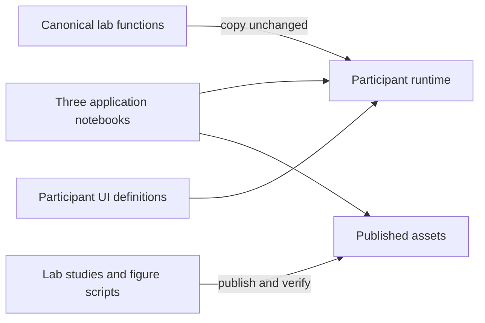

# sbi4finance

Three core application lessons for the ICAIF '26 tutorial: **Heston options,
rough Bergomi options, and parameter inference from return trajectories**.
They share a model → simulation → training → inference → checks workflow using
[BayesFlow](https://github.com/bayesflow-org/bayesflow).

PR #64 is merged. The current [collaborator handover plan](tutorial/curriculum/TUTORIAL-REVIEW.md#g-collaborator-handover-before-the-next-feedback-round)
prepares a clean review and compute route before the next content-feedback round.
Older returns exclusions and slot timings do not define the current application scope.

## Start editing here

For lesson feedback, start with these **three files**. They contain the prose,
equations, highlighted teaching snippets, layout and controls.

| Application | Main notebook | Runtime helpers it uses |
| --- | --- | --- |
| Heston options | [slot4_heston_bayesflow.py](tutorial/notebooks/slot4_heston_bayesflow.py) | [teaching](tutorial/src/sbi4f_tutorial/teaching.py), [backbones](tutorial/src/sbi4f_tutorial/backbones.py), optional [full_surface](tutorial/src/sbi4f_tutorial/full_surface.py) |
| Rough Bergomi options | [slot5_calibration.py](tutorial/notebooks/slot5_calibration.py) | [backbones](tutorial/src/sbi4f_tutorial/backbones.py), [teaching](tutorial/src/sbi4f_tutorial/teaching.py), [pricing](tutorial/src/sbi4f_tutorial/pricing.py); historical [long_end](tutorial/src/sbi4f_tutorial/long_end.py) |
| Trajectory inference | [trajectory_inference.py](tutorial/notebooks/trajectory_inference.py) | [trajectory](tutorial/src/sbi4f_tutorial/trajectory.py), including cached views, masks and explicit native inference |

Review locally from your checkout; cached viewing needs no Oscar login, full bank
or native model download:

```bash
cd tutorial
pixi install --locked
pixi run --locked test
pixi run --locked slot4        # Heston, in the marimo editor
pixi run --locked slot5        # rough options
pixi run --locked trajectories # observed paths
```

Run one lesson command at a time. The [tutorial README](tutorial/README.md)
explains read-only app mode, optional model downloads and author checks.
Exported HTML is a static preview; marimo runs the reactive controls.

## How code reaches the lessons



Numerical changes start in `lab/`, then the existing tools copy reviewed functions
into the self-contained participant runtime. [backbones.py](tutorial/src/sbi4f_tutorial/backbones.py)
is participant-authored UI; [trajectory.py](tutorial/src/sbi4f_tutorial/trajectory.py)
contains both authored and copied definitions. The [copy registry](lab/studies/copy_to_tutorial.py)
identifies that boundary per definition. Do not edit both numerical copies by hand.
The [minimal intervention map](tutorial/curriculum/TUTORIAL-REVIEW.md#g1--publish-the-minimal-edit-and-dependency-map)
links each type of change to its canonical source.

Changing displayed example code alone does not change an executing helper.
Shipped observations, draws, figures and metadata under `tutorial/assets/` enter
through publication tools; their [manifest](tutorial/MANIFEST.md) is generated.
The [lab README](lab/README.md#from-lab-code-to-a-lesson) gives the copy/publication/check sequence.

## Run numerical work on your compute

The core bank, training, evaluation and native-loading workers already run without
Slurm or Oscar. Start with the [lab workflow](lab/README.md#canonical-workflow)
and [training-data guide](lab/plans/training-data-guide.md). Current lab work uses
`pixi run --locked -e core ...`; its default environment retains historical BF2.0
studies. Use caller-owned data/output directories and preserve native bank trees.

Cluster launchers are deployment wrappers. Dated Oscar controllers retain their
original paths and campaign history; they are not the default training interface.
The [portability plan](tutorial/curriculum/TUTORIAL-REVIEW.md#g2--document-and-check-scheduler-free-compute-recipes)
specifies the remaining local recipes, artifact instructions and target-specific
rehearsal. It does not claim deployment to another cluster has already passed.

## Current state and next priorities

All three lessons have cached synthetic examples, visible workflow code and
recorded browser/runtime checks. Option routes have three 100k training banks;
trajectory routes have three million-history banks. Native models and full banks
are external downloads; a full bank is unnecessary for pretrained inference.

Scientific status remains explicit: rough conditional references and product
checks are unfinished; trajectory estimators failed their final marginal-calibration
screen, and the current Heston path law has a drift point-mass limitation.
See the [current application plan](tutorial/curriculum/TUTORIAL-REVIEW.md),
[path plan](lab/plans/PATH-INFERENCE-PLAN.md), [course status](course/status.md)
and historical [claim ledger](tutorial/CLAIMS.md) for their respective scope.

Next complete the handover's editing map, scheduler-free recipes, artifact paths
and dependency-checked cleanup, then resume notebook feedback. Record feedback
with source version, notebook/section, selected model/example and controls,
expected/observed behavior and a proposed improvement. Use GitHub review comments
or the [existing review notes](tutorial/curriculum/TUTORIAL-REVIEW.md#guided-notebook-review--1-november-2026).

## Where things belong

| Area | Purpose |
| --- | --- |
| `tutorial/` | Participant notebooks, runtime and small published inputs/results |
| `lab/` | Canonical numerical code, workers, studies, tests, publication tools and evidence |
| `course/` | Supporting lectures, theory and their figures |

Introduction, amortized-Bayes/architecture lessons and the backbone-review notebook
remain supporting work outside the current application-handover pass. Preserved
evidence and legacy utilities are not a required reading list; check dependencies
before retiring them. Repository rules are in [AGENTS.md](AGENTS.md).
