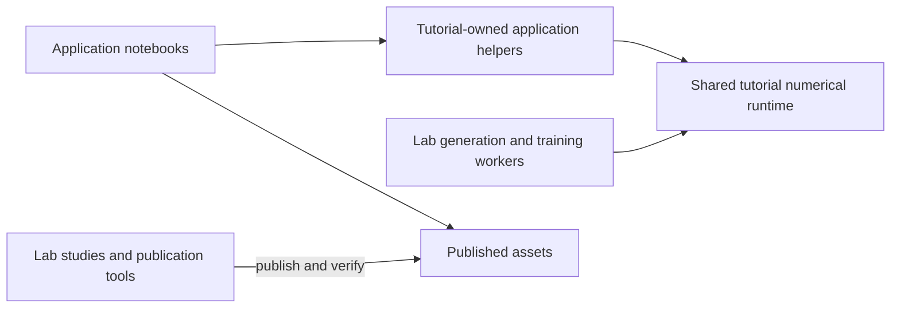

# sbi4finance

Three core application lessons for the ICAIF '26 tutorial: **Heston options,
rough Bergomi options, and parameter inference from return trajectories**.
They share a model → simulation → training → inference → checks workflow using
[BayesFlow](https://github.com/bayesflow-org/bayesflow).

PRs #64 and #65 are merged. The current [collaborator handover](tutorial/README.md#collaborator-handover)
explains how to review and edit the lessons; the [application plan](tutorial/curriculum/TUTORIAL-REVIEW.md#h-tutorial-owned-runtime-refactor)
records the source-ownership refactor and the deferred collaborator rehearsal.
Older returns exclusions and slot timings do not define the current application scope.

## Start editing here

For lesson feedback, start with these **three files**. They contain the prose,
equations, highlighted teaching snippets, layout and controls.

| Application | Main notebook | Authoritative helper package |
| --- | --- | --- |
| Heston options | [slot4_heston_bayesflow.py](tutorial/notebooks/slot4_heston_bayesflow.py) | [heston_options/](tutorial/src/sbi4f_tutorial/heston_options/) |
| Rough Bergomi options | [slot5_calibration.py](tutorial/notebooks/slot5_calibration.py) | [rough_options/](tutorial/src/sbi4f_tutorial/rough_options/) |
| Trajectory inference | [trajectory_inference.py](tutorial/notebooks/trajectory_inference.py) | [trajectories/](tutorial/src/sbi4f_tutorial/trajectories/) |

Common observation/conditioning code and native option inference live once
in [shared/](tutorial/src/sbi4f_tutorial/shared/). The [source walks](tutorial/curriculum/TUTORIAL-REVIEW.md#follow-a-computation-from-the-lesson)
identify the specific implementation behind each core computation.

Review locally from your checkout; cached viewing needs no Oscar login, full bank
or native model download:

```bash
cd tutorial
pixi install --locked
pixi run --locked test
pixi run --locked heston-options # Heston, in the marimo editor
pixi run --locked rough-options  # rough options
pixi run --locked path-inference # observed paths
```

Run one lesson command at a time. The [tutorial README](tutorial/README.md)
explains read-only app mode, optional model downloads and author checks.
Exported HTML is a static preview; marimo runs the reactive controls.

## How code reaches the lessons



Everything needed to run and change a lesson is under `tutorial/`. Edit its
application helpers or the shared runtime directly; the lab reuses the same
implementation. Older flat module names remain compatibility imports. There
is no function-copy step and no second numerical implementation to edit.

Changing displayed example code alone does not change an executing helper.
Shipped observations, draws, figures and metadata under `tutorial/assets/` enter
through publication tools; their [manifest](tutorial/MANIFEST.md) is generated.
The [lab README](lab/README.md#from-lab-code-to-a-lesson) gives the publication
and validation sequence.

## Make a small change

For explanation or layout, edit one of the three notebook files above and run
`pixi run --locked check`, `test` and `test-notebooks` from `tutorial/`.
For executing behavior, edit the application helper or shared definition under
`tutorial/src/sbi4f_tutorial/`; [the source walks and check matrix](tutorial/curriculum/TUTORIAL-REVIEW.md#follow-a-computation-from-the-lesson)
show the relevant definitions and assets. Changes to shared numerical code also
require the affected lab tests and release checks. Record comments with the
[feedback form](tutorial/curriculum/TUTORIAL-REVIEW.md#g6--rehearse-the-handover-and-collect-actionable-feedback).

## Run numerical work on your compute

The core bank, training, evaluation and native-loading workers already run without
Slurm or Oscar. Start with the [lab workflow](lab/README.md#canonical-workflow)
and [training-data guide](lab/plans/training-data-guide.md). Current lab work uses
`pixi run --locked -e core ...`; its default environment retains historical BF2.0
studies. Keep the complete checkout: the lab installs the sibling tutorial runtime
as a local dependency. Use caller-owned data/output directories and preserve native bank trees.

Cluster launchers are deployment wrappers. Dated Oscar controllers retain their
original paths and campaign history; they are not the default training interface.
The [local CPU recipes](lab/README.md#run-the-workers-on-a-local-cpu) cover
bounded generation, training, native reload and validation. The
[single-job Slurm recipe](lab/README.md#optional-single-job-slurm-deployment)
uses caller-selected resources and prints the command before submission.
Author-side worker checks passed on Apple Silicon without SSH or Slurm; a new
cluster/GPU allocation still needs its own readiness check.

## Current state and next priorities

All three lessons have cached synthetic examples, visible workflow code and
recorded browser/runtime checks. Option routes have three 100k training banks;
trajectory routes have three million-history banks. Native models and full banks
are external downloads; a full bank is unnecessary for pretrained inference.

Scientific status remains explicit: rough conditional references and product
checks are unfinished; trajectory estimators failed their final marginal-calibration
screen, and the current Heston path law has a drift point-mass limitation.
See the [current application plan](tutorial/curriculum/TUTORIAL-REVIEW.md),
[path plan](lab/plans/PATH-INFERENCE-PLAN.md), [course status](course/status.md)
and historical [claim ledger](tutorial/CLAIMS.md) for their respective scope.

The editing map, scheduler-free recipes, artifact paths and first bounded
cleanup batch are implemented. Collaborator rehearsal is deferred; its checklist
is ready in the handover plan. Record feedback
with source version, notebook/section, selected model/example and controls,
expected/observed behavior and a proposed improvement. Use GitHub review comments
or the [existing review notes](tutorial/curriculum/TUTORIAL-REVIEW.md#guided-notebook-review--1-november-2026).

## Where things belong

| Area | Purpose |
| --- | --- |
| `tutorial/` | Notebooks, authoritative application/shared runtime, tests and small published inputs/results |
| `lab/` | Bank/training/reference workers, lab-only studies, tests, publication tools and evidence |
| `course/` | Supporting lectures, theory and their figures |

Introduction, amortized-Bayes/architecture lessons and the backbone-review notebook
remain supporting work outside the current application-handover pass. Preserved
evidence and legacy utilities are not a required reading list; check dependencies
before retiring them. Repository rules are in [AGENTS.md](AGENTS.md).
