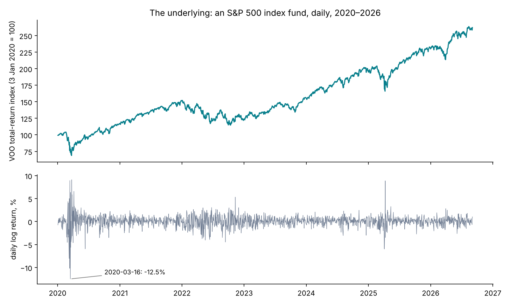
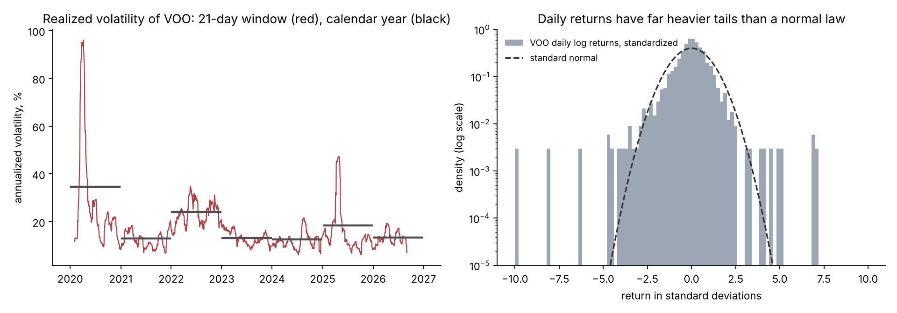
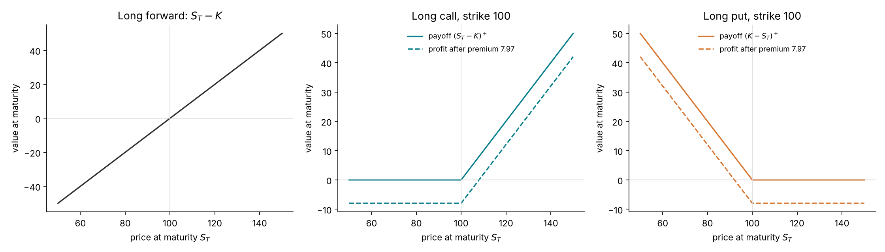
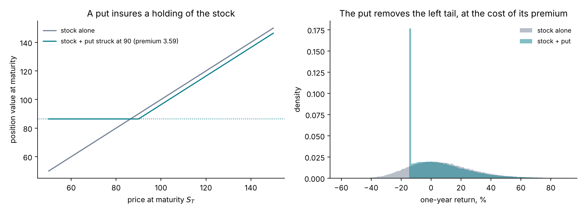
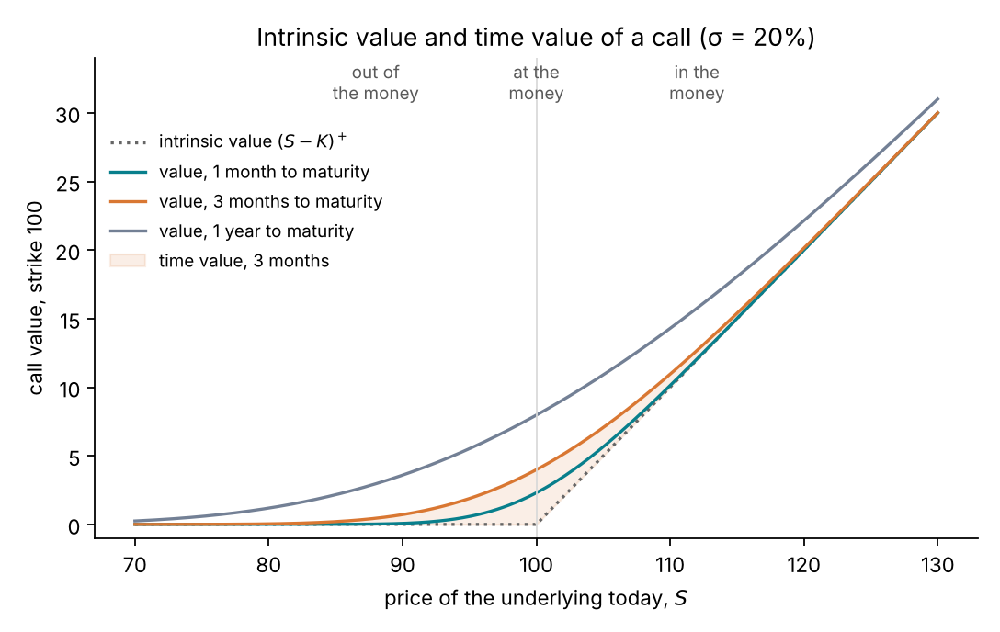
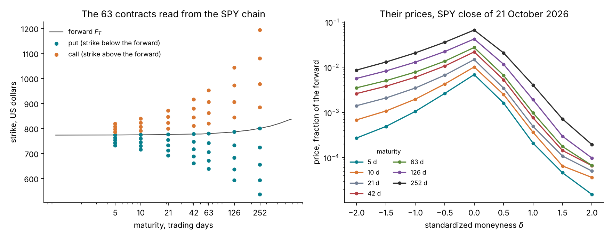
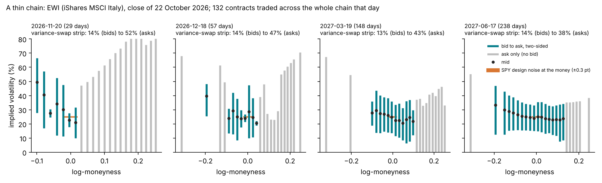
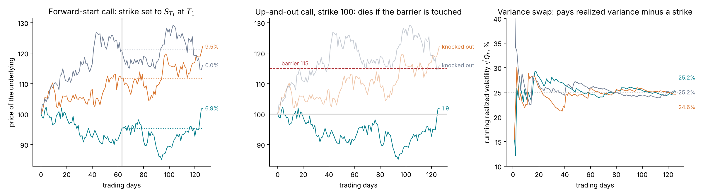

# Lecture 1. Options, quotes and volatility

[Course index](README.md) · Next: [Lecture 2. No-arbitrage without a model](02-no-arbitrage-without-a-model.md)

**What this lecture is for.** This lecture introduces the objects the whole course is about. It defines the underlying asset and its returns, measures volatility in real data, defines the option contracts, explains why they are traded and how a market quotes them, and separates the contracts a market quotes (vanillas) from those a bank must price with a model (exotics). It uses no model. Lecture 2 adds what can be deduced without a model, and Lectures 3 to 5, 10 and 13 build the models.

**Where it sits in the course.** The tutorial calibrates a model to the quotes described in Section 1.6 and uses it to price the products described in Section 1.7. The gap between the two is the problem the course solves. The course has sixteen lectures in four parts. Black–Scholes carries the simple concepts, Heston the workflow, and rough Bergomi the full examples.

| Part | Lectures |
| --- | --- |
| I. Markets and the first model | 1 Options, quotes and volatility · 2 No-arbitrage without a model · 3 Brownian motion, SDEs and Itô's lemma · 4 The Black–Scholes model · 5 Implied volatility and the smile |
| II. Calibration and Bayes on Black–Scholes | 6 Marking a product the smile does not quote · 7 Calibration as estimation · 8 Bayesian calibration · 9 Amortized inference |
| III. Heston and the BayesFlow workflow | 10 The Heston model · 11 Calibrating Heston · 12 The amortized workflow on Heston |
| IV. Rough Bergomi: the full examples | 13 The rough Bergomi model · 14 Why the exact posterior is expensive · 15 A liquid smile: SPY · 16 A thin chain: EWG |

**The argument of the course.** A bank must mark products that no option quotes, and report how uncertain each mark is. Where the quotes determine what a product depends on, the classical calibration gives the right range, and the course's Bayesian method returns the same one. Where they do not, the Bayesian method gives the open inputs a stated range that can be tested. Lecture 6, Section 6.8 states the argument in full, and Lecture 16, Section 16.8 gathers its evidence. This lecture sets up the problem: Section 1.6 shows a liquid and a thin chain, and Section 1.7 the products that need a model.

## 1.1 The underlying asset and its returns

An option is written on an **underlying asset**, a traded asset whose price at time $t$ is written $S_t$. In this course the main underlying is the S&P 500 index of large US companies, held through an exchange-traded fund. The tutorial's options are written on SPY, the oldest S&P 500 exchange-traded fund. The return data in this lecture come from VOO, another S&P 500 fund whose daily returns are in the repository.

A price series is studied through its returns. Over a step $\Delta t$, the **simple return** and the **log return** are

$$
R = \frac{S_{t+\Delta t}}{S_t} - 1, \qquad r = \ln\frac{S_{t+\Delta t}}{S_t} = \ln(1+R).
$$

Log returns add over time. The log return from $0$ to $T$ is the sum of the daily log returns:

$$
\ln\frac{S_T}{S_0} = \sum_{i=1}^{n} \ln\frac{S_{t_i}}{S_{t_{i-1}}} = \sum_{i=1}^{n} r_i .
$$

This additivity is why every model in the course is written for $\ln S_t$. For a small return the two definitions agree to first order, since $\ln(1+R) = R - \tfrac12 R^2 + O(R^3)$.

*Figure 1.1.* How to read the figure: the top panel compounds the daily returns into an index that starts at 100. Over the 6.65 years shown, the index grew by a factor of 2.62, an average log return of 14.5% a year. The bottom panel shows the 1,676 daily log returns. The worst day was 16 March 2020, at −12.5%, and the best was 24 March 2020, at +9.1%. Calm periods (2021, 2023–2024) alternate with turbulent ones (spring 2020, 2022, April 2025).

The figure contains a fact that returns in Lecture 3. On a typical day the drift is invisible under the noise. The mean daily log return is $0.145/252 = 0.058\%$, and the standard deviation of a daily return is $0.203/\sqrt{252} = 1.28\%$, about 22 times larger. The direction of the market over one day is almost pure noise; its size is not.

## 1.2 Volatility in data

**Volatility** is the standard deviation of returns, expressed per year. Over $n$ daily log returns $r_1, \dots, r_n$, the **realized variance** and **realized volatility** are

$$
Q = \frac{252}{n}\sum_{i=1}^{n} r_i^2, \qquad \sigma_{\text{realized}} = \sqrt{Q}.
$$

Two conventions in this definition need a reason.

1. **The factor 252 annualizes.** If daily returns are independent with variance $s^2$, the variance of a sum of $n$ of them is $n s^2$. A year has 252 trading days, so the annual variance is $252\,s^2$ and the annual volatility is $\sqrt{252}\,s$. Volatility grows with the square root of time, variance linearly. This square-root law is the scaling of Brownian motion in Lecture 3.
2. **The mean is not subtracted.** Over the whole sample, the daily mean is about 22 times smaller than the daily standard deviation (Section 1.1), so subtracting it would change $Q$ by about $(1/22)^2$, less than 0.3%. Over a short window the sample mean is mostly noise, and subtracting it would remove part of the genuine variance: for 21-day windows it would lower the smallest value below by 13%. The variance swap of Section 1.7 uses the same convention, for the same reason.

Over the whole sample, VOO's realized volatility is 20.3%. A single number hides most of the structure.

*Figure 1.2.* How to read the figure: the left panel computes $\sigma_{\text{realized}}$ over the last 21 trading days, one month, at every date. It ranges from 6.2% to 96% (6 April 2020). The yearly values are 34.7% in 2020, 13.0% in 2021, 24.2% in 2022, 13.1% in 2023, 12.7% in 2024, 18.4% in 2025 and 13.4% in 2026 to September. The right panel standardizes each daily return by the sample mean and standard deviation and compares the histogram with the standard normal density. The vertical axis is logarithmic, so the tails are visible.

The figure shows two facts that every model of the course must confront.

1. **Volatility changes over time, and high volatility clusters.** A volatile day is usually followed by another volatile day. A model with one constant volatility, such as Black–Scholes (Lecture 4), cannot produce this. Stochastic-volatility models (Lectures 10 and 13) make volatility itself a random process.
2. **Returns have heavy tails.** Fourteen daily returns lie beyond four standard deviations. A normal law would produce 0.11 such days in a sample of this size. The sample kurtosis is 17.9, against 3 for a normal law. Part of this comes from fact 1: a mixture of normal laws with different variances has heavier tails than any one of them. Lecture 5 shows that the same mixing mechanism produces the option smile.

**A limit of realized volatility.** Realized volatility is an estimate with its own error. For independent normal returns, the sample variance of $n$ returns has standard deviation $\sigma^2\sqrt{2/n}$, so the relative error of the volatility is about $1/\sqrt{2n}$. For a 21-day window this is $1/\sqrt{42} \approx 15\%$. A month of data measures volatility only roughly, and it measures the past. An option is a bet on volatility in the future, which Lecture 5 reads off option prices.

## 1.3 Contracts on the underlying: forwards, calls and puts

A **forward contract** with delivery date $T$ and price $K$ obliges its holder to buy the underlying at $T$ for $K$. Its value at $T$, the **payoff**, is $S_T - K$, which can be negative. Lecture 2 shows that one value of $K$, the forward price, makes the contract worth zero today.

A **European call option** with strike $K$ and maturity $T$ gives its holder the right, but not the obligation, to buy the underlying at $T$ for $K$. The holder exercises only if $S_T > K$, so the payoff is

$$
\Pi_{\text{call}} = (S_T - K)^+ = \max(S_T - K,\ 0).
$$

A **European put option** gives the right to sell at $K$, with payoff

$$
\Pi_{\text{put}} = (K - S_T)^+ = \max(K - S_T,\ 0).
$$

The buyer pays the seller a price today, the **premium**. The seller, or **writer**, receives the premium and owes the payoff. The **profit** of the buyer at maturity is the payoff minus the premium, ignoring interest on the premium.

*Figure 1.3.* How to read the figure: the horizontal axis is the price of the underlying at maturity. The forward's payoff is a straight line: the holder gains and loses one for one. The call's payoff is zero below the strike and rises one for one above it. The put is the mirror image. The dashed lines subtract the premium of a one-year at-the-money option on an asset at 100 with 20% volatility, which is 7.97 under the model of Lecture 4. It is close to the rule of thumb $0.4\,\sigma\sqrt{T}\,S = 0.4 \times 0.2 \times 1 \times 100 = 8$, which Lecture 4 derives.

The payoff's kink at the strike is the reason options have value. The function $x \mapsto (x - K)^+$ is convex, so Jensen's inequality gives

$$
\mathbb{E}\big[(S_T - K)^+\big] \;\ge\; \big(\mathbb{E}[S_T] - K\big)^+ .
$$

The left side is the expected payoff when $S_T$ is uncertain. The right side is the payoff if $S_T$ were known to equal its mean. The gap grows with the spread of $S_T$ around its mean. **An option's value increases with the uncertainty of the future price.** This is why option prices measure volatility, and why the whole course is about volatility models.

**European and American exercise.** An American option can be exercised at any date up to $T$, a European option only at $T$. SPY options are American. For calls on an asset with small dividends, early exercise has little value. For puts it has some, especially deep in the money, and Lecture 2 shows where this matters when reading a real chain.

## 1.4 Why options are traded

Options exist because they change the distribution of a position's outcomes in ways the underlying alone cannot. Three uses matter for this course.

**Insurance.** Holding the underlying together with a put struck at $K$ guarantees a minimum value at maturity:

$$
S_T + (K - S_T)^+ = \max(S_T,\ K).
$$

*Figure 1.4.* How to read the figure: the left panel shows that the insured position never ends below $90 - 3.59 = 86.41$, where 3.59 is the put's premium under the model of Lecture 4 with 20% volatility. Above the strike it follows the stock, lower by the premium. The right panel simulates one-year outcomes with 20% volatility and a 7% expected return. The insured position's returns stop at −13.6%, and all the probability below piles up at that floor, which is the tall bar. The 5% quantile of the return improves from −24.3% to −13.6%. The mean falls from 7.2% to 5.7%: the premium is the price of removing the left tail.

**Directional views with limited loss.** A call gains when the price rises and loses at most its premium when it falls.

**Views on volatility.** A **straddle**, one call and one put with the same strike, pays

$$
(S_T - K)^+ + (K - S_T)^+ = |S_T - K|,
$$

which depends on the size of the move and not on its direction. Its price is therefore the market's price for the size of moves, that is, for volatility. Buying a straddle is a bet that the price will move more than the premium implies.

The insurance use has a consequence for prices. Investors who hold the index buy puts below the current price to insure against a crash, and the dealers who sell them charge for that risk. Out-of-the-money puts are therefore expensive relative to out-of-the-money calls. Section 1.6 shows this in the SPY data, and Lecture 5 names it: the **skew**.

## 1.5 Moneyness, intrinsic value and time value

A call is **in the money** when the current price is above the strike, **at the money** when they are close, and **out of the money** when the price is below the strike. For a put the words are reversed. The **intrinsic value** is what immediate exercise would pay, $(S - K)^+$ for a call. The **time value** is the price minus the intrinsic value.

*Figure 1.5.* How to read the figure: the dotted line is the intrinsic value. Each solid line is the option's value, under the model of Lecture 4 with 20% volatility, at a given time to maturity. The shaded band is the time value at three months. It is largest at the money: the three-month at-the-money call is worth 3.99, all of it time value. It shrinks deep in the money and deep out of the money, where the payoff is close to certain (a sure exercise or a sure nothing). It shrinks as maturity approaches, because less time leaves less uncertainty.

The interpretation is the one of Section 1.3: the time value is the value of uncertainty, and the at-the-money option is the one whose payoff is most uncertain.

**Moneyness used in the course.** Lecture 2 shows that the right reference point for a strike is the forward price $F_T$, not the spot price. The course measures moneyness in two ways:

$$
k = \ln\frac{K}{F_T}\quad\text{(log-moneyness)}, \qquad \delta = \frac{k}{\sigma_{\text{ref}}\sqrt{T}}\quad\text{(standardized moneyness)}, \qquad \sigma_{\text{ref}} = 0.20 .
$$

The second measure expresses the distance from the forward in units of a typical move over the option's life, $\sigma_{\text{ref}}\sqrt T$. A strike 5% away from the forward is far for a one-week option and close for a one-year option, and $\delta$ puts both on one scale. For example, $\delta = 2$ means $k = 2 \times 0.2 \times \sqrt{5/252} = 0.056$ at one week and $k = 0.40$ at one year.

## 1.6 What a market quotes

An options exchange lists, for each underlying, contracts at a grid of maturities and strikes: the **option chain**. For each contract, market makers post a **bid**, the highest price at which someone will buy, and an **ask**, the lowest price at which someone will sell. The **mid** $(\text{bid} + \text{ask})/2$ is the usual estimate of the price, and the **half-spread** $(\text{ask} - \text{bid})/2$ is the natural scale of its uncertainty. Lecture 7 turns this into the noise model of the calibration.

A raw chain contains quotes that carry no information: zero bids, crossed markets where the bid exceeds the ask, and stale quotes. These are removed before use (Lecture 5 lists the cleaning rules). The SPY chain of the 21 October 2026 close, from Cboe's delayed quotes, has 13,114 options in 35 expirations; 32 expirations keep at least 8 quotes after cleaning (counts from study S8; the raw chain is not stored in the repository).

At a given strike and maturity, a call and a put carry the same information, by put–call parity (Lecture 2). The course therefore keeps only **out-of-the-money** options: puts below the forward and calls above. They are the more liquid ones, and their price is all time value, the part that carries information about volatility.

The tutorial reads the chain on a fixed **design grid** of 63 contracts: 7 maturities, $T \in \lbrace 5, 10, 21, 42, 63, 126, 252\rbrace$ business days, times 9 standardized moneyness values, $\delta \in \lbrace -2, -1.5, \dots, 2\rbrace$. Lecture 5 explains how the grid prices are read off the chain.

*Figure 1.6.* How to read the figure: the left panel places each contract by maturity and strike. Puts are below the forward, calls above it. The strikes fan out with maturity because $\delta$ scales with $\sqrt{T}$: from 731 to 819 US dollars at one week, around a forward of 773.8, to 536 to 1,193 dollars at one year, around a forward of 799.8. The forward rises with maturity, for a reason Lecture 2 explains. The right panel shows the prices as a fraction of the forward. They peak at the money ($\delta = 0$): 0.0069 at one week and 0.067 at one year. They grow with maturity at every $\delta$. They fall fastest on the call side.

The asymmetry between the two sides is the first appearance of the skew. At one year, the put at $\delta = -2$ costs 0.0086 of the forward, and the call at $\delta = +2$ costs 0.00019, a ratio of 45. A symmetric benchmark makes the comparison fair. Under Black–Scholes with 20% volatility (Lecture 4), the same put would cost 0.67 times the same call, because of a factor $e^{k}$ that Lecture 4 derives. The market prices the downside far above any symmetric model.

**A thin chain.** Figure 1.7 shows a thin chain, EWI (iShares MSCI Italy), from Cboe's delayed quotes at the close of 22 October 2026 (`lab/checks/thin_chains/`). Of its 94 out-of-the-money quotes, 45 were two-sided, with a bid as well as an ask. The whole chain traded 132 contracts that day. Measured in implied volatility (Lecture 5), the median bid–ask width of the two-sided quotes was 36, 23, 24 and 21 volatility points at its four expiries, 29, 57, 148 and 238 calendar days away. EWG (iShares MSCI Germany) is also thin, with narrower spreads. On the same day it had four expiries to six months, at 29, 57, 85 and 176 calendar days. Each had 7 to 9 two-sided quotes within 0.1 of the money in log-moneyness, and their median widths were 4.0, 2.5, 2.3 and 3.5 volatility points. SPY's design noise, the quote noise the tutorial assumes, is 0.3 volatility points at the money, above SPY's own half-spreads (Lecture 5, Sections 5.3 and 5.4). Lecture 16 uses EWG as the course's thin chain.

*Figure 1.7.* How to read the figure: each panel is one of EWI's four expiries, and each vertical bar one out-of-the-money quote, placed at its log-moneyness. A teal bar runs from the implied volatility of the bid to that of the ask. A grey bar is a quote with no bid and runs from zero to the ask. The dots are the mids. The short orange bar at the money shows, for scale, SPY's design noise of ±0.3 volatility points. The title of each panel gives the variance-swap strip over the quoted strikes, computed on the bids and on the asks (Lecture 5, Section 5.9).

**Vanillas.** Listed European and American calls and puts are called **vanilla** options. They are the data the models are calibrated to.

## 1.7 What a bank must price without quotes: exotic products

An **exotic** product is any payoff that is not a listed vanilla. Its payoff depends on the price at more than one date, or on the whole path. Exotics are sold to clients (structured products, hedges tailored to a balance sheet) and have no quoted price. Four of them recur in the course:

| Product | Payoff | What it depends on |
| --- | --- | --- |
| Forward-start call, struck at the money at $T_1$, maturing at $T_2$ | $\big(S_{T_2}/S_{T_1} - 1\big)^+$ | The return over $[T_1, T_2]$, as seen at $T_1$ |
| Cliquet | $\sum_i \big(S_{t_i}/S_{t_{i-1}} - 1\big)^+$, usually with caps and floors | A chain of forward-start periods |
| Up-and-out barrier call | $(S_T - K)^+\,\mathbf{1}\lbrace\max_{t \le T} S_t < B\rbrace$ | The whole path, through its maximum |
| Variance swap and volatility swap | $N\,(Q_T - K_{\text{var}})$ and $N\,(\sqrt{Q_T} - K_{\text{vol}})$, with $Q_T$ the realized variance of Section 1.2 over $[0, T]$ | Every daily return up to $T$ |

The strikes $K_{\text{var}}$ and $K_{\text{vol}}$ are set so that the swap costs nothing to enter. Lecture 5 shows that $K_{\text{var}}$ can be read off vanilla prices, and Lecture 6 shows that $K_{\text{vol}}$ cannot.

*Figure 1.8.* How to read the figure: the same three simulated paths, with 25% volatility over half a year, are used in all three panels. In the left panel, each path's strike is fixed at its own price on day 63 (dotted line), and the payoff is the return from there to day 126, if positive. In the centre panel, two paths touch the barrier at 115 and lose all value, even though one of them ends far above the strike. The third never touches it and pays 1.9. In the right panel, the running realized volatility starts erratic and settles near the 25% used to simulate the paths. The variance swap pays the final value, squared, minus its strike.

**Why exotics need a model.** A vanilla with maturity $T$ depends on $S_T$ alone, so its price depends only on the distribution of $S_T$. Lecture 2 shows that the vanilla prices at maturity $T$ determine that distribution and nothing more. An exotic depends on the joint behaviour of the price at several dates, and the vanillas say nothing about how the distributions at different dates are linked. A model supplies that link. Two models can agree on every vanilla and disagree on every exotic, which Lecture 6 documents.

**Marking a book.** A bank values every position at the end of each day; this is called **marking**. A vanilla is marked at its market mid (mark-to-market). An exotic has no market price, so it is marked at a model price (mark-to-model):

$$
\text{mark}_t(\Pi) = p_\Pi(\hat\theta_t),
$$

where $\hat\theta_t$ are the model's parameters calibrated to the vanillas. The parameters are uncertain, because many values of $\theta$ reproduce the vanilla quotes within their bid-ask spreads. The mark inherits this uncertainty. Lecture 6 describes the marking procedure step by step.

## 1.8 Summary

1. The underlying's log returns add over time, and their standard deviation per year is the volatility.
2. Real volatility changes over time and clusters, and real returns have heavy tails.
3. A call pays $(S_T - K)^+$ and a put $(K - S_T)^+$. The convexity of these payoffs makes their value increase with the uncertainty of $S_T$, so option prices measure volatility.
4. Markets quote vanillas with a bid and an ask. The course uses out-of-the-money options on a design grid of 63 contracts. The SPY prices already show that puts are expensive relative to calls: the skew. A thin chain, such as EWI or EWG, has fewer expiries and far wider spreads.
5. Exotics depend on the path, have no quote, and are marked with a calibrated model. The uncertainty of the calibration is the uncertainty of the mark.

Lecture 2 shows what the absence of arbitrage alone implies for these prices: the forward, put–call parity, the bounds on an option price, and the link between vanilla prices and the distribution of $S_T$.

## References

- Hull, J. C. (2021). *Options, futures, and other derivatives*, 11th edition. Pearson. Chapters 1, 10 and 11 cover the contracts and their uses.
- Cont, R. (2001). Empirical properties of asset returns: stylized facts and statistical issues. *Quantitative Finance* 1(2), 223–236. [doi](https://doi.org/10.1080/713665670)
- Gatheral, J. (2006). *The volatility surface: a practitioner's guide*. Wiley.

Figures: `course/scripts/lecture01.py`, except Figure 1.7, which `course/scripts/realignment.py` draws.
