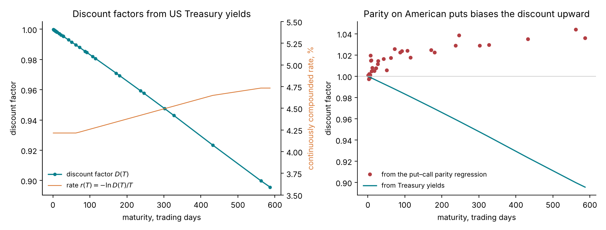
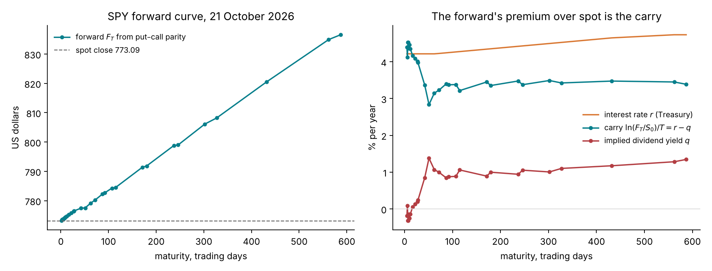
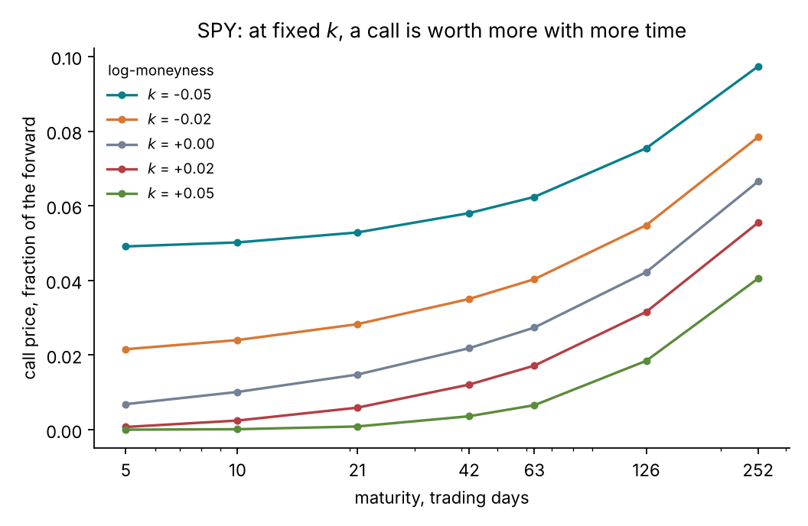
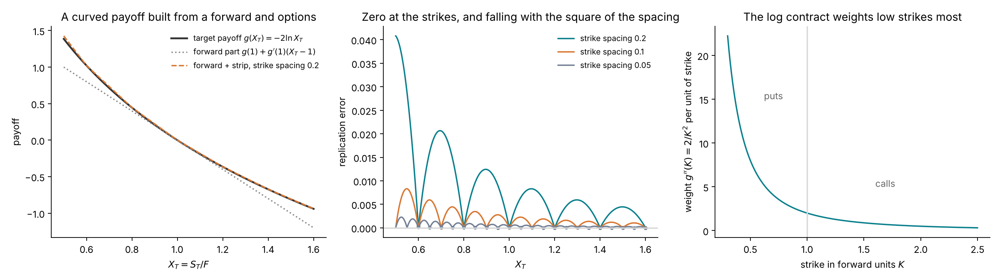

# Lecture 2. No-arbitrage without a model

[Course index](README.md) · Previous: [Lecture 1. Options, quotes and volatility](01-options-quotes-and-volatility.md) · Next: [Lecture 3. Brownian motion, SDEs and Itô's lemma](03-brownian-motion-and-ito.md)

**What this lecture is for.** This lecture derives everything that follows from one assumption: a liquid market offers no riskless profit. From it come the forward price, put–call parity, the bounds on an option price, the shape of option prices across strikes and maturities, and the link between option prices and the probability distribution of the future price. No model of the price's dynamics is used.

**Where it sits in the course.** Lecture 1 defined the contracts and the quotes. This lecture extracts from the quotes what the market says without any model. Its last section lists what no-arbitrage leaves open, which is what the models of Lectures 3 to 5, 10 and 13 supply. The forward, the discount factor and the forward units defined here are used in every later lecture.

**Its part in the argument.** Section 2.10 names what the quotes leave open: prices beyond the last quoted maturity, and the link between dates. These are the inputs the argument of the course is about (Lecture 6, Section 6.8).

## 2.1 Interest and discounting

A unit of currency today and a unit at a future date $`T`$ are different goods, because money today can earn interest. With a continuously compounded interest rate $`r`$, one unit invested today grows to $`e^{rT}`$ at $`T`$. The **discount factor**

```math
D(T) = e^{-r(T)\,T}
```

is the price today of one unit paid for sure at $`T`$, the price of a zero-coupon bond. The rate $`r(T)`$ can depend on the maturity; the function $`T \mapsto r(T)`$ is the **term structure of interest rates**.

The tutorial takes its discount factors from US Treasury yields. On 20 October 2026, the latest date published at the valuation, the 3-month yield was 4.26% and the 2-year yield 4.79%. The repository converts both to continuous compounding as semi-annual bond-equivalent yields, $`(1 + y/2)^2 = e^{r}`$, that is $`r = 2\ln(1 + y/2)`$: 4.26% becomes 4.215%. This is exact for the 2-year note. The 3-month bill yield is strictly a simple-interest yield on a 365-day basis, which converts by $`r = \ln(1 + y/4)/0.25`$ to 4.237%; the 2-basis-point difference changes the one-year discount factor by about 0.0002 and no conclusion of the course. The rate is held flat below 3 months and beyond 2 years, and interpolated linearly in $`T`$ between them.



*Figure 2.1.* How to read the figure: the left panel shows $`D(T)`$ for each of the 32 SPY expirations, falling from 1 to 0.896 at 587 business days, and the rate $`r(T)`$ on the right axis, from 4.22% to 4.73%. The right panel is explained in Section 2.4: it compares these discount factors with those a regression on option prices would give.

## 2.2 Arbitrage and replication

An **arbitrage** is a trading strategy that costs nothing today, never loses money, and makes money with positive probability. In a liquid market, traders exploit any arbitrage until prices move and it disappears. The course assumes there is none.

The assumption has a direct consequence, the **law of one price**. If two portfolios pay the same amount at $`T`$ in every state of the world, they must cost the same today. If they did not, buying the cheaper and selling the dearer would be an arbitrage. It follows that the price of a payoff is the cost of any portfolio that **replicates** it, that is, pays the same in every state. Every result in this lecture is a replication argument.

## 2.3 The forward price

A forward contract (Lecture 1) pays $`S_T - K`$ at $`T`$. The **forward price** $`F_0(T)`$ is the value of $`K`$ that makes the contract cost nothing today. It is found by building the payoff $`S_T`$ from traded assets.

Assume the underlying pays dividends continuously at a rate $`q`$ per year, reinvested in the underlying. One share held today grows by reinvestment to $`e^{qT}`$ shares at $`T`$. The replicating trades are:

| Trade today | Cash flow today | Value at $`T`$ |
| --- | --- | --- |
| Buy $`e^{-qT}`$ shares, reinvest the dividends | $`-S_0 e^{-qT}`$ | $`S_T`$ (one share) |
| Borrow $`S_0 e^{-qT}`$ until $`T`$ | $`+S_0 e^{-qT}`$ | $`-S_0 e^{-qT} e^{rT}`$ |
| **Total** | $`0`$ | $`S_T - S_0 e^{(r-q)T}`$ |

The total costs nothing and pays $`S_T - S_0 e^{(r-q)T}`$. A forward with strike $`K`$ also costs nothing if $`K`$ is the forward price. The law of one price therefore gives

```math
F_0(T) = S_0\, e^{(r-q)T}.
```

If a forward traded at a higher strike, selling it and doing the trades above would lock in the difference, an arbitrage; a lower strike gives the reverse arbitrage.

**Interpretation.** The forward exceeds the spot price by the **cost of carry**: holding the underlying ties up money that could earn $`r`$, and pays dividends at $`q`$. When $`r \gt q`$ the forward is above the spot.



*Figure 2.2.* How to read the figure: the left panel shows the SPY forward, read from the option chain by put–call parity (Section 2.4), against the spot close of 773.09 US dollars. It rises to 773.77 at 5 business days, 799.76 at one year and 836.57 at 587 business days. The right panel converts each forward into its carry $`\ln(F_0(T)/S_0)/T`$, which by the formula above equals $`r - q`$. Beyond 100 days the carry is about 3.4% a year, against a rate of about 4.4%, which implies a dividend yield of about 1.05%. Below 30 days the implied dividend yield is close to zero (between −0.3% and +0.2%). SPY pays dividends quarterly, and the next ex-dividend date, in mid-December, falls after those maturities, so no dividend is paid before them. The continuous-yield formula is an approximation that the data correct maturity by maturity.

**A limit: the day count.** These numbers use the repository's clock, business days divided by 252, with interest rates that are quoted per calendar year. On a calendar clock (calendar days divided by 365) the same forwards imply a long-maturity dividend yield of about 0.92%, and short-maturity values between −0.9% and +0.2%. Option prices in forward units do not depend on the clock, because the forward and the discount factor are read from the market at each expiration. The clock matters wherever a time-based quantity is compared with a market rate, as here, and Lecture 13 states the convention used for the model's maturities.

**Why the forward is the reference.** The forward is the price for delivery at $`T`$ that the market agrees on today. Strikes are therefore measured relative to the forward of the same maturity, not to the spot: an option struck at the forward is at the money for that maturity. This is the choice made in Lecture 1 when moneyness was defined as $`k = \ln(K/F_T)`$.

## 2.4 Put–call parity

A call and a put with the same strike and maturity satisfy a payoff identity that holds for every value of $`S_T`$:

```math
(S_T - K)^+ - (K - S_T)^+ = S_T - K .
```

Long one call and short one put therefore replicate a forward with strike $`K`$. A forward with strike $`K`$ pays $`S_T - K`$, which is $`F_0(T) - K`$ more than the fair forward's $`S_T - F_0(T)`$. The fair forward costs nothing, so the forward with strike $`K`$ is worth $`D(T)\,(F_0(T) - K)`$ today. The law of one price gives **put–call parity**, for European options and without any model:

```math
C - P = D(T)\,\big(F_0(T) - K\big).
```

Parity has three uses in the course.

1. **Only out-of-the-money options are needed.** The in-the-money call at a strike below the forward carries the same information as the out-of-the-money put at that strike, so the course keeps one of each pair (Lecture 1).
2. **The forward and the discount factor can be read off the chain.** Across strikes, $`C - P`$ is a straight line in $`K`$ with slope $`-D`$ and intercept $`D F`$. A linear regression of $`C - P`$ on $`K`$ near the money returns both.
3. **Data quality.** A pair that violates parity by more than its bid-ask spread signals a bad quote.

**A limit: American exercise.** SPY options are American. An American put can be worth more than a European put, because exercising a deep in-the-money put early returns the strike $`K`$ in cash, which then earns interest. This early-exercise premium grows with the strike, so it tilts the line $`C - P`$ against $`K`$ and biases the regression's slope. The right panel of Figure 2.1 shows the result: the regression returns a discount factor above 1, which is impossible with a positive rate, for 30 of the 32 expirations, up to 1.044 at 562 days. The tutorial therefore takes the discount factor from Treasury yields and uses parity only for the forward, $`F = K + (C - P)/D`$, as the median over the six strike pairs nearest the money, where the early-exercise premium is smallest.

**Calls before an ex-dividend date, and the forward of a thin chain.** A call can also carry early-exercise value, because a holder who exercises just before an ex-dividend date receives the dividend. EWI, a thin chain of Lecture 1, Section 1.6, is assumed to pay the amounts it paid a year earlier: about 0.70 US dollars a share before its December expiry and 1.17 before its June expiry. A binomial tree with escrowed dividends then gives an early-exercise premium of 0.18 on the December call struck at 57, more than that quote's half-spread of 0.125. On the June call struck at 55 it gives 0.50, inside that quote's half-spread of 1.75. On the same chain, a parity regression returns implied rates from −4.6% to 56% across the four expiries, so the rate must come from Treasury yields, as for SPY. EWG paid no December distribution in 2024 or 2025, so no dividend is assumed before June 2027. Its carry forward is then the spot carried at the Treasury rate, $`S_0 e^{rT}`$. Parity on its pairs nearest the money gives a forward 0.15% to 0.46% lower, because the puts in those pairs carry early-exercise value. Lecture 16 therefore uses the carry forward. The numbers are in `lab/checks/thin_chains/`.

## 2.5 Forward units and the pricing measure

The forward and the discount factor can be removed from every option price by a change of units. Define

```math
c = \frac{C}{D\,F}, \qquad p = \frac{P}{D\,F}, \qquad x = \frac{K}{F} = e^{k}, \qquad k = \ln\frac{K}{F}.
```

Here $`c`$ and $`p`$ are prices in **forward units**: fractions of the forward, paid at maturity. Dividing parity by $`DF`$ gives its forward-unit form

```math
c - p = 1 - x = 1 - e^{k}.
```

**The pricing measure.** A central theorem of mathematical finance, the fundamental theorem of asset pricing (Harrison and Kreps 1979; Harrison and Pliska 1981; Delbaen and Schachermayer 1994), states that a market has no arbitrage if and only if there is a probability measure $`\mathbb{Q}`$, the **pricing measure** or risk-neutral measure, under which the price of every payoff is its discounted expected value:

```math
\text{price today} = D(T)\;\mathbb{E}^{\mathbb{Q}}\big[\text{payoff at } T\big].
```

$`\mathbb{Q}`$ is not the real-world probability of the price's moves, which the course writes $`\mathbb{P}`$. It is a set of weights that makes prices consistent with each other. Lecture 4 constructs $`\mathbb{Q}`$ explicitly for the Black–Scholes model; this lecture uses only its existence.

Apply the theorem to the forward contract at the forward price, which costs nothing:

```math
0 = D(T)\,\mathbb{E}^{\mathbb{Q}}\big[S_T - F_0(T)\big] \quad\Longrightarrow\quad \mathbb{E}^{\mathbb{Q}}[S_T] = F_0(T).
```

Under $`\mathbb{Q}`$ the forward is the expected future price. Define the **terminal price in forward units** $`X_T = S_T / F_0(T)`$. It is non-negative and $`\mathbb{E}^{\mathbb{Q}}[X_T] = 1`$. The forward-unit option prices are then expectations of payoffs of $`X_T`$ alone:

```math
c(x) = \mathbb{E}^{\mathbb{Q}}\big[(X_T - x)^+\big], \qquad p(x) = \mathbb{E}^{\mathbb{Q}}\big[(x - X_T)^+\big].
```

**Why the course works in forward units.** Interest rates and dividends have disappeared: they sit in $`D`$ and $`F`$, which are read off the market. Prices at different maturities and on different dates become comparable, because each is a fraction of its own forward. The only object left to model is the distribution of $`X_T`$ under $`\mathbb{Q}`$, which is exactly what the volatility models of Lectures 4, 10 and 13 describe. In the tutorial's code the spot is 1 and the rates are zero, which is the same convention.

## 2.6 Bounds on option prices

The representation $`c(x) = \mathbb{E}^{\mathbb{Q}}[(X_T - x)^+]`$ with $`\mathbb{E}^{\mathbb{Q}}[X_T] = 1`$ gives bounds that hold in every arbitrage-free market.

**Lower bound.** The function $`X \mapsto (X - x)^+`$ is convex, so Jensen's inequality gives $`c(x) \ge (\mathbb{E}^{\mathbb{Q}}[X_T] - x)^+ = (1 - x)^+`$. The call is worth at least its forward intrinsic value.

**Upper bound.** For $`x \ge 0`$, $`(X_T - x)^+ \le X_T`$, so $`c(x) \le \mathbb{E}^{\mathbb{Q}}[X_T] = 1`$. The call is worth at most the underlying.

Together, and with parity for the put:

```math
(1 - x)^+ \;\le\; c(x) \;\le\; 1, \qquad (x - 1)^+ \;\le\; p(x) \;\le\; x .
```

The bounds have a limit at each end. As $`x \to 0`$ the call becomes the underlying and $`c \to 1`$; as $`x \to \infty`$ it becomes worthless and $`c \to 0`$. A quote outside the bounds is either an arbitrage or an error, and the tutorial's cleaning removes quotes below intrinsic value (Lecture 5).

## 2.7 The shape across strikes, and the distribution of the future price

Write the call price as an integral over the density $`q(s)`$ of $`X_T`$ under $`\mathbb{Q}`$:

```math
c(x) = \int_x^\infty (s - x)\, q(s)\, ds .
```

Differentiate once with respect to the strike. The integrand vanishes at the lower limit, so only the derivative of $`(s - x)`$ remains:

```math
c'(x) = -\int_x^\infty q(s)\, ds = -\,\mathbb{Q}(X_T > x) .
```

Differentiate again:

```math
c''(x) = q(x) .
```

This is the result of **Breeden and Litzenberger (1978)**. It has three consequences.

1. **Calls decrease in the strike**, with a slope between −1 and 0, because the slope is minus a probability.
2. **Calls are convex in the strike**, because the curvature is a density, which is non-negative.
3. **The vanilla prices at one maturity determine the distribution of $`X_T`$ under $`\mathbb{Q}`$ at that maturity**, and conversely. A complete strip of strikes is the same information as the risk-neutral density.

The derivatives have portfolio meanings. The call spread $`\big(c(x) - c(x+h)\big)/h`$ pays 1 when $`X_T \gt x + h`$, 0 when $`X_T \lt x`$, and something in between otherwise; as $`h \to 0`$ it becomes a **digital** option paying 1 if $`X_T \gt x`$, whose forward-unit price is $`\mathbb{Q}(X_T \gt x)`$. The butterfly $`c(x - h) - 2c(x) + c(x + h)`$ has a non-negative payoff, a tent centred at $`x`$, so its price is non-negative; divided by $`h^2`$, it prices a unit of probability at $`x`$.


*Figure 2.3.* How to read the figure: the left panel converts the 9 out-of-the-money SPY quotes at 63 business days into call prices by parity. They lie inside the no-arbitrage region (the upper bound 1 is off the scale), decrease, and are convex. The centre panel plots $`-\Delta c/\Delta x`$ between neighbouring strikes, an estimate of $`\mathbb{Q}(X_T \gt x)`$. The dashed line is the same probability for a log-normal law with the at-the-money volatility of 13.7%, the law of the Black–Scholes model in Lecture 4. Between the two lowest strikes, around $`x = 0.84`$, the market gives 0.964 against 0.994 for the log-normal: it puts 3.6% probability on a fall of about 16% or more in three months, six times the log-normal's 0.6%. The right panel estimates the density by second differences. With only 9 strikes the estimate is coarse. It lies below the log-normal at the three points left of the money (0.61 against 0.66 at $`x = 0.86`$, 1.38 against 2.33 at 0.905, 3.30 against 4.81 at 0.95), above it just right of the money (6.24 against 5.82 at 1.00, 5.73 against 4.14 at 1.05), and below it again in the right wing. The extra left-tail probability of the centre panel lies below the lowest strikes, where nine points cannot resolve the density.

**A caution on interpretation.** $`\mathbb{Q}`$ is a pricing measure, not a forecast. The 3.6% is the price of insurance against a fall, which includes what investors are willing to pay to avoid it (Lecture 1, Section 1.4). It is not the real-world probability of the fall.

## 2.8 The shape across maturities

Hold the forward-moneyness $`x`$ fixed and lengthen the maturity. If interest rates and the dividend yield are deterministic, the price in forward units $`X_t = S_t / F_0(t)`$ is a martingale under $`\mathbb{Q}`$: its expected future value, given everything known at an earlier time, is its current value. For $`T_1 \lt T_2`$, conditional Jensen's inequality then gives

```math
c(x, T_2) = \mathbb{E}^{\mathbb{Q}}\Big[\,\mathbb{E}^{\mathbb{Q}}\big[(X_{T_2} - x)^+ \,\big|\, \mathcal{F}_{T_1}\big]\Big] \;\ge\; \mathbb{E}^{\mathbb{Q}}\Big[\big(\mathbb{E}^{\mathbb{Q}}[X_{T_2} \mid \mathcal{F}_{T_1}] - x\big)^+\Big] = \mathbb{E}^{\mathbb{Q}}\big[(X_{T_1} - x)^+\big] = c(x, T_1),
```

where $`\mathcal{F}_{T_1}`$ denotes the information available at $`T_1`$. **At fixed forward-moneyness, a longer option is worth at least as much as a shorter one.** A violation is a **calendar arbitrage**. Discrete cash dividends make $`X_t`$ only approximately a martingale, so the constraint holds approximately on a real chain.



*Figure 2.4.* How to read the figure: each line follows one log-moneyness $`k`$ across the 7 design maturities, with the price interpolated between the grid strikes of each maturity (through the implied volatility of Lecture 5, which varies smoothly). Every line rises with maturity, so the SPY grid has no calendar arbitrage at these strikes. The in-the-money call at $`k = -0.05`$ starts at its intrinsic value of about 0.049 and gains little at first; the out-of-the-money call at $`k = +0.05`$ starts near zero.

## 2.9 Replicating any payoff of the terminal price

Breeden–Litzenberger says that the vanilla strip at maturity $`T`$ determines the distribution of $`X_T`$. A constructive version says that any payoff $`g(X_T)`$ can be built from a forward and a strip of vanillas. For a twice-differentiable function $`g`$, Taylor's theorem with integral remainder around 1 gives

```math
g(X) = g(1) + g'(1)(X - 1) + \int_1^X g''(K)\,(X - K)\,dK .
```

The integral can be rewritten with option payoffs. If $`X \gt 1`$, it equals $`\int_1^\infty g''(K)(X - K)^+ dK`$. If $`X \lt 1`$, it equals $`\int_X^1 g''(K)(K - X)\,dK = \int_0^1 g''(K)(K - X)^+ dK`$. In both cases (Carr and Madan 1998),

```math
g(X_T) = g(1) + g'(1)\,(X_T - 1) + \int_0^1 g''(K)\,(K - X_T)^+\,dK + \int_1^\infty g''(K)\,(X_T - K)^+\,dK .
```

The payoff is a bond paying $`g(1)`$, $`g'(1)`$ forwards, and a strip of out-of-the-money puts and calls with weight $`g''(K)`$ per unit of strike. Taking $`\mathbb{Q}`$-expectations, and using $`\mathbb{E}^{\mathbb{Q}}[X_T - 1] = 0`$, its price in forward units is

```math
\mathbb{E}^{\mathbb{Q}}\big[g(X_T)\big] = g(1) + \int_0^1 g''(K)\,p(K)\,dK + \int_1^\infty g''(K)\,c(K)\,dK .
```

**The example that matters: the log contract.** Take $`g(x) = -2\ln x`$. Then $`g(1) = 0`$, $`g'(1) = -2`$ and $`g''(K) = 2/K^2`$, so

```math
\mathbb{E}^{\mathbb{Q}}\big[-2\ln X_T\big] = 2\int_0^1 \frac{p(K)}{K^2}\,dK + 2\int_1^\infty \frac{c(K)}{K^2}\,dK = 2\int_{-\infty}^0 p(k)\,e^{-k}\,dk + 2\int_0^\infty c(k)\,e^{-k}\,dk,
```

where the second form changes variable to $`k = \ln K`$, with $`dK/K^2 = e^{-k}\,dk`$. Lecture 5 shows, with the stochastic calculus of Lecture 3, that this number is the fair strike of a variance swap times $`T`$. It is how the forward-variance curve $`\xi_0(t)`$ of the tutorial is built from the SPY chain.



*Figure 2.5.* How to read the figure: in the left panel, the dotted line is the bond and forward part, which matches the payoff's level and slope at $`X_T = 1`$; the options add the curvature. With a finite set of strikes $`K_j`$, the weight of each option is the discrete version of $`g''(K)\,dK`$: the change in the slope of the chord of $`g`$ at $`K_j`$, $`\big(g(K_{j+1}) - g(K_j)\big)/(K_{j+1} - K_j) - \big(g(K_j) - g(K_{j-1})\big)/(K_j - K_{j-1})`$. The strip is then the piecewise-linear interpolation of $`g`$ through the strikes. In the centre panel, its error is zero at every strike (dots) and largest between strikes. Between 0.7 and 1.4, its largest value is 0.0206 with spacing 0.2, 0.0045 with 0.1 and 0.0012 with 0.05: halving the spacing divides the error by about 4, as for any linear interpolation of a smooth function. The right panel shows the weights $`2/K^2`$: the log contract relies most on low strikes, that is, on out-of-the-money puts. A real chain stops at its lowest quoted strike, and Lecture 5 measures the error this truncation causes.

## 2.10 What no-arbitrage leaves open

No-arbitrage alone has given:

1. the forward price and put–call parity;
2. bounds on every option price and the constraints that prices decrease and are convex in the strike and increase with maturity;
3. at each quoted maturity, the risk-neutral distribution of $`X_T`$ and the price of any payoff of $`X_T`$.

It leaves three things open.

1. **Prices between and beyond the quoted strikes and maturities.** A chain has finitely many strikes, so the distribution of $`X_T`$ is known only roughly, and not at all beyond the range of quotes. Filling the gaps needs a smooth description of the smile, which Lecture 5 introduces.
2. **The link between dates.** The vanillas determine the distribution of $`X_T`$ at each maturity separately and say nothing about how the price at $`T_1`$ and the price at $`T_2`$ move together. Every exotic of Lecture 1 depends on that link. The set of all arbitrage-free joint laws consistent with the vanillas defines a range of exotic prices, the **model-free bounds** of martingale optimal transport (Beiglböck, Henry-Labordère and Penkner 2013). The range is usually too wide to price or hedge with.
3. **How prices move from day to day.** Hedging needs the sensitivity of prices to the underlying, which depends on the dynamics.

A **model** closes these gaps by specifying how the price evolves in time. Lecture 3 builds the mathematics of continuous-time randomness, and Lecture 4 uses it for the first model.

## 2.11 Summary

1. The discount factor $`D(T)`$ is the price of a unit paid at $`T`$; the tutorial takes it from Treasury yields.
2. The forward price is $`F_0(T) = S_0 e^{(r-q)T}`$, by replication. SPY's forwards imply a dividend yield of about 1% at long maturities and near zero before the next dividend.
3. Put–call parity, $`C - P = D(F - K)`$, makes calls and puts redundant and gives the forward. American puts bias a parity regression for the discount factor. On a thin chain the rate cannot come from parity. Before an ex-dividend date, calls can also carry early-exercise value.
4. In forward units, $`c(x) = \mathbb{E}^{\mathbb{Q}}[(X_T - x)^+]`$ with $`\mathbb{E}^{\mathbb{Q}}[X_T] = 1`$, and rates and dividends disappear.
5. Prices lie within $`(1-x)^+ \le c \le 1`$, decrease and are convex in the strike, and increase with maturity at fixed forward-moneyness.
6. The second derivative of the call price in the strike is the risk-neutral density, and any payoff of $`X_T`$ is a strip of vanillas. The log contract gives the variance swap of Lecture 5.
7. The vanillas say nothing about the joint law of prices at different dates. That is what a model adds.

## References

- Harrison, J. M., Kreps, D. M. (1979). Martingales and arbitrage in multiperiod securities markets. *Journal of Economic Theory* 20(3), 381–408. [doi](https://doi.org/10.1016/0022-0531(79)90043-7)
- Harrison, J. M., Pliska, S. R. (1981). Martingales and stochastic integrals in the theory of continuous trading. *Stochastic Processes and their Applications* 11(3), 215–260. [doi](https://doi.org/10.1016/0304-4149(81)90026-0)
- Delbaen, F., Schachermayer, W. (1994). A general version of the fundamental theorem of asset pricing. *Mathematische Annalen* 300, 463–520. [doi](https://doi.org/10.1007/BF01450498)
- Breeden, D. T., Litzenberger, R. H. (1978). Prices of state-contingent claims implicit in option prices. *Journal of Business* 51(4), 621–651. [JSTOR](https://www.jstor.org/stable/2352653)
- Carr, P., Madan, D. (1998). Towards a theory of volatility trading. In Jarrow, R. (ed.), *Volatility: new estimation techniques for pricing derivatives*, 417–427. Risk Books.
- Beiglböck, M., Henry-Labordère, P., Penkner, F. (2013). Model-independent bounds for option prices: a mass transport approach. *Finance and Stochastics* 17(3), 477–501. [doi](https://doi.org/10.1007/s00780-013-0205-8)
- Hull, J. C. (2021). *Options, futures, and other derivatives*, 11th edition. Pearson. Chapters 5 and 11.

Figures: `course/scripts/lecture02.py`.
