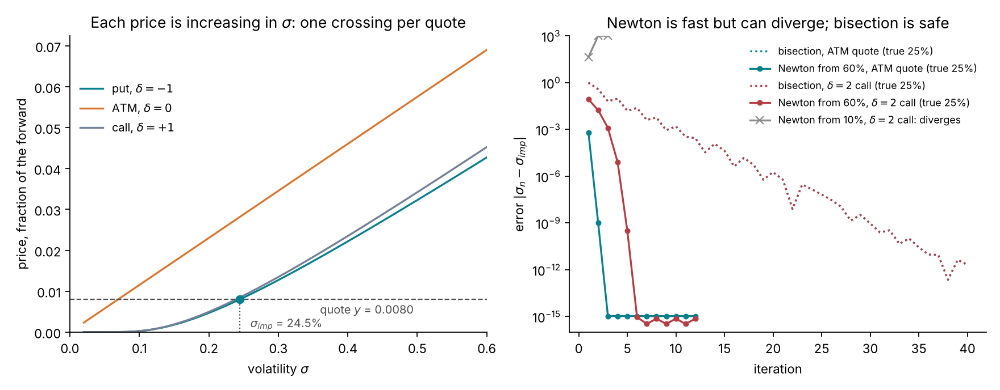
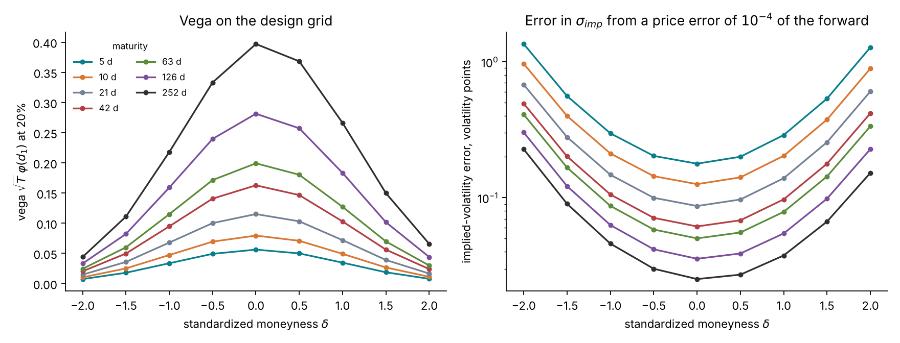
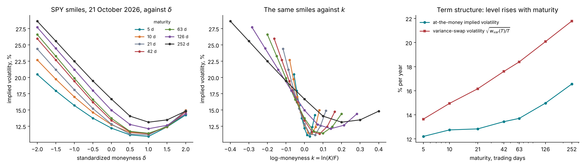
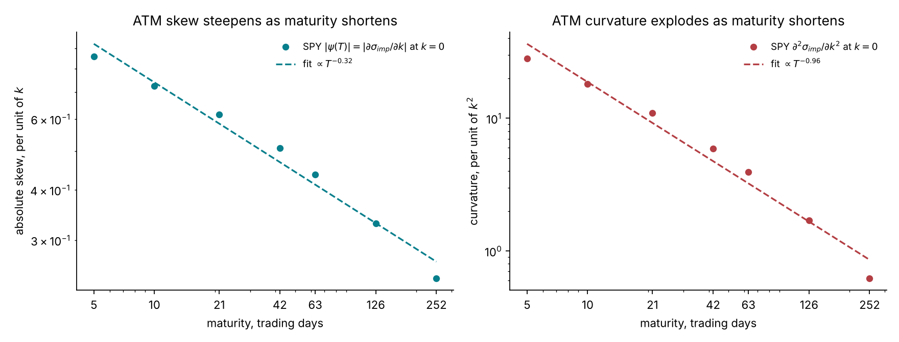
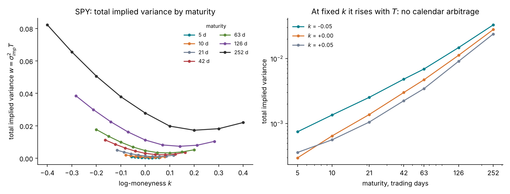

# Lecture 5. Implied volatility and the smile

[Course index](README.md) · Previous: [Lecture 4. The Black–Scholes model](04-black-scholes.md) · Next: [Lecture 6. Marking a product the smile does not quote](06-marking-a-product-the-smile-does-not-quote.md)

**What this lecture is for.** This lecture turns option prices into the quantity the market actually trades and quotes: implied volatility. It defines implied volatility, shows how to compute it and how precisely a quote determines it, reads the real SPY chain of 21 October 2026 onto the tutorial's design grid, and describes the pattern the market shows: the **smile**, with its skew and its term structure. It then explains what the smile says about the distribution of future prices, which mechanisms produce it, which constraints no-arbitrage puts on it, and how the variance swap and the forward-variance curve are read from it.

**Where it sits in the course.** Lecture 4 derived the Black–Scholes formula and showed that its assumption of a constant volatility contradicts the data on returns. This lecture shows that option prices contradict it too, in a precise and stable way. The smile measured here is the data that the models of Lectures 10 and 13 must reproduce, and the 63 SPY quotes read here are the observation the tutorial calibrates to in Parts II to IV. The forward-variance curve built in Section 5.9 is an input of the rough Bergomi model of Lecture 13. Section 5.11 states what the smile does not determine, which is the starting point of Lecture 6.

**Its part in the argument.** Section 5.9 reads the forward-variance curve from the quotes, and shows that on a thin chain the spreads leave it wide. Section 5.11 states what no smile determines: the forward smile. Both are inputs the argument of the course is about (Lecture 6, Section 6.8).

## 5.1 Implied volatility

The Black–Scholes formula of Lecture 4 maps a volatility to a price. The market works the other way round: it observes a price and asks which volatility would produce it. For a quoted out-of-the-money option with price $`y`$ in forward units, log-moneyness $`k`$ and maturity $`T`$, the **implied volatility** $`\sigma_{\text{imp}}`$ is the solution of

```math
c(k, T; \sigma_{\text{imp}}) = y \quad\text{(call)}, \qquad p(k, T; \sigma_{\text{imp}}) = y \quad\text{(put)} .
```

**Existence and uniqueness.** Lecture 4 showed two facts. The price is strictly increasing in $`\sigma`$, since the vega $`\sqrt{T}\varphi(d_1)`$ is positive. As $`\sigma`$ goes from 0 to $`\infty`$, the price goes continuously from the intrinsic value to the upper bound (1 for a call, $`e^k`$ for a put). Together, they imply that the equation has exactly one solution whenever the quote lies strictly inside the no-arbitrage bounds of Lecture 2, and none otherwise. A quote below its intrinsic value has no implied volatility; the tutorial's cleaning removes such quotes (Section 5.4).

**Why the market quotes in volatility.** Prices of options with different strikes and maturities are not comparable: a one-year at-the-money option costs about ten times a one-week one, simply because there is more time. Implied volatility removes this mechanical dependence on $`k`$ and $`T`$ through the formula, and leaves what is left: the market's view of the uncertainty, expressed per unit of time. Under Black–Scholes it would be the same number for every option. It is not, and the pattern of differences is the smile.

**A caution.** Implied volatility is a quoting convention, not a forecast and not a parameter. Using the Black–Scholes formula to quote prices does not mean believing the Black–Scholes model, just as quoting a bond by its yield does not assume a flat interest rate curve.

## 5.2 Computing it

The equation has no closed-form solution and is solved numerically. Two methods are standard.

**Bisection.** Start with an interval that contains the solution, such as $`[10^{-4}, 5]`$. Evaluate the price at the midpoint; since the price is increasing in $`\sigma`$, keep the half whose ends bracket the quote. Each step halves the interval, so about 40 steps reach $`10^{-12}`$. The method cannot fail inside the bounds. The tutorial's code uses it.

**Newton's method.** Linearize the price around the current guess and solve the linear equation:

```math
\sigma_{n+1} = \sigma_n - \frac{c(k, T; \sigma_n) - y}{\text{vega}(k, T; \sigma_n)} .
```

Near the solution, the error is squared at each step, so a few steps reach machine precision. Far in the wings, the vega at a poor starting guess can be tiny, and the step $`(c - y)/\text{vega}`$ huge.



*Figure 5.1.* How to read the figure: in the left panel, each curve is a price as a function of $`\sigma`$, increasing, so a horizontal line at the quoted price crosses it once. The one-month put at $`\delta = -1`$ ($`k = -0.058`$) quoted at 0.0080 of the forward has an implied volatility of 24.5%. In the right panel, the true volatility is 25%. Newton's method from 60% reaches $`10^{-15}`$ in 3 steps at the money and in 6 steps for the call at $`\delta = 2`$. Started from 10%, Newton's first step for the same wing call jumps to 43.5 (4,350%), and the next ones diverge. Bisection takes about 40 steps for either quote and never fails. Production code combines the two, or uses an algorithm designed for the problem, such as that of Jäckel (2015), which reaches machine precision in two Newton-type steps from a carefully built starting point.

## 5.3 How precisely a quote determines its implied volatility

A quote is uncertain by roughly its half-spread (Lecture 1). To first order, a price error $`\Delta y`$ becomes an implied-volatility error

```math
\Delta\sigma_{\text{imp}} \approx \frac{\Delta y}{\text{vega}} .
```

The vega is largest at the money and small in the wings and at short maturities (Lecture 4), so the same price error means very different volatility errors across the grid.



*Figure 5.2.* How to read the figure: the left panel shows the vega on the design grid. At one week it is 0.056 at the money and 0.0078 at $`\delta = 2`$, seven times smaller; at one year it is 0.40 at the money. The right panel divides a price error of $`10^{-4}`$ of the forward by the vega. The error is 0.025 volatility points for the one-year at-the-money option and 1.3 points for the one-week option at $`\delta = 2`$, fifty times more.

**Consequence for calibration.** A noise model with one price error for every quote would misstate how much each quote says about volatility. With an error of $`10^{-4}`$ of the forward, it would credit the one-year at-the-money quote with a volatility error of 0.025 points, far below its real uncertainty, and the one-week wing quote with 1.3 points. The real uncertainty of a quote is closer to constant in volatility units: a fraction of a point near the money and about a point in the wings, as the bid-ask spreads show. The tutorial therefore states the quote noise in volatility units, $`s_{\text{iv}}(\delta)`$, rising from 0.3 points at the money to 1 point at $`|\delta| = 2`$, and translates it into price units with the vega: $`\sigma_c = \text{vega}_c(\sigma_{\text{ref}}) \times s_{\text{iv}}(\delta_c)`$. Lecture 7 develops this noise model and the likelihood built on it.

## 5.4 Reading a real chain onto the design grid

A raw chain is noisy and irregular, so the tutorial cleans it and reads it at the 63 design points of Lecture 1. These are the steps that built the tutorial's SPY surface (study S8; `lab/src/sbi4finance/calibration/chain.py`).

**Cleaning.**

1. Keep out-of-the-money quotes only: puts below the forward, calls above.
2. Drop quotes with a zero bid, with a relative spread $`(\text{ask} - \text{bid})/\text{mid}`$ above 50%, or with a mid below intrinsic value (no implied volatility exists).
3. Within each maturity, drop an implied volatility more than 25% away from the five-point moving average centred on it: an isolated outlier is a stale or erroneous quote.
4. Count maturities in business days from the session of the underlying's last trade, not from the file's timestamp. A file fetched before the open carries the next day's date; counting from it would shorten the one-week maturity by a fifth.
5. Take the discount factor from Treasury yields and the forward from parity near the money (Lecture 2, Section 2.4).

**Reading the grid.** For each expiration, a cubic smoothing spline is fitted to implied volatility against $`\delta`$, weighted by the inverse half-spread. For each design point, the two expirations nearest the design maturity on either side whose strikes reach the point are read at its log-moneyness, and the total variance $`\sigma_{\text{imp}}^2 T`$ is interpolated linearly in $`T`$. An expiration whose strikes stop short of the point is skipped, because reading it would extrapolate its spline: on 21 October 2026, SPY's end-of-month expirations listed fewer strikes, and reading them would have given 9.3% instead of 14.8% for the one-year point at $`\delta = 2`$ (study S8). Of the 63 points, 35 were read from two expirations and 28 from one; none needed extrapolation. The noise of each point is the vega times the local half-spread in volatility, floored at the design's $`s_{\text{iv}}(\delta)`$. On SPY the real half-spreads are below the design noise at every point, so the floor applies everywhere.

## 5.5 The SPY implied-volatility surface

The implied volatility as a function of strike and maturity, $`\sigma_{\text{imp}}(k, T)`$, is the **implied-volatility surface**. A slice at one maturity is a **smile**. A related quantity, the **total implied variance**

```math
w(k, T) = \sigma_{\text{imp}}(k, T)^2\, T ,
```

is the $`w`$ of Lecture 4 that the market's price corresponds to; it is the natural variable for the no-arbitrage constraints of Section 5.8.



*Figure 5.3.* How to read the figure: under Black–Scholes every point would lie on one horizontal line. Instead:

- **The smiles slope down.** At one year, the put at $`\delta = -2`$ has an implied volatility of 28.7% and the call at $`\delta = +2`$ of 14.8%. Low strikes, the downside insurance of Lecture 1, are priced at much higher volatility. This is the **skew**.
- **The smiles curve up at the right end.** At one week the minimum, 11.0%, is at $`\delta = 1`$, and the $`\delta = 2`$ call is back up at 14.2%. Both wings are above the minimum: a **smile** in the strict sense, superimposed on the skew.
- **Against $`k`$ (centre), short smiles are steep and narrow, long smiles flat and wide.** Against $`\delta`$ (left) they look alike, which is why the design grid is defined in $`\delta`$.
- **The level rises with maturity** (right): the at-the-money volatility goes from 12.2% at one week to 16.6% at one year. On this date the market was calm, and longer horizons carried more uncertainty per unit of time.
- **The variance-swap volatility is above the at-the-money volatility at every maturity**, by 1.4 points at one week and 5.2 points at one year. Section 5.7 explains why.

## 5.6 The skew and the curvature across maturities

Two numbers summarize the shape of each smile near the money:

```math
\psi(T) = \frac{\partial \sigma_{\text{imp}}}{\partial k}\Big|_{k=0} \quad\text{(at-the-money skew)}, \qquad \kappa(T) = \frac{\partial^2 \sigma_{\text{imp}}}{\partial k^2}\Big|_{k=0} \quad\text{(at-the-money curvature)} .
```

The tutorial estimates them by fitting a quadratic in $`k`$ to the five quotes nearest the money of each maturity.



*Figure 5.4.* How to read the figure: on log–log axes a power law $`a\,T^{b}`$ is a straight line with slope $`b`$. The absolute skew falls from 0.86 at one week to 0.24 at one year, close to the line $`|\psi(T)| \approx 0.265\,T^{-0.32}`$. The curvature falls from 28.3 to 0.62, close to $`T^{-0.96}`$. As maturity shortens, both the slope and the curvature of the smile grow without bound, at well-defined rates.

**Why the power law matters.** Lecture 10 shows that the classical stochastic-volatility model (Heston) produces a skew that tends to a constant as $`T \to 0`$: it cannot follow this line at short maturities. Lecture 13 shows that a model whose volatility is rough, with Hurst exponent $`H`$ (Lecture 3), produces $`\psi(T) \propto T^{H - 1/2}`$. An exponent of −0.32 corresponds to $`H \approx 0.18`$. Equity-index skews show exponents near −0.4 in the literature (Gatheral, Jaisson and Rosenbaum 2018). The term structure of the skew is therefore the feature of the data that decides between model classes, and the reason the design grid starts at one week.

**A limit of the estimate.** Seven maturities and a quadratic through five points give a rough measurement, and Lecture 13 shows that the exponent of a fitted power law is a biased estimate of $`H - \tfrac12`$ over a finite range of maturities. The tutorial's posterior uses all 63 quotes, not the fitted exponent.

## 5.7 What the smile means

**The smile is the distribution of the future price.** By Breeden–Litzenberger (Lecture 2), the prices at one maturity determine the risk-neutral density of $`X_T`$, and the prices are equivalent to the implied volatilities. A flat smile is the log-normal law of Black–Scholes. A different smile is a different law:

- a smile that curves up in both wings means more probability in both tails than the log-normal: **fat tails**;
- a smile that slopes down (higher volatility at low strikes) means more probability of large falls than of large rises: a **heavier left tail**.

**Mechanism 1: a random volatility makes a smile.** Suppose the volatility $`\sigma_t`$ is itself random but independent of the Brownian motion that moves the price. Conditional on the whole path of $`\sigma`$, the price is log-normal with total variance $`\bar w = \int_0^T \sigma_t^2\,dt`$, so the option price is the Black–Scholes price averaged over the possible $`\bar w`$ (Hull and White 1987):

```math
c = \mathbb{E}\big[\,c_{\text{BS}}(k,\ \bar w)\,\big] .
```

Lecture 4 showed that the Black–Scholes price is convex in $`\sigma`$ in the wings (positive vomma) and nearly linear at the money. By Jensen's inequality, averaging over a random volatility therefore raises the wing prices more than the at-the-money price, and the implied volatility of the average is higher in the wings: a smile.

**Mechanism 2: a random volatility correlated with the price makes a skew.** If the volatility tends to rise when the price falls, as in the VOO data of Lecture 3 (Figure 3.7), large falls happen in high-volatility states and become larger, while rises happen in calm states and stay small. The left tail fattens, the right tail thins, and the smile tilts down.


*Figure 5.5.* How to read the figure: all panels are at one month.

- **Left.** Averaging the prices at 15% and 25% with equal weights gives a symmetric smile: 20.0% at the money, rising to 23.9% at $`k = \pm 0.25`$. The at-the-money level is the average volatility, 20%, because the at-the-money price is nearly linear in $`\sigma`$ (Lecture 4: $`c \approx 0.4\sigma\sqrt T`$). It is below the root-mean-square volatility $`\sqrt{\mathbb{E}[\sigma^2]} = 20.6\%`$.
- **Centre.** The Heston model of Lecture 10, at the centre of the tutorial's prior (initial and long-run variance 0.085, vol-of-vol 0.8, correlation −0.525), has a random variance negatively correlated with the price. Its smile falls from 37% at $`k = -0.25`$ through 28.4% at the money and flattens on the call side: a skew.
- **Right.** The same model's density of $`\ln X_T`$, recovered from its prices by Breeden–Litzenberger, against the log-normal with the same at-the-money volatility. At $`\ln X_T = -0.25`$ the model's density is 3.2 times the log-normal's; at $`+0.2`$ it is half of it. The skew of the centre panel is this heavier left tail.

**Why the variance-swap volatility exceeds the at-the-money volatility.** The left panel contains the explanation of Figure 5.3's last point. The at-the-money implied volatility measures the average volatility $`\mathbb{E}[\sigma]`$, while the variance swap (Section 5.9) pays the average variance, whose square root is $`\sqrt{\mathbb{E}[\sigma^2]} \ge \mathbb{E}[\sigma]`$ by Jensen's inequality. The skew widens the gap further, because the variance swap's replication weights low strikes, where implied volatility is high, most heavily (Lecture 2: weights $`2/K^2`$).

## 5.8 No-arbitrage constraints on a smile

Lecture 2's constraints on prices become constraints on implied volatilities.

**Calendar constraint.** At fixed log-moneyness, prices increase with maturity, and the Black–Scholes price is increasing in $`w`$. The total implied variance must therefore be non-decreasing in $`T`$:

```math
\frac{\partial w(k, T)}{\partial T} \ge 0 \quad\text{at fixed } k .
```

**Butterfly constraint.** Within a maturity, prices must be convex in the strike, so the implied density must be non-negative. Expressed through $`w`$ and its derivatives in $`k`$ (written $`w'`$ and $`w''`$), Gatheral and Jacquier (2014) show that the risk-neutral density of $`k`$ equals $`g(k)\,\varphi(d_2)/\sqrt{w}`$, with $`d_2`$ evaluated at $`k`$ and $`w(k)`$, where

```math
g(k) = \Big(1 - \frac{k\,w'}{2w}\Big)^2 - \frac{(w')^2}{4}\Big(\frac{1}{w} + \frac14\Big) + \frac{w''}{2},
```

so the density has the sign of $`g`$, and a smile is free of butterfly arbitrage if and only if $`g(k) \ge 0`$ at every $`k`$ (and the call price vanishes as $`k \to \infty`$). The constraint limits how steeply a smile can slope (the negative term in $`(w')^2`$) and requires enough curvature to compensate.

**Wing constraint.** Lee (2004) shows that the total implied variance can grow at most linearly in the wings, with slope at most 2: $`\limsup_{k \to \pm\infty} w(k, T)/|k| \le 2`$. The slope is linked to how many moments of the price distribution are finite. It matters when a smile is extrapolated beyond the quoted strikes, as in the variance-swap replication below.



*Figure 5.6.* How to read the figure: in the left panel, each maturity's curve lies above the curves of shorter maturities wherever they overlap. In the right panel, at $`k = -0.05`$, $`0`$ and $`+0.05`$, the total variance rises with maturity at every step: the SPY grid has no calendar arbitrage. Lecture 2 (Figure 2.3) showed the same grid's prices to be convex in the strike at 63 days.

## 5.9 The variance swap and the forward-variance curve

A variance swap (Lecture 1) pays the realized variance minus a fixed strike. Its fair strike can be read off the smile, without a model of the volatility's dynamics, by combining Itô's lemma with the replication of Lecture 2.

**Step 1: realized variance is a log contract plus a trading gain.** Suppose only that the forward-unit price is a continuous martingale with some random instantaneous variance $`V_t`$, $`dX_t/X_t = \sqrt{V_t}\,dW_t`$. This covers Black–Scholes, Heston and rough Bergomi alike. Itô's lemma for $`\ln X`$ gives

```math
d\ln X_t = \frac{dX_t}{X_t} - \tfrac12 V_t\,dt, \qquad\text{so}\qquad \int_0^T V_t\,dt = 2\int_0^T \frac{dX_t}{X_t} - 2\ln X_T .
```

**Step 2: take expectations.** The first term on the right is the gain from holding $`2/X_t`$ units of a martingale; it has mean zero (Lecture 3). What remains is the variance-swap total variance, written $`w_{\text{var}}(T)`$ to distinguish it from the total implied variance $`w(k, T)`$ of Section 5.5:

```math
w_{\text{var}}(T) := \mathbb{E}^{\mathbb{Q}}\Big[\int_0^T V_t\,dt\Big] = \mathbb{E}^{\mathbb{Q}}\big[-2\ln X_T\big] .
```

**Step 3: price the log contract with vanillas.** Lecture 2 replicated $`-2\ln X_T`$ with out-of-the-money puts and calls weighted by $`2/K^2`$:

```math
w_{\text{var}}(T) = 2\int_{-\infty}^{0} p(k, T)\,e^{-k}\,dk + 2\int_{0}^{\infty} c(k, T)\,e^{-k}\,dk .
```

The realized variance over $`[0, T]`$ is $`Q_T \approx \frac1T\int_0^T V_t\,dt`$, so the fair variance-swap strike is $`K_{\text{var}}(T) = w_{\text{var}}(T)/T`$ (Neuberger 1994; Demeterfi, Derman, Kamal and Zou 1999). This is how the VIX index is built from S&P 500 options.

**Step 4: the forward-variance curve.** Since $`w_{\text{var}}(T) = \int_0^T \mathbb{E}^{\mathbb{Q}}[V_t]\,dt`$, its derivative in $`T`$ is the expected instantaneous variance at each future date:

```math
\xi_0(t) = \mathbb{E}^{\mathbb{Q}}[V_t] = \frac{\partial w_{\text{var}}(t)}{\partial t}, \qquad \xi_0 \approx \frac{w_{\text{var}}(T_{j}) - w_{\text{var}}(T_{j-1})}{T_{j} - T_{j-1}} \text{ on } [T_{j-1}, T_{j}) .
```

The tutorial uses this **forward-variance curve**, constant on each of the 7 intervals between design maturities, as the input of rough Bergomi (Lecture 13), which matches it exactly by construction.

**Limits.** Three sources of error affect a real computation. (i) **Jumps**: with jumps in the price, $`-2\ln X_T`$ no longer equals the integrated variance; the difference is of third order in the jump sizes. (ii) **Discretization**: the integral becomes a trapezoid sum over the quoted strikes. (iii) **Truncation**: the chain stops at its lowest and highest strikes, and the omitted wings carry variance, mostly on the put side where the weight $`e^{-k}`$ is large. The tutorial uses only expirations whose cleaned strikes reach $`\delta \le -8`$ and $`\delta \ge 1.8`$.


*Figure 5.7.* How to read the figure:

- **Left.** The integrand $`2\,\text{OTM}(k)\,e^{-k}`$ peaks at the money and decays into the wings, more slowly on the put side. The area under each curve is $`w_{\text{var}}(T)`$ restricted to the grid's range.
- **Centre.** Red dots are the 17 expirations, out of 32, whose strikes reach $`\delta \le -8`$; grey crosses are those cut short, which mostly come out low. The exception, at 587 days, is cut on the call side, where the replication weight is small. The squares integrate only the 9 design points, $`|\delta| \le 2`$: at one week they agree with the full strip (13.6%), but at one year they give 18.9% against 21.8%, because the missing far puts carry about a quarter of the variance. The triangles are the at-the-money implied volatilities, below every variance-swap volatility.
- **Right.** The forward-variance curve in volatility units, $`\sqrt{\xi_0}`$, rises from 13.6% over the first week to 23.4% between 6 months and 1 year. The squares are the running averages $`\sqrt{w_{\text{var}}(T)/T}`$, which rise more slowly because each averages all the intervals before it.

**A thin chain.** On a thin chain the strip over the quoted strikes is wide. Computed over EWI's quoted strikes on 22 October 2026 (Lecture 1, Figure 1.7), the strip's variance-swap volatility is 14% on the bids and 52% on the asks at the first expiry, and 14% and 38% at the last (`lab/checks/thin_chains/EWI_2026-10-22.json`). Both values leave out the wings beyond the quoted strikes.

## 5.10 Four volatility objects

The course now has all four objects that the word "volatility" refers to. They are different and must be kept apart:

| Name | Definition | Observed? | Role in the course |
| --- | --- | --- | --- |
| Realized volatility $`\sqrt{Q_T}`$ | $`\sqrt{(252/n)\sum r_i^2}`$ over a period; the payoff of a volatility swap | Only after the fact | Lecture 1; the payoff of variance and volatility swaps |
| Implied volatility $`\sigma_{\text{imp}}(k, T)`$ | The Black–Scholes volatility that matches a quote | Yes, from quotes | The data; the smile is its shape |
| Forward variance $`\xi_0(t)`$ | The market's expected instantaneous variance at $`t`$, $`\mathbb{E}^{\mathbb{Q}}[V_t]`$, read by replication | Derived from quotes | The curve input of rough Bergomi; it fixes variance-swap prices |
| Instantaneous variance $`V_t`$ | The model's variance at time $`t`$, a random process | No, a model object | What the models of Lectures 10 and 13 specify |

## 5.11 What the smile does not tell

The surface determines, at each quoted maturity, the risk-neutral distribution of $`X_T`$, and with it every payoff of $`X_T`$ and the variance-swap strike. It does not determine how the smile itself will move.

The forward-start call of Lecture 1, struck at the money at $`T_1`$ and maturing at $`T_2`$, is priced at $`T_1`$ by the smile that will prevail then for maturity $`T_2 - T_1`$: the **forward smile**. Today's surface does not contain it. Two models that reproduce today's surface exactly can imply different forward smiles, and therefore different forward-start, cliquet and volatility-swap prices. A model of how volatility moves (Lectures 10 and 13) is needed to price them, and the uncertainty in that model's parameters (Parts II to IV) is the uncertainty in those prices.

This lecture has also shown that the Black–Scholes model cannot reproduce today's surface. Its single $`\sigma`$ gives one flat line per maturity, while SPY's smiles slope by 14 points from $`\delta = -2`$ to $`\delta = +2`$ at one year. Part II fits Black–Scholes to the 63 SPY quotes and shows what a Bayesian analysis reveals about a model that is wrong.

## 5.12 Summary

1. Implied volatility is the unique volatility that makes the Black–Scholes formula match a quote inside the no-arbitrage bounds. It is a quoting convention.
2. Bisection always finds it; Newton's method is faster but can diverge from a poor start in the wings.
3. A price error becomes a volatility error divided by the vega, so wing and short-dated quotes say less about volatility. The tutorial's noise model is stated in volatility units for this reason.
4. SPY's smiles on 21 October 2026 slope down (28.7% against 14.8% at one year, $`\delta = \mp2`$), curve up at short maturities, and rise in level with maturity.
5. The at-the-money skew follows $`|\psi(T)| \approx 0.265\,T^{-0.32}`$ and the curvature $`T^{-0.96}`$: both explode as maturity shortens.
6. A random volatility makes a smile through the convexity of option prices in $`\sigma`$; a negative correlation between volatility and price makes a skew, which is a heavier left tail of the risk-neutral law.
7. The total implied variance must rise with maturity and satisfy a butterfly condition; SPY's grid does.
8. The variance-swap strike is a model-free integral of out-of-the-money prices, and its derivative in maturity is the forward-variance curve $`\xi_0(t)`$, an input of rough Bergomi. Truncated strikes bias it down. On a thin chain the spreads leave it wide: over EWI's quoted strikes, its volatility lies between 14% and 52% at the first expiry.
9. The surface does not determine the forward smile, which exotics depend on. Pricing them needs a dynamic model, the subject of Lectures 10 and 13.

## References

- Hull, J., White, A. (1987). The pricing of options on assets with stochastic volatilities. *Journal of Finance* 42(2), 281–300. [doi](https://doi.org/10.1111/j.1540-6261.1987.tb02568.x)
- Gatheral, J. (2006). *The volatility surface: a practitioner's guide*. Wiley. Chapters 1–3 and 11.
- Gatheral, J., Jacquier, A. (2014). Arbitrage-free SVI volatility surfaces. *Quantitative Finance* 14(1), 59–71. [arXiv](https://arxiv.org/abs/1204.0646)
- Lee, R. W. (2004). The moment formula for implied volatility at extreme strikes. *Mathematical Finance* 14(3), 469–480. [RePEc](https://ideas.repec.org/a/bla/mathfi/v14y2004i3p469-480.html)
- Jäckel, P. (2015). Let's be rational. *Wilmott* 2015(75), 40–53.
- Neuberger, A. (1994). The log contract. *Journal of Portfolio Management* 20(2), 74–80. [doi](https://doi.org/10.3905/jpm.1994.409478)
- Demeterfi, K., Derman, E., Kamal, M., Zou, J. (1999). A guide to volatility and variance swaps. *Journal of Derivatives* 6(4), 9–32. [doi](https://doi.org/10.3905/jod.1999.319129)
- Gatheral, J., Jaisson, T., Rosenbaum, M. (2018). Volatility is rough. *Quantitative Finance* 18(6), 933–949. [doi](https://doi.org/10.1080/14697688.2017.1393551)

Figures: `course/scripts/lecture05.py`.
