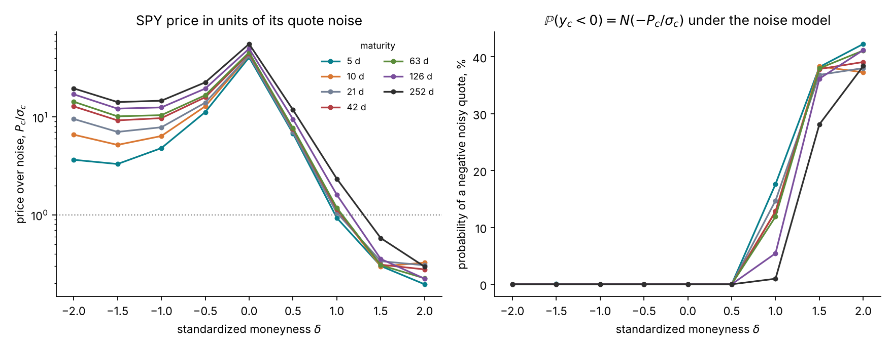
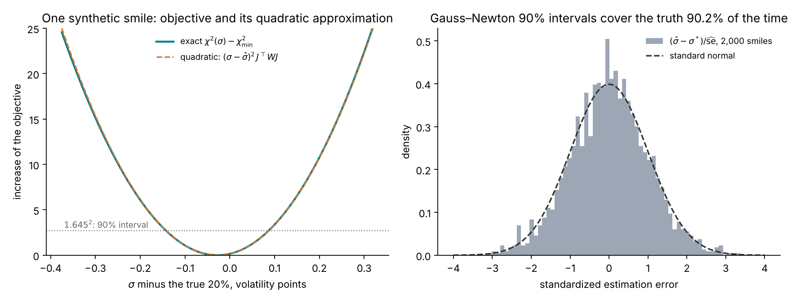
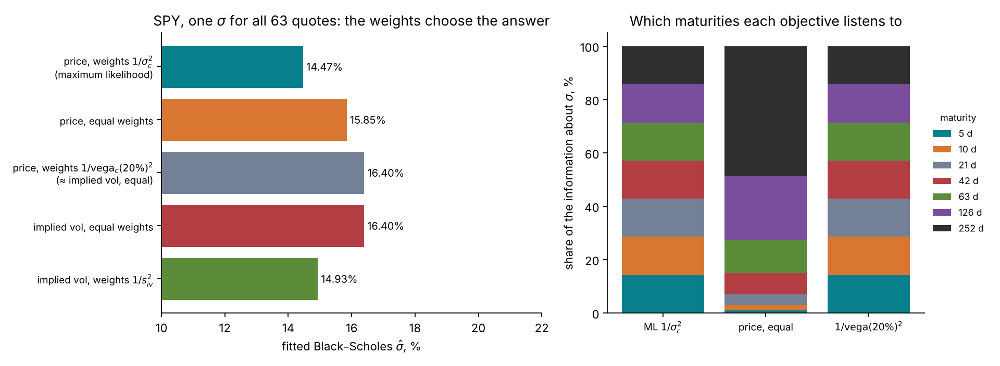
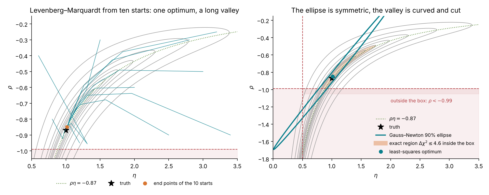
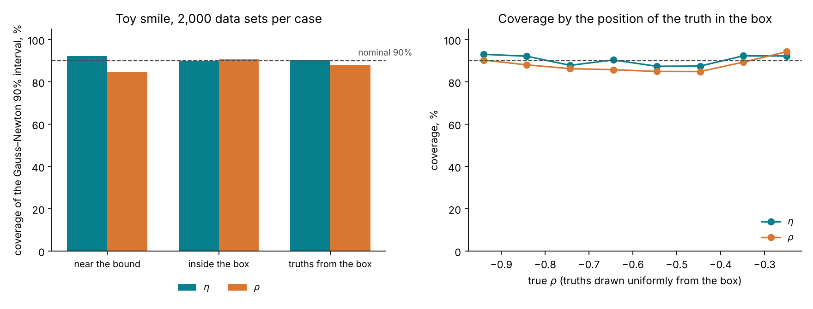
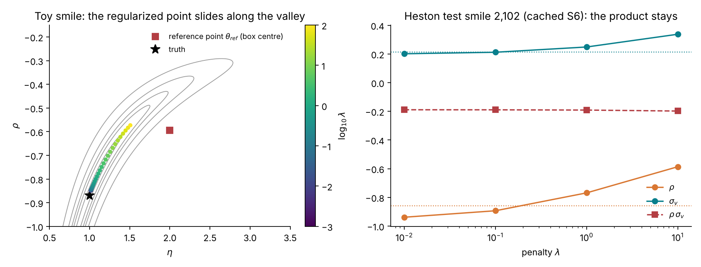

# Lecture 7. Calibration as estimation

[Course index](README.md) · Previous: [Lecture 6. Marking a product the smile does not quote](06-marking-a-product-the-smile-does-not-quote.md) · Next: [Lecture 8. Bayesian calibration](08-bayesian-calibration.md)

**What this lecture is for.** This lecture recasts model calibration as a problem of statistical estimation, and uses that view to examine the classical calibration tools. It states the observation model of a quote, derives the likelihood and shows that weighted least squares is maximum likelihood, explains how the choice of objective changes the answer, derives the Gauss–Newton optimizer and the Gauss–Newton covariance with its three conditions of validity, and then tests those conditions: on Black–Scholes, where they hold, and on a toy smile with a curved, truncated valley, where they fail in shape. It ends with multi-start optimization, regularization and the notions of identifiability and ill-posedness.

**Where it sits in the course.** Lecture 6 showed that the products a bank marks depend on how far the parameters can move while the model still fits the quotes. This lecture measures that distance the classical way, with one optimum and a local covariance. Lecture 8 measures it with a posterior and compares the two. The observation model and the likelihood defined here are the ones every later lecture uses: Lecture 14 explains why this likelihood is expensive for rough Bergomi, and Lectures 9, 12 and 15 build and check a network that bypasses it. Lecture 11 reports how the classical route performed in the tutorial's studies, and describes deep calibration.

**Its part in the argument.** This lecture builds the classical answer that the argument of the course compares with the posterior (Lecture 6, Section 6.8). Its interval is right when three conditions hold. It gives no range to what the fit holds fixed (Section 7.6), and its linear range can be wrong along a weakly informed direction (Section 7.7). Section 7.9 shows that the classical route already uses a prior when it regularizes, without stating its width: the posterior of Lecture 8 states it.

## 7.1 A quote as an observation

The data of a calibration are the 63 out-of-the-money prices $y = (y_1, \dots, y_{63})$ read from the chain on the design grid (Lecture 5, Section 5.4), in forward units. Each $y_c$ is a mid price: an estimate of the price at which the contract would trade, uncertain by roughly its half-spread. The model gives a price $P_c(\theta; \xi_0)$ for each contract, for parameters $\theta$ and the forward-variance curve $\xi_0$, which is read from the same chain and held fixed.

To compare quotes with model prices, a model of the difference is needed. The tutorial's **observation model** is

$$
y_c = P_c(\theta;\ \xi_0) + \sigma_c\,\varepsilon_c, \qquad \varepsilon_c \sim \mathcal{N}(0, 1) \text{ independent}, \qquad \sigma_c = \mathrm{vega}_c(\sigma_{\text{ref}}) \times s_{\text{iv}}(\delta_c) .
$$

The noise standard deviation $\sigma_c$ is a volatility noise $s_{\text{iv}}(\delta)$, rising linearly from 0.3 volatility points at the money to 1.0 point at $|\delta| = 2$, converted into price units by the vega at $\sigma_{\text{ref}} = 20\%$ (Lecture 5, Section 5.3). On SPY, the real half-spreads are below this design noise at every grid point, so the design noise is used (Lecture 5).

The observation model is a modelling choice, made explicit so that it can be checked and changed. Four of its assumptions are worth naming.

1. **The noise is Gaussian in price.** A bid-ask interval bounds the price; a Gaussian has unbounded tails. The Gaussian is chosen because it gives a simple likelihood, and the half-spread sets its scale.
2. **The noise standard deviations are known.** They are fixed per contract from the design rule, not estimated.
3. **The noise is independent across contracts.** The grid prices are read from a smoothing spline through many quotes (Lecture 5), which correlates neighbouring points. The tutorial ignores this correlation.
4. **The model's price is the truth up to noise.** This is the assumption that fails when the model is wrong; Lecture 8 tests it with a posterior predictive check.

*Figure 7.1.* How to read the figure: the left panel shows the ratio $P_c/\sigma_c$, the signal-to-noise ratio of each quote, using SPY's prices of 21 October 2026. It is 55.8 for the one-year at-the-money option and 0.195 for the one-week call at $\delta = 2$; 21 of the 63 quotes have a ratio below 3, all on the call side. The right panel shows the consequence: under a Gaussian noise model, a quote whose price is small against its noise is negative with probability $N(-P_c/\sigma_c)$, up to 42% for the one-week wing call.

**Negative noisy prices are kept.** A real price cannot be negative, but a simulated noisy quote can. The tutorial keeps such quotes in its simulations because they are valid draws from the declared observation model, and because the inference network reads the quotes as $y_c/\sigma_c$, which is defined for any value. Removing them would change the noise model into a truncated one without saying so. Implied volatilities, which do not exist for such quotes, are used only for plots and for the real chain, where cleaning removes quotes below intrinsic value.

## 7.2 The likelihood

Under the observation model, the quotes are independent normal variables with means $P_c(\theta; \xi_0)$ and standard deviations $\sigma_c$. Their joint density, seen as a function of $\theta$ for the observed $y$, is the **likelihood**:

$$
p(y \mid \theta, \xi_0) = \prod_{c=1}^{63} \frac{1}{\sqrt{2\pi}\,\sigma_c}\exp\!\Big(-\frac{(y_c - P_c(\theta; \xi_0))^2}{2\sigma_c^2}\Big),
\qquad
\log p(y \mid \theta, \xi_0) = -\tfrac12\,\chi^2(\theta) + \text{const},
$$

with the **chi-square objective**

$$
\chi^2(\theta) = \sum_{c=1}^{63}\Big(\frac{y_c - P_c(\theta; \xi_0)}{\sigma_c}\Big)^2 .
$$

The constant does not depend on $\theta$. The likelihood is largest where the model prices are closest to the quotes, with each quote's distance measured in units of its own noise.

**A check of fit.** If the model is right and $\theta$ is at its true value, $\chi^2$ is a sum of 63 squared standard normals: a chi-square variable with 63 degrees of freedom, with mean 63 and standard deviation $\sqrt{2 \times 63} = 11.2$. At the fitted value, with $d$ parameters estimated, it is approximately chi-square with $63 - d$ degrees of freedom. A minimum far above that range says the model cannot reproduce the quotes within their noise.

## 7.3 Least squares is maximum likelihood

The **maximum-likelihood estimate** maximizes $p(y \mid \theta, \xi_0)$. Since the logarithm is increasing and the constant does not depend on $\theta$,

$$
\hat\theta = \arg\max_\theta \log p(y \mid \theta, \xi_0) = \arg\min_\theta \chi^2(\theta) = \arg\min_\theta \sum_{c} w_c\,\big(P_c(\theta; \xi_0) - y_c\big)^2, \qquad w_c = \frac{1}{\sigma_c^2} .
$$

Weighted least squares with weights $1/\sigma_c^2$ is maximum likelihood under the observation model. A bank that calibrates by least squares is therefore already computing a statistical estimate, and the choice of weights is a choice of noise model, whether stated or not.

**A first test: Black–Scholes on Black–Scholes data.** Simulate 63 quotes from Black–Scholes with $\sigma = 20\%$ and the design noise, and fit one $\sigma$.

*Figure 7.2.* How to read the figure: in the left panel the fitted value is $\hat\sigma = 19.97\%$ and the objective at the minimum is $\chi^2 = 57.2$ on 62 degrees of freedom, inside the expected range. The exact objective (solid) and its quadratic approximation (dashed, Section 7.6) are indistinguishable. The 90% interval, where the objective is within $1.645^2 = 2.71$ of its minimum, is $\hat\sigma \pm 1.645 \times 0.0695$ volatility points. The right panel repeats the fit on 2,000 synthetic smiles. The estimation error divided by its estimated standard error follows a standard normal, and the 90% interval contains the true 20% in 90.2% of the smiles. The mean of $\chi^2$ at the fit is 61.8, close to its expected 62.

**Interpretation.** When the model is right, has one parameter, and is identified by every quote, least squares and its interval do exactly what they promise. The rest of the lecture removes these conditions one at a time.

## 7.4 Which objective

Not every calibration minimizes price errors weighted by $1/\sigma_c^2$. Two other objectives are common: price errors with equal weights, and implied-volatility errors with equal weights. They are related through the vega. Write $\Delta_c(\theta) = \big(y_c - P_c(\theta)\big)/\big(\sigma_{\text{imp}}(y_c) - \sigma_{\text{imp}}(P_c(\theta))\big)$ for the price change per unit of implied volatility across the residual, the secant of the price as a function of volatility. Then, exactly,

$$
\frac{y_c - P_c(\theta)}{\sigma_c} = \frac{\Delta_c(\theta)}{\mathrm{vega}_c(\sigma_{\text{ref}})}\cdot\frac{\sigma_{\text{imp}}(y_c) - \sigma_{\text{imp}}(P_c(\theta))}{s_{\text{iv}}(\delta_c)},
$$

because $\sigma_c = \mathrm{vega}_c(\sigma_{\text{ref}})\,s_{\text{iv}}(\delta_c)$. The maximum-likelihood objective equals implied-volatility errors weighted by $1/s_{\text{iv}}^2$ only when the factor $\Delta_c/\mathrm{vega}_c(\sigma_{\text{ref}})$ is one for every quote, and price errors weighted by $1/\mathrm{vega}_c(\sigma_{\text{ref}})^2$ equal implied-volatility errors with equal weights under the same condition. Two things move the factor away from one. The vega in $\sigma_c$ is taken at the reference 20%, while the model price sits at its own volatility, where the vega differs; and when the residuals are large the secant differs from the vega at either end. Near the optimum of a correct model both effects are small, and the objectives nearly agree.

*Figure 7.3.* How to read the figure: Black–Scholes cannot fit SPY's smile (Lecture 5), so the fitted $\hat\sigma$ depends on what the objective emphasizes. Maximum likelihood gives 14.47%; equal price weights 15.85%; price weights $1/\mathrm{vega}_c(20\%)^2$ 16.40% and equal implied-volatility weights 16.40% (16.401% and 16.396%); and implied-volatility weights $1/s_{\text{iv}}^2$ 14.93%. The gap between 14.47% and 14.93% is entirely the factor $\Delta_c/\mathrm{vega}_c(20\%)$ of the identity above, which at the maximum-likelihood fit ranges from 0.15 (far calls) to 1.37 (far puts). It has two parts, both large. The vega mismatch: SPY's implied volatilities run from 11.0% to 28.7%, and at the fitted 14.47% the vega at $|\delta| = 2$ is 6.2 times smaller than at 20%, so in implied-volatility terms the maximum-likelihood objective gives the far wings much less weight than $1/s_{\text{iv}}^2$ does. And the size of the residuals: across them the secant is 0.72 to 8.4 times the vega at 14.47%, largest for the far puts, whose implied volatilities are far above the fit. Applied one at a time to the implied-volatility objective, the vega mismatch alone would give 13.56% and the secant alone 18.49%; together they give back the maximum-likelihood 14.47% exactly. The modest gap between 14.47% and 14.93% is thus the difference of two large, opposite effects, not a sign that the objectives nearly agree. The agreement of the two 16.40% fits is likewise not guaranteed by the identity; the same effects are present there. The right panel shows where the information comes from. With equal price weights, the one-year quotes carry 49% of the information about $\sigma$ and the one-week quotes 1%, because long-dated options have the largest vegas. The other two objectives weight every maturity equally, 14.3% each.

**Interpretation.** For a correct model, every sensible objective gives nearly the same answer, with different precision. For a misspecified model, the objective chooses which quotes the model sacrifices, and the answer moves by two volatility points here. This is the effect Detlefsen and Härdle (2006) measured for Heston and Bates on DAX options, where the calibrated parameters and the exotic prices moved with the error measure. The tutorial uses $w_c = 1/\sigma_c^2$ throughout, so that the classical and the Bayesian routes use the same information and differ only in what they return.

## 7.5 Solving it: Gauss–Newton and Levenberg–Marquardt

For a model with a few parameters, the minimum of $\chi^2$ is found by iterating a linear approximation. Write the weighted residuals $r_c(\theta) = (y_c - P_c(\theta))/\sigma_c$ and their Jacobian $J_{cj} = \partial P_c/\partial\theta_j \,/\, \sigma_c$, so that $\chi^2(\theta) = r(\theta)^\top r(\theta)$. Near the current point $\theta$, a step $\Delta$ changes the residuals by approximately $-J\Delta$:

$$
\chi^2(\theta + \Delta) \approx \big(r - J\Delta\big)^\top\big(r - J\Delta\big) .
$$

Setting the derivative in $\Delta$ to zero gives the **Gauss–Newton step**, the solution of the normal equations

$$
J^\top J\,\Delta = J^\top r .
$$

The Gauss–Newton step is exact for a model linear in $\theta$ and fast near the minimum. Far from it, the linear approximation can be poor and the step too long. **Levenberg–Marquardt** (Levenberg 1944; Marquardt 1963) damps it:

$$
\big(J^\top J + \lambda\,\mathrm{diag}(J^\top J)\big)\Delta = J^\top r .
$$

A large $\lambda$ gives a short step along the gradient, which is safe; a small $\lambda$ gives the Gauss–Newton step, which is fast. The algorithm lowers $\lambda$ after a step that reduces $\chi^2$ and raises it after a step that does not. Parameter bounds are enforced by projecting each step back into the allowed box, or by a trust-region method that respects bounds (the course's scripts fit the multi-parameter models with the bounded trust-region solver of `scipy.optimize.least_squares`, the one Black–Scholes volatility with a bounded scalar search, and draw the paths of Figure 7.4 with a plain Levenberg–Marquardt loop). The derivatives $\partial P_c/\partial\theta_j$ come from the formula for Black–Scholes, from finite differences of the Fourier price for Heston (Lecture 10), and from finite differences of Monte Carlo prices for rough Bergomi, which need common random numbers to exist at all (Lecture 13).

## 7.6 The Gauss–Newton covariance and the delta method

The same linear approximation gives the uncertainty of $\hat\theta$. Suppose the model is right, with true value $\theta^*$, so that $r(\theta^*) = \varepsilon$ is a vector of independent standard normals. At the optimum the gradient vanishes, $J^\top r(\hat\theta) = 0$. Linearizing $r(\hat\theta) \approx \varepsilon - J(\hat\theta - \theta^*)$ and substituting:

$$
J^\top\big(\varepsilon - J(\hat\theta - \theta^*)\big) = 0 \quad\Longrightarrow\quad \hat\theta - \theta^* \approx (J^\top J)^{-1}J^\top\varepsilon .
$$

The right side is a linear function of $\varepsilon$, so $\hat\theta$ is approximately normal, with covariance

$$
\widehat{\mathrm{Cov}}(\hat\theta) = (J^\top J)^{-1}\,J^\top\,\mathrm{Cov}(\varepsilon)\,J\,(J^\top J)^{-1} = (J^\top J)^{-1} = \big(J_P^\top W J_P\big)^{-1},
$$

where $J_P$ is the unweighted Jacobian $\partial P_c/\partial\theta_j$ and $W = \mathrm{diag}(1/\sigma_c^2)$. The matrix $J^\top J$ is the curvature of $\tfrac12\chi^2$ at its minimum, the **Fisher information** of the quotes about $\theta$. A 90% interval for $\theta_j$ is $\hat\theta_j \pm 1.645\sqrt{\widehat{\mathrm{Cov}}_{jj}}$.

**The delta method.** A product price is a function of the parameters, $p_\Pi(\theta)$. Linearizing it around $\hat\theta$ gives its variance:

$$
\widehat{\mathrm{Var}}\big(p_\Pi(\hat\theta)\big) \approx \nabla_\theta p_\Pi^\top\;\widehat{\mathrm{Cov}}(\hat\theta)\;\nabla_\theta p_\Pi .
$$

A product whose gradient points along a poorly identified direction inherits that direction's width; a product whose gradient is orthogonal to it does not. The variance swap under rough Bergomi has zero gradient and therefore zero width (Lecture 13).

**Three conditions.** The interval is right when three conditions hold:

1. **Information.** Every direction of the parameter space is informed by many quotes, so that $J^\top J$ has no small eigenvalue.
2. **An interior optimum.** $\hat\theta$ lies inside the allowed parameter region, not on its boundary, so that the normal approximation is not cut off.
3. **A nearly quadratic objective.** $\chi^2$ is close to its quadratic approximation over the width of the interval, so that the model is close to linear in $\theta$ there.

Black–Scholes on Black–Scholes data meets all three (Figure 7.2). The next section builds a case that breaks the first and the third, and near the boundary the second.

**What the interval leaves out.** The covariance covers only the parameters that are fitted. An input held fixed enters the delta method with zero variance. That is harmless when the quotes determine the input, and it is not when they leave it open. Two such inputs recur in the course: a parameter fixed at a chosen value, and a curve extended flat beyond the last quote. These are the baselines of Lecture 6, Section 6.7. A product that depends on such an input gets a range that omits the input's uncertainty, however good the fit. A third case is the forward-variance curve $\xi_0$ read from the chain and given to the fit. On a liquid smile the quotes determine it, and the course's posterior is given it too (Lecture 15). On a thin chain they do not, and every method of Lecture 16 must infer it. These omissions are one of the two ways the course expects the classical range to fail. The other is a weakly informed direction, where the delta method's linear range can be wrong (Section 7.7); on a thin chain that is where the curve and the parameters trade off (Lecture 16, Section 16.1).

## 7.7 Where it fails: a toy smile with a curved, truncated valley

Lecture 13 shows that rough Bergomi's short-dated skew identifies only the product $\rho\eta$, and that the full surface separates $\eta$ from $\rho$, mainly through the long-dated at-the-money level relative to the forward-variance curve and more weakly through the curvature of the wings (Section 13.11). A two-parameter toy keeps only the first mechanism and the weak one: a skew that carries $\rho\eta$ and a small, noisy curvature that carries $\eta^2$. It stands for a smile without long-dated quotes, or for a curve $\xi_0$ too uncertain to read $\eta$ from the at-the-money level, and it isolates the failure of the classical interval in that case. Nine "quotes" at $x_j \in \lbrace -1, -0.75, \dots, 1\rbrace$ are

$$
y_j = \rho\,\eta\,x_j + 0.05\,\eta^2\,x_j^2 + s_j\,\varepsilon_j, \qquad s_j = 0.01 + 0.1\,x_j^2, \qquad \eta \in (0.5,\ 3.5),\quad \rho \in (-0.99,\ -0.2).
$$

The odd part of the smile, the skew, carries $\rho\eta$ and is large against the noise: at $x = 0.5$ it is 0.435 in size against a noise of 0.035. The even part, the curvature, carries $\eta^2$, is small, and is largest in the wings, where the noise is largest: at $x = 1$ it is 0.05 against a noise of 0.11. The box is the rough-Bergomi prior range of $\eta$ and $\rho$ (Lecture 13, Section 13.4). At the truth $(\eta, \rho) = (1.0, -0.87)$, the Gauss–Newton standard deviation of $\rho\eta$ is 0.028, 3% of its value, and that of $\eta$ is 0.48, nearly half of its value: the product is identified and the factors are not. The valley of the objective runs along the hyperbola $\rho = -0.87/\eta$ and is cut by $\rho = -0.99$ at $\eta = 0.88$.

*Figure 7.4.* How to read the figure: the grey contours are $\chi^2$ for one simulated data set; the dotted line is $\rho\eta = -0.87$; the shaded band below $\rho = -0.99$ is outside the box. The least-squares optimum is $(1.015, -0.849)$ with $\chi^2 = 4.1$ on 7 degrees of freedom. In the left panel, ten starts spread over the box all travel down to the valley and along it to the same optimum, within 0.001. In the right panel, the exact region of $\Delta\chi^2 \le 4.6$ (the 90% level for two parameters), restricted to the box, is a curved banana from $\eta = 0.82$ to $1.75$ and $\rho = -0.99$ to $-0.49$. The Gauss–Newton 90% ellipse is a straight, thin ellipse along the tangent of the valley at the optimum. It reaches $\eta = 0.01$, below the box, and $\rho = -1.69$, below $-1$, where the model is undefined. Its one-parameter 90% interval for $\rho$ is $(-1.50, -0.20)$. The Fisher information has eigenvalues 2.7 and 2,284, a condition number of 854, and its weak eigenvector points along the valley.

The figure shows each condition failing. The information along the valley is small (condition 1), the valley is curved over the width of the interval (condition 3), and the interval crosses the boundary (condition 2).

**How often the interval is wrong.** Coverage, the share of data sets whose interval contains the truth, measures the interval's honesty in repeated use.

*Figure 7.5.* How to read the figure: each bar uses 2,000 simulated data sets. With the truth near the bound, $(1.0, -0.87)$, the interval for $\eta$ covers 92.3% of the time and the interval for $\rho$ 84.7%, and 76% of the $\rho$ intervals extend below $-1$. With the truth inside the box, $(2.0, -0.435)$, coverage is 90.1% and 90.8% and fewer than 1% of the intervals extend below $-1$. With truths drawn uniformly from the box, coverage is 90.4% for $\eta$ and 88.0% for $\rho$; grouped by the true $\rho$ (right), the $\rho$ coverage ranges from 85% to 94%.

**Interpretation.** The coverage of the Gauss–Newton interval in this toy is close to nominal on average. Its failure is one of shape: a symmetric interval around a point on a curved, truncated valley includes impossible values most of the time near the bound and misses the curvature of the plausible set. A product priced by the delta method from this interval inherits the same shape error. Lecture 8 computes the exact region and shows that it can be read directly as a probability.

Lecture 11, Section 11.6 reports what the tutorial's studies found when they tested the classical interval.

## 7.8 Multi-start optimization

A **multi-start** runs the optimizer from several starting points and keeps the distinct optima. It is a practical way to build "a range of plausible calibrations" (Lecture 6).

What it returns depends on the shape of the objective. When the objective has several separated minima, as in the Heston-with-jumps study of Lecture 6, a multi-start finds them, which a single start cannot. When the objective has one minimum at the bottom of a long valley, as in Figure 7.4, every start ends at the same point. On the tutorial's studies, ten starts found one optimum on 97% of the Heston smiles and on all 8 rough-pilot smiles.

A multi-start therefore answers the question "are there several optima?" and not the question "how wide is the plausible set around one optimum?". When it returns several optima, it attaches no weights to them: two optima with $\chi^2$ of 60 and 62 count the same as two with 60 and 120. The range it builds depends on the number of starts, their spread, and the threshold at which two end points count as distinct.

## 7.9 Regularization

**Tikhonov regularization** adds a penalty that pulls the solution toward a reference point $\theta_{\text{ref}}$, often an earlier calibration or the centre of a plausible range:

$$
\hat\theta_\lambda = \arg\min_\theta\ \Big[\chi^2(\theta) + \lambda\,\big\|\theta - \theta_{\text{ref}}\big\|^2\Big] .
$$

The penalty makes the problem well posed: it adds $\lambda I$ to the curvature, which removes the small eigenvalue of the valley, so the solution is unique and stable from one calibration to the next.

**Regularization is a prior in disguise.** Multiply the objective by $-\tfrac12$ and exponentiate:

$$
\exp\!\Big(-\tfrac12\chi^2(\theta) - \tfrac{\lambda}{2}\|\theta - \theta_{\text{ref}}\|^2\Big) \;\propto\; p(y \mid \theta)\;\times\;\mathcal{N}\!\Big(\theta;\ \theta_{\text{ref}},\ \tfrac{1}{\lambda}I\Big),
$$

so $\hat\theta_\lambda$ is the mode of a posterior under a Gaussian prior centred on $\theta_{\text{ref}}$ with variance $1/\lambda$ in each coordinate. With the objective $\tfrac12\chi^2$ plus the same penalty the prior variance would be $1/(2\lambda)$; the factor depends on how the objective is scaled. Regularization returns the posterior's mode and discards its width.

*Figure 7.6.* How to read the figure: in the left panel, the penalty is $\lambda\sum_j\big((\theta_j - \theta_{\text{ref},j})/w_j\big)^2$, scaled by the box widths $w_j$, with $\theta_{\text{ref}}$ the box centre $(2.0, -0.595)$. As $\lambda$ grows from $10^{-3}$ to $10^2$, the regularized point slides along the valley from $(1.015, -0.849)$ through $(1.128, -0.764)$ at $\lambda = 2.15$ to $(1.508, -0.573)$ at $\lambda = 100$. It stays in the valley because moving across it would cost much more fit than moving along it. In the right panel (cached S6 results), the unregularized optimum of Heston smile 2,102 sits at the bound $\rho = -0.95$. As $\lambda$ goes from 0.01 to 10, $\sigma_v$ moves from 0.20 to 0.34 and $\rho$ from −0.94 to −0.59, while their product stays between −0.189 and −0.198, because at this low volatility of variance the smile pins only $\rho\sigma_v$. The truth is $\sigma_v = 0.213$, $\rho = -0.859$.

**Interpretation.** Where the smile identifies a parameter, the penalty leaves it alone. Where it does not, the penalty chooses the answer, and the answer depends on $\lambda$ and $\theta_{\text{ref}}$, which the quotes do not inform. Crépey (2003) and Cont and Tankov (2004) develop this approach for local volatility and for jump models.

A penalty is therefore already a prior, only an unstated one. Stated as a prior, with its width, it does two things the bare penalty does not. Its curvature at the mode, added to the quotes', gives a covariance: the Laplace approximation of the posterior. And it can be tested against simulated truths. On simulated thin chains, where least squares without a penalty cannot identify the model, this Laplace approximation gives the same product bands as the full posterior (Lecture 16, Section 16.4). There the prior does the work, not the posterior's shape.

Lecture 11, Section 11.7 describes deep calibration, which replaces the pricer in the least-squares objective by a neural network.

## 7.10 Identifiability and ill-posedness

Two words name what this lecture has measured.

A parameter is **identified** if different values of it give different distributions of the data. It is **locally identified** at $\theta$ if the Fisher information $J^\top J$ is invertible there. It is **weakly identified** in a direction if $J^\top J$ has a small eigenvalue along it: the data move very little when $\theta$ moves that way. In the toy smile the weak direction is the valley, with eigenvalue 2.7 against 2,284. In rough Bergomi, when only the short-dated skew informs the fit, it is $\eta$ at fixed $\rho\eta$; the full surface narrows that direction through the long-dated at-the-money level, provided $\xi_0$ is right (Lecture 13, Section 13.11). In Heston at low vol of vol it is $\sigma_v$ at fixed $\rho\sigma_v$ (Figure 7.6).

An inverse problem is **ill-posed**, in the sense of Hadamard, if its solution does not exist, is not unique, or does not depend continuously on the data. Calibration to a smile is the textbook case: the map from parameters to prices is smooth, and its inverse amplifies the quote noise along a weak direction by $1/\sqrt{\mu}$, where $\mu$ is the eigenvalue of $J^\top J$ in that direction. In the toy smile the standard deviation along the valley is $1/\sqrt{2.7} = 0.61$, against $1/\sqrt{2{,}284} = 0.021$ across it. Three responses are available. Least squares with Gauss–Newton reports the amplification locally, as a long interval. Regularization suppresses it with a penalty, and hides it. A posterior (Lecture 8) reports it globally, as a distribution over the whole plausible set.

## 7.11 Summary

1. A quote is a noisy observation of a model price. The tutorial's observation model is Gaussian in price, independent across contracts, with a known noise $\sigma_c = \mathrm{vega}_c \times s_{\text{iv}}(\delta_c)$; it is a stated choice, and it keeps negative noisy prices.
2. The log-likelihood is $-\tfrac12\chi^2$, so weighted least squares with weights $1/\sigma_c^2$ is maximum likelihood, and $\chi^2$ at the fit tests the model against its degrees of freedom.
3. Equal price weights, vega weights and implied-volatility weights are different noise models. For a misspecified model they give different answers: from 14.47% to 16.40% for Black–Scholes on SPY.
4. Gauss–Newton and Levenberg–Marquardt solve the normal equations $J^\top J\Delta = J^\top r$; the same linearization gives $\widehat{\mathrm{Cov}}(\hat\theta) = (J^\top W J)^{-1}$ and, by the delta method, the variance of any product price.
5. The interval is right when the information is ample, the optimum interior and the objective nearly quadratic. Black–Scholes meets all three; a curved, truncated valley breaks them, and the ellipse then includes impossible values and misses the curvature.
6. A multi-start finds separate optima but not the width of one, and attaches no weights. Regularization is the mode of a Gaussian-prior posterior and discards its width.
7. The interval gives no range to an input the fit holds fixed, such as a fixed parameter or a flat extension beyond the last quote. That omission, and a linear range along a weakly informed direction, are the two ways the course expects the classical range to fail (Lecture 6, Section 6.8).

## References

- Cont, R., Tankov, P. (2004). Non-parametric calibration of jump–diffusion option pricing models. *Journal of Computational Finance* 7(3), 1–49. [doi](https://doi.org/10.21314/JCF.2004.123)
- Crépey, S. (2003). Calibration of the local volatility in a generalized Black–Scholes model using Tikhonov regularization. *SIAM Journal on Mathematical Analysis* 34(5), 1183–1206. [doi](https://doi.org/10.1137/S0036141001400202)
- Detlefsen, K., Härdle, W. K. (2006). Calibration risk for exotic options. SFB 649 Discussion Paper 2006-001, Humboldt-Universität zu Berlin; DAX implied-volatility surfaces from April 2003 to March 2004. [doi](https://doi.org/10.18452/3928). A journal version (*Journal of Derivatives*, 2007) is cited elsewhere but could not be confirmed.
- Levenberg, K. (1944). A method for the solution of certain non-linear problems in least squares. *Quarterly of Applied Mathematics* 2(2), 164–168.
- Marquardt, D. W. (1963). An algorithm for least-squares estimation of nonlinear parameters. *Journal of the Society for Industrial and Applied Mathematics* 11(2), 431–441. [doi](https://doi.org/10.1137/0111030)

Figures: `course/scripts/lecture09.py`.
