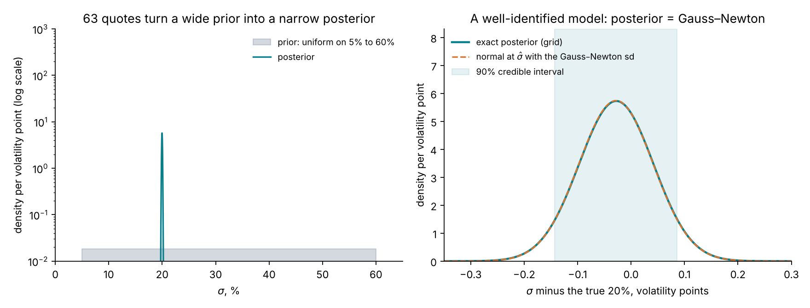
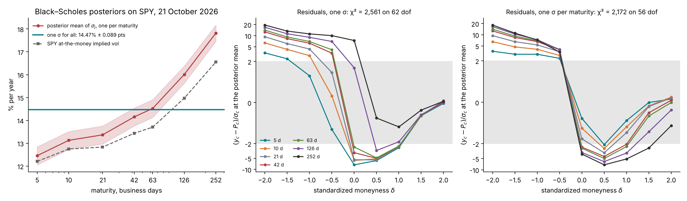
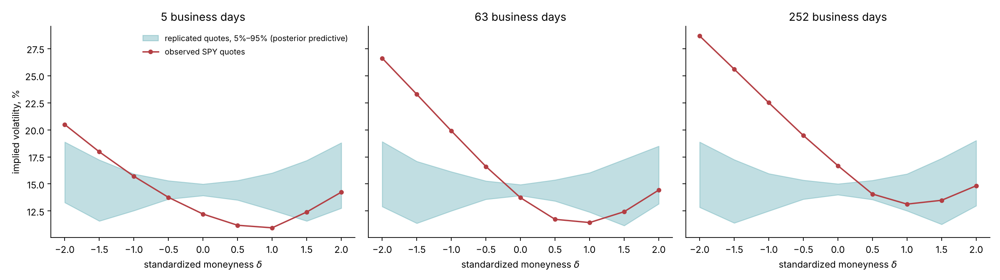
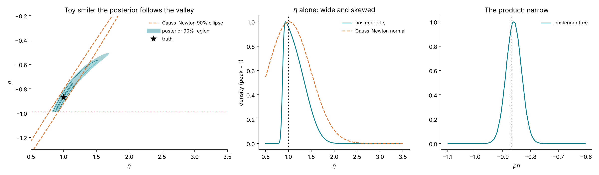
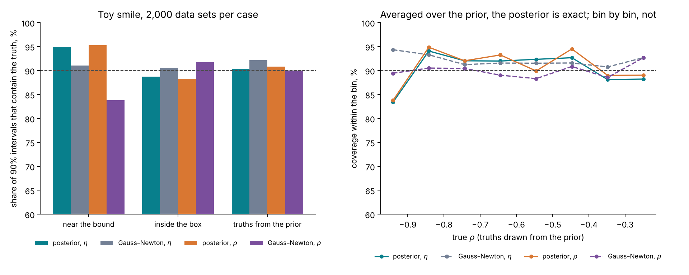
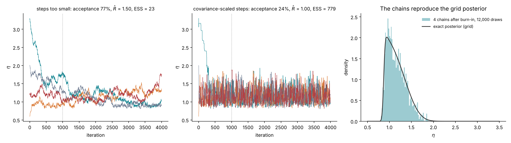

# Lecture 8. Bayesian calibration

[Course index](README.md) · Previous: [Lecture 7. Calibration as estimation](07-calibration-as-estimation.md) · Next: [Lecture 9. Amortized inference](09-amortized-inference.md)

**What this lecture is for.** This lecture replaces the single calibrated point of Lecture 7 by a probability distribution over the parameters, the posterior, and shows what it adds. It states Bayes' rule for a calibration and the tutorial's prior, computes exact posteriors on a grid for Black–Scholes and for the toy smile of Lecture 7, checks a posterior against real quotes with a posterior predictive check, and compares credible intervals with confidence intervals by simulation. It then pushes the posterior through to the prices of the products of Lecture 6 with common random numbers, and reads off the 90% quantile and the reserve. It derives two exact ways to sample a posterior: the Metropolis–Hastings sampler with its two diagnostics, and importance sampling with its own. It shows on a simulated Black–Scholes sector how a hierarchical model lets thin names borrow strength from liquid ones. It closes with what the posterior does not cover.

**Where it sits in the course.** Lecture 6 asked for a range of plausible prices for products the smile does not pin down. Lecture 7 built that range from one optimum and a local covariance, and showed where the construction breaks. This lecture builds it from the posterior, which is exact under the stated model and the stated prior, whatever the shape of the plausible set. Its one drawback is cost: every evaluation of the posterior density is one priced surface. For Black–Scholes and Heston that is cheap. For rough Bergomi it is a Monte Carlo run, which is the subject of Lecture 14. Lecture 9 learns the posterior from simulations instead, and Lecture 11 applies the methods of this lecture to Heston.

**Its part in the argument.** This lecture shows the first two claims of the argument (Lecture 6, Section 6.8) in their simplest form. The posterior returns the classical interval when the conditions of Lecture 7 hold (Section 8.3). It differs where a direction is weakly informed (Section 8.5) and where a name quotes almost nothing (Section 8.10). Section 8.11 sorts the cases. Section 8.12 states the fourth claim: what the posterior does not cover.

## 8.1 Bayes' rule for a calibration

The quotes $y$ and the parameters $\theta$ have a joint distribution, written two ways by the product rule of probability:

$$
p(\theta, y \mid \xi_0) = p(y \mid \theta, \xi_0)\,p(\theta) = p(\theta \mid y, \xi_0)\,p(y \mid \xi_0) .
$$

The first factorization says how the data arise: a parameter value is drawn from the **prior** $p(\theta)$, and the quotes are drawn from the observation model of Lecture 7 given that value, with density the likelihood $p(y \mid \theta, \xi_0)$. Dividing the two factorizations by $p(y \mid \xi_0)$ gives **Bayes' rule**:

$$
p(\theta \mid y, \xi_0) = \frac{p(y \mid \theta, \xi_0)\,p(\theta)}{p(y \mid \xi_0)}, \qquad p(y \mid \xi_0) = \int p(y \mid \theta, \xi_0)\,p(\theta)\,d\theta .
$$

The left side is the **posterior**: the distribution of the parameters given the quotes actually observed. The denominator, the **evidence**, does not depend on $\theta$; it only makes the posterior integrate to one. With the Gaussian observation model of Lecture 7, $\log p(y \mid \theta, \xi_0) = -\tfrac12\chi^2(\theta) + \text{const}$, so

$$
\log p(\theta \mid y, \xi_0) = -\tfrac12\,\chi^2(\theta) + \log p(\theta) + \text{const} .
$$

The same objective that least squares minimizes now shapes a distribution. Least squares keeps the lowest point of $\chi^2$. The posterior keeps all of it: a parameter value whose $\chi^2$ is 2 above the minimum has posterior density $e^{-1} = 0.37$ times that of the optimum (for a flat prior), and one 10 above has $e^{-5} = 0.007$ times.

From the posterior follow three things least squares does not return.

1. **A distribution over the whole plausible set**, of whatever shape, including curved valleys, truncation at bounds and several modes.
2. **Weights.** Two calibrations with $\chi^2$ of 60 and 62 are weighted $1$ to $e^{-1}$, and two with 60 and 120 are weighted $1$ to $e^{-30}$; a multi-start treats both pairs alike (Lecture 7, Section 7.8).
3. **A distribution for any function of the parameters.** A product price $p_\Pi(\theta)$ has the posterior distribution of $p_\Pi(\theta)$ when $\theta$ is drawn from $p(\theta \mid y, \xi_0)$. Its quantiles are the range and the prudent value that Lecture 6 asks for.

## 8.2 The prior

The prior states which parameter values are possible before the quotes are seen. The tutorial uses independent uniform distributions on boxes (design document, "The prior"; `lab/src/sbi4finance/calibration/tasks.py`).

| Model | Parameter | Prior | What it encodes |
| --- | --- | --- | --- |
| Rough Bergomi | $H$ | Uniform(0.02, 0.35) | Rough to nearly Markovian; equity estimates cluster near 0.1 |
| | $\eta$ | Uniform(0.5, 3.5) | Mild to violent volatility of variance; SPX fits report values near 2 |
| | $\rho$ | Uniform(−0.99, −0.2) | Negative correlation only: the equity skew |
| Heston ($\kappa = 2$ fixed) | $v_0$ | Uniform(0.01, 0.16) | Spot volatility from 10% to 40% |
| | $\theta_H$ | Uniform(0.01, 0.16) | Long-run volatility from 10% to 40% |
| | $\sigma_v$ | Uniform(0.1, 1.5) | Volatility of variance |
| | $\rho$ | Uniform(−0.95, −0.1) | Negative correlation only |

The forward-variance curve $\xi_0$ of rough Bergomi is not in the table. On a liquid smile it is read from the chain and held fixed (Lecture 5), and the rough-Bergomi posterior is conditional on it; the simulations that train the network of Lecture 15 draw curves from a separate prior, which describes the curves the network must be ready for, not a belief about today's curve (design document, "The prior"). Beyond the last quote (Lecture 15, Section 15.6) and on a thin chain (Lecture 16, Section 16.2), the curve is inferred instead, and that prior becomes part of the posterior. Heston has no such input: its forward-variance curve is a function of $v_0$ and $\theta_H$ (Lecture 10), and the conditioning on $\xi_0$ in the formulas of this lecture is empty for it.

**Why uniform.** A uniform prior on a box makes the posterior proportional to the likelihood inside the box and zero outside:

$$
p(\theta \mid y, \xi_0) \propto \exp\!\big(-\tfrac12\chi^2(\theta)\big)\,\mathbf 1\lbrace\theta \in B\rbrace .
$$

The posterior is then the least-squares objective of Lecture 7, exponentiated and restricted to the box, and the two routes can be compared directly. The box itself is information: it says that a correlation of −0.995 or a vol of vol of 5 is not considered. Its edges matter only where the likelihood reaches them, as it does for $\rho$ in the toy smile.

**Uniform is not "uninformative".** A prior uniform in $\eta$ is not uniform in $\eta^2$: if $\eta \sim \text{Uniform}(0.5, 3.5)$, then $v = \eta^2$ has density $\frac{1}{3}\cdot\frac{1}{2\sqrt v}$ on $(0.25, 12.25)$, which favours small values. Every prior favours something; the uniform box is chosen because it is simple to state, simple to sample, and matches what the training banks of Lectures 12 and 15 simulate. Where the quotes inform a parameter well, the choice hardly matters. Where they do not, as for $\eta$ at fixed $\rho\eta$ when only the short-dated skew informs them (the toy smile of Section 8.5), the posterior partly reflects the prior, and the lecture's exercises change it.

**Logit coordinates.** Samplers and neural networks work best on unbounded coordinates. Each parameter is mapped to the real line by

$$
u_i = \frac{\theta_i - a_i}{b_i - a_i} \in (0, 1), \qquad z_i = \log\frac{u_i}{1 - u_i} \in \mathbb R, \qquad \theta_i = a_i + \frac{b_i - a_i}{1 + e^{-z_i}} ,
$$

where $(a_i, b_i)$ is the prior range. A density changes under a change of variables by the absolute derivative of the map. Here $d\theta_i / dz_i = (b_i - a_i)\,u_i(1 - u_i)$, and the uniform prior density is $1/(b_i - a_i)$, so the prior density of $z_i$ is

$$
p(z_i) = \frac{1}{b_i - a_i}\cdot(b_i - a_i)\,u_i(1 - u_i) = u_i(1 - u_i),
$$

the logistic density, and the log posterior in logit coordinates is

$$
\log p(z \mid y, \xi_0) = -\tfrac12\,\chi^2\big(\theta(z)\big) + \sum_i \log\big(u_i(1 - u_i)\big) + \text{const} .
$$

The last sum, the log-Jacobian, is easy to forget. Without it, a sampler in $z$ would target the likelihood under a flat prior on $z$. That target is improper whenever the likelihood is positive at a bound of the box, because the flat prior gives the unbounded stretch of $z$ beyond any point unlimited mass. When the likelihood at the bounds is negligible, as for a parameter pinned well inside its range, a finite chain does not notice. When it is not, as for $\rho$ in the toy smile and in the Heston example of Lecture 11, Section 11.3, the chain drifts toward the bound.

## 8.3 A first posterior: Black–Scholes on Black–Scholes quotes

With one parameter the posterior can be computed exactly on a grid: evaluate $-\tfrac12\chi^2(\sigma)$ at 2,001 points between 19% and 21%, exponentiate, and normalize by numerical integration. Outside that window the likelihood is negligible (the posterior standard deviation turns out to be 0.07 volatility points), so the rest of the prior range contributes nothing to the normalization. The quotes are 63 synthetic Black–Scholes prices at $\sigma = 20\%$ with the design noise, the same data set as Figure 7.2; the prior is uniform on 5% to 60%.

*Figure 8.1.* How to read the figure: the left panel shows the prior, flat at 0.018 per volatility point, and the posterior, a spike at 20%. The prior's standard deviation is 15.9 volatility points; the posterior's is 0.0696, 228 times smaller. The right panel zooms in. The posterior mean is 19.972%, the 90% credible interval is 19.857% to 20.086%, and the dashed curve, a normal density centred at the least-squares estimate with the Gauss–Newton standard deviation of 0.0695 points, lies on top of the exact posterior.

**Why the two agree.** Expand $\chi^2$ to second order around its minimum $\hat\sigma$:

$$
\chi^2(\sigma) \approx \chi^2(\hat\sigma) + (\sigma - \hat\sigma)^2\,J^\top J \quad\Longrightarrow\quad p(\sigma \mid y) \propto \exp\!\Big(-\frac{(\sigma - \hat\sigma)^2}{2\,(J^\top J)^{-1}}\Big)
$$

inside the box. The posterior is then the normal density with mean $\hat\sigma$ and variance $(J^\top J)^{-1}$, the Gauss–Newton variance. The approximation holds when the three conditions of Lecture 7 hold: much information, an optimum away from the bounds, and a nearly quadratic objective over the posterior's width. This is the **Bernstein–von Mises theorem** in the form this course uses: when the classical interval is right, the posterior agrees with it (van der Vaart 1998, Chapter 10). The posterior differs from the Gauss–Newton interval only where the conditions fail, which is where the difference matters.

## 8.4 A posterior for a wrong model: Black–Scholes on SPY

The same computation on SPY's 63 grid quotes of 21 October 2026 asks: if Black–Scholes were true, which volatility would the quotes support?

*Figure 8.2.* How to read the figure: in the left panel the horizontal line is the posterior of a single $\sigma$, 14.47% with a standard deviation of 0.089 points (90%: 14.32% to 14.62%). The red curve and band are the posterior means and 90% intervals of a separate $\sigma_j$ for each maturity, from 12.45% at 5 days to 17.82% at 252 days, each with a standard deviation of 0.22 to 0.24 points; the dashed curve is SPY's at-the-money implied volatility, from 12.21% to 16.55%. The centre panel shows the residuals $(y_c - P_c)/\sigma_c$ of the single-$\sigma$ fit on a scale that is linear within ±2 and logarithmic beyond. A correct model puts 95% of them in the grey band; here 35% are there, the largest is 19.4, and $\chi^2 = 2{,}561$ on 62 degrees of freedom, against an expected 62 ± 11. The right panel gives a $\sigma$ to each maturity: $\chi^2$ falls only to 2,172 on 56 degrees of freedom, and 30% of the residuals are within ±2. The puts are too expensive and the calls too cheap at every maturity, which no single volatility per maturity can produce.

**The width of a posterior is conditional on the model.** The posterior of $\sigma$ is narrow, 0.089 points, because 63 quotes inform one number very precisely about what it would be if the model were right. It does not say that the model is right. A bank that read the narrow posterior as small model risk would be wrong by the whole smile. The fit must be checked before the width is read.

**The posterior predictive check.** The model's own forecast of new quotes, given the observed ones, is the **posterior predictive distribution**:

$$
p(\tilde y \mid y, \xi_0) = \int p(\tilde y \mid \theta, \xi_0)\,p(\theta \mid y, \xi_0)\,d\theta .
$$

It is sampled in two steps: draw $\theta^{(m)}$ from the posterior, then draw replicated quotes $\tilde y^{(m)} = P(\theta^{(m)}; \xi_0) + \sigma\odot\varepsilon^{(m)}$ from the observation model. If the model is right, the observed quotes look like one more replicate, and each quote falls outside the central 90% of its replicates about one time in ten (Gelman, Meng and Stern 1996).

*Figure 8.3.* How to read the figure: each panel is one maturity, in implied-volatility units. The blue band holds the central 90% of 400 replicated smiles; the red curve is the observed smile. At 5, 63 and 252 days, 5, 7 and 5 of the 9 observed quotes lie outside the band, against about 1 expected. The band is widest in the wings because the quote noise is set by the vega at 20% (Lecture 7, Section 7.1): at the posterior's 14.5% the vega at $|\delta| = 2$ is 6.2 times smaller, so the noise there is about 6.2 volatility points instead of 1.0. Between 12% and 13% of the replicated quotes have no implied volatility, almost all of them in the wings, where the noisy price falls below zero, and they are left out of the band.

The check fails, as it should: Black–Scholes cannot produce a skew. The same check is run on the tutorial's real smile with rough Bergomi (design document, study S8; Lecture 15), where it is the test that the posterior's width can be trusted.

## 8.5 Identification read off the posterior

Return to the toy smile of Lecture 7, Section 7.7, the case in which only the skew and a noisy curvature inform $(\eta, \rho)$: nine quotes $y_j = \rho\eta\,x_j + 0.05\,\eta^2 x_j^2 + s_j\varepsilon_j$, a uniform prior on the box $\eta \in (0.5, 3.5)$, $\rho \in (-0.99, -0.2)$, the truth $(1.0, -0.87)$ near the bound, and the same simulated data set as Figure 7.4. With two parameters, the posterior is computed exactly on a grid of $321 \times 241$ points.

*Figure 8.4.* How to read the figure: in the left panel the shaded area is the posterior's 90% highest-density region, the smallest region holding 90% of the posterior probability; the dotted line is the bound $\rho = -0.99$; the dashed lines are the two long sides of the Gauss–Newton ellipse, whose ends lie outside the plotted area. The posterior follows the curved valley and stops at the bound. The centre panel shows the marginal posterior of $\eta$: its 90% interval is 0.88 to 1.58, with median 1.13, against the Gauss–Newton interval 0.24 to 1.79, which crosses the bottom of the box. The posterior of $\eta$ rises steeply at the left, where the bound cuts the valley, and has a long right tail. The right panel shows the posterior of $\rho\eta$: its 90% interval is −0.906 to −0.815, with median −0.861, a width of ±5% around the true −0.87. For $\rho$ the posterior interval is −0.967 to −0.542, against the Gauss–Newton −1.50 to −0.20.

The posterior reads off what the toy smile identifies, the product $\rho\eta$, and what it does not, the split between $\rho$ and $\eta$, without a separate identifiability analysis. The toy stands for the short skew alone; Lecture 13 shows that the full rough-Bergomi surface also separates $\eta$ from $\rho$, provided the forward-variance curve is read correctly. Every posterior interval lies inside the box. Its median for $\eta$, 1.13, is above the least-squares 1.015, because the bound removes the part of the valley at small $\eta$ and leaves the long part at large $\eta$.

## 8.6 Credible and confidence intervals

The posterior's 90% interval and the Gauss–Newton 90% interval answer different questions.

A **confidence interval** $C(y)$ is a procedure whose output contains the true value in 90% of repeated data sets, for every fixed true value:

$$
\Pr\big(\theta^* \in C(y) \;\big|\; \theta^*\big) = 0.9 \quad\text{for every } \theta^* .
$$

The Gauss–Newton interval aims at this and reaches it only approximately.

A **credible interval** $C(y)$ holds 90% of the posterior probability for the data actually observed:

$$
\Pr\big(\theta \in C(y) \;\big|\; y\big) = \int_{C(y)} p(\theta \mid y)\,d\theta = 0.9 .
$$

The two meet on average. Draw the truth from the prior and the data from the model, and compute the probability that the credible interval contains the truth:

$$
\int\!\!\int \mathbf 1\lbrace\theta^* \in C(y)\rbrace\,p(y \mid \theta^*)\,p(\theta^*)\,dy\,d\theta^*
= \int \Big[\int \mathbf 1\lbrace\theta^* \in C(y)\rbrace\,p(\theta^* \mid y)\,d\theta^*\Big]\,p(y)\,dy
= \int 0.9\;p(y)\,dy = 0.9 .
$$

The first equality uses $p(y \mid \theta^*)\,p(\theta^*) = p(\theta^* \mid y)\,p(y)$ from Section 8.1; the inner integral is 0.9 by the definition of the credible interval. The coverage of credible intervals, averaged over truths drawn from the prior, is exactly nominal. No approximation enters. This identity is the basis of simulation-based calibration, the test of Lecture 9, Section 9.7. At a single fixed truth, the coverage of a credible interval can be above or below 90%.

*Figure 8.5.* How to read the figure: each case uses 2,000 simulated data sets, a fresh set from the ones of Figure 7.5, so the Gauss–Newton numbers differ from that figure by sampling error. The posterior intervals are the 5% and 95% quantiles of each marginal posterior. With truths drawn from the prior (left, third group), the posterior intervals cover 90.4% for $\eta$ and 90.8% for $\rho$, within the simulation's standard error of 0.7 points of 90%, as the identity requires; the Gauss–Newton intervals cover 92.2% and 90.0%. At the truth near the bound, the posterior covers 95.0% and 95.3% and Gauss–Newton 91.1% and 83.8%. At the truth inside the box, the posterior covers 88.8% and 88.3% and Gauss–Newton 90.6% and 91.8%. The right panel groups the truths drawn from the prior by their $\rho$: the posterior's coverage is 88% to 95% in seven of the eight bins and 83.4% (for $\eta$) and 83.8% (for $\rho$) in the bin nearest the bound.

**Interpretation.** The posterior's guarantee is exact and holds on average over the prior; it is the right guarantee when many smiles, whose parameters vary as the prior describes, are calibrated: in a valuation across a book, or in the validation of a method on simulated smiles (Lecture 14). In the bin nearest the bound the posterior under-covers because its intervals are equal-tailed: they always exclude the lowest 5% of the posterior mass, which for a truth at the bound is where the truth is. In this toy, the Gauss–Newton interval's coverage is also close to nominal on average. Its defect is the one Lecture 7 showed: it is a symmetric interval on a curved, truncated valley, and most of its intervals near the bound include values the model does not allow. The posterior's intervals never do.

## 8.7 From the posterior to product prices

A product price is a function of the parameters, so its posterior distribution is obtained by pricing the product at posterior draws:

$$
p_\Pi^{(m)} = p_\Pi\big(\theta^{(m)};\ \xi_0\big), \qquad \theta^{(m)} \sim p(\theta \mid y, \xi_0), \qquad m = 1, \dots, M .
$$

The values $\lbrace p_\Pi^{(m)}\rbrace$ are draws from the posterior distribution of the price. No linearization enters, unlike the delta method of Lecture 7. Jacquier and Jarrow (2000) used the same construction, with Markov chain Monte Carlo, to carry parameter uncertainty into Black–Scholes option values and hedge ratios.

**Common random numbers.** The prices of Lecture 6's products are Monte Carlo estimates, $\hat p_\Pi(\theta; \omega) = p_\Pi(\theta) + e(\theta; \omega)$, where $e$ is the Monte Carlo error for the random stream $\omega$. If every draw uses its own stream, the spread of the estimates is

$$
\mathrm{Var}\big(\hat p_\Pi^{(m)}\big) = \mathrm{Var}_{\text{post}}\big(p_\Pi(\theta)\big) + \mathbb E\big[s^2(\theta)\big],
$$

the posterior variance of the price plus the Monte Carlo variance $s^2$: the noise widens the range. If every draw uses the same stream $\omega$, the errors are nearly the same function of $\omega$ for nearby $\theta$, $e(\theta; \omega) \approx e(\bar\theta; \omega) + \nabla_\theta e(\bar\theta; \omega)^\top(\theta - \bar\theta)$. The first term is common to all draws: it shifts the whole price distribution by one Monte Carlo error and does not widen it. The range then measures the parameters, and the common shift is reported separately as the Monte Carlo standard error of the point price (Glasserman 2004). The repository's pricer uses, in addition, antithetic pairs and control variates (`lab/src/sbi4finance/calibration/products.py`), and prices the variance swap from the exact mean of the path law, so its Monte Carlo error is zero.

**The point, the range and the reserve.** Three numbers are read off the price draws (design document, "The point price, the range and the reserve"; Lecture 6):

- the **point price** $\hat p_\Pi$, the price at the least-squares calibration;
- the **90% range**, from the 5% to the 95% quantile of the draws;
- the **reserve**: for a position the bank has sold, the prudent value is the 90% quantile $q_{0.9}$, and the reserve is $q_{0.9} - \hat p_\Pi$; for a position it holds, $\hat p_\Pi - q_{0.1}$.

Lecture 11 applies this method to a Heston posterior, where it also measures the effect of common random numbers, and Lecture 15 applies it to rough Bergomi on SPY's smile. Lecture 11, Section 11.5 shows which parameter each Heston price range comes from, by the law of total variance. Lecture 13 explains why the variance swap has a range under Heston and none under rough Bergomi with a fixed curve.

## 8.8 Sampling a posterior: Metropolis–Hastings

A grid works in one or two dimensions. In four, a grid of 100 points per parameter has $10^8$ points; at the roughly 25 milliseconds per Heston surface measured in Lecture 11, Section 11.3, that is about a month. A posterior in more than two dimensions is represented instead by draws $\theta^{(1)}, \dots, \theta^{(M)}$, and any posterior expectation is estimated by an average, $\mathbb E[f(\theta) \mid y] \approx \frac1M\sum_m f(\theta^{(m)})$.

**The algorithm.** Write $\pi(\theta)$ for the unnormalized posterior, $p(y \mid \theta)\,p(\theta)$. The **Metropolis–Hastings** algorithm (Metropolis et al. 1953; Hastings 1970) builds a Markov chain whose long-run distribution is $\pi$. From the current state $\theta$:

1. Propose $\theta'$ from a proposal density $q(\theta' \mid \theta)$.
2. Accept it with probability $\alpha(\theta, \theta') = \min\!\Big(1,\ \dfrac{\pi(\theta')\,q(\theta \mid \theta')}{\pi(\theta)\,q(\theta' \mid \theta)}\Big)$; otherwise stay at $\theta$.

The normalizing constant $p(y)$ appears in both $\pi(\theta')$ and $\pi(\theta)$ and cancels, which is why it never needs computing.

**Why it works.** A chain with transition density $T(\theta \to \theta')$ leaves $\pi$ unchanged if it satisfies **detailed balance**, $\pi(\theta)\,T(\theta \to \theta') = \pi(\theta')\,T(\theta' \to \theta)$: integrating both sides over $\theta$ gives $\int \pi(\theta)\,T(\theta \to \theta')\,d\theta = \pi(\theta')$, so a draw from $\pi$ stays a draw from $\pi$ after one step. For $\theta' \neq \theta$, the Metropolis–Hastings transition is $T(\theta \to \theta') = q(\theta' \mid \theta)\,\alpha(\theta, \theta')$, and

$$
\pi(\theta)\,q(\theta' \mid \theta)\,\alpha(\theta, \theta') = \min\!\big(\pi(\theta)\,q(\theta' \mid \theta),\ \pi(\theta')\,q(\theta \mid \theta')\big),
$$

which is symmetric in $\theta$ and $\theta'$. Detailed balance holds. With a proposal that can reach every region of positive posterior density, the chain's distribution converges to $\pi$ from any start.

**Random-walk proposals and their scale.** The course's samplers use $\theta' = \theta + L\,\varepsilon$ with $\varepsilon \sim \mathcal N(0, I)$ and $LL^\top = \Sigma_{\text{prop}}$. The proposal is symmetric, so the ratio reduces to $\pi(\theta')/\pi(\theta)$. Steps that are too small are almost always accepted and move slowly; steps that are too large are almost always rejected. For a target close to a $d$-dimensional normal with covariance $\Sigma$, the efficient choice is $\Sigma_{\text{prop}} = (2.38^2/d)\,\Sigma$, with an acceptance rate near 23% in high dimension (Roberts, Gelman and Gilks 1997). $\Sigma$ is not known in advance; it is taken from the Gauss–Newton covariance or from a first, discarded run.

**Two diagnostics.** A chain gives correlated draws, and its early draws depend on the start. Two numbers check a run of $m$ chains with $n$ draws each, after the first part (the **burn-in**) is discarded.

**Split-$\hat R$** (Gelman and Rubin 1992; Gelman et al. 2013). Split each chain in halves, giving $2m$ sequences of length $n' = n/2$. Let $W$ be the mean of the within-sequence variances and $B$ be $n'$ times the variance of the sequence means. Then

$$
\hat R = \sqrt{\frac{\tfrac{n'-1}{n'}\,W + \tfrac{1}{n'}\,B}{W}} .
$$

If all sequences sample the same distribution, $B/n'$ is small and $\hat R \to 1$; if a chain is stuck or still drifting, $\hat R > 1$. Vehtari et al. (2021) recommend $\hat R < 1.01$ and propose a rank-normalized version; the course's scripts compute the classical split form, and the design document sets the same 1.01 threshold for its Heston chains.

**Effective sample size.** With $\rho_t$ the autocorrelation of the chain at lag $t$, the variance of a chain average of $N = mn$ draws is that of $N/\tau$ independent draws, with $\tau = 1 + 2\sum_{t \geq 1}\rho_t$. The **effective sample size** is $N/\tau$. The sum is truncated where the sums of adjacent pairs $\rho_{2k} + \rho_{2k+1}$ first turn negative (Geyer 1992). The Monte Carlo error of a posterior mean is the posterior standard deviation divided by $\sqrt{\text{ESS}}$; a few hundred effective draws give 90% quantiles good to a few percent of the posterior's width.

*Figure 8.6.* How to read the figure: each panel shows four chains of 4,000 steps from four starts spread over the box, with the first 1,000 steps (left of the dotted line) discarded. In the left panel the proposal has standard deviations of 0.02 in $\eta$ and 0.01 in $\rho$: the acceptance rate is 77%, but each step is short, so the chains wander slowly, still remember their starts after 1,000 steps and disagree with one another: $\hat R = 1.50$, and the 12,000 retained draws are worth 23 independent ones. In the centre panel the proposal covariance is the posterior covariance computed on the grid, times $2.38^2/2$: the acceptance rate is 24%, the chains forget their starts within a few hundred steps, $\hat R = 1.003$, and the effective sample size is 779. The right panel compares the 12,000 retained draws of the second run with the grid posterior of Figure 8.4.

Lecture 11, Section 11.3 runs this sampler on a four-parameter Heston posterior.

## 8.9 Importance sampling

Importance sampling is a second exact method, and it needs no chain. It draws parameter values independently from a proposal built from an approximation of the posterior, such as the Gauss–Newton normal of Lecture 7 or a network's posterior (Lecture 9), and reweights them with the likelihood. The course uses it to audit a network's posterior on one smile, following neural importance sampling (Dax et al. 2023), so this section calls the approximation the network.

**Self-normalized importance sampling.** Let $\pi(\theta) = p(\theta)\,L(\theta)/Z$ be the posterior of one smile, with $L(\theta) = p(y \mid \theta, \xi_0)$ and $Z$ unknown. For any density $q$ that is positive where $\pi$ is, and any function $h$,

$$
\mathbb{E}_\pi[h] = \frac{\mathbb{E}_q[h\,w]}{\mathbb{E}_q[w]}, \qquad w(\theta) = \frac{p(\theta)\,L(\theta)}{q(\theta)},
$$

because $\mathbb{E}_q[h\,w] = \int h\,p\,L\,d\theta = Z\,\mathbb{E}_\pi[h]$ and $\mathbb{E}_q[w] = Z$. With $M$ draws $\theta^{(m)} \sim q$, the estimate $\sum_m w^{(m)} h(\theta^{(m)}) / \sum_m w^{(m)}$ converges to $\mathbb{E}_\pi[h]$, and $Z$ cancels. The weighted draws are a sample of the exact posterior.

**Efficiency.** The estimate's variance is governed by the spread of the weights. The effective sample size

$$
\mathrm{ESS} = \frac{\big(\sum_m w^{(m)}\big)^2}{\sum_m \big(w^{(m)}\big)^2}
$$

counts how many equal-weight draws the sample is worth, and the efficiency is $\mathrm{ESS}/M$. As $M$ grows, it tends to $\mathbb{E}_q[w]^2 / \mathbb{E}_q[w^2] = 1 / \mathbb{E}_\pi[\pi/q]$, which is 1 only when $q = \pi$.

**A closed form.** Let the posterior be $\mathcal{N}(0, I_d)$ in standardized coordinates and the proposal $\mathcal{N}(\delta e_1, \lambda^2 I_d)$: a network whose mean is off by $\delta$ posterior standard deviations in one coordinate and whose width is $\lambda$ times the true one in all $d$. Completing the square in the Gaussian integral $\int \pi^2/q$ gives

$$
\frac{\mathrm{ESS}}{M} \;\longrightarrow\; \left(\frac{\sqrt{2\lambda^2 - 1}}{\lambda^2}\right)^{d} \exp\!\left(-\frac{\delta^2}{2\lambda^2 - 1}\right), \qquad \lambda^2 > \tfrac12 .
$$

At the right width, $\lambda = 1$, the efficiency is $e^{-\delta^2}$: 0.37 at $\delta = 1$ and 0.018 at $\delta = 2$. For $\lambda^2 \le \frac12$ the integral diverges: the weights have infinite variance, and a proposal narrower than $1/\sqrt2$ of the posterior gives an estimate whose error does not shrink like $1/\sqrt{M}$.

**The tail of the weights, $\hat k$.** A finite sample cannot show an infinite variance directly. Pareto-smoothed importance sampling fits a generalized Pareto law to the largest weights, the largest $\min(0.2M, 3\sqrt{M})$ of them, and reports its shape $\hat k$ (Zhang and Stephens 2009; Vehtari et al. 2024). A Pareto tail with shape $k$ has a finite variance only for $k < \frac12$ and a finite mean only for $k < 1$. Below 0.5 the estimate is reliable. Above it, Vehtari et al. (2024) set a threshold that depends on the sample size, $\min(1 - 1/\log_{10} M,\ 0.7)$: 0.58 for $M = 256$ proposals and 0.70 for $M = 2{,}048$. Above the threshold the estimate is unreliable, whatever the efficiency says. The design document's rule, $\hat k > 0.7$, is the large-sample value.

**The defensive proposal.** The audit's proposal $q$ is a Student $t$ law with 5 degrees of freedom, centred at the mean $\hat\mu$ of the network's draws in logit coordinates, with shape matrix $1.2^2\hat\Sigma$, where $\hat\Sigma$ is the draws' covariance, mixed with 10% of the prior (`sbi4finance.calibration.correction.fit_proposal` and `propose`). A $t$ law with $\nu$ degrees of freedom has covariance $\nu/(\nu - 2)$ times its shape matrix, so the proposal's $t$ part has covariance $\tfrac53 \times 1.44\,\hat\Sigma = 2.4\,\hat\Sigma$:

$$
q = 0.9\,t_5(\hat\mu, 1.2^2\hat\Sigma) + 0.1\,p(\theta) \quad\Longrightarrow\quad w = \frac{p\,L}{q} \le \frac{p\,L}{0.1\,p} = 10\,L .
$$

The prior component bounds every weight by ten times the likelihood, so the weights have a finite variance however narrow or misplaced the network's law (Hesterberg 1995). It does not prevent a few draws from carrying most of the weight. When the likelihood is concentrated far from where most proposals fall, the few proposals that land there dominate: the toy of Figure 8.7 reaches $\hat k = 0.93$ with the defensive proposal. The $t$ tails and the wide shape cover the posterior where the network is too narrow. The densities are evaluated in the network's logit coordinates, with the Jacobian of the logit map included, as in Section 8.2.

*Figure 8.7.* How to read the figure: the posterior is $\mathcal{N}(0, I_3)$; each point is the median of 60 audits with $M = 256$. Teal is a Gaussian proposal equal to the network's law; orange is the audit's defensive proposal built from it, with a broad Gaussian of standard deviation 4 standing in for the prior. Black is the closed form.

- **Left: a shifted network.** The teal points follow $e^{-\delta^2}$ up to $\delta \approx 1$: 0.40 at $\delta = 1$ against 0.37. Beyond that they lie above the curve: at $\delta = 2$ the median efficiency is 0.088, against 0.018 in theory. The rare large weights that drag the true efficiency down are not yet among 256 draws, so the measured efficiency is too optimistic. $\hat k$ reports it: its median passes 0.7 at $\delta = 2.25$ (0.82). The defensive proposal costs efficiency when the network is right, 0.70 at $\delta = 0$, and degrades more slowly when it is wrong.
- **Centre: a network of the wrong width.** The teal points follow the closed form for $\lambda \ge 0.8$. Left of $\lambda = 1/\sqrt2$ the weights have infinite variance, yet the measured efficiency stays between 0.11 and 0.39: a finite sample hides the problem. The defensive proposal keeps an efficiency of 0.55 even at $\lambda = 0.5$. At $\lambda = 1.5$, a network as much too wide as the rough pilot's (Lecture 15), the defensive proposal's efficiency is 0.35.
- **Right: the tail of the weights.** For the plain proposal, $\hat k$ rises as the network gets narrower and reaches 0.74 at $\lambda = 0.5$. For the defensive proposal it stays far below 0.5 at every $\lambda \le 2$, because its weights are bounded and its covariance, 2.4 times the network's, covers the target. At $\lambda = 3$ both rise again, to 0.45 and 0.93: a proposal so wide that a handful of draws carry the weight is also flagged, because 256 draws are then too few. The dotted lines mark 0.5, the threshold 0.58 for $M = 256$, and 0.7.

**A Monte Carlo likelihood.** When the prices are Monte Carlo estimates, as under rough Bergomi, the weights need an unbiased estimate of the likelihood itself, not of its logarithm. Importance sampling with such an estimate still targets the exact posterior (`lab/src/sbi4finance/calibration/correction.py`). The plug-in density $\mathcal N(y;\ \hat P,\ \mathrm{diag}(\sigma^2))$ is not such an estimate: it is unbiased for a model with noise variance $\sigma^2 + s^2$ (Lecture 14, Section 14.2). Two conditions give an unbiased estimate. First, each proposal is priced with its own random numbers. With the common random numbers of Section 8.7, the weights would converge to the posterior given one set of Monte Carlo errors, which is shifted from the exact one and, with the variance $\sigma^2 - s^2$, narrower. Second, quotes priced on the same paths have correlated errors, so the estimate uses their Monte Carlo covariance $S$. If $\hat P = P + e$ with $e \sim \mathcal N(0, S)$, the convolution of two Gaussians gives

$$
\mathbb E\Big[\mathcal N\big(y;\ \hat P,\ \mathrm{diag}(\sigma^2) - S\big)\Big] = \mathcal N\big(y;\ P,\ \mathrm{diag}(\sigma^2)\big)
$$

(`gaussian_loglik_mc`). The code refuses the estimate when the largest eigenvalue of $S$, in units of the quote noise, exceeds 0.5, because the estimate is then too noisy to weight with. The identity also needs $S$, and the number of paths, to be independent of $\hat P$. A Monte Carlo price and its estimated error are correlated, since a large payoff raises both, so choosing the path count from the pricing whose prices enter the likelihood biases the estimate. The code therefore takes the path count and $S$ from a separate pilot pricing (`price_for_likelihood`).

**What the audit cannot see.** The audit evaluates the likelihood under the same model and the same noise model as the network. If the model cannot produce the smile, the audit reweights toward the best wrong answer and can still report a high efficiency. The posterior predictive check of Section 8.4 addresses that.

## 8.10 Borrowing strength across names

A thin underlying quotes too little to be calibrated on its own, while other names in its sector may quote a full smile. A hierarchical model lets each thin name borrow strength from the rest of the sector. A simulated Black–Scholes sector shows what this changes (`lab/checks/bs_hierarchy.py`).

**The sector.** Each name has its own Black–Scholes volatility $\sigma_i$, and the log volatilities are drawn across names from $\mathcal N(\log 0.30,\ 0.10^2)$. The liquid names quote the 63 contracts of the design grid, with the design noise taken at a reference volatility of 30%. The illiquid names quote one 21-day at-the-money call, with 3 volatility points of noise. Every likelihood is the exact Gaussian likelihood of the quote noise, and the integrals are computed on grids, without sampling.

**Four methods** give a mark and a 90% interval for the volatility of each illiquid name.

1. **Per name.** Least squares on the name's own quotes, with the Gauss–Newton 90% interval of Lecture 7.
2. **Proxy.** The mean of the liquid names' marks, plus or minus 1.645 times their cross-sectional standard deviation. It ignores the illiquid name's own quote. It is one simple proxy of the course's own: the prudent-valuation rules allow "proxy data based on similar instruments" without giving a recipe (Regulation (EU) 2016/101, Art. 3(3)(a)).
3. **Empirical Bayes.** The normal hierarchical model $\log\sigma_i \sim \mathcal N(\mu, \tau^2)$, with its two hyperparameters $(\mu, \tau)$ at the maximum of the marginal likelihood of the sector's quotes. Each name's posterior combines its own quote with this estimated law of the sector.
4. **Hierarchical Bayes.** The same model with priors on $(\mu, \tau)$, flat on $\mu$ and half-normal with scale 0.3 on $\tau$, whose uncertainty is integrated out.

*Figure 8.8.* How to read the figure:

- **Left: how the methods differ, on one sector.** This is the first of the 600 simulated sectors with 2 liquid and 6 illiquid names; it was not chosen. Each row is one illiquid name, with one bar per method: its 90% interval and its mark (dot). The black tick is the true volatility, and a faded bar misses it. The dotted lines are the two liquid names' marks, 28.7% and 30.6%, both below the six illiquid names' true volatilities of 31.3% to 35.4%. The proxy gives every name the same interval, centred on the two liquid marks, and covers 1 truth of 6. Fitting each name alone gives wide intervals around a noisy quote: name 5's quote reads 24.4% for a true 32.4%. Empirical Bayes pulls each name toward its estimate of the sector, with too narrow a sector law, and covers 4 of 6. The hierarchical model pulls less, because it is unsure of the sector law, and covers 5 of 6.
- **Centre: coverage against width, over all sectors.** Each point is one method; filled squares are the sector with 2 liquid and 6 illiquid names (600 simulated sectors), open circles the sector with 8 and 32 (300). The dashed line is the nominal 90%. A good method sits on the line and as far left as it can.
- **Right: the error of the mark.** The root-mean-square error of each method's price for a six-month at-the-money call, which no illiquid name quotes, as a share of the true price.

With 2 liquid and 6 illiquid names the four methods give:

| Method | Coverage of 90% intervals | Mean width (vol points) | Error of the 6-month call's mark |
| --- | --- | --- | --- |
| Per name | 89.7% | 9.9 | 10.2% |
| Proxy: the liquid names' mean | 59.5% | 8.2 | 12.4% |
| Empirical Bayes | 69.7% | 5.5 | 8.5% |
| Hierarchical Bayes | 88.0% | 7.6 | 7.9% |

With 8 liquid and 32 illiquid names the four methods cover 89.6%, 83.3%, 87.5% and 89.4%, with mean widths of 9.9, 9.4, 6.8 and 7.1 volatility points.

**Interpretation.** The hierarchical model gives the most accurate mark and an interval that covers close to its nominal rate. Fitting each name alone also covers, but in the small sector its interval is 30% wider and the error of its mark 28% larger, because each name rests on one quote. The proxy and empirical Bayes are overconfident when the sector is small. The proxy ignores each name's own quote and inherits the error of two liquid marks. Empirical Bayes treats its estimated $(\mu, \tau)$ as known; its median estimate of the sector's dispersion $\tau$ is 0.086 against a true 0.10, so its sector law is too narrow. The hierarchical model carries the uncertainty of $(\mu, \tau)$ into each name. In the larger sector the hyperparameters are better determined, and empirical Bayes comes close to the hierarchical model.

**What this example does not show.** The sector is simulated and every name follows Black–Scholes, so the model is right by construction. Pooling real thin chains needs the same hierarchical step on rough-Bergomi posteriors of several real names, which the course has not run (v2-plan, Section 2.6, option D).

## 8.11 Where the posterior and the classical answer part

The results of this lecture sort into the cases of the argument of the course (Lecture 6, Section 6.8).

| Case | Classical answer | Posterior | Where it is shown |
| --- | --- | --- | --- |
| The quotes determine the parameters | The Gauss–Newton interval | The same interval | Section 8.3 on Black–Scholes; on SPY, Lecture 11 (Heston) and Lecture 15 (rough Bergomi) |
| A direction is weakly informed | A linear, symmetric interval, which can cross the bounds | Follows the curved, truncated valley | Section 8.5, the toy smile; on a thin chain, Lecture 16 (pending) |
| An input is not quoted | The input fixed, with no range | A prior on the input, carried into the range | Lecture 15, Section 15.6, the long end; on a thin chain, $H$ and the last curve level (Lecture 16, pending) |
| A name quotes almost nothing | Its own fit, wide, or a proxy, overconfident | Strength borrowed from the sector | Section 8.10, a simulated sector |

In the third case the posterior's range depends on the width of the prior. The posterior is then right if its prior is, and not otherwise. The course therefore tests other laws for the unquoted input (Lecture 16, Section 16.4).

## 8.12 What the posterior does not cover

The posterior is exact for the model, the prior and the observation model it is given. It does not cover what it is not given.

1. **The choice of model.** The posterior range is within-model. On pilot smile 290, Heston and rough Bergomi both fit, and their forward-start prices differ by 7.9%, more than either model's 90% range (3.8% and 2.2%) or reserve (1.6%); on smile 292 they differ by 4.1%, less than either range (8.1% and 9.3%) (Lecture 6, Section 6.7; design document, study S7). The across-model gap can therefore exceed the within-model range, and the posterior does not measure it. Across-model and model-free bounds remain separate numbers.
2. **The observation model.** The noise scale $s_{\text{iv}}(\delta)$, its independence across contracts and its Gaussian shape are assumptions (Lecture 7, Section 7.1). A noise scale twice as large would make the posterior about twice as wide in every direction where it is close to normal, since the Gauss–Newton covariance $(J^\top W J)^{-1}$ scales with $\sigma_c^2$.
3. **The prior box.** Values outside the box have zero posterior probability, whatever the quotes say. The posterior predictive check and the position of the posterior against the bounds show when the box binds.
4. **The forward-variance curve and the monitoring.** On a liquid smile $\xi_0$ is read from the chain and held fixed. Its uncertainty, which comes from the same quotes, is then not propagated, and the rough-Bergomi identification of $\eta$ through the long-dated at-the-money level relies on it (Lecture 13, Section 13.11). On a thin chain the curve is inferred (Lecture 16). The products are priced with continuous monitoring; daily monitoring adds a leverage term (Lecture 13).
5. **Numerical error.** The pricers have errors of their own. The Fourier ladder accepts a rung when it agrees with the next one to 0.1 quote-noise units on every contract, and the rough-Bergomi Monte Carlo doubles its paths until every standard error is below 0.25 quote-noise units, with up to 0.5 tolerated at the corner of the prior box (design document, "Heston" and "Rough Bergomi: a Monte Carlo run"). In the Heston example of Lecture 11, the Monte Carlo standard error of each point price is at most 0.55% of the price, against 90% ranges of 1.7% to 4.4%.
6. **Approximate inference.** A sampler that has not converged, or a network that approximates the posterior (Lecture 9), adds its own error. $\hat R$, the effective sample size, simulation-based calibration (Lecture 9, Section 9.7) and the importance-sampling audit (Section 8.9) measure it.

## 8.13 Summary

1. Bayes' rule turns the least-squares objective into a distribution: $\log p(\theta \mid y, \xi_0) = -\tfrac12\chi^2(\theta) + \log p(\theta) + \text{const}$. The posterior gives the whole plausible set with weights, and a distribution for any product price.
2. The tutorial's priors are uniform boxes, sampled in logit coordinates with the log-Jacobian $\sum_i \log(u_i(1 - u_i))$. Uniform is a choice, not an absence of information.
3. When the three conditions of Lecture 7 hold, the posterior is the Gauss–Newton normal (Bernstein–von Mises): 19.972% ± 0.0696 points for Black–Scholes on Black–Scholes quotes.
4. A posterior's width is conditional on the model. Black–Scholes on SPY gives 14.47% ± 0.089 points and $\chi^2 = 2{,}561$ on 62 degrees of freedom; the posterior predictive check puts 5 to 7 of 9 quotes outside their 90% bands.
5. On the toy smile, the posterior follows the curved, truncated valley: $\rho\eta$ to ±5%, $\eta$ from 0.88 to 1.58, every interval inside the box.
6. Credible intervals cover exactly on average over the prior, by an identity that needs no approximation; at a fixed truth they can over- or under-cover.
7. Product prices at posterior draws, with common random numbers, give the range, the 90% quantile and the reserve.
8. Metropolis–Hastings samples any posterior whose density can be evaluated up to a constant; $\hat R$ and the effective sample size check the run.
9. Importance sampling reweights draws from a proposal with the likelihood, and the weighted draws are a sample of the exact posterior. Its efficiency falls like $e^{-\delta^2}$ for a proposal $\delta$ standard deviations off, and $\hat k$ flags heavy-tailed weights that a finite sample hides. A defensive mixture keeps the weights' variance finite but does not stop a few draws from dominating. With a Monte Carlo likelihood, each proposal is priced with its own random numbers, and the estimate $\mathcal N(y;\ \hat P,\ \mathrm{diag}(\sigma^2) - S)$ uses the Monte Carlo covariance.
10. In a simulated Black–Scholes sector of 2 liquid and 6 illiquid names, the 90% intervals of the illiquid names cover 88.0% under hierarchical Bayes, against 69.7% under empirical Bayes and 59.5% for the proxy. Fitting each name alone covers 89.7%, with intervals 30% wider and a mark error 28% larger than the hierarchical model's. Only the hierarchical model carries the uncertainty of the sector's hyperparameters into each name.
11. The posterior returns the classical interval where the quotes determine the parameters. It differs where a direction is weakly informed, where an input is not quoted, and where a name quotes almost nothing (Section 8.11). Where an input is not quoted, the prior sets the range, so the prior must be tested.

Each posterior evaluation here was one priced surface: microseconds for Black–Scholes, and about 25 milliseconds for Heston (Lecture 11, Section 11.3). For rough Bergomi it is a Monte Carlo run of about 5.0 CPU-seconds at the first rung of the path ladder (4.96 measured in study S9), and 11.9 CPU-seconds on average over the pilot bank (Lecture 13, Section 13.8). Lecture 14 gives what the exact rough-Bergomi posterior then costs, by a Metropolis chain and by importance sampling, and explains where that cost comes from.

## References

- Dax, M., Green, S. R., Gair, J., Pürrer, M., Wildberger, J., Macke, J. H., Buonanno, A., Schölkopf, B. (2023). Neural importance sampling for rapid and reliable gravitational-wave inference. *Physical Review Letters* 130, 171403. [arXiv:2210.05686](https://arxiv.org/abs/2210.05686)
- Gelman, A., Carlin, J. B., Stern, H. S., Dunson, D. B., Vehtari, A., Rubin, D. B. (2013). *Bayesian data analysis*, 3rd edition. CRC Press.
- Gelman, A., Meng, X.-L., Stern, H. (1996). Posterior predictive assessment of model fitness via realized discrepancies. *Statistica Sinica* 6, 733–807.
- Gelman, A., Rubin, D. B. (1992). Inference from iterative simulation using multiple sequences. *Statistical Science* 7(4), 457–472. [doi](https://doi.org/10.1214/ss/1177011136)
- Geyer, C. J. (1992). Practical Markov chain Monte Carlo. *Statistical Science* 7(4), 473–483. [doi](https://doi.org/10.1214/ss/1177011137)
- Glasserman, P. (2004). *Monte Carlo methods in financial engineering*. Springer.
- Hastings, W. K. (1970). Monte Carlo sampling methods using Markov chains and their applications. *Biometrika* 57(1), 97–109.
- Hesterberg, T. (1995). Weighted average importance sampling and defensive mixture distributions. *Technometrics* 37(2), 185–194. [pdf](https://www.stat.cmu.edu/technometrics/90-00/vol-37-02/v3702185.pdf)
- Jacquier, E., Jarrow, R. (2000). Bayesian analysis of contingent claim model error. *Journal of Econometrics* 94(1–2), 145–180. [doi](https://doi.org/10.1016/S0304-4076(99)00020-2)
- Metropolis, N., Rosenbluth, A. W., Rosenbluth, M. N., Teller, A. H., Teller, E. (1953). Equation of state calculations by fast computing machines. *Journal of Chemical Physics* 21(6), 1087–1092. [doi](https://doi.org/10.1063/1.1699114)
- Roberts, G. O., Gelman, A., Gilks, W. R. (1997). Weak convergence and optimal scaling of random walk Metropolis algorithms. *Annals of Applied Probability* 7(1), 110–120. [doi](https://doi.org/10.1214/aoap/1034625254)
- van der Vaart, A. W. (1998). *Asymptotic statistics*. Cambridge University Press.
- Vehtari, A., Gelman, A., Simpson, D., Carpenter, B., Bürkner, P.-C. (2021). Rank-normalization, folding, and localization: an improved $\hat R$ for assessing convergence of MCMC. *Bayesian Analysis* 16(2), 667–718. [doi](https://doi.org/10.1214/20-BA1221)
- Vehtari, A., Simpson, D., Gelman, A., Yao, Y., Gabry, J. (2024). Pareto smoothed importance sampling. *Journal of Machine Learning Research* 25(72), 1–58. [JMLR](https://jmlr.org/papers/v25/19-556.html)
- Zhang, J., Stephens, M. A. (2009). A new and efficient estimation method for the generalized Pareto distribution. *Technometrics* 51(3), 316–325. [doi](https://doi.org/10.1198/tech.2009.08017)

Figures: `course/scripts/lecture10.py`, except Figure 8.7, drawn by `course/scripts/lecture13.py`, and Figure 8.8, drawn by `course/scripts/realignment.py`.
