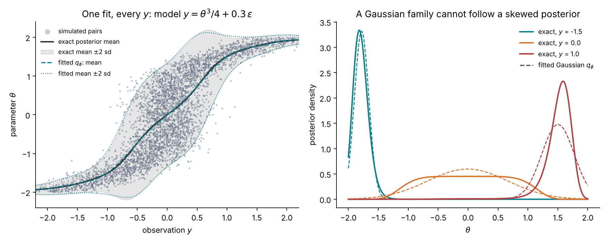
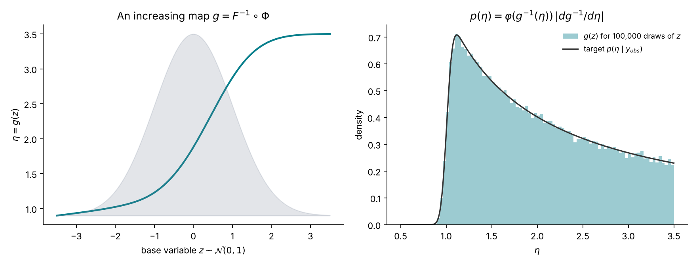
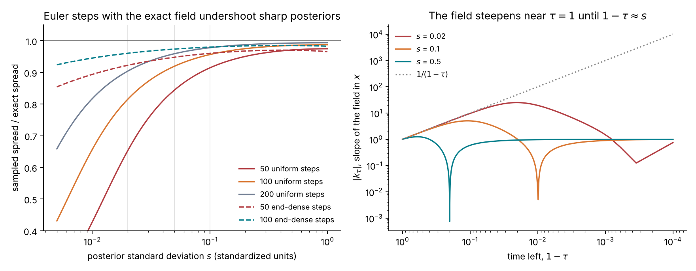
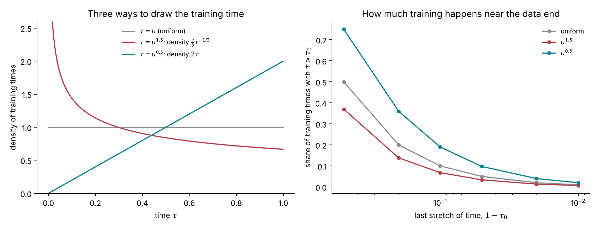
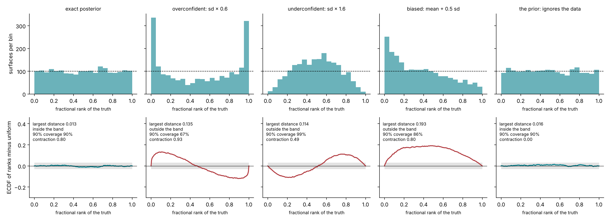

# Lecture 9. Amortized inference

[Course index](README.md) · Previous: [Lecture 8. Bayesian calibration](08-bayesian-calibration.md) · Next: [Lecture 10. The Heston model](10-heston.md)

**What this lecture is for.** This lecture builds the method that makes many rough-Bergomi posteriors affordable, and with them the checks of a posterior's coverage. It shows why parameters simulated from the prior, paired with the surfaces they generate, already contain the posterior of every surface; how a network is trained to extract it (neural posterior estimation); and how the tutorial's network represents a posterior, by flow matching. It then shows how the number of sampling steps and the distribution of training times affect a sharp posterior. It ends with two checks that a learned posterior is right on average over simulated surfaces: simulation-based calibration, and contraction, coverage and recovery.

**Where it sits in the course.** Lecture 8 computed exact posteriors for models whose likelihood is cheap. For rough Bergomi every evaluation of the likelihood is a Monte Carlo run, and Lecture 14 shows what the exact posterior then costs. This lecture moves that cost into a training bank priced once. It closes Part II with the theory and with toys. Lecture 12 applies the workflow to Heston, where every result has an exact check, and Lectures 15 and 16 apply it to rough Bergomi.

**Its part in the argument.** This lecture supplies the method of the third claim of the argument (Lecture 6, Section 6.8). Simulation-based calibration (Section 9.7) and coverage (Section 9.8) need posteriors on thousands of simulated smiles. For rough Bergomi an amortized network makes simulation-based calibration affordable, once its training bank is paid (Lecture 14, Section 14.4).

## 9.1 Simulated pairs carry the posterior

Draw parameters from the prior and simulate data from the model. Each draw produces a pair $(\theta, y)$ from the joint distribution

$$
p(\theta, y) = p(\theta)\,p(y \mid \theta) .
$$

The same joint distribution can be factored the other way, by the definition of conditional probability:

$$
p(\theta, y) = p(y)\,p(\theta \mid y) .
$$

The second factorization says that among simulated pairs whose data equal a given $y$, the parameters are distributed exactly as the posterior $p(\theta \mid y)$. The simulator never evaluates the likelihood $p(y \mid \theta)$; it only draws from it. This is the starting point of **simulation-based inference** (Cranmer, Brehmer and Louppe 2020).

The crudest way to use it is to keep the simulated pairs whose data fall close to the observation and read their parameters. This is rejection approximate Bayesian computation. It is too wasteful for 63 quotes, but it shows the principle on a model small enough to draw.

**A toy version of the smile's identification problem.** Take two parameters with the tutorial's prior ranges, $\eta \sim \mathcal{U}(0.5, 3.5)$ and $\rho \sim \mathcal{U}(-0.99, -0.2)$, and one observation that measures only their product, as the level of the short-dated at-the-money skew does in rough Bergomi (Lecture 13). The full surface identifies $\eta$ separately, mainly through the long-dated at-the-money level against the forward-variance curve, so that identification depends on $\xi_0$ being exact (Lecture 8, Section 8.5); the toy keeps only the skew:

$$
y = \rho\,\eta + 0.05\,\varepsilon, \qquad \varepsilon \sim \mathcal{N}(0, 1) .
$$

The exact posterior for an observation $y_{\text{obs}}$ is proportional to the likelihood inside the prior box. Its marginal for $\eta$ integrates $\rho$ out in closed form:

$$
p(\eta \mid y_{\text{obs}}) \;\propto\; \frac{1}{\eta}\Big[\Phi\Big(\frac{-0.2\,\eta - y_{\text{obs}}}{0.05}\Big) - \Phi\Big(\frac{-0.99\,\eta - y_{\text{obs}}}{0.05}\Big)\Big], \qquad 0.5 < \eta < 3.5 ,
$$

where the factor $1/\eta$ comes from changing variables from $\rho$ to $\rho\eta$.

*Figure 9.1.* How to read the figure: 400,000 pairs were simulated from the prior and the model.

- **Left.** Each grey dot is one pair. The red band keeps the 4,214 pairs (1.05%) whose $y$ lies within 0.01 of $y_{\text{obs}} = -1$.
- **Centre.** The parameters of the kept pairs lie along the curve $\rho\eta = -1$, inside the exact posterior's contours. The curve is the toy's version of the $\rho$–$\eta$ valley of the design document: the data fix the product and leave the factors free along it.
- **Right.** The kept values of $\eta$ reproduce the exact marginal. Their 90% interval is 1.07 to 3.27, against 1.07 to 3.29 for the exact posterior. The marginal is cut sharply on the left at $|y_{\text{obs}}|/0.99 = 1.01$, because $\rho$ cannot be below −0.99, and decays slowly to the right, where it is cut by the prior's upper bound.

**Interpretation and limit.** The figure contains the whole idea of amortized inference: the posterior of any observation is already inside the simulated pairs, and nothing about the likelihood has to be computed. The rejection step is what does not scale. With 63 quotes, the chance that a simulated surface falls within a small distance of the observed one on every quote is negligible. A network replaces the band: it learns, from all pairs at once, how the parameters vary with the data.

## 9.2 Neural posterior estimation

Let $q_\phi(\theta \mid y)$ be a family of conditional densities with parameters $\phi$, for example a neural network that outputs a density over $\theta$ for each $y$. **Neural posterior estimation** fits $\phi$ by maximizing the likelihood of the simulated parameters given their simulated data, that is, by minimizing

$$
\mathcal{L}(\phi) = \mathbb{E}_{p(\theta, y)}\big[-\log q_\phi(\theta \mid y)\big] \approx -\frac{1}{n}\sum_{i=1}^{n} \log q_\phi(\theta_i \mid y_i)
$$

over the $n$ simulated pairs (Papamakarios and Murray 2016; Greenberg, Nonnenmacher and Macke 2019).

**Why the minimizer is the posterior.** Write the joint expectation as an expectation over $y$ of an expectation over the posterior, and add and subtract $\log p(\theta \mid y)$:

$$
\mathcal{L}(\phi) = \mathbb{E}_{p(y)}\Big[\mathbb{E}_{p(\theta \mid y)}\Big[\log\frac{p(\theta \mid y)}{q_\phi(\theta \mid y)}\Big]\Big] - \mathbb{E}_{p(y)}\Big[\mathbb{E}_{p(\theta \mid y)}\big[\log p(\theta \mid y)\big]\Big] = \mathbb{E}_{p(y)}\Big[\mathrm{KL}\big(p(\cdot \mid y)\,\big\|\,q_\phi(\cdot \mid y)\big)\Big] + \text{const}.
$$

The constant does not depend on $\phi$. The Kullback–Leibler divergence is non-negative and is zero only when the two densities coincide. If the family is rich enough to contain the posterior, the minimizer is therefore $q_\phi(\theta \mid y) = p(\theta \mid y)$ for almost every $y$ the prior and the model can produce. One fit serves every observation: this is what **amortized** means. The cost of inference is paid in training, and each new observation costs one evaluation of the network.

*Figure 9.2.* How to read the figure: the model is $y = \theta^3/4 + 0.3\,\varepsilon$ with $\theta \sim \mathcal{U}(-2, 2)$. Its posterior is narrow where the cube is steep and wide where it is flat. The family $q_\phi$ is a Gaussian whose mean and log standard deviation are linear combinations of 13 smooth functions of $y$, fitted to 40,000 simulated pairs by minimizing $\mathcal{L}(\phi)$.

- **Left.** The fitted mean and band (teal) lie on the exact ones (black and grey) across all observations, including the wide region around $y = 0$ and the narrow tails. At $y = 1$, for example, the exact posterior has mean 1.506 and standard deviation 0.257, and the fit gives 1.503 and 0.270.
- **Right.** The fit has the right mean and spread, but a Gaussian cannot take the posterior's shape. At $y = 0$ the posterior is flat-topped, because the cube is flat near zero. At $y = 1$ it is skewed, with a long left tail and a sharp right edge: above its mode near $\theta = 1.6$ the cube rises steeply, so the likelihood falls fast. The prior's bound at $\theta = 2$ plays no part there, since the posterior density at 2 is 0.4% of its peak. At $y = -1.5$ the posterior is cut by the bound at $-2$, 1.8 posterior standard deviations from its mean.

**Interpretation.** The objective recovers the best member of the family, for every observation at once. The posterior of the smile is not Gaussian either: Figure 9.1 showed a curved valley cut by the prior box. The family must be flexible enough to represent such shapes. The next two sections build one.

## 9.3 Flexible densities by change of variables

A **normalizing flow** represents a density as the image of a simple one under an invertible map (Papamakarios et al. 2021). Let $z \sim \mathcal{N}(0, I)$ and $\theta = g(z)$ with $g$ invertible and differentiable. The change-of-variables formula gives the density of $\theta$:

$$
p(\theta) = \varphi\big(g^{-1}(\theta)\big)\,\Big|\det \frac{\partial g^{-1}}{\partial \theta}\Big| ,
$$

where $\varphi$ is the standard normal density. In one dimension any continuous density can be reached this way: with $F$ the target's cumulative distribution function and $\Phi$ the standard normal one, the map $g = F^{-1}\circ\Phi$ sends $\mathcal{N}(0, 1)$ exactly to the target, because $\Phi(z)$ is uniform and $F^{-1}$ of a uniform has distribution $F$.

*Figure 9.3.* How to read the figure: the left panel shows $g = F^{-1}\circ\Phi$ for the marginal posterior of $\eta$ in Figure 9.1, over the standard normal density (shaded). The map is flat on the left, where the posterior has its sharp edge at $\eta \approx 1$, and steep on the right, where it spreads mass thinly up to 3.5. The right panel pushes 100,000 standard normal draws through $g$; their histogram matches the target.

**From one dimension to several, and to conditional densities.** In several dimensions a flow composes simple invertible layers whose Jacobian determinants are cheap, and conditions each layer on the data $y$. Such a network can be trained by the objective of Section 9.2, because $\log q_\phi$ is computable through the change-of-variables formula. The tutorial uses a different construction of $g$, which does not require invertible layers: it defines the map as the solution of an ordinary differential equation and learns its velocity.

## 9.4 Flow matching

**The path.** Draw a noise vector $z \sim \mathcal{N}(0, I)$ and a target $\theta$ from the distribution to be learned, independently, and connect them by a straight line in time $\tau \in [0, 1]$:

$$
x_\tau = (1 - \tau)\,z + \tau\,\theta, \qquad \frac{dx_\tau}{d\tau} = \theta - z .
$$

Each line has a constant velocity. Many lines pass through the same point $x$ at the same time $\tau$, from different pairs.

**The averaged velocity field.** Define the velocity at $(x, \tau)$ as the average velocity of the lines that pass there:

$$
v(x, \tau) = \mathbb{E}\big[\theta - z \,\big|\, x_\tau = x\big] .
$$

**It carries the noise to the target.** Let $p_\tau$ be the law of $x_\tau$. For any smooth test function $f$, differentiate $\mathbb{E}[f(x_\tau)]$ in $\tau$ and use the tower property of conditional expectation:

$$
\frac{d}{d\tau}\mathbb{E}\big[f(x_\tau)\big] = \mathbb{E}\big[f'(x_\tau)\,(\theta - z)\big] = \mathbb{E}\big[f'(x_\tau)\,v(x_\tau, \tau)\big] = \int f'(x)\,v(x, \tau)\,p_\tau(x)\,dx = -\int f(x)\,\partial_x\big(p_\tau v\big)(x)\,dx ,
$$

where the last step integrates by parts. Since this holds for every $f$, the densities satisfy the **continuity equation** $\partial_\tau p_\tau + \partial_x(p_\tau\,v) = 0$. The law of the solutions of the ordinary differential equation $dx/d\tau = v(x, \tau)$, started from $x_0 \sim \mathcal{N}(0, I)$, satisfies the same equation with the same initial law. So, under regularity conditions that make the solution unique, following the field from $\tau = 0$ to $\tau = 1$ turns standard normal draws into draws from the target (Lipman et al. 2023; Liu, Gong and Liu 2023).

**It can be learned by regression.** The conditional mean minimizes the expected squared error. The field is therefore the minimizer of

$$
\mathcal{L}(\phi) = \mathbb{E}_{z,\,\theta,\,\tau}\Big\| u_\phi\big((1 - \tau)z + \tau\theta,\ \tau\big) - (\theta - z)\Big\|^2
$$

over functions $u_\phi$. The loss needs only pairs $(z, \theta)$ and a time $\tau$; no density and no inverse map are computed.

**For a posterior.** Give the network the data as an extra input, $u_\phi(x, \tau, y)$, and draw $(\theta, y)$ from the simulated pairs. The same argument, for each $y$, makes the learned field transport $\mathcal{N}(0, I)$ to $p(\theta \mid y)$ for every observation the prior can produce (Wildberger et al. 2023). This is the tutorial's inference network.

*Figure 9.4.* How to read the figure: the target is a mixture of two Gaussians, with weight 0.4 at −1.0 (standard deviation 0.3) and weight 0.6 at 1.2 (standard deviation 0.2). For such a target the field has a closed form, so no network is involved.

- **Left.** The training lines cross each other: a point near $x = 0$ at $\tau = 0.5$ is crossed by lines heading to both components.
- **Centre.** The colour is the averaged velocity, positive (red) upward and negative (blue) downward. The black paths follow it. Unlike the training lines, they never cross: each starting point has one path, and the paths separate near $x = 0$ into the two components.
- **Right.** 50,000 standard normal draws are moved along the field with 400 small steps. At $\tau = 0.5$ and $0.8$ their histograms match the exact laws $p_\tau$ (dotted). At $\tau = 1$ they match the target: 60.2% of the draws end above 0, against a weight of 60%, and the largest gap between histogram and density over 60 bins is 0.015.

## 9.5 Sampling with a finite number of steps

To draw from the learned posterior, the tutorial integrates $dx/d\tau = u_\phi(x, \tau, y)$ from $\tau = 0$ to $1$ with Euler steps, $x_{i+1} = x_i + (\tau_{i+1} - \tau_i)\,u_\phi(x_i, \tau_i, y)$. The step count is a choice made at sampling time, after training. It matters most for sharp posteriors.

**The Gaussian case in closed form.** Let the target be $\mathcal{N}(\mu, s^2)$ in one standardized coordinate. Then $x_\tau$ and $\theta - z$ are jointly Gaussian, with

$$
\mathbb{E}[x_\tau] = \tau\mu, \quad \mathrm{Var}(x_\tau) = (1 - \tau)^2 + \tau^2 s^2, \quad \mathrm{Cov}(x_\tau, \theta - z) = \tau s^2 - (1 - \tau),
$$

so the conditional mean is linear in $x$ (design document, Appendix F.2):

$$
v(x, \tau) = \mu + k_\tau\,(x - \tau\mu), \qquad k_\tau = \frac{\tau s^2 - (1 - \tau)}{(1 - \tau)^2 + \tau^2 s^2} .
$$

The deviation of a draw from the mean path obeys $d(\text{deviation})/d\tau = k_\tau \times \text{deviation}$, so the exact flow multiplies the initial spread of 1 by $\exp\big(\int_0^1 k_\tau\,d\tau\big) = s$. An Euler step of size $h$ multiplies it by $1 + h\,k_\tau$ instead. Since $1 + x \le e^{x}$, with a gap of order $x^2/2$, Euler steps shrink the spread more than the exact flow wherever $h|k_\tau|$ is not small.

**Where the field is steep.** For $s \ll 1$ and $1 - \tau \gg s$, $k_\tau \approx -1/(1 - \tau)$: the field's slope grows as the end approaches, until $1 - \tau$ reaches $s$. A sharp posterior's field is steep exactly at the last steps, so uniform steps undershoot there. A grid dense near the end, $\tau_i = 1 - (1 - i/n)^2$, makes the steps short where the field is steep.

*Figure 9.5.* How to read the figure:

- **Left.** With 50 uniform steps the sampled spread is 0.65 of the exact one at $s = 0.02$, 0.84 at $s = 0.05$ and 0.91 at $s = 0.1$. With 100 steps on the end-dense grid it is 0.96, 0.97 and 0.98. These are the numbers of the design document's Appendix F.2, reproduced here from the closed form. Two hundred uniform steps give 0.90, 0.96 and 0.98, close to 100 end-dense steps at twice the cost.
- **Right.** On logarithmic axes with time running to the right, $|k_\tau|$ follows $1/(1 - \tau)$ until $1 - \tau \approx s$ and then returns to 1. The narrow dips are where $k_\tau$ changes sign. The steep stretch is long for $s = 0.02$ and absent for $s = 0.5$.

**Why this matters for the tutorial.** In the network's standardized coordinates, Heston's initial variance $v_0$ has a posterior standard deviation near 0.02, because the one-week quotes pin it. With 50 uniform steps, the first two Heston networks returned $v_0$ intervals a median 25% too narrow against the exact posterior, and covered the truth on 73% to 78% of held-out smiles instead of 90% (design document, Appendix F.2). The tutorial samples with 100 end-dense steps.

## 9.6 Where in time the loss is trained

The training loss averages over the time $\tau$. How $\tau$ is drawn decides which parts of the field the network learns best. BayesFlow's default draws $\tau = u^{1.5}$ with $u$ uniform, which favours the noise end; the tutorial draws $\tau = u^{0.5}$. Since $\mathbb{P}(u^{a} \le t) = t^{1/a}$, the two densities are

$$
p(\tau) = \tfrac{2}{3}\,\tau^{-1/3} \quad (a = 1.5), \qquad p(\tau) = 2\tau \quad (a = 0.5) .
$$

*Figure 9.6.* How to read the figure: the left panel shows the three densities. In the right panel, the share of training times with $\tau > 0.9$ is 19% under $u^{0.5}$, 10% under the uniform rule and 6.8% under $u^{1.5}$. Within the last 1% of time the shares are 2.0%, 1.0% and 0.67%.

**Interpretation.** Section 9.5 showed that a sharp posterior's field has its structure near $\tau = 1$. Its location, the posterior mean, is also set there, because the path only commits to a final value when little time is left. Training more often near the data end puts the network's effort where a sharp posterior's location is decided. On Heston this change reduced the median error of the $v_0$ posterior mean from 0.35 to 0.16 posterior standard deviations (Lecture 12, Section 12.2).

## 9.7 Simulation-based calibration

**The idea.** Simulation provides the one thing real data never do: the true parameters. Draw $\theta^\star$ from the prior, simulate $y$ from the model, and draw $L$ values $\theta^{(1)}, \dots, \theta^{(L)}$ from the network's posterior $q(\theta \mid y)$. Record the rank of $\theta^\star$ among them,

$$
r = \left|\left\lbrace \ell : \theta^{(\ell)} < \theta^\star \right\rbrace\right| \in \lbrace 0, 1, \dots, L \rbrace ,
$$

**Why the rank is uniform when the posterior is exact.** The pair $(\theta^\star, y)$ is a draw from the joint distribution $p(\theta)\,p(y \mid \theta)$. By the second factorization of Section 9.1, the same joint is $p(y)\,p(\theta \mid y)$, so given $y$ the true value $\theta^\star$ is distributed as $p(\theta \mid y)$. If $q = p$, then $\theta^\star, \theta^{(1)}, \dots, \theta^{(L)}$ are $L + 1$ independent draws from one distribution given $y$. Every ordering of exchangeable draws is equally likely, so $\theta^\star$ is equally likely to occupy each of the $L + 1$ positions, and $r$ is uniform on $\lbrace 0, \dots, L \rbrace$. This holds for every $y$, so it holds averaged over $y$ (Talts et al. 2018). With ties broken at random and a uniform jitter added, the fractional rank $u = (r + U)/(L + 1)$ is uniform on $(0, 1)$. For $L \to \infty$, $u$ becomes $Q(\theta^\star \mid y)$, the network's cumulative distribution function at the truth, and the statement is the probability integral transform.

**How the test is judged.** Over $B$ simulated surfaces, the empirical distribution function $F_B$ of the fractional ranks is compared with the uniform one. The Dvoretzky–Kiefer–Wolfowitz inequality, with Massart's constant, bounds the largest gap:

$$
\mathbb{P}\Big(\sup_u |F_B(u) - u| > \varepsilon\Big) \le 2\,e^{-2B\varepsilon^2} .
$$

For $P$ targets tested together at family-wise level $\alpha$, setting $P \cdot 2 e^{-2B\varepsilon^2} = \alpha$ gives the band

$$
\varepsilon = \sqrt{\frac{\ln(2P/\alpha)}{2B}} .
$$

With $\alpha = 5\%$ it is 0.0356 for $P = 4$ and $B = 2{,}000$, 0.1007 for $P = 4$ and $B = 250$, and 0.0304 for one target and $B = 2{,}000$. The band comes from an inequality that holds for every distribution and from a union bound over the targets, both conservative, so it is wider than the tailored band of Säilynoja, Bürkner and Vehtari (2022) and can miss a mild miscalibration (design document, "Simulation-based calibration").

*Figure 9.7.* How to read the figure: the toy model is $\theta \sim \mathcal{N}(0, 1)$ and $y = \theta + 0.5\,\varepsilon$, whose exact posterior is $\mathcal{N}(0.8\,y,\ 0.2)$. Each column replaces the exact posterior by a wrong one and runs SBC on 2,000 surfaces with 400 draws each. The top row is the rank histogram, with the uniform level dashed. The bottom row is the ECDF of the ranks minus the uniform CDF, with the band of 0.030 shaded.

- **Exact posterior.** Flat histogram, a largest distance of 0.013, inside the band. Its 90% intervals cover the truth on 90% of surfaces.
- **Overconfident, standard deviation × 0.6.** The truth often falls outside the narrow posterior, so ranks pile up at 0 and 1. The ECDF difference is a sideways S, positive then negative, with a largest distance of 0.135. Coverage of the 90% interval falls to 67%.
- **Underconfident, × 1.6.** The truth sits too often in the middle. The shape is the reverse S, with a distance of 0.114 and a coverage of 99%.
- **Biased, mean + 0.5 sd.** The posterior sits too high, so the truth ranks low. The ECDF difference is a positive hump, with a distance of 0.193. Coverage is still 86%: a shift of half a standard deviation costs little coverage, which is why coverage alone is a weak check.
- **The prior, ignoring the data.** Given any $y$, the "posterior" is $\mathcal{N}(0, 1)$. The truth is a draw from the prior, so its rank is uniform: the distance is 0.016, inside the band, and the coverage is 90%. The contraction, defined in Section 9.8, is 0 instead of 0.80.

**What SBC cannot see.** The last column is the main limit: SBC averages over the prior, and a posterior that ignores the data passes it. SBC is also marginal, one target at a time, so it is a necessary condition, not a sufficient one. Section 9.8, and the checks of single smiles in Lectures 12 and 15, add what it misses.

Lecture 12 reports simulation-based calibration of the Heston network, and Lecture 15 of the rough-Bergomi network.

## 9.8 Contraction, coverage and recovery

**Contraction.** For each target, contraction compares the average posterior variance with the prior variance,

$$
\text{contraction} = 1 - \frac{\mathbb{E}_y\big[\mathrm{Var}(\theta \mid y)\big]}{\mathrm{Var}(\theta)} .
$$

It is 0 when the data teach nothing and 1 when they fix the target exactly. The tutorial computes it in the logit coordinates of the prior box (Lecture 8, Section 8.2), where a uniform prior has variance $\pi^2/3 = 3.29$. The product $\rho\eta$ is not uniform on its range, and its prior variance there is 1.42, computed by Monte Carlo from the box (design document, "Recovery, contraction and coverage"). Dividing by 3.29 instead would overstate how much the smile identifies $\rho\eta$.

In the toy of Figure 9.7 the exact posterior has variance 0.2 against a prior variance of 1, so its contraction is 0.80. The prior used as a posterior has contraction 0, although it passes simulation-based calibration.

**Coverage.** Coverage at level $\gamma$ is the share of simulated surfaces whose central $\gamma$ posterior interval contains the truth. For a calibrated posterior it equals $\gamma$. With $n$ surfaces and an observed share $\hat p$, the Wilson interval

$$
\frac{\hat p + \frac{z^2}{2n} \pm z\sqrt{\frac{\hat p(1 - \hat p)}{n} + \frac{z^2}{4n^2}}}{1 + \frac{z^2}{n}}, \qquad z = 1.96,
$$

gives the range of shares compatible with the data at 95% confidence (Wilson 1927).

**Recovery.** A recovery plot compares the posterior median with the true value over held-out surfaces. Points on the diagonal are perfect recovery; a flat cloud means the smile does not identify the target.

Lecture 12 reports coverage and contraction for the Heston network, and Lecture 15 coverage, contraction and recovery for the rough-Bergomi network.

## 9.9 Summary

1. Pairs simulated from the prior and the model are draws from the joint distribution, so their parameters, among pairs with data near the observation, follow the posterior. No likelihood is evaluated.
2. Neural posterior estimation minimizes $\mathbb{E}[-\log q_\phi(\theta \mid y)]$, which equals the expected Kullback–Leibler divergence from the posterior plus a constant. One fit serves every observation.
3. A flexible family is needed, because posteriors are skewed and cut by the prior box. Normalizing flows build one by change of variables.
4. Flow matching learns the average velocity of straight lines from noise to target by regression. The continuity equation shows that following that field carries $\mathcal{N}(0, I)$ to the posterior.
5. Euler steps undershoot sharp posteriors: 50 uniform steps give 0.65 of the spread at $s = 0.02$; 100 end-dense steps give 0.96. Training times drawn as $\tau = u^{0.5}$ put more training where a sharp posterior's location is set.
6. If the posterior is exact, the rank of the true parameter among posterior draws is uniform, because the truth is one more exchangeable draw. Overconfidence, underconfidence and bias each leave their own shape in the ranks. A posterior that ignores the data passes.
7. Contraction measures what the smile identifies, from 0 when the data teach nothing to 1 when they fix the target. It must be read with simulation-based calibration, which a posterior that ignores the data passes. Coverage, with its Wilson interval, says whether intervals hold their level, and a recovery plot compares the posterior median with the truth.

## References

- Cranmer, K., Brehmer, J., Louppe, G. (2020). The frontier of simulation-based inference. *Proceedings of the National Academy of Sciences* 117(48), 30055–30062. [doi](https://doi.org/10.1073/pnas.1912789117)
- Papamakarios, G., Murray, I. (2016). Fast ε-free inference of simulation models with Bayesian conditional density estimation. *Advances in Neural Information Processing Systems* 29. [arXiv](https://arxiv.org/abs/1605.06376)
- Greenberg, D., Nonnenmacher, M., Macke, J. (2019). Automatic posterior transformation for likelihood-free inference. *ICML 2019*, PMLR 97, 2404–2414. [proceedings](https://proceedings.mlr.press/v97/greenberg19a.html)
- Papamakarios, G., Nalisnick, E., Rezende, D. J., Mohamed, S., Lakshminarayanan, B. (2021). Normalizing flows for probabilistic modeling and inference. *Journal of Machine Learning Research* 22(57), 1–64. [JMLR](https://jmlr.org/papers/v22/19-1028.html)
- Lipman, Y., Chen, R. T. Q., Ben-Hamu, H., Nickel, M., Le, M. (2023). Flow matching for generative modeling. *ICLR 2023*. [arXiv](https://arxiv.org/abs/2210.02747)
- Liu, X., Gong, C., Liu, Q. (2023). Flow straight and fast: learning to generate and transfer data with rectified flow. *ICLR 2023*. [arXiv](https://arxiv.org/abs/2209.03003)
- Wildberger, J., Dax, M., Buchholz, S., Green, S. R., Macke, J. H., Schölkopf, B. (2023). Flow matching for scalable simulation-based inference. *NeurIPS 36*. [proceedings](https://proceedings.neurips.cc/paper_files/paper/2023/hash/3663ae53ec078860bb0b9c6606e092a0-Abstract.html)
- Talts, S., Betancourt, M., Simpson, D., Vehtari, A., Gelman, A. (2018). Validating Bayesian inference algorithms with simulation-based calibration. [arXiv:1804.06788](https://arxiv.org/abs/1804.06788)
- Säilynoja, T., Bürkner, P.-C., Vehtari, A. (2022). Graphical test for discrete uniformity and its applications in goodness-of-fit evaluation and multiple sample comparison. *Statistics and Computing* 32. [arXiv:2103.10522](https://arxiv.org/abs/2103.10522)
- Massart, P. (1990). The tight constant in the Dvoretzky–Kiefer–Wolfowitz inequality. *Annals of Probability* 18(3), 1269–1283. [Project Euclid](https://projecteuclid.org/euclid.aop/1176990746)
- Wilson, E. B. (1927). Probable inference, the law of succession, and statistical inference. *Journal of the American Statistical Association* 22(158), 209–212. [doi](https://doi.org/10.1080/01621459.1927.10502953)

Figures: `scripts/course/lecture12.py`, except Figure 9.7, drawn by `scripts/course/lecture13.py`.
