# Lecture 13. The rough Bergomi model

[Course index](README.md) · Previous: [Lecture 12. The amortized workflow on Heston](12-the-amortized-workflow-on-heston.md) · Next: [Lecture 14. Why the exact posterior is expensive](14-why-the-exact-posterior-is-expensive.md)

**What this lecture is for.** This lecture builds the model of the tutorial's advanced example: rough Bergomi. It presents the evidence that volatility is rough, constructs the Gaussian process that makes it rough, and shows that the model's expected variance equals an input curve read from the market. It then explains why the model has no Markov state and no exact Fourier or PDE pricer, and how its 63 prices are computed instead: by a simulation scheme built for the rough kernel, a conditional Black–Scholes estimator, and two variance-reduction devices, with a budget for the Monte Carlo error. Finally it shows how each of the three parameters shapes the smile, derives the power law of the short-maturity skew, asks which parameter combinations the smile can tell apart, also when the forward-variance curve is uncertain or the quotes are few, and shows how the parameters move the prices of products that the smile does not quote, the variance swap included.

**Where it sits in the course.** This lecture opens Part IV, the full examples. Lecture 5 measured SPY's skew and found that it steepens like $`T^{-0.32}`$ as the maturity shortens. Lecture 10 showed that Heston cannot follow this: its skew tends to a constant, and its variance-swap curve is tied to its smile parameters. Rough Bergomi repairs both defects with three parameters, at the price of having no characteristic function: it has no exact Fourier or PDE pricer, and the tutorial prices it by Monte Carlo, at 5 to 12 CPU-seconds per surface. Lecture 6 explained why a bank needs a range for these parameters, not one value, and Lectures 8, 9 and 12 built that range as a posterior and amortized it, on Black–Scholes and on Heston. Lecture 14 explains why the range is expensive for this model, and Lectures 15 and 16 compute it on a liquid smile and on a thin chain. The forward-variance curve of Lecture 5, Section 5.9, is this model's input.

**Its part in the argument.** Rough Bergomi is the model the argument needs (Lecture 6, Section 6.8): its smile has the right shape, and its likelihood is a Monte Carlo run. Section 13.11 shows how much of what the smile says about the parameters passes through the forward-variance curve. That is why a thin chain, whose curve is not quoted, is where the posterior and the classical answer can part.

## 13.1 Evidence that volatility is rough

**What the market's skew asks for.** Lecture 5 (Figure 5.4) found SPY's at-the-money skew to follow $`|\psi(T)| \approx 0.265\,T^{-0.32}`$ from one week to one year. Lecture 10 (Section 10.8) showed that a Markovian diffusion for the variance produces a skew that tends to a constant as $`T \to 0`$. A skew that keeps steepening needs a variance process whose short-range moves are large relative to its long-range moves. Lecture 3 (Section 3.2) called this property roughness and measured it by the Hurst exponent $`H`$: increments over a lag $`\Delta`$ have size $`\Delta^H`$, and $`H \lt \tfrac12`$ means rougher than Brownian motion.

**What the data on volatility say.** Gatheral, Jaisson and Rosenbaum (2018) measured the roughness of volatility directly. Their statistic, for a series of estimated volatilities $`\hat\sigma_t`$, is

```math
m(q, \Delta) = \frac{1}{N}\sum_{t}\big|\log \hat\sigma_{t+\Delta} - \log \hat\sigma_t\big|^q .
```

If log volatility has increments of size $`\Delta^H`$ at every scale, then $`m(q, \Delta) \propto \Delta^{qH}`$: on log–log axes, $`m`$ against $`\Delta`$ is a straight line with slope $`\zeta_q = qH`$, and the slopes are proportional to $`q`$. On realized variance computed from intraday prices of many equity indices, they found straight lines and $`H`$ of order 0.1.

The course has daily VOO returns only (Lecture 1). Realized variance is therefore computed over blocks of 5 consecutive trading days, $`RV = \tfrac{252}{5}\sum r_i^2`$, which gives 335 blocks from 2020 to 2026. The figure computes $`m`$ on $`\log RV = 2\log\hat\sigma`$, which multiplies $`m(q, \Delta)`$ by $`2^q`$ and leaves the slopes $`\zeta_q`$ unchanged.


*Figure 13.1.* How to read the figure: in the left panel each set of dots is one $`q`$, from 0.5 to 2, at lags of 1 to 12 weeks. The fitted slopes are 0.054, 0.112, 0.170 and 0.228. In the right panel they lie on a straight line through the origin, $`\zeta_q = qH`$ with $`H = 0.116`$, far below the Brownian line $`H = \tfrac12`$ (dashed). This is the pattern Gatheral, Jaisson and Rosenbaum report. The square shows a correction this data set needs. A weekly realized variance from 5 returns is a noisy estimate of the week's variance (Lecture 1, Section 1.2). If the returns within a week were normal with a constant variance, the noise would add $`2\,\psi_1(5/2) = 0.981`$ to $`m(2, \Delta)`$ at every lag, where $`\psi_1`$ is the trigamma function. The measured $`m(2, 1)`$ is 1.178, so 83% of it would be sampling noise. Subtracting this constant and refitting gives $`H = 0.32`$. With blocks of 10 days the raw estimate is 0.14 and the corrected one 0.22.

**Interpretation and limits.** The raw scaling is the rough pattern, with $`H`$ close to the published 0.1. The correction shows that six years of daily returns cannot pin $`H`$ down: most of the short-lag variation of weekly log realized variance is sampling noise, and the correction itself assumes normal returns within a week, which Lecture 1 showed to be false. Measuring $`H`$ from returns needs intraday data, as in Gatheral, Jaisson and Rosenbaum (2018). The tutorial does not rely on this estimate. It infers $`H`$ from the option smile, through the term structure of the skew (Section 13.10), which is the quantity the model must reproduce. SPY's exponent of −0.32 corresponds to $`H \approx 0.18`$ under the leading-order formula of Section 13.10.

## 13.2 The Volterra driver

**Definition.** Rough Bergomi drives the log variance with the Gaussian process

```math
Y_t = \sqrt{2H}\int_0^t (t - s)^{H - \frac12}\,dW_s, \qquad 0 < H < \tfrac12 ,
```

where $`W`$ is a Brownian motion. $`Y_t`$ is a weighted sum of all past Brownian shocks $`dW_s`$. The weight $`(t - s)^{H - \frac12}`$ depends on the age $`t - s`$ of the shock. For $`H \lt \tfrac12`$ the exponent is negative, so recent shocks weigh most, and the weight diverges for the newest ones. For $`H = \tfrac12`$ the weight is 1 and $`Y_t = W_t`$. An integral of this form, with a kernel of the age, is a **Volterra process**. Mandelbrot and Van Ness (1968) wrote the fractional Brownian motion of Lecture 3 as an integral of Brownian shocks with this kernel plus a term for the shocks before time 0. Dropping that term gives the process used here, the Riemann–Liouville fractional Brownian motion, whose increments are not exactly stationary.

**Its variance.** $`Y_t`$ is an Itô integral of a deterministic function, so it is Gaussian with mean zero, and the Itô isometry (Lecture 3, Section 3.3) gives its variance:

```math
\mathrm{Var}(Y_t) = 2H\int_0^t (t - s)^{2H - 1}\,ds = 2H\cdot\frac{t^{2H}}{2H} = t^{2H} .
```

The factor $`\sqrt{2H}`$ is chosen to make this exactly $`t^{2H}`$, so that the parameter $`\eta`$ of Section 13.4 has the same meaning at every $`H`$.

**Its covariance.** For $`t \le u`$, the two integrals share the shocks on $`[0, t]`$:

```math
\mathrm{Cov}(Y_t, Y_u) = 2H\int_0^t (t - s)^{H - \frac12}(u - s)^{H - \frac12}\,ds .
```

**Its roughness.** Split an increment over $`[t, t + h]`$ into new and old shocks:

```math
Y_{t+h} - Y_t = \sqrt{2H}\int_t^{t+h}(t + h - s)^{H-\frac12}\,dW_s + \sqrt{2H}\int_0^t\Big[(t + h - s)^{H - \frac12} - (t - s)^{H - \frac12}\Big]dW_s .
```

The two terms are independent. The first has variance $`h^{2H}`$, by the same computation as above. In the second, substitute $`x = (t - s)/h`$: its variance is $`h^{2H}\cdot 2H\int_0^{t/h}\big[(x + 1)^{H - \frac12} - x^{H - \frac12}\big]^2dx`$, and the integral converges as $`t/h \to \infty`$. Hence

```math
\mathbb{E}\big[(Y_{t+h} - Y_t)^2\big] \approx c_H\,h^{2H}, \qquad h \ll t ,
```

with a constant $`c_H`$. Increments over a lag $`h`$ have size $`h^H`$, as for the fractional Brownian motion of Lecture 3: the path is rough with Hurst exponent $`H`$.


*Figure 13.2.* How to read the figure: the left panel uses the same shocks for every path, so the four share their large-scale shape. With $`H = 0.45`$ the path is nearly Brownian; with $`H = 0.1`$ it is dominated by short-range noise. The centre panel checks $`\mathrm{Var}(Y_t) = t^{2H}`$: at five dates from about one trading day to one year, the simulated variance over 4,000 paths is between 0.98 and 1.03 times $`t^{2H}`$, within the sampling error of about 2%. The right panel checks the roughness: the mean squared increment, from one-eighth of a day to 16 days, has log–log slopes of 0.20, 0.37 and 0.60, equal to $`2H`$ for $`H`$ = 0.1, 0.185 and 0.3.

## 13.3 The variance, the forward-variance curve and the law of $`V_t`$

**The variance.** Rough Bergomi sets

```math
V_t = \xi_0(t)\,\exp\Big(\eta\,Y_t - \tfrac12\,\eta^2\,t^{2H}\Big) ,
```

where $`\xi_0(t)`$ is a deterministic curve and $`\eta \gt 0`$ a parameter. $`V_t`$ is positive by construction.

**Its mean is the input curve.** $`\eta Y_t`$ is normal with mean 0 and variance $`\eta^2 t^{2H}`$, and for a normal $`Z \sim \mathcal{N}(0, s^2)`$, $`\mathbb{E}[e^Z] = e^{s^2/2}`$ (Lecture 4). Hence

```math
\mathbb{E}^{\mathbb{Q}}[V_t] = \xi_0(t)\,e^{-\frac12\eta^2 t^{2H}}\,\mathbb{E}\big[e^{\eta Y_t}\big] = \xi_0(t)\,e^{-\frac12\eta^2 t^{2H}}\,e^{\frac12\eta^2 t^{2H}} = \xi_0(t) .
```

$`\xi_0(t)`$ is therefore the model's forward-variance curve, the object of Lecture 5, Section 5.9. Whatever the parameters, the model's variance-swap strikes are

```math
K_{\text{var}}(T) = \frac1T\int_0^T\xi_0(t)\,dt ,
```

and they match the market's if $`\xi_0`$ is read from the market's chain by replication. Heston (Lecture 10, Section 10.4) gives the opposite: a parametric curve $`\theta + (v_0 - \theta)e^{-\kappa t}`$ that the smile calibration fixes. In rough Bergomi the curve is an input, and the three parameters describe only the shape of the smile around it.

**The law of $`V_t`$.** $`V_t/\xi_0(t)`$ is log-normal with log-mean $`-\tfrac12\eta^2t^{2H}`$ and log-variance $`\eta^2 t^{2H}`$. Its median is $`e^{-\frac12\eta^2 t^{2H}}`$, below its mean of 1, and it falls with $`t`$. Its variance is $`\mathrm{Var}(V_t) = \xi_0(t)^2\big(e^{\eta^2 t^{2H}} - 1\big)`$. A one-standard-deviation move of $`Y_t`$ multiplies $`V_t`$ by $`e^{\eta t^H}`$: with $`\eta = 2`$ and $`H = 0.185`$, by $`e^{2 \times 0.631} = 3.5`$ over one month.

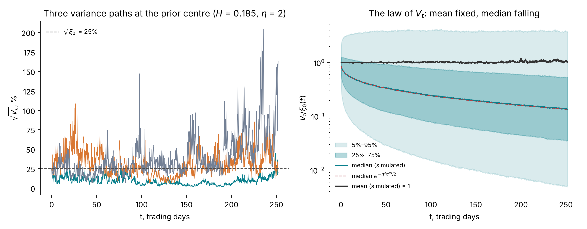

*Figure 13.3.* How to read the figure: the paths in the left panel are simulated by the scheme of Section 13.6, with $`H = 0.185`$, $`\eta = 2`$ and $`\xi_0 = 0.25^2`$. One path spends most of the year below 15% volatility; another spikes above 150%. The right panel shows that the mean of $`V_t/\xi_0`$ stays at 1, as derived: at one year the simulated mean is 1.054 with a standard error of 0.043. The median falls as $`e^{-\frac12\eta^2t^{2H}}`$: 0.452 at one month (formula 0.450) and 0.136 at one year (formula 0.135). At one year the 5% and 95% quantiles are 0.0048 and 3.66 times $`\xi_0`$, a volatility range of 1.7% to 48% around a mean variance of $`(25\%)^2`$. The law is very skewed: most paths are calm, and a few very volatile paths carry the mean.

## 13.4 The rough Bergomi model and its parameters

Bergomi (2005) proposed to model the forward-variance curve itself as the state of the market, moving log-normally with exponential kernels. Bayer, Friz and Gatheral (2016) replaced the exponential kernels with the power kernel of Section 13.2. In forward units and under $`\mathbb{Q}`$ (Lectures 2 and 4), the resulting model is

```math
\frac{dX_t}{X_t} = \sqrt{V_t}\,\big(\rho\,dW_t + \sqrt{1 - \rho^2}\,dW^\perp_t\big), \qquad X_0 = 1,
```

```math
V_t = \xi_0(t)\,\exp\Big(\eta\,Y_t - \tfrac12\eta^2t^{2H}\Big), \qquad Y_t = \sqrt{2H}\int_0^t(t - s)^{H - \frac12}\,dW_s .
```

The price shock is correlated with the variance shock $`dW`$ by $`\rho`$, built as in Lecture 3, Section 3.7. The model has three parameters and one input curve.

| Symbol | Meaning | Tutorial prior | Prior centre |
| --- | --- | --- | --- |
| $`H`$ | Hurst exponent: the roughness of the log variance | Uniform(0.02, 0.35) | 0.185 |
| $`\eta`$ | Volatility of the log variance, in units of $`\text{year}^{-H}`$ | Uniform(0.5, 3.5) | 2.0 |
| $`\rho`$ | Correlation between price and variance shocks | Uniform(−0.99, −0.2) | −0.595 |
| $`\xi_0(t)`$ | Forward-variance curve, an input read from the chain | 7 levels. Pilot: level $`\sigma_0 \in (10\%, 40\%)`$, slope $`s \in (-0.3, 0.6)`$, perturbations of up to ±0.2 in log. Full bank: a power law in time times a random walk in log time (Lecture 15, Section 15.1) | flat at $`(25\%)^2`$ in this lecture |

The prior is that of the tutorial's task (`rough_task` in `lab/src/sbi4finance/calibration/tasks.py`). It allows only negative correlations, because equity skews slope down. Lecture 7 discusses its role in the calibration. All figures of this lecture use the prior centre and a flat curve at 25% unless they say otherwise.

The model differs from Heston (Lecture 10) in three ways. The variance is the exponential of a Gaussian process, not a square-root diffusion, so it is log-normal and never reaches zero. Its expected value is an input, not a function of the parameters. And its kernel is a power of the age of each shock, not an exponential, which has the consequence of the next section.

## 13.5 No Markov state: the past matters

**Heston's forward variance.** In Heston, the expected future variance given the past is $`\mathbb{E}[V_u \mid \mathcal{F}_t] = \theta + (V_t - \theta)e^{-\kappa(u - t)}`$ (Lecture 10, Section 10.4 applied from time $`t`$). It depends on the past only through $`V_t`$. That is what made the pair $`(X_t, V_t)`$ a Markov state and the characteristic function computable.

**Rough Bergomi's forward variance.** Split $`Y_u`$, for $`u \gt t`$, into the shocks before $`t`$, which are known at $`t`$, and the shocks after $`t`$, which are independent of the past:

```math
Y_u = \underbrace{\sqrt{2H}\int_0^t (u - s)^{H - \frac12}\,dW_s}_{\text{known at } t} + \underbrace{\sqrt{2H}\int_t^u (u - s)^{H - \frac12}\,dW_s}_{\mathcal{N}(0,\,(u - t)^{2H})} .
```

The same log-normal mean as in Section 13.3 then gives the forward-variance curve seen from time $`t`$:

```math
\xi_t(u) = \mathbb{E}^{\mathbb{Q}}[V_u \mid \mathcal{F}_t] = \xi_0(u)\,\exp\Big(\eta\sqrt{2H}\int_0^t(u - s)^{H - \frac12}\,dW_s - \tfrac12\eta^2\big(u^{2H} - (u - t)^{2H}\big)\Big) .
```

For each future date $`u`$, the integral weights the past shocks by $`(u - s)^{H - \frac12}`$, a different weighting for each $`u`$. The current variance $`V_t`$ uses the weights $`(t - s)^{H - \frac12}`$. Two pasts with the same $`V_t`$ can therefore have different curves $`\xi_t(\cdot)`$: no finite set of numbers summarizes the past. The state of the model is the whole curve $`\xi_t(\cdot)`$, which is Bergomi's point of view.

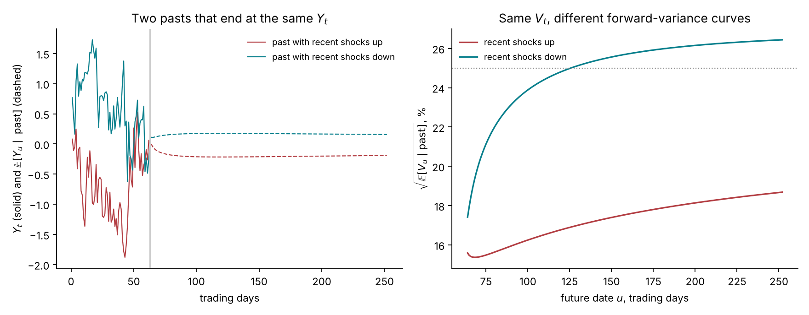

*Figure 13.4.* How to read the figure: the two histories are chosen among 20,000 simulated 63-day pasts at the prior centre because they end within 0.02 of $`Y_t = 0`$, at −0.007 and −0.011, so the current variance is the same. In one (red) the driver fell early and rose in the last month; in the other (teal) it rose early and fell. The right panel computes $`\sqrt{\xi_t(u)}`$ from the formula above. The curves differ already the next day, 15.6% against 17.4%, and 189 trading days later they are 18.7% and 26.4%. As the horizon grows, the weights $`(u - s)^{H - \frac12}`$ of old and recent shocks become more equal, so the early shocks of each history regain influence. In Heston the two histories would give the same curve.

**Consequences.** Without a finite Markov state there is no partial differential equation in a few variables and no affine structure, so neither a Fourier nor a PDE method of Lecture 10 applies. Monte Carlo pricing must simulate each path from time zero on a fine grid. Roughness alone is not the cause: rough Heston (El Euch and Rosenbaum 2019) keeps an affine structure and a characteristic function that solves a fractional Riccati equation numerically. Rough Bergomi's log-normal variance has no such structure, so it has no exact Fourier or PDE pricer. Approximations exist: replacing the power kernel by a sum of exponentials gives a Markovian model with many factors, an approach that Abi Jaber and El Euch (2019) develop for rough volatility models and apply to rough Heston. The repository and the tutorial price rough Bergomi by Monte Carlo.

## 13.6 Simulating the driver: the hybrid scheme

**The problem.** On a grid $`t_i = i\Delta`$, $`Y_{t_i}`$ is an integral over all cells $`[t_{i-k}, t_{i-k+1}]`$, $`k = 1, \dots, i`$, of the kernel against $`dW`$. The simplest scheme evaluates the kernel at one point per cell, as a Riemann sum:

```math
Y_{t_i} \approx \sqrt{2H}\sum_{k=1}^{i}(k\Delta)^{H - \frac12}\,\Delta W_{i-k+1} .
```

The kernel diverges at age zero, so it varies sharply inside the newest cell, and a single value there misses most of its weight. On the first step this scheme captures $`2H\,\Delta^{2H-1}\Delta/\Delta^{2H} = 2H`$ of the variance: 37% for $`H = 0.185`$.

**The hybrid scheme** of Bennedsen, Lunde and Pakkanen (2017) treats the newest cell exactly and the older cells at well-chosen points.

1. **The newest cell, exactly.** $`Z_i = \sqrt{2H}\int_{t_{i-1}}^{t_i}(t_i - s)^{H - \frac12}dW_s`$ is Gaussian, jointly with the increment $`\Delta W_i`$. The Itô isometry gives $`\mathrm{Var}(Z_i) = \Delta^{2H}`$ and $`\mathrm{Cov}(Z_i, \Delta W_i) = \sqrt{2H}\,\Delta^{H + \frac12}/(H + \tfrac12)`$. A Gaussian pair is simulated as a regression on $`\Delta W_i`$ plus an independent residual:

```math
Z_i = \frac{\sqrt{2H}\,\Delta^{H - \frac12}}{H + \frac12}\,\Delta W_i + \Delta^{H}\sqrt{1 - \frac{2H}{(H + \frac12)^2}}\;\varepsilon_i, \qquad \varepsilon_i \sim \mathcal{N}(0, 1) .
```

For $`H = 0.185`$ the residual carries 21% of the cell's variance. The independent normals $`\varepsilon_i`$ are the scheme's second stream of random numbers.

2. **The older cells, at the cell average.** For $`k \ge 2`$ the kernel is smooth on its cell, and the cell's contribution is replaced by $`(b_k\Delta)^{H-\frac12}\Delta W_{i-k+1}`$. Replacing a function $`f`$ by a constant $`c`$ on a cell adds a mean squared error $`\int(f - c)^2`$, which is smallest when $`c`$ is the average of $`f`$ on the cell. Setting $`(b_k\Delta)^{H - \frac12}`$ to the cell average of the kernel gives, with $`\alpha = H - \tfrac12`$,

```math
b_k^{\ast} = \left(\frac{k^{\alpha + 1} - (k - 1)^{\alpha + 1}}{\alpha + 1}\right)^{1/\alpha} .
```

3. **The sum by FFT.** The scheme is

```math
Y_{t_i} \approx Z_i + \sqrt{2H}\sum_{k=2}^{i}(b_k^{\ast}\Delta)^{H - \frac12}\,\Delta W_{i-k+1} ,
```

a discrete convolution of the increments with fixed weights. The fast Fourier transform computes it for all $`i`$ at once, in $`O(n\log n)`$ operations per path instead of $`O(n^2)`$.

4. **The exact mean.** The scheme's own variance of $`Y_{t_i}`$, $`\Delta^{2H} + 2H\sum_{k=2}^{i}(b_k^{\ast}\Delta)^{2H - 1}\Delta`$, replaces $`t_i^{2H}`$ in the exponent of $`V`$. The discretized variance then has mean exactly $`\xi_0(t_i)`$, by the argument of Section 13.3.

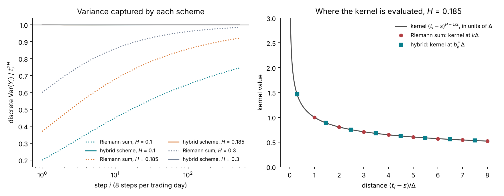

*Figure 13.5.* How to read the figure: the left panel uses 8 steps per trading day for 63 days. The Riemann sum (dotted) captures 20%, 37% and 60% of the variance on the first step for $`H`$ = 0.1, 0.185 and 0.3, and still only 74%, 92% and 98% after 504 steps: the deficit is concentrated in the newest cell, which every step contains. The hybrid scheme (solid) captures 100% on the first step and between 99.96% and 99.997% after 504 steps. In the right panel, for $`k \ge 2`$ the points $`b_k^{\ast}`$ are 1.46, 2.48, 3.48, close to the cell midpoints $`k - \tfrac12`$, while the Riemann sum evaluates the kernel at the cell ends $`k`$. The point $`b_1^{\ast} = 0.30`$ is shown for comparison; the scheme does not use it, because the newest cell is exact.

**The price.** Given the variance path, the log price advances by the left-point Euler step of Lecture 3,

```math
\ln X_{t_i} = \ln X_{t_{i-1}} - \tfrac12V_{t_{i-1}}\Delta + \sqrt{V_{t_{i-1}}}\big(\rho\,\Delta W_i + \sqrt{1 - \rho^2}\,\Delta W^\perp_i\big) ,
```

with $`\Delta W^\perp`$ the third stream of normals. The pricer of the next section needs only two path quantities: $`\int V\,dt \approx \sum V_{t_{i-1}}\Delta`$ and $`\int\sqrt V\,dW \approx \sum\sqrt{V_{t_{i-1}}}\,\Delta W_i`$.

**The grids.** The tutorial prices its 63 contracts on three grids: 10 trading days with 80 steps (8 a day) for the one- and two-week maturities, 63 days with 504 steps (8 a day) for one, two and three months, and 252 days with 504 steps (2 a day) for six months and one year (`rough_task`, `numerics.blocks`). Short maturities get short steps, where the Euler error of the log price matters most.

## 13.7 Pricing a surface: conditional Black–Scholes, antithetic pairs and control variates

A price is an expectation over paths, $`P_c = \mathbb{E}^{\mathbb{Q}}[(K_c - X_{T_c})^+]`$ for a put. The plain estimate is the average of the payoff over $`N`$ simulated paths. Its standard error is the payoff's standard deviation divided by $`\sqrt N`$. Three devices reduce that standard deviation. The first two leave the estimate unbiased; the third adds a bias of order $`1/N`$, negligible at the path counts used.

**1. Conditional Black–Scholes (Romano and Touzi 1997).** Fix the path of $`W`$, and hence of $`V`$. The log price is

```math
\ln X_T = \rho\int_0^T\sqrt{V_t}\,dW_t + \sqrt{1 - \rho^2}\int_0^T\sqrt{V_t}\,dW^\perp_t - \tfrac12\int_0^T V_t\,dt .
```

Given $`W`$, the first and third terms are known numbers, and the second is an Itô integral of a known function against the independent $`W^\perp`$: normal with mean 0 and variance $`(1 - \rho^2)\int_0^T V_t\,dt`$. Write

```math
F^{\text{eff}} = \exp\Big(\rho\int_0^T\sqrt{V_t}\,dW_t - \tfrac12\rho^2\int_0^TV_t\,dt\Big), \qquad w^{\text{eff}} = (1 - \rho^2)\int_0^T V_t\,dt .
```

Then $`\ln X_T \mid W \sim \mathcal{N}\big(\ln F^{\text{eff}} - \tfrac12w^{\text{eff}},\ w^{\text{eff}}\big)`$, which is the Black–Scholes law of Lecture 4 with forward $`F^{\text{eff}}`$ and total variance $`w^{\text{eff}}`$. The expected payoff given $`W`$ is therefore a Black–Scholes put:

```math
\mathbb{E}\big[(K - X_T)^+ \mid W\big] = P_{\text{BS}}\big(F^{\text{eff}}, K, w^{\text{eff}}\big) .
```

Averaging this formula over paths of $`W`$ estimates the same price. By the law of total variance, $`\mathrm{Var}(\text{payoff}) = \mathrm{Var}\big(\mathbb{E}[\text{payoff}\mid W]\big) + \mathbb{E}\big[\mathrm{Var}(\text{payoff}\mid W)\big]`$, so the conditional estimate never has more variance than the payoff. The repository prices puts this way and obtains calls by put–call parity (Lecture 2), so every quote, including the calls at $`\delta \gt 0`$, is estimated through a put.

**2. Antithetic pairs.** Each set of normals $`z`$ is used twice, as $`z`$ and $`-z`$, and the two estimates are averaged. The price responds to the shocks mostly through smooth, monotone functions, so the two halves of a pair are negatively correlated, and the pair average has less variance than two independent paths.

**3. Control variates.** Two path quantities have known mean zero:

```math
C^{(1)} = F^{\text{eff}} - 1, \qquad C^{(2)} = \int_0^TV_t\,dt - \int_0^T\xi_0(t)\,dt .
```

$`C^{(1)}`$ has mean zero because, in the discretized scheme, each factor $`\exp\big(\rho\sqrt{V_{t_{i-1}}}\Delta W_i - \tfrac12\rho^2V_{t_{i-1}}\Delta\big)`$ has conditional mean one. $`C^{(2)}`$ has mean zero because the scheme keeps $`\mathbb{E}[V_{t_i}] = \xi_0(t_i)`$. The conditional put depends on the path only through $`F^{\text{eff}}`$ and $`w^{\text{eff}}`$, so to first order it is a linear function of the two controls. The estimator regresses the per-path puts on the controls, two per maturity, and subtracts the fitted linear part:

```math
\hat P = \frac1N\sum_{n}\Big(P^{(n)} - \hat\beta_1 C^{(1,n)} - \hat\beta_2C^{(2,n)}\Big) .
```

The variance falls by the factor $`1 - R^2`$ of the regression. Estimating $`\hat\beta`$ on the same paths adds a bias of order $`1/N`$, negligible at the path counts used (McCrickerd and Pakkanen 2018 use the same two ideas). On the 63 quotes of the example surface at the centre of the prior, the controls leave a median 2.2% of the variance on top of the antithetic pairs, from 0.01% for the far calls, whose payoff is almost linear in the controls, to 15% for the far puts at six months and a year, whose payoff is not (`tutorial/assets/results/calibration/smile/example-rough.json`, study S2-1).

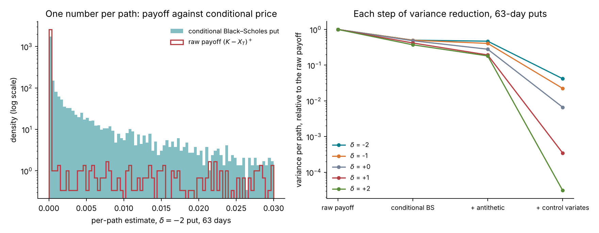

*Figure 13.6.* How to read the figure: the puts are at $`\delta = -2, -1, 0, +1, +2`$ with 63 days to maturity, on 16,384 paths (8,192 pairs) at the prior centre. In the left panel, most paths give a raw payoff of exactly zero and a few give large values; the conditional price is positive on every path and spread more evenly. In the right panel, at equal numbers of paths, the conditional formula halves the variance (factors 0.50 to 0.37). Antithetic pairs then lower it to 0.47 of the raw variance at $`\delta = -2`$ and to 0.18 at $`\delta = +2`$. The control variates lower it to 0.042 at $`\delta = -2`$, 0.0066 at the money and $`3.1 \times 10^{-5}`$ at $`\delta = +2`$. The last two puts are in the money, nearly linear in $`F^{\text{eff}}`$, and the regression explains almost all of their variation. In units of the quote noise, the standard error at 16,384 paths falls from 1.02, 0.53, 1.02, 0.98 and 2.93 $`\sigma_c`$ for the raw payoff to 0.21, 0.079, 0.083, 0.018 and 0.016 $`\sigma_c`$ with all three devices. A variance factor of 0.042 is worth 24 times as many raw paths; one of 0.0066, 150 times.

## 13.8 How many paths: cost and the error budget

**The budget.** Each price $`\hat P_c`$ has a Monte Carlo standard error $`s_c`$, which adds to the quote noise $`\sigma_c`$ of Lecture 5. The tutorial requires

```math
s_c \le 0.25\,\sigma_c \quad\text{for every quote, so that}\quad \sqrt{\sigma_c^2 + s_c^2} \le 1.031\,\sigma_c :
```

the simulation inflates the noise standard deviation by at most 3.1%. Each grid starts at $`2^{15}`$ paths and doubles, up to $`2^{21}`$, until every quote of the grid meets the budget. At $`2^{21}`$ paths the cap is $`0.5\,\sigma_c`$; a surface above it stops with an error rather than being replaced (`rough_task`, `numerics`).

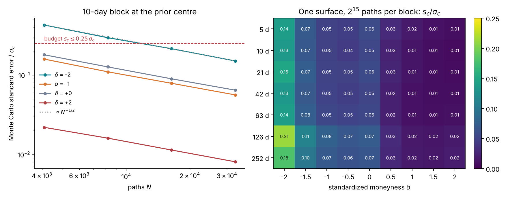

*Figure 13.7.* How to read the figure: in the left panel the standard error falls as $`N^{-1/2}`$, by a factor of about 0.7 per doubling. The put at $`\delta = -2`$ is the hardest: 0.43 $`\sigma_c`$ at 4,096 paths, 0.30 at 8,192, 0.21 at 16,384 and 0.15 at 32,768, so it meets the budget from 16,384 paths. The put at $`\delta = +2`$, whose payoff the controls explain, is at 0.008 $`\sigma_c`$ at 32,768 paths. The 10-day grid with 32,768 paths took 0.35 CPU-seconds. In the right panel, the whole surface at $`2^{15}`$ paths per grid has a largest error of 0.21 $`\sigma_c`$, at six months and $`\delta = -2`$, and a median of 0.048 $`\sigma_c`$, so no grid needs more paths. The errors are largest for the far puts and smallest for the calls. The surface took 4.4 CPU-seconds in the latest run of the script; the same surface is cached in `tutorial/assets/results/calibration/smile/example-rough.json` with the same largest and median errors.

**Cost across the prior.** One surface at the prior centre costs a median of 4.96 CPU-seconds at the first rung of the path ladder, measured on a flat 20% curve without the budget check (`tutorial/assets/results/calibration/costs/costs.json`, study S9). Across the tutorial's pilot bank of 2,200 surfaces drawn from the prior, 23%, 26% and 31% of the 10-day, 63-day and one-year grids needed more than $`2^{15}`$ paths, and none needed $`2^{21}`$; the average cost was 11.9 CPU-seconds per surface (`tutorial/assets/results/calibration/rough-pilot/s1/bank-quality.json`). Over all quotes of the bank, $`s_c/\sigma_c`$ has a median of 0.040, a 99% quantile of 0.22 and a largest value of 0.250, and no surface has a quote above the budget. The Monte Carlo error adds a median of 0.16% to the noise variance (same file).

**What this costs a posterior.** Each evaluation of rough Bergomi's likelihood is one surface. Lecture 14 converts this cost into the cost of an exact posterior: at least 16.9 CPU-hours by a random-walk chain, and about 85 CPU-minutes by importance sampling from a Gauss–Newton proposal on SPY's 63 quotes. Lecture 9 shows how the cost is paid once, in training.

## 13.9 How each parameter shapes the smile

The three figures below vary one parameter at a time around the prior centre, with a flat curve at 25% and the path ladder of Section 13.8 starting at $`2^{15}`$ paths per grid. All surfaces use the same random numbers, so their differences are not Monte Carlo noise. The error bars show two Monte Carlo standard errors in volatility units; the largest standard error is 0.07 volatility points. Each figure shows the smile at one week and at one year and the term structure of the absolute at-the-money skew, measured as in Lecture 5 by a quadratic through the five quotes nearest the money. At-the-money levels in the text are the $`\delta = 0`$ quotes. Some differences are also given in noise units: the change of a quote's implied volatility divided by its quote noise in volatility units, $`s_{\text{iv}}(\delta)`$, which is 0.3 points at the money (Lecture 5, Section 5.3).

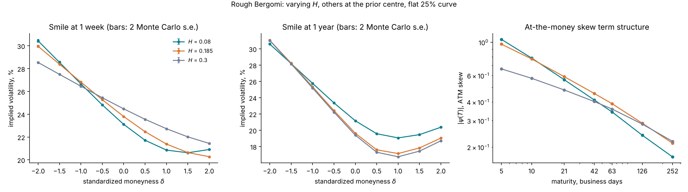

*Figure 13.8: the Hurst exponent $`H`$.* How to read the figure: $`H`$ sets the slope of the skew's term structure. The fitted power-law exponents from one week to one year are −0.46, −0.39 and −0.28 for $`H`$ = 0.08, 0.185 and 0.3; SPY's −0.32 lies between the last two. The lines pivot: at one week the skew is −1.04, −0.97 and −0.66, while at one year it is −0.17, −0.21 and −0.22. A small $`H`$ also curves the short smile: the one-week curvature is 16.4, 7.6 and 3.1. At one year the skews are close, but the levels are not: the at-the-money quote is 21.2%, 19.6% and 19.4%, so $`H = 0.08`$ raises it by 5.1 noise units from the centre (Section 13.11). $`H`$ shapes the smile mostly at short maturities and moves its level at long ones.

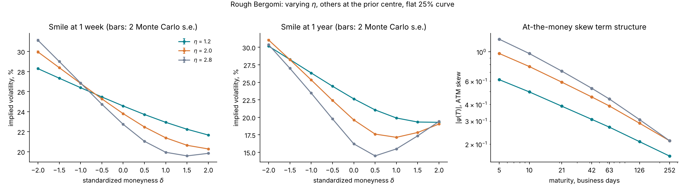

*Figure 13.9: the vol-of-vol $`\eta`$.* How to read the figure: $`\eta`$ scales three things at once. The short skew grows with $`\eta`$, nearly in proportion: −0.62, −0.97 and −1.25 at one week for $`\eta`$ = 1.2, 2.0 and 2.8. The curvature grows faster, roughly as $`\eta^2`$: 2.4, 7.6 and 17.0 at one week. And the at-the-money level falls below the curve's 25%, more at long maturities: from 24.6%, 23.8% and 22.7% at one week to 22.6%, 19.6% and 16.2% at one year, which is +10.0 and −11.4 noise units from the centre. This is the mechanism of Lecture 5, Section 5.7: at-the-money implied volatility measures roughly the average volatility, which falls below the root of the average variance as the variance becomes more random, and Figure 13.3 showed how random it becomes at $`\eta = 2`$. $`\eta`$ also steepens the skew's term structure, from −0.34 to −0.45.

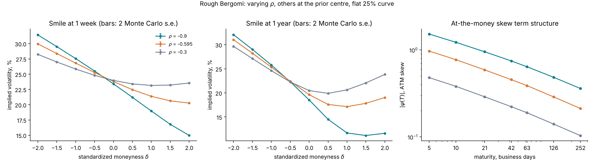

*Figure 13.10: the correlation $`\rho`$.* How to read the figure: $`\rho`$ sets the sign and size of the skew. The one-week skew is −1.52, −0.97 and −0.48 for $`\rho`$ = −0.9, −0.595 and −0.3, in the ratio of the correlations. The fitted exponent barely moves with $`\rho`$ (−0.37 to −0.39). At leading order it depends on $`H`$ alone (Section 13.10), although over the design grid $`\eta`$ moves it too (Figure 13.9). $`\rho`$ also moves the one-year at-the-money quote: 18.5%, 19.6% and 20.5%, which is −3.7 and +2.8 noise units from the centre. At one week the smile with $`\rho = -0.9`$ falls from 31.4% at $`\delta = -2`$ to 15.0% at $`\delta = +2`$, with a negative curvature of −3.6; with $`\rho = -0.3`$ it falls from 28.2% to a minimum of 23.2% at $`\delta = +1`$ and rises to 23.6%, with a curvature of 13.1. A larger correlation turns the randomness of the variance into skew; a smaller one leaves it as curvature.

## 13.10 The short-maturity skew

The figures show a skew that steepens without limit as $`T`$ falls. This section derives its leading term, following the same three steps as Lecture 10, Section 10.8.

**Step 1: skew and skewness.** As in Lecture 10, a log price close to normal with total variance $`w`$ and standardized skewness $`\gamma_1`$ has an at-the-money skew $`\psi(T) \approx \gamma_1/(6\sqrt T)`$ (Backus, Foresi, Li and Wu 1997).

**Step 2: the third cumulant.** Take a flat curve $`\xi_0`$. To first order in $`\eta`$, $`V_t \approx \xi_0(1 + \eta Y_t)`$ and $`\sqrt{V_t} \approx \sqrt{\xi_0}\big(1 + \tfrac12\eta Y_t\big)`$. Write $`B = \rho W + \sqrt{1 - \rho^2}W^\perp`$ for the price shock. The martingale part of the log price is then

```math
M_T = \int_0^T\sqrt{V_t}\,dB_t \approx \sqrt{\xi_0}\,B_T + \tfrac12\eta\sqrt{\xi_0}\int_0^T Y_t\,dB_t .
```

The first term is normal. To first order in $`\eta`$ the third cumulant is the cross term $`3\,\mathbb{E}\big[\xi_0B_T^2\cdot\tfrac12\eta\sqrt{\xi_0}\int_0^TY_t\,dB_t\big]`$. As in Lecture 10, $`B_T^2 = 2\int_0^TB_t\,dB_t + T`$, and the Itô isometry gives

```math
\mathbb{E}\Big[\int_0^TB_t\,dB_t\int_0^TY_t\,dB_t\Big] = \int_0^T\mathbb{E}[B_tY_t]\,dt .
```

Only the $`\rho W`$ part of $`B`$ is correlated with $`Y`$, and $`\mathbb{E}[W_tY_t] = \sqrt{2H}\int_0^t(t - s)^{H - \frac12}ds = \sqrt{2H}\,t^{H + \frac12}/(H + \tfrac12)`$. Integrating over $`t`$,

```math
\int_0^T\mathbb{E}[B_tY_t]\,dt = \frac{\rho\sqrt{2H}\;T^{H + \frac32}}{\big(H + \frac12\big)\big(H + \frac32\big)}, \qquad \kappa_3 \approx 3\,\xi_0^{3/2}\,\eta\cdot\frac{\rho\sqrt{2H}\;T^{H + \frac32}}{\big(H + \frac12\big)\big(H + \frac32\big)} .
```

The standardized skewness is $`\gamma_1 = \kappa_3/(\xi_0T)^{3/2} = 3\rho\eta\sqrt{2H}\,T^H/\big((H + \tfrac12)(H + \tfrac32)\big)`$.

**Step 3: the skew.** Dividing by $`6\sqrt T`$:

```math
\psi(T) \approx \frac{\rho\,\eta\,\sqrt{2H}}{2\big(H + \frac12\big)\big(H + \frac32\big)}\;T^{H - \frac12}, \qquad T \to 0 .
```

This is the formula of Bayer, Friz and Gatheral (2016), from the general expansion of Fukasawa (2011); El Euch, Fukasawa, Gatheral and Rosenbaum (2019) give the next terms. Three checks follow. For $`H = \tfrac12`$ the exponent is zero and the constant is $`\rho\eta/4`$; with $`\eta`$ the volatility of the log variance, $`\sigma_v/\sqrt{v_0}`$ in Heston's terms, this is Heston's limit $`\rho\sigma_v/(4\sqrt{v_0})`$ of Lecture 10. For $`H \lt \tfrac12`$ the skew diverges as $`T^{H - \frac12}`$: the power law that SPY shows. And at leading order the level of the skew is proportional to $`\rho\eta`$, while its exponent depends on $`H`$ alone. Over the design grid this separation is only approximate: the fitted exponent moves from −0.34 to −0.45 as $`\eta`$ goes from 1.2 to 2.8 (Figure 13.9), about 60% of the move from −0.46 to −0.28 that $`H`$ produces between 0.08 and 0.3 (Figure 13.8).

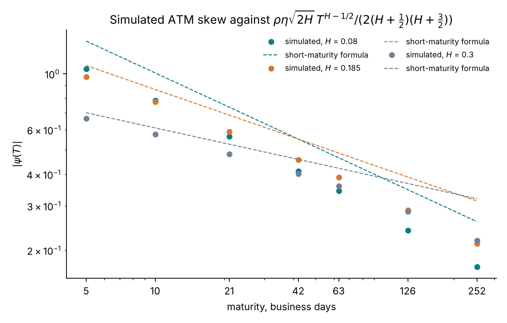

*Figure 13.11.* How to read the figure: the dots are the skews of Figure 13.8; the dashed lines the formula. The formula is above the simulation everywhere, and the gap grows with maturity. At one week it is 29%, 11% and 6% too high for $`H`$ = 0.08, 0.185 and 0.3; at one year, 51%, 48% and 47%. The fitted exponents are steeper than $`H - \tfrac12`$: −0.46 against −0.42, −0.39 against −0.315, and −0.28 against −0.20.

**Interpretation and limits.** The expansion is in powers of the standard deviation of $`\eta Y_T`$, which is $`\eta T^H`$. At one week and $`\eta = 2`$ this is 1.46, 0.97 and 0.62 for the three values of $`H`$: not small, and largest for the roughest case, which is why the formula is least accurate there. Two consequences follow for the tutorial. Reading $`H`$ as the fitted exponent plus $`\tfrac12`$ understates it, so SPY's exponent of −0.32 does not mean $`H = 0.18`$ exactly. And the inference must use the full simulated map from parameters to prices, which the amortized network learns, rather than the expansion.

## 13.11 What the smile identifies

The skew formula suggests a weakness. At short maturities the skew depends on $`\eta`$ and $`\rho`$ only through the product $`\rho\eta`$. If that were the whole story, the smile would fix $`\rho\eta`$ and leave a valley of pairs $`(\eta, \rho)`$ with the same product and the same fit. This section checks the suggestion on full surfaces.


*Figure 13.12.* How to read the figure: the three sets are $`(\eta, \rho)`$ = (1.4, −0.850), (2.0, −0.595) and (2.8, −0.425), all with $`\rho\eta = -1.19`$ and $`H = 0.185`$. At one week (left) the three smiles nearly coincide from $`\delta = -2`$ to $`\delta = +1`$, as the formula predicts; they part in the call wing, where the curvature acts (18.5%, 20.3% and 22.3% at $`\delta = +2`$). At one year (centre) they differ everywhere: the at-the-money level is 21.4%, 19.6% and 16.8%, and the curvature changes sign, from −0.01 at $`\eta = 1.4`$ to 1.74 at $`\eta = 2.8`$. The right panel divides each difference from the prior centre by the quote noise in volatility units, $`s_{\text{iv}}(\delta)`$ (Lecture 5, Section 5.3). Moving $`\eta`$ to 1.4 or 2.8 at fixed $`\rho\eta`$ changes the quotes by up to 5.7 and 9.5 noise units, both at the one-year at-the-money quote, with root-mean-square differences of 2.3 and 2.9 over the 63 quotes. Changing the product instead, to $`\rho = -0.70`$ at $`\eta = 2`$ ($`\rho\eta = -1.40`$, 18% steeper), changes them by at most 2.4 units, with a root-mean-square of 1.2.

**Interpretation.** On these surfaces the smile separates $`\eta`$ from $`\rho`$, and the strongest separation is not in the short skew but in the one-year at-the-money level relative to the input curve. That level is not specific to $`\eta`$. In the sweeps of Section 13.9, with the curve held fixed, the one-year at-the-money quote moves from the prior centre by +10.0 and −11.4 noise units for $`\eta`$ = 1.2 and 2.8, by +5.1 and −0.8 for $`H`$ = 0.08 and 0.3, and by −3.7 and +2.8 for $`\rho`$ = −0.9 and −0.3. The gap between the at-the-money volatility and the variance-swap volatility therefore carries information on all three parameters, which the inference combines with the skew, its term structure and the curvature. Three qualifications follow.

1. **This revises an earlier reading of the smile.** The tutorial's first identification list stated that the level of each maturity's smile is fixed by $`\xi_0`$ and carries no parameter information, and that the curvature alone separates $`\eta`$ from $`\rho`$, leaving $`\eta`$ wide. The evidence of this section replaces it: the at-the-money level against $`\xi_0`$ carries information on all three parameters, mostly on $`\eta`$.
2. **This route depends on $`\xi_0`$ being right.** The curve is replicated from out-of-the-money quotes whose strikes stop at $`\delta = -8`$ or before (Lecture 5, Section 5.9), and truncation lowers it: integrating only the design grid's strikes gives a one-year variance-swap volatility of 18.9% instead of 21.8% (Lecture 5, Figure 5.7). An error of 0.3 volatility points in the curve's one-year level moves the model's one-year at-the-money volatility by a comparable amount, about one noise unit, which the inference would read as information about $`H`$, $`\eta`$ and $`\rho`$.
3. **The evidence from the pilot is partial.** The pilot of study S2 reports all three parameters identified: on 250 test smiles the posterior standard deviation relative to the mean has a median of 5% for $`\eta`$, 6% for $`\rho`$ and 10% for $`H`$ (study S2). The same pilot's simulation-based calibration fails for $`\rho`$ and $`\rho\eta`$, so the 6% for $`\rho`$ is not a validated width. The full study ⟨S2⟩ measures it on the complete bank (study S2, run R3 of `lab/plans/CLUSTER-RUNS.md`; Lecture 15, Section 15.2), and Lecture 8, Section 8.5 reads identification off the posterior.

The prior's range of $`\rho`$ also bounds the valley: at fixed $`\rho\eta`$, $`\eta`$ must lie between $`|\rho\eta|/0.99`$ and $`|\rho\eta|/0.2`$.

**From identification to product prices.** The short-dated skew pins only the product $`\rho\eta`$. The full surface also separates $`\eta`$, mainly through the long-dated at-the-money level relative to $`\xi_0`$: in the pilot of study S2 the posterior standard deviation is a median 5% of the posterior mean for $`\eta`$, against 10% for $`H`$ (qualification 3 above; study S2). That separation holds only as far as $`\xi_0`$ is read correctly. The volatility swap, the forward-start and the out-of-grid put (Section 13.12; Lecture 6, Section 6.2) all depend on $`\eta`$, which explains most of their posterior variance in the pilot (study S7). On three pilot test smiles (`tutorial/assets/results/calibration/rough-pilot/s7/products.json`), the 90% range of the forward-start under the pilot network's posterior is 2.2% to 9.3% of its posterior mean, and the short-side reserve 1.0% to 6.0% of its point price; the pilot network's intervals are 1.3 to 1.6 times too wide (study S5), so these figures overstate the exact ranges. That width comes from the pilot's audit, which is being rerun (Lecture 15, Section 15.2).

**When $`\xi_0`$ is uncertain or the quotes are few.** Qualification 2 can be measured locally. A quick check fits rough Bergomi to SPY's 63 quotes of 21 October 2026 by least squares, with $`\xi_0`$ replicated from SPY's strip, and finds $`H = 0.077`$, $`\eta = 2.68`$ and $`\rho = -0.77`$, with $`\chi^2 = 80.7`$ (`lab/checks/rough_checks.py`, results in `rough_checks.json`). At that fit it computes the local (Laplace) posterior covariance of $`(H, \eta, \rho)`$ and the seven log levels of $`\xi_0`$,

```math
\Sigma_{\text{local}} = \big(J^\top D^{-1} J + P^{-1}\big)^{-1} .
```

Here $`J`$ is the Jacobian of the 63 prices, by central differences with common random numbers, $`D`$ the diagonal matrix of the squared design noise, and $`P^{-1}`$ the prior precision: zero for $`(H, \eta, \rho)`$, and $`1/s_\xi^2`$ for each log level. A curve known exactly ($`s_\xi = 0`$) keeps only the block of $`(H, \eta, \rho)`$. A standard deviation $`s_\xi`$ of 5%, 10% or 20% per level makes the quotes carry the curve as well. Three quote sets are compared: the full grid, the 36 quotes up to 42 days, and 15 quotes at one, three and six months with $`\delta`$ from −1 to 1. Contraction is here $`1 - \mathrm{Var}/\mathrm{Var}_{\text{prior}}`$ in natural units, with the variance $`(b - a)^2/12`$ of the uniform box. The check is local: it shows where a direction is weak relative to the prior box, not the posterior's shape.

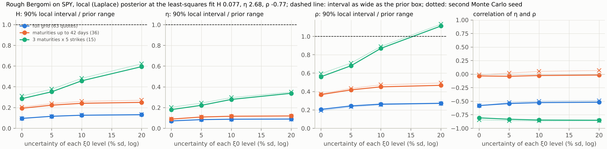

*Figure 13.13.* How to read the figure: the first three panels show the local 90% interval of $`H`$, $`\eta`$ and $`\rho`$ divided by the width of the prior box, against $`s_\xi`$; the dashed line is an interval as wide as the box. Each colour is one quote set. Solid lines use one Monte Carlo seed for the Jacobian and dotted lines a second, so their gap is the Monte Carlo error of the check. The right panel shows the local correlation of $`\eta`$ and $`\rho`$: −0.49 to −0.58 on the full grid, −0.04 to 0.07 on the 36 short quotes and −0.81 to −0.86 on the 15 quotes. On the full grid every interval stays far inside its box at every $`s_\xi`$. On the 15 quotes the interval of $`\rho`$ approaches the width of its box at 10% and exceeds it at 20%.

On the full grid the curve's uncertainty costs little. The contraction of $`\rho`$ is 0.95 to 0.96 with $`\xi_0`$ known and 0.92 to 0.93 with $`\xi_0`$ known to 10% per level, where each pair of numbers is the two seeds; the contractions of $`H`$ and $`\eta`$ stay above 0.97 at every $`s_\xi`$. On the 36 quotes up to 42 days, the contraction of $`\rho`$ falls from 0.84–0.85 with $`\xi_0`$ known to 0.75–0.77 at 10%. On the 15 quotes it falls from 0.61–0.65 with $`\xi_0`$ known to 0.12–0.16 at 10%, and below zero at 20%, where the local standard deviation of $`\rho`$ exceeds that of the uniform box. On those 15 quotes the local 90% interval of $`\rho`$ crosses a bound of the box at every $`s_\xi`$, and that of $`H`$ from 5% on. With few quotes, much of what the quotes say about $`\rho`$ passes through the curve. A thin chain does not support a replicated curve (Lecture 5, Section 5.9), so its curve must be inferred, as the thin network of Lecture 16 does.

## 13.12 Products the smile does not quote

A bank calibrates to vanilla quotes in order to price products that are not quoted (Lecture 1, Section 1.7). Three such products show which parameters matter beyond the smile.

**The variance swap** over $`[0, T]`$ pays the realized variance $`\frac1T\int_0^TV_t\,dt`$ against a fixed strike. Its fair strike is $`\frac1T\int_0^T\xi_0(t)\,dt`$ (Section 13.3), the same for every parameter value.

**The volatility swap** pays the realized volatility $`\sqrt{\frac1T\int_0^TV_t\,dt}`$. By Jensen's inequality its fair strike is below the variance swap's, by an amount that grows with the randomness of the realized variance, and therefore with $`\eta`$.

**The forward-start at-the-money call** pays $`(X_{T_2}/X_{T_1} - 1)^+`$ at $`T_2`$: an at-the-money call whose strike is set at the future date $`T_1`$. Its price depends on the smile that the model predicts for the interval $`[T_1, T_2]`$, the **forward smile**, which no quote today observes. It is priced by the conditional Black–Scholes argument of Section 13.7 applied to $`[T_1, T_2]`$: given $`W`$, $`X_{T_2}/X_{T_1}`$ is log-normal with forward $`\exp\big(\rho\int_{T_1}^{T_2}\sqrt V\,dW - \tfrac12\rho^2\int_{T_1}^{T_2}V\,dt\big)`$ and total variance $`(1 - \rho^2)\int_{T_1}^{T_2}V\,dt`$. Under Black–Scholes with volatility $`\sigma`$, its price is $`2N\big(\tfrac12\sigma\sqrt{T_2 - T_1}\big) - 1`$.

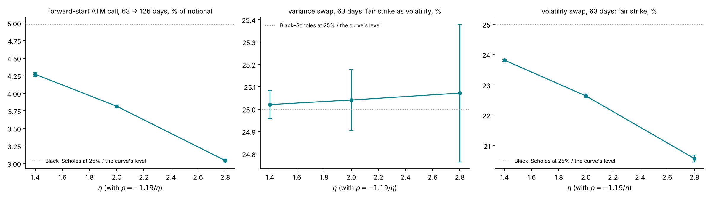

*Figure 13.14.* How to read the figure: each panel uses the three sets with $`\rho\eta = -1.19`$ and a flat 25% curve, on 32,768 paths (16,384 antithetic pairs). The variance-swap strike (centre), in volatility units, is 25.02%, 25.04% and 25.07%, equal to the curve's 25% within two standard errors (0.03, 0.07 and 0.15 points): the parameters do not move it. The volatility swap (right) is 23.82%, 22.64% and 20.57% for $`\eta`$ = 1.4, 2.0 and 2.8, below 25% by 1.2, 2.4 and 4.4 points. The forward-start call (left) is worth 4.27%, 3.82% and 3.04% of the notional, against 4.98% under Black–Scholes at 25%. Inverted through the Black–Scholes formula, these are forward at-the-money volatilities of 21.4%, 19.1% and 15.3%, below the spot 63-day at-the-money volatilities of the same surfaces (22.8%, 21.7% and 19.8%). Seen from today, the variance at day 63 is itself random, with a log standard deviation of $`\eta\,(0.25)^{H}`$, so the forward smile mixes more variance states than the spot smile and sits lower at the money.

**Interpretation.** The three parameter sets share the skew's product and fit the short smiles almost equally. Their forward-start prices differ by 29% of the highest, and their volatility-swap strikes by 3.2 points. A calibration that fixed $`\rho\eta`$ but left $`\eta`$ uncertain would leave these prices uncertain by the same amounts. Section 13.11 showed that the full smile does constrain $`\eta`$; Lecture 8, Section 8.7 shows how a posterior carries what remains of the uncertainty into such prices.

**The variance swap under daily monitoring.** A real variance swap uses daily returns, and then the strike is no longer the integral of $`\xi_0`$ alone. Write one day's log return as $`r = \int_t^{t+\Delta}\sqrt{V_s}\,dB_s - \tfrac12\int_t^{t+\Delta}V_s\,ds`$, where $`B`$ is the Brownian motion of the price and $`\Delta = 1/252`$. Squaring and taking expectations,

```math
\mathbb{E}[r^2] = \mathbb{E}\Big[\int_t^{t+\Delta} V_s\,ds\Big] - \mathbb{E}\Big[\int_t^{t+\Delta}\sqrt{V_s}\,dB_s\int_t^{t+\Delta}V_u\,du\Big] + \tfrac14\,\mathbb{E}\Big[\Big(\int_t^{t+\Delta}V_s\,ds\Big)^2\Big] .
```

The first term is $`\xi_0\Delta`$ for a flat curve. The middle term is the leverage: under rough Bergomi $`V_u`$ depends on the shock $`dW_s`$ at every earlier time $`s`$ through the kernel $`\sqrt{2H}(u-s)^{H-\frac12}`$ of Section 13.2, and $`dB_s`$ has correlation $`\rho`$ with $`dW_s`$, so to first order in $`\eta`$, $`\mathbb{E}[\sqrt{V_s}\,dB_s\,V_u] = \rho\eta\sqrt{2H}\,\xi_0^{3/2}(u-s)^{H-\frac12}\,ds`$ for $`u \gt s`$. Integrating over $`t \leq s \lt u \leq t + \Delta`$, with $`\int_0^\Delta\int_s^\Delta (u-s)^{H-\frac12}\,du\,ds = \Delta^{H+\frac32}/\big((H+\tfrac12)(H+\tfrac32)\big)`$,

```math
\mathbb{E}[r^2] \approx \xi_0\Delta - \frac{\rho\,\eta\sqrt{2H}\;\xi_0^{3/2}\,\Delta^{H+\frac32}}{(H+\frac12)(H+\frac32)} + \tfrac14\,\xi_0^2\Delta^2 .
```

With $`\rho \lt 0`$ the daily-monitored strike is above the continuous one. For $`\xi_0 = 0.04`$ the first-order excess is 0.29% of the strike at the prior centre $`(H, \eta, \rho) = (0.185, 2.0, -0.595)`$, 0.32% at the best fit of pilot smile 293, $`(0.068, 1.32, -0.66)`$, and 0.62% for a steep skew, $`(0.07, 1.9, -0.9)`$. A Monte Carlo check over 63 days, with 16 time steps per day and 8,192 paths, gives 0.53% (standard error 0.05), 0.38% (0.01) and 0.94% (0.05): the exponential in $`V`$ adds terms of higher order in $`\eta`$ (`course/scripts/lecture08.py`). A daily-monitored rough-Bergomi variance swap therefore does depend on $`(H, \eta, \rho)`$, by a few tenths of a percent to about one percent of the strike, and $`\xi_0`$ itself is read from noisy quotes. The tutorial prices the swap with continuous monitoring and a fixed curve; the next paragraph and Lecture 8, Section 8.12 state what this leaves out.

**The variance swap: Heston against rough Bergomi.** Lecture 6, Section 6.3 derived the variance swap's fair strike as the average of the forward-variance curve, $`K_{\text{var}} = \frac1T\int_0^T \xi_0(t)\,dt`$. The two models treat that curve differently.

Under Heston, the curve is a function of the parameters, $`\mathbb E[V_t] = \theta_H + (v_0 - \theta_H)e^{-\kappa t}`$, so

```math
K_{\text{var}}^{\text{Heston}}(T) = \frac1T\int_0^T\big(\theta_H + (v_0 - \theta_H)e^{-\kappa t}\big)dt = \theta_H + (v_0 - \theta_H)\,\frac{1 - e^{-\kappa T}}{\kappa T},
```

and its posterior range is that of the linear combination $`\frac{1 - e^{-\kappa T}}{\kappa T}\,v_0 + \big(1 - \frac{1 - e^{-\kappa T}}{\kappa T}\big)\theta_H`$, with weights 0.787 and 0.213 for $`\kappa = 2`$ and $`T = 63/252`$. Under rough Bergomi, the curve is an input read from the chain, $`\mathbb E[V_t] = \xi_0(t)`$ for every $`(H, \eta, \rho)`$ (Section 13.3), so with continuous monitoring and a fixed $`\xi_0`$ the variance swap's posterior range is exactly zero.

Three qualifications keep this result in its place. First, the repository prices the swap directly as the integral of the input curve, without the simulated paths (`products.variance_swap`); its zero range is a consistency check of the curve input, and it cannot reveal an error in the path simulation. Second, a daily-monitored swap carries a leverage term that depends on $`(H, \eta, \rho)`$: the paragraph above derives it and measures it at 0.38% to 0.94% of the strike for three parameter sets. Third, $`\xi_0`$ is read from the same noisy quotes, and its uncertainty is not propagated; the thin network of Lecture 16 infers it instead. Under Heston the same uncertainty about the level of variance appears in the posterior of $`(v_0, \theta_H)`$, and so in the variance swap's range. The comparison of the two models' variance-swap ranges therefore flatters rough Bergomi: it is zero by construction, not because the quotes determine the strike exactly.

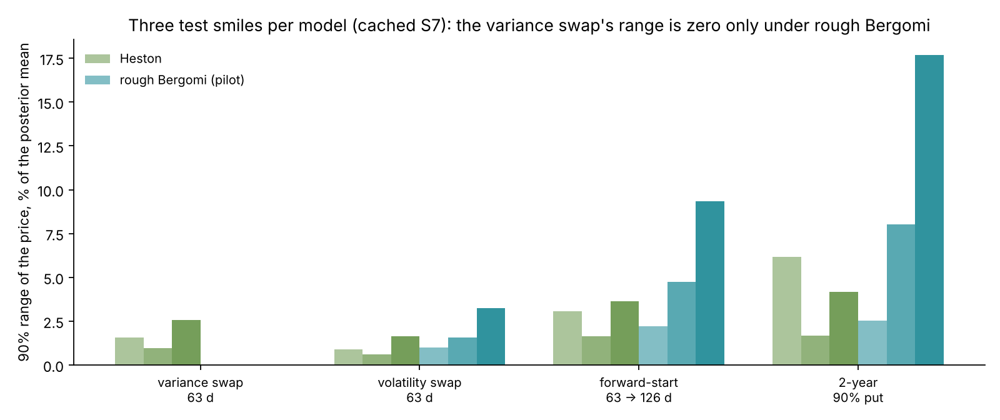

*Figure 13.15.* How to read the figure: each group of bars is one product; the green bars are three Heston test smiles (rows 2,300 to 2,302) under the Heston network's posterior (checkpoint `heston-net-v3`, not an exact posterior) and the blue bars three rough-Bergomi smiles of the pilot study (rows 290 to 292) under the pilot network's posterior, one shade per smile; the height is the 90% range as a share of the posterior mean (`tutorial/assets/results/calibration/heston/s7/products.json`, `tutorial/assets/results/calibration/rough-pilot/s7/products.json`). Under Heston the variance swap's range is 1.57%, 0.97% and 2.59% on the three smiles; under rough Bergomi it is zero on all three. The other products have ranges under both models: the volatility swap 0.61% to 1.64% under Heston and 0.98% to 3.26% under rough Bergomi, the forward-start 1.65% to 3.65% and 2.22% to 9.34%, the two-year put 1.68% to 6.15% and 2.54% to 17.69%. The rough-Bergomi ranges come from the pilot network's posterior, whose intervals are 1.3 to 1.6 times too wide (study S5; a pilot result being rerun, Lecture 15, Section 15.2), so they overstate the exact posterior's ranges. Study S7 on the full bank, with the validated network, will replace these pilot ranges: ⟨S7⟩, from run R10 of `lab/plans/CLUSTER-RUNS.md`.

Under rough Bergomi, every product's range comes from $`(H, \eta, \rho)`$ alone, and in the pilot study the volatility of variance $`\eta`$ explains most of it: a single-parameter $`R^2`$ of 0.77 to 0.96 for the volatility swap and 0.94 to 0.97 for the forward-start (study S7).

## 13.13 What the model misses

- **Jumps in the price.** A crash is a continuous move in this model. Short-dated out-of-the-money puts, where jumps matter most, are expected to be the quotes it fits worst; the check on SPY is ⟨S8⟩. The design grid stops at $`|\delta| = 2`$.
- **Jumps in volatility.** The variance rises only through the diffusive driver $`Y`$.
- **Constant parameters across maturities.** One $`H`$, one $`\eta`$ and one $`\rho`$ must fit the skew and the curvature at all seven maturities at once. The model has no parameter that acts at one maturity only.
- **An ever-widening law of the variance.** $`\ln V_t`$ has a variance $`\eta^2t^{2H}`$ that grows without bound: at one year and $`\eta = 2`$, the 5%–95% range of the volatility is 1.7% to 48% (Figure 13.3). The model has no mean reversion of the variance toward a level.
- **Volatility products.** The model does not price VIX products consistently with SPX options. Jacquier, Martini and Muguruza (2018) study VIX futures in the model; path-dependent volatility models (Guyon and Lekeufack 2023) fit SPX and VIX smiles jointly.
- **The dynamics of the smile.** One day's smile does not test how the model's smile moves when the price moves, which matters for hedging (Lecture 4, Section 4.10).

The posterior predictive check on the real SPY smile shows where the model misses in practice: the quotes whose standardized residual under the posterior exceeds two ⟨S8⟩ (Lecture 15, Section 15.3). Both ⟨S8⟩ of this section come from study S8, SPY's posterior and its predictive check (run R6 of `lab/plans/CLUSTER-RUNS.md`).

## 13.14 The time convention

Every formula of this lecture contains $`t^{H}`$ with $`t`$ in years. The number $`\eta`$ is therefore measured in $`\text{year}^{-H}`$, and its value depends on how time is counted.

**Business days.** The repository counts maturities in business days (weekdays, with exchange holidays not removed) and divides by 252 (course index, Conventions). The convention reflects where variance accrues. French and Roll (1986) found that stock returns are much more variable over trading hours than over non-trading hours: a weekend adds far less variance than two trading days. The forward-variance curve read from the chain (Lecture 5) and the simulation grids of Section 13.6 use the same clock, so the input curve and the model agree. The thin chain of Lecture 16 also removes NYSE holidays, so its maturities are trading days; SPY's surface of 21 October still counts weekdays, which overstates its maturities by about 5% at three to six months and 4% at one year (Lecture 15, Section 15.3).

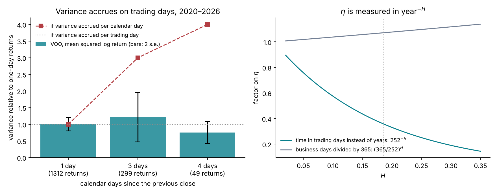

*Figure 13.16.* How to read the figure: in the left panel, returns over a weekend (3 calendar days, 299 returns) have 1.22 times the mean squared value of one-day returns (1,312 returns), with a standard error of 0.37; returns over a long weekend (4 days, 49 returns) have 0.75 times, with a standard error of 0.16. If variance accrued per calendar day the ratios would be 3 and 4 (squares); the data are close to one trading day's variance (dotted). In the right panel, measuring time in trading days instead of years multiplies $`\eta`$ by $`252^{-H}`$, which is 0.36 at $`H = 0.185`$: the same smile gives $`\eta = 0.72`$ in day units. Counting business days but dividing by 365 multiplies $`\eta`$ by $`(365/252)^{H}`$, 1.07 at $`H = 0.185`$. A prior on $`\eta`$, a published estimate and a simulator must all use the same clock.

## 13.15 Summary

1. The log volatility of equity indices behaves like a rough process with a small Hurst exponent. Daily VOO data reproduce the scaling pattern ($`H = 0.12`$ raw) but cannot pin $`H`$ down once sampling noise is removed (0.22 to 0.32). The tutorial infers $`H`$ from the smile.
2. The driver $`Y_t = \sqrt{2H}\int_0^t(t - s)^{H - \frac12}dW_s`$ is Gaussian with $`\mathrm{Var}(Y_t) = t^{2H}`$ and increments of size $`h^H`$.
3. The variance $`V_t = \xi_0(t)\exp(\eta Y_t - \tfrac12\eta^2t^{2H})`$ has mean exactly $`\xi_0(t)`$, so the model matches the market's variance-swap curve by construction. Its law is log-normal and very skewed.
4. The model has no finite Markov state: two pasts with the same current variance imply different forward-variance curves. It has no characteristic function and no exact Fourier or PDE pricer; the tutorial prices it by Monte Carlo.
5. The hybrid scheme simulates the newest cell of the kernel exactly and the others at their cell averages, keeps the mean of the variance exact, and computes the convolution by FFT.
6. Conditional Black–Scholes pricing, antithetic pairs and two control variates reduce the variance per path, on the 63-day grid, by factors of 24 (far puts) to over 30,000 (in-the-money puts); the far puts at six months and one year gain least from the controls (Section 13.7). With $`2^{15}`$ paths per grid a surface at the prior centre costs about 5 CPU-seconds and meets the budget $`s_c \le 0.25\,\sigma_c`$; across the prior the average is 11.9 CPU-seconds. Lecture 14 shows what this means for an exact posterior: at least 16.9 CPU-hours by a random-walk chain, and about 85 CPU-minutes by importance sampling on SPY's 63 quotes.
7. At leading order $`H`$ sets the exponent of the skew's term structure and $`\rho\eta`$ its size; over the design grid $`\eta`$ also steepens the fitted exponent (−0.34 to −0.45). $`\rho`$ sets the skew's sign, and $`\eta`$ the curvature. All three parameters move the long-dated at-the-money level relative to the variance-swap level.
8. The short-maturity skew is $`\rho\eta\sqrt{2H}\,T^{H - \frac12}/\big(2(H + \tfrac12)(H + \tfrac32)\big)`$. Over one week to one year the simulated skew lies below it, with a steeper exponent, because the expansion parameter $`\eta T^H`$ is not small.
9. At fixed $`\rho\eta`$, changing $`\eta`$ moves the one-year at-the-money quote by up to 9.5 noise units: the smile separates $`\eta`$ from $`\rho`$, mainly through the at-the-money level relative to $`\xi_0`$, which also depends on $`H`$ and $`\rho`$ and requires the input curve to be right. The same changes move a forward-start call by 29% and a volatility swap by 3.2 points, and leave the variance swap unchanged.
10. With the curve uncertain, the full grid still identifies the three parameters: the local contraction of $`\rho`$ is 0.92 to 0.93 with $`\xi_0`$ known to 10% per level, against 0.95 to 0.96 with $`\xi_0`$ known. On 15 quotes it falls from 0.61–0.65 to 0.12–0.16: there much of what the quotes say about $`\rho`$ passes through the curve.
11. Under continuous monitoring and a fixed curve, rough Bergomi's variance swap has no posterior range; daily monitoring adds a leverage term of 0.38% to 0.94% of the strike for three parameter sets. Under Heston the variance swap moves with $`v_0`$ and $`\theta_H`$.
12. Time is counted in business days over 252, where variance accrues, and $`\eta`$ is in $`\text{year}^{-H}`$.

## References

- Bayer, C., Friz, P., Gatheral, J. (2016). Pricing under rough volatility. *Quantitative Finance* 16(6), 887–904. [doi](https://doi.org/10.1080/14697688.2015.1099717)
- Bergomi, L. (2005). Smile dynamics II. *Risk*, October 2005, 67–73. [Risk.net](https://www.risk.net/derivatives/equity-derivatives/1500225/smile-dynamics-ii)
- Gatheral, J., Jaisson, T., Rosenbaum, M. (2018). Volatility is rough. *Quantitative Finance* 18(6), 933–949. [doi](https://doi.org/10.1080/14697688.2017.1393551)
- Mandelbrot, B. B., Van Ness, J. W. (1968). Fractional Brownian motions, fractional noises and applications. *SIAM Review* 10(4), 422–437. [doi](https://doi.org/10.1137/1010093)
- Bennedsen, M., Lunde, A., Pakkanen, M. S. (2017). Hybrid scheme for Brownian semistationary processes. *Finance and Stochastics* 21(4), 931–965. [doi](https://doi.org/10.1007/s00780-017-0335-5)
- Romano, M., Touzi, N. (1997). Contingent claims and market completeness in a stochastic volatility model. *Mathematical Finance* 7(4), 399–412. [doi](https://doi.org/10.1111/1467-9965.00038)
- McCrickerd, R., Pakkanen, M. S. (2018). Turbocharging Monte Carlo pricing for the rough Bergomi model. *Quantitative Finance* 18(11), 1877–1886. [doi](https://doi.org/10.1080/14697688.2018.1459812)
- Backus, D., Foresi, S., Li, K., Wu, L. (1997). Accounting for biases in Black–Scholes. CRIF Working Paper 30, Fordham University. [Fordham](https://research.library.fordham.edu/crif_working_papers/30)
- Fukasawa, M. (2011). Asymptotic analysis for stochastic volatility: martingale expansion. *Finance and Stochastics* 15(4), 635–654. [doi](https://doi.org/10.1007/s00780-010-0136-6)
- El Euch, O., Fukasawa, M., Gatheral, J., Rosenbaum, M. (2019). Short-term at-the-money asymptotics under stochastic volatility models. *SIAM Journal on Financial Mathematics* 10(2), 491–511. [doi](https://doi.org/10.1137/18M1167565)
- Abi Jaber, E., El Euch, O. (2019). Multifactor approximation of rough volatility models. *SIAM Journal on Financial Mathematics* 10(2), 309–349. [doi](https://doi.org/10.1137/18M1170236)
- El Euch, O., Rosenbaum, M. (2019). The characteristic function of rough Heston models. *Mathematical Finance* 29(1), 3–38. [arXiv](https://arxiv.org/abs/1609.02108)
- Jacquier, A., Martini, C., Muguruza, A. (2018). On VIX futures in the rough Bergomi model. *Quantitative Finance* 18(1), 45–61. [RePEc](https://ideas.repec.org/a/taf/quantf/v18y2018i1p45-61.html)
- Guyon, J., Lekeufack, J. (2023). Volatility is (mostly) path-dependent. *Quantitative Finance* 23(9), 1221–1258. [doi](https://doi.org/10.1080/14697688.2023.2221281)
- French, K. R., Roll, R. (1986). Stock return variances: the arrival of information and the reaction of traders. *Journal of Financial Economics* 17(1), 5–26. [RePEc](https://ideas.repec.org/a/eee/jfinec/v17y1986i1p5-26.html)

Figures: `course/scripts/lecture07.py`, except Figure 13.13 (`lab/checks/figures.py`) and Figure 13.15 (`course/scripts/lecture10.py`).
