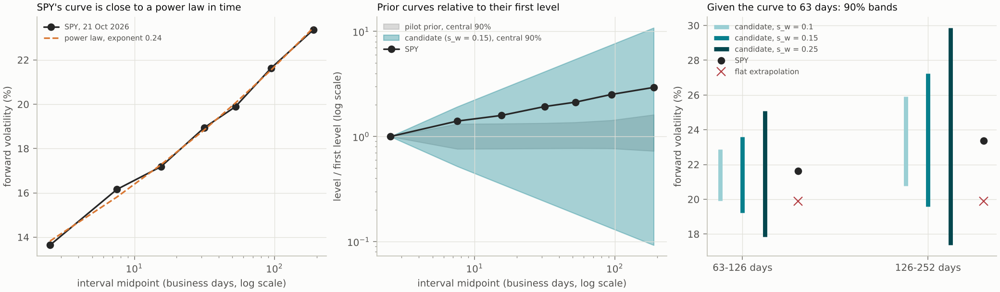
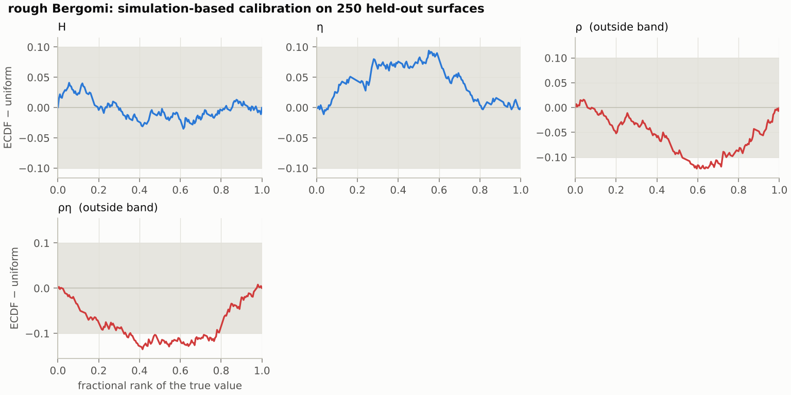
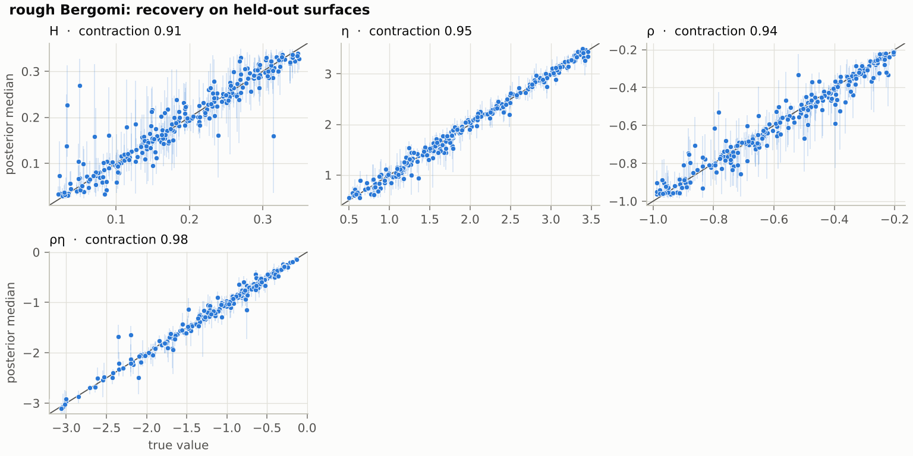
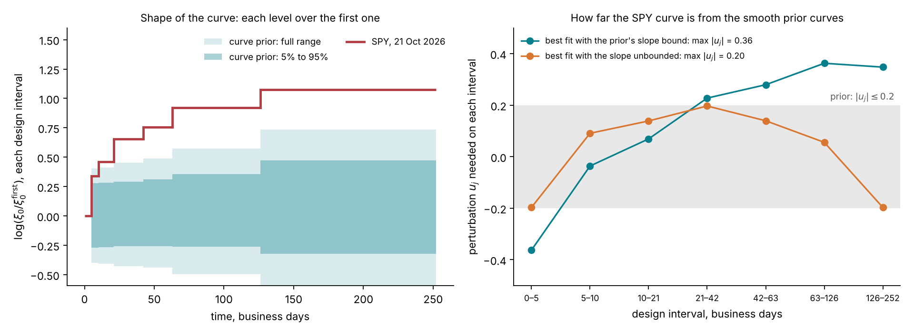
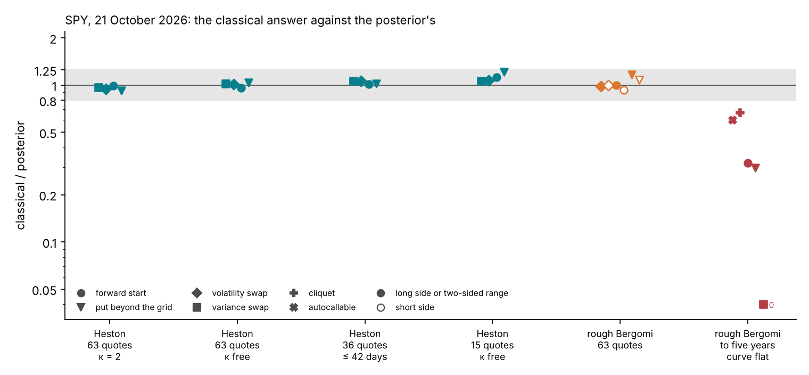
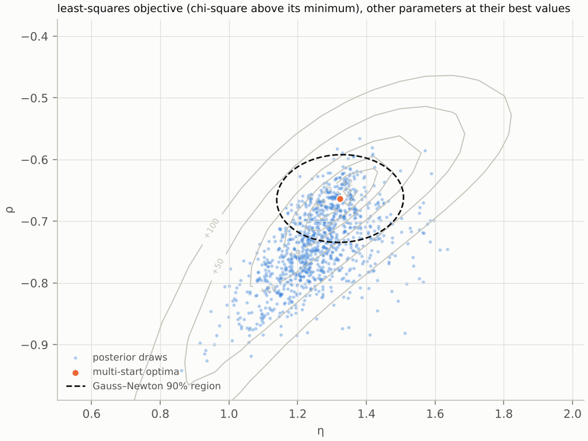
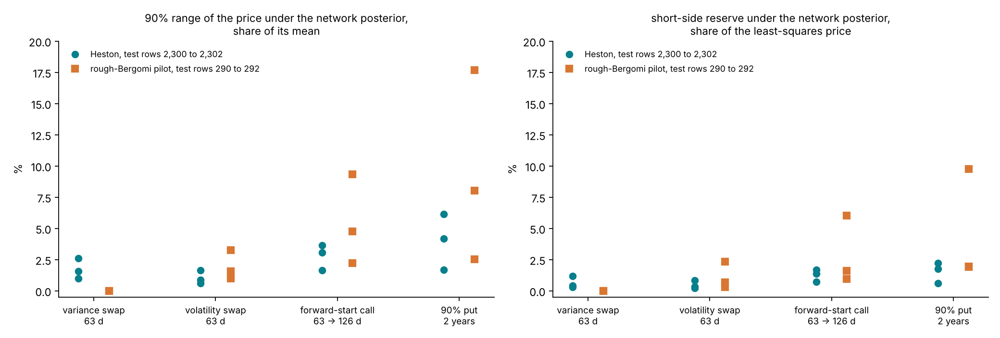
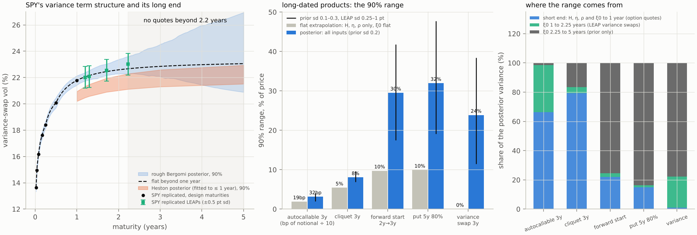
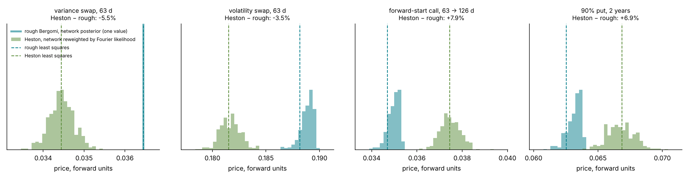

# Lecture 15. A liquid smile: SPY

[Course index](README.md) · Previous: [Lecture 14. Why the exact posterior is expensive](14-why-the-exact-posterior-is-expensive.md) · Next: [Lecture 16. A thin chain: EWG](16-a-thin-chain-ewg.md)

**What this lecture is for.** This lecture runs the amortized workflow on rough Bergomi and a liquid smile: SPY at the close of 21 October 2026. It describes the network and the training bank for rough Bergomi, with the full bank's prior for the forward-variance curve and the time grids that define the model the bank simulates. It reports what the checks found on the pilot network and what remains to run on the full bank. It then shows what SPY's posterior rests on, compares a posterior computed by importance sampling with the Gauss–Newton answer on SPY's 63 quotes, and turns posteriors into product ranges and reserves. It ends beyond the last quote, where the prior decides, and with Heston and rough Bergomi calibrated to the same smiles.

**Where it sits in the course.** Lecture 13 built rough Bergomi, and Lecture 14 measured what its exact posterior costs. Lecture 9 introduced the amortized posterior, and Lecture 12 ran its workflow and its checks on Heston, where every result has an exact reference. This lecture applies the same workflow to rough Bergomi on a smile with many tight quotes; Lecture 16 applies it to a thin chain. Numbers that need the full rough-Bergomi bank or SPY's posterior are written ⟨Sn⟩, and the runs that fill them are listed in `lab/plans/CLUSTER-RUNS.md`.

**Its part in the argument.** This lecture gives three claims of the argument on rough Bergomi (Lecture 6, Section 6.8). On SPY's 63 quotes the posterior and Gauss–Newton agree (Section 15.4). Beyond the last quote they part, by an amount the prior sets (Section 15.6). On pilot smiles, two models that both fit can price a product further apart than either model's range, so the posterior is exact for its model only (Section 15.7).

## 15.1 The network and the bank for rough Bergomi

**What the network reads and returns.** The tutorial's network for rough Bergomi is BayesFlow's flow-matching network (Radev et al. 2022, version 2.0.14 in the repository), with a velocity network of four hidden layers of 256 units (`lab/src/sbi4finance/calibration/inference.py`).

| Item | Content | Size |
| --- | --- | --- |
| Conditions | The 63 quotes divided by their noise standard deviations, $y_c/\sigma_c$, and the logarithms of the 7 forward-variance levels $\xi_0$ | 70 |
| Targets | $H$, $\eta$, $\rho$, each mapped to the real line by the logit of its position in the prior box | 3 |
| Output | Draws from the joint posterior of the three targets | 1,000 per smile in the study |

**Why these inputs.** Dividing each quote by its noise makes the quote noise a standard normal in every input, whatever the maturity or strike, so the network sees each quote in units of its own precision. The logarithm of the forward-variance levels puts quiet and volatile markets on one additive scale. The curve is a condition, not a target: it is read from the market (Lecture 5) and the network learns the posterior of $(H, \eta, \rho)$ given it. The thin network of Lecture 16 infers the curve instead. Both conditions and targets are then standardized by their training means and standard deviations, which are frozen after training.

**Why logits.** Lecture 12, Section 12.1 explains the logit map of the targets and its Jacobian, which the audit includes (Section 15.2).

*Figure 15.1.* How to read the figure:

- **Left.** The scaled quotes range from 0.20 (the one-week call at $\delta = 2$) to 55.8 (the one-year at-the-money option) for SPY, and from 0.75 to 78.6 for the simulated surface (`tutorial/assets/results/calibration/smile/example-rough.json`). A value near 0.2 says that the quote is a fifth of its noise: such a quote carries little information by itself. The two surfaces have the same noise standard deviations, because SPY's real half-spreads are below the design noise everywhere and the design floor applies (Lecture 5, Section 5.4). The gap between them is therefore in the prices. SPY's value is below the example's at every grid point, by a factor between 0.05 (calls at $\delta = 2$) and 0.86 (the one-year at-the-money option). SPY's one-month at-the-money volatility is 12.8%, about half the example's flat 25%, and a far out-of-the-money option's price falls much faster than in proportion to the volatility.
- **Centre.** SPY's curve rises from $\log\xi_0 = -3.98$ (13.6% in volatility units) to $-2.91$ (23.4%). The example's is flat at $\log 0.0625 = -2.77$. Section 15.3 shows that SPY's steep, concave rise lies outside the curves the pilot's prior produces, and inside those of the full bank's prior.
- **Right.** The logistic density has heavier tails than the normal with the same variance; both are centred at the middle of the prior box.

**Training settings.** The reference run trains on the 100,000 training surfaces in batches of 256, with a fresh quote error in every batch (Lecture 12, Section 12.2). The optimizer is AdamW with weight decay $5 \times 10^{-3}$ and gradient norms clipped at 1.5. The learning rate rises from $5 \times 10^{-5}$ to $5 \times 10^{-4}$ over the first 5% of steps and then decays to zero along a cosine. The checkpoint kept is the epoch with the smallest validation loss. The number of epochs, the cores and the training time are ⟨S2⟩, from run R3 of `lab/plans/CLUSTER-RUNS.md`. After training, 1,000 posterior draws for one smile take 1.4 seconds on the clock (3.6 CPU-seconds), after 5.9 seconds to load the network and compile the sampler once (`tutorial/assets/results/calibration/costs/costs.json`).

**The training bank.** The network learns from a bank of simulated surfaces, generated once on a cluster. Each surface is one draw of $(H, \eta, \rho)$, one draw of a curve $\xi_0$, one Monte Carlo pricing of the 63 contracts (Lecture 13), and the Monte Carlo standard errors of the prices. Four independent random streams per surface, for the parameters, the pricing, the quotes and the curve, are seeded from the surface's identity, so any surface can be regenerated alone (`lab/src/sbi4finance/calibration/bank.py`). The full bank has 100,000 training surfaces, 5,000 for validation, 5,000 for testing and 2,000 for simulation-based calibration, 112,000 in all. Only the pilot bank of 2,200 surfaces has been generated so far; the full bank is study S1, ⟨S1⟩, from run R1 of `lab/plans/CLUSTER-RUNS.md`.

**The curve prior of the full bank.** The pilot bank drew each curve as $\sigma_0^2(1 + s\,\bar t_j)\,e^{u_j}$, and SPY's curve lies outside that prior (Section 15.3). The full bank draws it instead as a power law in time times a random walk in log time (`lab/src/sbi4finance/calibration/tasks.py`, `draw_context`; v2-plan, Sections 5 and 7). With $\bar t_j$ the midpoint of the $j$-th design interval and $x_j = \log\bar t_j - \log\bar t_1$,

$$
\log\xi_{0,j} = 2\log\sigma_0 + b\,x_j + W_j, \qquad W_1 = 0, \qquad W_{j+1} - W_j \sim \mathcal{N}\big(0,\ s_w^2\,(x_{j+1} - x_j)\big),
$$

with $\sigma_0$ log-uniform on $(0.08, 0.60)$, $b$ uniform on $(-0.6, 0.6)$ and $s_w = 0.15$. A curve with any level's volatility $\sqrt{\xi_{0,j}}$ outside 6% to 60% is drawn again. A positive $b$ gives a rising curve, as in a calm market, and a negative $b$ an inverted one, as in a stressed market. The prior passed gate G0′ on a 200-surface mini-pilot on 24 October 2026 (v2-plan, Section 5):

- it covers SPY's curve, which lies inside the central 90% of prior curves at every level;
- it covers SPY's four smile statistics, at ranks 0.28, 0.25, 0.79 and 0.83 in the prior predictive (Lecture 12, Section 12.3);
- it costs 11.5 CPU-seconds a surface (the pilot: 11.9);
- no quote missed the Monte Carlo budget.

*Figure 15.2.* How to read the figure: the left panel shows SPY's seven forward volatilities of 21 October 2026 against the midpoints of the design intervals, on a log scale, with a power law in time of exponent 0.24. The centre panel shows curves divided by their first level: the central 90% of the pilot's prior (grey) and of the power-law walk with $s_w = 0.15$ (teal), drawn without the truncation to 6%–60%, and SPY's curve. SPY's curve leaves the pilot's band and stays inside the new one. The right panel holds the curve fixed to 63 days and shows the 90% band of each of the two later levels for three walk sds, with SPY's level (dot) and flat extrapolation (cross) (`lab/checks/curve_prior/`).

**The model the bank simulates.** The bank's model is rough Bergomi on the hybrid scheme's grids of Lecture 13, Section 13.6: 8 steps a day to 63 days and 2 a day beyond. The Bayesian and classical methods of this lecture and the next price the quotes with this pricer, so the grid is part of the model they share; refining it would double every cost (v2-plan, Section 7). The Monte Carlo errors the bank stores do not include the grid's bias. On 12 mini-pilot surfaces, a grid twice as fine moves a quote by a median of 0.02 of SPY's design noise sd. The 90th percentile is 0.15 and the largest move 1.0, on a surface with $\eta = 3.4$ and $\rho = -0.96$ (`lab/checks/grid_bias_minipilot/`). EWG's noise is two to fifteen times larger. Study S1-G measures the bias on the full bank: ⟨S1-G⟩, the grid bias in units of the quote noise on 50 test surfaces, from run R2.

*Figure 15.3.* How to read the figure:

- **Left.** Each surface is priced on three time grids, starting at $2^{15}$ paths and doubling until every standard error is below a quarter of its quote noise. The first rung sufficed for 77% of the 10-day blocks, 74% of the 63-day blocks and 69% of the one-year blocks. About 1% of blocks needed $2^{19}$ paths, at most 0.3% needed $2^{20}$, and none needed $2^{21}$ (`tutorial/assets/results/calibration/rough-pilot/s1/bank-quality.json`).
- **Right.** The rough bank's Monte Carlo errors have a median of 0.040 noise standard deviations, a 99% quantile of 0.22 and a largest value of 0.250, at the budget. The Heston bank's quadrature errors are $10^{-8}$ at the median and 0.056 at the largest, against a budget of 0.1 (`heston/s1/bank-quality.json`).

**Cost.** The rough pilot bank cost 26,241 CPU-seconds, 11.9 per surface or 3.3 CPU-hours per 1,000 surfaces. At that rate the full bank costs about 370 CPU-hours, under two hours on 200 cores. With the full bank's curve prior the mini-pilot cost 11.5 CPU-seconds a surface, and the full bank is estimated at about 360 CPU-hours (run R1). The Heston bank's cost is in Lecture 12, Section 12.2.

**A consequence of Monte Carlo error in the bank.** Lecture 14, Section 14.2 showed that pricing with standard error $s_c$ and adding quote noise $\sigma_c$ produces data distributed as a model with noise variance $\sigma_c^2 + s_c^2$. A network trained on such data learns the posterior of that slightly noisier model: at most 3% wider in standard deviation within the budget, and 0.1% wider at the pilot bank's median error (Lecture 14, Section 14.2).

## 15.2 Checks of the rough network

The checks are those of Lectures 9 and 12: simulation-based calibration, coverage, contraction and recovery (Lecture 9, Sections 9.7 and 9.8), the neural-pricer route (Lecture 12, Section 12.6) and the audit by importance sampling (Lecture 8, Section 8.9; Lecture 12, Section 12.7). On Heston they have all run. On rough Bergomi only the pilot network has been checked: a network trained on 1,600 surfaces of the pilot bank of 2,200. Every check of the full bank's network is pending.

**Simulation-based calibration of the pilot network, 250 held-out smiles.** Lecture 12, Figure 12.3 draws the distances in its right panel. The distances are 0.042 for $H$ and 0.095 for $\eta$, inside the band of 0.101, and 0.126 for $\rho$ and 0.138 for $\rho\eta$, outside it (`rough-pilot/s2/validation.json`). The pilot network was trained on 1,600 surfaces; the full bank's network replaces it, ⟨S2⟩.

*Figure 15.4 (study S2, `tutorial/assets/results/calibration/rough-pilot/s2/sbc.png`).* How to read the figure: each panel is one target, drawn as the bottom row of Lecture 9, Figure 9.7, with the band of 0.10 shaded. $H$ stays near zero. $\eta$ has a positive hump, up to 0.095 near rank 0.55: its posterior sits slightly too high, but inside the band. $\rho$ and $\rho\eta$ have negative dips in the middle of the rank range, down to −0.13: the truth ranks high among the draws too often, so the posterior of $\rho$ sits too low, that is, too negative. Study S2 measures the bias as a median 0.3 posterior standard deviations. By Lecture 9, Figure 9.7, a dip without a sideways S is a bias, not an overconfidence.

**Coverage, contraction and recovery.** Lecture 12, Figure 12.4 draws the pilot network's coverage in its centre panel and its contraction in orange. The 95% intervals cover the truth on 92.0% to 96.4% of the 250 smiles. The largest shortfall is $\rho$'s 50% interval, at 42% with a Wilson interval of 36% to 48%, which excludes 50%: the bias of Figure 15.4 moves the centre of the posterior, and a narrow central interval feels it most. The 90% intervals of $H$ and $\rho$ cover 86%, with a Wilson interval of 81.2% to 89.8%, which also excludes 90%. The contraction is 0.91 for $H$, 0.95 for $\eta$, 0.94 for $\rho$ and 0.98 for $\rho\eta$.

*Figure 15.5 (study S2, `tutorial/assets/results/calibration/rough-pilot/s2/recovery.png`).* How to read the figure: each point is one held-out surface, at its true value (horizontal) and posterior median (vertical), with its 90% interval as a faint vertical line; the panel titles give the contraction. The correlations between truth and median are 0.94 for $H$, 0.99 for $\eta$, 0.97 for $\rho$ and 0.99 for $\rho\eta$ (`rough-pilot/s2/validation.json`). $H$ scatters most, with a few medians far above small true values, and its intervals are the longest. $\rho$ shows the bias: below −0.8, many medians sit below the diagonal. $\eta$ and $\rho\eta$ lie close to the diagonal across their whole range.

**Interpretation.** The pilot smile identifies all three parameters, not only $\rho\eta$. In these simulations $\xi_0$ is known exactly, which is what lets the long-dated level identify $\eta$ (Lecture 13, Section 13.11). Within one smile, the posterior correlation of $\eta$ and $\rho$ in logit coordinates has a median of 0.34 (10% to 90%: −0.20 to 0.75): the ridge of Lecture 8, Section 8.5 exists, but it is short at this noise level. $H$, with the lowest contraction, is the least identified target. Whether this holds for real quotes depends on the noise in the wings, which the real chain measures (study S8). Lecture 13, Section 13.11 shows locally how much of this identification survives an uncertain curve or few quotes.

**The neural-pricer route.** The second simulation-based route of Lecture 12, Section 12.6, a chain on the likelihood of a neural pricer, has been rehearsed on Heston only. Its condition on rough Bergomi is the pricer's error: the pricer learns from Monte Carlo prices whose errors reach 0.25 noise standard deviations, so its error must be measured again, ⟨S4⟩.

**The Monte Carlo likelihood inside the audit.** The audit is the importance sampling of Lecture 8, Section 8.9, with the network's draws as proposal, and Lecture 12, Section 12.7 runs it on Heston. For rough Bergomi each proposal's 63 contracts are priced by Monte Carlo, so the weights use the unbiased estimate of Lecture 8, Section 8.9: each proposal is priced on its own seed, and the Gaussian variance is the quote noise minus the proposal's Monte Carlo covariance $S$. On a simulated surface the quotes also carry the bank's own Monte Carlo error $C$, so the variance is $\mathrm{diag}(\sigma_c^2) + C - S$ (`lab/studies/audit.py`). A pilot pricing at a quarter of the paths chooses each proposal's path count, up to 32 times the base, so that the count, and the covariance $S$ taken from the pilot, do not depend on the prices that enter the likelihood; choosing the count from the same pricing would bias the estimate, because a Monte Carlo price and its estimated error are correlated (`correction.price_for_likelihood`). A proposal that would need more paths gets zero weight and is counted, instead of dropping its surface, and that surface is then not counted as a reliable audit (v2-plan, Section 4).

The pilot audit of study S5 differed in three ways, and its numbers below are to be rerun, ⟨S5⟩. It priced all proposals of a surface on one seed, with common random numbers across proposals; the weights then converge to the posterior given that seed's error field, which is shifted and too narrow (v2-plan, Section 4). It used $\sigma_c^2 + s_c^2$ and so targeted a noise variance $\sigma_c^2 + 2s_c^2$; with $a = s_c/\sigma_c$ this widens the audited posterior by about $a^2$ in standard deviation, about 1% at $a = 0.1$ and 4% at $a = 0.2$. And it priced each proposal at $2^{13}$ paths per maturity block, a quarter of the bank's first rung, where the standard errors are about twice those of the first rung at the same parameters, since they scale as the inverse square root of the path count; it flagged a surface as not auditable when a proposal's error stayed above $0.9\,\sigma_c$.

**The pilot audit.** Lecture 12, Figure 12.8 shows the audits of 40 held-out pilot smiles (test rows 250 to 289), each with $M = 256$ proposals at 8,192 paths per block (`rough-pilot/s5/audit.json`). In its left panel the horizontal axis is the largest error of the network's posterior mean among $H$, $\eta$ and $\rho$, in audited standard deviations, and the vertical axis is the efficiency. Teal points have $\hat k \le 0.58$, orange points lie between 0.58 and 0.7, and red points above 0.7. One smile with an error of 17.9 lies off the scale. The efficiency has a median of 14% and a 5% to 95% range of 1.9% to 24%. Nine smiles (22.5%) have $\hat k > 0.7$, the tutorial's rule; thirteen (32.5%) exceed 0.58, the threshold of Vehtari et al. (2024) for $M = 256$. Four smiles (10%) have an efficiency below 2%. One audit costs a median 425 CPU-seconds. In the right panel, $\hat k$ is below 0.5 on 25 of the 40 pilot smiles (outlined histogram). Six smiles have $\hat k$ between 1.8 and 12.8 and are drawn at the right edge: their weight tails are so heavy that the audited posterior rests on a few draws.

**What the audit says about the pilot network.** On the 30 smiles with a reliable audit by the tutorial's rule, an efficiency above 5% and $\hat k < 0.7$ (27 smiles at the 0.58 threshold), the pilot network's means are a median 0.37, 0.62 and 0.42 audited standard deviations from the audited ones for $H$, $\eta$ and $\rho$, and its 90% intervals are 1.26, 1.61 and 1.35 times as wide. A network trained on 1,600 surfaces is calibrated on average for $H$ and $\eta$, biased for $\rho$ (above), and too wide for each smile. The efficiency ceiling near 25% is consistent with the toy of Lecture 8, Figure 8.7: a defensive proposal around a network about 1.5 times too wide has an efficiency near 0.35 in three dimensions even before the mean errors and the non-Gaussian shape of the real posterior are counted. Two cautions apply. An audited posterior built from a few dozen effective draws is itself coarse, so part of the largest errors is the audit's. And the flag threshold, $\hat k$ above 0.7 or above the sample-size threshold, an efficiency floor, or both, is an open decision for the organizers; the full study reports both on 200 test surfaces, ⟨S5⟩. Because the pilot's audited posterior was shifted and too narrow, the errors and width ratios above are not a measure of the network's error; the rerun replaces them.

**Pending.** ⟨S2⟩ is the full bank's network: its SBC, coverage, contraction and recovery on 2,000 held-out surfaces, from study S2 (run R3; its gate G2 asks for every target, $H$, $\eta$, $\rho$ and $\rho\eta$, inside the band). ⟨S4⟩ is the held-out error of the rough-Bergomi neural pricer and the agreement of the two routes, from study S4 (run R10). ⟨S5⟩ is the audit of the full bank's network on 200 surfaces, each proposal on its own seed, with 512 proposals at 32,768 paths per block, from study S5 (run R5, accepted when fewer than 1% of proposals are unpriced).

## 15.3 SPY's posterior and its predictive check

The real smile is the SPY chain at the close of 21 October 2026, from Cboe's delayed quotes: 13,114 options in 35 expirations, of which 32 keep at least 8 quotes after cleaning (study S8). Lecture 5 read it onto the design grid. Four results are in.

1. The skew's term-structure exponent from one week to one year is −0.32.
2. Every grid point is read from quotes: 35 from two expirations, 28 from one, none extrapolated (`spy/surface.json`).
3. The real half-spreads lie below the design noise at every point, so the observation's noise standard deviations are the design's.
4. The forward-variance curve lies outside the pilot's curve prior and inside the full bank's (Section 15.1). The next paragraphs explain why that matters.

**The pilot's curve prior.** The pilot bank draws each forward-variance curve as a smooth curve with perturbations,

$$
\xi_{0,j} = \sigma_0^2\,(1 + s\,\bar t_j)\,e^{u_j}, \qquad \sigma_0 \sim \mathcal{U}(0.10, 0.40),\quad s \sim \mathcal{U}(-0.3, 0.6),\quad u_j \sim \mathcal{U}(-0.2, 0.2),
$$

where $\bar t_j$ is the midpoint of the $j$-th design interval in years (`rough_task` in `lab/src/sbi4finance/calibration/tasks.py`). The ratio of the last level to the first is therefore bounded:

$$
\frac{\xi_{0,7}}{\xi_{0,1}} \le \frac{1 + 0.6 \times 0.750}{1 + 0.6 \times 0.0099}\,e^{0.4} = 2.15 .
$$

SPY's ratio is 2.93: its forward volatility rises from 13.6% on the first interval to 23.4% on the last.

*Figure 15.6.* How to read the figure:

- **Left.** Each curve is divided by its first level and drawn in logarithms, so all start at zero. The shaded bands are the 5% to 95% range and the full range of 20,000 curves drawn from the pilot's prior. The SPY curve is inside the full range on the second interval and leaves it from the third interval on. None of the 20,000 prior curves reaches SPY's final ratio; the largest reaches 2.09.
- **Right.** For each slope $s$, the best $\sigma_0$ makes the largest perturbation $|u_j|$ as small as possible; the figure shows the resulting $u_j$ for the best slope. With the slope held to the prior's bound, the best fit sits at $s = 0.6$, the bound, and needs $|u_j|$ up to 0.36, against an allowed 0.2. Its perturbations rise steadily from −0.36 to +0.36: the prior's largest slope is too small for the curve's rise. With the slope unbounded, the best fit needs a slope of 2.7 a year and $|u_j|$ up to 0.20. Its perturbations are negative at both ends and positive in the middle, which says that the SPY curve is concave: it rises steeply over the first weeks and then flattens.

**Why this matters.** The network conditions on the curve. On SPY the pilot network conditions on a curve it has never seen, so its posterior for this smile is an extrapolation, however well the smile statistics of Lecture 12, Figure 12.2 sit inside the prior. The audit evaluates the Monte Carlo likelihood with the real curve, so it is the check that applies to this smile. The consequence, drawn by study S8: the curve prior must cover such curves before the full bank is generated. A calm market's curve rises steeply and concavely, and a stressed market's falls. The full bank's prior was built for this, and SPY's curve lies inside the central 90% of its curves at every level (Section 15.1, Figure 15.2).

**What SPY's surface assumes.** Three conventions of SPY's surface differ from those of the thin chain (Lecture 16, Section 16.2), and every result on SPY inherits them.

1. The 63 grid values are smoothing-spline readings, which the likelihood treats as independent quotes with the design noise (Lecture 6, Section 6.1). The predictive check is therefore the test of that observation model, and it is a result, not a gate (`lab/plans/CLUSTER-RUNS.md`, R6).
2. The forward comes from put–call parity. On American options parity gives a forward that is too low when the puts in the pairs carry early-exercise value; on EWG the difference is 0.15% to 0.46% (Lecture 2, Section 2.4).
3. Maturities count weekdays rather than NYSE trading days, which overstates them by about 5% at three to six months and 4% at one year (v2-plan, Section 1).

**The posterior predictive check.** The study runs the check of Lecture 12, Section 12.8 on the SPY smile under its rough-Bergomi posterior, with 200 posterior draws. The liquid network is given SPY's replicated curve as known, as in training, so every result is conditional on that curve. The tutorial's criterion is that at most 10% of quotes lie beyond two standard deviations; under the correct model of Lecture 12, Figure 12.10, 6% did. Short-dated far out-of-the-money puts, where jumps in the price dominate, are where rough Bergomi is expected to miss (Lecture 13, Section 13.13). The posterior, its residuals and its p-value are ⟨S8⟩.

⟨S8⟩ is SPY's posterior, its audit, its predictive check and its products, from study S8 (run R6 of `lab/plans/CLUSTER-RUNS.md`). Its gate, G4, asks for the audit's $\hat k$ to be at most 0.7, or for a rerun with 4,096 proposals.

## 15.4 The posterior against Gauss–Newton on SPY

On SPY's 63 quotes a posterior has been computed by importance sampling from a Gauss–Newton proposal (Lecture 14, Section 14.5), so it can be compared with the classical answer directly (`lab/checks/rough_spy_is.py`). Both methods had the curve read from SPY's own strip, and both used the same pricer: Monte Carlo with 32,768 paths per block and common random numbers, so that the prices are a smooth function of $(H, \eta, \rho)$ and the comparison isolates the shape of the posterior. The posterior is therefore that of one fixed-seed pricer, not rough Bergomi's exact one (Lecture 8, Section 8.9). A second seed moves its means by 0.07 to 0.21 posterior standard deviations (`rough_spy_is_seed1.json`). The least-squares fit on this pricer is $(H, \eta, \rho) = (0.089, 2.64, -0.73)$, with $\chi^2 = 83.3$ on 63 quotes.

**The parameters.** The Gauss–Newton 90% intervals are 1.13 times as wide as the posterior's for $H$, 1.03 times for $\eta$ and 1.10 times for $\rho$ (`lab/checks/rough_spy_is/rough_spy_is_seed0.json`, `parameters`).

**The products.** For each product the check reports a reserve on each side. Under the posterior it is the distance from the mark, the price at the least-squares fit, to the 5% quantile for a long position and to the 95% quantile for a short one; under Gauss–Newton it is 1.645 delta-method standard deviations (Lecture 7, Section 7.6). These sit at the ends of the central 90% interval, not at the 90% quantile of Lecture 6, Section 6.6. The delta-method reserves are 0.93 to 1.16 times the posterior's (`images/v2-evidence-numbers.json`, case "rough Bergomi 63 quotes"). At the 10% and 90% quantiles, with 1.2816 delta-method standard deviations, they are 0.94 to 1.13 times the posterior's (recomputed from `rough_spy_is_seed0.npz` by `course/scripts/check_v2_plan.py`).

*Figure 15.7.* How to read the figure: each column is one case and each marker one product. The vertical axis is the classical answer over the posterior's, on a log scale; the grey band runs from 0.8 to 1.25. The four Heston columns are the delta-method 90% ranges over the exact posterior's of Lecture 11, Section 11.4. The column "rough Bergomi 63 quotes" is this section's: the delta-method reserve over the posterior's, filled for the long side and open for the short side. The variance swap is left out, because both answers are zero when the curve is given. The right-hand column is the range with the curve held flat beyond one year, and only $(H, \eta, \rho)$ uncertain, over the posterior's (Section 15.6). The numbers are in `images/v2-evidence-numbers.json`, drawn by `course/scripts/realignment.py`.

**Interpretation.** With three parameters and these quotes, the posterior is close to the Gauss–Newton normal, as the Bernstein–von Mises theorem predicts (Lecture 8, Section 8.3). The course presents this as a strength: the method returns the classical answer where that answer is right. The two answers part where the quotes do not determine what the product needs: beyond the last quote (Section 15.6), and on a thin chain (Lecture 16).

**The pilot's evidence.** Study S6 also ran the classical route on 8 rough-Bergomi pilot smiles, with ten optimizer starts each; Lecture 11, Section 11.6 reports their coverage. The rough-Bergomi figure of the study shows the toy's geometry (Lecture 7, Section 7.7) on a real model. It is a pilot result, and its posterior is the pilot network's, not an exact one.

*Figure 15.8 (study S6, `tutorial/assets/results/calibration/rough-pilot/s6/landscape.png`).* How to read the figure: the contours are the objective, lower is better; the valley runs along $\rho\eta \approx -0.87$ and is cut by $\rho = -1$ on the left; the orange dots are the multi-start optima, the dashed ellipse is the Gauss–Newton region at the best optimum, and the blue region holds 90% of the posterior draws. The ellipse covers the middle of the valley only. Four caveats apply (`tutorial/assets/results/calibration/rough-pilot/s6/classical.json`). The slice is drawn at the best-fit $H = 0.068$, where the optimum $(\eta, \rho) = (1.32, -0.66)$ has $\rho\eta = -0.88$. The truth is $H = 0.043$, $\eta = 1.42$, $\rho = -0.76$, with $\rho\eta = -1.09$: it lies on a different slice, because $H$ and $\rho\eta$ trade off in setting the level of the short-dated skew (Lecture 13, Section 13.10), so the fit at a higher $H$ has a smaller $|\rho\eta|$. The truth is not plotted. And the cloud is the pilot network's posterior, which is too wide and places $\rho$ too negative (studies S2 and S5; Section 15.2). The reading that the truth lies outside the ellipse and inside the cloud refers to this projection and cannot be checked on the figure.

## 15.5 Products and reserves

The products are the tutorial's (`lab/src/sbi4finance/calibration/products.py`): a 63-day variance swap, a 63-day volatility swap, an at-the-money forward-start call that starts at 63 days and ends at 126, and a two-year put struck at 90% of the forward, which lies outside the design grid. Each product is priced at 400 draws of the network posterior, the network's draws without the audit's correction, and at the least-squares point, with common random numbers (Lecture 8, Section 8.7; `lab/studies/products_study.py`).

**The three numbers per product.** Write $\Pi^{(i)}$ for the price at posterior draw $i$, $\bar\Pi$ for their mean, $q_\alpha$ for their $\alpha$ quantile, and $\Pi(\hat\theta)$ for the price at the least-squares point. The study reports

$$
\text{range} = \frac{q_{0.95} - q_{0.05}}{\bar\Pi}, \qquad \text{reserve for a short position} = \frac{q_{0.90} - \Pi(\hat\theta)}{\Pi(\hat\theta)},
$$

and, for each parameter, the share of the price variance across draws that a regression on that parameter alone explains (`lab/studies/products_study.py`; `sbi4finance.calibration.products.reserve`). The reserve is the distance from the point price to the 90% quantile on the side that hurts the position: the object Article 9 of the prudent-valuation regulation asks for (Lecture 6, Section 6.6).

*Figure 15.9.* How to read the figure: each point is one smile; circles are Heston test rows 2,300 to 2,302, squares rough-Bergomi pilot rows 290 to 292 (`heston/s7/products.json`, `rough-pilot/s7/products.json`).

- **Variance swap.** Under Heston the range is 1.0% to 2.6% and the reserve 0.3% to 1.2%. Heston's variance-swap strike is the average of its forward-variance curve $\theta_H + (v_0 - \theta_H)e^{-\kappa t}$, which moves with the parameters; $v_0$ alone explains 40% to 54% of its price variance. Under rough Bergomi the range is exactly zero: the curve $\xi_0$ is an input, and for continuous monitoring the variance swap's price is its average. The zero holds for a fixed $\xi_0$ and checks that the products are priced consistently with the curve input; an error in the curve read from the chain moves the price without any range showing it.
- **Volatility swap.** Heston 0.6% to 1.6%; rough 1.0% to 3.3%, with $\eta$ explaining 77% to 96% of the price variance.
- **Forward-start call.** Heston 1.6% to 3.7%, reserve 0.7% to 1.7%; rough 2.2% to 9.3%, reserve 1.0% to 6.0%, with $\eta$ explaining 94% to 97%.
- **Two-year 90% put.** Heston 1.7% to 6.2%, driven by $\theta_H$ (76% to 91%). Over the put's two years, Heston's expected average variance is $\theta_H + (v_0 - \theta_H)\,(1 - e^{-\kappa T})/(\kappa T) = \theta_H + 0.25\,(v_0 - \theta_H)$ at $\kappa = 2$ and $T = 2$, so the long-run variance carries three quarters of the weight. That is why it drives the price, even though the smile pins $\theta_H$ well (contraction 0.99, Lecture 12, Section 12.4); rough 2.5% to 17.7%, reserve 1.9% to 9.7%, driven by $\eta$ (68% to 94%) and then $H$ on two of the three smiles. The rough put also needs the curve beyond one year, which the study holds flat; that part of its range is extrapolation, not calibration (Section 15.6).

**Interpretation.** Under rough Bergomi every product's range comes from $(H, \eta, \rho)$, and mostly from $\eta$: the pilot posterior's standard deviation of $\eta$ is a median 5% of its mean (study S2), and these products amplify what is left. That identification of $\eta$ comes mainly from the long-dated at-the-money level against $\xi_0$, so it assumes the curve is exact (Lecture 13, Section 13.11). The pilot network's intervals are 1.3 to 1.6 times too wide for each smile (Section 15.2, from the pilot's audit, which is being rerun), so these ranges overstate the posterior's. The full bank's network, or the audited draws, will set the reported numbers, ⟨S7⟩, from study S7 on the full bank (run R10); SPY's own products are ⟨S8⟩ (Section 15.3). Pricing the 401 parameter sets of one smile costs 327 to 355 CPU-seconds, and the Monte Carlo least squares 209 to 290.

## 15.6 The long end

SPY's design grid ends at one year, and its LEAP expirations end at about 2.2 years. Beyond them no option is quoted, so the quotes do not determine the forward-variance curve there, and a product to five years needs it. Holding the curve flat beyond the last quote is one of this course's baselines; extrapolation beyond the last maturity has no single convention (Lecture 6, Section 6.7).

A quick check measures what the flat curve leaves out (`lab/checks/long_end/`). It prices five products at SPY's least-squares fit of Lecture 13, Section 13.11: a three-year autocallable, a three-year cliquet, a forward start from two to three years, a five-year put struck at 80% and a three-year variance swap. It compares two 90% ranges. Flat extrapolation varies $(H, \eta, \rho)$ only, and holds the curve at its replicated levels to one year and flat beyond. The posterior varies every input: $(H, \eta, \rho)$ from the 63 quotes; the seven levels to one year from replication, with 5% each in log; and four levels from one to five years, under a random walk in $\log\xi_0$ from the one-year level with a standard deviation of 0.2 per square-root year. Up to 2.23 years the walk is informed by the variance swaps replicated on SPY's four LEAP expirations, at 1.20, 1.30, 1.71 and 2.23 years, each with a standard deviation of 0.5 volatility points; beyond them only the prior constrains it. Flat extrapolation is that walk's mean and its zero-width limit. The posterior is a Gaussian (Laplace) approximation, and the products are priced by Monte Carlo with common random numbers.

*Figure 15.10.* How to read the figure: the left panel shows SPY's variance-swap volatility against maturity: the replicated design maturities (dots), the replicated LEAPs (squares, with ±0.5 point bars), the flat continuation beyond one year (dashed) and the 90% band of the rough-Bergomi posterior (blue). The orange band is a Heston posterior fitted to the quotes up to one year, whose curve is a function of its parameters (Lecture 13, Section 13.12). The grey area has no quotes. The centre panel shows each product's 90% range as a share of its price, under flat extrapolation (grey) and under the posterior with a prior sd of 0.2 (blue); the black bars span prior sds of 0.1 to 0.3 and LEAP sds of 0.25 to 1 point. The right panel splits each price's posterior variance into three groups of inputs: the short end ($H$, $\eta$, $\rho$ and $\xi_0$ to one year), $\xi_0$ from 1 to 2.25 years, which the LEAPs inform, and $\xi_0$ from 2.25 to 5 years, which only the prior constrains. For the forward start, the five-year put and the variance swap the last group dominates.

**Results.** Flat extrapolation varies only $(H, \eta, \rho)$. It leaves out three inputs that the posterior varies: the curve to one year, known to 5% per level; the curve from one to 2.25 years, which the LEAPs inform; and the curve beyond 2.25 years, which only the prior constrains. Its range is zero for the three-year variance swap and 0.30 to 0.67 of the posterior's 90% range for the other four products. Three products show the long end itself. For the forward start from two to three years, the five-year put and the variance swap, the curve beyond 2.25 years explains 64%, 76% and 59% of the posterior's variance (Figure 15.10, right panel), and flat extrapolation gives 0.32, 0.30 and 0 of their ranges. For the autocallable and the cliquet it explains 2% and 14%, so their gap is not the long end. The posterior's range depends on the width of the random-walk prior beyond the last quote: the forward start's 90% range goes from 19.4% to 36.8% of its price as the prior's sd goes from 0.1 to 0.3 per square-root year. The prior must therefore be stated and tested. Study S10 tests it with two other laws for the unquoted level (Lecture 16, Section 16.4).

**Status.** This is a quick check, not a study. Its posterior is a Laplace approximation, and its curve to one year is known to 5% per level by assumption. The plan proposes to repeat it with SPY's audited posterior from study S8 (v2-plan, Section 2.6, option C).

## 15.7 Heston against rough Bergomi

The range of Section 15.5 is a range within one model. A bank can also use other models, and their prices can differ by more than either model's range. The study calibrates Heston to the same three rough-Bergomi smiles. Heston's posterior for each smile is the Heston network's draws corrected by importance sampling with the Fourier likelihood; rough Bergomi's is the pilot network posterior of Section 15.5, without correction (`lab/studies/across_models.py`; study S7).

*Figure 15.11.* How to read the figure: each panel is one product for smile 290. Teal is the price under the rough-Bergomi network posterior, green under the Heston network posterior reweighted with the Fourier likelihood, and the dashed lines the two least-squares prices; the panel title gives Heston's point price relative to rough Bergomi's (`rough-pilot/s7-across/across-models.json`, `rough-pilot/s7/price-draws.npz`, `rough-pilot/s7-across/heston-price-draws.npz`).

- **The fit.** Heston fits this smile nearly as well as rough Bergomi: smallest $\chi^2$ of 67.7 against 59.3 on 63 quotes, both inside the range of a correct fit (Lecture 12, Figure 12.9). Its audit's efficiency is 50%.
- **The prices.** Heston prices the variance swap 5.5% lower, the volatility swap 3.5% lower, the forward-start call 7.9% higher and the two-year put 6.9% higher than rough Bergomi. For every product the two models' 90% ranges are disjoint. That includes the variance swap: Heston's curve is implied by its parameters, while rough Bergomi takes the market's.
- **The other two smiles.** On smile 291 Heston cannot fit at all, with $\chi^2 = 1{,}347$; its audit's efficiency is 0.05%, and its posterior collapses to a point, the signal that the model, not its parameters, is wrong. Its forward-start price, 7.6% below rough Bergomi's, is the price of a rejected model and is not a comparison of two calibrations. On smile 292 Heston fits with $\chi^2 = 73.1$ against 59.7 and prices the forward-start 4.1% lower. There the forward-start reserve is 6.0% under rough Bergomi and 3.2% under Heston, and three of the four products' ranges overlap.

**Interpretation.** The per-smile picture differs. On smile 290 both models fit, the forward-start prices differ by 7.9%, the ranges are disjoint, and the gap is about five times either model's own reserve of 1.6%: there the within-model posterior understates the calibration uncertainty a bank faces. On smile 292 both models fit and the 4.1% gap is smaller than rough Bergomi's own reserve; the pilot network's over-wide intervals inflate that reserve (Section 15.5). On smile 291 the comparison does not apply. Three smiles cannot say how often the gap exceeds the within-model range; the full bank's comparison is ⟨S7⟩, from study S7 (run R10), and the SPY smile's ⟨S8⟩, from study S8 (run R6). The tutorial hands this gap to its final segment on misspecification (slot 6). Lecture 16, Section 16.6 returns to model error on a thin chain.

## 15.8 Summary

1. The rough network reads 63 scaled quotes and the logarithms of 7 forward-variance levels, and returns draws of $(H, \eta, \rho)$. The full bank of 112,000 surfaces draws its curves from a power law in time times a random walk in log time. That prior covers SPY's curve, which the pilot's did not, and the bank is estimated at about 360 CPU-hours.
2. The model is rough Bergomi on the bank's grids, shared by the Bayesian and classical methods. On 12 mini-pilot surfaces a grid twice as fine moves a quote by a median of 0.02 of SPY's design noise sd, and by at most 1.0.
3. On the pilot, SBC passes for $H$ and $\eta$ and fails for $\rho$ and $\rho\eta$; the contraction is 0.91 to 0.98. The pilot's audit priced all proposals of a surface on one seed and is being rerun. Every check of the full bank's network is pending: ⟨S2⟩, ⟨S4⟩, ⟨S5⟩.
4. SPY's data are in: a skew exponent of −0.32, and every grid point read from quotes. Its surface treats spline readings as independent quotes, takes the forward from parity and counts weekdays. Its posterior and predictive check are ⟨S8⟩.
5. On SPY's 63 quotes, with the curve read from SPY's strip and one fixed-seed pricer for both, the posterior and Gauss–Newton agree: the Gauss–Newton 90% intervals are 1.03 to 1.13 times as wide as the posterior's, and the delta-method reserves are 0.93 to 1.16 times the posterior's. On pilot smile 293 the Gauss–Newton region covers only the middle of the valley in $(\eta, \rho)$.
6. On the pilot smiles every rough product's range comes mostly from $\eta$; the forward-start's 90% range is 2.2% to 9.3% of its mean, overstated by a pilot network that is too wide.
7. Beyond the last quote the two answers part. For the three products that depend mostly on the curve beyond 2.25 years, flat extrapolation gives 0.32, 0.30 and 0 of the posterior's 90% range, and that segment of the curve explains 59% to 76% of their posterior variance. The posterior's range depends on the prior's width: 19.4% to 36.8% of the forward start's price for a prior sd of 0.1 to 0.3 per square-root year.
8. On pilot smile 290, Heston and rough Bergomi both fit and price the forward-start 7.9% apart, about five times either model's own reserve; on smile 292 the gap is within rough Bergomi's reserve, and on smile 291 Heston is rejected.
9. For the argument of the course: on a liquid smile the method returns the classical answer, and beyond the last quote it gives the open input a range that flat extrapolation does not. Beyond SPY's LEAPs the curve's share of that range comes from the prior alone, so the prior must be stated and tested.

## References

- Commission Delegated Regulation (EU) 2016/101 of 26 October 2015 on regulatory technical standards for prudent valuation, Article 9. [EUR-Lex](https://eur-lex.europa.eu/legal-content/EN/TXT/HTML/?uri=CELEX:32016R0101)
- Radev, S. T., Mertens, U. K., Voss, A., Ardizzone, L., Köthe, U. (2022). BayesFlow: learning complex stochastic models with invertible neural networks. *IEEE Transactions on Neural Networks and Learning Systems* 33(4), 1452–1466. [doi](https://doi.org/10.1109/TNNLS.2020.3042395)
- van der Vaart, A. W. (1998). *Asymptotic statistics*. Cambridge University Press.
- Vehtari, A., Simpson, D., Gelman, A., Yao, Y., Gabry, J. (2024). Pareto smoothed importance sampling. *Journal of Machine Learning Research* 25(72), 1–58. [JMLR](https://jmlr.org/papers/v25/19-556.html)
- Wilson, E. B. (1927). Probable inference, the law of succession, and statistical inference. *Journal of the American Statistical Association* 22(158), 209–212. [doi](https://doi.org/10.1080/01621459.1927.10502953)

Figures: `course/scripts/lecture12.py` (Figures 15.1 and 15.3), studies S2 and S6 (Figures 15.4, 15.5 and 15.8, copied from their accepted results), `course/scripts/lecture14.py` (Figures 15.6, 15.9 and 15.11), `course/scripts/realignment.py` (Figure 15.7), `lab/checks/curve_prior/curve_prior.py` (Figure 15.2) and `lab/checks/long_end/long_end_figure.py` (Figure 15.10).
