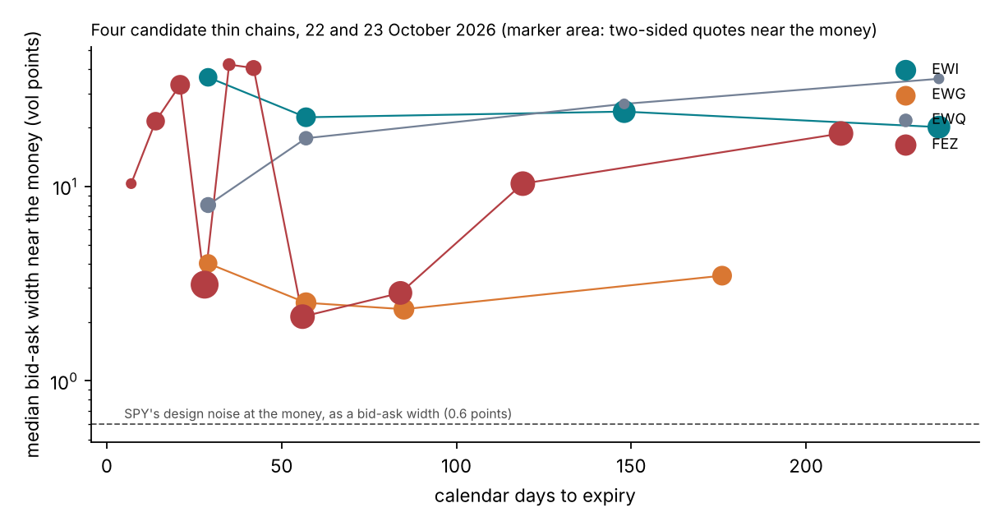

# Lecture 16. A thin chain: EWG

[Course index](README.md) · Previous: [Lecture 15. A liquid smile: SPY](15-a-liquid-smile-spy.md)

**What this lecture is for.** This lecture applies the method to a thin chain: an option chain whose quotes are few and wide, so that they leave the inputs of a product open but still say something about them. It explains why such a chain is the example on which Bayes and simulation-based inference both matter, and why the course chose EWG, the iShares MSCI Germany ETF, among four candidates. It states the conventions the procedure needs on a thin chain, with their measured effects, and the thin network that infers the forward-variance curve instead of reading it. It explains why a first attempt, SPY's front three months, is withdrawn, and what it still shows about model error. It then sets out the two studies that test the method on thin chains, coverage on simulated chains and EWG's own posterior, whose results are pending. It ends with what the checks do not establish, and with the argument of the course claim by claim: its evidence, and what the pending runs decide.

**Where it sits in the course.** Lecture 15 showed that on a liquid smile the posterior and the Gauss–Newton answer agree, as the Bernstein–von Mises theorem predicts, and that they part beyond the last quote, where the prior decides. This lecture takes the other case in which they can part: a chain whose quotes do not determine what the product needs. It uses the model of Lecture 13, the costs of Lecture 14 and the checks of Lectures 9, 12 and 15. It is the last lecture of the course. Numbers that need the full rough-Bergomi bank are written ⟨Sn⟩, and the runs that fill them are listed in `tutorial_final/CLUSTER-RUNS.md`.

**Its part in the argument.** This lecture tests the case on which the argument of the course most depends, a thin chain (Lecture 6, Section 6.8). It also closes the argument: Section 16.8 gathers the evidence for every claim, and says what the pending runs decide.

## 16.1 Why a thin chain, and which one

On a liquid smile the posterior returns the classical answer (Lecture 15, Section 15.4). A thin chain is where the quotes leave the product's inputs open, so it is where a posterior can differ from a classical interval. The course chose its thin example by a rule, among four chains of 22 and 23 October 2026. Lecture 1, Section 1.6 shows one of them, EWI.

*Figure 16.1.* How to read the figure: for each expiry to one year, the median bid–ask width of the two-sided out-of-the-money quotes with $|\text{log-moneyness}|$ at most 0.1, in volatility points, on a log scale. The marker area is the number of such quotes. The dashed line is SPY's design noise at the money read as a bid–ask width, 0.6 points. The data are in `tutorial_final/checks/thin_chains/`. EWG's widths, 2.3 to 4.0 points, lie below EWI's and EWQ's at every expiry; FEZ is as tight in its monthly expiries and much wider in the others.

| Chain | Expiries to one year (calendar days) | Two-sided quotes near the money | Median width (vol points) |
| --- | --- | --- | --- |
| EWI, MSCI Italy | 29, 57, 148, 238 | 7 to 11 | 20 to 36 |
| EWG, MSCI Germany | 29, 57, 85, 176 | 7 to 9 | 2.3 to 4.0 |
| EWQ, MSCI France | 29, 57, 148, 238 | 2 to 5 | 8.0 to 36 |
| FEZ, Euro Stoxx 50 | monthly 28, 56, 84; others to 210 | 12 to 17 monthly | 2.1 to 3.1 monthly; 10 to 42 otherwise |

The rule for the most robust example has four parts.

1. Bayes must matter: the quotes must leave the product's inputs open, but say something.
2. Simulation-based inference must matter: the likelihood must be expensive, as under rough Bergomi.
3. Nothing the model ignores may dominate: dividends before the last expiry, events, early exercise.
4. The claim must be testable: coverage on simulated chains with the chain's own design, and an exact posterior on the real chain.

EWI and EWQ say almost nothing beyond the smile's level, so their posterior would be their prior. FEZ is liquid in its monthly expiries, wide elsewhere, and pays dividends in December and March. EWG has four usable expiries to six months, median half-spreads of 1.2 to 2.0 volatility points near the money (4 to 7 times SPY's design noise there), and no dividend before June 2027. A single stock would add earnings and dividends that rough Bergomi ignores. The course therefore uses EWG of 22 October 2026 (v2-plan, Section 3). EWG is an index ETF, and the prior range of $\rho$ stays $(-0.99, -0.2)$, as for SPY (Lecture 13, Section 13.4).

**Where the posterior and the baselines can part on EWG.** Three mechanisms can make the classical bounds too narrow on a thin chain. The course has not yet measured any of them on EWG.

1. **The curve and the parameters trade off.** With few quotes, much of what the quotes say about $\rho$ passes through the curve. The local (Laplace) check of Lecture 13, Section 13.11 shows it on 15 SPY quotes with SPY's design noise, which is 2 to 15 times smaller than EWG's: with the curve uncertain to 10% per level, the contraction of $\rho$ falls from 0.61–0.65 to 0.12–0.16. The baselines fit the curve along such directions, where a delta-method interval can misstate the range.
2. **$H$ is weakly identified.** The baseline that fixes $H$ at 0.10 gives it no range (Lecture 6, Section 6.7).
3. **The last level is unquoted.** EWG's quotes end at 120 trading days. A product that needs the curve beyond them depends on the prior, or on a flat or power-law extension, alone (Section 16.5).

## 16.2 The procedure on a thin chain

The marking procedure is that of Lecture 6, Section 6.1. On a thin chain four of its conventions matter more than on SPY. Each was checked, and each check is reproducible from a committed file (v2-plan, Section 1).

1. **Clock.** Maturities are NYSE trading days over 252, the model's clock. Counting weekdays instead would make EWG's April expiry 126 days instead of 120.
2. **Rate and forward.** The rate is the 3-month Treasury yield, flat: 4.22% on 22 October. For EWG the forward is the spot carried at that rate, since EWG paid no December distribution in 2024 or 2025. Put–call parity on American options gives a forward 0.15% to 0.46% lower, because the puts in the pairs carry early-exercise value. That would move EWG's put volatilities down and its call volatilities up, by up to 1.24 half-spreads (Lecture 2, Section 2.4).
3. **Exercise.** Out-of-the-money puts are priced as European. On EWG their early-exercise value is at most 0.31 of a half-spread, at the six-month expiry. The calls carry none, because no dividend falls before June 2027.
4. **Noise.** Each quote's noise sd is its half-spread in price units, floored at the design noise. Converting the half-spread with the vega at 20% volatility, as SPY's pipeline does, would understate it up to 3.6 times in EWG's put wing. A noise scale $s$ of 0.5 and 2 tests the choice that the half-spread is one sd.

**EWG's layout.** The design contracts EWG quotes are 27: seven each at 21, 42 and 63 days, with $\delta$ from −2 to 1, and six at 126 days, with $\delta$ from −1.5 to 1. They are read from the expiries at 21, 40, 58 and 120 trading days, through the smoothing spline of Lecture 5, Section 5.4. A design point belongs to the layout when its strike lies inside the strikes its expiry quotes. The layout's noise is 2.0 to 15.0 times SPY's design noise, with a median of 3.8 (`configs/thin/ewg_layout.json`, built by `tutorial_final/checks/thin_chains/build_layout.py`). These 27 readings are the network's input. The audit's likelihood uses EWG's 61 cleaned quotes at their own strikes and maturities instead (Section 16.5).

**The thin network S2-T.** The liquid network of Lecture 15 is given the forward-variance curve read from the chain. A thin chain's strip does not support a replicated curve (Lecture 5, Section 5.9), and giving an estimator a curve read from a fuller chain is the leak of Section 16.3. The thin network therefore infers the curve (`src/sbi4finance/calibration/thin.py`).

| Item | Content | Size |
| --- | --- | --- |
| Conditions | Each of the 27 layout quotes over its noise sd times a noise scale, $y_c/(s\,\sigma_c)$, and $\log s$ | 28 |
| Targets | $H$, $\eta$, $\rho$ and the seven log forward-variance levels, each mapped to the real line by a logit of its prior support | 10 |
| Output | Draws from the joint posterior of the ten targets | 1,000 per chain |

The prior support of a level is a volatility of 6% to 60%, the truncation of the curve prior (Lecture 15, Section 15.1). Training draws the noise scale $s$ log-uniformly between 0.5 and 2 for every surface of every batch, with a fresh quote error, so one network serves the chain's own noise ($s = 1$) and the sensitivity to it. The network trains on the full bank's surfaces, with a velocity network of four layers of 512 units (run R4 of `tutorial_final/CLUSTER-RUNS.md`). Its gate, G2-T, asks that at $s = 1$ all eleven quantities of the SBC, the ten targets and $\rho\eta$, lie inside the simultaneous band (Lecture 9, Section 9.7); $s = 0.5$ and $s = 2$ are reported as they come. The audit needs the prior density of the curve: the power law times the random walk of Lecture 15, Section 15.1, with $\sigma_0$ fixed by the first level and the exponent $b$ integrated out on a grid (`thin.curve_log_prior`).

⟨S2-T⟩: the thin network's SBC, coverage and contraction on 2,000 simulated EWG chains at $s$ = 1, 0.5 and 2, from study S2-T (run R4).

## 16.3 A first attempt, and what was wrong with it

The first thin example was SPY with its later quotes hidden: the 27 quotes of SPY's three front monthly smiles, at 21, 42 and 63 days, nine strikes each (`tutorial_final/checks/desk_case/`). It is withdrawn as evidence on thin chains, for three reasons (v2-plan, Section 4).

1. It hid SPY's later quotes but kept SPY's tight noise, so it was not a thin chain in the sense of Section 16.1.
2. It gave every method SPY's curve to one year, read from the full chain. A thin chain cannot supply that curve, so every method knew more than a thin chain allows.
3. Its real-data comparison was dominated by model error.

Two other checks had the same leak: rough Bergomi on 15 sparse SPY quotes, and on 63 quotes with three times the noise (`tutorial_final/checks/rough_spy_is_cases.py`). Every method was given the same full-chain curve, so they described a market that knows its variance-swap curve, and they are withdrawn as well. The local check of Lecture 13, Section 13.11 is a different one: it makes the curve uncertain. The front-month case stays in the repository for the record and for its costs (Lecture 14, Section 14.5). EWG's layout and noise, with the curve inferred, replace it (Sections 16.2, 16.4 and 16.5).

**What the case still shows.** The third reason is itself a lesson, and the course keeps it as an illustration of model error, not as evidence on thin chains. Fitted to the front three months alone, rough Bergomi has a $\chi^2$ of 216 on the 36 later quotes, which that fit did not use. The fit to all 63 quotes has a $\chi^2$ of 48 on the same 36 quotes (`tutorial_final/checks/desk_case/real_market.json`). The parameters that fit the front months misprice the later maturities by far more than the quote noise allows, and no range computed within the model from the front months shows it. Only quotes that the fit did not use reveal it. EWG has no later quotes to hold out, so its test is the posterior predictive check at its own quotes (Section 16.6).

## 16.4 Reserves and their coverage on simulated thin chains

A one-sided 90% bound is correct when the truth falls beyond it 10% of the time. Study S10 counts how often each method's bounds are breached on simulated chains with EWG's design (`tutorial_final/studies/thin_coverage.py`).

**The chains.** Each of 1,000 test surfaces of the full bank, which no other study uses, becomes a thin chain: its clean prices on EWG's layout plus a fresh quote error with the layout's noise. The truth, $(H, \eta, \rho)$ and the forward-variance curve, is the surface's own, a draw from the prior. No method is given the curve.

**The products.** Six products are priced under rough Bergomi on one set of one-year paths (`sbi4finance.calibration.thin_products`): a six-month variance swap, a six-month volatility swap, a forward start from three to six months, a six-month put struck at 80% of the forward, a six-month cliquet of six monthly returns capped at 2% with the sum floored at zero, and a forward start from six months to one year, which starts at the last quoted maturity.

**The five methods.** Each method gives a centre and one-sided 90% bounds for each product.

1. The thin network alone: the products at 256 of its draws.
2. The audited posterior: importance sampling with 512 proposals from the network's draws, through a Student-$t$ fit mixed with 10% of the prior. Each proposal is priced on the layout on its own seed, with the unbiased likelihood $\mathcal{N}\big(y;\ \hat P,\ \mathrm{diag}(\sigma^2) + C - S\big)$ of Lecture 15, Section 15.2, and a second round is refitted to the weights when $\hat k$ exceeds 0.7. The bounds are the 10% and 90% quantiles of the products at draws resampled by the weights.
3. Gauss–Newton on $(H, \eta, \rho)$ and one forward-variance level per quoted interval, flat beyond the last quote, with delta-method bounds at the fit's price $\mp 1.2816$ standard deviations (Lecture 7, Section 7.6).
4. The same fit, with the levels beyond the last quote extrapolated by a power law in time fitted to the quoted levels.
5. The Gauss–Newton fit with $H$ fixed at 0.10.

The classical fits start from the quotes and the prior box, not from the network. Methods 3 to 5 are the course's baselines: Lecture 6, Section 6.7 gives what the sources say about fixing a parameter and about extrapolating the curve.

**Breaches.** A long breach is a true price below the lower bound, and a short breach one above the upper bound. A correct method breaches each side 10% of the time. The truth and every method price the products on one seed per chain and the same path count, so product Monte Carlo error does not blur the comparison. One chain in 50 also gives the posterior's bounds on a second product seed, which measures that error.

**Three laws for the unquoted level.** The layout's quotes end at 126 days, and only the forward start from six months to one year depends on the curve beyond them. Its truth is therefore priced under three laws for the last level, with the quotes unchanged: the prior's law; the level held flat; and the prior's increment over the last interval doubled in log variance. The first arm is correct for the posterior by construction, because a posterior's coverage holds on average over truths drawn from its prior (Lecture 8, Section 8.6). The second is correct for the flat Gauss–Newton fit by construction. The third is correct for neither, so it tests both methods when their assumption about the unquoted level is wrong. The posterior's prior is not changed.

**Reliable audits.** The summary reports every method on all chains and on the chains whose audit is reliable: a final $\hat k$ of at most 0.7 and every proposal priced, since a proposal left unpriced gets zero weight and biases the audit. The threshold 0.7 is the design document's large-sample rule. The sample-size threshold of Lecture 8, Section 8.9 is stricter: 0.63 for 512 proposals, and 0.67 for the 1,024 of two pooled rounds. Each chain's $\hat k$ is stored, so the summary can also be read under the stricter rule. The run is accepted when at least 90% of chains have a reliable audit, and when the second product seed moves the bounds by less than a tenth of their width. It costs about 11 CPU-minutes a chain, about 180 CPU-hours in all (run R8).

**Truths near EWG.** Study S10-E repeats S10 on 300 chains whose truths are drawn from EWG's audited posterior (Section 16.5), with their layout quotes priced as the bank prices them. The posterior's prior is then not the truths' law, so its coverage is not guaranteed by construction: S10-E tests every method near the real chain (run R9, about 55 CPU-hours). The truths are resampled from weighted draws, so some repeat when the posterior's effective sample size is small, and chains that share a truth are not independent. The summary therefore counts the distinct truths and gives intervals from a bootstrap over them.

⟨S10⟩: the breach rates of the five methods on each side, for each product and each law of the last level, with Wilson intervals (Lecture 9, Section 9.8), on all chains and on the reliable ones; from study S10 (run R8).

⟨S10-E⟩: the same on the 300 chains near EWG, with the number of distinct truths and intervals from the bootstrap over them; from study S10-E (run R9).

## 16.5 EWG's own chain

Study S11 computes EWG's posterior and its products (`tutorial_final/studies/thin_real.py`).

**The data.** EWG's 61 cleaned out-of-the-money quotes of 22 October 2026, 38 puts and 23 calls, at their own strikes and trading days: 9 at 21 days, 15 at 40, 19 at 58 and 18 at 120 (`tutorial_final/checks/thin_chains/EWG_observation.json`). They use the carry forward and the NYSE clock of Section 16.2. Each quote's noise sd is its half-spread in price units, floored at the design noise.

**The posterior.** The thin network reads the chain on its 27-contract layout and gives a proposal. Importance sampling with the Monte Carlo likelihood at the chain's own 61 quotes gives the posterior. Every proposal is priced on its own seed, and the likelihood is the unbiased estimate $\mathcal{N}\big(y;\ \hat P,\ \mathrm{diag}(\sigma^2) - S\big)$, with no bank term because the quotes are real. Rounds are refitted to the weights and pooled until $\hat k$ is at most 0.5 or four rounds have run. The design-grid readings only shape the proposal. The run is accepted when $\hat k$ at $s = 1$ is at most 0.5; otherwise it is rerun with 4,096 proposals.

**Three noise scales.** Each scale $s$ of 1, 0.5 and 2 multiplies every noise sd, and the network is given the same $s$. At $s = 1$ the half-spread is one sd.

**What is reported.** For each scale: the posterior of $(H, \eta, \rho)$ and of the curve; the six products of Section 16.4 under the posterior and under the network alone, with one-sided 90% bounds; and the three baselines of Section 16.4, fitted from the quotes and the prior box, each with delta-method bounds.

**The long end.** EWG's quotes end at 120 trading days, inside the curve's interval from 63 to 126 days, so the likelihood does not depend on the last forward-variance level, from 126 to 252 days: given the other targets, its posterior is its prior. The forward start from six months to one year is therefore also reported with that level flat, and with its prior increment doubled. These are its posteriors under the two other laws of Section 16.4.

**The predictive check.** At $s = 1$ the posterior predictive check of Lecture 12, Section 12.8 runs at each of the 61 quotes (Section 16.6).

The run costs about 3 CPU-hours (run R7).

⟨S11⟩: EWG's posterior, its audit's $\hat k$ and efficiency, the six products' bounds under every method, and the predictive check, at the three noise scales; from study S11 (run R7).

## 16.6 Model error

Every range of Sections 16.4 and 16.5 is a range within the model (Lecture 6, Section 6.7). Two checks bear on the model itself.

1. **The predictive check at EWG's quotes** (Section 16.5; Lecture 12, Section 12.8) is the test. The audit cannot be, because it uses the model's own likelihood (Section 16.7). If rough Bergomi fails EWG's predictive check, model error exceeds every within-model range (v2-plan, Section 2.5).
2. **The across-model comparison** of Lecture 15, Section 15.7 measured how far Heston's prices lie from rough Bergomi's on smiles that both models fit. On pilot smile 290 their forward-start prices differ by 7.9%, about five times either model's own reserve.

Section 16.3 showed how large model error can be on a real chain: rough Bergomi fitted to SPY's front three months has a $\chi^2$ of 216 on the 36 later quotes it did not see.

Which model fits index smiles best is disputed. Abi Jaber and Li (2024) find that rough models with $H$ in $(0, \tfrac12)$ "are inconsistent with the global shape of SPX smiles", and that between one week and three months they underperform one-factor Markovian models with as many parameters. The course therefore treats rough Bergomi as a model to be tested at EWG's quotes, not as a given.

The prudent-valuation rules keep the two kinds of uncertainty apart (Lecture 6, Section 6.6). Uncertainty from calibrating to market-derived parameters belongs to market price uncertainty, under Article 9. The range from alternative models and calibration approaches belongs to model risk, under Article 11.

## 16.7 What the checks do not establish

1. **SBC and coverage average over the prior.** They pass a posterior that ignores the data, so contraction must be read with them. They are marginal, one target at a time, so they cannot show a wrong dependence between targets. S10 also draws its truths from the prior; S10-E draws them near EWG (Section 16.4).
2. **The Heston check is on Heston.** It shows that the workflow, the architecture and the training choices can reproduce an exact posterior on a related model. It does not prove that the rough-Bergomi network does.
3. **The pricer route shares the bank.** An error common to the bank, the prior or the noise model is invisible to the comparison of the two routes.
4. **The audit and the pricer route assume the model.** They check the network against the model's own likelihood, not the model against the market.
5. **The posterior predictive check has limited power.** Two of the three rough smiles of Lecture 12, Figure 12.9 are fitted by Heston within noise. A model can pass the fit and still price a product differently: Lecture 15, Section 15.7 shows Heston and rough Bergomi pricing the forward-start call 7.9% apart on one of these two smiles.
6. **Every check inherits the noise model.** The width of the posterior is set by the quote noise $\sigma_c$. If $\sigma_c$ is wrong, a calibrated posterior is calibrated for the wrong noise. The table below lists this as the first risk; S11's noise scales of 0.5 and 2 measure it on EWG.

**Risks.** The main risks are of method rather than schedule (design document, "Risks and open decisions").

| Risk | Effect | Mitigation |
| --- | --- | --- |
| The posterior width is the noise model's | The reserve is as arbitrary as $\sigma_c$ | State it; derive $\sigma_c$ from bid-ask widths, as on EWG; noise scales 0.5 and 2 (S2-T, S11); the exercise that doubles $\sigma_c$; report the range in noise units too |
| The model cannot produce the real smile | A confident, wrong posterior; the audit passes because it uses the same model | Prior and posterior predictive checks, on SPY (S8) and EWG (S11); the Heston comparison; hand-over to slot 6 |
| $\xi_0$ from the chain carries its own error | A biased level at every maturity | Report the replication error; show the sensitivity of $H$, $\eta$, $\rho$ to an uncertain curve (Lecture 13, Section 13.11); on a thin chain, infer the curve (S2-T) |
| Monte Carlo noise in the audit likelihood | Weights biased where $s_c$ is not small | One seed per proposal and the unbiased estimate with the Monte Carlo covariance (Lecture 15, Section 15.2); a pilot pricing chooses each proposal's path count, so the choice cannot bias the estimate; a proposal that would need too many paths is counted, and its chain is not reliable |
| The valley makes the network's job hard | Posterior too narrow along the valley | SBC on $\rho\eta$ and on $\eta$; the audit; the pricer route |
| The design grid is not the real chain | Interpolation error enters as data | Report the smile-fit residuals; on EWG the audit's likelihood uses the chain's own quotes (S11); a network that reads the chain as quoted (Lecture 12, Section 12.10) |
| Products depend on $\xi_0$ beyond the data | The out-of-grid product's range mixes calibration and extrapolation | State the extrapolation; give the curve beyond the last quote a stated prior and test other laws (Lecture 15, Section 15.6; S10) |
| The classical critique sounds overstated | Loss of credibility with quants | Same weights for both routes; report Gauss–Newton coverage as measured; show where the posterior returns the classical answer (Lecture 15, Section 15.4); name the pricer route as the strong competitor |
| The cost claim sounds overstated | Loss of credibility with practitioners | One machine, CPU-seconds; one posterior measured by importance sampling on SPY, on a fixed-seed pricer (Lecture 14, Section 14.5) |

Two results bear on these risks. The pilot's curve prior did not cover SPY's curve, and the full bank's does (Lecture 15, Sections 15.1 and 15.3). A rough-Bergomi posterior has been computed on SPY by importance sampling, on a fixed-seed pricer (Lecture 14, Section 14.5), while the random-walk chain is still extrapolated.

## 16.8 The argument, claim by claim

This section gathers the evidence for each claim of the argument of the course (Lecture 6, Section 6.8), as it stands before the runs of `tutorial_final/CLUSTER-RUNS.md`.

| Claim | Evidence so far | Status |
| --- | --- | --- |
| 1. On a liquid smile the posterior returns the classical answer | Heston on SPY, with 63, 36 or 15 quotes: delta-method 90% ranges 0.92 to 1.21 times the exact posterior's (Lecture 11, Section 11.4; the case with $\kappa = 2$ on 63 quotes reuses a feasibility run to be redone as study S8-H). Rough Bergomi on SPY's 63 quotes, curve given, on a fixed-seed pricer: delta-method reserves 0.94 to 1.13 times the posterior's at the 10% and 90% quantiles (Lecture 15, Section 15.4) | Shown by quick checks, as theory predicts |
| 2a. Beyond the last quote they part | For the three SPY products that depend mostly on the curve beyond 2.25 years (a forward start from two to three years, a five-year put and a three-year variance swap), flat extrapolation gives 0.32, 0.30 and 0 of the posterior's 90% range. The forward start's range goes from 19.4% to 36.8% of its price as the prior's sd goes from 0.1 to 0.3 (Lecture 15, Section 15.6) | Shown by a quick check with a Laplace approximation; the prior sets the size |
| 2b. On a thin chain they part | The local (Laplace) check, on 15 SPY quotes with SPY's design noise and an uncertain curve: the contraction of $\rho$ falls from 0.61–0.65 to 0.12–0.16 (Lecture 13, Figure 13.13). On EWG: ⟨S10⟩, ⟨S10-E⟩, ⟨S11⟩ | Not yet shown |
| 2c. Pooling helps a name that quotes almost nothing | A simulated Black–Scholes sector of 2 liquid and 6 illiquid names: hierarchical Bayes covers 88.0%, the proxy 59.5%, empirical Bayes 69.7%; fitting each name alone covers 89.7%, with intervals 30% wider (Lecture 8, Figure 8.8) | Shown on simulated data, with the model right by construction |
| 2d. A weakly informed direction | On the toy smile the Gauss–Newton interval of $\eta$, 0.24 to 1.79, crosses the box; the posterior's is 0.88 to 1.58 (Lecture 8, Figure 8.4). Heston with jumps has two optima with different exotic prices (Lecture 6, Figure 6.2) | Shown on synthetic data |
| 3a. Simulation-based inference makes the posterior checkable | One rough-Bergomi posterior: at least 16.9 CPU-hours by a chain, about 85 CPU-minutes by importance sampling from Gauss–Newton on SPY with a fixed-seed pricer, and 3.6 CPU-seconds by the network plus about 53 CPU-minutes for its audit. Simulation-based calibration on 2,000 smiles: about 2 CPU-hours with the network after a training bank of about 370 CPU-hours, against about 2,800 by importance sampling (Lecture 14, Section 14.4) | Costs measured or extrapolated; the network's own checks are ⟨S2⟩ and ⟨S5⟩ |
| 3b. The network proposes where a classical fit fails | On SPY's front three months the Gauss–Newton proposal failed, but that case is withdrawn (Section 16.3). Not measured on EWG | Not yet shown; S10 can refute it, and showing it needs a classical-proposal arm (v2-plan, Section 2.6, option B) |
| 4. The posterior is exact for its model only | On pilot smile 290, under the pilot network's posterior, Heston and rough Bergomi price the forward start 7.9% apart, about five times either model's reserve (Lecture 15, Section 15.7). EWG's predictive check: ⟨S11⟩ | Partly shown, on pilot smiles; the test on EWG is pending |

**What the pending runs decide.** Studies S10, S10-E and S11 settle claim 2b. They can refute claim 3b, through unreliable audits, but cannot show it: that needs a classical-proposal arm (v2-plan, Section 2.6, option B). The course reports every outcome.

| If, on EWG-like chains | Then the course says |
| --- | --- |
| A baseline's one-sided bounds are breached clearly more than 10% of the time (the 95% interval of its breach rate lies above 10%), while the audited posterior's are not. On S10, whose truths come from the prior, the posterior covers by construction if its audit is right; S10-E, whose truths come from EWG's posterior, is the test without that advantage | The thin chain is the main example: where the quotes leave the inputs open, the classical range is too narrow and the posterior's is not |
| Gauss–Newton covers at its nominal rate too | The case for Bayes rests on the long end and on pooling; on a thin chain the method agrees with the classical answer as well |
| The posterior is breached too, under the law of the unquoted level that is correct for neither method | The posterior is right only under its own prior; the lesson is to state and test the prior |
| More than 10% of chains have an unreliable audit | The network is not good enough as a proposal on thin chains, and claim 3b is not made |
| Rough Bergomi fails EWG's predictive check | Model error exceeds every within-model range, and EWG becomes the course's example of misspecification |

**What the course does not claim.**

- That the posterior differs from Gauss–Newton on SPY's grid. It does not (Lecture 15, Section 15.4).
- That the network makes one posterior much cheaper than importance sampling from a good classical proposal (Lecture 14, Section 14.4).
- That the network takes milliseconds. It takes 1.4 seconds for 1,000 draws, and its audit about 53 CPU-minutes on SPY (Lecture 14, Section 14.5).
- That banks use rough volatility in production, or that fixing $H$ at 0.10 is practice (Lecture 6, Section 6.7).
- Any result of SPY's front three months as evidence on thin chains, or of the importance-sampling checks on 15 sparse SPY quotes and on three times the noise (Section 16.3).

The plan lists the options that would make claims 2b, 2c and 3b solid (v2-plan, Section 2.6).

## 16.9 Summary

1. A thin chain is one whose quotes leave a product's inputs open but say something. Among four candidates, EWG of 22 October 2026 meets the course's rule: four usable expiries to six months, median half-spreads near the money 4 to 7 times SPY's design noise, and no dividend before June 2027.
2. On a thin chain the clock, the forward, exercise and the noise matter. The course uses NYSE trading days, the carry forward (parity on American options gives a forward 0.15% to 0.46% lower), European puts (early exercise at most 0.31 of a half-spread) and the half-spread as one sd, tested at scales 0.5 and 2.
3. The thin network reads EWG's 27 layout quotes and a noise scale, and infers $H$, $\eta$, $\rho$ and the seven log levels of the curve. The audit's likelihood uses EWG's 61 own quotes.
4. SPY's front three months are withdrawn as a thin example: they kept SPY's tight noise and gave every method a curve read from the full chain. Fitted to them, rough Bergomi has a $\chi^2$ of 216 on the 36 later quotes, against 48 for the fit to all 63.
5. Study S10 counts breaches of five methods' one-sided 90% bounds on 1,000 simulated EWG chains, with three laws for the unquoted level, and S10-E repeats it near EWG. Study S11 computes EWG's posterior at three noise scales. All three are pending.
6. Model error is tested by the predictive check at EWG's quotes, and the claim that rough models fit SPX smiles best is disputed.
7. Two outcomes would weaken the argument: Gauss–Newton covering at its nominal rate on EWG-like chains, and rough Bergomi failing EWG's predictive check.
8. The argument stands as follows (Section 16.8). Quick checks show that on a liquid smile the posterior returns the classical answer, and that beyond the last quote the two part, by an amount the prior sets. Pooling helps on simulated data. The costs show that amortization would make the posterior's coverage checkable; the network's own checks are pending. Pilot smiles show that the posterior is exact for its model only. The thin chain, and the network as a proposal where a classical fit fails, are not yet shown.

## References

- Abi Jaber, E., Li, S. (2024). Volatility models in practice: rough, path-dependent or Markovian? [arXiv:2401.03345](https://arxiv.org/abs/2401.03345)
- Commission Delegated Regulation (EU) 2016/101 (prudent valuation), Articles 9 and 11. [EUR-Lex](https://eur-lex.europa.eu/legal-content/EN/TXT/HTML/?uri=CELEX:32016R0101)
- Wilson, E. B. (1927). Probable inference, the law of succession, and statistical inference. *Journal of the American Statistical Association* 22(158), 209–212. [doi](https://doi.org/10.1080/01621459.1927.10502953)
- Calibration design document of this repository: [docs/design/calibration-design-document.md](../design/calibration-design-document.md), section "Risks and open decisions".

Figures: `scripts/course/realignment.py` (Figure 16.1).
