# Smile calibration advanced example: technical design and narrative

Oct 22, 2026 · AI & Analytics Solutions SAS di Muia Francesco

> **Draft for study.** This document follows the structure and depth of the [SVJ design document](svj-design-document.md), for the application chosen on 21 October 2026 (plan, [`tutorial_final/PLAN.md`](../../tutorial_final/PLAN.md)). It states the method, the mathematics and the planned evidence before the simulations run. A number written as ⟨S7⟩ is a placeholder: it names the study in the plan's §6.4 that produces it, and it is replaced when that study has run. A figure marked *pending* is specified here, with its reading guide, and drawn when its study runs. Everything that does not depend on a run (the models, the derivations, the criteria, the narrative) is final subject to review.

> **Superseded in part, 24 October 2026.** Version 2 of the [course](../course/README.md) and its [plan](../course/v2-plan.md) correct this document where they differ:
> 1. This document describes a desk's daily routine and roles. The course states only the marking procedure (Lecture 6), and does not claim that a posterior is needed every morning: the uses of many posteriors are a valuation across a book, for example at month-end, and the validation of a method.
> 2. Fixing $H$ at 0.10 and holding the curve flat beyond the last quote are the course's baselines, not documented practice ([practice-sources.md](../course/practice-sources.md)).
> 3. The thin example is EWG, with the forward-variance curve inferred, not SPY's front months (Lecture 16).
> 4. The exact rough-Bergomi posterior costs at least 16.9 CPU-hours by a random-walk chain, and about 85 CPU-minutes by importance sampling from a Gauss–Newton proposal on SPY, with common random numbers (Lecture 14).
> 5. The audit's Monte Carlo likelihood needs a seed per proposal, the full Monte Carlo covariance and a path count chosen on a separate pilot pricing (Lecture 8, Section 8.9).

The advanced example of the ICAIF '26 tutorial should calibrate a volatility model to today's option smile and carry the posterior of the calibration into the price of a product the smile does not pin down. The model is rough Bergomi, which is priced by Monte Carlo only; Heston, which has an exact likelihood through a Fourier pricer, is the model on which the method is checked against the exact answer.

## Executive summary

This section states the whole method in seven steps, with its mathematics. Each step needs the one before it, and each ends with a link to the section that gives the details.

### 1. The quantity a desk needs

The input is today's option smile of one underlying: a panel of C = 63 vanilla quotes y = (y\_1, …, y\_C), one per contract, on 7 maturities and 9 strikes. The output is the price of a product that is not in the panel, together with a range for it: a forward-start call (one period of a cliquet), a volatility swap, and, as a control, a variance swap. For a product with payoff Π, the desk needs

```math
p_{\Pi} = \mathbb{E}^{\mathbb{Q}}\big[\Pi \mid \text{today's smile}\big], \qquad \text{and the range of } p_{\Pi} \text{ over the calibrations the smile allows.}
```

The range is not optional: prudent-valuation rules ask for "a range of plausible valuations" and a point in it at 90% confidence. This must be done every morning, for every underlying the desk trades.

Details: [The practitioner problem](#the-practitioner-problem).

### 2. The model that generates the prices

The model is rough Bergomi (Bayer, Friz and Gatheral 2016) under the pricing measure. It has three parameters θ = (H, η, ρ) and one curve input, the forward-variance curve ξ\_0(t), which is read off the market:

```math
\begin{aligned}
\frac{dS_t}{S_t} &= \sqrt{V_t}\,\big(\rho\,dW_t + \sqrt{1-\rho^2}\,dW^{\perp}_t\big),\\
V_t &= \xi_0(t)\,\exp\!\Big(\eta\,Y_t - \tfrac{1}{2}\eta^2\,t^{2H}\Big), \qquad Y_t = \sqrt{2H}\int_0^t (t-s)^{H-\frac12}\,dW_s .
\end{aligned}
```

Simulating from the model is cheap. Pricing one vanilla under it needs Monte Carlo, because V\_t is a non-Markovian log-normal functional of the whole past of W and has no characteristic function. Inverting the smile is the hard part.

Details: [The model](#the-model).

### 3. The price needs a posterior

A product price depends on the parameters, p\_Π(θ; ξ\_0). The smile does not determine θ exactly. Its short-maturity skew pins only the product ρη, and the term structure of the skew pins H. The rest of the surface also separates η from ρ, mainly through the long-dated at-the-money level measured against the forward-variance curve ξ\_0, so that separation is only as good as ξ\_0. The honest price is therefore an average over everything the smile allows, and the honest range is the spread of that average's ingredients:

```math
p(p_{\Pi} \mid y) = \int \underbrace{\delta\big(p_{\Pi} - p_{\Pi}(\theta;\xi_0)\big)}_{\text{price the product}}\ \underbrace{p(\theta \mid y, \xi_0)}_{\text{posterior of the calibration}}\ d\theta .
```

The first factor is a Monte Carlo price. The whole problem is the second factor, the posterior of three parameters given 63 noisy quotes.

Details: [From posterior to prices](#from-posterior-to-prices).

### 4. Why the posterior is expensive

Bayes' rule needs the likelihood. Under the quote-noise model each quote is the model price plus independent Gaussian noise with a known standard deviation σ\_c, so

```math
\log p(y \mid \theta, \xi_0) = -\frac{1}{2}\sum_{c=1}^{C}\left(\frac{y_c - P_c(\theta;\xi_0)}{\sigma_c}\right)^{2} + \text{const}.
```

For Heston, P\_c is a Fourier integral and this line costs milliseconds; an exact posterior by MCMC costs minutes per surface. For rough Bergomi, P\_c is a Monte Carlo expectation over at least 2^15 paths per maturity block, up to 504 steps each, so one evaluation of the likelihood is one priced surface: 5.0 CPU-seconds at the centre of the prior with 2^15 paths, and 11.9 CPU-seconds on average over the pilot bank, where hard surfaces need more paths. An MCMC chain of 20,000 evaluations costs 28 to 66 CPU-hours. For a desk with many underlyings, every morning, that is not available.

Details: [Why the likelihood is expensive](#why-the-likelihood-is-expensive).

### 5. Least squares returns one point, not a range

The usual route is weighted least squares, θ̂ = argmin Σ\_c w\_c (P\_c(θ) − y\_c)², with a neural pricer in place of Monte Carlo when the model has no formula (deep calibration). It returns one point:

```math
p_{\Pi}\big(\hat\theta;\xi_0\big) \qquad \text{in place of} \qquad p\big(p_{\Pi}\mid y\big).
```

Its interval, when one is computed, comes from the curvature of the objective at θ̂ (the Gauss–Newton covariance (JᵀWJ)⁻¹) and is local and symmetric. Where the objective is close to a quadratic, as on most Heston smiles (S6), the interval is about right. Where it is not, it fails: along a curved valley, such as the ρ–η valley that appears when the quotes constrain mainly ρη, and at the edge of the prior box, where on some smiles no interval exists. A multi-start, the desk's way to build a range, returns the distinct optima without weights; in the pilot studies it found a single optimum on 97% of Heston smiles and on every rough-Bergomi smile, so it returns no range at all. A regularized fit picks a point by a penalty. None of them produces the probability-weighted range the rules ask for. The study measures how often the local interval is wrong on ⟨S6⟩ synthetic surfaces.

Details: [Classical calibration and where it fails](#classical-calibration-and-where-it-fails).

### 6. Amortized inference makes the posterior cheap

The idea is to pay the cost of inference once, in training. Pairs (θ, y) are simulated from the prior, the model and the noise: price a surface by Monte Carlo, add quote noise. A velocity network u\_φ is trained by flow matching to carry standard normal noise z to the parameters, conditioned on the quotes y and the curve ξ\_0:

```math
\mathcal{L}(\phi) = \mathbb{E}\,\Big\| u_\phi\big((1-\tau)\,z + \tau\,\theta,\ \tau,\ y,\ \xi_0\big) - (\theta - z) \Big\|^2 .
```

The minimizer transports N(0, I) to p(θ ∣ y, ξ\_0) for every surface the prior can produce. A new smile then needs no optimizer and no Markov chain, only 100 Euler steps of the trained network. The Monte Carlo pricing is spent once, on the training bank of 100,000 surfaces, on the cluster.

Details: [Amortized design](#amortized-design).

### 7. Checking the network's posterior before pricing products

The network gives only an approximation of the posterior, so three checks guard it.

**Calibration on average.** Simulation-based calibration on 2,000 held-out surfaces checks that the rank of the true parameter among the posterior draws is uniform, for all three parameters.

**Correctness on a model with an exact answer.** On Heston surfaces, the same workflow is compared with the exact posterior from the Fourier likelihood.

**Correctness for this surface.** The audit fits a proposal q(θ) to the network's draws and reweights M proposals with the Monte Carlo likelihood:

```math
w^{(m)} = \frac{p(\theta^{(m)})\,\hat L(\theta^{(m)})}{q(\theta^{(m)})}, \qquad \text{efficiency} = \frac{\big(\sum_m w^{(m)}\big)^2}{M\sum_m \big(w^{(m)}\big)^2}.
```

Here L̂ is an unbiased estimate of the likelihood, obtained from Monte Carlo prices by reducing the Gaussian variance by the Monte Carlo variance (Appendix G.3). The weighted draws approximate the exact posterior; a low efficiency, or a Pareto shape parameter k̂ above min(1 − 1/log₁₀ M, 0.7), which is 0.58 for M = 256, flags a surface for the slow exact route.

The products are then priced from each posterior draw, with common random numbers, and the range, the 90% quantile and the reserve are read off the pooled prices.

Details: [Validation plan](#validation-plan), [From posterior to prices](#from-posterior-to-prices).

### The two claims

1. The smile does not pin down the parameters exactly, and products outside the smile inherit what it leaves open. The posterior shows how much is left open and in which direction: the short skew fixes only ρη, η is separated from ρ only through the long-dated level against the forward-variance curve, and near the edges of the prior some directions are barely constrained. The posterior turns the bid-ask widths into a price range and a reserve. The variance swap's range is zero by construction, for continuous monitoring and a fixed curve, which makes it a consistency check of the curve input rather than a result; the volatility swap's and the forward-start's ranges are not zero: ⟨S7⟩% of the price at the 90% quantile. All these ranges are conditional on the model and on ξ\_0.
2. Amortization makes the Bayesian answer affordable for a Monte-Carlo-priced model: 1.4 seconds per surface against at least 17 CPU-hours for the exact posterior (about 41 at the pilot bank's average pricing cost), validated by simulation-based calibration on thousands of synthetic surfaces (met for Heston; ⟨S2⟩ for rough Bergomi, whose pilot network fails it for ρ) and audited surface by surface.

Details: [Planned feasibility study](#planned-feasibility-study).

## Course map

This document is both the design of the tutorial's advanced example and a short course on the method behind it. The course has eight lessons. Each lesson explains the ideas, the computations and the figures in the body, and leaves the derivations to an appendix.

| Lesson | Sections | What it teaches | Derivations |
| --- | --- | --- | --- |
| 1. The problem | [The practitioner problem](#the-practitioner-problem) | Why a desk's daily calibration carries a range, who asks for it, and what current practice does about it | [Appendix A](#appendix-a-calibration-practice-and-what-the-rules-ask-for) |
| 2. The models | [Executive summary of the model](#executive-summary-of-the-model), [Notation and key terms](#notation-and-key-terms), [The model](#the-model) | Black–Scholes and the implied volatility, Heston, rough Bergomi, the forward-variance curve, the prior, the Monte Carlo computation of the 63 model prices | [Appendix B](#appendix-b-blackscholes-implied-volatility-and-the-variance-swap), [Appendix C](#appendix-c-heston-and-the-fourier-pricer), [Appendix D](#appendix-d-rough-bergomi), [Appendix J](#appendix-j-fourier-pricing-and-why-the-example-moves-from-heston-to-rough-bergomi) |
| 3. The observation and the likelihood | [The observation model](#the-observation-model), [Why the likelihood is expensive](#why-the-likelihood-is-expensive) | What a quote is, how noisy it is, what the smile identifies, and why one likelihood evaluation is a Monte Carlo run | [Appendix B](#appendix-b-blackscholes-implied-volatility-and-the-variance-swap), [Appendix D](#appendix-d-rough-bergomi) |
| 4. Classical calibration | [Classical calibration and where it fails](#classical-calibration-and-where-it-fails) | Least squares, its weights, its intervals, multi-start, regularization, deep calibration, and the exact but slow Bayesian route | [Appendix E](#appendix-e-calibration-as-estimation) |
| 5. Amortized inference | [Amortized design](#amortized-design) | How a network trained on simulated surfaces returns the posterior in seconds; the neural-pricer route as the alternative | [Appendix F](#appendix-f-amortized-inference) |
| 6. Validation | [Validation plan](#validation-plan) | SBC, the Heston check, agreement between the two neural routes, the audit, and the posterior predictive check on a real smile | [Appendix G](#appendix-g-validation) |
| 7. From posterior to prices | [From posterior to prices](#from-posterior-to-prices) | How posterior draws become product prices, a range and a reserve; why the variance swap has none; within-model against across-model | [Appendix H](#appendix-h-products-under-the-posterior) |
| 8. Evidence | [Planned feasibility study](#planned-feasibility-study) | The nine studies, their criteria, and the figures each produces | [Appendix I](#appendix-i-the-real-surface) |

The course assumes probability at the level of conditional densities and Bayes' rule, the normal distribution, least squares and some Python. It assumes no prior knowledge of option pricing beyond the idea of a call, of rough volatility or of neural networks. A reader in a hurry can start with the Executive summary, then the [Summary](#summary), the executive summary of the model and the table of the planned study. The sections [Why Heston is the check and not the example](#why-heston-is-the-check-and-not-the-example), [Tutorial narrative](#tutorial-narrative) and [Risks and open decisions](#risks-and-open-decisions) are design notes for the organizers.

## Summary

The advanced example should calibrate the rough Bergomi model to a vanilla smile and carry the posterior into the price of a forward-start option, a volatility swap and a variance swap. The model is the one of Bayer, Friz and Gatheral (2016), simulated with the hybrid scheme of Bennedsen, Lunde and Pakkanen (2017) and priced with the conditional Black–Scholes estimator of Romano and Touzi (1997).

The example meets the three selection criteria:

- **Users' pain.** Every derivatives desk recalibrates its models to the smile daily, marks exotics with the result, and must hold a reserve for the calibrations it did not pick. The rules name the object: a range of plausible calibrations with a 90% point (Regulation (EU) 2016/101, Art. 11), Level 3 sensitivity ranges (IFRS 13), model-risk assessment (SR 11-7, replaced by SR 26-2 in April 2026).
- **Widely used model class.** Stochastic volatility calibrated to vanillas is the standard way to price equity exotics; rough volatility is the research frontier the audience knows, and deep calibration (Horvath, Muguruza and Tomas 2021) is the method it knows for it.
- **The classical route falls short.** Least squares returns one point. Its local interval is right where the objective is close to a quadratic and wrong along a curved valley or at the edge of the prior box, and a multi-start, which usually finds a single optimum, returns no range. The exact Bayesian route exists but, for a model priced by Monte Carlo, costs at least 17 CPU-hours per surface.

Amortized inference trains a network once on simulated surfaces priced on the cluster. The network then returns the joint posterior of H, η and ρ for a new smile in 1.4 seconds. Heston, which has a Fourier likelihood, is used to check the network against the exact posterior, in the role the exact grid posterior plays for GBM in slot 4.

A network can be calibrated on average and still be off for a single surface. The Heston network passes the average check; the rough pilot network passes it for H and η and is biased for ρ (S2). An importance-sampling audit with the Monte Carlo pricer checks each surface, corrects its posterior, and flags surfaces that need the slow exact route. The audit costs about 425 CPU-seconds per surface.

The posterior gives, for each product, a price distribution. The variance swap's is a point, because the forward-variance curve fixes it under continuous monitoring. The volatility swap's and the forward-start's are not, and their 90% quantiles against the point calibration are the within-model reserves. Heston and rough Bergomi calibrated to the same smile price the forward-start ⟨S7⟩% apart. On one pilot smile that gap is five times either model's reserve; on another it is smaller than either model's 90% range. The comparison hands over to the tutorial's final segment on misspecification.

The tutorial therefore makes two separate claims, stated under [The two claims](#the-two-claims). The section [Planned feasibility study](#planned-feasibility-study) holds the criteria for both and the figures each study produces.

## Three routes from one smile to a product price, with their costs

This section compares, in one figure, the three ways of going from today's smile to a product price that the rest of the document develops: least squares ([Classical calibration and where it fails](#classical-calibration-and-where-it-fails)), the exact posterior by MCMC ([Why the likelihood is expensive](#why-the-likelihood-is-expensive)) and the amortized posterior ([Amortized design](#amortized-design)).

*Pending figure ⟨S9-0⟩: three routes from one smile to a product price, with measured costs per surface.* Drawn as the SVJ diagram: each row one route from the same input, the 63 quotes of one smile, to a price for the forward-start option. The boxes give the method, what it returns and the risk number it supports; the line under each row gives the measured cost and the main finding. The highlighted row is the route the tutorial teaches.

How to read the figure: the first row is multi-start least squares, which returns one price per start in about 60 CPU-seconds and no range. The second row is MCMC with the Monte Carlo pricer inside, which returns the exact posterior and the exact range in at least 17 CPU-hours. The third row is the amortized posterior with its audit: the range in 1.4 seconds, checked against the Monte Carlo likelihood in about 425 CPU-seconds. A fourth, dashed row is the neural-pricer route (deep calibration with MCMC on the pricer), which the study uses as an independent check.

## Why Heston is the check and not the example

This section explains the role of the two stochastic-volatility models in the tutorial. Heston has an exact posterior, so it is used to check the method. Rough Bergomi's exact posterior is too expensive, so it is where the method is needed. Appendix J gives the technical reasons.

Heston (1993) is the model every quant has calibrated. Its characteristic function is known in closed form, so a European price is a one-dimensional Fourier integral that costs about a millisecond, a full calibration costs about a second, and an exact posterior by MCMC costs minutes per surface. The 9 October 2026 experiment on the HKDE model (Heston with Kou jumps, [Agazzotti et al. 2025](https://arxiv.org/abs/2502.13824)) showed the phenomenon this lesson is about: thirty optimizer starts ended at two optima with almost equal fit and different exotic prices, and the posterior exposed the directions the surface does not identify. It also showed that a desk would not need simulation-based inference for it. The Fourier likelihood is available, a multi-start exposes the two optima, and an MCMC chain on the Fourier likelihood gives the range. SBI would speed up a working method rather than replace a missing one.

That is exactly what makes Heston valuable here, in a different role. Slot 4 teaches the amortized workflow on GBM because GBM has an exact posterior to check every step against. Slot 5 needs the same thing for a smile: a model whose exact posterior exists. Heston is that model. The network is trained and checked on Heston surfaces first; the lesson shows the exact posterior and the amortized posterior side by side, and only then moves to rough Bergomi, where the exact posterior is out of reach. Heston also supplies the across-model comparison at the end: the same smile, two models, two forward-start prices.

Rough Bergomi is the example because it is the model where the method is needed. It has no characteristic function; its variance is a log-normal functional of the entire past of the Brownian motion; its vanilla prices are Monte Carlo expectations. The industry's answer to its cost is a neural pricer trained on simulated surfaces, which is itself simulation-based, and which returns a point calibration. The lesson goes one step further and returns the posterior.

Appendix J sets out the two sides in detail: the Fourier pricers that make Heston fast, including the PROJ method used in the 9 October study, the two places where Heston's smile has the wrong shape, and why rough Bergomi repairs them at the price of having no characteristic function.

One slide from the 9 October study stays in the tutorial, as a preview on a Heston-with-jumps surface.

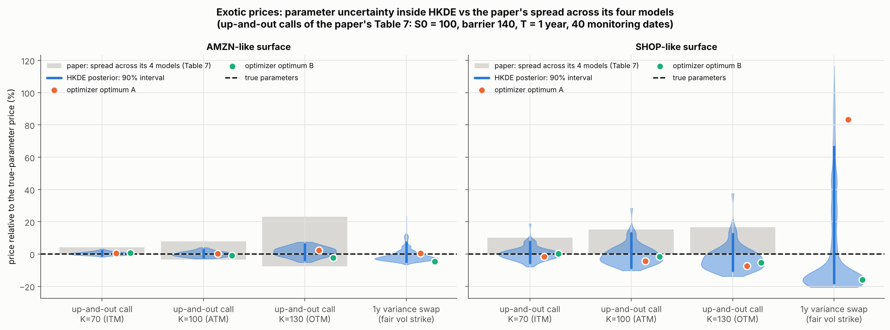

How to read the figure: each panel is one option surface, and each column one exotic product, priced relative to its price under the true parameters. The blue violin shows the spread of prices under the HKDE posterior, with its 90% interval as a thick line. The orange and green dots are the two optimizer end points, and the grey bar is the spread across the four models of the paper's Table 7. On the SHOP-like surface the posterior range of each barrier option is wider than the grey bar, and the variance swap ranges from −18% to +67%. In rough Bergomi the variance swap's range will be zero, because the forward-variance curve is an input rather than a parametric consequence; the comparison is one of the lesson's teaching points.

## The practitioner problem

This section expands step 1 of the executive summary. It describes what a desk computes every morning, which number the regulations ask for, and why current practice does not produce it. It is lesson 1 of the course.

A derivatives desk prices and hedges products that are not quoted, with a model calibrated to products that are. The calibration runs every morning, and intraday for liquid underlyings. Its output is used three times: to mark the book, to compute hedge ratios, and, at a slower pace, to set the reserves that the valuation rules require. The current tools meet the daily constraint by returning one calibration and leaving its uncertainty to judgment.

Calibration risk has a literature of its own. Schoutens, Simons and Tistaert (2004) calibrated seven models to the same Eurostoxx smile, each within market precision, and found that their prices for barrier, lookback and cliquet options differed substantially. Detlefsen and Härdle (2006) showed that, within one model, the choice of objective function (prices or implied volatilities, absolute or relative errors) moves the calibrated parameters and the exotic prices. Guillaume and Schoutens (2012) measured the same effect under Heston. Cont (2006) gave the general frame: the set of models and calibrations consistent with the vanillas defines a range of prices, and the width of that range is model uncertainty.

Supervisors ask for that range:

- **Prudent valuation.** Banks in the EU deduct additional valuation adjustments from capital. The model-risk adjustment covers "the potential existence of a range of different models or model calibrations". Where possible, the bank determines "a range of plausible valuations produced from alternative appropriate modelling and calibration approaches" and takes a point in the range at which it is 90% confident it could exit the position at that price or better (Regulation (EU) 2016/101, Article 11).
- **Fair-value disclosure.** For Level 3 instruments, IFRS 13 requires a description of the sensitivity of the fair value to unobservable inputs and, for financial instruments, the effect of changing those inputs to reasonably possible alternatives (IFRS 13, paragraph 93(h)).
- **Model risk management.** SR 11-7 asked banks to assess model risk, including the uncertainty of inputs and assumptions, and to hold the resulting limitations against the model's use; SR 26-2 replaced it on 17 April 2026. PRA SS1/23 defines model uncertainty as "the inherent uncertainty in the parameter estimates and results of statistical models".

The rules name the object, a range of calibrations with a quantile, and leave its construction to the bank. In practice the range is built by rerunning the calibration with alternative objectives, weights or starting points, and reading the spread, or by expert judgment. Appendix A gives the sources.

The rough Bergomi model supplies a realistic case. It fits equity-index smiles with three parameters, its short-maturity skew follows the power law the market shows, and it is the model the deep-calibration literature calibrates. Its parameters are not equally well determined by the smile: the short-maturity skew constrains only the product ρη, the term structure of the skew constrains H, and η is separated from ρ mainly by the long-dated at-the-money level against the forward-variance curve. The products a desk marks with the model depend on η itself, so their prices inherit how well that separation works and how well the curve is read.

The Bayesian answer exists, but its cost does not scale. One likelihood evaluation is one Monte Carlo surface, 5.0 CPU-seconds, and an exact posterior by MCMC costs at least 17 CPU-hours per surface. The amortized posterior costs 1.4 seconds per surface. The audit adds about 425 CPU-seconds for each surface it checks.

## Executive summary of the model

This section describes the finished pipeline as a desk would run it, before the lessons explain how each part is built. It states the inputs and outputs, what the model captures and misses, and the daily run in order.

The model turns today's smile of one underlying into a posterior over its three parameters, and the posterior into a price distribution for any product the model can price. The price, the range and the reserve read off that distribution include the uncertainty about the calibration itself.

### What goes in and what comes out

The input is today's cleaned end-of-day option chain of one underlying, reduced to a panel of 63 quotes on a fixed design grid, with a quote-noise standard deviation per quote derived from its bid-ask spread, and the forward-variance curve ξ\_0 built from the same chain. The output has four parts:

1. A joint posterior of H, η and ρ, as 1,000 random draws.
2. For each product, the distribution of its price under those draws, built by pricing the product from each draw with common random numbers.
3. The point price, the 90% range and the reserve for each product, with the within-model range labelled as such.
4. An audit score for the surface, which says whether the network's posterior can be trusted for this smile.

### Data: what is observed and what is simulated

This subsection lists every dataset the method uses, and says which are observed and which are simulated. The method uses one observed dataset and four simulated ones.

| Dataset | Observed or simulated | Size | Role in the method | Where |
| --- | --- | --- | --- | --- |
| SPY option chain, close of 21 October 2026, from Cboe's delayed quotes | Observed | 13,114 options in 35 expirations, reduced to 63 quotes y\_c, their 63 noise levels σ\_c and the 7 levels of ξ\_0 | The smile whose posterior is computed and whose products are priced | S8, Appendix I |
| Rough-Bergomi training bank | Simulated | 100,000 training surfaces, plus 5,000 for validation, 5,000 for test and 2,000 for SBC: 112,000 in total | Trains the network; the test and SBC surfaces check it | [Amortized design](#amortized-design), S1, S2 |
| Rough-Bergomi pilot bank | Simulated | 2,200 surfaces | Measures the cost of the generator and gives the first checks reported in this draft | S1 |
| Heston bank | Simulated | 60,000 surfaces | Trains the Heston network and checks it against the exact posterior | S3 |
| Product prices under the posterior | Simulated | 1,000 posterior draws, each priced for 4 products | The price distribution, the range and the reserve | [From posterior to prices](#from-posterior-to-prices), S7 |

Each simulated surface of a bank is generated in three steps, from the prior, the model and the noise model:

```math
\theta \sim p(\theta), \quad \xi_0 \sim p(\xi_0); \qquad P_c(\theta;\xi_0) = \mathbb{E}^{\mathbb{Q}}\big[\text{payoff}_c\big]; \qquad y_c = P_c(\theta;\xi_0) + \sigma_c\,\varepsilon_c, \quad \varepsilon_c \sim \mathcal{N}(0,1) .
```

The model prices P\_c are Monte Carlo averages over simulated paths of (V\_t, S\_t) for rough Bergomi, and Fourier integrals for Heston. The Heston bank has no ξ\_0, because Heston's curve is a function of its parameters.

All data, observed and simulated, are option prices on a single day, under the pricing measure Q. No time series of returns is used, and the real-world measure P does not enter. This is the main difference from the SVJ example, which calibrated to daily returns under P.

The observed and the simulated data meet in one place. The network is trained only on simulated pairs (θ, ξ\_0, y), and is then applied to the real (y, ξ\_0) of SPY. Whether the real smile resembles the smiles the model and the prior produce is checked twice: by the posterior predictive check and by the audit ([Validation plan](#validation-plan)).

### When it is used

The model runs every morning for each underlying a desk calibrates. It serves as the source of the calibration range for prudent valuation and Level 3 disclosure, as a challenger to the desk's point calibration, and as a diagnostic of what today's smile does and does not identify. It does not replace the desk's pricing library: it prices with the same model and the same Monte Carlo engine, many times instead of once. The tutorial network is trained for the fixed design grid; the extension to arbitrary quote sets is Stage D of the plan.

### What it captures

Each feature of the smile comes from one mechanism of the model, governed by a few quantities.

| Feature of the smile | How the model produces it | Quantities in charge |
| --- | --- | --- |
| The level of implied volatility at each maturity | The forward-variance curve sets the expected variance over each horizon; the gap between the at-the-money and the variance-swap level is set by the parameters | ξ\_0(t), an input; the gap mostly η, also H and ρ |
| The skew: puts dearer than calls | Negative correlation between returns and variance shocks; a fall in price raises variance | ρη, the product |
| The skew's term structure: steeper at short maturities, flattening as T^(H−½) | The roughness of the variance path: shocks to variance decay as a power of time, not exponentially | H |
| The curvature: both wings above the centre | Randomness of the realized variance, which mixes log-normal laws | η², with H |
| Variance-swap prices | Matched exactly for continuous monitoring: the model's expected variance over [0, T] is the integral of ξ\_0 | ξ\_0(t) only; daily monitoring adds a small term in (H, η, ρ) |
| Volatility-swap and forward-start prices | The spread of future realized variance and the forward smile | η, H, ρ |

### What it misses

- **Jumps in the price.** A crash is a continuous move in this model. Short-dated out-of-the-money puts, where jumps dominate, are the quotes it fits worst; the design grid stops at two standard deviations from the forward.
- **Jumps in volatility.** Volatility rises only through the diffusive Volterra driver.
- **Dependence of volatility on the price path.** Path-dependent volatility models (Guyon and Lekeufack 2023) add it, and fit SPX and VIX smiles jointly; this model does not price VIX products consistently with SPX products.
- **Discrete dividends, rates and borrow.** The forward and the discount factor are inputs taken from the chain; their estimation error is not part of the quote-noise model.
- **Non-Gaussian quote errors.** Stale quotes, crossed markets and the discreteness of tick sizes are cleaned away rather than modelled.

The posterior predictive check on the real smile shows where the model misses: quotes whose standardized residual under the posterior exceeds two.

### The daily calibration and pricing run

1. Take the end-of-day chain of the underlying: strike, expiry, type, bid, ask.
2. Clean it: out-of-the-money quotes only, positive bids, relative spread below a threshold, no violations of monotonicity or convexity in strike. Compute the forward per maturity from put–call parity and the discount factor from the chosen curve.
3. Build the forward-variance curve ξ\_0 by log-contract replication at each quoted maturity, and difference the total variances between maturities.
4. Read the design grid: for each of the 7 maturities, fit a smooth smile in δ-moneyness through the cleaned quotes and read 9 prices at δ ∈ {−2, …, 2}; derive each quote's noise standard deviation from the bid-ask width at that point.
5. Run the inference network, conditioned on the 63 prices scaled by their noise standard deviations and on the logarithms of the 7 forward-variance levels of ξ\_0. It returns 1,000 draws of (H, η, ρ) in 1.4 seconds.
6. Audit the draws. Fit a Student t proposal to them, draw M proposals, price each proposal's surface by Monte Carlo and reweight. The efficiency and the Pareto k̂ are the audit score; a flagged surface goes to the exact route (MCMC with the Monte Carlo pricer, or the neural-pricer route).
7. Price the products from each posterior draw with common random numbers: variance swap, volatility swap, forward-start call, and any vanilla outside the grid.
8. Report, for each product, the point price, the 90% range and the reserve: the distance from the point calibration's price to the 90% quantile on the side that hurts the position.

Training happens once, before any of these steps: 100,000 surfaces priced on the cluster, about 370 CPU-hours with the validation and test splits (measured on the pilot), and ⟨S2⟩ minutes of training. The network is retrained only when the model, the prior, the design grid or the noise model changes, or when a diagnostic fails.

*Pending figure: the daily pipeline, as the SVJ diagram.* The upper band runs once (prior → simulator and Monte Carlo pricer → training bank → networks); the lower band runs every morning for every underlying (chain → cleaning, forward, ξ\_0 → design grid → network → audit → products → report). The two accented boxes are the trained networks, and only the audit evaluates the Monte Carlo likelihood.

### The output for one real smile (SPY)

*Pending ⟨S8⟩.* For the SPY smile of ⟨date⟩, the network's posterior puts H at ⟨S8⟩ (90%: ⟨S8⟩ to ⟨S8⟩), η at ⟨S8⟩ (⟨S8⟩ to ⟨S8⟩) and ρ at ⟨S8⟩ (⟨S8⟩ to ⟨S8⟩); the product ρη is known to ⟨S8⟩% and η alone to ⟨S8⟩%. The audit passes with efficiency ⟨S8⟩%. The 3-month variance swap strike is ⟨S8⟩% with zero range; the 3-month volatility swap is ⟨S8⟩% (90%: ⟨S8⟩ to ⟨S8⟩); the 3-month-into-6-month forward-start call is ⟨S8⟩% of notional (90%: ⟨S8⟩ to ⟨S8⟩), against ⟨S8⟩% at the least-squares calibration, so the within-model reserve for a short position is ⟨S8⟩% of the price. Heston calibrated to the same smile prices the forward-start at ⟨S8⟩%.

## Notation and key terms

This section fixes the symbols and terms used in the rest of the document. It can be skipped and consulted when a symbol is unclear.

Implied volatility is the number that makes the Black–Scholes formula reproduce an option price. It is a quoting convention, not a forecast: a smile is the set of implied volatilities across strikes and maturities, and its shape is the data. The document quotes implied volatility annualized, as a fraction that reads as a percentage.

A quote is reported in forward units: the option price divided by the discount factor and by the forward, so that 1 is the forward and a price is a fraction of it. In the repository's tasks spot is 1 and rates are zero, which is the same convention.

### Four volatility objects

| Name | Definition | Observed? | Role in this course |
| --- | --- | --- | --- |
| Implied volatility σ\_imp(k, T) | The Black–Scholes volatility that matches the quote at log-moneyness k and maturity T | Yes, from quotes | The data; the smile is its shape |
| Forward variance ξ\_0(t) | The market's expected instantaneous variance at future time t, E[V\_t], read off the chain by replication | Derived from quotes | The model's curve input; it fixes the variance-swap curve |
| Instantaneous variance V\_t | The model's variance at time t, a random path | No, a model object | What the parameters H, η, ρ move around ξ\_0 |
| Realized variance Q\_T | (1/T) ∫₀ᵀ V\_t dt, the average variance over [0, T]; in practice the sum of squared daily log returns | Only after the fact | The payoff of the variance swap, whose square root is the payoff of the volatility swap |

### Symbols

| Symbol | Meaning | Units | Prior median or design value |
| --- | --- | --- | --- |
| S\_t, F\_T, D\_T | Price, forward for maturity T, discount factor | currency, currency, – | – |
| k | Log-moneyness, ln(K / F\_T) | – | – |
| δ | Standardized moneyness, k / (σ\_ref √T) | – | −2 to 2 in steps of 0.5 |
| σ\_ref | Reference volatility of the design grid | fraction per year | 0.20 |
| T | Maturity, in trading days over 252 | years | 5, 10, 21, 42, 63, 126, 252 days |
| C | Number of quotes in the panel | – | 63 |
| y\_c, P\_c(θ; ξ\_0), σ\_c | Observed quote, model price, quote-noise standard deviation of contract c | forward units | – |
| c(k, T), p(k, T) | Black–Scholes call and put in forward units | – | – |
| H | Hurst exponent of the variance driver; roughness | – | 0.185, uniform on (0.02, 0.35) |
| η | Volatility of variance | per year^H | 2.0, uniform on (0.5, 3.5) |
| ρ | Correlation between price and variance shocks | – | −0.595, uniform on (−0.99, −0.2) |
| θ | The three parameters (H, η, ρ), in the unbounded coordinates of the adapter | – | – |
| ξ\_0(t) | Forward-variance curve, constant on each of the 7 intervals [T\_{j−1}, T\_j) between design maturities, with T\_0 = 0 | variance per year | level σ\_0 = 25% a year, slope s = 0.15 |
| σ\_0, s, u\_j | Level, slope and log perturbations of the training curves: the level on interval j is σ\_0² (1 + s t\_j) e^(u\_j), with t\_j the interval's midpoint | fraction per year, per year, – | σ\_0 ~ U(10%, 40%), s ~ U(−0.3, 0.6), u\_j ~ U(−0.2, 0.2) independently |
| W\_t, W^⊥\_t | Brownian motion driving the variance and the correlated price shock; independent Brownian motion for the rest of the price shock | – | – |
| Y\_t | The Volterra driver, √(2H) ∫₀ᵗ (t − s)^(H−½) dW\_s, with Var(Y\_t) = t^(2H) | – | – |
| V\_t, Q\_T | Instantaneous and realized variance | variance per year | – |
| v\_0, θ\_H, κ, σ\_v, ρ\_H | Heston's initial variance, long-run variance, mean reversion, vol-of-vol and correlation | variance, variance, per year, –, – | κ fixed at 2 |
| φ(u) | Characteristic function of ln(S\_T / F\_T) | – | – |
| N, n | Monte Carlo paths and time steps per maturity block | – | 2^15 paths, doubled up to 2^21 until the error budget holds; 80 steps over 10 days, 504 over 3 months, 504 over a year |
| M, L | Audit proposals; posterior draws per surface | – | M = 256 at 2^13 paths per block for rough Bergomi (the pilot's setting; the full study sets M from the pilot's efficiencies), 2,048 with the Fourier likelihood for Heston; L = 1,000 |
| Π, p\_Π | A product's payoff and price | forward units | – |
| T\_1, T\_2 | Forward-start dates: strike set at T\_1, expiry T\_2 | years | 63 and 126 days |

### Statistical vocabulary

The word *calibration* has two meanings in this document, and the lesson must keep them apart. In finance, calibrating a model means choosing its parameters so that it reproduces quoted prices. In the Bayesian workflow, a calibrated posterior is one whose credible intervals contain the truth as often as they claim. The table uses *model calibration* and *statistical calibration* where the context does not settle it.

| Term | Meaning | Lesson |
| --- | --- | --- |
| Likelihood p(y ∣ θ, ξ\_0) | The probability density of the observed quotes, seen as a function of the parameters; Gaussian around the model prices under the quote-noise model | 3 |
| Prior p(θ) | The distribution of the parameters before the smile is seen; uniform on the ranges of the symbols table | 2 |
| Posterior p(θ ∣ y, ξ\_0) | The distribution of the parameters after the smile is seen; proportional to likelihood times prior | 4 to 7 |
| Posterior draw | One parameter vector sampled from the posterior; 1,000 draws stand for the whole posterior | 4 to 7 |
| Identified, weakly identified | A direction in parameter space the data pin down, or leave wide; the ρ–η direction is the weakly identified one when the quotes constrain mainly the short skew | 3 |
| Ridge, valley | A curve in parameter space along which the likelihood (or the least-squares objective) is almost flat | 3, 4 |
| Ill-posed | An inverse problem whose solution is not unique or not stable; model calibration to a smile is the textbook case | 4 |
| Regularization | Adding a penalty to the objective to make the solution unique and stable; the solution then depends on the penalty | 4 |
| Credible interval | An interval that holds the parameter with 90% or 95% posterior probability | 6, 7 |
| Coverage | The share of surfaces whose interval contains the true value; measurable on simulated surfaces | 6 |
| Gauss–Newton covariance | The curvature-based covariance of the least-squares estimate, (JᵀWJ)⁻¹; its square roots are the standard errors | 4 |
| Delta method | The first-order propagation of a parameter covariance to a function of the parameters, here a product price | 4, 7 |
| Deep calibration | Least squares with a neural network in place of the pricer, trained on simulated surfaces | 4, 5 |
| Neural posterior estimation (NPE) | Training a network on simulated (parameter, data) pairs to return the posterior directly | 5 |
| Neural likelihood estimation (NLE) | Training a network to return the likelihood, here through a neural pricer and the quote-noise model, and sampling the posterior from it | 5 |
| Flow matching | The training method of the inference network: a learned velocity field carries noise to posterior draws | 5 |
| Set-based summary network | A network that reads a variable number of quotes as a set, so that missing quotes are handled by construction | 5 |
| SBC | Simulation-based calibration: the check that true values have uniform ranks among posterior draws | 6 |
| Contraction | 1 minus posterior variance over prior variance: the share of prior uncertainty the smile removes | 6 |
| Importance sampling | Reweighting draws from a convenient distribution so that weighted averages target another distribution | 6 |
| Efficiency, ESS | The effective sample size of a set of weights, and its ratio to the number of draws | 6 |
| Pareto k̂ | The shape parameter of a generalized Pareto law fitted to the largest importance weights; above 0.7 the weighted estimate is unreliable | 6 |
| Posterior predictive check | Comparing the data with data simulated from the posterior; here, the quotes with the model prices under posterior draws, in units of the quote noise | 6 |
| Misspecification | A model that cannot produce the data it is fitted to; its posterior is confident and wrong | 6, 7 |
| Reserve, prudent value, AVA | The distance from the point price to the 90% quantile of the price range on the adverse side; the regulatory name for the deduction it supports | 7 |
| Common random numbers | Pricing every posterior draw with the same Monte Carlo noise, so that differences between draws are not Monte Carlo noise | 7 |

## The model

This section expands step 2 of the executive summary. It defines the three pricing models, the prior on the rough-Bergomi parameters, and the Monte Carlo computation of the model prices P\_c(θ; ξ\_0), which is the simulator the whole method relies on. It is lesson 2 of the course.

Three models appear in the lesson, in order of difficulty: Black–Scholes, whose smile is flat; Heston, whose smile has the right shape and an exact pricer; and rough Bergomi, whose smile has the right term structure and no exact pricer. All three are stated under the pricing measure Q, with the price in forward units so that rates and dividends drop out.

### Black–Scholes and the smile

Under Black–Scholes the forward-normalized price is a geometric Brownian motion with one constant volatility σ, dS\_t / S\_t = σ dW\_t. A European call struck at K with maturity T, in forward units and with log-moneyness k = ln(K / F\_T), is

```math
c(k, T;\sigma) = N(d_1) - e^{k}\,N(d_2), \qquad d_{1,2} = \frac{-k \pm \tfrac12 \sigma^2 T}{\sigma\sqrt{T}}, \qquad p(k,T;\sigma) = c(k,T;\sigma) - 1 + e^{k}.
```

Here N is the cumulative distribution function of the standard normal, N(x) = P(Z ≤ x) for Z ~ N(0, 1), and φ = N′ is its density. The second equation is put–call parity. The formula contains no quote: it maps a volatility to a price. A quote enters when the formula is read backwards. For a quoted price y in forward units at log-moneyness k and maturity T, the implied volatility σ\_imp solves c(k, T; σ\_imp) = y, or p(k, T; σ\_imp) = y for a put. The solution exists and is unique because c is increasing in σ, and the vega ∂c/∂σ = √T φ(d\_1) is the slope of that map. Under the model the implied volatility is the same number at every strike and maturity. The market's is not: equity-index smiles slope down in k (the skew), curve up in the wings, and the slope is steepest at the shortest maturities. The smile is the data that rejects the model, and the first thing slot 5 shows. Appendix B has the formulas and the variance-swap replication that the forward-variance curve rests on.

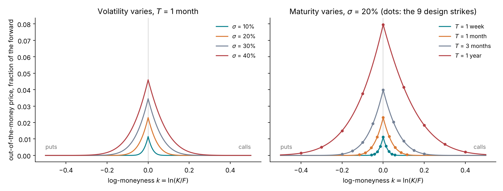

How to read the figure: each curve is the price of the out-of-the-money option at each strike, a put for k < 0 and a call for k > 0, as a fraction of the forward. The price peaks at the money and falls toward zero in both wings. In the left panel a higher volatility raises the price at every strike; at the money the price is close to 0.4 σ√T, so it is almost proportional to σ (1.15% of the forward at 10%, 4.6% at 40%). In the right panel a longer maturity raises the price and widens the curve, both as √T. The dots are the design strikes δ ∈ {−2, …, 2}: because δ scales k by √T, the grid reaches k = ±0.06 at one week and k = ±0.4 at one year, and covers the same part of each curve.

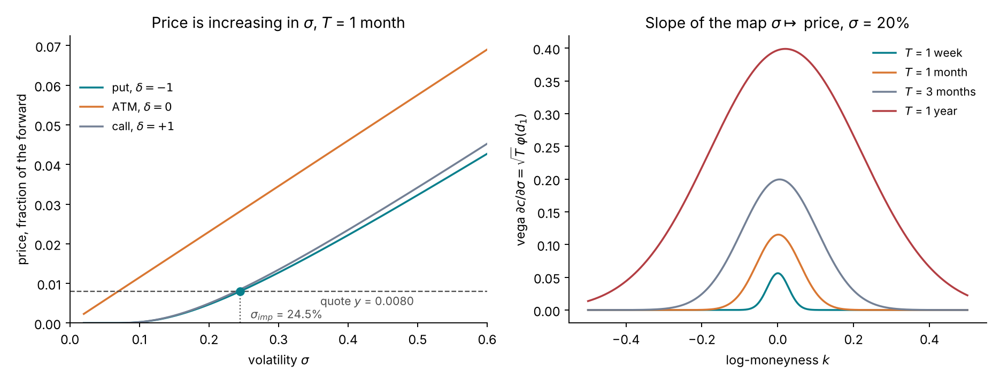

How to read the figure: the left panel shows the map σ ↦ price for one contract per curve. Each curve is increasing, so a horizontal line at a quoted price crosses it exactly once, and the crossing is the implied volatility: the put at δ = −1 quoted at 0.0080 of the forward has σ\_imp = 24.5%. The right panel shows the slope of that map, the vega. It is largest at the money and small in the wings, most of all at short maturities: at one week the vega at δ = 2 is about one seventh of the at-the-money vega. Where the vega is small, a small price error becomes a large volatility error. This is why the noise model of the observation section states the noise in price as vega × a volatility noise. The figures are drawn by `scripts/plot_design_black_scholes.py`.

### Heston

Heston (1993) gives the variance its own mean-reverting diffusion, correlated with the price:

```math
\begin{aligned}
\frac{dS_t}{S_t} &= \sqrt{V_t}\,\big(\rho_H\,dW_t + \sqrt{1-\rho_H^2}\,dW^{\perp}_t\big),\\
dV_t &= \kappa\,(\theta_H - V_t)\,dt + \sigma_v \sqrt{V_t}\,dW_t, \qquad V_0 = v_0 .
\end{aligned}
```

Each term has a plain meaning: κ(θ\_H − V\_t) dt pulls the variance to its long-run level, σ\_v √V\_t dW\_t is the shock to variance, and ρ\_H < 0 makes volatility rise when the price falls. The model is affine, so the characteristic function of X\_T = ln(S\_T / F\_T) is known in closed form (Appendix C), and a European price is a one-dimensional integral, the Lewis half-shift formula:

```math
c(k,T) = 1 - \frac{e^{-x/2}}{\pi}\int_0^\infty \mathrm{Re}\!\left[e^{iux}\,\varphi_T\!\big(u - \tfrac{i}{2}\big)\right]\frac{du}{u^2 + \tfrac14}, \qquad x = \ln\frac{F_T}{K} = -k .
```

The repository evaluates it by Gauss–Legendre quadrature on [0, U] and climbs a ladder of (nodes, cutoff U) pairs: (512, 400), (1024, 600), (2048, 1500), (4096, 3000), (8192, 6000). A rung is accepted when it and the next one both price inside the no-arbitrage bounds and differ by at most 0.1 σ\_c on every contract; the finer rung's prices are kept and the difference is stored as a numerical diagnostic, separate from the quote noise. Low variance with a steep skew at one week needs the upper rungs, because the integrand then decays slowly in u; every one of the 60,000 Heston surfaces of the bank passed. Heston's forward-variance curve is parametric, E[V\_t] = θ\_H + (v\_0 − θ\_H) e^(−κt), so its variance-swap prices depend on the calibration; this is the contrast with Bergomi-type models.

The lesson's Heston task infers (v\_0, θ\_H, σ\_v, ρ\_H) with κ fixed at 2, on the same 63 contracts and the same quote noise as the rough task. The model is simulated, where paths are needed, with the repository's Heston kernels.

### Rough Bergomi

Bergomi's models (2005) take the forward-variance curve as the state variable and let it move log-normally. Bayer, Friz and Gatheral (2016) replaced the exponential kernel of the one-factor model with a power kernel:

```math
\begin{aligned}
\frac{dS_t}{S_t} &= \sqrt{V_t}\,\big(\rho\,dW_t + \sqrt{1-\rho^2}\,dW^{\perp}_t\big),\\
V_t &= \xi_0(t)\,\exp\!\Big(\eta\,Y_t - \tfrac12\,\eta^2\,\mathrm{Var}(Y_t)\Big), \qquad Y_t = \sqrt{2H}\int_0^t (t-s)^{H-\frac12}\,dW_s, \qquad \mathrm{Var}(Y_t) = t^{2H}.
\end{aligned}
```

Each piece has a plain meaning:

- **ξ\_0(t)** is today's forward-variance curve, the market's expectation of V\_t. The exponential factor has mean one, so E[V\_t] = ξ\_0(t) exactly: the model matches the variance-swap curve by construction, whatever H, η and ρ are.
- **Y\_t** is a Gaussian process with power memory. Its increment over [t, t + dt] depends on all past shocks dW\_s, weighted by (t − s)^(H−½). For H = ½ the weight is constant and Y is a Brownian motion; for H near 0.1, as equity data suggest (Gatheral, Jaisson and Rosenbaum 2018), recent shocks weigh heavily and the path of Y is far rougher than a Brownian path.
- **η** scales the log-variance: a one-standard-deviation move of Y\_t changes V\_t by the factor e^η t^H. It is the volatility of variance in this model's units.
- **ρ** is the correlation between the price shock and the variance shock, as in Heston. The skew of the smile is proportional to ρη.
- **The normalization √(2H)** makes Var(Y\_t) = t^(2H), so that η has the same meaning at every H. Appendix D computes it.

The model is not Markovian: V\_t alone does not determine the future of V, the whole past of W does. This has two consequences for the lesson. Pricing needs the path of Y on a fine grid from time zero, which the hybrid scheme supplies. And there is no state vector of fixed size on which a Fourier or PDE method could work: the only pricer is Monte Carlo.

### The prior

The parameters are drawn uniformly on bounded ranges, which is what the repository's bank generator does, and inferred in the unbounded coordinates the adapter produces by a logit map of each range.

| Quantity | Prior | What it encodes |
| --- | --- | --- |
| H | Uniform(0.02, 0.35) | Rough to nearly Markovian; equity estimates cluster near 0.1 |
| η | Uniform(0.5, 3.5) | Mild to violent volatility of variance; SPX fits report values near 2 |
| ρ | Uniform(−0.99, −0.2) | Negative correlation only: the equity skew. Positive values are left out on purpose |
| σ\_0 (curve level) | Uniform(10%, 40%) | A quiet index to a volatile single stock |
| s (curve slope) | Uniform(−0.3, 0.6) | Inverted to upward-sloping term structures: before the perturbations, the last interval's forward variance is between 0.78 and 1.44 times the first's |
| u\_1, …, u\_7 (curve perturbations) | Uniform(−0.2, 0.2) each, independently | Kinks and humps: each interval's level moves by up to 22% around the smooth curve, as event dates and real term structures do |

The curve is context, not a target: the network conditions on the logarithms of its 7 levels and does not infer them. For a real smile the levels come from the chain. The prior on the curve therefore describes the surfaces the network must be ready for, not a belief about ξ\_0. The perturbations are there so that the network does not learn that every curve is a straight line in t, which a real chain would contradict on the first day.

A uniform prior is the simplest honest choice, and it makes the posterior proportional to the likelihood inside the box, so that the posterior and the least-squares objective can be compared directly. The exercises change it.

### Prior predictive check

A prior predictive check asks whether the prior produces smiles that look like real ones. The check takes 2,000 held-out surfaces of the bank, each priced from a draw of the prior, and computes four statistics per surface: the ATM implied volatility at 1 month, the ATM skew at 1 month, the exponent of the skew's term structure, and the curvature at 1 month, each from a quadratic fitted to the five quotes nearest the money. It computes them twice, from the clean model prices and from the noisy quotes, and compares their distribution with the same statistics computed on the SPY chain and on ⟨S8⟩ further dates. A real design grid is read off a smoothing spline, so its statistics compare with the clean distribution; the noisy one shows how much of each statistic the quote noise hides.

The rough-Bergomi version below uses the 400 test surfaces of the pilot bank; the full bank's 2,000 and the real values of ⟨S8⟩ replace them when they exist. The Heston version follows it.

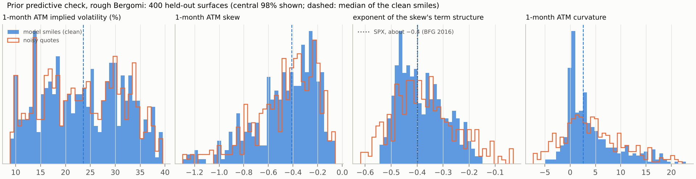

*Figure S2-1 (rough Bergomi, pilot): the prior predictive check on 400 held-out surfaces.* The rough prior puts the SPX exponent of about −0.4 at the centre: the clean smiles' exponent has a median of −0.40 and a 90% range of −0.51 to −0.22. Their 1-month ATM skew has a median of −0.41 (90%: −0.96 to −0.16), and their 1-month ATM volatility spans 10% to 37%, the range of the curve prior.

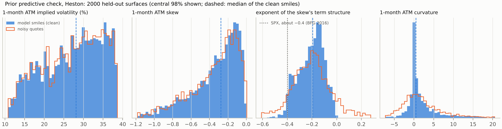

How to read the figure: each panel is one statistic. The filled histogram shows the clean model smiles and the dashed line their median; the outline shows the same statistic read from the noisy quotes. The real values will be marked when study S8 has a chain; the dotted line in the third panel is the SPX exponent of about −0.4 reported by Bayer, Friz and Gatheral (2016). A good prior covers the real values and leaves room on both sides for other underlyings and other days. Two things show already. The Heston prior reaches an exponent of −0.4 only in its tail: 90% of its clean smiles lie between −0.38 and −0.05, because Heston's skew flattens at short maturities. And the 1-month curvature read from noisy quotes is spread far wider than the clean one, from −5.1 to 13.3 against −2.3 to 12.3 for the central 90%, which is the noise that keeps η loosely identified.

### Computing the 63 model prices for one parameter value by Monte Carlo

This section computes the model prices of the 63 design contracts for one parameter value θ = (H, η, ρ) and one curve ξ\_0:

```math
(\theta,\ \xi_0)\ \longmapsto\ P_c(\theta;\xi_0) = \mathbb{E}^{\mathbb{Q}}\big[(K_c - S_{T_c})^+\big], \qquad c = 1, \dots, 63,
```

written here for a put; a call is the same with the payoff (S\_{T\_c} − K\_c)⁺. This map from parameters to prices is the forward model of the whole method: the simulator, in the language of simulation-based inference. Heston computes the same 63 numbers with a Fourier integral (Appendix C). Rough Bergomi has no characteristic function (Appendix J), so each expectation is estimated by an average over N simulated paths of the model:

```math
P_c(\theta;\xi_0) \;\approx\; \frac{1}{N}\sum_{n=1}^{N}\big(K_c - S^{(n)}_{T_c}\big)^+ .
```

Steps 1 to 4 below simulate the N paths: first the variance, then the price, which moves with √V. Step 5 forms the average, with two refinements. It averages a Black–Scholes formula per path instead of the raw payoff, and it doubles N until the Monte Carlo error is small against the quote noise. The result is one priced surface, 63 numbers, at about 5 CPU-seconds. Adding the quote noise of [The observation model](#the-observation-model), y\_c = P\_c(θ; ξ\_0) + σ\_c ε\_c, turns it into one simulated observation.

The method uses this computation in three places. It runs 100,000 times to build the training bank of (θ, y) pairs ([Amortized design](#amortized-design)). It runs M = 256 times per real surface in the audit ([Validation plan](#validation-plan)). It would run once per step of an exact MCMC chain, about 12,300 steps and 17 CPU-hours per surface ([Why the likelihood is expensive](#why-the-likelihood-is-expensive)). Its cost is why the exact posterior is slow, and why the amortized method pays it once, in training.

The hybrid scheme turns three streams of standard normals, one per path and time step, into one surface. The numbers below use the prior median: H = 0.185, η = 2.0, ρ = −0.595, a flat curve at σ\_0 = 25%, and the 63-day maturity block with 504 steps, Δ = 63 / (252 × 504) years.

1. **Draw the shocks.** For each path, draw 504 increments ΔW\_i ~ N(0, Δ) and 504 independent residual normals; draw 504 increments ΔW^⊥\_i for the price.
2. **Build the driver.** Y at step i is the sum of an exact term for the most recent interval, which is a Gaussian correlated with ΔW\_i, and a convolution of the older increments with the kernel (t\_i − t\_k)^(H−½) evaluated at the optimal points of Bennedsen, Lunde and Pakkanen. The convolution of 504 steps is one FFT per path batch.
3. **Build the variance.** V\_i = ξ\_0(t\_i) exp(η Y\_i − ½ η² Var(Y\_i)), with Var(Y\_i) the discrete variance of the scheme, so that E[V\_i] = ξ\_0(t\_i) holds in the discretized model as well.
4. **Build the price.** The log price advances by −½ V\_{i−1} Δ + √(V\_{i−1} Δ) (ρ z\_i + √(1 − ρ²) z^⊥\_i), the left-point Euler step. Along the way the scheme accumulates ∫ V ds and ∫ √V dW, which the pricer needs.
5. **Price the contracts.** Conditional on the path of (V, W), the price at maturity is log-normal with a known mean and variance, so each put is a Black–Scholes formula per path (Appendix D). Every normal draw is used twice, with its sign flipped (antithetic pairs), and two quantities with known mean zero are subtracted in proportion, per maturity (control variates, Appendix D.4). The average starts at 2^15 paths; the standard error of each price is recorded, and the path count doubles, up to 2^21, until every standard error is below a quarter of its quote-noise standard deviation.

At the prior median the 1-month ATM implied volatility is 22.8%, below the curve's flat 25%: with negative correlation and a large vol-of-vol the at-the-money level sits under the variance-swap level. The 1-month ATM skew is −0.59 per unit of log-moneyness and the 1-week skew −0.97: the skew steepens toward short maturities, as T^(H−½) = T^(−0.315) in the limit. The surface costs 4.7 CPU-seconds at 2^15 paths on each of its three grids; its largest Monte Carlo standard error is 0.21 σ\_c and its median 0.048 σ\_c, so the first rung of the ladder suffices.

### The 63 prices at the centre of the prior, plotted as smiles


How to read the figure: the left panel shows what a desk sees, the implied volatilities of the 63 quotes, with error bars of one quote-noise standard deviation, and the clean model smile through them. The bars are widest in the long-dated wings, where vega is smallest, and the noise is Gaussian in price, not in volatility: the low quote at one year and δ = 1.5 is 2.4 standard deviations below the model in price and almost 4 in volatility. The right panel shows the absolute ATM skew at the 7 maturities on log–log axes. The short-maturity formula (dotted) is within 11% of the simulated skew at one and two weeks and drifts above it at longer maturities, by 47% at one year. The power law fitted from one week to one year has exponent −0.39, against H − ½ = −0.32: over a year of maturities the term structure is steeper than its short-maturity limit when η is large. The smile identifies H through the whole simulated map, which the network learns, rather than through the fitted exponent alone. The crosses are the skews read from the noisy quotes; at one year they are as uncertain as the skew itself is small.

### The skew's term structure

For short maturities the at-the-money skew of the rough Bergomi smile, ψ(T) = ∂σ\_imp / ∂k at k = 0, follows a power law (Bayer, Friz and Gatheral 2016; El Euch, Fukasawa, Gatheral and Rosenbaum 2019):

```math
\psi(T) \;\approx\; \frac{\rho\,\eta\,\sqrt{2H}}{2\,\big(H+\tfrac12\big)\big(H+\tfrac32\big)}\; T^{\,H-\frac12}, \qquad T \to 0 .
```

Two facts follow. The slope of log|ψ| against log T is H − ½ at short maturities, so the term structure of the skew identifies H on its own; over the design's one week to one year the fitted slope is steeper than H − ½ at the centre of the prior, −0.39 against −0.32, so reading H off a real smile as the exponent plus ½ tends to understate it. The prior predictive study measures the gap across the prior. On the pilot's 400 test surfaces the fitted exponent lies below H − ½ on 93% of them, by a median of 0.05 (90%: from 0.17 below to 0.002 above), and its correlation with H is 0.77: the exponent carries H, with a bias that the network learns and a reader of the exponent does not. The level of the skew at any maturity is proportional to ρη, so the skew identifies the product, not the factors; the curvature separates them, and how well depends on the quote noise in the wings (on the pilot, well: S2). Equity-index markets show skew term structures with exponents near −0.4 (SPY on 21 October 2026: −0.32, S8), which is the empirical case for roughness and the reason the design grid starts at one week. The curvature of the smile, the second derivative in k, depends on η² (with H and ρ), at order T^(2H−1); it is the quantity that separates η from ρ, and it lives in the wings, where the quotes are noisiest. Appendix D states the expansions; study S2 measures how well each direction is recovered.

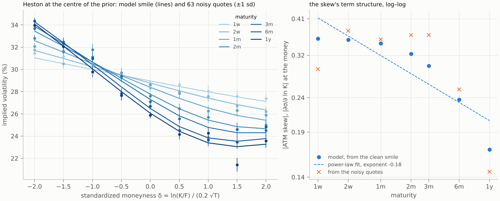

How to read the figure: Heston's skew is nearly flat from one week to one month, at −0.36 to −0.35, and falls only beyond; no power law fits it (the dashed line, exponent −0.18 over the year). A Markovian model of this kind produces a skew that tends to a constant as T → 0, which is the short-maturity behaviour index smiles do not show and the reason the lesson moves on to a rough model.

### From parameters to a product price

Given θ and ξ\_0, any product the model can simulate has a price, by Monte Carlo over the same paths:

- **Variance swap** on [0, T]: fair strike K\_var = E[Q\_T] = (1/T) ∫₀ᵀ ξ\_0(t) dt. No parameter enters: this is the control.
- **Volatility swap** on [0, T]: fair strike K\_vol = E[√Q\_T], which lies below √K\_var by a convexity correction of about Var(Q\_T) / (8 K\_var^{3/2}). Var(Q\_T) grows with η and depends on H.
- **Forward-start call** with strike set at T\_1 and expiry T\_2: price E[(S\_{T\_2} / S\_{T\_1} − 1)⁺]. Under Black–Scholes it depends on σ alone; under stochastic volatility it depends on the law of the variance at T\_1 and on the forward smile, so on η, H and ρ. It is the textbook product for calibration and model risk (Bergomi 2004; Schoutens, Simons and Tistaert 2004).
- **A vanilla outside the grid**, the 2-year 90% put: an extrapolation in maturity, which also needs ξ\_0 beyond the last quoted maturity. The study holds the last level flat out to two years and says so; the extrapolation is stated, not inferred.

The forecast of the SVJ lesson becomes the pricing step here: nothing is re-estimated, the draw supplies θ, the market supplies ξ\_0, and only the Monte Carlo paths are new. [From posterior to prices](#from-posterior-to-prices) turns the prices under all draws into a range and a reserve.

## The observation model

This section defines the data: what one quote y\_c is, which 63 contracts are used, and the noise σ\_c attached to each quote. Together with the model prices of the previous section, the noise model gives the likelihood p(y ∣ θ, ξ\_0) of step 4 of the executive summary. The section ends with the parameter directions the smile can and cannot identify, which is what the posterior will show.

### What a quote is

An end-of-day chain lists, for each listed contract, a bid and an ask. The mid is the observation; the half-spread is the natural scale of its uncertainty; quotes with zero bid, crossed markets or spreads wider than a threshold are removed. The forward per maturity comes from put–call parity on the pairs nearest the money, and the discount factor from a short-rate curve or, where it is not available, from the same parity regression. Appendix I gives the cleaning rules for the SPY chain.

### The design grid

The network is trained on a fixed set of contracts, so the real chain is read at that set. The grid is defined in standardized moneyness δ = k / (σ\_ref √T), with σ\_ref = 20%, at δ ∈ {−2, −1.5, …, 2} and at the 7 maturities. Defining strikes in δ rather than in k keeps every maturity inside its liquid region: at one week, δ = 2 is about 1.1% from the forward, at one year about 40%. For each maturity a smooth smile is fitted through the cleaned quotes in δ, and the 9 grid prices and their noise standard deviations are read off it. Puts are used below the forward and calls above, so each quote is out of the money.

### The noise model

Each observed price is the model price plus independent Gaussian noise with a known standard deviation:

```math
y_c = P_c(\theta;\xi_0) + \sigma_c\,\varepsilon_c, \qquad \varepsilon_c \sim \mathcal{N}(0,1)\ \text{independent}, \qquad \sigma_c = \mathrm{vega}_c(\sigma_{\mathrm{ref}})\times s_{\mathrm{iv}}(\delta_c),
```

with s\_iv rising linearly from 0.3 volatility points at δ = 0 to 1.0 at |δ| = 2. The noise is Gaussian in price, which is what the bank generator adds, with a standard deviation that corresponds to a fixed noise in implied volatility through the vega: a wide-wing quote is allowed to be off by one volatility point, an at-the-money quote by a third of one. The standard deviations are fixed per task, so the training bank, the network, the audit and the classical fits all see the same noise model. A real chain's bid-ask widths are mapped to the same scale when the grid is read, and the exercise that doubles σ\_c shows what the reserve owes to this choice.

Negative noisy prices are retained, as in every bank of the repository: they are valid observations under the declared Gaussian model, and the network conditions on prices scaled by their noise standard deviations, y\_c / σ\_c, which is defined for any value. Implied volatilities are computed for plots and for the real chain, where quotes below intrinsic value are removed by cleaning.

### What the smile identifies

Combining the skew formula with the noise model gives the identification picture the posterior will show:

- the **level** of each maturity's smile is set mainly by ξ\_0, which is conditioned on, not inferred; the gap between the at-the-money level and the variance-swap level is not fixed by ξ\_0, and moves with η most and with H and ρ (Lecture 7 of the course: at fixed ρη, η moves the one-year at-the-money quote by up to about 10 noise units);
- the **skew** level fixes ρη to a few percent, because it is read from the best-quoted region of every maturity;
- the **skew's term structure** fixes H at leading order, from seven maturities between one week and one year; over this range η also steepens the fitted exponent;
- the **curvature** measures η² given ρη, but from the wings, where the noise is three times larger; on its own it would leave η wide, and in the pilot it is the at-the-money level that separates η from ρ (S2: the posterior standard deviation of η is a median 5% of its mean);
- the range ρ ∈ (−0.99, −0.2) truncates the ρ–η direction: at fixed ρη, η cannot be below |ρη| / 0.99 nor above |ρη| / 0.2.

Study S2's recovery and contraction figures test each line. The separation of η through the at-the-money level holds only if ξ\_0 is right. ξ\_0 is replicated from strikes that stop at δ = −8 or before (Appendix I.4); Lecture 5 of the course shows that stopping at |δ| = 2 instead lowers the one-year variance-swap volatility from 21.8% to 18.9%, and the remaining truncation is smaller but not measured. An error in ξ\_0 becomes an error in η that the posterior, conditional on ξ\_0, does not show. Study S6 measures how often a ρ–η valley appears in the least-squares objective.

## Why the likelihood is expensive

This section expands step 4 of the executive summary. It explains why, for rough Bergomi, one evaluation of the likelihood costs one Monte Carlo surface, and why an exact posterior therefore costs hours per surface. This cost is what the amortized method removes.

The likelihood is the probability density of the 63 observed quotes, given the parameters and the curve. Under the noise model it is the Gaussian of the executive summary's step 4. The cost is entirely in the model prices P\_c(θ; ξ\_0).

### Heston: a formula

For Heston each P\_c is the Lewis integral, and the 63 prices of a surface share the characteristic function across strikes within a maturity: at the first rung of the quadrature ladder a surface costs about 15 CPU-milliseconds, at the second about 35. One likelihood evaluation costs 20 milliseconds, a random-walk chain of 20,000 evaluations 7 minutes. This is why Heston has an exact posterior to show.

### Rough Bergomi: a Monte Carlo run

For rough Bergomi each P\_c is an expectation over the Volterra path. The study estimates it on three time grids, each with its own random stream: 80 steps to 10 days for the one- and two-week maturities, 504 steps to 63 days for the next three, and 504 steps to one year for the two long ones. Each grid starts at N = 2^15 paths and doubles, up to 2^21, until its standard errors meet the budget below. The estimator is the conditional Black–Scholes price (Appendix D): conditional on the variance path and the correlated part of the price shock, the terminal price is log-normal with mean and variance known from the path, so the put price is a formula per path and the Monte Carlo averages formulas rather than payoffs. Its variance is small and bounded, which is what makes the standard error reliable; antithetic paths and two control variates reduce it further (McCrickerd and Pakkanen 2018; Appendix D.4).

One priced surface costs about 5 CPU-seconds at the first rung of the ladder, and 11.9 on average over the pilot bank, where a quarter to a third of the maturity blocks needed more paths (S1). The standard errors s\_c are recorded with every price. Each grid's path count doubles until s\_c ≤ 0.25 σ\_c for every quote it prices, so that the Monte Carlo noise adds at most 6.25% to the quote-noise variance, and 0.16% at the pilot bank's median. The hardest surfaces sit in the corner of the prior where η is near 3.5, ρ near −1 and the volatility level is high: there the far puts at one and two weeks, and the far calls at six months, have heavy-tailed payoffs. The first pilot bank, built on two grids with at most 2^18 paths, stopped on three such surfaces among its first 250. The separate 10-day grid, where a path costs a sixth as much, and paths up to 2^21 price them within the budget, at up to 2^20 paths and two CPU-minutes for the worst of the three. At the very corner of the prior box even 2^21 paths leave one far quote at 0.30 σ\_c. A surface whose ladder ends above the budget is therefore kept if no quote exceeds 0.5 σ\_c, which inflates that quote's noise variance by 25% at most, and the bank reports how many surfaces end above the budget; above 0.5 σ\_c the bank stops with an error. In the pilot bank of 2,200 surfaces none ended above the budget, and no block needed 2^21 paths. Nothing is redrawn silently, because redrawing would remove the hardest parameters from the prior.

### The likelihood is only estimated

With Monte Carlo prices the log-likelihood is evaluated at P̂\_c rather than P\_c. The Gaussian form is not linear in the price, so the estimate of the likelihood is not unbiased, unlike the particle filter's in the SVJ lesson. Two facts keep this harmless: the bank's rule bounds the Monte Carlo error at a quarter of the quote noise, and at half of it for the few surfaces that end the ladder above the budget, and the estimator covariance across contracts is stored, so the exact chain of study S9 can add it to the noise covariance. Common random numbers make the likelihood a smooth deterministic function of θ for a fixed seed, which the classical optimizer needs; they introduce a fixed-sample bias that a second seed measures. Appendix G quantifies the second-order bias.

### The cost of the exact posterior

A random-walk chain needs on the order of 10^4 likelihood evaluations to reach a few hundred effective draws in three dimensions; Hamiltonian methods need gradients, which Monte Carlo pricing does not give cheaply. Study S9 extrapolates rather than runs it: the Heston chains of S3 needed a median of 12,300 evaluations for 400 effective draws, and at 5.0 CPU-seconds per rough evaluation that is about 17 CPU-hours per surface, or about 41 at the pilot bank's average of 11.9 CPU-seconds. Both are lower bounds: a likelihood estimated by Monte Carlo is noisy, and a chain on a noisy likelihood needs more evaluations than one on an exact likelihood. For one desk's universe, every morning, that is the cost amortization removes.

## Classical calibration and where it fails

This section expands step 5 of the executive summary. It describes the calibration methods desks use today, what each returns, and why none returns the range the rules ask for. These methods are the baselines that study S6 compares with the amortized posterior.

Model calibration in practice is a least-squares problem, solved once per surface by a local optimizer. For this model it fixes the skew and its term structure well, and returns one point with, at best, a local interval. The exact Bayesian route gives the right statement, at hours per surface.

### Classical calibration routes and what each returns

| Route | Output | Key references | Where it fails for a smile |
| --- | --- | --- | --- |
| Weighted least squares with a local optimizer | One parameter vector | Standard practice; Gatheral (2006) | One point; where a valley exists, the result depends on the start and on the weights |
| Least squares with Gauss–Newton standard errors | A point and a local covariance | Nonlinear regression textbooks | Symmetric, local; wrong in shape along a curved, truncated valley |
| Multi-start least squares | The set of local optima | Standard practice | The distinct optima, with no weights; in the pilot studies usually a single optimum, so no range |
| Regularized (Tikhonov) calibration | One stable point | Crépey (2003); Cont and Tankov (2004) | The answer depends on the penalty and on the reference point |
| Deep calibration: neural pricer and least squares | One point, fast | Hernandez (2017); Bayer et al. (2019); Horvath, Muguruza and Tomas (2021) | Fast, but still one point |
| Neural pricer with MCMC | A posterior | Bayer et al. (2019) sample it by MCMC on their pricer | Correct up to the pricer's error; a sampler per surface |
| MCMC with the Monte Carlo pricer inside | The exact posterior | Gupta and Reisinger (2014) for Bayesian calibration in general | at least 17 CPU-hours per surface (extrapolated, S9) |

### Least squares and its weights

The calibration objective is

```math
\hat\theta = \arg\min_{\theta}\ \sum_{c=1}^{C} w_c\,\big(P_c(\theta;\xi_0) - y_c\big)^2 .
```

With w\_c = 1 / σ\_c² the objective is minus twice the log-likelihood, so least squares is maximum likelihood under the noise model, and, with the uniform prior, the posterior mode. Desks often minimize errors in implied volatility instead, with equal weights or vega weights; to first order a vega-weighted price error is an implied-volatility error, so the two agree near the optimum and differ in the wings. Detlefsen and Härdle (2006) measured how much the choice moves the answer. The study uses w\_c = 1 / σ\_c² throughout, so that the classical and the Bayesian route use the same information and differ only in what they return.

### The Gauss–Newton interval

Near the optimum the objective is approximately quadratic, with curvature JᵀWJ, where J is the C × 3 Jacobian ∂P\_c / ∂θ\_j and W the diagonal of the weights. The covariance of the estimate is its inverse, and an interval for a product price follows by the delta method:

```math
\widehat{\mathrm{Cov}}(\hat\theta) = \big(J^{\top} W J\big)^{-1}, \qquad \widehat{\mathrm{Var}}\big(p_{\Pi}(\hat\theta)\big) \approx \nabla_\theta p_{\Pi}^{\top}\,\widehat{\mathrm{Cov}}(\hat\theta)\,\nabla_\theta p_{\Pi} .
```

Three conditions make the interval right: many informative quotes for each direction, an optimum inside the parameter space, and an objective close to a quadratic over the width of the interval. A ρ–η valley, where it exists, breaks the first and the third, and ρ near −1 breaks the second. Along the valley JᵀWJ has a small eigenvalue, so the interval is long in a direction that is only approximately the valley's, and it extends past ρ = −1 into values the model does not allow. Study S6 measures its coverage on 200 synthetic surfaces, against the posterior interval's. For Monte Carlo pricers the Jacobian itself is a finite difference of noisy prices and needs common random numbers to exist.

### Multi-start and regularization

A multi-start runs the optimizer from several points and keeps the distinct optima. On a valley it can return points spread along it, each with an objective value within the noise of the others; in the pilot studies it found a single optimum on 97% of Heston smiles and on all 8 rough-Bergomi smiles (S6), so the range it builds is often a single point. It is the desk's practical way to build a range of plausible calibrations, and the range it builds depends on how many starts, how far apart, and how different two optima must be to count. Tikhonov regularization adds λ ‖θ − θ\_ref‖² to the objective and returns one point; the point moves with λ and with θ\_ref, typically yesterday's calibration, which makes the calibration stable from day to day at the cost of hiding the valley. Study S6 reports the number of distinct modes and the sensitivity of the regularized point to λ.

### Deep calibration

Horvath, Muguruza and Tomas (2021) train a neural network f\_ψ to map parameters (and the curve) to the implied-volatility grid, on a bank of simulated surfaces, and then calibrate by least squares with f\_ψ in place of the pricer. Calibration takes milliseconds and the pricer's error is measured once, on held-out surfaces. Bayer et al. (2019) compare this two-step route with a one-step inverse map from surfaces to parameters, which is amortized point estimation. Both return one point. The pricer, however, gives a likelihood at no cost, and a Markov chain on it gives a posterior in seconds: this neural-likelihood route is the strongest Bayesian competitor to the amortized posterior, and study S4 compares the two.

### Bayesian MCMC: exact but slow

Bayesian inference treats the parameters as uncertain and updates the prior with the likelihood by Bayes' rule, p(θ ∣ y, ξ\_0) ∝ p(y ∣ θ, ξ\_0) p(θ). The posterior has no closed form, so it is represented by draws. A random-walk Metropolis–Hastings chain proposes θ′ = θ + Gaussian step, computes the ratio of posterior densities, and moves with probability min(1, ratio); the normalizing constant cancels. For Heston each ratio costs two Fourier likelihoods and the chain runs in minutes; the study uses four chains, R-hat below 1.01 and an effective sample size above 400 as in the SVJ reference. For rough Bergomi each ratio costs two Monte Carlo surfaces, and the chain runs in hours; study S9 measures it once.

## Amortized design

This section expands step 6 of the executive summary. It explains how the network that returns the posterior is built, trained and used. It is the core of the method; the next section checks the network, and the one after uses it to price products.

Amortized inference pays the cost of inference once, in training. A network is trained on simulated surfaces whose parameters are known, and it then maps any new smile to its posterior in seconds. The network never evaluates the likelihood: it learns the posterior from simulations alone. The Monte Carlo pricing, which is the expensive part, is done once per training surface and never again.

### Why simulations from the prior yield the posterior

The model is cheap to simulate per surface relative to an MCMC chain, even though its likelihood is expensive. Drawing θ and a curve from the prior and then a noisy surface y from the pricer and the noise model produces triples (θ, ξ\_0, y) from the joint distribution p(θ) p(ξ\_0) p(y ∣ θ, ξ\_0). The same joint distribution factors as p(y, ξ\_0) p(θ ∣ y, ξ\_0). Among simulated surfaces that resemble the observed one, with the same curve, the parameters are therefore distributed as the posterior. A network trained on many triples learns to return p(θ ∣ y, ξ\_0) for any smile; this is neural posterior estimation.

### What the network takes in and gives out

| Item | Content | Size per surface |
| --- | --- | --- |
| Input | The 63 quotes, each divided by its noise standard deviation, and the logarithms of the 7 forward-variance levels | 70 |
| Targets | H, η, ρ in the logit coordinates of their ranges | 3 |
| Output | Random draws from the joint posterior of the 3 targets | 1,000 × 3 in the study; any number on request |

There is no summary network in Stage B: 70 numbers go straight into the inference network, as in the repository's rough pilot. The Heston check network has the same input without the curve, 63 numbers, because Heston's curve is a function of its parameters. The curve enters as context, so one network serves every term structure the prior covers. In Stage D the input becomes a set of tokens (δ, T, y\_c / σ\_c, present-or-missing) read by a set transformer, so that a real chain with missing strikes or maturities is handled by the same network; Appendix F explains why training with random masks is the right way to teach it.

### The simulator and the training bank

Training is offline, on a bank generated once. Each of 100,000 training surfaces is one draw of (H, η, ρ), one draw of a curve (σ\_0, s, u\_1, …, u\_7), one Monte Carlo pricing of the 63 contracts on the path ladder, and one draw of quote noise. The bank stores the clean prices, the noisy observations, the parameters, the 7 curve levels with their (σ\_0, s), the Monte Carlo standard errors, the estimator covariance and the path count each maturity block needed. Its format, `calibration_bank_v1`, is the repository's `option_bank_v1` with these context arrays added, and keeps its seed streams, shards and manifests; the archived option-bank modules are imported rather than edited, because archived evidence pins their source hashes. Each example has four independent streams, for the prior, the pricing, the quotes and the curve, so any surface can be regenerated alone. Generation runs as an array of single-core jobs on the cluster. At the pilot's 3.3 CPU-hours per 1,000 surfaces it costs about 370 CPU-hours for the 112,000 surfaces of the three splits, under two hours on 200 cores; the assembler verifies every shard.

At training time every batch draws a fresh quote error around the clean prices of its surfaces. The conditions are y\_c / σ\_c, so the error of the declared noise model is a standard normal in these units and costs nothing to draw: the priced bank is reused, and the network never sees the same noisy surface twice. This choice is measured, not assumed. A first Heston network trained for 40 epochs on four fixed noise draws per surface, the repository's earlier augmentation, failed SBC for v\_0 and θ\_H: its 90% intervals covered the truth on 78% and 85% of 2,000 held-out smiles, overconfident exactly where the smile identifies the parameters best and the posterior is narrowest, so that a small error in the network's mean is large against the posterior's width. A second network, trained for 500 epochs with a fresh error in every batch, failed in the same way, and the cause turned out to be the sampler (Appendix F.2). With the sampler fixed, its v\_0 posterior had the right width but a mean a median 0.35 posterior standard deviations from the exact one. The last change is where in time the loss is trained. BayesFlow draws τ = u^1.5 by default, which favours the noise end; a sharp posterior's location is set near the data end, so the study draws τ = u^0.5, with density 2τ. The third network's v\_0 mean error fell to a median 0.16 posterior standard deviations, and 80% of 50 test smiles met the agreement criterion of study S3 on all four parameters, against 28% for the second. It also passes SBC for all four parameters on 2,000 held-out smiles, where the first two failed for v\_0 and θ\_H, and its 95% intervals cover the truth on 93.5% to 95.2% of them (S2). Validation uses 5,000 surfaces with their stored noise; 5,000 test surfaces and 2,000 SBC surfaces are never used for selection.

### The inference network: from noise to posterior draws

The inference network is BayesFlow's FlowMatching, the class slot 4 uses, with three targets and 70 conditions. Training uses straight lines, as in the SVJ lesson. From here on θ stands for the 3 standardized targets. For one training triple, take its targets θ, draw a noise vector z from a standard normal in 3 dimensions, and draw a time τ between 0 and 1. The point at time τ on the straight line from z to θ is x\_τ = (1 − τ) z + τ θ, and its velocity along the line is θ − z. The velocity network u\_φ sees x\_τ, τ and the 70 conditions, and is trained to predict that velocity:

```math
\mathcal{L}(\phi) = \mathbb{E}\,\Big\| u_\phi\big((1-\tau)\, z + \tau\,\theta,\ \tau,\ y/\sigma,\ \xi_0\big) - (\theta - z) \Big\|^2, \qquad z \sim \mathcal{N}(0, I),\quad \tau = u^{0.5},\ u \sim \mathcal{U}(0,1).
```

Many lines pass through the same point at the same time, from different noise draws and different targets. The squared-error loss makes the network learn their average velocity, and following the average velocity from noise at τ = 0 lands on the posterior at τ = 1; Appendix F proves it. Sampling draws z and follows the learned field from τ = 0 to τ = 1 with 100 Euler steps on the grid τ\_i = 1 − (1 − i/100)², which is dense where the flow ends; Appendix F.2 explains why uniform steps are not enough. The velocity network is BayesFlow's TimeMLP with four hidden layers of 256 units, with the 70 conditions in place of the SVJ design's 32 learned summaries.

### Training settings and cost

The targets are standardized with their training mean and standard deviation, and the conditions as well, both frozen after training. The reference run uses ⟨S2⟩ epochs over the 100,000 surfaces, with a fresh quote error in every batch of 256. The optimizer is BayesFlow's default for offline training: AdamW with weight decay 5 × 10⁻³ and gradient norms clipped at 1.5; the learning rate warms up from 5 × 10⁻⁵ to 5 × 10⁻⁴ over the first 5% of steps and then decays to zero along a cosine. The checkpoint kept is the epoch with the smallest validation loss, and its reload is checked by drawing twice with the same seed. Training runs on ⟨S2⟩ CPU cores in ⟨S2⟩ minutes. The study samples with this fixed Euler grid, compiled once, at 1.4 seconds per surface for 1,000 draws (3.6 CPU-seconds), after 5.9 seconds to load the network and compile the sampler.

### Where the likelihood enters

The likelihood enters at no point of training or sampling. Within the amortized workflow and its checks, the Monte Carlo pricer comes back in three places: in the training bank, once; in the exact chain of study S9; and in the audit, which weights proposals fitted to the network's draws by the Monte Carlo likelihood of the observed surface.

### The neural-pricer route

The same bank trains the other neural object of the literature: a pricer f\_ψ(θ, ξ\_0) that returns the 63 clean prices, fitted by least squares in units of σ\_c on the stored reference prices. With it, the approximate likelihood p̃(y ∣ θ, ξ\_0) = N(y; f\_ψ(θ, ξ\_0), diag(σ\_c²)) costs microseconds, and a Markov chain on it gives a posterior in seconds. This route is neural likelihood estimation; it is correct up to the pricer's error, which is measured once on held-out surfaces and must stay below the quote noise. The two routes should agree, and study S4 checks that they do; the lesson then says which to use when: the amortized posterior where surfaces arrive in quantity and the design is fixed, the pricer route where the noise model or the quote set changes from day to day. Appendix F states both objectives.

## Validation plan

This section expands the first half of step 7 of the executive summary: the checks that must pass before the network's posterior is used to price anything.

A learned posterior can be wrong in ways that the training loss does not reveal, so the amortized posterior is accepted only after five checks, each against a known answer, plus one check that runs on every real surface.

| Check | Question it answers | Known answer | When it runs | Study |
| --- | --- | --- | --- | --- |
| Simulation-based calibration | Is the posterior calibrated on average? | True values of 2,000 simulated surfaces | Once | S2 |
| Recovery, contraction, coverage | What does a smile identify? | True values of simulated surfaces | Once | S2 |
| Agreement with the exact Heston posterior | Is the workflow right where the exact answer exists? | Fourier likelihood; MCMC and importance reweighting | Once, 50 surfaces and the real one | S3 |
| Agreement with the neural-pricer route | Do two independent simulation-based routes agree? | MCMC on the neural pricer | Once, 50 surfaces and the real one | S4 |
| Audit by importance sampling | Is the network right for this surface? | Monte Carlo likelihood | Every surface | S5 |
| Posterior predictive check | Can the model produce this smile at all? | The quotes and their noise | Every real surface | S8 |

### Simulation-based calibration

SBC (Talts et al. 2018) checks the posterior against the one thing simulation provides for free: the true parameters. Draw θ\* and a curve from the prior, price and add noise to get y, draw L = 1,000 posterior draws from the network given (y, ξ\_0), record the fractional rank of θ\* among the draws for each of the three targets, and repeat for 2,000 held-out surfaces. If the posterior is exact, θ\* is one more draw from it, so the ranks are uniform (Appendix G). The study plots the ranks in the ECDF-difference form of Säilynoja, Bürkner and Vehtari (2022) and judges them with a simultaneous Dvoretzky–Kiefer–Wolfowitz band, union-adjusted over the targets: the largest distance between the rank ECDF and the uniform CDF must stay below √(ln(2P/α) / (2B)), which is 0.035 for P = 3 targets, B = 2,000 surfaces and α = 5%. A correct posterior then fails the test in at most 5% of studies, counting all targets together. Ties between θ\* and a draw are broken at random. The DKW band does not use the structure of ranks, so it is wider than Säilynoja's and conservative: it can miss a mild miscalibration that the tailored band would catch, and the coverage table and the audit take over there. SBC averages over the prior and passes a posterior that ignores the data, so the next checks cover what it misses.

*Pending figure ⟨S2-3⟩: SBC rank ECDF differences for H, η and ρ on 2,000 surfaces, with the simultaneous DKW band.* How to read the figure: each panel is one target; a flat curve at zero inside the grey band is a calibrated posterior; a sideways S is an overconfident one; a hump is a biased one.

The Heston network passes the same check, with P = 4 targets and a band of 0.036. The largest distances between the rank ECDF and the uniform CDF are 0.025, 0.018, 0.012 and 0.013 for v\_0, θ\_H, σ\_v and ρ. Its 50%, 80%, 90% and 95% intervals cover the truth on 48% to 50%, 78% to 80%, 89% to 90% and 93.5% to 95.2% of the 2,000 smiles across the four targets, and the contraction is 0.99, 0.99, 0.95 and 0.93. The first two networks failed here for v\_0 and θ\_H, with distances 0.086 and 0.051 for the first and 0.110 and 0.043 for the second; the training section gives the causes.

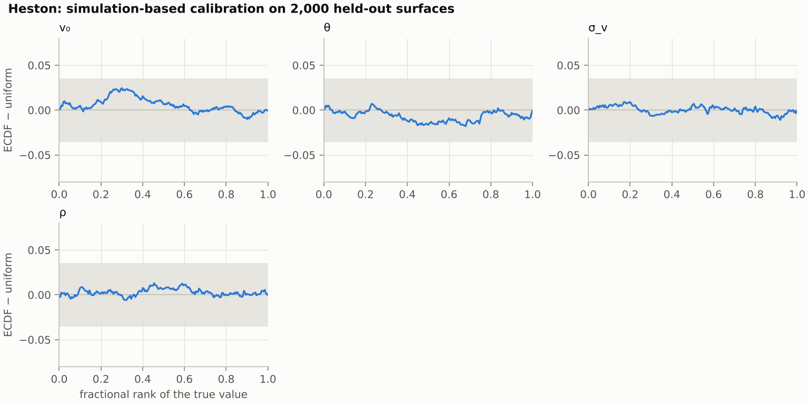

*Figure: SBC for the Heston network on 2,000 held-out smiles, with the simultaneous DKW band for four targets.* How to read it: as figure ⟨S2-3⟩; every curve stays inside the band, and the largest excursion, v\_0's hump near rank 0.3, is 0.025.

### Recovery, contraction and coverage

A recovery plot compares, for each target, the posterior median with the true value over held-out surfaces; contraction is 1 minus the average posterior variance over the prior variance, in the logit coordinates; coverage is the share of surfaces whose 50%, 80%, 90% and 95% intervals contain the truth. The identification picture predicts the outcome: contraction near 1 for ρη, high for H, moderate for η and ρ separately, with the η posterior bounded below by |ρη| / 0.99. The study reports contraction for the three targets and for the product ρη, which it computes from the joint draws. A target uniform on its range has the logistic variance π²/3 = 3.29 in these coordinates; ρη, the product of two uniforms, is not uniform on its range, and its prior variance there, computed from the prior box by Monte Carlo, is 1.42. Dividing by π²/3 instead would overstate how much the smile identifies ρη.

*Pending figure ⟨S2-4⟩: recovery of H, η, ρ and ρη on 1,000 held-out surfaces.* How to read the figure: each point is one surface, at its true value (horizontal) and posterior median (vertical), with its 90% interval; points on the diagonal are perfect recovery; a flat cloud means the smile does not identify the target.

### Agreement with the exact Heston posterior

Heston surfaces have an exact posterior through the Fourier likelihood. The study computes it in two ways: importance reweighting of a defensive proposal built from the network's draws, with the exact likelihood (the repository's correction), and an independent random-walk chain. The amortized posterior for Heston is compared with it on 50 synthetic surfaces and on the real smile. The criterion is the SVJ one: for each target, posterior means within 0.3 posterior standard deviations and 90% widths within 25%.

### Agreement with the neural-pricer route

On rough Bergomi surfaces no exact posterior is affordable, but a second simulation-based route exists: a chain on the neural pricer. The two routes share the bank and nothing else, so their agreement on 50 surfaces, under the same criterion, is evidence that neither has a systematic error larger than the pricer's. Their disagreement, where it occurs, is resolved by the audit with the Monte Carlo likelihood.

### Audit by importance sampling

The audit corrects the amortized posterior for a given surface and is part of the daily process. It follows neural importance sampling (Dax et al. 2023) and the SVJ audit:

1. Fit a multivariate Student t law with 5 degrees of freedom to the network's draws in the logit coordinates, with its shape matrix set to 1.2² times the draws' covariance (a covariance of 5/3 × 1.44 ≈ 2.4 times the draws'), and mix it with 10% of the prior. This is the proposal q(θ).
2. Draw M proposals from q.
3. Price each proposal's 63 contracts by Monte Carlo at 2^13 paths per maturity block, doubling up to 2^15 for a block whose standard error exceeds 0.5 σ\_c, with common random numbers across proposals. Evaluate the Gaussian likelihood with variance σ\_c² − s\_c², which makes it an unbiased estimate of the exact likelihood (Appendix G.3). A surface with a proposal whose standard error stays above 0.9 σ\_c is flagged as not auditable. The pilot of S5 used σ\_c² + s\_c² instead, which counts the Monte Carlo variance twice; it is rerun with the corrected likelihood.
4. Give each proposal the weight w = p(θ) L̂(θ) / q(θ), in the logit coordinates with the Jacobian included.
5. Use the weighted proposals as the posterior. Their efficiency, and the Pareto k̂ of the largest weights (Vehtari et al. 2024), are the audit score.

A proposal close to the posterior gives nearly equal weights, a high efficiency and a small k̂; a network that is off by δ posterior standard deviations gives an efficiency that falls roughly like e^(−δ²). The cost is M priced surfaces at reduced path counts: about 425 CPU-seconds for M = 256 in the pilot. The flag threshold is an open decision: the SVJ study used 2% efficiency; this study reports the distribution of efficiencies and k̂ on 500 held-out test surfaces and proposes the sample-size-dependent threshold of Pareto-smoothed importance sampling, k̂ < min(1 − 1/log₁₀ M, 0.7), 0.58 for M = 256, as the rule. The defensive mixture bounds the weights' variance; it does not prevent a few draws from carrying most of the weight.

### Posterior predictive check on a real smile

All the checks above use simulated surfaces, where the model is true. A real smile may lie outside what the model can produce, and a network applied to it returns a posterior without warning. The check prices the 63 contracts at 200 posterior draws, computes the standardized residual (y\_c − P\_c) / σ\_c for each quote and draw, and reports the quotes whose median residual exceeds two in absolute value. Short-dated far-out-of-the-money puts, where price jumps dominate, are where the model is expected to miss. Together with the prior predictive check of the smile statistics, this is the lesson's misspecification diagnostic and its hand-over to slot 6.

## From posterior to prices

This section expands step 3 and the second half of step 7 of the executive summary. It turns the validated posterior draws into a price distribution for each product, and reads off it the point price, the range and the reserve that step 1 asks for.

The posterior becomes a product price in three steps: price the product from every posterior draw, pool the prices into the price distribution, and read the point, the range and the reserve off it. The same draws also show which parameter the price range owes most to.

### From posterior draws to price distributions

For a product with payoff Π, the price under draw m is p\_Π^(m) = p\_Π(θ^(m); ξ\_0), a Monte Carlo expectation with common random numbers across draws, so that the differences between draws are differences between parameters and not Monte Carlo noise. The pooled values {p\_Π^(m)} are draws from the price distribution p(p\_Π ∣ y, ξ\_0) of the executive summary's step 3. Every product price in the study is such a Monte Carlo price, and the notebook reads the cached prices of study S7 rather than repricing live. A learned price map, validated against Monte Carlo by the repository's surrogate protocol, would make the repricing live; it is an extension and no claim rests on it.

Three products and one control, with the dependence the model implies:

| Product | Fair value under rough Bergomi | Depends on | Expected posterior range |
| --- | --- | --- | --- |
| Variance swap, 63 days | (1/T) ∫₀ᵀ ξ\_0(t) dt | ξ\_0 only | Zero |
| Volatility swap, 63 days | E[√Q\_T] = √K\_var − Var(Q\_T) / (8 K\_var^{3/2}) + … | η, H; weakly ρ | ⟨S7⟩% |
| Forward-start ATM call, 63 → 126 days | E[(S\_{T\_2}/S\_{T\_1} − 1)⁺] | η, H, ρ through the forward smile | ⟨S7⟩% |
| 2-year 90% put, outside the grid | A vanilla, extrapolated in maturity | all three, and ξ\_0 beyond one year | ⟨S7⟩% |

The variance swap is the control: if its range is not zero, the pricing or the curve handling is wrong. In Heston the same product's range is not zero, because the curve is parametric; the lesson shows both.

### The point price, the range and the reserve

The point price is the one the desk would report: the price at the least-squares calibration, or the posterior mean. The range is the 90% interval of the price distribution. The reserve follows the prudent-valuation logic: for a position the desk has sold, the prudent value is the 90% quantile of the price, and the reserve is the distance from the point price to it; for a position it holds, the 10% quantile. Appendix H states the definitions. The reserve is reported in percent of the point price, product by product, and labelled within-model.

*Pending figure ⟨S7-1⟩: price distributions of the variance swap, the volatility swap and the forward-start under the posterior of the SPY smile, with the least-squares price, the multi-start prices and the 90% quantile marked.* How to read the figure: each panel is one product; the histogram is the price under 1,000 posterior draws; the orange line is the least-squares price, the orange dots the other multi-start optima, and the dashed line the 90% quantile whose distance from the orange line is the reserve. The variance swap's panel is a single bar.

### Which parameter the range owes most to

The law of total variance splits the variance of a product price into the part due to η at fixed (H, ρ) and the rest, as the SVJ design split the VaR into state and parameter shares. The study reports, for each product, the share of the price variance explained by η alone, by ρη, and by H, from a linear regression of the price on the three parameters across the posterior draws. The prediction is that the volatility swap is almost all η, and the forward-start a mix.

### Within-model against across-model

The posterior range is a within-model range: it says what one model, with the calibration uncertainty the quotes allow, implies. Model risk in Cont's sense is wider: it includes the choice of model. The study calibrates Heston to the same smile and prices the same products; the gap between the two forward-start prices, ⟨S7⟩%, is a lower bound on the across-model range, and the model-free bounds of martingale optimal transport (Beiglböck, Henry-Labordère and Penkner 2013), which use the vanillas and nothing else, are its upper bound. The lesson compares the posterior range with both, smile by smile: in the pilot the within-model range is below the across-model gap on one smile and above it on another (S7).

### Hedge ratios under the posterior

Each posterior draw also gives the product's sensitivities to the forward-variance curve, by bumping ξ\_0 and repricing with common random numbers. The spread of the hedge ratio across draws is the calibration uncertainty of the hedge. This is an optional extension; the study computes it for the forward-start only if time allows, and the notebook shows it as a one-line exercise.

## Planned feasibility study

This section lists the studies that produce the numbers and figures on which the document's two claims rest. Each placeholder ⟨Sn⟩ elsewhere in the document is filled by study Sn.

The study answers nine questions with explicit criteria. The table tracks them; the subsections state the setup, the figures and the placeholders each study fills. Criteria marked *proposed* are decisions for the organizers.

| # | Study | Question | Criterion | Result | Status |
| --- | --- | --- | --- | --- | --- |
| 1 | S1 | Cost and quality of the training bank | 100,000 surfaces with s\_c ≤ 0.25 σ\_c on every quote, or ≤ 0.5 σ\_c at the top of the ladder on a reported share of surfaces; path counts used and CPU-hours per 1,000 surfaces reported | Heston: 60,000 surfaces, quadrature error at most 0.056 σ\_c against a budget of 0.1, 0.013 CPU-hours per 1,000 surfaces. Rough pilot: 2,200 surfaces, every quote within the budget (median 0.04 σ\_c, largest 0.25), 3.3 CPU-hours per 1,000 surfaces. Full rough bank: ⟨S1⟩ | Heston and rough pilot met; full rough bank pending |
| 2 | S2 | Statistical calibration and identification | SBC rank ECDFs inside the simultaneous DKW band (family-wise 5%) for all 3 targets on 2,000 surfaces; 95% coverage between 93% and 97% | Heston: all 4 targets inside the band on 2,000 smiles; 95% coverage 93.5% to 95.2%. Rough pilot, 250 smiles: H and η inside the band, ρ and ρη outside (bias toward more negative ρ); 95% coverage 92.0% to 96.4%. Full rough bank: ⟨S2⟩ | Heston met; rough pilot not met; full rough bank pending |
| 3 | S3 | Agreement with the exact Heston posterior | Means within 0.3 posterior sd and 90% widths within 25%, on 50 surfaces, all targets | Network alone: 40 of 50 smiles on all four targets (v\_0 82%, θ\_H 96%, σ\_v 100%, ρ 98%). Network corrected by its audit: agrees with independent chains on 4 of 4 | Partly met: the network with its audit agrees with independent chains on 4 of 4 smiles (on the other 46 the audit is its own reference); the network alone meets it on 80% |
| 4 | S4 | Agreement with the neural-pricer route | Same criterion, on 50 rough-Bergomi surfaces; pricer error below 0.5 σ\_c on held-out surfaces | Heston rehearsal: pricer error 0.03 σ\_c; the pricer route agrees with the exact posterior on 50 of 50 smiles, and with the network on 84% (v\_0 86%). Rough: ⟨S4⟩ | Heston rehearsal: pricer route met (50 of 50 against the exact posterior), network against pricer route 84%; rough pending |
| 5 | S5 | The audit | Distribution of efficiency and k̂ on 500 surfaces; flag rate at k̂ > 0.7 reported; cost per surface | Rough pilot, 40 smiles: efficiency median 14%; 23% flagged at k̂ > 0.7 and 33% at the sample-size threshold 0.58; 425 CPU-seconds per smile; the pilot network's means 0.4 to 0.6 sd off and its intervals 1.3 to 1.6 times too wide; computed with a likelihood that counts the Monte Carlo variance twice. Full: ⟨S5⟩ | pilot reported, to be rerun with the corrected likelihood; full pending |
| 6 | S6 | The classical route | Coverage of Gauss–Newton 90% intervals against posterior 90% intervals on 200 surfaces; number of distinct multi-start modes; sensitivity of the regularized point to λ | Heston: Gauss–Newton coverage 87% to 92% against posterior 87% to 90% on 200 smiles; one optimum on 97%; no interval on 11 smiles at the prior's edge. Rough pilot, 8 smiles: one optimum on every smile; Gauss–Newton coverage 71% to 100%, no interval on the smile at ρ = −0.99; a curved η–ρ valley the ellipse cannot follow on one smile. Full rough: ⟨S6⟩ | Heston done; rough pilot reported; full pending |
| 7 | S7 | Products and reserves | Variance-swap range zero; volatility-swap, forward-start and out-of-grid ranges and reserves, with each price's Monte Carlo standard error; Heston-against-rough gap | Heston, 3 smiles: every product carries a range, the variance swap's 1.0% to 2.6%; forward-start reserve 0.7% to 1.7% of its price. Rough pilot, 3 smiles: variance-swap range zero by construction (continuous monitoring, fixed curve); forward-start reserve 1.0% to 6.1%, driven by η (pilot network too wide, S5); Heston-against-rough forward-start gap −4.1% to +7.9%, larger than both reserves on one smile and inside both ranges on another. Full rough: ⟨S7⟩ | Heston done; rough pilot reported; full pending |
| 8 | S8 | The real smile | Skew term-structure exponent; posterior; audit score; posterior predictive residuals with at most ⟨proposed: 10%⟩ of quotes beyond two standard deviations | SPY, 21 October 2026: exponent −0.32; every grid point read from quotes; real spreads below the design noise; the forward-variance curve outside the curve prior. Posterior, audit and residuals: ⟨S8⟩ | data done; posterior pending |
| 9 | S9 | Costs | One table on one machine: Monte Carlo likelihood evaluation; exact chain extrapolated to 400 effective draws; network; audit; neural pricer with MCMC; multi-start least squares | One rough likelihood evaluation 5.0 CPU-s; exact rough posterior at least 17 CPU-h (extrapolated; about 41 at the pilot bank's average pricing cost); amortized posterior 1.4 s for 1,000 draws; audit 425 CPU-s; Monte Carlo least squares 600 CPU-s; Heston exact posterior 250 CPU-s | done (pilot networks) |

### Hardware, software and timing conventions of the study

All timings are reported for one named machine, in CPU-seconds that count every thread, as in the SVJ study. The software is the repository's locked environment: Python 3.12, BayesFlow 2.0.14 with Keras on the JAX CPU backend, NumPy, SciPy. The bank is generated on Oscar with single-core array jobs and assembled with checksums. Every random stream is seeded from the task fingerprint and the example identity, so any surface can be regenerated alone.

### 1. The training bank (S1)

The bank's manifest records the task fingerprint, the shard map, the per-surface Monte Carlo standard errors and the generation cost. The study reports the CPU-hours per 1,000 surfaces, the share of maturity blocks that needed each rung of the path ladder, and the distribution of the ATM skew exponent across the bank. A surface with a quote above 0.5 σ\_c at 2^21 paths stops its shard with an error naming the contract, and is never silently replaced.

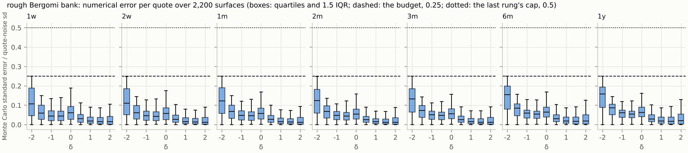

*Figure S1-1 (rough Bergomi, pilot bank of 2,200 surfaces): Monte Carlo standard error over quote-noise standard deviation, by maturity and δ.* How to read the figure: each panel is one maturity; the boxes show the ratio s\_c / σ\_c across surfaces at each δ; everything sits below the dashed line at 0.25, apart from any surface that ends the ladder between it and the dotted cap at 0.5. The full bank's figure replaces this one.

| Rough pilot bank, 2,200 surfaces | Value |
| --- | --- |
| Generation | 26,241 CPU-seconds in 88 shards of 25: 11.9 CPU-seconds per surface, 3.3 CPU-hours per 1,000 |
| s\_c / σ\_c over all quotes: median, 90%, 99%, largest | 0.040, 0.11, 0.22, 0.250 |
| Surfaces with a quote above the budget of 0.25 | none |
| Noise variance added by the Monte Carlo error: median, largest | 0.16%, 6.25% |
| Blocks that needed more than 2^15 paths: 10-day, 63-day, 1-year grid | 23%, 26%, 31% |
| Blocks that needed 2^20 paths; 2^21 | at most 0.3% per grid; none |

The far puts at δ = −2 set the path counts: their boxes reach the budget at every maturity, while the calls at δ = 2 sit near zero, where the control variates remove almost all the variance (Appendix D.4). ⟨S1⟩

### 2. Statistical calibration and identification (S2)

Figures ⟨S2-1⟩ to ⟨S2-4⟩ above, plus the contraction table. The values below are the pilot's: 250 test smiles and a network trained on the pilot bank's 1,600 surfaces; the full bank's replace them.

| Target | Contraction | 95% coverage | Note |
| --- | --- | --- | --- |
| H | 0.91 (pilot) | 92.4% (pilot) | from the skew's term structure |
| η | 0.95 (pilot) | 96.4% (pilot) | bounded below by \|ρη\| / 0.99 |
| ρ | 0.94 (pilot) | 92.0% (pilot) | follows η at fixed ρη |
| ρη | 0.98 (pilot) | 95.2% (pilot) | from the skew level |

Pilot reading. The smile identifies all three parameters, not only ρη. The posterior's standard deviation relative to its mean has a median of 10% for H, 5% for η and 6% for ρ and for ρη. Within a smile the correlation of η and ρ, in logit coordinates, has a median of 0.34 (10% to 90%: −0.20 to 0.75): the ridge of the identification picture exists, but it is short, because the 63 quotes separate η from ρ well enough at this noise level, mainly through the long-dated at-the-money level against ξ\_0 (Lecture 7 of the course), which makes the separation depend on ξ\_0 being read correctly. H, not η, is the least identified parameter. Whether this holds for real quotes depends on the noise in the wings: real short-dated far-from-the-money options are often quoted wider than the noise model's one volatility point, and the real chain of S8 measures that. ⟨S2⟩

SBC passes for H and η and fails for ρ and ρη. The pilot network places ρ too negative, and with it ρη, by a median of 0.3 posterior standard deviations; its 95% intervals still cover the truth on 92% to 96% of smiles. A bias of this size is what a training set of 1,600 surfaces can leave, and the full bank tests whether it goes; meanwhile the audit (S5) corrects it smile by smile.

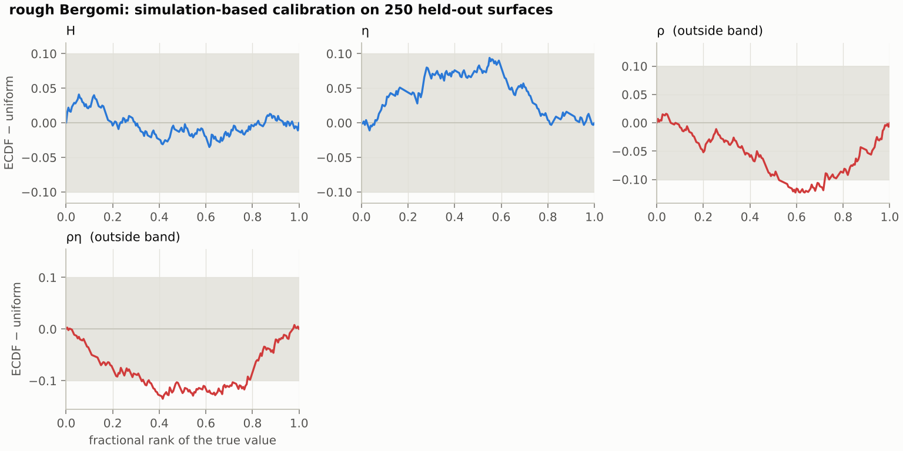

*Figure S2-3 (rough Bergomi, pilot): SBC rank ECDF differences on 250 held-out smiles.* How to read the figure: as above; the dips of ρ and ρη in the middle of the rank range mean the truth ranks high among the draws more often than it should, so the posterior sits too low, too negative, for these two targets.

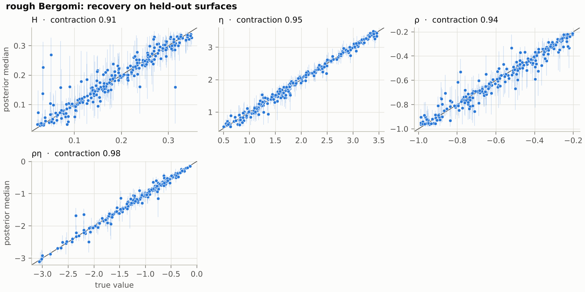

*Figure S2-4 (rough Bergomi, pilot): recovery on 250 held-out smiles*, read as above.

### 3. The Heston check (S3)

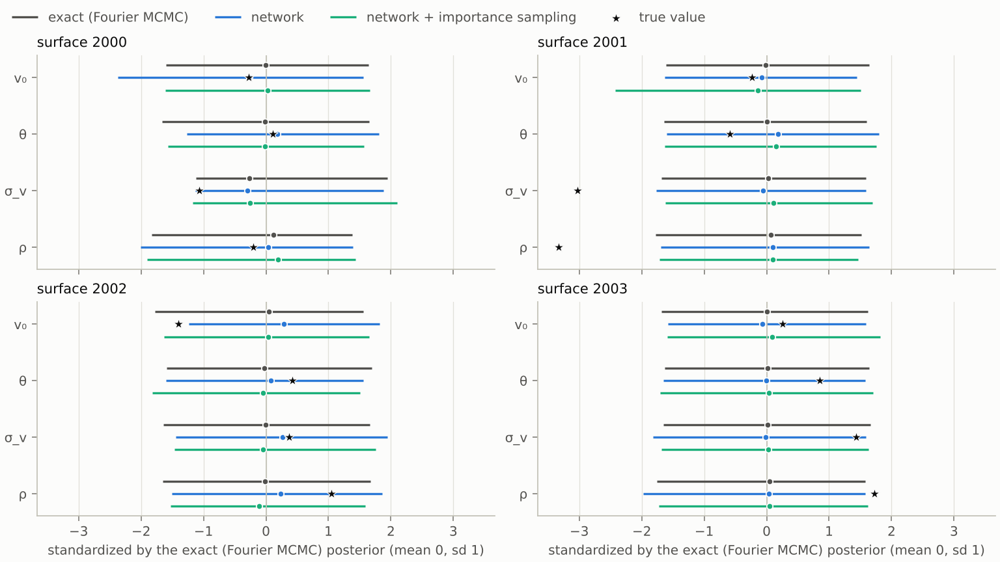

*Figure S3-1: exact against amortized posterior on the four Heston test smiles that also have independent chains (test rows 2,000 to 2,003), target by target, standardized by the exact posterior.* How to read the figure: as the SVJ agreement figure: dots are medians and lines 90% intervals, standardized by the chains' posterior (grey, mean 0 and sd 1); blue is the network alone, green the network corrected by importance reweighting with the Fourier likelihood, and the star the true value. A star outside the grey interval, as for σ\_v and ρ on surface 2001, is a true value in the tail of the exact posterior: 3.0 and 3.3 standard deviations below the chains' means (3.2 and 3.4 below the reweighted posterior's), along the ridge where σ\_v and ρ trade off at a fixed skew. The network follows the exact posterior there; whether such tails occur as often as they should is the question SBC answers on 2,000 smiles (S2).

Setup: the 50 test smiles at rows 2,000 to 2,049, which no training or selection step used; 1,000 network draws per smile; the exact posterior by importance reweighting of 2,048 proposals with the Fourier likelihood (the audit of S5 with the exact likelihood), and, on the first four smiles, by four random-walk chains of 6,000 steps each after 1,000 of burn-in.

| Target | Network against exact: mean error in exact-posterior sd, median (largest) | 90% width ratio, range | Smiles within the criterion |
| --- | --- | --- | --- |
| v\_0 | 0.16 (0.55) | 0.77 to 1.48 | 82% |
| θ\_H | 0.07 (0.39) | 0.87 to 1.08 | 96% |
| σ\_v | 0.08 (0.24) | 0.83 to 1.14 | 100% |
| ρ | 0.09 (0.31) | 0.79 to 1.16 | 98% |
| All four | | | 80% (40 of 50) |

The network alone misses the criterion on 10 of the 50 smiles, nine of them by v\_0's mean, 0.32 to 0.55 posterior standard deviations off. v\_0 has the sharpest posterior of the four, because the one-week quotes pin the initial variance, so a small error of the network in absolute terms is a visible one against the posterior's width. The reweighted posterior agrees with the chains on all four smiles that have them: means within 0.17 posterior standard deviations and 90% widths within 21%, with R̂ at most 1.011 (on surface 2001, just above the 1.01 threshold; at most 1.004 on the other three), at least 413 effective draws per target and about 400 CPU-seconds for the four chains of one smile. The audit's efficiency has a median of 32% and a range of 4.5% to 65%; its k̂ exceeds 0.7 on 4 of the 50 smiles, two of them among the ten that miss. On the one chain smile with k̂ above 0.7 (surface 2001, k̂ 0.74), the reweighted v\_0 interval is 21% wider than the chains', which is the inflation the rule expects of a heavy-tailed weight distribution. The audit costs a median 32 CPU-seconds per smile with the Fourier likelihood.

Reading: the workflow's output for a smile, the network corrected by its audit, meets the criterion on the four smiles that have independent chains (on the other 46 the audit is its own reference); the network alone meets it on 80% of smiles, all four targets together, and on 96% or more for θ\_H, σ\_v and ρ. The lesson shows both numbers and says which one a desk would rely on. The three networks behind this result, and what each change bought, are in the training section and Appendix F.2.

### 4. The two neural routes (S4)

For rough Bergomi: the pricer's held-out error in units of σ\_c, its training cost, and the agreement table between MCMC on the pricer and the amortized posterior, as in S3. The figure overlays the two posteriors on the real smile. ⟨S4⟩

Heston first, as a rehearsal where the exact answer is known. The pricer is a multilayer perceptron with four layers of 256 units. It was trained for 300 epochs on the clean prices of the 50,000 training surfaces, in 370 CPU-seconds. Its held-out RMS error is 0.029 σ\_c at the median contract and 0.041 σ\_c at the worst, and 99% of its errors on 2,050 test surfaces (rows 0 to 2,049) are below 0.11 σ\_c. Four random-walk chains of 20,000 steps on its likelihood cost a median 12 CPU-seconds per smile, with R̂ at most 1.007 and at least 948 effective draws per target.

| Comparison on 50 smiles: share within the criterion | v\_0 | θ\_H | σ\_v | ρ | All four |
| --- | --- | --- | --- | --- | --- |
| Network against MCMC on the pricer (test rows 2,050 to 2,099) | 86% | 98% | 96% | 100% | 84% |
| MCMC on the pricer against the exact posterior (the smiles of S3) | 100% | 100% | 100% | 100% | 100% |
| Network against the exact posterior (S3, for comparison) | 82% | 96% | 100% | 98% | 80% |

Reading: on the smiles of S3, MCMC on the pricer reproduces the exact posterior on all 50, with mean errors of a median 0.03 to 0.045 posterior standard deviations (0.27 at the largest) and 90% widths within 0.79 to 1.11 of the exact ones. On the same smiles the network meets the criterion against the pricer route on 80% of them, as it does against the exact posterior. The pricer route therefore reaches the same verdict on the network as the exact posterior, which is what it is used for on rough Bergomi, where no exact posterior is affordable. Its own condition is the pricer's error, 0.03 σ\_c here against the 0.5 σ\_c the criterion allows; for rough Bergomi the pricer's error has to be measured again, because it learns from Monte Carlo prices whose own error is up to 0.25 σ\_c, and up to 0.5 σ\_c on the few surfaces at the top of the paths ladder.

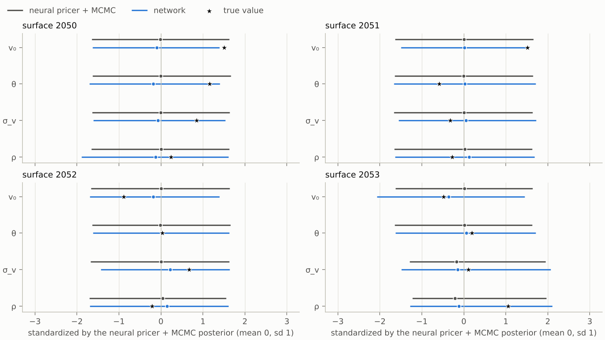

*Figure S4-1 (Heston): MCMC on the neural pricer (grey) against the amortized posterior (blue) on the first four of the 50 smiles, standardized by the pricer route's posterior; the star is the true value.* How to read the figure: as figure S3-1, with the pricer route in place of the exact posterior.

### 5. The audit (S5)

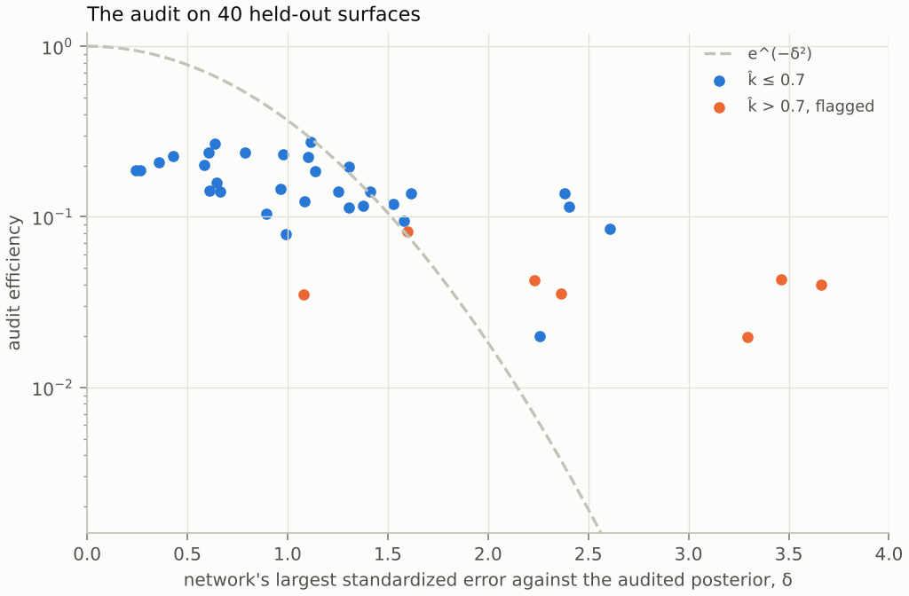

*Figure S5-1 (rough Bergomi, pilot): efficiency and k̂ of the audit on 40 held-out test smiles (rows 250 to 289), against the network's standardized error on the same smiles; the full study uses 500.* How to read the figure: each point is one surface; the horizontal axis is the largest standardized error of the network's posterior mean against the audited posterior, the vertical axis the audit efficiency on a log scale; the dashed curve is e^(−δ²); points in the lower right are the surfaces the audit must flag, and the colour marks k̂ above 0.7.

Pilot reading. With 256 proposals at 2^13 paths per block, one audit costs a median 425 CPU-seconds. The efficiency has a median of 14% (5% to 95%: 1.9% to 24%), and its ceiling near 25% even where the network is right is the price of the defensive proposal, a t law with inflated covariance and 10% of the prior, and of the pilot network being too wide. The audit flags 23% of the smiles (9 of 40) at k̂ > 0.7, 33% (13 of 40) at the sample-size threshold 0.58, and 10% at an efficiency below 2%. On the 30 smiles with a reliable audit (efficiency above 5%, k̂ below 0.7), the pilot network's means are a median 0.37, 0.62 and 0.42 audited standard deviations from the audited ones for H, η and ρ, and its 90% intervals are 1.3, 1.6 and 1.4 times as wide: a network trained on 1,600 surfaces is calibrated on average for H and η, biased for ρ (S2), and too wide for each smile, and the audit is what makes its answer usable. Two cautions read the figure: an audited posterior from a few dozen effective draws is itself coarse, so the largest errors are partly the audit's, and the points far above e^(−δ²) at large δ are the smiles where that is so. These numbers were computed with the likelihood variance σ\_c² + s\_c², which counts the Monte Carlo variance twice and targets a noise variance σ\_c² + 2s\_c². With a = s\_c/σ\_c it widens the audited posterior by about a² in standard deviation, about 1% where a = 0.1 and 4% where a = 0.2, and more on the hard surfaces whose blocks needed extra paths in the bank. The conclusions above survive an error of that size; the rerun with the corrected likelihood replaces the numbers. ⟨S5⟩

### 6. The classical route (S6)

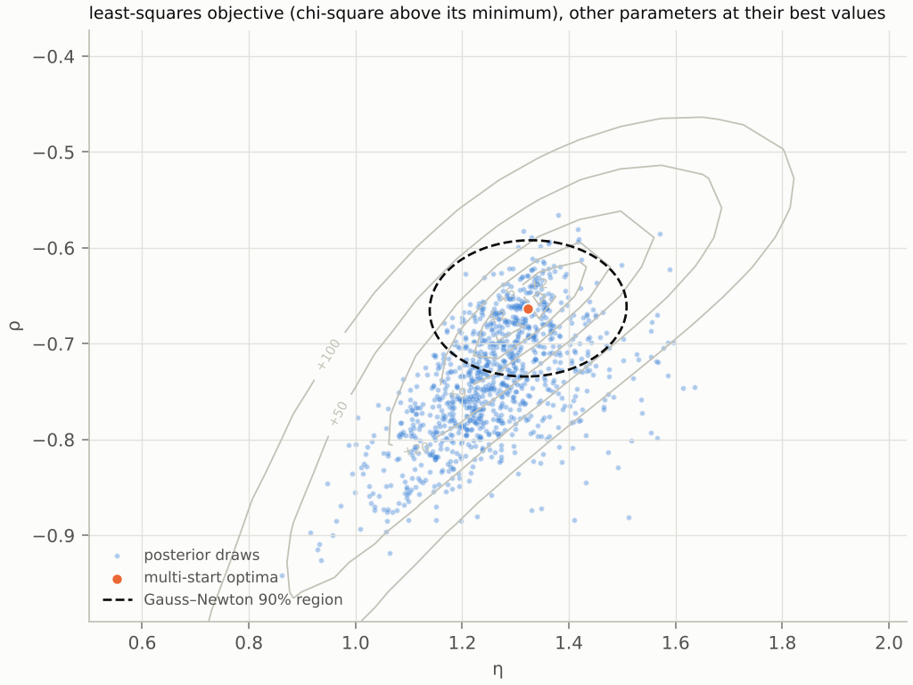

*Figure S6-1 (rough Bergomi, pilot): the least-squares objective over (η, ρ) at the best H for test smile 293, with the multi-start optimum, the Gauss–Newton 90% ellipse and the posterior draws.* How to read the figure: the contours are the objective, lower is better; the valley runs along ρη = constant and is cut by ρ = −1 on the left; the orange dots are the multi-start optima, the dashed ellipse is the Gauss–Newton region at the best optimum, and the blue region holds 90% of the posterior.

The table reports Gauss–Newton against posterior coverage per target, the mean number of distinct modes, and the movement of the regularized point over a decade of λ. ⟨S6⟩

Pilot reading, 8 rough-Bergomi smiles (test rows 293 to 300), ten starts each with the Monte Carlo pricer at 2^13 paths per block and a fixed seed, a median 600 CPU-seconds per smile. The starts find one optimum on every smile: the multiple optima of the identification picture do not appear. The Gauss–Newton 90% interval exists on 7 of the 8 smiles; on the eighth the optimum sits at ρ = −0.99, the prior's edge, and the information matrix is singular. Its coverage, 100% for H, 86% for η and 71% for ρ, is close to the pilot posterior's (88%, 75%, 75%), and 8 smiles cannot separate the two. The figure shows where the two routes differ: on smile 293 the objective's valley curves along ρη ≈ −0.87, the round Gauss–Newton ellipse covers its middle only, and the truth (η 1.42, ρ −0.76) lies outside the ellipse and inside the posterior's cloud. Tikhonov regularization moves the point little for λ up to 1 and toward the prior's centre at λ = 10: on smile 297, whose ρ is −0.99, from −0.98 to −0.78. The full bank's 200 smiles measure how often the valley matters.

Heston is the contrast: the smile identifies every Heston parameter (contraction 0.93 to 0.99, S2), and there the classical route works. On 200 test smiles (rows 2,100 to 2,299), ten starts with the Fourier pricer find a single optimum on 97% of them, at a median 10 CPU-seconds per smile.

| Heston, 200 smiles | v\_0 | θ\_H | σ\_v | ρ |
| --- | --- | --- | --- | --- |
| Gauss–Newton 90% interval covers the truth (189 smiles with an interval) | 90% | 87% | 92% | 90% |
| Posterior 90% interval covers the truth | 90% | 89% | 90% | 87% |
| Gauss–Newton width over posterior width, median (10% to 90%) | 1.03 (0.96 to 1.11) | 1.02 (0.96 to 1.09) | 1.03 (0.95 to 1.47) | 1.02 (0.90 to 1.34) |

The exceptions are at the edges of the prior box. On 15 smiles the best fit sits at a bound, more than 8 logit units from the centre, and on 11 of them the information matrix is singular, so no interval exists. Tikhonov regularization toward the prior centre leaves a well-identified smile where it is and moves a weakly identified one. On test smile 2,102, whose σ\_v is 0.21, ρ moves from −0.94 to −0.59 and σ\_v from 0.20 to 0.34 as λ goes from 0.01 to 10. Their product stays at −0.19 to −0.20, because at low volatility of variance the smile pins only ρσ\_v. The figure shows the well-identified case: elliptical contours, one optimum, and a Gauss–Newton region that holds the posterior draws. The rough-Bergomi figure ⟨S6-1⟩ is drawn the same way.

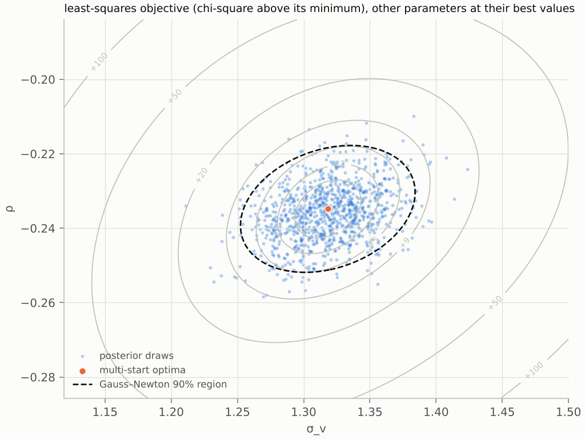

*Figure S6-1 (Heston): the least-squares objective over (σ\_v, ρ) for test smile 2,100, with v\_0 and θ\_H at their best values.* How to read the figure: as figure ⟨S6-1⟩; here the valley is a bowl, the ten starts land on one point, and the dashed Gauss–Newton region holds the posterior draws.

### 7. Products and reserves (S7)

Heston first. On three test smiles (rows 2,300 to 2,302), each product is priced at 400 posterior draws and at the least-squares point, with 8,192 paths and common random numbers, at about 0.5 CPU-seconds per parameter set:

| Heston, 3 test smiles | 90% range, share of the posterior mean | Short-side reserve, share of the point price | Parameter that explains most of the price variance (single-parameter R²) |
| --- | --- | --- | --- |
| Variance swap 63 d | 1.0% to 2.6% | 0.3% to 1.2% | v\_0 (0.40 to 0.54) |
| Volatility swap 63 d | 0.6% to 1.6% | 0.2% to 0.8% | v\_0, σ\_v and ρ, in proportions that vary by smile |
| Forward-start 63 → 126 d | 1.6% to 3.7% | 0.7% to 1.7% | σ\_v and ρ on two smiles, θ\_H on the third |
| 2-year 90% put | 1.7% to 6.2% | 0.6% to 2.2% | θ\_H (0.76 to 0.91) |

Under Heston every product carries a range, the variance swap included: its strike is the average of Heston's forward-variance curve θ\_H + (v\_0 − θ\_H) e^(−κt), which moves with v\_0 and θ\_H (claim C10). The out-of-grid put has the widest range, and the long-run variance θ\_H drives it, because it sets the long end of Heston's variance curve: the expected average variance over two years is θ\_H + 0.25 (v\_0 − θ\_H) at κ = 2. Under rough Bergomi the forward-variance curve is an input, so the variance swap's range is zero by construction (continuous monitoring, fixed curve) and the other products' ranges come from (H, η, ρ) alone.

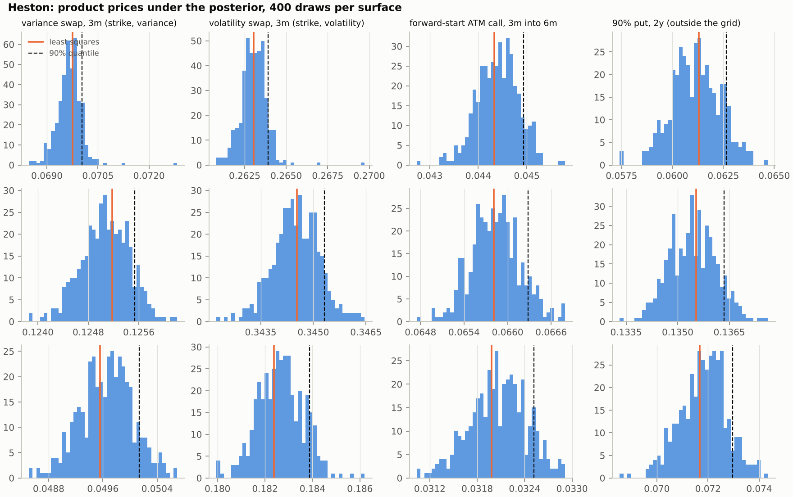

*Figure S7-1 (Heston): price distributions of the four products under the posterior of three test smiles.* How to read the figure: each row is one smile and each panel one product; the histogram is the price under 400 posterior draws, the orange line the least-squares price and the dashed line the 90% quantile, whose distance from the orange line is the short-side reserve.

Rough Bergomi, pilot: three test smiles of the pilot bank (rows 290 to 292), 400 posterior draws of the pilot network each, least squares by Monte Carlo at 2^13 paths per block with four starts:

| Rough Bergomi pilot, 3 smiles | 90% range, share of the posterior mean | Short-side reserve, share of the point price | Parameter that explains most of the price variance (single-parameter R²) |
| --- | --- | --- | --- |
| Variance swap 63 d | zero | zero | none: the price is the curve's average |
| Volatility swap 63 d | 1.0% to 3.3% | 0.3% to 2.3% | η (0.77 to 0.96), then ρ |
| Forward-start 63 → 126 d | 2.2% to 9.3% | 1.0% to 6.1% | η (0.94 to 0.97), then ρ |
| 2-year 90% put | 2.5% to 17.7% | 1.9% to 9.7% | η (0.68 to 0.94), then H on two smiles |

The variance swap's range is zero by construction, and every other product's range comes mostly from the volatility of variance η: the smile pins η to about 5%, and these products amplify what is left. The pilot network's intervals are 1.3 to 1.6 times too wide (S5), so these ranges overstate the posterior's; the full bank's network, or the audited draws, set the reported numbers. Pricing 401 parameter sets costs about 340 CPU-seconds per smile, and the Monte Carlo least squares about 240.

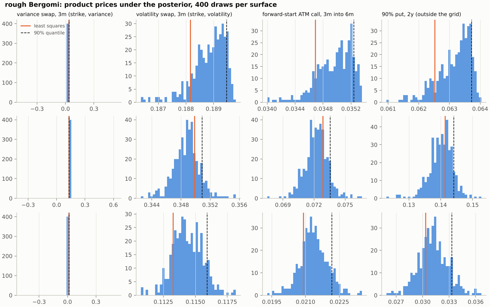

*Figure S7-1 (rough Bergomi, pilot): price distributions of the four products on three test smiles*, read as the Heston figure above; the variance swap's panel is a single bar.

For rough Bergomi, full bank: figure ⟨S7-1⟩ above, the variance-explained table, each price's Monte Carlo standard error, and the Heston-against-rough table:

| Product | Rough Bergomi: point, 90% range, reserve | Heston: point, 90% range, reserve | Gap between points |
| --- | --- | --- | --- |
| Variance swap 63 d | 0.0364, zero, zero | 0.0344, 0.0340 to 0.0350, 1.2% | -5.5% |
| Volatility swap 63 d | 0.1882, 0.1877 to 0.1895, 0.7% | 0.1815, 0.1803 to 0.1832, 0.8% | -3.5% |
| Forward-start 63 → 126 d | 0.0347, 0.0345 to 0.0353, 1.6% | 0.0374, 0.0368 to 0.0382, 1.6% | +7.9% |
| 2-year 90% put | 0.0625, 0.0622 to 0.0638, 1.9% | 0.0669, 0.0651 to 0.0683, 1.9% | +6.9% |

The table is the pilot's first smile (test row 290; prices in forward units; reserve as a share of the point price); the full bank and the real smile replace it. Heston's posterior for a rough-Bergomi smile is the Heston network's draws corrected by importance sampling with the Fourier likelihood. On this smile and on the third, Heston fits nearly as well as rough Bergomi (χ² 67.7 and 73.1 against 59.3 and 59.7, on 63 quotes), and still prices the forward-start 7.9% above and 4.1% below it at the least-squares points. On this one the two models' 90% ranges are disjoint for every product. That includes the variance swap: Heston's forward-variance curve is implied by its parameters, while rough Bergomi takes the market's. On the second smile Heston cannot fit at all (χ² 1,347): its audit's efficiency is zero and its posterior collapses to a point, the signal that the model, not its parameters, is wrong. On smile 290 the gap between the models' forward-start prices, 7.9%, is about five times either model's reserve (1.6%) and larger than both 90% ranges (3.8% and 2.2%). On smile 292 the gap, −4.1%, is smaller than both models' 90% ranges (8.1% and 9.3%), and the ranges overlap. The across-model gap can therefore exceed the within-model range or fall inside it, and that comparison, smile by smile, is what slot 6 takes up.

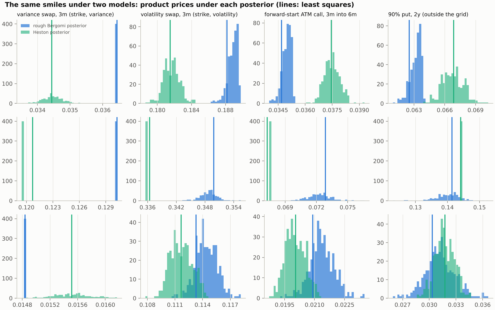

*Figure S7-2 (pilot): the same smiles under two models.* How to read the figure: each row is one smile and each panel one product; blue is the rough-Bergomi posterior, green the Heston posterior, and the lines the two least-squares prices; on the second row Heston's posterior is a single point because Heston cannot fit that smile.

### 8. The real smile (S8)

The SPY chain of 21 October 2026, the close, from Cboe's delayed quotes (Appendix I): 13,114 options in 35 expirations, of which 32 keep at least 8 quotes after cleaning. Discounts come from Treasury yields of 20 October, the latest published (3-month 4.26%, 2-year 4.79%), and forwards from parity: 773.77 at one week and about 800 at one year, against a close of 773.09.

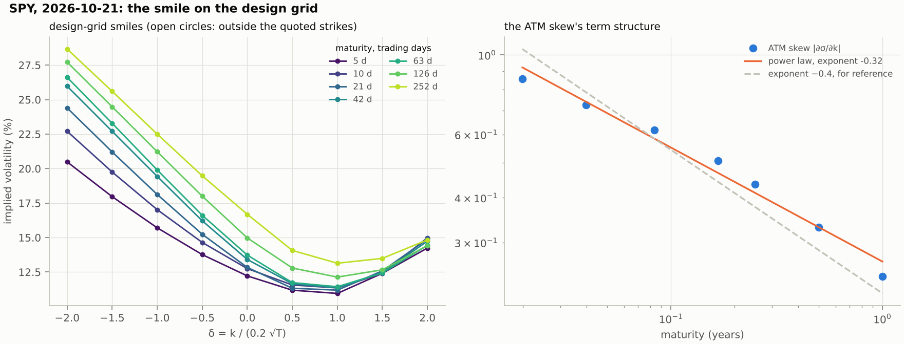

*Figure S8-0: SPY on 21 October 2026, the smile on the design grid.* How to read the figure: the left panel shows the implied volatility at the 9 values of δ for each of the 7 maturities, every point read from quotes (none extrapolated); the right panel shows the absolute ATM skew against maturity on log–log axes, with the fitted power law and, dashed, a slope of −0.4 for reference.

| SPY, 21 October 2026 | 1 w | 2 w | 1 m | 2 m | 3 m | 6 m | 1 y |
| --- | --- | --- | --- | --- | --- | --- | --- |
| ATM implied volatility | 12.2% | 12.8% | 12.8% | 13.4% | 13.7% | 15.0% | 16.6% |
| ATM skew ∂σ/∂k | −0.86 | −0.72 | −0.62 | −0.51 | −0.44 | −0.33 | −0.24 |
| Variance-swap volatility, √(w(T)/T) | 13.6% | 15.0% | 16.2% | 17.6% | 18.4% | 20.1% | 21.8% |
| Forward volatility on the interval ending at T | 13.6% | 16.2% | 17.2% | 18.9% | 19.9% | 21.6% | 23.4% |

The skew's exponent from one week to one year is −0.32 (claim C1). The real half-spreads lie below the design noise at every point, so the observation's noise standard deviations are the design's.

The forward-variance curve lies outside the training prior. The prior writes each level as σ\_0²(1 + s t\_j) e^(u\_j), with s at most 0.6 a year and \|u\_j\| at most 0.2. The SPY curve rises by a factor of 2.9 in variance from the first interval to the last, concavely, and the best fit inside the prior needs \|u\_j\| = 0.36; even with the slope unbounded it needs 0.20. The network conditions on a curve it has not seen, so its posterior for this smile is an extrapolation, and the audit, whose Monte Carlo likelihood uses the real curve, is the check that applies. The curve prior has to cover such curves before the full bank is generated: a calm market's curve rises steeply and concavely, a stressed one's falls. ⟨S8⟩

*Pending figure ⟨S8-1⟩: the SPY smile at the 7 maturities with the fitted posterior predictive band, and the standardized residuals by δ and maturity.* How to read the figure: the left panels show the cleaned quotes as dots with bid-ask bars and the 90% posterior predictive band of the model as a shaded region; the right panel shows each quote's median standardized residual, with the lines at ±2; quotes beyond them are where the model misses.

### 9. Costs (S9)

| Route | Per surface | Notes |
| --- | --- | --- |
| One Monte Carlo likelihood evaluation, 2^15 paths per block | 5.0 CPU-s (3.9 s on the clock) | the unit everything else is counted in |
| Exact MCMC with the Monte Carlo pricer, to 400 effective draws | at least 17 CPU-h (41 at the bank's average pricing cost) | extrapolated: 12,300 evaluations, the median the Heston chains of S3 needed, at 5.0 and at 11.9 CPU-seconds per evaluation |
| Amortized posterior, 1,000 draws | 1.4 s on the clock (3.6 CPU-s) | plus 5.9 s to load the network and compile the sampler once |
| Audit, M proposals at 2^13 paths per block | 425 CPU-s for M = 256 | pilot, median over 40 smiles (S5) |
| Neural pricer with MCMC, 4 chains | 12 CPU-s (Heston) | plus the pricer's training, once: 370 CPU-s on the Heston bank (S4) |
| Multi-start least squares, 10 starts, Monte Carlo pricer with common random numbers | 600 CPU-s | pilot, 2^13 paths per block, median over 8 smiles (S6) |
| Heston: exact MCMC with the Fourier likelihood | 250 CPU-s | the check model: 12,300 evaluations at 20 ms |
| Training bank and network, once | about 370 CPU-h for the full bank (the pilot's rate) and ⟨S2⟩ min of training | break-even against the exact route after about 22 surfaces |

## Tutorial narrative

This section and the next are design notes for the organizers. This one sets out how the material above is presented in the tutorial's advanced segment; the next lists what could go wrong.

The 40-minute advanced segment makes the two claims of the executive summary. Francesco presents it. The schedule is the plan's §4; the table repeats it with the evidence each act shows.

| Minutes | Act | Message | Evidence on screen |
| --- | --- | --- | --- |
| 0–4 | The question | A desk calibrates to today's smile and marks a forward-start option. Ten calibrations fit equally well. Which price, and what reserve? | The SPY smile; the regulation's words |
| 4–9 | GBM under Q | Black–Scholes gives one volatility; the market gives a smile with a skew that steepens as T^(H−½). Slot 4's posterior forecasts, this one prices. | Flat line against the smile; the skew term structure on log–log axes |
| 9–16 | Heston | The smile explained; the Fourier likelihood; the exact posterior; the slot-4 workflow with a new simulator; the network against the exact answer | Figure S3-1 |
| 16–21 | Rough Bergomi | Why rough; why Monte Carlo only; why no exact posterior | One priced surface and its cost; the skew term structure under both models |
| 21–26 | The amortized posterior | The posterior for the SPY smile in seconds; ρη from the skew, H from its term structure, η from the level against ξ\_0 | Posterior pairs over H, η, ρ |
| 26–31 | Is it right? | SBC on 2,000 surfaces; the audit of this surface; the neural-pricer route agrees | ⟨S2-3⟩, ⟨S5-1⟩, the overlay of S4 |
| 31–35 | The classical route | Multi-start usually finds one optimum and weighs nothing; the Gauss–Newton ellipse is right on a quadratic objective and wrong along a curved valley or at the prior's edge; regularization picks a point by λ | ⟨S6-1⟩ |
| 35–39 | From posterior to prices | Variance swap: zero range. Volatility swap and forward-start: a range and a reserve. | ⟨S7-1⟩ |
| 39–40 | Across models | Heston and rough Bergomi price the forward-start ⟨S7⟩% apart; within-model is a lower bound; slot 6 | the Heston-against-rough table |

### Notebook outline

The segment runs on one marimo notebook, `tutorial_final/notebooks/slot5_calibration.py`. It reads the accepted results in `tutorial_final/results/calibration` and marks any that are missing as pending, so it runs at every stage of the study. Three cells compute live, each in seconds on a laptop CPU; everything else is cached.

1. **The smile.** The example surfaces: one maturity's smile against the one Black–Scholes volatility, with a maturity selector, and the skew term structures of both models on log–log axes. The SPY smile replaces the simulated one when study S8 has a chain.
2. **Heston.** The exact-posterior check (table and figure); exact against network posterior for a chosen surface, as pair plots. Live: load the network and draw 1,000 samples for that surface.
3. **Rough Bergomi.** Live: sliders for H, η and ρ price one smile at 2^13 paths per block, about 2 CPU-seconds, and redraw its skew term structure against the slope H − ½. Then the cost table of S9.
4. **Amortized posterior.** Posterior pairs for held-out surfaces, with the ρη ridge, and the recovery figure.
5. **Diagnostics.** The SBC figures, the audit summary and the neural-pricer overlay. A live audit is not affordable on a laptop: M proposals priced at 2^13 paths cost minutes, which is the audit's row in the cost table.
6. **Classical route.** The coverage table, and the objective's landscape with the multi-start optima, the Gauss–Newton region and the posterior draws.
7. **Products.** Price distributions under the posterior, with a live confidence-level slider: the reserve table recomputes from the stored per-draw prices.
8. **Across models, and exercises.** Heston against rough Bergomi on the same smile; double σ\_c and reweight; drop the two shortest maturities; calibrate Heston to a rough surface.

## Risks and open decisions

The main risks are of method rather than of schedule: a posterior whose width is the noise model's, a real smile the model cannot produce, and claims about classical methods and costs that must stay measured.

| Risk | Effect | Mitigation |
| --- | --- | --- |
| The posterior width is the noise model's | The reserve is as arbitrary as σ\_c | State it; derive σ\_c from bid-ask widths; show the exercise that doubles σ\_c; report the range in units of the quote noise as well |
| The model cannot produce the real smile | A confident, wrong posterior; the audit passes because the likelihood is evaluated under the wrong model | Prior and posterior predictive checks on the real smile; the Heston comparison; hand over to slot 6 |
| ξ\_0 from the chain carries its own error | A biased level at every maturity | Report the replication error; treat the level as conditioned on; show the sensitivity of H, η, ρ to a bumped curve |
| Monte Carlo noise in the audit likelihood | Weights biased where s\_c is not small | Common random numbers across proposals; add the Monte Carlo variances to the noise; raise the path count on flagged surfaces |
| The valley makes the network's job hard | Posterior too narrow along the valley | SBC on the product ρη and on η separately; the audit catches single surfaces; the pricer route is the cross-check |
| η is identified through ξ\_0, which enters as exact | The posterior of η, and every product range, is conditional on a curve read from truncated strikes; an error in ξ\_0 becomes an error in η the posterior does not show | Measure the replication error of ξ\_0 on the chain; rerun the network on perturbed curves within that error, or condition on a posterior for ξ\_0; report each product's sensitivity to ξ\_0 |
| The design grid is not the real chain | Interpolation error enters as data | Report the smile-fit residuals; Stage D reads the chain as quoted |
| The forward-start depends on ξ\_0 beyond the data | The out-of-grid product's range mixes calibration and extrapolation | Keep the forward-start inside one year; state the extrapolation of the 2-year put |
| The classical critique sounds overstated | Loss of credibility with quants | Use the same weights for both routes; report the Gauss–Newton coverage as measured; name the neural-pricer route as the strong competitor |
| The cost claim sounds overstated | Loss of credibility with practitioners | One machine, CPU-seconds, the exact chain measured rather than guessed |

### Decisions for the organizers

- [ ] The headline product: the ATM forward-start call, or a capped cliquet of three periods.
- [ ] The noise scale: 0.3 to 1.0 volatility points across δ, or a scale read from the real chain's bid-ask widths.
- [ ] The prior ranges of H, η and ρ, and whether to allow positive ρ.
- [ ] The real underlying: SPY (listed, liquid, chain available through the connector) or SPX (the index desks quote).
- [ ] The audit flag: k̂ above the sample-size threshold min(1 − 1/log₁₀ M, 0.7), an efficiency floor, or both.
- [ ] Whether to propagate the uncertainty of ξ\_0 into the posterior, which now takes the curve as exact.
- [ ] Heston in the lesson: seven minutes as the exact check, or four.
- [ ] Stage D in the tutorial: the set-based network shown, or mentioned.
- [ ] Hosting of the bank and the networks: GitHub release or Hugging Face.

## Appendix A. Calibration practice and what the rules ask for

This appendix gives the sources behind [The practitioner problem](#the-practitioner-problem): what desks do today, and the wording of the rules that ask for a range of calibrations.

### A.1 What desks do

A pricing library calibrates each model to the vanilla surface of each underlying at least daily. Local volatility (Dupire 1994) matches the vanillas exactly and prices path-dependent products with the wrong dynamics; stochastic and local-stochastic volatility models match the vanillas approximately and are used where forward smiles matter: cliquets, barriers, volatility products. The calibration is a least-squares fit, in prices or in implied volatilities, often with a penalty toward yesterday's parameters for stability. The result is one parameter set, used to mark the book and to compute hedge ratios. Model risk is handled outside the calibration: by pricing with alternative models, by reserves set at independent price verification, and by expert judgment.

### A.2 The sources

| Claim | What the source shows | Source |
| --- | --- | --- |
| Calibration is not unique and the choice matters for exotics | Seven models calibrated to one smile within market precision price barriers, cliquets and lookbacks far apart | Schoutens, Simons and Tistaert (2004), "A perfect calibration! Now what?" |
| Within one model, the objective function moves the exotic prices | Heston and Bates calibrated with price and implied-volatility objectives give different parameters and different exotic prices | Detlefsen and Härdle (2006), J. Derivatives; Guillaume and Schoutens (2012), Rev. Deriv. Res. |
| Model uncertainty is a range of prices consistent with the vanillas | A coherent measure of model uncertainty from the set of models consistent with market prices | Cont (2006), Math. Finance |
| Banks must deduct a model-risk adjustment built from a range of plausible calibrations | Art. 11(1): a range of different models or model calibrations; Art. 11(3): a range of plausible valuations and a point at 90% confidence; Art. 11(4): an expert-based approach where (3) is impossible | [Regulation (EU) 2016/101](https://eur-lex.europa.eu/legal-content/EN/TXT/HTML/?uri=CELEX:32016R0101) |
| Level 3 fair values need sensitivity ranges | Narrative sensitivity to unobservable inputs and, for financial instruments, the effect of reasonably possible alternative assumptions | IFRS 13, paragraph 93(h) |
| Supervisors expect model risk to be assessed, including input uncertainty | Model risk increases with higher uncertainty about inputs and assumptions; sensitivity analysis and benchmarking against alternative models | [SR 11-7](https://www.federalreserve.gov/supervisionreg/srletters/sr1107.htm), replaced by [SR 26-2](https://www.federalreserve.gov/supervisionreg/srletters/SR2602.htm) in April 2026; [PRA SS1/23](https://www.bankofengland.co.uk/-/media/boe/files/prudential-regulation/supervisory-statement/2023/ss123.pdf) |
| Bayesian calibration addresses the ill-posedness directly | Posterior over the parameters of a local-volatility model, with exotic prices under the posterior | Gupta and Reisinger (2014), J. Comput. Finance |
| Rough volatility fits the smile's term structure and is calibrated with neural pricers | The power-law ATM skew; rough Bergomi calibrated to SPX; deep calibration | Gatheral, Jaisson and Rosenbaum (2018); Bayer, Friz and Gatheral (2016); Horvath, Muguruza and Tomas (2021) |

No source shows a desk computing a posterior over its calibration every morning. That step is the tutorial's proposal. The documented gap is a range of calibrations that the rules ask for and that practice builds by rerunning optimizers, and amortized Bayesian calibration is one way to fill it.

### A.3 What the approach adds, and what it does not

The posterior turns the bid-ask widths into a probability-weighted range of calibrations and a quantile, which is the object Art. 11(3) describes, and it propagates to any product and any hedge ratio the model can price. It does not cover the choice of model, which Cont's definition and Art. 11(1) include; the across-model comparison and the model-free bounds place it. It does not replace independent price verification, which uses market observables the model does not see.

## Appendix B. Black–Scholes, implied volatility and the variance swap

This appendix derives the Black–Scholes formulas in forward units, the forward and the discount factor from the chain, and the replication of the variance swap from which the forward-variance curve ξ\_0 is built. It supports [The model](#the-model) and [The observation model](#the-observation-model).

### B.1 The formulas in forward units

Under Q, with interest rate r and dividend yield q, the price follows dS\_t / S\_t = (r − q) dt + σ dW\_t: the change of measure replaces the real-world drift with r − q. The forward for delivery at T is F\_t(T) = S\_t e^((r−q)(T−t)), and Itô's formula gives

```math
\frac{dF_t(T)}{F_t(T)} = \frac{dS_t}{S_t} - (r-q)\,dt = \sigma\,dW_t .
```

The derivative of e^((r−q)(T−t)) in t cancels the drift, so the forward is a martingale under Q. At maturity S\_T = F\_T(T). Dividing the call price C = D E[(S\_T − K)⁺] by the discount factor D and by today's forward F = F\_0(T) therefore gives

```math
\frac{C}{D\,F} = \mathbb{E}\big[(X_T - e^{k})^+\big], \qquad \frac{dX_t}{X_t} = \sigma\,dW_t, \quad X_0 = 1, \quad k = \ln\frac{K}{F} .
```

Rates and dividends are absorbed in D and F, which are read off the chain (B.2), and E[X\_T] = 1, which B.3 uses. The price in forward units depends on σ alone, and X\_T is log-normal, so the expectation has a closed form.

With F the forward, D the discount factor, K the strike and k = ln(K / F), a European call with maturity T therefore costs C = D F c(k, T; σ) with

```math
c(k,T;\sigma) = N(d_1) - e^{k}N(d_2), \qquad d_1 = \frac{-k + \tfrac12\sigma^2 T}{\sigma\sqrt T}, \qquad d_2 = d_1 - \sigma\sqrt T,
```

and a put costs D F p with p = c − 1 + e^k. The vega in forward units is ∂c/∂σ = √T φ(d\_1), where φ is the standard normal density, the same for the call and the put. Implied volatility inverts c (or p) in σ by bisection or Newton; the inversion is well conditioned except far in the wings, where vega is tiny and a small price error is a large volatility error, which is the reason the noise model is stated in price with a vega factor.

### B.2 The forward and the discount from the chain

Put–call parity, C − P = D (F − K), holds model-free for European options. A linear regression of C − P on K across the strikes nearest the money gives −D as the slope and D F as the intercept, hence both. For SPY, which is American-exercise, the early-exercise value of the in-the-money puts grows with the strike and tilts the slope, so the regression returns discount factors above one; the study takes the discount from Treasury yields and only the forward from parity (Appendix I).

### B.3 The log contract and the variance swap

For a continuous price process under Q, Itô's formula gives d ln S\_t = −½ V\_t dt + √V\_t dW̃\_t, so

```math
\mathbb{E}\Big[\int_0^T V_t\,dt\Big] = -2\,\mathbb{E}\big[\ln (S_T/F_T)\big].
```

Any twice-differentiable payoff g(S\_T) is a portfolio of a bond, a forward and a strip of out-of-the-money options (Carr and Madan 1998):

```math
g(S_T) = g(F) + g'(F)(S_T - F) + \int_0^F g''(K)\,(K - S_T)^+\,dK + \int_F^\infty g''(K)\,(S_T - K)^+\,dK .
```

With g = ln(S/F), g'' = −1/K², and taking expectations, E[S\_T] = F removes the forward term. In forward units, with dK / K² = e^(−k) dk / F, the total variance to maturity T is

```math
w(T) \;=\; \mathbb{E}\Big[\int_0^T V_t\,dt\Big] \;=\; 2\int_{-\infty}^{0} p(k,T)\,e^{-k}\,dk \;+\; 2\int_{0}^{\infty} c(k,T)\,e^{-k}\,dk ,
```

a weighted integral of out-of-the-money prices (Neuberger 1994; Demeterfi, Derman, Kamal and Zou 1999). The fair variance-swap strike is w(T)/T, and the forward-variance curve between two quoted maturities is the difference quotient ξ\_0 = (w(T\_{i+1}) − w(T\_i)) / (T\_{i+1} − T\_i). In the discrete chain the integral becomes a sum over strikes with trapezoid weights, truncated at the last quoted strike on each side, which is the VIX construction; the truncation error is reported as the replication error of study S8. The relation holds for continuous paths; price jumps add a third-order term that the model does not have and the data may.

## Appendix C. Heston and the Fourier pricer

This appendix states Heston's characteristic function and the Fourier integral that prices a surface in milliseconds. It is the exact pricer behind the Heston check of study S3.

### C.1 The characteristic function

For an affine model the log-forward X\_T = ln(S\_T / F\_T) has a characteristic function of the form φ(u) = exp(C(u, T) + D(u, T) v\_0), where C and D solve Riccati equations. For Heston, with b = κ − iρ\_H σ\_v u,

```math
d = \sqrt{b^2 + \sigma_v^2\,(u^2 + iu)}, \qquad a = \frac{b - d}{\sigma_v^2} = -\frac{u^2 + iu}{b + d}, \qquad g = \frac{b - d}{b + d},
```

```math
\ln\varphi(u) = \kappa\theta_H\Big[aT - \frac{2}{\sigma_v^2}\ln\frac{1 - g e^{-dT}}{1 - g}\Big] + v_0\,a\,\frac{1 - e^{-dT}}{1 - g e^{-dT}} .
```

This is the form that stays on the principal branch of the logarithm for all T (the "little Heston trap" of Albrecher et al. 2007), and the form the repository implements, with the removable limits at u = 0 and σ\_v = 0 handled explicitly. The equation a = −(u² + iu) / (b + d) is the same number as (b − d) / σ\_v², computed without cancellation.

### C.2 The Lewis half-shift integral

Lewis (2001) writes the call as the forward minus an integral of the characteristic function along the line Im(u) = −½, where the payoff transform and the characteristic function both exist:

```math
c(k,T) = 1 - \frac{e^{-x/2}}{\pi}\int_0^\infty \mathrm{Re}\!\left[e^{iux}\,\varphi\!\big(u - \tfrac{i}{2}\big)\right]\frac{du}{u^2 + \tfrac14}, \qquad x = -k .
```

Under Black–Scholes φ(u − i/2) = exp(−½σ²T(u² + ¼)) is real and the integral reproduces the formula of Appendix B, which is the pricer's first test. For small u the integrand decays like exp(−½ w u²), with w the total variance to the maturity. Beyond u ≈ 1/(σ\_v √(1 − ρ\_H²) T) Heston's characteristic function decays only exponentially, about like exp(−c u) with c = (v\_0 + κθ\_H T) √(1 − ρ\_H²) / σ\_v, so the cutoff is set by c: it is small at the centre of the prior and reaches a few thousand in the corner of the prior where v\_0 is small, σ\_v large and |ρ\_H| near 1, whatever the maturity (Lecture 6 of the course derives the rate and measures it). That is why the pricer climbs the ladder of the main text and accepts a rung only when the next one agrees with it within 0.1 σ\_c; the difference is stored as a numerical diagnostic, separate from the quote noise. Puts follow by parity.

### C.3 The no-jump branch and the forward-variance curve

The repository's HKDE pricer adds Kou double-exponential jumps to Heston; with jump intensity zero its characteristic function is the Heston one above, and the branch is tested. Heston's expected variance is E[V\_t] = θ\_H + (v\_0 − θ\_H) e^(−κt), so its total variance is w(T) = θ\_H T + (v\_0 − θ\_H)(1 − e^(−κT)) / κ and its variance-swap strike depends on three parameters. Calibrated to the same smile as rough Bergomi, Heston therefore carries a variance-swap range where rough Bergomi carries none; the lesson shows the two side by side.

## Appendix D. Rough Bergomi

This appendix gives the mathematics of rough Bergomi that the Monte Carlo pricer uses: the variance of the driver, the hybrid scheme that simulates it, the conditional Black–Scholes estimator and its variance reduction, and the short-maturity skew on which the identification argument rests.

### D.1 The Volterra driver and its variance

Y\_t = √(2H) ∫₀ᵗ (t − s)^(H−½) dW\_s is a Gaussian process with mean zero and

```math
\mathrm{Var}(Y_t) = 2H\int_0^t (t-s)^{2H-1}\,ds = t^{2H}, \qquad \mathrm{Cov}(Y_t, Y_u) = 2H\int_0^{\min(t,u)} (t-s)^{H-\frac12}(u-s)^{H-\frac12}\,ds .
```

It is a Riemann–Liouville fractional Brownian motion: its paths are Hölder continuous of every order below H, so for H = 0.1 they are far rougher than Brownian paths (H = ½). Its increments are not stationary and it is not a semimartingale for H < ½, which is why no Itô calculus and no Markov state of finite dimension applies to V. The factor exp(ηY\_t − ½η² t^(2H)) has mean one, so E[V\_t] = ξ\_0(t), and V\_t is log-normal with Var(V\_t) = ξ\_0(t)² (exp(η² t^(2H)) − 1).

### D.2 The hybrid scheme

On a grid t\_i = iΔ, the hybrid scheme of Bennedsen, Lunde and Pakkanen (2017) treats the most recent interval of the kernel exactly and the rest by a Riemann sum at optimally chosen points:

```math
Y_{t_i} \;\approx\; \sqrt{2H}\left[\int_{t_{i-1}}^{t_i} (t_i - s)^{H-\frac12}\,dW_s \;+\; \sum_{k=2}^{i} \big(b_k^{*}\Delta\big)^{H-\frac12}\,\Delta W_{i-k+1}\right], \qquad b_k^{*} = \left(\frac{k^{H+\frac12} - (k-1)^{H+\frac12}}{H+\frac12}\right)^{\frac{1}{H-\frac12}} .
```

The first term is Gaussian, with variance Δ^(2H) / (2H) and covariance Δ^(H+½) / (H + ½) with ΔW\_i; it is simulated as a linear combination of ΔW\_i and an independent normal, which is the repository's second innovation channel. The sum is a discrete convolution of the increments with fixed weights, computed by FFT across all steps at once. The scheme's discrete variance of Y\_i replaces t\_i^(2H) in the exponent, so the discretized V has the exact mean ξ\_0(t\_i). The remaining error is the Euler step of the log price, which the repository's coupled-grid study measured; the two-block pricing of the design keeps the step short at short maturities.

### D.3 The conditional Black–Scholes estimator

Write the price shock as ρ dW + √(1 − ρ²) dW^⊥. Conditional on the path of (V, W), the terminal log price is Gaussian:

```math
\ln\frac{S_T}{F_T} \;\Big|\; (V, W) \;\sim\; \mathcal{N}\!\Big(\rho\!\int_0^T\!\!\sqrt{V_s}\,dW_s - \tfrac12\rho^2\!\int_0^T\!\! V_s\,ds \;-\; \tfrac12(1-\rho^2)\!\int_0^T\!\! V_s\,ds,\ \ (1-\rho^2)\!\int_0^T\!\! V_s\,ds\Big).
```

So, conditional on the driver, the put price is the Black–Scholes put with an effective forward F exp(ρ ∫√V dW − ½ρ² ∫V ds) and total variance (1 − ρ²) ∫V ds (Romano and Touzi 1997; Willard 1997). The Monte Carlo averages this formula over paths. Each term lies in [0, K], so the estimator has finite variance even where raw call payoffs do not have a second moment, and its standard error is reliable. The repository's pricer accumulates ∫V ds and ∫√V dW along each path, prices puts this way, and obtains calls by parity; McCrickerd and Pakkanen (2018) add antithetic paths and a control variate on the same idea.

### D.4 Antithetic pairs and control variates

The pricer reduces the variance of the conditional estimator in two ways (McCrickerd and Pakkanen 2018 use the same two ideas).

**Antithetic pairs.** Each block of standard normals z that drives the scheme is used twice, as z and as −z. The two estimates of a price are averaged within the pair, and the pair averages are the independent units from which means and standard errors are computed. The put price responds to the driver mostly through smooth, roughly monotone functions of it, so the two halves of a pair are negatively correlated and the pair average typically has less than half the variance of a single path.

**Control variates.** For each maturity T\_i of a block, two path quantities with known mean zero are recorded:

```math
C^{(1)} = \exp\!\Big(\rho\sum_{j\le i}\sqrt{V_{j-1}}\,\Delta W_j - \tfrac12\rho^2\sum_{j\le i} V_{j-1}\Delta\Big) - 1, \qquad C^{(2)} = \sum_{j\le i} V_{j-1}\Delta \;-\; \sum_{j\le i}\xi_0(t_{j-1})\,\Delta .
```

The first is the effective forward of Appendix D.3 minus one. Each factor exp(ρ √V\_{j−1} ΔW\_j − ½ρ² V\_{j−1} Δ) has conditional mean one, because ΔW\_j is Gaussian and independent of V\_{j−1} in the left-point scheme, so C^(1) has mean zero exactly, not only in the limit. The second is the integrated variance minus its mean, which is known exactly because the hybrid scheme keeps E[V\_j] = ξ\_0(t\_j). The conditional Black–Scholes put is a smooth function of exactly these two quantities, through its forward and its total variance, so to first order they explain its variation from path to path. Within a block, the vector of put payoffs is regressed on the 2 × (number of maturities) controls by least squares, and the price is the mean of the payoffs minus the fitted linear part; the standard error comes from the residuals, with the degrees of freedom reduced by the number of controls. Estimating the coefficients on the same sample adds a bias of order 1/N, negligible at the path counts used. The variance falls by the factor 1 − R² of the regression. At the prior median (the example surface of the main text) the factor has a median of 0.022 over the 63 quotes, on top of the antithetic pairs, and ranges from 0.0001 for the far calls, whose payoff is almost linear in the controls, to 0.15 for the far puts at six months and a year, whose payoff is not.

### D.5 The short-maturity skew

For the rough Bergomi model the at-the-money skew ψ(T) = ∂σ\_imp(k, T)/∂k at k = 0 has the short-maturity expansion

```math
\psi(T) = \frac{\rho\,\eta\,\sqrt{2H}}{2\,\big(H+\tfrac12\big)\big(H+\tfrac32\big)}\;T^{\,H-\frac12}\,\big(1 + o(1)\big), \qquad T\to 0,
```

(Bayer, Friz and Gatheral 2016, from the general result of Fukasawa 2011; El Euch, Fukasawa, Gatheral and Rosenbaum 2019 give the next terms and the at-the-money curvature). The constant follows in three lines from the first-order expansion in the volatility of volatility. Write √V\_t ≈ √ξ\_0 (1 + ½ η Y\_t) for a flat curve. The third cumulant of the log return is then 6 ρ ξ\_0^(3/2) ∫₀ᵀ∫₀ᵗ ½ η √(2H) (t − s)^(H−½) ds dt, the double integral is T^(H+3/2) / ((H + ½)(H + 3/2)), and the implied-volatility skew at the money is the standardized skewness divided by 6√T. The same steps for Heston with κ = 0 give ρσ\_v / (4√v\_0), the textbook short-maturity Heston skew (Gatheral 2006), which checks the constant. For H = ½ the exponent is zero and the skew is flat in T, as in Markovian models; for H < ½ it explodes as T → 0, which is what index smiles do. The at-the-money implied variance itself is, to leading order, the integrated forward variance (1/T) ∫ξ\_0 with a correction of order η², and the curvature is of order η² T^(2H−1) with a coefficient that depends on H and ρ. Study S2 checks the exponent and the constant against the Monte Carlo surfaces of the bank, maturity by maturity; the identification statements of the lesson rest on that check rather than on the expansion alone.

## Appendix E. Calibration as estimation

This appendix relates the classical routes of [Classical calibration and where it fails](#classical-calibration-and-where-it-fails) to statistical estimation: least squares as maximum likelihood, its covariance, regularization as a prior, deep calibration, and the model-free bounds that limit any model's range.

### E.1 Least squares is maximum likelihood

Under y\_c = P\_c(θ) + σ\_c ε\_c with independent standard normal ε\_c, the log-likelihood is −½ Σ\_c ((y\_c − P\_c(θ)) / σ\_c)² up to a constant, so weighted least squares with w\_c = 1/σ\_c² is maximum likelihood and, under a flat prior on the box, the posterior mode. Changing the weights changes the estimator and the implied noise model at once; stating σ\_c makes the choice explicit.

### E.2 The Gauss–Newton covariance

Near the optimum, P\_c(θ) ≈ P\_c(θ̂) + J\_c (θ − θ̂), with J the Jacobian. Substituting into the objective gives a quadratic with Hessian 2 JᵀWJ, and the usual argument for nonlinear least squares gives Cov(θ̂) ≈ (JᵀWJ)⁻¹ when the noise model holds and the linearization is accurate over the interval. The eigenvectors of JᵀWJ are the directions the quotes identify, in decreasing order of precision; its smallest eigenvalue is the valley. For the delta method, a product price p\_Π(θ) is linearized the same way, Var(p\_Π) ≈ ∇p\_Πᵀ Cov(θ̂) ∇p\_Π; a product whose gradient points along the valley inherits the valley's width, a product whose gradient is orthogonal to it does not. The variance swap's gradient is zero.

### E.3 Regularization

Tikhonov regularization minimizes the objective plus λ ‖θ − θ\_ref‖², which, for the objective χ² (minus twice the log-likelihood) plus λ ‖θ − θ\_ref‖², is maximum a posteriori under a Gaussian prior centred on θ\_ref with variance 1/λ in each coordinate. The regularized point is a compromise between the data and θ\_ref decided by λ; as λ → 0 it is the least-squares point, as λ → ∞ it is θ\_ref. Crépey (2003) and Cont and Tankov (2004) develop this for local volatility and for Lévy models. The Bayesian posterior under the same Gaussian prior is the distribution of which the regularized point is the mode; what regularization discards is its width.

### E.4 Deep calibration

Two-step deep calibration (Horvath, Muguruza and Tomas 2021) fits a network f\_ψ: (θ, ξ\_0) → implied-volatility grid on a bank of simulated surfaces, with a mean-squared error in implied volatility, then minimizes Σ\_c w\_c (f\_ψ,c(θ) − y\_c)² by Levenberg–Marquardt. The pricer's accuracy is checked on held-out surfaces and bounds the calibration's error. One-step deep calibration (Hernandez 2017) fits the inverse map from surfaces to parameters directly, which is amortized point estimation and returns no interval. The study's neural-pricer route is the two-step pricer with the Gaussian noise model, sampled by MCMC rather than optimized.

### E.5 Model-free bounds

Given the vanilla prices at the relevant maturities and nothing else, the price of a product consistent with them lies in an interval given by martingale optimal transport (Beiglböck, Henry-Labordère and Penkner 2013; Hobson 1998 for lookbacks; Brown, Hobson and Rogers 2001 for barriers). The bounds are attained by extreme models and are usually too wide to act on, but they are the outer limit of model uncertainty and the natural reference for how much of it one model occupies.

## Appendix F. Amortized inference

This appendix derives why the network of [Amortized design](#amortized-design) returns the posterior: the training objectives of neural posterior estimation and flow matching, the coordinate maps, the extension to variable quote sets, and the neural-likelihood alternative.

### F.1 The objective of neural posterior estimation

For a network that outputs a conditional density q\_φ(θ ∣ y, ξ\_0), training on pairs from the joint p(θ) p(ξ\_0) p(y ∣ θ, ξ\_0) with the negative log probability of the true parameters,

```math
\mathcal{L}(\phi) = \mathbb{E}\big[-\log q_\phi(\theta \mid y, \xi_0)\big] = \mathbb{E}_{p(y,\xi_0)}\Big[\mathrm{KL}\big(p(\theta \mid y,\xi_0)\,\big\|\,q_\phi(\theta \mid y,\xi_0)\big)\Big] + \text{const},
```

so the minimizer is the posterior for almost every surface the prior can produce. Flow matching reaches the same target with a different loss.

### F.2 Flow matching

Let p\_0 = N(0, I) and p\_1 = p(θ ∣ y, ξ\_0) for a fixed surface. For a pair (z, θ) with z ~ p\_0 and θ ~ p\_1 independent, the straight-line interpolation x\_τ = (1 − τ) z + τ θ has velocity θ − z. Define the marginal velocity field v(x, τ) = E[θ − z ∣ x\_τ = x]. The continuity equation shows that the law of x\_τ under the straight-line coupling solves ∂\_τ p\_τ + ∇·(p\_τ v) = 0, so the flow of v carries p\_0 to p\_1 (Lipman et al. 2023; Liu, Gong and Liu 2023). The squared-error regression of θ − z on (x\_τ, τ) has v as its minimizer, which is why the conditional flow-matching loss of the main text, averaged over surfaces with the conditions as inputs, learns the posterior flow for every surface at once (Wildberger et al. 2023). Sampling with a finite number of Euler steps introduces a discretization error that SBC measures together with the training error, which is why the calibration checks use the same solver as the lesson. The error matters most for the sharpest posteriors. For a Gaussian posterior with standard deviation s in the network's standardized coordinates, the straight-line field is linear, v(x, τ) = μ + k\_τ (x − τμ) with k\_τ = (τs² − (1 − τ)) / ((1 − τ)² + τ²s²), and |k\_τ| grows like 1/(1 − τ) as τ → 1 until 1 − τ reaches s. An Euler step of size h multiplies the spread by 1 + h k\_τ, so uniform steps undershoot where k\_τ is large: with the exact field, 50 uniform steps return 0.65 s at s = 0.02, 0.84 s at s = 0.05 and 0.91 s at s = 0.1. Steps of size proportional to 1 − τ near the end remove most of it: 100 steps on τ\_i = 1 − (1 − i/100)² return 0.96 s, 0.97 s and 0.98 s. Heston's v\_0 posterior has s near 0.02, because the one-week quotes pin the initial variance. With 50 uniform steps the first two Heston networks failed SBC for v\_0: their 90% intervals covered the truth on 73% to 78% of held-out smiles, and against the exact posterior of study S3 they were a median 25% too narrow. On 100 test smiles, the same trained network covered v\_0 on 73% with 50 uniform steps, 93% with 50 steps on the end-dense grid, 94% with 25 fixed Runge–Kutta steps at three times the cost, and 92% with 200 uniform steps at four times the cost. The sampler is set at sampling time, so a checkpoint keeps working when it changes.

### F.3 Standardization and bounds

The targets are mapped to the real line by the logit of their position in the prior box, then standardized by their training mean and standard deviation; the conditions are standardized the same way. BayesFlow applies both maps inside the adapter and undoes them on the way out, including the log-Jacobian of the logit when a density is needed. The audit and the exact chains work in the same unbounded coordinates, with the Jacobian of the logit included in the prior density.

### F.4 Variable quote sets

A real chain never has exactly the 63 design contracts. Two remedies exist: read the chain at the design grid through a smile fit (Stage B), or let the network read the chain as a set (Stage D). In Stage D each quote is a token (δ, T, y\_c / σ\_c) and a set transformer (Lee et al. 2019) pools the tokens into a fixed-size summary by attention; the output does not depend on the order of the tokens, and tokens can be dropped. Training with random masks, where each training surface loses a random subset of quotes, makes the network learn the posterior given any subset, p(θ ∣ y\_S, ξ\_0) for a random S, which is the marginal the real chain needs. The masks must be drawn from a distribution that covers the patterns real chains show: whole maturities missing, wings missing, sparse short maturities.

### F.5 The neural-likelihood route

A pricer f\_ψ trained by least squares on the clean prices approximates the conditional mean of y given (θ, ξ\_0). With the Gaussian noise model the approximate likelihood is N(y; f\_ψ(θ, ξ\_0), diag(σ\_c²)), and the posterior under it is proportional to this times the prior. Its error relative to the exact posterior is controlled by the pricer's error in units of σ\_c: a pricer error of 0.5 σ\_c shifts the log-likelihood by at most about 0.125 per quote, 8 units over 63 quotes in the worst case, which is why study S4 requires the pricer's held-out error to be well below that and reports the agreement rather than assuming it.

## Appendix G. Validation

This appendix derives the tools of the [Validation plan](#validation-plan): why simulation-based calibration works, how the importance-sampling audit is scored, how Monte Carlo noise affects the likelihood, and how two posteriors are compared.

### G.1 Why exact posteriors give uniform ranks

Draw θ\* ~ p(θ), y ~ p(y ∣ θ\*), and θ^(1), …, θ^(L) ~ p(θ ∣ y). Given y, θ\* is itself distributed as p(θ ∣ y), by Bayes' rule, so θ\*, θ^(1), …, θ^(L) are L + 1 exchangeable draws from one distribution and the rank of θ\* among them is uniform on {0, …, L}. A posterior that differs from p(θ ∣ y) breaks the exchangeability, and the direction of the break says how (Talts et al. 2018). The test is marginal, one target at a time, so it is necessary rather than sufficient; the SVJ design document's toy figure shows the four shapes.

### G.2 Importance sampling, efficiency and k̂

For proposals θ^(m) ~ q and weights w^(m) ∝ p(θ^(m)) L(θ^(m)) / q(θ^(m)), the self-normalized estimate Σ w^(m) h(θ^(m)) / Σ w^(m) converges to E[h ∣ y] as M grows, for any q that is positive where the posterior is. Its variance is governed by the variance of the weights; the effective sample size (Σw)² / Σw² counts how many equal-weight draws the sample is worth. Pareto-smoothed importance sampling (Vehtari et al. 2024) fits a generalized Pareto law to the largest weights; its shape parameter k̂ estimates how heavy the weight tail is, and the estimate is unreliable when k̂ exceeds min(1 − 1/log₁₀ M, 0.7), which is 0.58 for M = 256 and 0.7 for M ≥ 2,048 (Vehtari et al. 2024), whatever the efficiency says. The defensive mixture with the prior bounds the ratio p/q, and with it the variance of the weights, where the network's law is too narrow; it does not prevent a few draws from carrying most of the weight.

### G.3 Monte Carlo noise in the likelihood

Write P̂\_c = P\_c + s\_c ζ\_c, with ζ\_c ~ N(0, 1) independent across quotes and of the quote noise. Importance weights need an unbiased estimate of the likelihood, not of its logarithm: self-normalized importance sampling with an unbiased likelihood estimate targets the exact posterior, as pseudo-marginal methods do (Andrieu and Roberts 2009). Averaging a Gaussian density over a Gaussian error convolves the two, E[N(y\_c; P̂\_c, v)] = N(y\_c; P\_c, v + s\_c²). Three consequences follow. The plug-in N(y\_c; P̂\_c, σ\_c²) is unbiased for a likelihood with noise variance σ\_c² + s\_c². N(y\_c; P̂\_c, σ\_c² + s\_c²) is unbiased for σ\_c² + 2 s\_c², which counts the Monte Carlo variance twice. N(y\_c; P̂\_c, σ\_c² − s\_c²) is unbiased for the exact likelihood whenever s\_c < σ\_c, and the audit uses it. Its variance grows as s\_c approaches σ\_c, which is why the audit doubles a block's paths above 0.5 σ\_c and flags a surface above 0.9 σ\_c. The identity assumes errors independent across quotes; within a maturity block they share paths and are correlated, and the full version replaces σ\_c² − s\_c² by the matrix σ² I − S, with S the block's estimator covariance, when that matrix is positive definite. For the log-likelihood, the plug-in has expectation −½ Σ ((y\_c − P\_c) / σ\_c)² − ½ Σ s\_c² / σ\_c²: with the bank's budget s\_c ≤ 0.25 σ\_c the shift is at most 0.031 per quote, 2 over 63 quotes (0.125 per quote for the few quotes at the cap of 0.5 σ\_c), and with the typical s\_c ≈ 0.05 σ\_c it is 0.08 over 63 quotes, nearly constant in θ. The same error enters training: the bank's clean prices carry it, so the network learns the posterior for a noise variance σ\_c² + s\_c², which is at most 3% wider in standard deviation than the declared one within the budget, 12% for the few quotes at the cap, and in the typical case 0.1%. The exact chain of study S9 uses the stored estimator covariance and a second seed to check that its posterior is insensitive to the Monte Carlo noise.

### G.4 Agreement metrics

Two posteriors are compared target by target: the difference of their means in units of the reference posterior's standard deviation, and the ratio of their 90% interval widths. The SVJ criterion, 0.3 standard deviations and 25%, is kept so that the two lessons report the same thing. For the product ρη the metrics are computed on the joint draws.

## Appendix H. Products under the posterior

This appendix derives the prices of the three products under the model and defines the reserve, as used in [From posterior to prices](#from-posterior-to-prices).

### H.1 The variance swap

For continuous paths the realized variance Q\_T = (1/T) ∫₀ᵀ V\_t dt has expectation (1/T) ∫₀ᵀ ξ\_0(t) dt under rough Bergomi, by E[V\_t] = ξ\_0(t), whatever (H, η, ρ). The daily-sampled variance swap differs by a discretization term of order Δ; the model's price is reported for the continuous payoff and the discrete correction stated. The posterior range is therefore zero by construction, for continuous monitoring and a fixed curve. In the code the price is the integral of ξ\_0 itself, so the zero is a consistency check of the curve input, not a test of the Monte Carlo pricer. Daily monitoring adds a term that depends on (H, η, ρ): for ξ\_0 = 0.04 Lecture 8 of the course derives it to first order and measures 0.38% to 0.94% of the strike by Monte Carlo on three parameter sets. The uncertainty of ξ\_0 itself is not propagated.

### H.2 The volatility swap

K\_vol = E[√Q\_T]. Expanding √x around μ = E[Q\_T], √x ≈ √μ + (x − μ) / (2√μ) − (x − μ)² / (8 μ^{3/2}), and taking expectations,

```math
K_{\mathrm{vol}} \;\approx\; \sqrt{K_{\mathrm{var}}} \;-\; \frac{\mathrm{Var}(Q_T)}{8\,K_{\mathrm{var}}^{3/2}},
```

the convexity correction of Brockhaus and Long (2000). Var(Q\_T) is the variance of the time average of a log-normal process with Var(V\_t) = ξ\_0(t)² (e^(η² t^(2H)) − 1) and the covariance of Appendix D.1; it grows with η and, at fixed η, depends on H through the memory of Y. The study prices the product by Monte Carlo and uses the expansion only to explain its dependence.

### H.3 The forward-start call

The payoff (S\_{T\_2} / S\_{T\_1} − 1)⁺ is a call on the return over [T\_1, T\_2], struck at the money at T\_1. Under Black–Scholes it is c(0, T\_2 − T\_1; σ) = 2N(σ√(T\_2 − T\_1) / 2) − 1 ≈ 0.4 σ √(T\_2 − T\_1), independent of the price at T\_1. Under stochastic volatility, conditioning on the state at T\_1 gives

```math
p_{\mathrm{FS}} = \mathbb{E}\Big[\,c_{\mathrm{cond}}\big(T_1, T_2;\ \text{state at } T_1\big)\Big],
```

where c\_cond is the price of an at-the-money call over [T\_1, T\_2] given the variance path's past up to T\_1, which depends on the law of V at T\_1 and on its dynamics afterwards: the forward smile. Vol-of-vol raises the price through the convexity of c in σ, and ρ moves it through the forward skew. This is why the product is the classic test of smile dynamics (Bergomi 2004) and of calibration risk (Schoutens, Simons and Tistaert 2004), and why rough Bergomi and Heston calibrated to the same vanillas price it apart. The study prices it by Monte Carlo from the same paths as the vanillas, with the forward-start payoff read at steps T\_1 and T\_2.

### H.4 The reserve

Let p̂ be the point price and q\_α the α-quantile of the price distribution under the posterior. For a position the desk has sold, the prudent value is q\_0.90 and the reserve is q\_0.90 − p̂; for a position it holds, the prudent value is q\_0.10 and the reserve p̂ − q\_0.10. The reserve is reported in percent of p̂. It is within-model; the across-model comparison adds the gap between the models' point prices, and the model-free bounds give the outer limit.

## Appendix I. The real surface

This appendix describes how a real option chain becomes the network's input: the chain, the cleaning rules, the reading of the design grid and the construction of ξ\_0. It supports study S8.

### I.1 The SPY option chain and where it comes from

The SPY end-of-day chain for one date comes from a vendor file: Alpha Vantage's historical options endpoint (a premium endpoint, CSV) or Cboe's delayed-quotes page (JSON, with OCC option symbols). Either gives strike, expiration, type, bid and ask, and the reader `scripts/build_surface.py` parses both. Only derived quantities are committed to the repository, in `tutorial_final/results/calibration/spy/surface.json`: the forward and discount per maturity, the 7 forward-variance levels, the 63 design-grid prices with their noise standard deviations, the implied-volatility grid, the cleaning counts, the provenance (vendor, endpoint, time of capture, the rate curve and its source) and the SHA-256 of the raw file, which stays outside the repository. The study's chain is Cboe's delayed quotes for SPY, fetched on 22 October 2026 before the open: 13,114 options in 35 expirations, quoted at the close of 21 October.

### I.2 Cleaning rules

1. Keep out-of-the-money quotes only: puts below the forward, calls above.
2. Drop quotes with zero bid, with a relative spread (ask − bid) / mid above 50%, or with a mid below intrinsic value.
3. Within each maturity, drop isolated implied-volatility outliers: a quote more than 25% away from the five-point moving average of its neighbours' implied volatilities.
4. Maturities: the valuation date is the session of the underlying's last trade, not the file's timestamp (a file fetched before the open carries the next day's date and the previous close's quotes, and counting from the timestamp would shorten every maturity by a trading day, a fifth of the one-week maturity). Count business days from it to each expiration (exchange holidays are not removed), keep every expiration with at least 8 cleaned quotes, and require the expirations to bracket the 7 design maturities.
5. The discount factor per maturity from Treasury yields (the 3-month and 2-year yields of the valuation date or the latest published, linear in T, continuously compounded), and the forward from parity with that discount, F = K + (C − P) / D, the median over the six pairs nearest the money. The parity regression of Appendix B.2 is not used for SPY: its options are American, the early-exercise value of the in-the-money puts grows with the strike and tilts the slope, and the regression returns discount factors above one, up to 1.04 on 21 October 2026.

### I.3 Reading the design grid

For each expiration, fit a cubic smoothing spline to implied volatility against δ on the cleaned quotes, weighted by the inverse half-spread. For each design point, take the nearest expiration on each side of the design maturity whose cleaned strip reaches the point's log-moneyness, read its spline there, and interpolate the total variance σ\_imp² T linearly in T; where only one side has such an expiration, use its implied volatility at that log-moneyness. An expiration whose strip stops short is skipped for that point, because reading it would extrapolate its spline: SPY's end-of-month expirations list fewer strikes, and on 21 October 2026 reading them gave a one-year δ = 2 volatility of 9.3% against 14.8% from the expirations that quote it. Convert to the forward-unit price of the out-of-the-money option, and set the quote's noise standard deviation to the vega at σ\_ref times the local half-spread in implied volatility, floored at the design's s\_iv(δ), so that a real quote is never treated as more precise than the design assumes. A design point that no expiration's strip reaches is extrapolated and flagged; on 21 October 2026 none was, 35 points were read from two expirations and 28 from one. The network conditions on the design noise; where the chain's noise is wider, the audit's likelihood uses the chain's. On SPY it is not wider: the real half-spreads lie below the design noise at every one of the 63 points, so the floor binds everywhere.

### I.4 The forward-variance curve

For each expiration, w(T) is computed by the trapezoid sum of Appendix B.3 over the cleaned out-of-the-money quotes, with the forward-unit prices and the e^(−k) weights, truncated at the last quoted strikes. Only the expirations whose cleaned strip reaches δ ≤ −8 and δ ≥ 1.8 enter the term structure: a strip cut short in the put wing misses the tail's variance, and SPY's end-of-month expirations, whose strips stop between δ = −2 and −6, replicate three to four volatility points below their neighbours (30 June 2027: 18.3% against 21.0% for 17 June). On 21 October 2026, 17 of the 32 expirations qualify, from 5 to 562 trading days. w is interpolated linearly in T at the 7 design maturities among them, and the level on each design interval is the difference quotient (w(T\_j) − w(T\_{j−1})) / (T\_j − T\_{j−1}), with w(0) = 0.

### I.5 What the real smile is used for

The real smile is the running example of the lesson: the flat line that fails, the skew term structure and its exponent, the posterior, the audit, the products and the reserve. It is one date and one underlying; the lesson says so. The prior predictive check places its smile statistics among the surfaces the network was trained for, but its forward-variance curve is outside the curve prior: S8 states the gap and what it implies for the full bank.

## Appendix J. Fourier pricing, and why the example moves from Heston to rough Bergomi

This appendix collects three facts in one place: why Heston is priced in milliseconds, why that speed does not carry over to rough Bergomi, and what rough Bergomi gives in exchange. It uses the forward units of Appendix B.1. The Black–Scholes figures of the main text (the price against σ, k and T, and the implied-volatility inversion) are the starting point. The figures of this appendix are drawn by `scripts/plot_design_fourier_heston.py`.

### J.1 One characteristic function, several inversions

Heston has no closed-form price. It has a closed-form characteristic function, φ\_T(u) = E[e^(iuX\_T)] with X\_T = ln(S\_T / F\_T) (Appendix C.1). A Fourier pricer recovers a price from φ\_T by inverting a Fourier transform. The published pricers differ only in how they write that inversion.

Heston (1993) writes the call as two probabilities:

```math
c = P_1 - e^{k}P_2, \qquad P_2 = \frac12 + \frac1\pi\int_0^\infty \mathrm{Re}\Big[\frac{e^{-iuk}\,\varphi_T(u)}{iu}\Big]du, \qquad P_1 = \frac12 + \frac1\pi\int_0^\infty \mathrm{Re}\Big[\frac{e^{-iuk}\,\varphi_T(u-i)}{iu}\Big]du .
```

P\_2 = Q(X\_T > k) is the probability that the call ends in the money. P\_1 is the same probability under the share measure, whose characteristic function is φ\_T(u − i) because E[e^(X\_T)] = 1 (Appendix B.1). Each P\_j is the inversion formula of Gil-Pelaez (1951) for a distribution function.

Lewis (2001) moves the contour of integration to Im(u) = −½ (Appendix C.2). This line lies midway between the contour of P\_2, Im(u) = 0, and the line Im(u) = −1, along which P\_1 evaluates φ\_T. The integrands are analytic in the strip −1 ≤ Im(u) ≤ 0, so Cauchy's theorem allows the contour to move, and the two integrals merge into one. The two forms therefore return the same price. They differ numerically in three ways:

| | Heston (1993) | Lewis (2001) |
| --- | --- | --- |
| Integrals per price | Two | One |
| Decay of the integrand, before φ\_T decays | 1/u | 1/(u² + ¼) |
| Behaviour at u = 0 | Removable singularity | Regular |

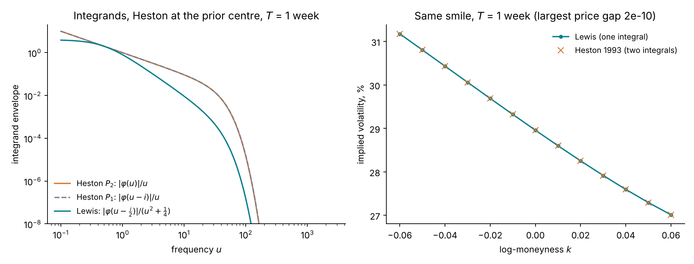

How to read the figure: the left panel shows the size of each integrand against the frequency u, on log–log axes, for the one-week maturity where the integrands decay slowest. The two Heston curves lie on top of each other. At u = 10 the Lewis integrand is about ten times smaller than the Heston ones, because of its extra factor of u; all three then fall off steeply once φ\_T decays. A quadrature can therefore stop earlier for the Lewis form. The right panel shows the implied volatilities of 13 one-week calls priced by both forms. The largest price difference is 2 × 10⁻¹⁰ of the forward, far below the quote noise: the two forms are the same pricer.

Three other inversions rest on the same φ\_T:

- **Carr and Madan (1999)** multiply the call by e^(αk) so that it has a Fourier transform in k, and invert it with the fast Fourier transform. One transform prices a whole grid of strikes. The damping α is a free parameter that affects accuracy.
- **The COS method (Fang and Oosterlee 2008)** expands the density of X\_T on a truncated interval in a cosine series. The series coefficients are read off φ\_T directly. This is a Fourier series rather than a Fourier integral.
- **PROJ (Kirkby 2015)** projects the density onto a basis of B-splines and computes the coefficients from φ\_T with the fast Fourier transform. Later work extends it, with the variance discretized as a Markov chain, to path-dependent products such as barrier and Bermudan options under stochastic volatility (Kirkby, Nguyen and Cui 2017). The fypy library implements it. Agazzotti et al. (2025) calibrated Heston with Kou jumps (HKDE) with it, and the 9 October 2026 study used it as the HKDE pricer.

All of these methods need φ\_T in closed form, or at least cheaply computable. Section J.3 returns to this condition.

### J.2 What Heston's smile gets wrong

Pricing is not Heston's weakness. Its weakness is the shape of the smile it can produce, in two places.

**The short-maturity skew.** Heston is Markovian: the state (S\_t, V\_t) determines the future. Its at-the-money skew therefore tends to a constant as the maturity shrinks (Appendix D.5):

```math
\psi(T) \;\longrightarrow\; \frac{\rho_H\,\sigma_v}{4\sqrt{v_0}}, \qquad T \to 0 .
```

Equity-index smiles do not flatten at short maturities. Their skew keeps steepening, approximately as T^(−0.4) (Gatheral, Jaisson and Rosenbaum 2018).

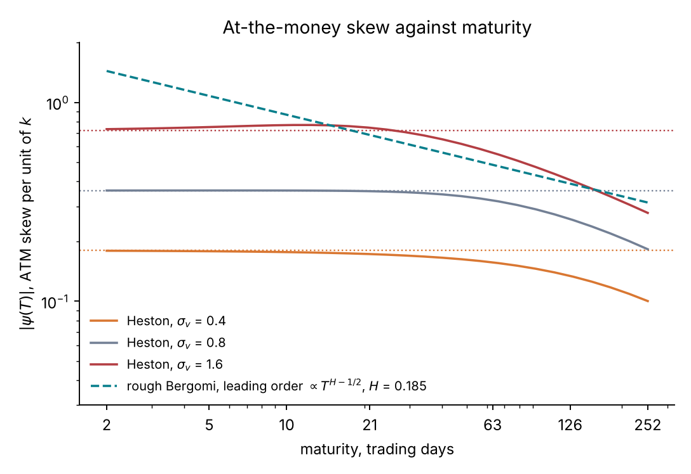

How to read the figure: each solid line is Heston's at-the-money skew, computed by finite differences of Fourier implied volatilities, from two trading days to one year. Each dotted line is the limit ρ\_H σ\_v / (4√v\_0) for the same σ\_v. Every Heston curve is flat up to about one month and falls beyond it. Raising σ\_v shifts the whole curve up and does not tilt the flat part. The dashed line is the rough-Bergomi leading-order skew, proportional to T^(H−½) with H = 0.185; on these axes it is a straight line with slope −0.315. No value of σ\_v makes a Heston curve follow it at both one week and one year.

**The term structure of variance.** Heston's expected variance is a single exponential between v\_0 and θ\_H (Appendix C.3):

```math
\mathbb{E}[V_t] = \theta_H + (v_0 - \theta_H)\,e^{-\kappa t} .
```

This curve is monotone in t. It cannot follow a hump, a kink at an event date, or any other shape that a real forward-variance curve shows.


How to read the figure: the black steps in the left panel are one draw of ξ\_0(t) from the prior of the main text (σ\_0 = 25%, s = 0.15, random perturbations). The coloured curves are the Heston curves E[V\_t] whose variance-swap strikes best match those of ξ\_0 at the 7 design maturities. The right panel shows the remaining errors in the square root of the variance-swap strike. They reach 0.8 volatility points with κ fixed at 2, and 0.86 with κ free (where the fit chooses κ ≈ 15), against an at-the-money quote noise of 0.3 volatility points. Rough Bergomi takes ξ\_0 as an input, so its error is zero at every maturity.

Desks repair both defects by adding structure: a very large vol-of-vol (which violates the Feller condition), price jumps (Bates 1996; the four Kou jump parameters of HKDE), time-dependent parameters, or a second variance factor. Each repair adds parameters, and each added parameter is another direction the smile may leave unidentified, as the 9 October HKDE study found.

### J.3 What rough Bergomi does better, and its price

Rough Bergomi repairs both defects with fewer parameters:

1. **The skew.** Its at-the-money skew is ψ(T) ∝ ρη T^(H−½) (Appendix D.5). One parameter, H, sets the exponent of the power law, and H ≈ 0.1 reproduces the market's steepening.
2. **The term structure.** Its expected variance is the input curve, E[V\_t] = ξ\_0(t) exactly (Appendix D.1). The variance-swap strikes are matched at every maturity, and the three parameters describe only the shape of the smile around them.

The cost comes from the same feature that produces the skew. The power kernel (t − s)^(H−½) weights the whole past of W, so the model has no state of finite dimension. It is not affine either: its variance is the exponential of a Gaussian process. It therefore has no closed-form φ\_T, and none of the pricers of J.1 applies; nor does a PDE. Monte Carlo is the only pricer, at about 5 CPU-seconds per surface (see [Why the likelihood is expensive](#why-the-likelihood-is-expensive)).

Roughness alone does not remove the characteristic function. Rough Heston (El Euch and Rosenbaum 2019) keeps an affine structure, and its φ\_T solves a fractional Riccati equation that is computed numerically. Rough Bergomi is log-normal in the variance and has no such structure.

### J.4 Consequence for the tutorial

For Heston, one likelihood evaluation is a Fourier surface of about 20 milliseconds, so MCMC gives the exact posterior in minutes. Simulation-based inference would only speed up a method that already works. Heston is therefore the model on which the amortized workflow is checked against the exact answer (see [Why Heston is the check and not the example](#why-heston-is-the-check-and-not-the-example)). For rough Bergomi, the model fits the smile's term structure better, and the exact posterior costs at least 17 CPU-hours per surface. That is where amortization is needed.

## References

Bibliographic details were checked on 22 Oct 2026, against publisher, arXiv or regulator pages where they could be reached, and otherwise against library catalogues and the reference lists of citing papers. Magazine articles and working papers without a link to a DOI have none, or none could be confirmed.

**Volatility models and the smile**

- Heston, S. L. (1993). A closed-form solution for options with stochastic volatility with applications to bond and currency options. *Review of Financial Studies* 6(2), 327–343. [doi](https://doi.org/10.1093/rfs/6.2.327)
- Bates, D. S. (1996). Jumps and stochastic volatility: exchange rate processes implicit in Deutsche Mark options. *Review of Financial Studies* 9(1), 69–107. [doi](https://doi.org/10.1093/rfs/9.1.69)
- Dupire, B. (1994). Pricing with a smile. *Risk*, January 1994, 18–20. [Risk.net](https://www.risk.net/derivatives/equity-derivatives/1500211/pricing-with-a-smile)
- Bergomi, L. (2004). Smile dynamics. *Risk*, September 2004, 117–123. [Risk.net](https://risk.net/node/1530377)
- Bergomi, L. (2005). Smile dynamics II. *Risk*, October 2005, 67–73. [Risk.net](https://www.risk.net/derivatives/equity-derivatives/1500225/smile-dynamics-ii)
- Gatheral, J. (2006). The volatility surface: a practitioner's guide. Wiley, Hoboken, NJ. [Wiley](https://www.wiley-vch.de/en/areas-interest/finance-economics-law/the-volatility-surface-978-0-471-79251-2)
- Guyon, J., Lekeufack, J. (2023). Volatility is (mostly) path-dependent. *Quantitative Finance* 23(9), 1221–1258. [doi](https://doi.org/10.1080/14697688.2023.2221281)
- Agazzotti, G., Aglieri Rinella, C., Aguilar, J.-P., Kirkby, J. L. (2025). Calibration and option pricing with stochastic volatility and double exponential jumps. *Journal of Computational and Applied Mathematics* 465, 116563. [doi](https://doi.org/10.1016/j.cam.2025.116563); [arXiv](https://arxiv.org/abs/2502.13824)

**Rough volatility and its simulation**

- Gatheral, J., Jaisson, T., Rosenbaum, M. (2018). Volatility is rough. *Quantitative Finance* 18(6), 933–949. [doi](https://doi.org/10.1080/14697688.2017.1393551)
- Bayer, C., Friz, P., Gatheral, J. (2016). Pricing under rough volatility. *Quantitative Finance* 16(6), 887–904. [doi](https://doi.org/10.1080/14697688.2015.1099717)
- Fukasawa, M. (2011). Asymptotic analysis for stochastic volatility: martingale expansion. *Finance and Stochastics* 15(4), 635–654. [doi](https://doi.org/10.1007/s00780-010-0136-6)
- El Euch, O., Fukasawa, M., Gatheral, J., Rosenbaum, M. (2019). Short-term at-the-money asymptotics under stochastic volatility models. *SIAM Journal on Financial Mathematics* 10(2), 491–511. [doi](https://doi.org/10.1137/18M1167565)
- Bennedsen, M., Lunde, A., Pakkanen, M. S. (2017). Hybrid scheme for Brownian semistationary processes. *Finance and Stochastics* 21(4), 931–965. [doi](https://doi.org/10.1007/s00780-017-0335-5)
- El Euch, O., Rosenbaum, M. (2019). The characteristic function of rough Heston models. *Mathematical Finance* 29(1), 3–38. [arXiv](https://arxiv.org/abs/1609.02108)
- McCrickerd, R., Pakkanen, M. S. (2018). Turbocharging Monte Carlo pricing for the rough Bergomi model. *Quantitative Finance* 18(11), 1877–1886. [doi](https://doi.org/10.1080/14697688.2018.1459812)

**Monte Carlo and numerical methods**

- Andrieu, C., Roberts, G. O. (2009). The pseudo-marginal approach for efficient Monte Carlo computations. *Annals of Statistics* 37(2), 697–725. [doi](https://doi.org/10.1214/07-AOS574)
- Romano, M., Touzi, N. (1997). Contingent claims and market completeness in a stochastic volatility model. *Mathematical Finance* 7(4), 399–412. [doi](https://doi.org/10.1111/1467-9965.00038)
- Willard, G. A. (1997). Calculating prices and sensitivities for path-independent derivative securities in multifactor models. *Journal of Derivatives* 5(1), 45–61. [SSRN](https://papers.ssrn.com/sol3/papers.cfm?abstract_id=7997)
- Lewis, A. L. (2001). A simple option formula for general jump-diffusion and other exponential Lévy processes. Working paper. [RePEc](https://ideas.repec.org/p/vsv/svpubs/explevy.html)
- Gil-Pelaez, J. (1951). Note on the inversion theorem. *Biometrika* 38(3–4), 481–482.
- Carr, P., Madan, D. B. (1999). Option valuation using the fast Fourier transform. *Journal of Computational Finance* 2(4), 61–73. [Risk.net](https://www.risk.net/journal-of-computational-finance/2160495/option-valuation-using-the-fast-fourier-transform)
- Fang, F., Oosterlee, C. W. (2008). A novel pricing method for European options based on Fourier-cosine series expansions. *SIAM Journal on Scientific Computing* 31(2), 826–848. [CWI](https://ir.cwi.nl/pub/13283)
- Kirkby, J. L. (2015). Efficient option pricing by frame duality with the fast Fourier transform. *SIAM Journal on Financial Mathematics* 6(1), 713–747. [doi](https://doi.org/10.1137/140989480)
- Kirkby, J. L., Nguyen, D., Cui, Z. (2017). A unified approach to Bermudan and barrier options under stochastic volatility models with jumps. *Journal of Economic Dynamics and Control* 80, 75–100. [doi](https://doi.org/10.1016/j.jedc.2017.05.001)
- Albrecher, H., Mayer, P., Schoutens, W., Tistaert, J. (2007). The little Heston trap. *Wilmott Magazine*, no. 1, 83–92. [Serval](https://serval.unil.ch/notice/serval:BIB_7042C88010EE)

**Calibration practice and model risk**

- Schoutens, W., Simons, E., Tistaert, J. (2004). A perfect calibration! Now what? *Wilmott Magazine*, March 2004, 66–78. [Semantic Scholar](https://www.semanticscholar.org/paper/A-perfect-calibration!-now-what-Schoutens-Simons/7a513dd70934fc50e8a465e45feeb922594a7d49)
- Detlefsen, K., Härdle, W. K. (2006). Calibration risk for exotic options. SFB 649 Discussion Paper 2006-001, Humboldt-Universität zu Berlin. [doi](https://doi.org/10.18452/3928)
- Guillaume, F., Schoutens, W. (2012). Calibration risk: illustrating the impact of calibration risk under the Heston model. *Review of Derivatives Research* 15(1), 57–79. [doi](https://doi.org/10.1007/s11147-011-9069-2)
- Cont, R. (2006). Model uncertainty and its impact on the pricing of derivative instruments. *Mathematical Finance* 16(3), 519–547. [doi](https://doi.org/10.1111/j.1467-9965.2006.00281.x)
- Crépey, S. (2003). Calibration of the local volatility in a generalized Black–Scholes model using Tikhonov regularization. *SIAM Journal on Mathematical Analysis* 34(5), 1183–1206. [doi](https://doi.org/10.1137/S0036141001400202)
- Cont, R., Tankov, P. (2004). Non-parametric calibration of jump–diffusion option pricing models. *Journal of Computational Finance* 7(3), 1–49. [doi](https://doi.org/10.21314/JCF.2004.123)
- Hernandez, A. (2017). Model calibration with neural networks. *Risk*, June 2017. [Risk.net](https://www.risk.net/derivatives/5288126/model-calibration-with-neural-networks)
- Bayer, C., Horvath, B., Muguruza, A., Stemper, B., Tomas, M. (2019). On deep calibration of (rough) stochastic volatility models. [arXiv:1908.08806](https://arxiv.org/abs/1908.08806)
- Horvath, B., Muguruza, A., Tomas, M. (2021). Deep learning volatility: a deep neural network perspective on pricing and calibration in (rough) volatility models. *Quantitative Finance* 21(1), 11–27. [doi](https://doi.org/10.1080/14697688.2020.1817974)
- Gupta, A., Reisinger, C. (2014). Robust calibration of financial models using Bayesian estimators. *Journal of Computational Finance* 17(4), 3–36. [doi](https://doi.org/10.21314/JCF.2014.285)

**Simulation-based inference and validation**

- Lipman, Y., Chen, R. T. Q., Ben-Hamu, H., Nickel, M., Le, M. (2023). Flow matching for generative modeling. *ICLR 2023*. [arXiv](https://arxiv.org/abs/2210.02747)
- Liu, X., Gong, C., Liu, Q. (2023). Flow straight and fast: learning to generate and transfer data with rectified flow. *ICLR 2023*. [arXiv](https://arxiv.org/abs/2209.03003)
- Wildberger, J., Dax, M., Buchholz, S., Green, S. R., Macke, J. H., Schölkopf, B. (2023). Flow matching for scalable simulation-based inference. *NeurIPS 36*, 16837–16864. [proceedings](https://proceedings.neurips.cc/paper_files/paper/2023/hash/3663ae53ec078860bb0b9c6606e092a0-Abstract.html)
- Lee, J., Lee, Y., Kim, J., Kosiorek, A., Choi, S., Teh, Y. W. (2019). Set transformer: a framework for attention-based permutation-invariant neural networks. *ICML 2019*, PMLR 97, 3744–3753. [proceedings](https://proceedings.mlr.press/v97/lee19d.html)
- Talts, S., Betancourt, M., Simpson, D., Vehtari, A., Gelman, A. (2018). Validating Bayesian inference algorithms with simulation-based calibration. [arXiv:1804.06788](https://arxiv.org/abs/1804.06788)
- Säilynoja, T., Bürkner, P.-C., Vehtari, A. (2022). Graphical test for discrete uniformity and its applications in goodness-of-fit evaluation and multiple sample comparison. *Statistics and Computing* 32(2), 32. [doi](https://doi.org/10.1007/s11222-022-10090-6)
- Dax, M., Green, S. R., Gair, J., Pürrer, M., Wildberger, J., Macke, J. H., Buonanno, A., Schölkopf, B. (2023). Neural importance sampling for rapid and reliable gravitational-wave inference. *Physical Review Letters* 130(17), 171403. [doi](https://doi.org/10.1103/PhysRevLett.130.171403)
- Vehtari, A., Simpson, D., Gelman, A., Yao, Y., Gabry, J. (2024). Pareto smoothed importance sampling. *Journal of Machine Learning Research* 25(72), 1–58. [JMLR](https://jmlr.org/papers/v25/19-556.html)

**Variance swaps and model-free bounds**

- Carr, P., Madan, D. (1998). Towards a theory of volatility trading. In Jarrow, R. (ed.), *Volatility: new estimation techniques for pricing derivatives*, 417–427. Risk Books, London. [Google Books](https://books.google.com/books/about/Volatility.html?id=8NPuAAAAMAAJ)
- Neuberger, A. (1994). The log contract. *Journal of Portfolio Management* 20(2), 74–80. [doi](https://doi.org/10.3905/jpm.1994.409478)
- Demeterfi, K., Derman, E., Kamal, M., Zou, J. (1999). A guide to volatility and variance swaps. *Journal of Derivatives* 6(4), 9–32. [doi](https://doi.org/10.3905/jod.1999.319129)
- Brockhaus, O., Long, D. (2000). Volatility swaps made simple. *Risk*, January 2000, 92–95. [Risk.net](https://www.risk.net/infrastructure/1530370/volatility-swaps-made-simple)
- Beiglböck, M., Henry-Labordère, P., Penkner, F. (2013). Model-independent bounds for option prices: a mass transport approach. *Finance and Stochastics* 17(3), 477–501. [doi](https://doi.org/10.1007/s00780-013-0205-8)
- Hobson, D. (1998). Robust hedging of the lookback option. *Finance and Stochastics* 2(4), 329–347. [doi](https://doi.org/10.1007/s007800050044)
- Brown, H., Hobson, D., Rogers, L. C. G. (2001). Robust hedging of barrier options. *Mathematical Finance* 11(3), 285–314. [doi](https://doi.org/10.1111/1467-9965.00116)

**Regulation and accounting standards**

- Commission Delegated Regulation (EU) 2016/101, Article 11 (model risk AVA). [EUR-Lex](https://eur-lex.europa.eu/eli/reg/2016/101/oj)
- International Accounting Standards Board (2011). IFRS 13 Fair value measurement, paragraph 93(h). [IFRS Foundation](https://www.ifrs.org/issued-standards/list-of-standards/ifrs-13-fair-value-measurement/)
- Board of Governors of the Federal Reserve System, OCC (2011). SR 11-7: Guidance on model risk management. [Federal Reserve](https://www.federalreserve.gov/supervisionreg/srletters/sr1107.htm); superseded on 17 April 2026 by SR 26-2: Revised guidance on model risk management. [Federal Reserve](https://www.federalreserve.gov/supervisionreg/srletters/SR2602.htm)
- Prudential Regulation Authority (2023). SS1/23 Model risk management principles for banks, footnote 20. [PDF](https://www.bankofengland.co.uk/-/media/boe/files/prudential-regulation/supervisory-statement/2023/ss123.pdf)
