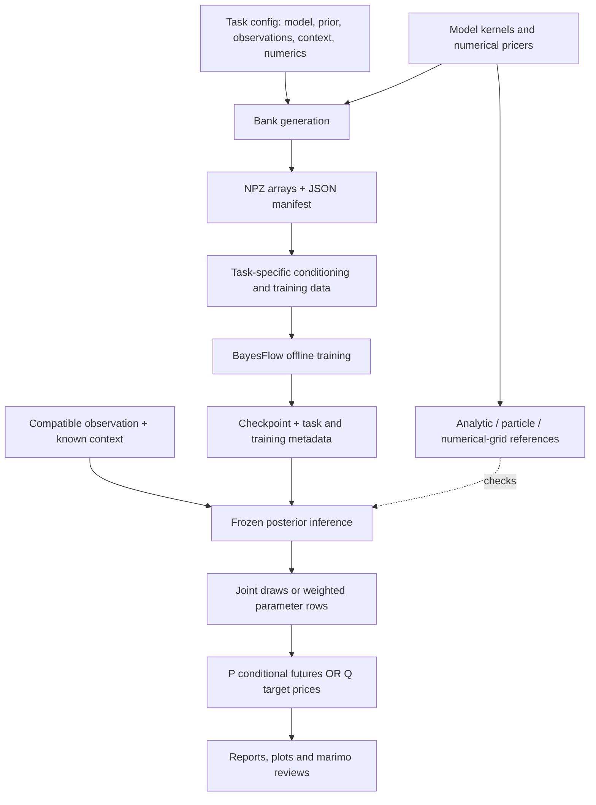
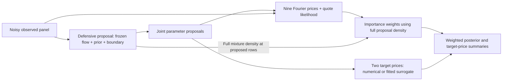

# Code architecture: simulator ladder and inference workflows

**Implemented-code snapshot, 12 October 2026.** This guide explains how the
building blocks fit together and where to make changes. The
[collaborator handover](simulator-handover.md) records results, PR dependencies
and outstanding decisions. Its [issue index](simulator-handover.md#tracked-follow-ups)
separates stack integration, curriculum selection and the three model-specific
scientific follow-ups. The scoped simulator/bank implementation is complete;
these issues do not require a new architecture. The [mathematical guide](simulator-plan/notes/01-foundations.md)
explains the underlying inference concepts.

The main code described here is on `feat/hkde-offline-tutorial` (PR #19).
The later rough-inference and data additions are explicitly marked below:
they live on separate branches and are not all present in this checkout.
Having a module or checkpoint does not mean its scientific validation passed.

## 1. Organizing idea

The repository is a small Python package with explicit task configurations,
array files and experiment scripts. It has no simulator class hierarchy,
plugin registry, database or training service. Most public operations are
functions taking NumPy arrays and plain dictionaries.

There are two financial workflows:

- **Returns under P:** simulate observed histories, learn parameters and any
  required hidden continuation state, then simulate conditional futures.
- **Options under Q:** calculate expectation prices, add a specified quote-error
  model, learn pricing parameters from the resulting panel, then propagate
  parameter uncertainty to other model prices.

The same project supports both, but they use different tasks and checkpoints.
P denotes physical dynamics for returns/risk; Q denotes risk-neutral dynamics
for valuation. Sharing a trajectory kernel does not define a change of measure.



The arrows describe data flow, not a strict Python import layering. For
example, inference modules reuse bank validators, and numerical reference
modules reuse model pricers. Scientific kernels do not call BayesFlow,
Slurm or notebook code.

## 2. Repository map

| Location | Responsibility |
|---|---|
| [`src/sbi4finance/`](../src/sbi4finance/) | Model, bank, inference, reference and prediction functions. Modules are currently mostly flat. |
| [`configs/tasks/`](../configs/tasks/) | Concrete experiment designs: free/fixed parameters, prior, measure, observation/context, numerical settings, seeds and split sizes. |
| [`configs/*protocol*.json`](../configs/) | Frozen study choices, reference requirements, training settings, evaluation populations and acceptance criteria. |
| [`scripts/`](../scripts/) | Commands that compose library functions into generation, training, validation and plotting runs. Some experiment/report logic deliberately remains here. |
| [`cluster/`](../cluster/) | Thin Slurm wrappers around the same commands, plus allocation discovery. |
| [`checkpoints/`](../checkpoints/) | Selected saved approximators with their task/training metadata and status notes. |
| [`docs/results/`](results/) | Committed numerical summaries, selected arrays, fitted price map, figures and verification records. Large raw banks live at run-specific output locations. |
| [`notebooks/`](../notebooks/) | Didactic marimo examples and evidence reviews; these consume the implementation and saved results. |
| [`tests/`](../tests/) | Numerical identities, array/role boundaries, reproducibility, serialization and experiment-run checks. |

[`pyproject.toml`](../pyproject.toml) and `pixi.lock` define the environment and
named commands. The reference environment uses Python 3.12, BayesFlow/Keras
with JAX, NumPy/SciPy and Numba. Numerical preparation functions generally defer
neural-framework imports until workflow construction; generating banks does
not require constructing a neural model. Use the locked Pixi environment for
the complete workflow; ordinary package installation alone does not reproduce it.

The existing [`mmar/univariate.py`](../src/sbi4finance/mmar/univariate.py),
notebook01 MMAR example and `train_univariate.py` remain a separate earlier
workflow. Their simple returns, cascade forecasts and checkpoint are not
interchangeable with the new returns tasks.

## 3. Models and numerical prices

| Module | Main entry points and role |
|---|---|
| [`gbm.py`](../src/sbi4finance/gbm.py) | `simulate_log_returns`, `drift_posterior`, `predictive_log_return`, `european_price`: exact baseline simulation, inference and pricing checks. |
| [`heston.py`](../src/sbi4finance/heston.py) | `draw_innovations`, `simulate`: full-truncation variance stepping, leverage and optional Gaussian log-price jumps; NumPy and Numba backends. |
| [`hkde.py`](../src/sbi4finance/hkde.py) | `draw_innovations`, `simulate`: double-exponential price jumps using Heston diffusion stepping. `characteristic_function`, `european_price`: separate Fourier European valuation. |
| [`bergomi.py`](../src/sbi4finance/bergomi.py) | `curve_values`, `simulate_one_factor`: explicit forward-variance context and exact OU factor transitions. `option_panel`: shared Monte Carlo European pricing for one-factor and rough models. |
| [`rough_bergomi.py`](../src/sbi4finance/rough_bergomi.py) | `rough_driver`, `simulate_rough`: FFT hybrid Volterra driver and joint-Gaussian covariance reference on a uniform grid. |

Random inputs are explicit at the trajectory boundary. Heston/HKDE separate
innovation generation from stepping; Bergomi receives normal arrays. This
allows matched comparisons, repeatable examples and continuation tests.
GBM instead accepts an explicit NumPy generator for its exact increments.
Numba accelerates Heston's sequential stepping, including the diffusion used
by HKDE. Fourier quadrature, vectorized operations and the rough FFT use their
existing numerical implementations. There is no Cython dependency.

**A path is not an option price.** HKDE's option bank calls its Fourier pricer;
it does not simulate trajectories for every panel. Bergomi pricing averages
bounded conditional-put estimators over many paths, integrates out the
independent asset noise, and reports covariance of the estimated price means.
These Monte Carlo errors are separate from grid bias and market quote noise.
The Fourier implementation is direct quadrature, not imported PROJ code.

Pricing functions remain with their models. The `pricing/fourier.py` and
`pricing/monte_carlo.py` directories in the early
[design discussion](simulator-ladder-architecture-2026-10-11.md) were a proposed
layout, not the delivered tree. Their responsibilities exist without that
extra package hierarchy.

Continuation is model-specific:

- Heston/HKDE need the **signed auxiliary variance state** of the declared
  discretization. Effective variance is its positive part; clipping the saved
  state changes subsequent transitions.
- One-factor Bergomi retains factor state, elapsed time and the original curve,
  plus the current price level when reconstructing price paths. Exact factor
  transitions do not make its asset discretization exact.
- Rough Bergomi currently simulates from the original Q origin. Scalar current
  variance or the current Volterra driver is insufficient memory; there is no
  rough historical-return restart/forecast API.

## 4. Tasks, observations and saved banks

The bank families are [`gbm_bank.py`](../src/sbi4finance/gbm_bank.py),
[`heston_bank.py`](../src/sbi4finance/heston_bank.py), and
[`option_bank.py`](../src/sbi4finance/option_bank.py). Each exposes
`generate_examples(config, split, example_ids)`, `write_bank(...)` and
`load_bank(...)`. They share conventions and small helpers, rather than a
generic bank superclass. Option banks explicitly dispatch between `hkde`,
`one_factor` and `rough`; [`option_panel.py`](../src/sbi4finance/option_panel.py)
validates quote context and adds the declared noise.

One returns example is a whole ordered history. One options example is a whole
ordered quote panel, even when hundreds of thousands of paths were used to
estimate its prices. Training examples are not individual internal time steps
or Monte Carlo paths.

| Role | Returns banks | Option banks |
|---|---|---|
| Observed conditioning | `observations [B,T,1]`: decimal log returns | `observations [B,C,1]`: noisy currency premiums |
| Known context | Positive `dt_years [T]`; remaining fixed design in task | Ordered contracts, spot, rate, dividend, quote sigma and model context in task |
| Synthetic training targets | `parameters [B,P]`; Heston also `terminal_state [B,1]` | Ordered `parameters [B,P]` |
| Auxiliary values | Split-qualified `example_id` | IDs, `reference_prices`, price SE/covariance, refinement differences |

Here B is batch size, T history length, C contract count, and P parameter
count. Synthetic state/parameter truth, numerical diagnostics and future
outcomes never become observed conditions. Fixed context need not be a neural
input: in the current HKDE task the nine prices condition the network, while
contract design and other known inputs are bound to its saved task.

The task fingerprint identifies the scientific/numerical design; the full
configuration also records execution seed and split counts. Separate
prior/process-or-pricing/quote-noise streams and split-qualified IDs make
selected examples reproducible across batching and ordering. A standard bank
contains `train.npz`, `validation.npz`, `test.npz` and `manifest.json`; the
manifest records roles, configuration, source/environment identifiers and file
hashes. Writers require a new directory, publish the manifest last, and retain
failure information rather than silently replacing a failed draw.

Current adapters require complete fixed designs; a stored shape alone does
not imply support for missing observations, varying grids, arbitrary option
chains or new priors. The [bank guide](option-banks.md) describes the exact
integrity and numerical checks. Independent examples belong in independent
splits; any future noise augmentations must retain their base-surface group.

## 5. Inference, references and downstream calculations

The repeated inference interface is intentionally small:

1. `conditioning_data(...)` selects observable inputs and validates the task's
   array/time conventions.
2. `training_data(...)` adds synthetic targets in separate fields.
3. `build_workflow(...)` constructs a BayesFlow adapter and network.
4. A training script loads the bank, calls `fit_offline`, restores the selected
   checkpoint and writes metadata. Later sampling uses the saved transforms
   and training-fitted normalization.

| Task | Neural representation | Reference and downstream route |
|---|---|---|
| [`gbm_inference.py`](../src/sbi4finance/gbm_inference.py) | Sum of log returns, sufficient for this fixed known-volatility drift task; small flow-matching network | Analytic `gbm.drift_posterior` and predictive log-return distribution |
| [`heston_inference.py`](../src/sbi4finance/heston_inference.py) | Ordered returns, observation-derived trailing moments, GRU summary; versioned time/state transforms; flow matching or spline flow | [`heston_reference.py`](../src/sbi4finance/heston_reference.py): particle filtering across a theta grid for the same discrete model. [`heston_forecast.py`](../src/sbi4finance/heston_forecast.py): continue paired theta/state draws |
| [`hkde_inference.py`](../src/sbi4finance/hkde_inference.py) | Nine ordered prices directly condition a spline coupling flow over theta and jump intensity | [`hkde_reference.py`](../src/sbi4finance/hkde_reference.py): Fourier prices plus two-dimensional posterior quadrature; propagate the same parameter rows to target contracts |

These are restricted tasks, not nine-parameter SVJ estimation. Heston's
current inverse problem estimates theta and terminal state with the remaining
parameters fixed. A checkpoint must travel with its task, adapter identity,
normalization, training report and environment. Helpers check local contracts;
callers/runners must still compare the full application task with the saved
task. Keep common draw indices when assembling named parameter/state samples.

### HKDE: three different maps



- **Inverse map:** `hkde_inference.py` learns parameters conditional on the
  noisy panel. The raw neural candidate remains provisional.
- **Forward map:** [`hkde_surrogate.py`](../src/sbi4finance/hkde_surrogate.py)
  fits a tensor Chebyshev polynomial to accurate expectation labels for two
  fixed target puts. This is supervised price regression, not a posterior
  network. Its saved coefficients bind the parameter box, context and contracts;
  prediction rejects extrapolation or changed specifications.
- **Correction:** [`hkde_correction.py`](../src/sbi4finance/hkde_correction.py)
  combines neural/prior/boundary proposals and weights each row by
  likelihood times prior divided by the **full mixture density**. The nine
  likelihood prices still come from Fourier valuation. Only the two downstream
  target prices use the accepted surrogate. Weighted summaries need no
  resampling; `resample` supplies finite-pool SIR draws for diagnostics.

Correction avoids retraining the frozen network, but retains numerical-price
and finite-sample errors. [`hkde_diagnostics.py`](../src/sbi4finance/hkde_diagnostics.py)
and the evaluation scripts check SBC, conditional/reference accuracy, joint
quantities and downstream prices. They answer different questions. The latest
corrected test still fails one SBC gate; its used test and acceptance flag remain
unchanged. Notebook10 now runs an explicitly **provisional live demonstration**
on fixed synthetic `validation:257` with 2,048 proposals and the same seed and
numerical tolerances. It uses the existing functions and assets; it adds no new
inference framework. Technical execution and single-case checks are distinct
from population calibration and M8 release acceptance. See the
[historical result](hkde-corrected-inference.md),
[gate explanation](hkde-calibration-gate-audit.md) and
[live execution record](results/hkde-live-demo/verification.json).

## 6. Execution and review

Generation, training and scientific evaluation are separate commands. For
example, `generate_option_bank.py` produces and verifies data;
`train_hkde.py` trains the declared candidate after checking its reference
prerequisite; `evaluate_hkde.py` and `evaluate_hkde_correction.py` assess
frozen candidates. The GBM training script is a smaller combined demonstration.
Protocols and reports preserve the difference between training selection,
validation and a used held-out test.

`cluster/simulate.sbatch` and `cluster/option_bank.sbatch` invoke the same
Python commands as local runs, using explicit interpreters/configs/output
paths and bounded thread settings. They do not install software or introduce
a remote execution service. `cluster/train.sbatch` is the older MMAR GPU
trainer, not a model-generic training launcher.

Marimo notebooks explain functionality and display committed evidence. Small
fresh illustrations are labeled separately from recorded experiments. Opening
a review should not implicitly generate a large bank, train or submit a job.
For the main checkout:

```bash
pixi install --locked
PYTHONPATH=src pixi run review-hkde
PYTHONPATH=src pixi run review-hkde-corrected
```

The environment install needs package access; review execution needs no market
files. `PYTHONPATH=src` selects this checkout when sharing an editable environment
between worktrees. Commands for checks and other reviews are in the
[handover](simulator-handover.md#first-review-session).

## 7. Related code on separate branches

**Rough development work, [PR #14](https://github.com/fmuia/sbi4finance/pull/14):**
`feat/rough-bergomi-option-bank` adds `bergomi_refinement.py` for coupled-grid
pricing comparisons, `option_bank_shards.py` for independently generated array
tasks and bank assembly, and `rough_reference.py` / `rough_inference.py` for
the restricted H/eta inverse task. Shards own disjoint split-ID ranges;
assembly checks coverage and identities, then produces an ordinary
`option_bank_v1`. Optional verified prefix reuse extends a bank without changing
its existing rows or schema. `cluster/option_bank_array.sbatch` selects a job-map record
and invokes that route. Scheduling does not change the examples.

The runner requires an accepted independent reference before training/reload,
then provides validation-only evaluation. The original 4,096-row run stopped
on a reference-efficiency failure. One bounded extension reuses those rows and
appends 4,096 independent rows: all 20 reference cases and all seven neural validation
gates pass, including 512-case SBC. A trained checkpoint is delivered; its later
held-out outcome is recorded separately below. This pilot's observation law explicitly includes finite
Monte Carlo pricing randomness followed by quote noise. It preserves base
groups when augmenting training quotes, and estimates posterior target-price
**means** using independent pricing randomness; noisy target-estimate quantiles
are not presented as posterior price uncertainty. Read its
[extension study](https://github.com/fmuia/sbi4finance/blob/feat/rough-bergomi-option-bank/docs/rough-reference-expansion.md)
and notebook09 on that branch. The original stopped study is preserved. These
later additions are absent from PR #19's ancestry; this documentation update
does not import their code or change the HKDE acceptance result.

**Rough held-out evaluation, [PR #28](https://github.com/fmuia/sbi4finance/pull/28):**
`feat/rough-heldout-test` evaluates the frozen checkpoint and existing reference
bank once, with source/input hashes and raw audit draws. It introduces no model,
bank schema or retraining. All 16 reference cases pass; six of seven neural
gates pass, including 256-case SBC and target-price means. On `test:3`, eta's
posterior SD is 31.0% too small against the 25% gate, so the candidate remains
provisional. All 256 cases are used and closed; no retry or tuning followed.
The [study](https://github.com/fmuia/sbi4finance/blob/feat/rough-heldout-test/docs/rough-heldout-test.md)
and updated notebook09 explain the conditional failure alongside the passed
marginal ranks. The independent raw-draw audit, 129 software tests and offline
26-cell review verify this result, not scientific acceptance. This follow-up
also remains outside PR #19's code ancestry.

**Data workstream, [PRs #5, #6, #16–#18](simulator-handover.md#where-the-work-lives):**
the separate `datasets/` modules load local CSV/JSON artifacts, prepare return
windows and fixed HKDE panels, and exercise the bank/checkpoint boundary:

| Module | Boundary |
|---|---|
| `datasets/local.py` | `LocalArtifact`, CSV/JSON load/write and explicit field roles |
| `datasets/returns.py` | `prepare_return_window`: dates/cutoff and levels or declared returns to a complete window, without fill or window standardization |
| `datasets/options.py` | `prepare_hkde_panel`, `hkde_panel_prices`: the fixed nine-premium design with full task/context matching |
| `datasets/banks.py` | `load_hkde_bank_panel`: calls the simulator-owned reader and selects a validation example into `LocalArtifact` |
| `datasets/hkde_teaching.py` | `load_teaching_example`: checked cache for the separate offline walkthrough |

Observation, context, auxiliary metadata and optional synthetic truth remain
separate. Preparation supplies the declared arrays to the task's conditioning
function; it does not create a new simulator, bank format or neural adapter.
The HKDE handoff has been tested through CSV/JSON round-trip to `[1,9,1]`
conditioning and seeded checkpoint draws. Returns integration has an analytic
GBM interoperability check; neural-checkpoint integration remains deferred.
Parsing alone does not establish compatibility. The audited round trips establish
transport equivalence for the matched saved task/checkpoint, not scientific
acceptance or market adequacy. Its cached HKDE lesson preserves the original raw-neural
result rather than notebook10's correction.

Later [PR #21](https://github.com/fmuia/sbi4finance/pull/21) connects that prepared
panel to the corrected cached lesson; [PR #22](https://github.com/fmuia/sbi4finance/pull/22)
adds the opt-in provisional live route. They reuse the existing loader,
correction and checker, with no new bank/adapter format. Their combined review
bases contain specific older parent revisions; these changes are not imported
by this architecture note. I1–I3 and I4a are complete, while formal participant
I4 depends on [HKDE's acceptance decision](https://github.com/fmuia/sbi4finance/issues/24).
[Issue #27](https://github.com/fmuia/sbi4finance/issues/27) tracks verifying the
actual combined tree, and [#26](https://github.com/fmuia/sbi4finance/issues/26)
tracks which route becomes the participant lesson.

Synthetic teaching/training/testing is the required **S** workflow and needs
no market acquisition. Optional **M** applies a compatible observation to
normally frozen weights. **E** evaluates against separately withheld real
outcomes or quotes. Market observations have no known model-parameter/latent-state
labels, and empirical evaluation is distinct from simulator truth-based checks.

## 8. How to extend this without a framework rewrite

| Intended change | Start here |
|---|---|
| Different prior or fixed context within a supported task | New explicit task config; assess numerical support and train/evaluate a matching checkpoint. Existing weights do not automatically transfer. |
| New dynamics or numerical scheme | Model function plus matched reference/numerical checks; declare its task identity and state. Add to explicit bank dispatch only when needed. |
| New observation design or unknowns | Bank validator/generator and model-specific `conditioning_data`, `training_data`, reference and neural workflow. |
| Faster generation | Profile the relevant kernel/pricer, preserve example identity, and compare the scientific output. Use existing chunks/shards where sufficient. |
| New payoff/target price | Validated expectation pricer and target-specific error checks before surrogate fitting or uncertainty propagation. |
| Participant teaching change | Marimo notebook consuming existing functions and evidence; keep acceptance status and actual run costs visible. |

Prefer these local changes while the curriculum is evolving. Two-factor
Bergomi, a full collaborator SVJ reproduction, rough P continuation,
American/exotic pricing and direct price-posterior networks are future
capabilities, not hidden features of the present interfaces. The useful stable
boundaries are explicit task semantics, observable-versus-truth roles,
reproducible bank identities and independent numerical/inference checks.
