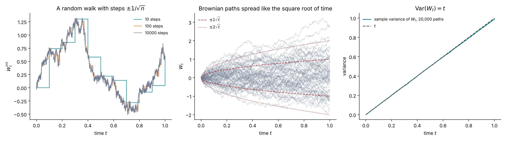
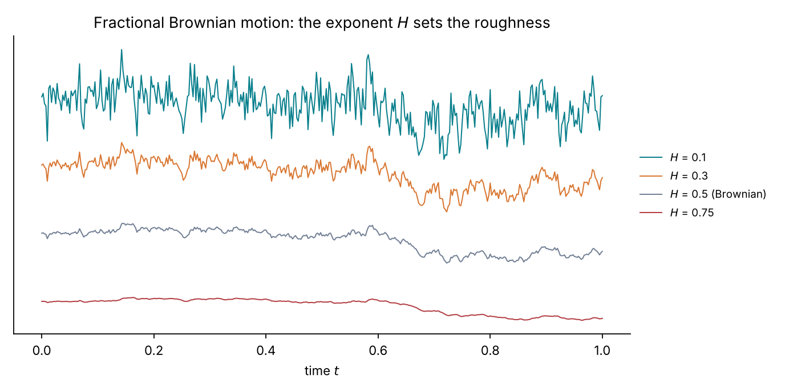
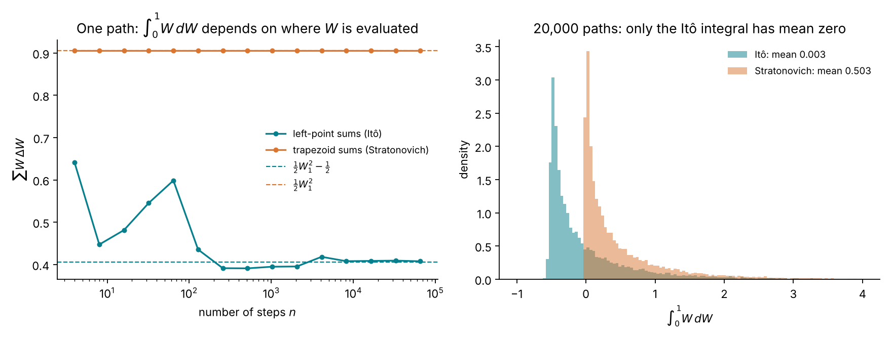
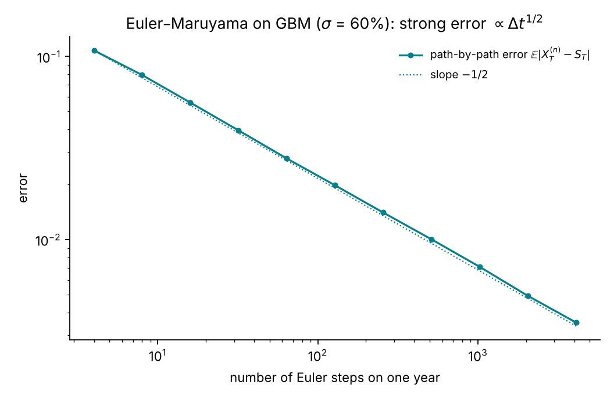
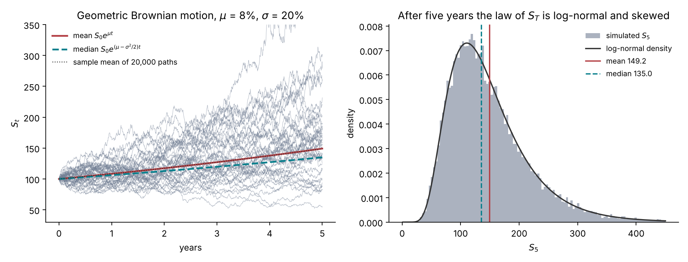
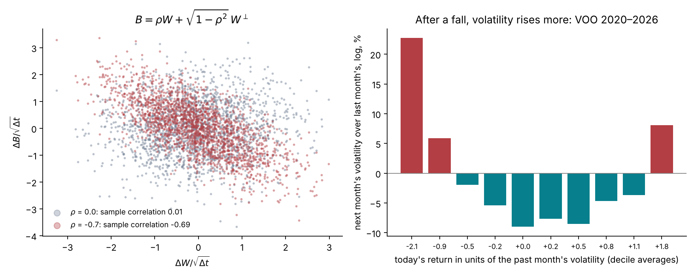
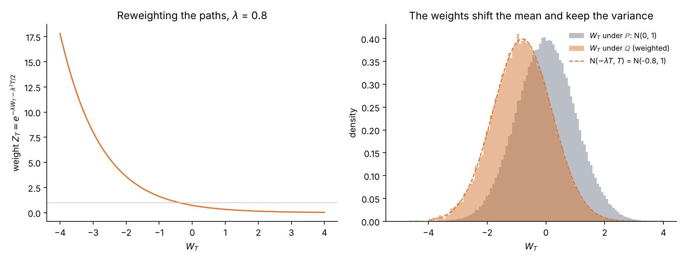
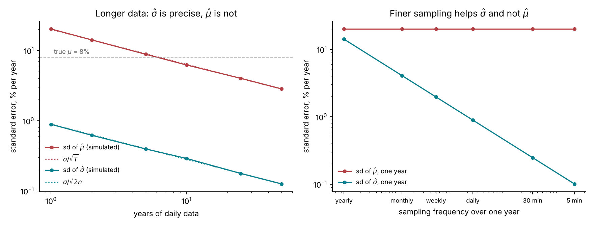

# Lecture 3. Brownian motion, SDEs and Itô's lemma

[Course index](README.md) · Previous: [Lecture 2. No-arbitrage without a model](02-no-arbitrage-without-a-model.md) · Next: [Lecture 4. The Black–Scholes model](04-black-scholes.md)

**What this lecture is for.** This lecture builds the mathematics in which every volatility model of the course is written. It constructs Brownian motion as the limit of a random walk, shows that its paths are rough, defines the stochastic integral and stochastic differential equations, derives Itô's lemma, and solves the simplest price model, geometric Brownian motion. It then covers three tools the later lectures need: correlated Brownian motions, the change of probability measure, and what can and cannot be estimated from one observed path.

**Where it sits in the course.** Lecture 2 showed that option prices pin down the distribution of the future price at each date, and that a model must supply how prices move through time. A model in this course is a stochastic differential equation. Lecture 4 uses this lecture's tools to price options under the simplest one, Black–Scholes; Lectures 10 and 13 use them for stochastic and rough volatility. Two results of this lecture recur throughout: Itô's lemma, which creates the $-\tfrac12\sigma^2$ terms of every pricing formula, and the fact that volatility is measurable from a path while the drift is not.

## 3.1 From a random walk to Brownian motion

A price moves in many small, unpredictable steps. The simplest model of such motion is a **random walk**: flip a fair coin $n$ times per unit of time and move up or down by a fixed step each time. Let $Z_1, Z_2, \dots$ be independent, each $+1$ or $-1$ with probability $\tfrac12$, so $\mathbb{E}[Z_i] = 0$ and $\mathrm{Var}(Z_i) = 1$. Define

$$
W^{(n)}_t = \frac{1}{\sqrt{n}} \sum_{i=1}^{\lfloor nt \rfloor} Z_i .
$$

The step size $1/\sqrt{n}$ is forced. The variance of $W^{(n)}_t$ is $\lfloor nt\rfloor/n \to t$. With a step of $1/n$ the variance would vanish and the walk would freeze; with a step of $1$ it would explode. Only the square-root scaling gives a non-trivial limit.

As $n \to \infty$, the central limit theorem gives $W^{(n)}_t \to \mathcal{N}(0, t)$ in distribution at every $t$, and the whole path converges to a limit process $W_t$ called **Brownian motion** (Donsker's theorem). Brownian motion is defined by four properties:

1. $W_0 = 0$.
2. **Independent increments**: for $s < t$, $W_t - W_s$ is independent of everything before $s$.
3. **Gaussian increments**: $W_t - W_s \sim \mathcal{N}(0,\ t - s)$.
4. **Continuous paths**: $t \mapsto W_t$ has no jumps.

From these, $\mathbb{E}[W_t] = 0$, $\mathrm{Var}(W_t) = t$ and $\mathrm{Cov}(W_s, W_t) = \min(s, t)$. Brownian motion is also **self-similar**: $W_{ct}$ has the same distribution as $\sqrt{c}\,W_t$. Zooming in by a factor $c$ in time and $\sqrt{c}$ in space gives a path that looks statistically the same.

*Figure 3.1.* How to read the figure: the left panel builds three walks from the same 10,000 coin flips, aggregated into 10, 100 or 10,000 steps. As the step shrinks, the staircase becomes a continuous but jagged path. The centre panel shows that Brownian paths spread out like $\sqrt{t}$, not like $t$: about 68% of them lie within $\pm\sqrt{t}$ and 95% within $\pm2\sqrt{t}$ at each time. The right panel checks $\mathrm{Var}(W_t) = t$ on 20,000 paths.

**Interpretation.** The square-root spreading is the law of Lecture 1, Section 1.2, that volatility grows with the square root of time. It holds because the increments are independent: their variances add.

## 3.2 Brownian paths are rough

Over a short interval $\Delta t$, the increment $\Delta W = W_{t+\Delta t} - W_t$ has standard deviation $\sqrt{\Delta t}$. For small $\Delta t$, $\sqrt{\Delta t}$ is much larger than $\Delta t$. The slope $\Delta W / \Delta t$ therefore has standard deviation $1/\sqrt{\Delta t}$, which diverges as $\Delta t \to 0$: **a Brownian path has no derivative at any point**. Ordinary calculus, built on derivatives, does not apply to it.

Two sums over a partition of $[0, T]$ into $n$ steps of size $\Delta t = T/n$ make this precise.

**Quadratic variation.** The sum of squared increments converges to the length of the interval:

$$
\sum_{i=1}^{n} (\Delta W_i)^2 \;\longrightarrow\; T .
$$

The proof is two lines. Each $(\Delta W_i)^2$ has mean $\Delta t$ and variance $2\Delta t^2$ (the fourth moment of a normal is three times the squared variance). The sum has mean $n\Delta t = T$ and variance $2n\Delta t^2 = 2T\Delta t \to 0$. The randomness averages out and leaves a deterministic number.

**Total variation.** The sum of absolute increments, the length of the path, diverges. Each $|\Delta W_i|$ has mean $\sqrt{2\Delta t/\pi}$, so the sum has mean $\sqrt{2nT/\pi} \to \infty$.

![Left: the quadratic variation of Brownian paths on [0, 1] against the number of steps, with its 5–95% range over 400 paths. Right: the total variation against the number of steps, with the theoretical growth.](images/l03-quadratic-variation.png)

*Figure 3.2.* How to read the figure: in the left panel, the sum of squared increments is centred on 1 for every number of steps, and its spread shrinks like $\sqrt{2/n}$: with 10 steps it ranges from about 0.4 to 1.9, with 100,000 steps 90% of the paths give a value between 0.993 and 1.007. In the right panel, the length of the path grows without bound, exactly as $\sqrt{2n/\pi}$.

The quadratic-variation result is summarized by the **rules of Itô calculus**, which say how small increments combine:

$$
(dW_t)^2 = dt, \qquad dW_t\,dt = 0, \qquad (dt)^2 = 0 .
$$

The first rule is the limit just proved. The other two say that products of order $\Delta t^{3/2}$ or $\Delta t^2$ vanish when summed over $1/\Delta t$ steps. These rules are the whole difference between stochastic and ordinary calculus.

**A preview: the roughness exponent.** Brownian increments over $\Delta t$ have size $\Delta t^{1/2}$. **Fractional Brownian motion** generalizes this to increments of size $\Delta t^{H}$, with an exponent $H \in (0, 1)$ called the Hurst exponent: $\mathbb{E}[(B_{t+\Delta t} - B_t)^2] = \Delta t^{2H}$ (Mandelbrot and Van Ness 1968). For $H = \tfrac12$ it is Brownian motion. For $H < \tfrac12$ the paths are rougher, and for $H > \tfrac12$ smoother.

*Figure 3.3.* How to read the figure: the four paths are built from the same 400 standard normal numbers, so they share their large-scale shape. With $H = 0.75$ the path is smooth; with $H = 0.5$ it is Brownian; with $H = 0.3$ and $H = 0.1$ it is increasingly jagged, because short-range increments are larger relative to long-range ones. Lecture 13 shows that the logarithm of equity volatility behaves like a process with $H \approx 0.1$, the top path, and that this roughness is what produces the steep short-maturity skew of Lecture 5. The asset price itself stays Brownian-like.

## 3.3 The Itô integral

A trading strategy holds a quantity $f_t$ of an asset whose price moves by $dW_t$. Over a grid $t_0 < t_1 < \dots < t_n$, the strategy decides its holding $f_{t_{i-1}}$ at the start of each interval, before the move, and gains $f_{t_{i-1}}(W_{t_i} - W_{t_{i-1}})$. The total gain is a sum, and its limit as the grid is refined is the **Itô integral**:

$$
\int_0^T f_t\, dW_t = \lim_{n\to\infty} \sum_{i=1}^{n} f_{t_{i-1}}\big(W_{t_i} - W_{t_{i-1}}\big).
$$

The integrand is evaluated at the **left end** of each interval. This is the finance requirement that a position is chosen before the price moves; a process with this property is called **non-anticipating**. For smooth functions the evaluation point would not matter. For Brownian paths it does, because of the quadratic variation.

**The example that shows it.** Take $f_t = W_t$. The identity $W_{i-1}\Delta W_i = \tfrac12\big(W_i^2 - W_{i-1}^2\big) - \tfrac12(\Delta W_i)^2$, summed over $i$, telescopes:

$$
\sum_{i=1}^{n} W_{t_{i-1}}\,\Delta W_i = \tfrac12 W_T^2 - \tfrac12 \sum_{i=1}^{n} (\Delta W_i)^2 \;\longrightarrow\; \tfrac12 W_T^2 - \tfrac12 T .
$$

Ordinary calculus would give $\int_0^T W\,dW = \tfrac12 W_T^2$. The extra $-\tfrac12 T$ is the quadratic variation. If the integrand is instead the average of its values at the two ends of each interval, $\tfrac12(W_{t_{i-1}} + W_{t_i})$, the same identity gives a sum of exactly $\tfrac12 W_T^2$ at every $n$, and ordinary calculus holds. This trapezoid rule, like evaluation at the midpoint in time, converges to the **Stratonovich** integral. In both, the holding over an interval depends on the move during that interval.

*Figure 3.4.* How to read the figure: in the left panel, the trapezoid sum equals $\tfrac12 W_1^2$ at every step count, while the left-point sum fluctuates and settles on $\tfrac12 W_1^2 - \tfrac12$. In the right panel, over 20,000 paths, the Itô integral has mean 0.003, zero up to sampling error, and the Stratonovich integral has mean 0.503.

**Two properties of the Itô integral.** Both follow from the left-point rule, because each $f_{t_{i-1}}$ is independent of the following increment $\Delta W_i$:

1. **Zero mean**: $\mathbb{E}\big[\int_0^T f_t\, dW_t\big] = 0$. A strategy that trades a driftless price cannot expect to gain. More strongly, the integral as a function of $T$ is a **martingale**.
2. **Itô isometry**: $\mathbb{E}\big[\big(\int_0^T f_t\, dW_t\big)^2\big] = \mathbb{E}\big[\int_0^T f_t^2\, dt\big]$. The variance of the gain is the accumulated squared position.

## 3.4 Stochastic differential equations

A **stochastic differential equation** (SDE)

$$
dX_t = a(X_t, t)\, dt + b(X_t, t)\, dW_t
$$

is shorthand for the integral equation $X_t = X_0 + \int_0^t a(X_s, s)\,ds + \int_0^t b(X_s, s)\,dW_s$. The two coefficients have plain meanings over a short step:

$$
\mathbb{E}[dX_t \mid X_t] = a\,dt, \qquad \mathrm{Var}(dX_t \mid X_t) = b^2\,dt .
$$

The **drift** $a$ is the expected rate of change, and the **diffusion coefficient** $b$ is the size of the random shocks. Over short horizons the shock term dominates, since $b\sqrt{dt} \gg a\,dt$; this is the observation of Lecture 1 that daily noise swamps the daily drift.

**Simulation.** The **Euler–Maruyama scheme** replaces $dt$ by a step $\Delta t$ and $dW_t$ by a normal increment:

$$
X_{i+1} = X_i + a(X_i, t_i)\,\Delta t + b(X_i, t_i)\,\sqrt{\Delta t}\; Z_{i+1}, \qquad Z_{i+1} \sim \mathcal{N}(0, 1) .
$$

*Figure 3.5.* How to read the figure: the scheme is applied to the price model of Section 3.6 with a high volatility of 60%, and compared with the exact solution driven by the same Brownian path. The error falls from 0.108 with 4 steps to 0.0035 with 4,096: a factor of about 31 for a factor of 1,024 in steps, which is a slope of $-\tfrac12$. The Euler scheme has **strong order** $\tfrac12$: halving the error costs four times as many steps. Lecture 13 meets this cost when rough Bergomi is priced by simulation, and uses a scheme (the hybrid scheme) built to reduce it.

## 3.5 Itô's lemma

Let $X_t$ solve the SDE above and let $f(t, x)$ be a smooth function. Itô's lemma gives the SDE of $Y_t = f(t, X_t)$. Expand $f$ to second order, as in ordinary calculus:

$$
df = f_t\, dt + f_x\, dX + \tfrac12 f_{xx}\,(dX)^2 + f_{tx}\, dt\, dX + \tfrac12 f_{tt}\,(dt)^2 + \dots
$$

Now apply the rules of Section 3.2. With $dX = a\,dt + b\,dW$:

$$
(dX)^2 = a^2 (dt)^2 + 2ab\, dt\, dW + b^2 (dW)^2 = b^2\, dt,
$$

and the terms in $dt\,dX$ and $(dt)^2$ vanish. What remains is **Itô's lemma**:

$$
df(t, X_t) = \Big(f_t + a\,f_x + \tfrac12\, b^2 f_{xx}\Big)\,dt + b\, f_x\, dW_t .
$$

The term $\tfrac12 b^2 f_{xx}\,dt$ has no counterpart in ordinary calculus. It appears because $(dW)^2$ is of order $dt$, not smaller. It is the stochastic version of Jensen's inequality: a convex function ($f_{xx} > 0$) of a randomly moving quantity drifts upward, at a rate proportional to the variance of the moves. Every "$-\tfrac12\sigma^2$" in the course comes from this term.

## 3.6 Geometric Brownian motion

The simplest model of a price is that its returns over short intervals are independent, with constant mean and variance per unit time:

$$
\frac{dS_t}{S_t} = \mu\, dt + \sigma\, dW_t ,
$$

with an expected return $\mu$ and a volatility $\sigma$ per year. This is **geometric Brownian motion** (GBM). The noise is proportional to the price, so the price stays positive.

To solve it, apply Itô's lemma to $f(x) = \ln x$, with $a = \mu S$, $b = \sigma S$, $f_x = 1/S$ and $f_{xx} = -1/S^2$:

$$
d\ln S_t = \Big(\mu S_t \cdot \frac{1}{S_t} + \tfrac12\,\sigma^2 S_t^2\cdot\Big(-\frac{1}{S_t^2}\Big)\Big)dt + \sigma S_t \cdot \frac{1}{S_t}\, dW_t = \Big(\mu - \tfrac12\sigma^2\Big)dt + \sigma\, dW_t .
$$

The right side has constant coefficients, so it integrates directly:

$$
\ln S_T = \ln S_0 + \Big(\mu - \tfrac12\sigma^2\Big)T + \sigma W_T, \qquad S_T = S_0 \exp\!\Big(\Big(\mu - \tfrac12\sigma^2\Big)T + \sigma W_T\Big).
$$

The log return over $[0, T]$ is normal with mean $(\mu - \tfrac12\sigma^2)T$ and variance $\sigma^2 T$, so $S_T$ is **log-normal**. Its mean uses the normal moment-generating function, $\mathbb{E}[e^{\sigma W_T}] = e^{\sigma^2 T/2}$:

$$
\mathbb{E}[S_T] = S_0 e^{\mu T}, \qquad \mathrm{median}(S_T) = S_0 e^{(\mu - \sigma^2/2)T}, \qquad \mathrm{Var}(S_T) = S_0^2 e^{2\mu T}\big(e^{\sigma^2 T} - 1\big).
$$

*Figure 3.6.* How to read the figure: with $\mu = 8\%$ and $\sigma = 20\%$, the mean grows at 8% a year to 149.2 after five years, while the median, the path a typical investor sees, grows at $8\% - 2\% = 6\%$ to 135.0. The mean of 20,000 simulated paths matches $S_0e^{\mu t}$. The right panel shows the log-normal skew: a long right tail of rare large outcomes pulls the mean above the median. One path in four (25.1%) ends below its starting value after five years.

**Interpretation of $-\tfrac12\sigma^2$.** Volatility lowers the growth rate of the typical path. A gain of 10% followed by a loss of 10% leaves $1.1 \times 0.9 = 0.99$, a net loss. The mean is still $S_0e^{\mu T}$, held up by the rare paths that grow a lot.

**GBM against the data.** GBM has a constant volatility and normal log returns. Lecture 1 showed that real volatility changes over time and that real returns have heavy tails. GBM is therefore wrong for equity indices, and Lecture 5 shows how option prices reveal it. It remains the reference model: Lecture 4 prices options under it, and the market quotes every option price through it (implied volatility, Lecture 5).

## 3.7 Two Brownian motions and correlation

Stochastic-volatility models drive the price and its volatility with two Brownian motions that are correlated. Given two independent Brownian motions $W$ and $W^\perp$ and a number $\rho \in [-1, 1]$, the process

$$
B_t = \rho\, W_t + \sqrt{1 - \rho^2}\; W^\perp_t
$$

is a Brownian motion (its increments are normal with variance $(\rho^2 + 1 - \rho^2)\,dt = dt$), and its increments have correlation $\rho$ with those of $W$. In the rules of Itô calculus this reads

$$
dW_t\, dB_t = \rho\, dt, \qquad dW_t\, dW^\perp_t = 0 .
$$

Itô's lemma for a function $f(t, X_t, Y_t)$ of two processes gains a cross term, $f_{xy}\, dX\, dY$, which brings $\rho$ into every formula of Lectures 10 and 13.

*Figure 3.7.* How to read the figure: the left panel shows the construction above for 2,000 increments; with $\rho = -0.7$ the cloud tilts downward and the sample correlation is −0.69. The right panel looks for the same structure in VOO. Each day's return is divided by the volatility of the previous 21 days, the days are sorted into ten groups by this standardized return, and each bar is the average log change between the volatility of the next 21 days and that of the previous 21. Large moves in either direction are followed by higher volatility, which is the clustering of Lecture 1. The response is asymmetric: after the worst tenth of days (an average of −2.1 standard deviations) the log of the ratio averages +0.23, a rise of about 25%; after the best tenth (+1.8 standard deviations) it averages +0.08, a rise of about 8%. The correlation between the standardized return and the change in volatility is −0.14.

**Interpretation.** Falls in equity prices are followed by rises in volatility. This is called the **leverage effect**. A stochastic-volatility model captures it with a negative correlation $\rho$ between the shocks to the price and the shocks to the variance. Lecture 5 shows that this negative correlation is what produces the skew of option prices.

## 3.8 Changing the drift by reweighting paths: Girsanov's theorem

Lecture 2 introduced the pricing measure $\mathbb{Q}$ as a set of probability weights different from the real-world measure $\mathbb{P}$. Girsanov's theorem says how such a change of weights acts on a Brownian motion.

Let $W$ be a Brownian motion under $\mathbb{P}$ and $\lambda$ a constant. Define the weight of each path

$$
Z_T = \exp\!\Big(-\lambda W_T - \tfrac12 \lambda^2 T\Big),
$$

which is positive and has $\mathbb{E}^{\mathbb{P}}[Z_T] = 1$ (by the normal moment-generating function). Define a new measure by $\mathbb{Q}(A) = \mathbb{E}^{\mathbb{P}}[Z_T\, \mathbf{1}_A]$. **Girsanov's theorem**: under $\mathbb{Q}$, the process $\tilde W_t = W_t + \lambda t$ is a Brownian motion.

The check at time $T$ is a short computation of the moment-generating function of $\tilde W_T$ under $\mathbb{Q}$:

$$
\mathbb{E}^{\mathbb{Q}}\big[e^{u \tilde W_T}\big] = \mathbb{E}^{\mathbb{P}}\big[e^{-\lambda W_T - \frac12\lambda^2 T}\, e^{u(W_T + \lambda T)}\big] = e^{-\frac12\lambda^2 T + u\lambda T}\; e^{\frac12 (u - \lambda)^2 T} = e^{\frac12 u^2 T},
$$

which is the moment-generating function of $\mathcal{N}(0, T)$. Under $\mathbb{Q}$, $W_T = \tilde W_T - \lambda T$ is normal with mean $-\lambda T$ and variance $T$.

*Figure 3.8.* How to read the figure: with $\lambda = 0.8$, paths that end low receive large weights and paths that end high receive small ones (left). Applying these weights to 200,000 draws of $W_1$ (right) moves the distribution's mean from 0 to −0.80 and leaves its variance at 1.00.

**Interpretation.** Reweighting paths changes the drift and leaves the volatility unchanged. The volatility cannot change because it is a property of each path, its quadratic variation (Section 3.2), and reweighting does not change the paths, only their probabilities. Lecture 4 uses exactly this to move from $\mathbb{P}$, with drift $\mu$, to $\mathbb{Q}$, with drift $r - q$, keeping $\sigma$.

## 3.9 What one path reveals: volatility, not drift

Suppose a price follows GBM and is observed over $[0, T]$ at $n$ equally spaced times. Two estimators suggest themselves.

**The volatility** comes from the realized variance of Lecture 1. As the sampling becomes finer, $\sum (\Delta \ln S)^2 \to \sigma^2 T$ by the quadratic-variation result, whatever $T$ is. With $n$ observations the standard error is about $\sigma/\sqrt{2n}$, so it falls with the number of observations, not with the length of the period.

**The drift** comes from the total log return. Since $\ln(S_T/S_0) = (\mu - \tfrac12\sigma^2)T + \sigma W_T$,

$$
\hat\mu = \frac{1}{T}\ln\frac{S_T}{S_0} + \tfrac12\hat\sigma^2, \qquad \mathrm{sd}(\hat\mu) \approx \frac{\sigma}{\sqrt{T}} .
$$

The estimator depends on the path only through its endpoints, so sampling more often within $[0, T]$ adds nothing. Only a longer period helps.

*Figure 3.9.* How to read the figure: the curves come from 4,000 simulated GBM histories with $\mu = 8\%$ and $\sigma = 20\%$, and match the formulas (dotted). With one year of daily data, the volatility is known to 0.9 volatility points and the drift to 20 percentage points, more than twice the drift itself. The drift's standard error falls below the true drift only after about 6 years, and is still 4 points after 25 years. Sampling every five minutes instead of daily improves the volatility's error by a factor of 9 and leaves the drift's unchanged.

For VOO, 6.65 years of data give a drift standard error of $0.203/\sqrt{6.65} = 7.9\%$ a year, against an estimated mean log return of 14.5%. This is Merton's (1980) observation: expected returns are hard to estimate even with long histories.

**Why this matters for the course.** Lecture 4 shows that option prices do not depend on $\mu$ at all, only on $\sigma$. The quantity options depend on is the one a path measures well, and the one they do not depend on is the one a path barely measures.

## 3.10 Summary

1. Brownian motion is the limit of a random walk with steps of size $1/\sqrt{n}$. Its increments are independent and normal with variance equal to the elapsed time.
2. Its paths are continuous, nowhere differentiable, and have quadratic variation $T$: $(dW)^2 = dt$. The Hurst exponent $H$ generalizes the roughness; $H = \tfrac12$ is Brownian.
3. The Itô integral evaluates the integrand before each move, as a trading strategy must. It has mean zero and variance $\mathbb{E}\int f^2\,dt$, and $\int_0^T W\,dW = \tfrac12 W_T^2 - \tfrac12 T$.
4. An SDE $dX = a\,dt + b\,dW$ specifies a drift and a shock size. Euler–Maruyama simulates it with strong error proportional to $\sqrt{\Delta t}$.
5. Itô's lemma adds $\tfrac12 b^2 f_{xx}\,dt$ to the chain rule. Applied to $\ln S$ for GBM it gives $S_T = S_0\exp((\mu - \tfrac12\sigma^2)T + \sigma W_T)$, a log-normal law.
6. Correlated Brownian motions are built as $\rho W + \sqrt{1-\rho^2}\,W^\perp$; equity data show a negative correlation between returns and volatility changes.
7. Reweighting paths (Girsanov) changes the drift and not the volatility.
8. A path measures volatility precisely and the drift poorly.

## References

- Øksendal, B. (2003). *Stochastic differential equations: an introduction with applications*, 6th edition. Springer.
- Shreve, S. E. (2004). *Stochastic calculus for finance II: continuous-time models*. Springer. Chapters 3 to 5.
- Kloeden, P. E., Platen, E. (1992). *Numerical solution of stochastic differential equations*. Springer.
- Mandelbrot, B. B., Van Ness, J. W. (1968). Fractional Brownian motions, fractional noises and applications. *SIAM Review* 10(4), 422–437. [doi](https://doi.org/10.1137/1010093)
- Merton, R. C. (1980). On estimating the expected return on the market: an exploratory investigation. *Journal of Financial Economics* 8(4), 323–361. [doi](https://doi.org/10.1016/0304-405X(80)90007-0)
- Black, F. (1976). Studies of stock price volatility changes. *Proceedings of the 1976 Meetings of the American Statistical Association, Business and Economic Statistics Section*, 177–181. The first description of the leverage effect.

Figures: `scripts/course/lecture03.py`.
