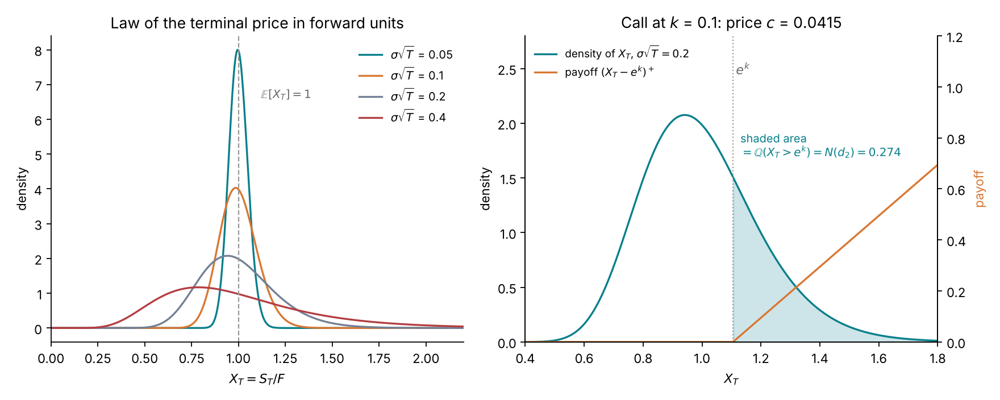
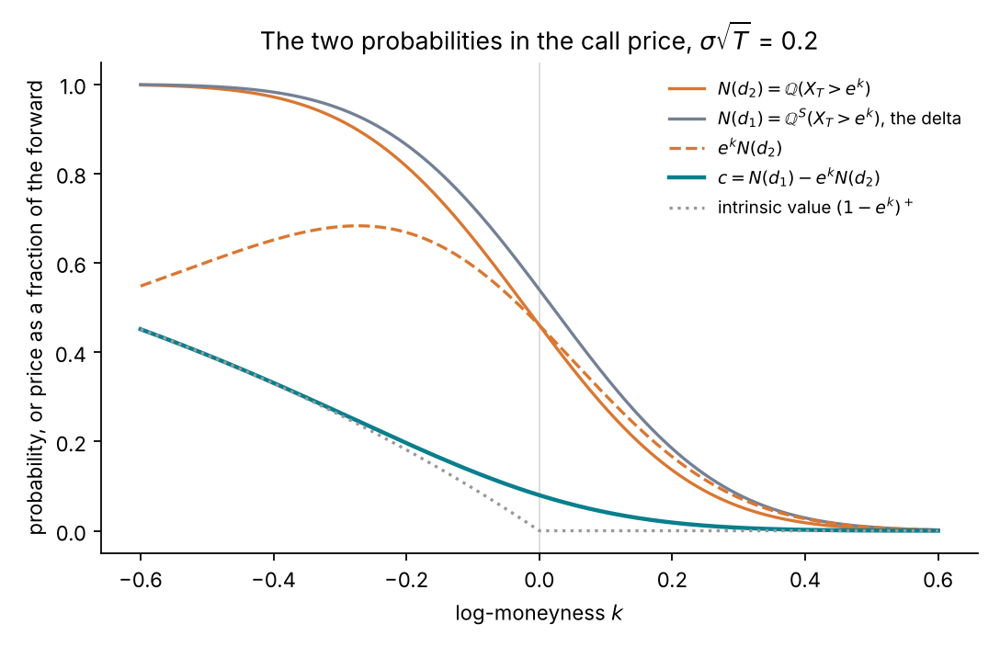
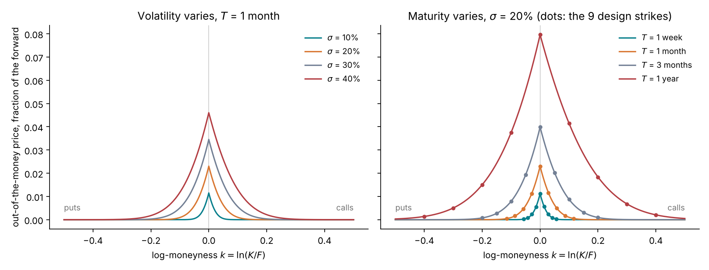
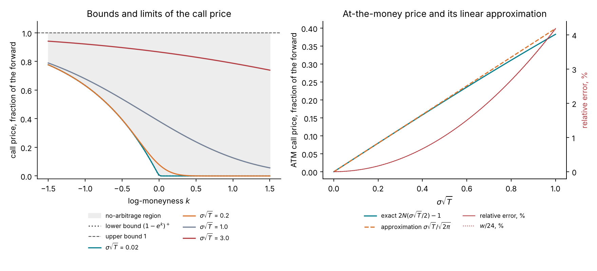
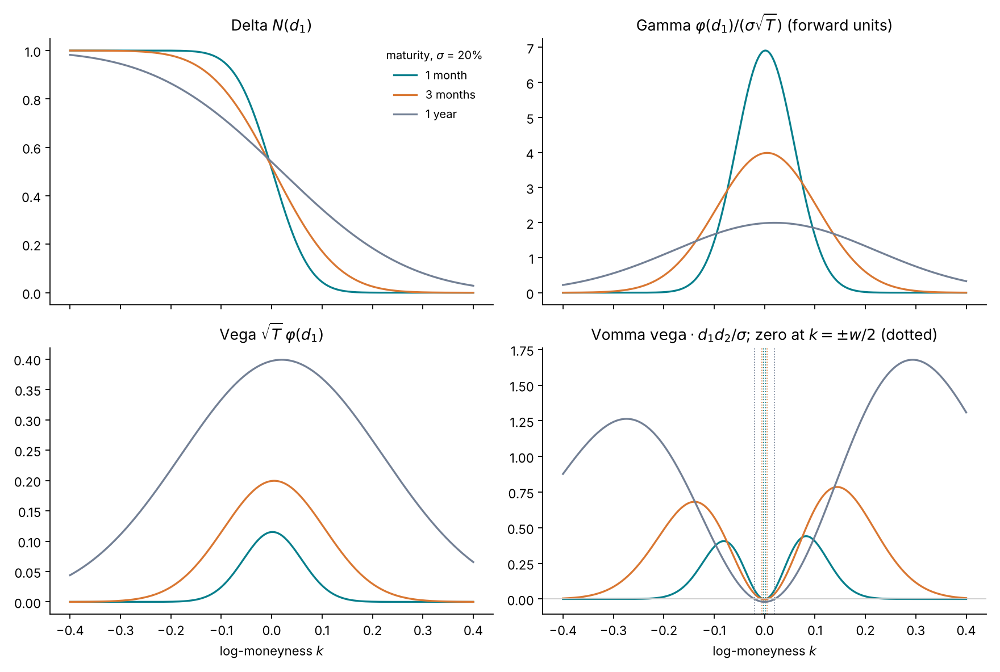

# Lecture 4. The Black–Scholes model

[Course index](README.md) · Previous: [Lecture 3. Brownian motion, SDEs and Itô's lemma](03-brownian-motion-and-ito.md) · Next: [Lecture 5. Implied volatility and the smile](05-implied-volatility-and-the-smile.md)

**What this lecture is for.** This lecture prices options under the simplest model of a price, geometric Brownian motion with a constant volatility. It shows that an option can be replicated by trading the underlying, that the replication cost does not depend on the expected return, and that the price is therefore an expectation under the pricing measure $\mathbb{Q}$ of Lecture 2, constructed here explicitly. It then derives the Black–Scholes formula step by step, studies how the price depends on its inputs and how it responds to them (the Greeks), and lists where the model's assumptions fail. Section 4.12 lets the volatility depend on time and prices a forward-start call under it.

**Where it sits in the course.** Lectures 2 and 3 supplied the no-arbitrage results and the stochastic calculus. This lecture combines them into the first complete pricing model. Lecture 5 uses its formula as the market's quoting convention, implied volatility, and shows that real prices reject the model's constant volatility. Every later model is built to fix that failure, and every later price is still reported through this formula. Part II (Lectures 6 to 9) uses it to introduce calibration and Bayesian inference.

## 4.1 The model and its assumptions

The Black–Scholes model (Black and Scholes 1973; Merton 1973) assumes:

1. **The price follows geometric Brownian motion** under the real-world measure $\mathbb{P}$: $dS_t / S_t = \mu\,dt + \sigma\,dW^{\mathbb{P}}_t$, with constant $\mu$ and $\sigma$.
2. **The interest rate $r$ and the dividend yield $q$ are constant.**
3. **Trading is continuous and frictionless**: any quantity can be bought or sold at any time, with no transaction costs and no restrictions on short selling.
4. **There is no arbitrage.**

Each assumption is relaxed somewhere. Deterministic rates and dividends that vary with maturity only change $D$ and $F$, which Lecture 2 reads off the market, so assumption 2 costs nothing in forward units. Assumption 3 fails in practice, and Section 4.3 measures the cost. Assumption 1 is the one the course is about: Lecture 1 showed that real volatility is not constant, and Lectures 10 and 13 replace it.

## 4.2 Pricing by replication: the Black–Scholes equation

Let $V(t, S)$ be the value of an option when the underlying is at $S$ at time $t$. By Itô's lemma (Lecture 3) with $dS = \mu S\,dt + \sigma S\,dW^{\mathbb{P}}$:

$$
dV = \Big(\partial_t V + \mu S\,\partial_S V + \tfrac12\sigma^2 S^2\,\partial_{SS} V\Big)dt + \sigma S\,\partial_S V\, dW^{\mathbb{P}} .
$$

Build a portfolio that holds the option and is short $\Delta$ units of the underlying. The short position pays the dividends, $q S\,dt$ per unit. The portfolio's value is $\Pi = V - \Delta S$, and over $dt$ it changes by

$$
d\Pi = dV - \Delta\, dS - \Delta\, q S\, dt .
$$

Substitute $dV$ and $dS$ and choose $\Delta = \partial_S V$. The two $dW^{\mathbb{P}}$ terms are $\sigma S\,\partial_S V\,dW^{\mathbb{P}} - \Delta\,\sigma S\,dW^{\mathbb{P}} = 0$, and the two $\mu$ terms are $\mu S\,\partial_S V\,dt - \Delta\,\mu S\,dt = 0$. What remains is

$$
d\Pi = \Big(\partial_t V + \tfrac12\sigma^2 S^2\,\partial_{SS} V - q S\,\partial_S V\Big)dt .
$$

The portfolio has no random term: it is riskless over $dt$. By no-arbitrage, a riskless portfolio earns the riskless rate, $d\Pi = r\,\Pi\,dt = r\,(V - S\,\partial_S V)\,dt$. Equating the two expressions gives the **Black–Scholes equation**:

$$
\partial_t V + (r - q)\,S\,\partial_S V + \tfrac12\sigma^2 S^2\,\partial_{SS} V - r V = 0, \qquad V(T, S) = \text{payoff}(S).
$$

Each term has a meaning. $\partial_t V$ is the **time decay** (theta). $(r - q)S\,\partial_S V$ is the carry of the hedge. $\tfrac12\sigma^2 S^2\,\partial_{SS} V$ is the convexity gain from the price's moves: the Itô term of Lecture 3, with $\partial_{SS} V$, the **gamma**, as its weight. $-rV$ is the funding of the option's value.

**The expected return $\mu$ has disappeared.** It cancelled together with the random term, because the hedge removes all exposure to the direction of the move. Two traders who disagree about $\mu$ but agree on $\sigma$ agree on the option's price, since both can replicate it at the same cost. This is fortunate: Lecture 3 showed that $\mu$ is almost impossible to estimate and $\sigma$ is easy.

## 4.3 What hedging achieves in practice

The argument above assumes continuous rebalancing at the true volatility. A simulation shows what happens when either assumption is relaxed.

The seller of a three-month at-the-money call, with $\sigma = 20\%$ and zero rates, receives the model price, 3.99% of the forward, and holds $\Delta = \partial_S V$ units of the underlying, rebalanced at fixed intervals. At maturity the seller pays the payoff. The final profit and loss (P&L) would be exactly zero under continuous rebalancing.

*Figure 4.1.* How to read the figure: each histogram comes from 20,000 simulated paths.

- **Left.** With daily rebalancing, the P&L has mean zero and a standard deviation of 0.43% of the forward, about a tenth of the premium, whether the price drifts at −10% or +25% a year. The drift does not matter, as the derivation said.
- **Centre.** The P&L's standard deviation falls from 1.64% with monthly rebalancing to 0.43% daily and 0.10% with 20 rebalancings a day: it is proportional to $1/\sqrt{n}$, the same rate as the Euler error of Lecture 3. Continuous hedging is a limit that real hedging approaches slowly.
- **Right.** The seller prices and hedges at 20%, but the price actually moves with 15%, 20% or 25% volatility. The mean P&L is +1.00%, 0.00% and −0.99% of the forward.

The right panel shows what an option is. Over $dt$, a seller hedged at $\Delta = \partial_S V$ gains $-dV + \Delta\,dS$. With zero rates, Itô's lemma and the Black–Scholes equation ($\partial_t V = -\tfrac12\sigma^2 S^2 \Gamma$, with $\Gamma = \partial_{SS}V$) give

$$
d\text{P\&L} = \tfrac12\,\Gamma\,S^2\Big(\sigma^2\,dt - \Big(\frac{dS}{S}\Big)^2\Big).
$$

Each instant, the seller earns the model variance $\sigma^2 dt$ and pays the realized squared return, weighted by the gamma. **A hedged option is a position on realized against implied variance.** With zero drift, the expected P&L is exactly the premium minus the expected payoff, $c(\sigma_{\text{model}}) - c(\sigma_{\text{realized}})$: $3.99\% - 2.99\% = 1.00\%$ when the realized volatility is 15%. This is why the volatility in the formula is the quantity options trade on, and why Lecture 5 reads it back out of prices.

## 4.4 From the equation to an expectation: the pricing measure

The Black–Scholes equation is a linear partial differential equation with a terminal condition. The **Feynman–Kac theorem** writes its solution as an expectation:

$$
V(t, S) = e^{-r(T-t)}\;\mathbb{E}\big[\,\text{payoff}(S_T) \,\big|\, S_t = S\big], \qquad \text{where } \frac{dS_u}{S_u} = (r - q)\,du + \sigma\, dW^{\mathbb{Q}}_u .
$$

The expectation is taken under a process whose drift is $r - q$, not $\mu$. The measure under which the price has this drift is the pricing measure $\mathbb{Q}$ of Lecture 2, which exists here explicitly. Girsanov's theorem (Lecture 3) constructs it. Write the real-world dynamics as

$$
\frac{dS_t}{S_t} = \mu\,dt + \sigma\,dW^{\mathbb{P}}_t = (r - q)\,dt + \sigma\Big(dW^{\mathbb{P}}_t + \lambda\,dt\Big), \qquad \lambda = \frac{\mu - r + q}{\sigma} .
$$

The number $\lambda$ is the **market price of risk**: the excess expected return per unit of volatility. Reweighting the paths by $Z_T = \exp(-\lambda W^{\mathbb{P}}_T - \tfrac12\lambda^2 T)$ makes $W^{\mathbb{Q}}_t = W^{\mathbb{P}}_t + \lambda t$ a Brownian motion, and the price then has drift $r - q$ and the same $\sigma$. Lecture 3, Figure 3.8 showed this reweighting at work.

**Interpretation.** Under $\mathbb{Q}$, every asset earns the riskless rate on average, as if investors did not care about risk; hence the name **risk-neutral**. $\mathbb{Q}$ is not a belief about the future. It is the set of weights that prices consistently, and it differs from $\mathbb{P}$ by the market price of risk. Only the drift differs; the volatility is the same under both, because it is a property of each path.

## 4.5 In forward units

Lecture 2 showed that in forward units rates and dividends drop out. Under $\mathbb{Q}$ the forward $F_t(T) = S_t e^{(r-q)(T-t)}$ satisfies, by Itô's lemma,

$$
\frac{dF_t(T)}{F_t(T)} = \frac{dS_t}{S_t} - (r - q)\,dt = \sigma\, dW^{\mathbb{Q}}_t .
$$

The derivative of $e^{(r-q)(T-t)}$ in $t$ cancels the drift, so the forward is a martingale. At maturity $F_T(T) = S_T$. With $X_t = F_t(T)/F_0(T)$, $X_0 = 1$, the call price in forward units is

$$
c = \frac{C}{D(T)\,F_0(T)} = \mathbb{E}^{\mathbb{Q}}\big[(X_T - e^{k})^+\big], \qquad \frac{dX_t}{X_t} = \sigma\,dW^{\mathbb{Q}}_t, \qquad k = \ln\frac{K}{F_0(T)} .
$$

Everything about the market (spot, rates, dividends) sits in $D$ and $F$. The model's content is the law of $X_T$, which depends on one number, $\sigma$.

## 4.6 The law of the terminal price

Lecture 3 solved this SDE: with drift zero, $\ln X_T = -\tfrac12\sigma^2 T + \sigma W^{\mathbb{Q}}_T$. Write $w = \sigma^2 T$ for the **total variance** and $Z \sim \mathcal{N}(0, 1)$:

$$
\ln X_T = -\tfrac12 w + \sqrt{w}\,Z, \qquad \ln X_T \sim \mathcal{N}\big(-\tfrac12 w,\ w\big).
$$

The mean is $\mathbb{E}[X_T] = e^{-w/2}\,\mathbb{E}[e^{\sqrt w Z}] = e^{-w/2}e^{w/2} = 1$, as no-arbitrage requires: the $-\tfrac12 w$ is the convexity correction that keeps the mean at the forward. The density of $X_T$ is

$$
q(x) = \frac{1}{x\sqrt{2\pi w}}\exp\!\Big(-\frac{(\ln x + \tfrac12 w)^2}{2w}\Big), \qquad x > 0 .
$$

*Figure 4.2.* How to read the figure: in the left panel, a small $\sigma\sqrt{T}$ gives a narrow, nearly symmetric density around 1. As $\sigma\sqrt{T}$ grows, the density widens, its peak moves below 1, and a long right tail keeps the mean at 1. In the right panel, the call struck at $e^{0.1} = 1.105$ pays $(X_T - e^k)^+$, which is positive only in the shaded region. The probability of that region is 0.274, and the expected payoff, the price, is 0.0415 of the forward.

## 4.7 The Black–Scholes formula, derived

Split the expectation into the two parts of the payoff:

$$
c = \mathbb{E}\big[X_T\,\mathbf{1}\lbrace X_T > e^k\rbrace\big] - e^k\,\mathbb{Q}\big(X_T > e^k\big).
$$

**The second term.** The call ends in the money when $-\tfrac12 w + \sqrt{w} Z > k$, that is when $Z > (k + \tfrac12 w)/\sqrt{w}$. Define

$$
d_2 = \frac{-k - \tfrac12 w}{\sqrt{w}} .
$$

By the symmetry of the normal law, $\mathbb{Q}(Z > -d_2) = N(d_2)$, where $N$ is the standard normal cumulative distribution function, $N(x) = \mathbb{Q}(Z \le x)$, and $\varphi = N'$ is its density.

**The first term.** Write it as an integral over $z$ and combine the exponents:

$$
\mathbb{E}\big[X_T\,\mathbf{1}\lbrace Z > -d_2\rbrace\big] = \int_{-d_2}^{\infty} e^{-\frac12 w + \sqrt{w} z}\,\varphi(z)\,dz = \int_{-d_2}^{\infty} \frac{1}{\sqrt{2\pi}}\, e^{-\frac12 (z - \sqrt{w})^2}\,dz ,
$$

because $-\tfrac12 w + \sqrt{w}z - \tfrac12 z^2 = -\tfrac12(z - \sqrt w)^2$ (completing the square). The integrand is the normal density shifted by $\sqrt w$, so the integral is $\mathbb{Q}(Z > -d_2 - \sqrt{w}) = N(d_2 + \sqrt w)$. Define $d_1 = d_2 + \sqrt{w}$. The **Black–Scholes formula** in forward units is

$$
c(k, T; \sigma) = N(d_1) - e^{k} N(d_2), \qquad d_{1,2} = \frac{-k \pm \tfrac12\sigma^2 T}{\sigma\sqrt{T}},
$$

and in currency, $C = D(T)\,F_0(T)\,c$.

**What the two terms mean.** $N(d_2) = \mathbb{Q}(X_T > e^k)$ is the risk-neutral probability that the call is exercised, and $e^k N(d_2)$ is the expected strike payment. $N(d_1)$ is the same exercise probability under a different measure, the **share measure** $\mathbb{Q}^S$, which reweights each path by $X_T$ (a valid reweighting, since $X_T > 0$ and $\mathbb{E}[X_T] = 1$). Under $\mathbb{Q}^S$, $\ln X_T \sim \mathcal{N}(+\tfrac12 w, w)$, which is why $d_1$ has $+\tfrac12 w$. $N(d_1)$ is also the hedge ratio (Section 4.10).

*Figure 4.3.* How to read the figure: both probabilities fall from 1 to 0 as the strike rises, with $N(d_1)$ always above $N(d_2)$, because the share measure tilts weight toward high outcomes. The call price is the gap between $N(d_1)$ and the dashed curve $e^k N(d_2)$. Deep in the money (left) it approaches the intrinsic value; deep out of the money (right) it approaches zero.

## 4.8 The put, parity and a symmetry

By put–call parity in forward units (Lecture 2), $p = c - 1 + e^k$. Substituting the formula and using $1 - N(x) = N(-x)$:

$$
p(k, T; \sigma) = e^{k} N(-d_2) - N(-d_1).
$$

The formula has a symmetry between puts and calls. Changing $k$ to $-k$ maps $d_1$ to $-d_2$ and $d_2$ to $-d_1$, so

$$
p(k) = e^{k}\, c(-k) .
$$

**Where the symmetry comes from.** Write the put under the share measure $\mathbb{Q}^S$ of Section 4.7, which reweights each path by $X_T$, and set $Y_T = 1/X_T$:

$$
p(k) = \mathbb{E}^{\mathbb{Q}}\big[(e^k - X_T)^+\big] = \mathbb{E}^{\mathbb{Q}}\big[X_T\,(e^k Y_T - 1)^+\big] = \mathbb{E}^{\mathbb{Q}^S}\big[(e^k Y_T - 1)^+\big] = e^{k}\,\mathbb{E}^{\mathbb{Q}^S}\big[(Y_T - e^{-k})^+\big].
$$

Under $\mathbb{Q}^S$, $\ln X_T \sim \mathcal{N}(+\tfrac12 w, w)$, so $\ln Y_T = -\ln X_T \sim \mathcal{N}(-\tfrac12 w, w)$: $Y_T$ under $\mathbb{Q}^S$ has exactly the law of $X_T$ under $\mathbb{Q}$. The last expectation is therefore $c(-k)$.

**Interpretation.** Under Black–Scholes, the law of the price seen in units of cash ($\mathbb{Q}$) and the law of cash seen in units of the asset ($\mathbb{Q}^S$) are the same log-normal, and the only asymmetry between a put at $k$ and a call at $-k$ is the factor $e^{k}$ that converts strike units. At $k = -0.4$ the put costs $e^{-0.4} = 0.67$ times the call at $k = +0.4$. Lecture 1 found the market's ratio for SPY at one year and $\delta = \mp 2$ to be 45: the market's distribution is far from this symmetric benchmark. Lecture 5 measures the asymmetry as the skew.

## 4.9 What the price depends on, and its limits

The formula depends on $\sigma$ and $T$ only through the total variance $w = \sigma^2 T$, and on the strike only through $k$. Doubling the maturity has the same effect as multiplying the volatility by $\sqrt 2$.

*Figure 4.4.* How to read the figure: each curve peaks at the money and falls in both wings. In the left panel, a higher volatility raises the price at every strike; at the money the price is close to $0.4\,\sigma\sqrt{T}$, almost proportional to $\sigma$ (1.15% of the forward at 10%, 4.6% at 40%). In the right panel, a longer maturity raises the price and widens the curve, both as $\sqrt T$. The dots are the design strikes $\delta \in \lbrace -2, \dots, 2\rbrace$ of Lecture 1: because $\delta$ scales $k$ by $\sqrt T$, they sample the same part of every curve. For SPY's real prices (Lecture 1, Figure 1.6), the left side is far above this symmetric shape.

**Limits.** As $w \to 0$, $d_1$ and $d_2$ go to $+\infty$ if $k < 0$ and to $-\infty$ if $k > 0$, so $c \to (1 - e^k)^+$, the intrinsic value: with no uncertainty the option is worth its sure payoff. As $w \to \infty$, $d_1 \to +\infty$ and $d_2 \to -\infty$, so $c \to 1$, the upper bound of Lecture 2. Between these limits, $c$ is strictly increasing in $w$ (Section 4.10), so the price moves continuously from the lower to the upper no-arbitrage bound as the volatility goes from zero to infinity. Lecture 5 relies on this to define implied volatility.

**The at-the-money price.** At $k = 0$, $d_1 = \tfrac12\sqrt w$ and $d_2 = -\tfrac12\sqrt w$, so $c = 2N(\tfrac12\sqrt w) - 1$. A Taylor expansion of $N$ around 0, $N(x) = \tfrac12 + \varphi(0)\big(x - \tfrac{x^3}{6}\big) + O(x^5)$ with $\varphi(0) = 1/\sqrt{2\pi}$, gives

$$
c_{\text{ATM}} = \frac{\sigma\sqrt{T}}{\sqrt{2\pi}}\Big(1 - \frac{\sigma^2 T}{24} + \dots\Big) \approx 0.4\,\sigma\sqrt{T} .
$$

*Figure 4.5.* How to read the figure: in the left panel, with $\sigma\sqrt T = 0.02$ the price is nearly the intrinsic value; with $\sigma\sqrt T = 3$ it is between 0.74 and 0.94 across the strikes shown, approaching the upper bound 1. In the right panel, the linear approximation overstates the at-the-money price by a relative error of $w/24$: 0.17% at $\sigma\sqrt T = 0.2$ (20% volatility over one year), and 4% only at $\sigma\sqrt T = 1$. For the design grid, the approximation is accurate to better than 0.2%.

## 4.10 The sensitivities (Greeks)

The holder of an option needs its sensitivities to the market inputs, to hedge them. They follow from one identity. Since $d_1^2 - d_2^2 = (d_1 - d_2)(d_1 + d_2) = \sqrt{w}\cdot(-2k/\sqrt{w}) = -2k$,

$$
\varphi(d_1) = e^{k}\,\varphi(d_2) .
$$

**Delta.** With $C = D\,(F N(d_1) - K N(d_2))$ and $\partial d_1/\partial F = \partial d_2/\partial F = 1/(F\sigma\sqrt T)$,

$$
\frac{\partial C}{\partial F} = D\,N(d_1) + D\,\frac{F\varphi(d_1) - K\varphi(d_2)}{F\sigma\sqrt{T}} = D\,N(d_1),
$$

because the bracket vanishes by the identity ($K/F = e^k$). The hedge ratio with respect to the forward is $N(d_1)$ (in forward units, $D = 1$); with respect to the spot it is $e^{-qT}N(d_1)$.

**Gamma.** Differentiating $N(d_1)$ once more with respect to the forward, in forward units ($F = 1$): $\Gamma = \varphi(d_1)/(\sigma\sqrt{T})$. It is largest at the money and grows as maturity shortens: a short-dated at-the-money option's hedge must change quickly.

**Vega.** Differentiating with respect to $\sigma$, $\partial d_1/\partial\sigma - \partial d_2/\partial\sigma = \sqrt{T}$, and by the identity the $\varphi(d_2)$ term combines with the $\varphi(d_1)$ term:

$$
\frac{\partial c}{\partial \sigma} = \varphi(d_1)\frac{\partial d_1}{\partial\sigma} - e^{k}\varphi(d_2)\frac{\partial d_2}{\partial\sigma} = \sqrt{T}\,\varphi(d_1) > 0 .
$$

Vega is the same for a call and a put, since parity's $1 - e^k$ does not depend on $\sigma$. It is positive at every strike, which is the monotonicity used in Section 4.9.

**Theta and gamma.** In forward units the Black–Scholes equation reads $\partial_t c + \tfrac12\sigma^2 F^2\,\partial_{FF} c = 0$: the option loses value with time at exactly the rate its convexity gains from the moves. Equivalently, the price grows with maturity at the rate $\partial c/\partial T = \sigma\,\varphi(d_1)/(2\sqrt{T}) > 0$, the calendar monotonicity of Lecture 2.

**Vomma.** The curvature of the price in $\sigma$, $\partial^2 c/\partial\sigma^2$, determines what happens when $\sigma$ itself is uncertain. Using $\partial d_1/\partial\sigma = -d_2/\sigma$ and $\varphi'(x) = -x\varphi(x)$:

$$
\frac{\partial^2 c}{\partial \sigma^2} = \sqrt{T}\,\varphi'(d_1)\,\frac{\partial d_1}{\partial\sigma} = \sqrt{T}\,\varphi(d_1)\,\frac{d_1 d_2}{\sigma} = \text{vega}\cdot\frac{d_1 d_2}{\sigma}, \qquad d_1 d_2 = \frac{k^2 - w^2/4}{w} .
$$

The vomma is positive when $|k| > \tfrac12 w$, in the wings, and slightly negative in the narrow band $|k| < \tfrac12 w$ around the money.

*Figure 4.6.* How to read the figure: delta falls from 1 to 0 across the strikes, more steeply at short maturities. Gamma and vega peak at the money; gamma is larger at short maturities, vega at long ones (0.115 at one month, 0.40 at one year). Vomma is positive in both wings and crosses zero at $k = \pm\tfrac12 w$ (dotted), so close to the money that the negative band is barely visible.

**Why vomma matters for the course.** If the volatility is not a fixed number but random, a price is an average of Black–Scholes prices over the possible volatilities. By Jensen's inequality, the average of a function that is convex in $\sigma$ exceeds the function at the average $\sigma$. Wing options, whose price is convex in $\sigma$, are therefore worth more under a random volatility than under its average, and at-the-money options slightly less. Lecture 5 shows that this is how a random volatility produces the smile.

## 4.11 Where the model fails

The derivation is exact under its assumptions. Each assumption is contradicted by evidence already seen in the course:

| Assumption | Evidence against it | Where |
| --- | --- | --- |
| Constant volatility | Realized volatility of VOO between 6% and 96% over 21-day windows, and between 12.7% and 34.7% over calendar years | Lecture 1, Figure 1.2 |
| Normal log returns | 14 daily moves beyond four standard deviations where a normal law predicts 0.11; kurtosis 17.9 | Lecture 1, Figure 1.2 |
| Volatility independent of the price | Volatility rises by about 25% after the worst tenth of days and by about 8% after the best tenth | Lecture 3, Figure 3.7 |
| Continuous, costless hedging | Daily hedging leaves a P&L with a standard deviation of a tenth of the premium | Figure 4.1 |
| Symmetric law of the log price | SPY's one-year put at $\delta = -2$ costs 45 times the call at $\delta = +2$, against 0.67 under the model | Lecture 1, Figure 1.6; Section 4.8 |

The last line is the decisive one for calibration. No single value of $\sigma$ reproduces the market's option prices across strikes and maturities. Lecture 5 makes this precise by inverting the formula quote by quote, and the resulting pattern, the smile, is the data that the models of Lectures 10 and 13 are built to explain.

## 4.12 A term structure of volatility and the forward start

A forward-start call with strike-setting date $T_1$ and maturity $T_2$ pays $(S_{T_2}/S_{T_1} - 1)^+$ at $T_2$: it is a call struck at the money on the day $T_1$. Write $\tau = T_2 - T_1$. The tutorial's product has $T_1 = 63$ and $T_2 = 126$ business days.

**Under Black–Scholes.** The payoff $(S_{T_2}/S_{T_1} - 1)^+$ is a number, paid at $T_2$ per unit of notional. At $T_1$ it is the payoff of a call with strike 1 on the ratio $S_t/S_{T_1}$, which starts at 1. With zero carry its value at $T_1$ is the forward-unit price $c(0, \tau; \sigma)$ of Section 4.7, a constant that does not depend on $S_{T_1}$, and a constant known at $T_1$ is worth the same today:

$$
p_{\text{FS}} = c(0, \tau; \sigma) = 2N\Big(\tfrac12\sigma\sqrt{\tau}\Big) - 1 \;\approx\; 0.4\,\sigma\sqrt{\tau} .
$$

**With a deterministic volatility $\sigma(t)$.** The same argument holds with the total variance over $[T_1, T_2]$ in place of $\sigma^2\tau$. The forward-start price depends on $\int_{T_1}^{T_2}\sigma(t)^2\,dt$, the forward variance, while a vanilla at $T_2$ depends on $\int_0^{T_2}\sigma(t)^2\,dt$.

*Figure 4.7.* How to read the figure: term structure A is flat at 20%. Term structure B is 25% for three months and then 13.2%, chosen so that the total variance to six months is the same, $0.2^2 \times 0.5 = 0.02$. On the six-month quotes the two are indistinguishable: the at-the-money call costs 0.0564 of the forward under both, and the variance swap strike is 0.04 under both. The three-month call tells them apart, 0.0399 against 0.0498. The forward-start call prices at 0.0399 under A and 0.0264 under B, 34% lower. A bank that quotes only the six-month smile cannot price the forward-start; a bank that also quotes three months can, in this deterministic world, because the two maturities fix the forward variance.

Lecture 10, Section 10.10 prices the forward-start call under Heston, where it also depends on the dispersion of the variance at $T_1$.

## 4.13 Summary

1. A delta-hedged option is riskless under continuous trading, which gives the Black–Scholes equation; the expected return $\mu$ drops out.
2. Discrete hedging leaves an error proportional to $1/\sqrt{n}$. A hedged option earns the gap between the model's variance and the realized variance, weighted by gamma.
3. By Feynman–Kac, the price is a discounted expectation under $\mathbb{Q}$, where the drift is $r - q$. Girsanov's theorem builds $\mathbb{Q}$ by reweighting paths with the market price of risk $\lambda = (\mu - r + q)/\sigma$.
4. In forward units, $\ln X_T \sim \mathcal{N}(-\tfrac12 w, w)$ with $w = \sigma^2 T$, and $c = N(d_1) - e^k N(d_2)$. $N(d_2)$ and $N(d_1)$ are the exercise probabilities under $\mathbb{Q}$ and under the share measure.
5. Puts follow by parity and satisfy $p(k) = e^k c(-k)$.
6. The price depends on $w$ and $k$ only, rises from the intrinsic value to 1 as $w$ grows, and is about $0.4\,\sigma\sqrt{T}$ at the money.
7. Delta is $N(d_1)$, vega is $\sqrt T\varphi(d_1) > 0$, and vomma is positive in the wings, which links random volatility to the smile.
8. Real volatility is random, clustered and correlated with returns, and real option prices are asymmetric. The model fails in exactly the way Lectures 5, 10 and 13 address.
9. Under Black–Scholes a forward-start call from $T_1$ to $T_2$ costs $c(0, \tau; \sigma)$, an at-the-money call over $\tau = T_2 - T_1$. With a deterministic $\sigma(t)$ it depends on the forward variance $\int_{T_1}^{T_2}\sigma(t)^2\,dt$, which quotes at $T_2$ alone do not fix.

## References

- Black, F., Scholes, M. (1973). The pricing of options and corporate liabilities. *Journal of Political Economy* 81(3), 637–654. [doi](https://doi.org/10.1086/260062)
- Merton, R. C. (1973). Theory of rational option pricing. *Bell Journal of Economics and Management Science* 4(1), 141–183. [doi](https://doi.org/10.2307/3003143)
- El Karoui, N., Jeanblanc-Picqué, M., Shreve, S. E. (1998). Robustness of the Black and Scholes formula. *Mathematical Finance* 8(2), 93–126. [doi](https://doi.org/10.1111/1467-9965.00047) For the P&L of hedging at the wrong volatility.
- Shreve, S. E. (2004). *Stochastic calculus for finance II: continuous-time models*. Springer. Chapters 4 and 5.
- Gatheral, J. (2006). *The volatility surface: a practitioner's guide*. Wiley. Chapter 1.

Figures: `scripts/course/lecture04.py`, except Figure 4.7, which `scripts/course/lecture08.py` draws.
