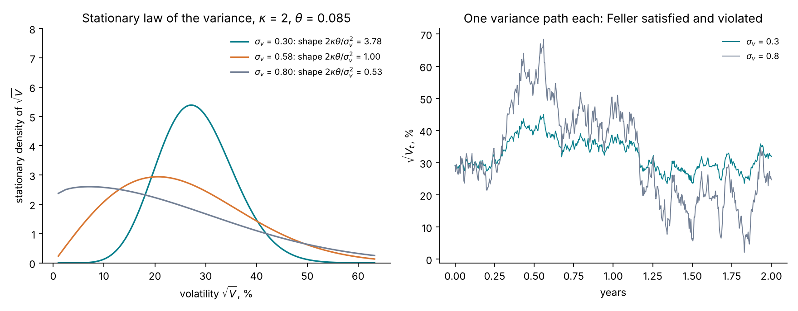
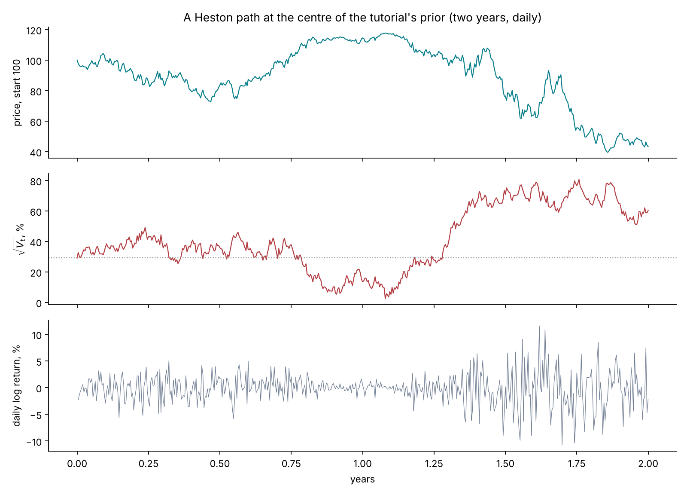
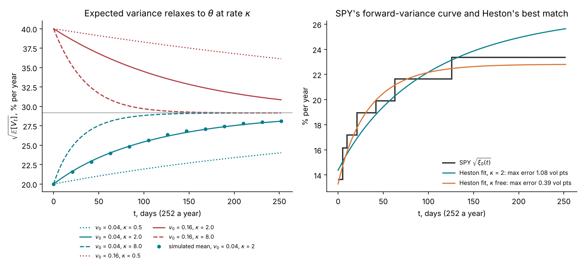
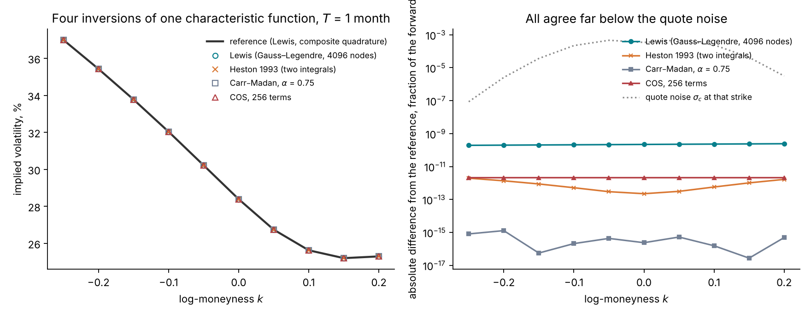
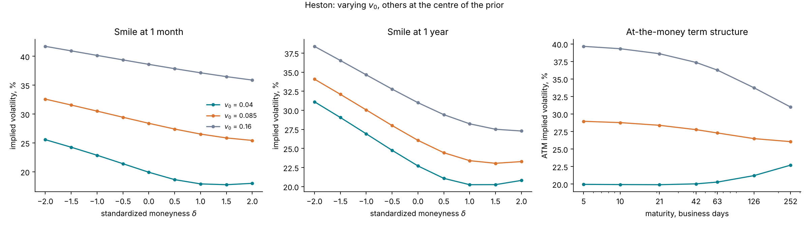
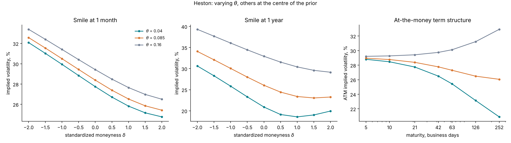
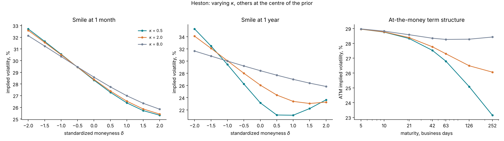
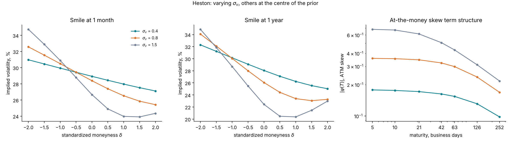
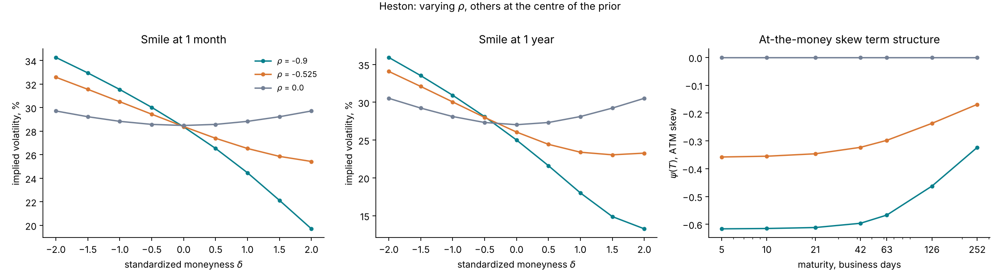
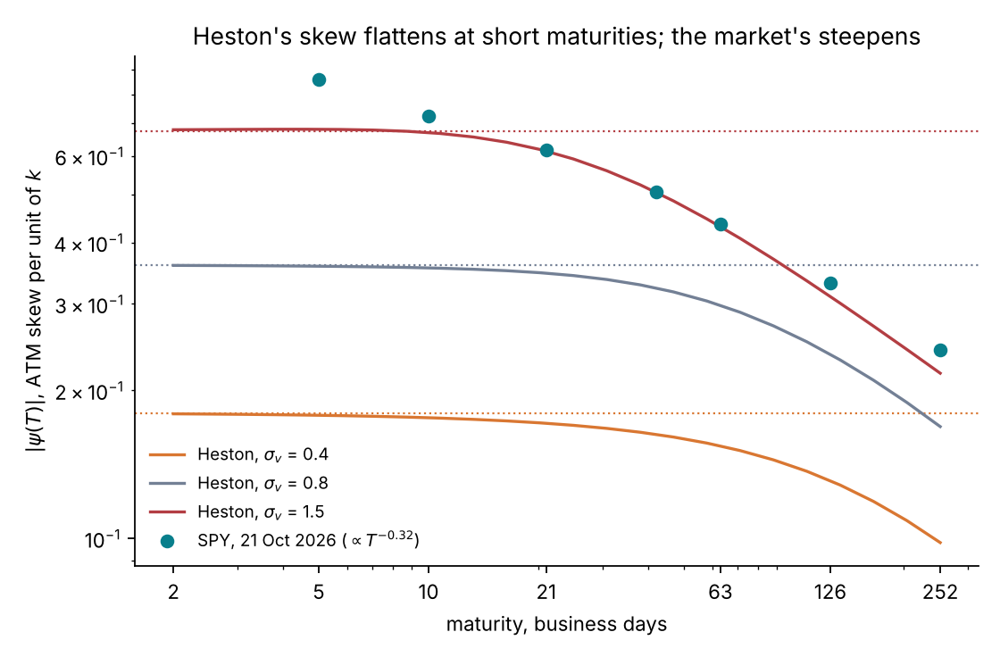

# Lecture 6. Stochastic volatility: the Heston model

[Course index](README.md) · Previous: [Lecture 5](05-implied-volatility-and-the-smile.md) · Next: [Lecture 7. Rough volatility: the rough Bergomi model](07-rough-bergomi.md)

**What this lecture is for.** This lecture builds the first model in which volatility is itself random: the Heston model. It defines the variance process and the meaning of each parameter, states when the variance can reach zero, simulates the model, and derives in closed form the expected variance and the variance-swap strike. It then derives the model's characteristic function step by step, shows how option prices are recovered from it by five Fourier methods, and explains the numerical controls the repository uses. Finally it shows how each parameter shapes the smile, derives the short-maturity skew, fits the model to the SPY smile of Lecture 5, and states where the fit fails.

**Where it sits in the course.** Lecture 5 showed two mechanisms behind the smile: a random volatility makes the smile curve up, and a negative correlation between volatility and price makes it slope down. Heston is the simplest model that contains both, with a pricing formula fast enough for exact Bayesian inference. In the tutorial it plays the role of the check: the amortized posterior is compared on Heston surfaces with the exact posterior (Lecture 13, study S3). Lecture 7 replaces it with rough Bergomi, which fits the term structure of the skew better and has no pricing formula. The tools of this lecture (characteristic functions, Fourier inversion, the short-maturity skew) are used again there.

## 6.1 From a constant volatility to a random variance

Lecture 4 assumed a constant volatility $\sigma$. Lectures 1 and 3 showed that real volatility changes over time, clusters, and rises after falls in the price. Lecture 5 showed that each of these facts leaves a mark on option prices. A model of option prices therefore needs an instantaneous variance $V_t$ that is itself a random process, with three properties:

1. **Positivity.** $V_t \ge 0$ at all times, since it is a variance.
2. **Mean reversion.** High variance tends to fall and low variance tends to rise, so that volatility clusters but does not drift away. Realized volatility in Lecture 1 rose to 96% in April 2020 and returned to about 13% within a year.
3. **Correlation with the price.** Shocks to the variance are negatively correlated with shocks to the price (the leverage effect of Lecture 3, Figure 3.7).

The price keeps the form of Lecture 4 with $\sigma$ replaced by $\sqrt{V_t}$. In forward units and under the pricing measure $\mathbb{Q}$ (Lectures 2 and 4):

$$
\frac{dX_t}{X_t} = \sqrt{V_t}\,dB_t, \qquad X_0 = 1 .
$$

The rest of this lecture chooses the dynamics of $V_t$.

## 6.2 The variance process

Heston (1993) lets the variance follow the square-root diffusion of Cox, Ingersoll and Ross (1985), originally a model of interest rates:

$$
dV_t = \kappa\,(\theta - V_t)\,dt + \sigma_v\,\sqrt{V_t}\,dW_t, \qquad V_0 = v_0 .
$$

Each term has a plain meaning.

- **$\kappa(\theta - V_t)\,dt$ is mean reversion.** When $V_t > \theta$ the drift is negative and pulls the variance down; when $V_t < \theta$ it pushes it up. $\theta$ is the **long-run variance** and $\kappa$ the **speed** of reversion. A deviation from $\theta$ halves in expectation after $\ln 2/\kappa$ years: about 4 months for $\kappa = 2$.
- **$\sigma_v\sqrt{V_t}\,dW_t$ is the shock to the variance.** $\sigma_v$ is the **volatility of variance**, or vol-of-vol. The shock is proportional to $\sqrt{V_t}$, so it shrinks as the variance approaches zero. This is what keeps $V_t$ non-negative.
- **$v_0$ is today's variance**, which the market does not quote directly. Its square root is the volatility that applies to the next instant.

**The stationary law.** If the process runs long enough, the distribution of $V_t$ settles to a Gamma law (Cox, Ingersoll and Ross 1985):

$$
V_\infty \sim \mathrm{Gamma}\Big(\text{shape } \frac{2\kappa\theta}{\sigma_v^2},\ \text{scale } \frac{\sigma_v^2}{2\kappa}\Big), \qquad \mathbb{E}[V_\infty] = \theta, \qquad \mathrm{Var}(V_\infty) = \frac{\theta\,\sigma_v^2}{2\kappa} .
$$

The variance of the stationary law grows with $\sigma_v$ and falls with $\kappa$: fast reversion keeps the variance close to $\theta$.

**The Feller condition.** Near zero, the drift pushes the variance up at the rate $\kappa\theta$, and the shock has size $\sigma_v\sqrt{V}$. Feller (1951) showed that zero is never reached if the drift wins:

$$
2\kappa\theta \;\ge\; \sigma_v^2 \qquad \text{(Feller condition)} .
$$

The condition is exactly that the Gamma shape $2\kappa\theta/\sigma_v^2$ is at least 1. With shape below 1, the stationary density $v^{\text{shape}-1}$ diverges at zero: the process spends a large share of time near zero and touches it, from where the drift pushes it back immediately. The price model remains well defined, and the pricing formula of Section 6.5 remains valid. The simulation needs care in every case: the Gaussian shock of an Euler step of Lecture 3 is unbounded, so the step can produce a negative $V$ whether or not the condition holds. Simulations therefore use the **full-truncation** scheme, which replaces $V$ by $\max(V, 0)$ inside the drift and the square root (Lord, Koekkoek and van Dijk 2010). When the condition fails, the variance spends more time near zero and the truncation acts more often.

*Figure 6.1.* How to read the figure: the left panel converts the Gamma law of $V$ into the density of $\sqrt{V}$. With $\sigma_v = 0.3$ the shape is 3.78, the density is concentrated around the long-run volatility $\sqrt{0.085} = 29\%$, and the probability of a volatility below 10% is 0.19%. At $\sigma_v = 0.583$ the shape is exactly 1, the Feller boundary, and that probability is 11.1%. With $\sigma_v = 0.8$ the shape is 0.53, the Feller condition fails, and the probability is 25.3%. The right panel simulates two years of daily variance with the same random numbers. With $\sigma_v = 0.8$ the volatility swings between 2.1% and 68%; with $\sigma_v = 0.3$ it stays between 23.5% and 45.0%.

**In the tutorial.** The Heston task fixes $\kappa = 2$ and draws $v_0$ and $\theta$ uniformly on $(0.01, 0.16)$, $\sigma_v$ on $(0.1, 1.5)$ and $\rho$ on $(-0.95, -0.1)$ (`heston_task` in `src/sbi4finance/calibration/tasks.py`; design document, [Heston](../design/calibration-design-document.md#heston)). At the centre of this prior, $2\kappa\theta = 0.34$ and $\sigma_v^2 = 0.64$, so the Feller condition fails. Over the whole prior box it fails for 67% of the parameter draws. Equity-index calibrations commonly violate it, as Section 6.10 shows for SPY.

## 6.3 The Heston model

Combining the price and the variance, with the correlation built as in Lecture 3, Section 3.7, gives the model under $\mathbb{Q}$ in forward units:

$$
\frac{dX_t}{X_t} = \sqrt{V_t}\,\big(\rho\,dW_t + \sqrt{1-\rho^2}\,dW^\perp_t\big), \qquad X_0 = 1,
$$

$$
dV_t = \kappa\,(\theta - V_t)\,dt + \sigma_v\sqrt{V_t}\,dW_t, \qquad V_0 = v_0 .
$$

The model has five parameters: $v_0$, $\theta$, $\kappa$, $\sigma_v$ and the correlation $\rho$ (written $\rho_H$ in the design document). The pair $(X_t, V_t)$ is a **Markov state**: its current value determines the distribution of the whole future. This is what makes the pricing problem of Section 6.5 solvable, and what rough Bergomi gives up in Lecture 7.

*Figure 6.2.* How to read the figure: the path is simulated by full-truncation Euler with 8 steps a day. The volatility (centre) wanders between 2.4% and 81% around its long-run level of 29% (dotted). The daily returns (bottom) are small when the volatility is low, around year 1 (a mean volatility of 17% between years 1 and 1.25), and large when it is high (55% from year 1.25 to 1.5, and 68% from 1.5 to 2): volatility clusters. Falls in the price come with rises in the volatility: from year 1.25 to year 2 the price falls from 104 to 44. Averaged over 400 simulated one-year paths, the correlation between the daily return and the daily change in variance is −0.52, close to $\rho = -0.525$, and the correlation between consecutive absolute returns is 0.24. Pooled over 4,000 such paths, the kurtosis of daily returns is 7.0, against 3 for a normal law and 17.9 for VOO (Lecture 1). The model reproduces the stylized facts of Lecture 1 in kind, though not the full size of the tails.

## 6.4 Expected variance and the variance swap

**Expected variance.** Take expectations of the variance equation. The Itô integral has mean zero (Lecture 3), so $m(t) = \mathbb{E}^{\mathbb{Q}}[V_t]$ satisfies the ordinary differential equation

$$
\frac{dm}{dt} = \kappa\,(\theta - m), \qquad m(0) = v_0, \qquad\text{so}\qquad \mathbb{E}^{\mathbb{Q}}[V_t] = \theta + (v_0 - \theta)\,e^{-\kappa t} .
$$

This is the model's **forward-variance curve** $\xi_0(t)$ of Lecture 5, Section 5.9. It starts at $v_0$ and relaxes exponentially to $\theta$.

**The variance-swap strike.** Integrating over $[0, T]$ gives the total variance and the fair strike of Lecture 5:

$$
w_{\text{var}}(T) = \int_0^T \mathbb{E}^{\mathbb{Q}}[V_t]\,dt = \theta T + (v_0 - \theta)\,\frac{1 - e^{-\kappa T}}{\kappa}, \qquad K_{\text{var}}(T) = \frac{w_{\text{var}}(T)}{T} .
$$

In Heston, variance-swap prices are therefore a function of three parameters, $(v_0, \theta, \kappa)$. Calibrating the model to the smile fixes them, and with them the variance swaps. Rough Bergomi takes the opposite approach in Lecture 7: the forward-variance curve is an input read from the market, and the parameters describe only the shape of the smile around it.

*Figure 6.3.* How to read the figure: the left panel plots $\sqrt{\mathbb{E}[V_t]}$. From $v_0 = 0.04$ (20%) or $v_0 = 0.16$ (40%), the curve moves toward $\sqrt{\theta} = 29\%$. With $\kappa = 0.5$, a share $e^{-0.5} = 61\%$ of the initial gap in variance remains after one year; with $\kappa = 8$, a share $e^{-8 \times 42/252} = 26\%$ remains after two months. The dots are the means of 20,000 simulated paths for $v_0 = 0.04$ and $\kappa = 2$; at one year the simulated mean variance is 0.0791 against the formula's 0.0789. The right panel shows SPY's forward-variance curve, read from the chain by replication (Lecture 5, Figure 5.7), which rises from 13.6% to 23.4% in volatility units. The Heston curves are fitted to SPY's 7 variance-swap strikes. With $\kappa$ fixed at 2, as in the tutorial's Heston task, the best curve misses a strike by up to 1.08 volatility points. With $\kappa$ free the fit chooses $\kappa = 6.2$ and misses by at most 0.39 points.

**A limit.** A single exponential is monotone. SPY's curve on this date happens to rise monotonically, so Heston can approximate it. A curve with a hump, or with a kink at an event date such as an election or a central-bank meeting, cannot be matched: the design document's Appendix J.2 shows a curve drawn from the tutorial's prior that the best Heston curve misses by up to 0.8 volatility points with $\kappa$ fixed at 2, and by up to 0.86 with $\kappa$ free.

## 6.5 The characteristic function

**Why it is the object to compute.** Lecture 2 showed that the vanilla prices at one maturity are equivalent to the distribution of $X_T$. A distribution is also determined by its **characteristic function**, the expected value of a complex exponential of the log price:

$$
\varphi_T(u) = \mathbb{E}^{\mathbb{Q}}\big[e^{iu\ln X_T}\big], \qquad u \in \mathbb{C} .
$$

If $\varphi_T$ is known in closed form, prices follow by a Fourier inversion (Section 6.6). For Black–Scholes, $\ln X_T \sim \mathcal{N}(-\tfrac12 w, w)$ gives $\varphi_T(u) = \exp\big(-\tfrac12 w\,(u^2 + iu)\big)$, with $w = \sigma^2 T$. For Heston, $\varphi_T$ is found by solving a partial differential equation.

**Step 1: the equation.** Write $x_t = \ln X_t$. By Itô's lemma (Lecture 3), $dx_t = -\tfrac12 V_t\,dt + \sqrt{V_t}\,dB_t$. Define

$$
f(t, x, v) = \mathbb{E}^{\mathbb{Q}}\big[e^{iu x_T} \,\big|\, x_t = x,\ V_t = v\big] .
$$

Because $(x_t, V_t)$ is Markov, $f(t, x_t, V_t)$ is the conditional expectation of a fixed random variable, so it is a martingale in $t$. A martingale has no drift. Itô's lemma for a function of two processes, with $(dx)^2 = v\,dt$, $(dV)^2 = \sigma_v^2 v\,dt$ and $dx\,dV = \rho\sigma_v v\,dt$, gives the drift, which must vanish:

$$
\partial_t f - \tfrac12 v\,\partial_x f + \kappa(\theta - v)\,\partial_v f + \tfrac12 v\,\partial_{xx} f + \rho\sigma_v v\,\partial_{xv} f + \tfrac12\sigma_v^2 v\,\partial_{vv} f = 0, \qquad f(T, x, v) = e^{iux} .
$$

**Step 2: the affine guess.** Every coefficient of the equation is affine (constant plus linear) in $v$. Try a solution that is exponential-affine in $x$ and $v$, with $\tau = T - t$ the time to maturity:

$$
f = \exp\big(iux + C(\tau) + D(\tau)\,v\big), \qquad C(0) = D(0) = 0 .
$$

Then $\partial_t f = -(C' + D' v) f$, $\partial_x f = iu f$, $\partial_{xx} f = -u^2 f$, $\partial_v f = D f$, $\partial_{vv} f = D^2 f$ and $\partial_{xv} f = iuD f$. Substituting and dividing by $f$:

$$
-C' - D'v - \tfrac12 v\,iu + \kappa\theta D - \kappa v D - \tfrac12 v u^2 + \rho\sigma_v v\,iuD + \tfrac12\sigma_v^2 v D^2 = 0 .
$$

**Step 3: separate the terms.** The equation holds for every $v$, so the terms without $v$ and the terms with $v$ vanish separately:

$$
C'(\tau) = \kappa\theta\,D(\tau), \qquad D'(\tau) = \tfrac12\sigma_v^2 D^2 - (\kappa - i\rho\sigma_v u)\,D - \tfrac12(u^2 + iu) .
$$

The second is a **Riccati equation**: a quadratic right-hand side. The first then gives $C$ by integration.

**Step 4: solve.** Write $b = \kappa - i\rho\sigma_v u$. The right-hand side of the Riccati equation is $\tfrac12\sigma_v^2 (D - D_+)(D - D_-)$, with roots

$$
D_\pm = \frac{b \pm d}{\sigma_v^2}, \qquad d = \sqrt{b^2 + \sigma_v^2\,(u^2 + iu)} .
$$

Separating variables, $dD/\big((D - D_+)(D - D_-)\big) = \tfrac12\sigma_v^2\,d\tau$, and integrating with $D(0) = 0$ gives

$$
D(\tau) = \frac{b - d}{\sigma_v^2}\cdot\frac{1 - e^{-d\tau}}{1 - g\,e^{-d\tau}}, \qquad g = \frac{b - d}{b + d},
$$

$$
C(\tau) = \frac{\kappa\theta}{\sigma_v^2}\Big[(b - d)\,\tau - 2\ln\frac{1 - g\,e^{-d\tau}}{1 - g}\Big] .
$$

At $t = 0$ the log price is $x_0 = 0$ and the variance $v_0$, so the characteristic function is

$$
\varphi_T(u) = \exp\big(C(T) + D(T)\,v_0\big) .
$$

**Checks.** $D(\tau) \to (b-d)/\sigma_v^2$ as $\tau \to \infty$, a finite limit. As $\sigma_v \to 0$ the variance becomes deterministic, and the formula tends to the Black–Scholes form $\exp(-\tfrac12(u^2 + iu)\,w_{\text{var}}(T))$ with the total variance of Section 6.4. The repository implements exactly these formulas, with the limits at $u = 0$ and $\sigma_v = 0$ handled explicitly (`src/sbi4finance/hkde.py`; design document, Appendix C.1).

**The little Heston trap.** Heston (1993) wrote the same solution with the growing exponential $e^{+d\tau}$ and $G = 1/g$. The two forms are equal as mathematical functions. Numerically they differ, because the complex logarithm has a branch cut. In the original form, the argument of $\ln\big((1 - G e^{d\tau})/(1 - G)\big)$ crosses the negative real axis as $u$ grows, for long maturities, and the principal value of the logarithm jumps by $2\pi i$. The decaying form above stays on one branch for all $T$ (Albrecher, Mayer, Schoutens and Tistaert 2007).

*Figure 6.4.* How to read the figure: at the centre of the prior and $T = 5$ years, the original form follows the correct function up to $u \approx 1.2$, then jumps from 0.7 to −0.7 and stays wrong; the largest gap between the two is 1.41. At one year the two forms agree to $3 \times 10^{-16}$. The right panel prices calls from each form with the same quadrature. At one year the prices agree exactly, at two years to $7 \times 10^{-7}$ of the forward, and at five years the original form is off by up to 0.085 of the forward, or 9.6 volatility points. The error is silent: nothing in the computation signals it.

## 6.6 From the characteristic function to prices

Five inversions are in common use. All rest on $\varphi_T$ and differ in how they write the inversion; the design document's Appendix J.1 compares the first two in detail.

**1. Two probabilities (Heston 1993).** Lecture 4 wrote the Black–Scholes call as $c = N(d_1) - e^k N(d_2)$, two exercise probabilities. The same decomposition holds for any model: $c = P_1 - e^k P_2$, with $P_2 = \mathbb{Q}(X_T > e^k)$ and $P_1$ the same probability under the share measure. Each probability is recovered from a characteristic function by the inversion formula of Gil-Pelaez (1951):

$$
P_2 = \frac12 + \frac1\pi\int_0^\infty \mathrm{Re}\Big[\frac{e^{-iuk}\,\varphi_T(u)}{iu}\Big]du, \qquad P_1 = \frac12 + \frac1\pi\int_0^\infty \mathrm{Re}\Big[\frac{e^{-iuk}\,\varphi_T(u - i)}{iu}\Big]du .
$$

The share measure's characteristic function is $\varphi_T(u - i)$ because it reweights each path by $X_T$, and $\mathbb{E}[X_T e^{iu\ln X_T}] = \varphi_T(u - i)$.

**2. One integral on a shifted line (Lewis 2001).** Writing the call payoff's Fourier transform in the log price and moving the integration contour to $\mathrm{Im}(u) = -\tfrac12$ merges the two integrals into one, with $x = -k$:

$$
c(k, T) = 1 - \frac{e^{-x/2}}{\pi}\int_0^\infty \mathrm{Re}\Big[e^{iux}\,\varphi_T\big(u - \tfrac{i}{2}\big)\Big]\frac{du}{u^2 + \tfrac14} .
$$

The integrand decays like $1/u^2$ before $\varphi_T$ decays, against $1/u$ for the two-probability form, and has no singularity at $u = 0$. Under Black–Scholes $\varphi_T(u - \tfrac i2) = \exp(-\tfrac12 w(u^2 + \tfrac14))$ is real, and the integral reproduces the formula of Lecture 4. The repository uses this form.

**3. A damped Fourier transform in the strike (Carr and Madan 1999).** The call price does not decay as $k \to -\infty$, so it has no Fourier transform in $k$. The damped price $e^{\alpha k} c(k)$ with $\alpha > 0$ does, and its transform is

$$
\psi_T(u) = \frac{\varphi_T\big(u - (\alpha + 1)i\big)}{\alpha^2 + \alpha - u^2 + i(2\alpha + 1)u}, \qquad c(k) = \frac{e^{-\alpha k}}{\pi}\int_0^\infty \mathrm{Re}\big[e^{-iuk}\,\psi_T(u)\big]\,du .
$$

Evaluated by the fast Fourier transform, one transform prices a whole grid of strikes. The method needs the moment $\mathbb{E}[X_T^{1+\alpha}]$ to be finite; in Heston such moments can become infinite at long maturities (Andersen and Piterbarg 2007), which limits the choice of $\alpha$.

**4. A cosine series for the density (Fang and Oosterlee 2008).** On a truncated interval $[a, b]$, the density of $\ln X_T$ is expanded in a cosine series whose coefficients are read off $\varphi_T$ directly:

$$
q(y) \approx \frac{2}{b - a}\sum_{j=0}^{N-1}{}' \;\mathrm{Re}\Big[\varphi_T\Big(\frac{j\pi}{b-a}\Big)\,e^{-ij\pi a/(b-a)}\Big]\cos\Big(j\pi\,\frac{y - a}{b - a}\Big),
$$

where the prime halves the first term. Integrating the put payoff against each cosine has a closed form, so a price is a finite sum. For smooth densities the error falls exponentially in $N$. The interval is set from the cumulants of $\ln X_T$.

**5. Projection on B-splines (Kirkby 2015).** The PROJ method projects the density onto a basis of B-splines and computes the coefficients from $\varphi_T$ with the fast Fourier transform. Kirkby (2015) introduced it for European options. Later work discretized the variance as a Markov chain, so that the projection steps through monitoring dates and prices Bermudan and barrier options under stochastic volatility with jumps (Kirkby, Nguyen and Cui 2017). The fypy library implements it, and Agazzotti et al. (2025) calibrated Heston with Kou jumps with it; the tutorial's study of 9 October 2026 used it (design document, Appendix J.1).

*Figure 6.5.* How to read the figure: the four methods are implemented in `scripts/course/lecture06.py` on the same characteristic function. They are compared with a reference: the Lewis integral by composite Gauss–Legendre quadrature (panels of width 1.5 with 64 nodes each, up to a cutoff of 284), which changes by $2 \times 10^{-15}$ of the forward when the panel width is halved. Their smiles coincide (left). On the right, Carr–Madan agrees with the reference to $1.3 \times 10^{-15}$ of the forward, the two-probability form to $2.0 \times 10^{-12}$, COS with 256 terms to $2.1 \times 10^{-12}$ (the same at 1,024 terms), and the Lewis rule with 4,096 nodes on $[0, 3{,}000]$ to between $1.9 \times 10^{-10}$ and $2.4 \times 10^{-10}$. The largest of these differences is 350 times smaller than the smallest quote noise at these strikes, $8.6 \times 10^{-8}$, which is that of the put at $k = -0.25$, beyond the design grid (whose one-month strikes span $k = \pm 0.115$). The reference matters at this level: a single Gauss–Legendre rule with 16,384 nodes on $[0, 8{,}000]$ is itself off by $1.6 \times 10^{-10}$, and one with 32,768 nodes on $[0, 400]$ by $2.6 \times 10^{-11}$. In this script COS took 0.0015 CPU-seconds for 10 prices, the two adaptive-quadrature methods about 0.037, and the vectorized Lewis quadrature 0.50; the timings describe this code on one run, not the methods' best implementations. The design document's Appendix J.1 compares the integrands of the two-probability and Lewis forms, and finds a largest price gap of $2 \times 10^{-10}$ of the forward on 13 one-week calls.

## 6.7 The quadrature ladder

The Lewis integral is computed by Gauss–Legendre quadrature on $[0, U]$ with a finite number of nodes. Two numbers control the error: the cutoff $U$ and the node count. The cutoff must reach the frequency at which the integrand has become negligible, and that frequency is set by how the characteristic function decays.

**How the integrand decays.** At small $u$, $\ln\varphi_T(u - \tfrac i2) \approx -\tfrac12 w\,(u^2 + \tfrac14)$, with $w$ the total variance to maturity: the decay is Gaussian. At large $u$ the solution of Section 6.5 takes a different form. With $b = \kappa - i\rho\sigma_v u$, the root $d$ grows like $\sigma_v\sqrt{1 - \rho^2}\,u$. Once $e^{-dT}$ is negligible, $D(T) \approx (b - d)/\sigma_v^2$, whose real part is about $-\sqrt{1 - \rho^2}\,u/\sigma_v$, and $C(T) \approx \kappa\theta T\,(b - d)/\sigma_v^2$ plus a term that tends to a constant. Hence

$$
\big|\varphi_T\big(u - \tfrac i2\big)\big| \approx e^{-c\,u}, \qquad c = \frac{(v_0 + \kappa\theta T)\sqrt{1 - \rho^2}}{\sigma_v}, \qquad u \gg \frac{1}{\sigma_v\sqrt{1 - \rho^2}\,T} .
$$

Beyond this crossover the decay is only exponential, and its rate $c$ is small when $v_0$ is small, $\sigma_v$ is large and $|\rho|$ is near 1. These are the contracts that need a large cutoff. The Gaussian form $\exp(-\tfrac12 w u^2)$ holds only below the crossover.

The repository therefore climbs a ladder of (nodes, cutoff) pairs: (512, 400), (1024, 600), (2048, 1500), (4096, 3000), (8192, 6000). A rung is accepted when it and the next rung both price every contract inside the no-arbitrage bounds of Lecture 2 (to $10^{-9}$ of the forward) and differ by at most $0.1\,\sigma_c$ on every contract, where $\sigma_c$ is the quote noise of Lecture 5. The finer rung's prices are kept, and their difference from the coarser rung is stored as a numerical diagnostic, separate from the quote noise.

*Figure 6.6.* How to read the figure: errors are measured against a reference computed by composite Gauss–Legendre quadrature (panels of width 1.5 with 64 nodes each) up to the cutoff $30/c$, which changes by less than $3 \times 10^{-11}\,\sigma_c$ when the panel width is halved. At the centre of the prior and one year (teal), every rung is within $7 \times 10^{-7}\,\sigma_c$ of the reference. At a corner of the prior, $v_0 = \theta = 0.01$, $\sigma_v = 1.5$, $\rho = -0.95$ and one week (red), the first rung's error is $0.49\,\sigma_c$, the second's $0.081\,\sigma_c$, the third's $0.0028\,\sigma_c$, and the last two are below $2 \times 10^{-5}\,\sigma_c$. The repository's pricer applied to these nine contracts rejects the first three rungs, because each prices at least one out-of-the-money option below zero by more than the tolerance of $10^{-9}$; the first two rungs also differ by $0.51\,\sigma_c$. The pair (4,096, 3,000) and (8,192, 6,000) prices inside the bounds, agrees to $2 \times 10^{-5}\,\sigma_c$, and is accepted, returning the finest prices. The right panel shows why. Beyond their crossover frequencies, $u \approx 1.5$ and $u \approx 108$, both integrands follow the exponential tail $e^{-cu}/(u^2 + \tfrac14)$ (dotted). A fit of $\ln|\varphi_T(u - \tfrac i2)|$ over each tail gives $c = 0.2712$ against the formula's 0.2713 for the centre, and $c = 0.0021643$ against 0.0021643 for the corner. The integrand falls below $10^{-10}$ at $u \approx 59$ for the centre and only at $u \approx 3{,}200$ for the corner, beyond the cutoffs of 400, 600 and 1,500 of the first three rungs. The corner is hard because $v_0$ is small (0.01), $\sigma_v$ is large (1.5) and $|\rho|$ is near 1 ($\sqrt{1 - \rho^2} = 0.31$); the maturity enters $c$ only through $\kappa\theta T$, which is 0.0004 here. Every one of the 60,000 Heston surfaces of the tutorial's bank passed the ladder (design document, [Heston](../design/calibration-design-document.md#heston)).

## 6.8 How each parameter shapes the smile

The five figures below vary one parameter at a time around the centre of the prior ($v_0 = \theta = 0.085$, $\kappa = 2$, $\sigma_v = 0.8$, $\rho = -0.525$), with prices from the repository's Fourier pricer at 4,096 nodes. Each figure shows the smile at one month and at one year on the design grid, and a term structure: of the at-the-money level for $v_0$, $\theta$ and $\kappa$, and of the at-the-money skew for $\sigma_v$ and $\rho$. The skew is measured as in Lecture 5, by a quadratic through the five quotes nearest the money.

*Figure 6.7: the initial variance $v_0$.* How to read the figure: $v_0$ sets the short end. The one-month at-the-money volatility is 19.9%, 28.4% and 38.6% for $v_0 = 0.04, 0.085, 0.16$, close to $\sqrt{v_0}$ = 20%, 29% and 40%. The term structure (right) starts near $\sqrt{v_0}$ and moves toward the long-run level with maturity: from 20.0% at one week to 22.7% at one year for $v_0 = 0.04$, and from 39.7% to 31.0% for $v_0 = 0.16$. A higher $v_0$ also flattens the short smile, because the skew scales like $1/\sqrt{v_0}$ (Section 6.9).

*Figure 6.8: the long-run variance $\theta$.* How to read the figure: $\theta$ sets the long end. The one-year at-the-money volatility is 20.9%, 26.1% and 32.9% for $\theta = 0.04, 0.085, 0.16$, while the one-month level barely moves (27.7%, 28.4%, 29.4%). With $v_0 = \theta = 0.085$ the term structure still falls, from 29.0% at one week to 26.1% at one year, although the expected variance is flat at $\theta$: at-the-money implied volatility measures roughly the average volatility, which a random variance pushes below the root of the average variance (Lecture 5, Section 5.7), and the gap grows with maturity as more variance uncertainty accumulates.

*Figure 6.9: the speed of mean reversion $\kappa$.* How to read the figure: $\kappa$ acts through time. At one month the three smiles nearly coincide. At one year, slow reversion ($\kappa = 0.5$) leaves a strongly skewed and curved smile (35.3% at $\delta = -2$, 23.2% at the money), and fast reversion ($\kappa = 8$) a flat one (31.6% and 28.4%). Fast reversion averages out the variance shocks over a long horizon, so long smiles look more like Black–Scholes with volatility $\sqrt{\theta}$: the one-year at-the-money level is 28.4% for $\kappa = 8$, against 29% for $\sqrt{\theta}$.

*Figure 6.10: the vol-of-vol $\sigma_v$.* How to read the figure: $\sigma_v$ controls how random the variance is, and so both the curvature and, through the correlation, the skew. The one-month skew is about proportional to $\sigma_v$: 0.17, 0.35 and 0.61 for $\sigma_v = 0.4, 0.8, 1.5$. The one-year smile acquires a pronounced curvature at $\sigma_v = 1.5$ (34.9% at $\delta = -2$, 22.4% at the money, 23.0% at $\delta = +2$). The at-the-money level falls as $\sigma_v$ rises (28.9%, 28.4% and 26.7% at one month), by the convexity argument of Figure 6.8. On the right, each skew is flat up to about one month and falls beyond.

*Figure 6.11: the correlation $\rho$.* How to read the figure: $\rho$ rotates the smile around the money. With $\rho = -0.9$ the one-month smile falls from 34.3% at $\delta = -2$ to 19.7% at $\delta = +2$; with $\rho = 0$ it is symmetric, 29.7% at both ends. A zero correlation gives a smile that is symmetric in log-moneyness (Renault and Touzi 1996), which is the pure mixing mechanism of Lecture 5. The skew (right) is proportional to $\rho$: −0.62, −0.36 and 0 at one week, in the ratio of −0.9 to −0.525 to 0.

## 6.9 The short-maturity skew

The figures show that Heston's skew is flat at short maturities. This section derives the limit and compares it with the market.

**Step 1: skew and skewness.** For a log price whose distribution is close to normal with total variance $w$ and a small standardized skewness $\gamma_1$, a Gram–Charlier expansion of the option price around Black–Scholes gives the implied volatility to first order as (Backus, Foresi, Li and Wu 1997)

$$
\sigma_{\text{imp}}(k) \approx \sigma\Big(1 + \frac{\gamma_1}{6}\,\frac{k}{\sigma\sqrt{T}}\Big), \qquad\text{so}\qquad \psi(T) = \frac{\partial\sigma_{\text{imp}}}{\partial k}\Big|_{k=0} \approx \frac{\gamma_1}{6\sqrt{T}} .
$$

A negatively skewed log price gives a negative skew of implied volatility. The skew of the smile is the skewness of the risk-neutral law, divided by $6\sqrt{T}$.

**Step 2: the skewness of Heston's log price at short maturities.** Over a short horizon the variance moves little from $v_0$. Ignore mean reversion, which acts over times of order $1/\kappa$, and linearize: $V_t \approx v_0 + \sigma_v\sqrt{v_0}\,W_t$, so $\sqrt{V_t} \approx \sqrt{v_0} + \tfrac12\sigma_v W_t$. The martingale part of the log price is then

$$
M_T = \int_0^T\sqrt{V_t}\,dB_t \approx \sqrt{v_0}\,B_T + \frac{\sigma_v}{2}\int_0^T W_t\,dB_t .
$$

The first term is normal with variance $v_0 T$ and no skewness. The third cumulant, to first order in $\sigma_v$, comes from the cross term $3\,\mathbb{E}\big[(\sqrt{v_0}B_T)^2\cdot\tfrac{\sigma_v}{2}\int_0^T W_t\,dB_t\big]$. Write $B_T^2 = 2\int_0^T B_t\,dB_t + T$ (Lecture 3, Section 3.3). The constant $T$ multiplies an integral of mean zero, and the Itô isometry gives $\mathbb{E}\big[\int B\,dB\int W\,dB\big] = \int_0^T\mathbb{E}[B_t W_t]\,dt = \int_0^T\rho t\,dt = \tfrac12\rho T^2$. Hence

$$
\kappa_3 \approx 3\,v_0\,\frac{\sigma_v}{2}\cdot 2\cdot\frac{\rho T^2}{2} = \frac32\,\rho\,\sigma_v\,v_0\,T^2, \qquad \gamma_1 = \frac{\kappa_3}{(v_0 T)^{3/2}} = \frac32\,\frac{\rho\,\sigma_v}{\sqrt{v_0}}\,\sqrt{T} .
$$

The drift term $-\tfrac12\int V\,dt$ contributes nothing at this order, because its product with $B_T^2$ has an odd Gaussian moment.

**Step 3: the limit.** Combining the two steps, the $\sqrt{T}$ cancels:

$$
\psi(T) \;\longrightarrow\; \frac{\gamma_1}{6\sqrt{T}} = \frac{\rho\,\sigma_v}{4\sqrt{v_0}}, \qquad T \to 0 .
$$

This is the textbook short-maturity Heston skew (Gatheral 2006; Alòs, León and Vives 2007). It is a constant: the skewness of the log price grows like $\sqrt{T}$, exactly as fast as the $6\sqrt{T}$ that converts it into a skew. Mean reversion only lowers the skew at maturities of order $1/\kappa$ and beyond.

*Figure 6.12.* How to read the figure: each solid line is a Heston skew at the centre of the prior, from two trading days to one year; each dotted line is its limit $|\rho\sigma_v|/(4\sqrt{v_0})$. For $\sigma_v = 0.8$ the limit is 0.360, the skew is 0.359 at two days and 0.346 at one month, and it falls to 0.169 at one year. SPY's skews (dots, Lecture 5) rise from 0.24 at one year to 0.86 at one week along a power law $T^{-0.32}$, steepening as maturity shortens. On log–log axes a Heston curve is flat on the left and falling on the right; SPY's points are a straight line with negative slope. No Heston curve follows them at both ends: $\sigma_v = 1.5$ matches SPY from one to three months and is too flat at one week.

## 6.10 Fitting Heston to the SPY smile

**The fit.** The model is fitted to the 63 SPY quotes of Lecture 5 by weighted least squares,

$$
\hat\theta = \arg\min_\theta \sum_{c=1}^{63}\Big(\frac{P_c(\theta) - y_c}{\sigma_c}\Big)^2,
$$

over $(v_0, \theta, \kappa, \sigma_v, \rho)$ within wide bounds, from three starting points, with the repository's Fourier pricer at 4,096 nodes and a final check at 8,192. Lecture 9 explains why the weights $1/\sigma_c^2$ make this the maximum-likelihood estimate under the tutorial's noise model. The two fits below, with $\kappa$ free and with $\kappa = 2$ fixed, took 87 CPU-seconds and 956 surface evaluations.

| | $v_0$ | $\theta$ | $\kappa$ | $\sigma_v$ | $\rho$ | RMS residual | largest residual | within $2\sigma_c$ |
| --- | --- | --- | --- | --- | --- | --- | --- | --- |
| $\kappa$ free | 0.0177 (13.3%) | 0.0509 (22.6%) | 3.78 | 1.37 | −0.628 | 0.84 | 2.29 | 62 of 63 |
| $\kappa = 2$ fixed | 0.0182 (13.5%) | 0.0657 (25.6%) | 2 | 1.14 | −0.631 | 1.03 | 2.93 | 58 of 63 |

The residuals are in units of the quote noise $\sigma_c$. By this measure Heston fits SPY's grid on this date: a model that is exactly right would give a root-mean-square residual near 1.

*Figure 6.13.* How to read the figure: the fit with $\kappa$ free is shown.

- **Left.** The model follows the one-year smile closely. At one week it is above the market between $\delta = -1.5$ and the money and below it at $\delta = +2$, by 2.2 volatility points.
- **Centre.** The residuals have structure. From two weeks to two months, the model is above the quotes at $\delta = -1$ and $-0.5$ (by 0.5 to 1.3 noise units) and below them at the money (by 1.1 to 1.7) and at $\delta = +0.5$ (by 0.9 to 1.5). At one week it is above from $\delta = -1$ to the money (by 1.4 to 2.3). At $\delta = -2$ it is below the quotes at every maturity (by 0.4 to 1.5). Near the money the model's short smiles are too curved: the quadratic estimator of Lecture 5 gives a curvature of 25.4 at two weeks against SPY's 18.1, 16.5 at one month against 11.0, and 9.0 at two months against 5.9.
- **Right.** With the same estimator, the model's skew is 1.15 at one week against SPY's 0.86, and 0.91 against 0.72 at two weeks; from two months on the two agree. The fitted skew follows a power law with exponent −0.41 over the grid, against SPY's −0.32. Below one week, outside the grid, the model's skew flattens toward its limit of 1.62 (dashed).

**Where the fit fails.** Four facts qualify the good residuals.

1. **The parameters are extreme.** To produce a steep skew at short maturities, the fit uses a vol-of-vol of 1.37 a year with $v_0 = 0.0177$. The Feller condition fails by a factor of five: $2\kappa\theta = 0.385$ against $\sigma_v^2 = 1.89$. The variance process implied by these parameters spends much of its time near zero.
2. **The shape is wrong in a structured way.** The large vol-of-vol that produces the short skew also over-curves the short smiles (centre panel), and the model's skew is a flat-then-falling curve on log–log axes rather than SPY's straight line (Section 6.9).
3. **The noise model is loose in the wings on this date.** The quote noise $\sigma_c$ is set as a volatility noise times the vega at $\sigma_{\text{ref}} = 20\%$ (Lecture 5, Section 5.3). SPY's implied volatilities were well below 20% on this date, and at the market's own implied volatility the same $\sigma_c$ corresponds to 0.30 volatility points at the money but 7.0 points for the one-week call at $\delta = +2$ and 5.1 points for the one-year call at $\delta = +2$. The 2.2-point miss at the one-week $\delta = +2$ call is therefore only $0.2\,\sigma_c$. Lecture 9 returns to this choice.
4. **The variance swaps are inconsistent with the market.** The fitted $(v_0, \theta, \kappa)$ imply variance-swap volatilities (Section 6.4) of 13.8%, 14.2%, 15.0%, 16.2%, 17.2%, 19.0% and 20.6% at the 7 design maturities. SPY's replicated values (Lecture 5) are 13.6%, 15.0%, 16.2%, 17.6%, 18.4%, 20.1% and 21.8%: the model is below by 0.8 to 1.4 volatility points from two weeks on. The replication uses strikes down to $\delta = -8$, which the fit does not see. The fitted model puts less variance in the far put wing than the market does, as its negative residuals at $\delta = -2$ already suggest.

**Interpretation.** One day's 63 quotes, with this noise model, do not reject Heston. What they show is that Heston can match the short skew only with an extreme vol-of-vol, which distorts the short smiles, and that its variance-swap curve is tied to its smile parameters and need not agree with the market's. These are the two defects that rough Bergomi addresses in Lecture 7: its skew follows a power law in $T$ with one parameter, and its forward-variance curve is an input.

## 6.11 Why Heston is the check and not the example

Heston's characteristic function makes the 63 model prices that one evaluation of the likelihood of Lecture 9 needs cost a median of 0.020 CPU-seconds at one rung of the quadrature ladder, 1,024 nodes (`tutorial_final/results/calibration/costs/costs.json`, study S9). A checked evaluation prices at least two rungs, so it costs at least twice that. One Monte Carlo surface of rough Bergomi costs 4.96 CPU-seconds at the first rung of its path ladder, measured on a flat 20% curve without the error-budget check (same file), and 11.9 CPU-seconds on average across the pilot bank, where the budget is enforced (Lecture 7, Section 7.8). The Heston chains of study S3, with an exact likelihood, needed about 12,300 evaluations for 400 effective draws (same file). At that count an exact posterior costs about 250 CPU-seconds for Heston at one rung (500 or more with the ladder), and for rough Bergomi at least 17 CPU-hours at 4.96 seconds per surface, or about 41 CPU-hours at the bank's average. A chain on rough Bergomi's estimated likelihood would need more evaluations still (Lecture 11), so these are lower bounds. Heston therefore has an exact posterior to which the amortized posterior can be compared, surface by surface; this is the check of study S3 (Lecture 13). A desk using Heston would not need simulation-based inference: the exact posterior is affordable. Rough Bergomi, whose smile has the right shape and whose posterior is unaffordable by MCMC, is where the method is needed (Lecture 7, and the design document's [Why Heston is the check and not the example](../design/calibration-design-document.md#why-heston-is-the-check-and-not-the-example)).

## 6.12 Summary

1. Heston makes the variance a square-root process, $dV = \kappa(\theta - V)dt + \sigma_v\sqrt{V}dW$, correlated with the price by $\rho$. $\kappa$ is the speed of mean reversion, $\theta$ the long-run variance, $\sigma_v$ the vol-of-vol and $v_0$ today's variance.
2. The variance has a Gamma stationary law. It never reaches zero if $2\kappa\theta \ge \sigma_v^2$ (Feller). The tutorial's prior violates the condition for 67% of its draws. An Euler simulation needs full truncation in every case, and the truncation acts more often when the condition fails; pricing is unaffected.
3. The expected variance is $\theta + (v_0 - \theta)e^{-\kappa t}$, so the forward-variance curve and the variance-swap strikes are functions of three parameters.
4. The characteristic function is exponential-affine in the variance, with coefficients that solve Riccati equations in closed form. The original Heston form crosses a branch cut at long maturities and can silently misprice by several volatility points; the decaying form does not.
5. Prices follow from the characteristic function by the two-probability form, the Lewis integral, Carr–Madan, COS or PROJ. All agree far below the quote noise. The repository uses Lewis with a quadrature ladder accepted at $0.1\,\sigma_c$.
6. $v_0$ sets the short level, $\theta$ the long level, $\kappa$ how fast the smile flattens with maturity, $\sigma_v$ the curvature and the skew's size, and $\rho$ the skew's sign and size.
7. The short-maturity skew tends to the constant $\rho\sigma_v/(4\sqrt{v_0})$, while SPY's keeps steepening like $T^{-0.32}$.
8. Fitted to SPY on 21 October 2026, Heston has residuals within the quote noise, with a vol-of-vol of 1.37, the Feller condition violated fivefold, over-curved short smiles, and variance-swap strikes 0.8 to 1.4 points below the market's.
9. One Heston likelihood costs 0.02 CPU-seconds per quadrature rung, so its exact posterior is affordable in minutes; rough Bergomi's costs at least 17 CPU-hours. Heston is the tutorial's check, and rough Bergomi its example.

## References

- Heston, S. L. (1993). A closed-form solution for options with stochastic volatility with applications to bond and currency options. *Review of Financial Studies* 6(2), 327–343. [doi](https://doi.org/10.1093/rfs/6.2.327)
- Cox, J. C., Ingersoll, J. E., Ross, S. A. (1985). A theory of the term structure of interest rates. *Econometrica* 53(2), 385–407. [RePEc](https://ideas.repec.org/a/ecm/emetrp/v53y1985i2p385-407.html)
- Feller, W. (1951). Two singular diffusion problems. *Annals of Mathematics* 54(1), 173–182.
- Lord, R., Koekkoek, R., van Dijk, D. (2010). A comparison of biased simulation schemes for stochastic volatility models. *Quantitative Finance* 10(2), 177–194. [EUR repository](https://repub.eur.nl/pub/18571)
- Albrecher, H., Mayer, P., Schoutens, W., Tistaert, J. (2007). The little Heston trap. *Wilmott Magazine*, no. 1, 83–92. [Serval](https://serval.unil.ch/notice/serval:BIB_7042C88010EE)
- Gil-Pelaez, J. (1951). Note on the inversion theorem. *Biometrika* 38(3–4), 481–482.
- Lewis, A. L. (2001). A simple option formula for general jump-diffusion and other exponential Lévy processes. Working paper. [RePEc](https://ideas.repec.org/p/vsv/svpubs/explevy.html)
- Carr, P., Madan, D. B. (1999). Option valuation using the fast Fourier transform. *Journal of Computational Finance* 2(4), 61–73. [Risk.net](https://www.risk.net/journal-of-computational-finance/2160495/option-valuation-using-the-fast-fourier-transform)
- Fang, F., Oosterlee, C. W. (2008). A novel pricing method for European options based on Fourier-cosine series expansions. *SIAM Journal on Scientific Computing* 31(2), 826–848. [CWI](https://ir.cwi.nl/pub/13283)
- Kirkby, J. L. (2015). Efficient option pricing by frame duality with the fast Fourier transform. *SIAM Journal on Financial Mathematics* 6(1), 713–747. [doi](https://doi.org/10.1137/140989480)
- Kirkby, J. L., Nguyen, D., Cui, Z. (2017). A unified approach to Bermudan and barrier options under stochastic volatility models with jumps. *Journal of Economic Dynamics and Control* 80, 75–100. [doi](https://doi.org/10.1016/j.jedc.2017.05.001)
- Agazzotti, G., Aglieri Rinella, C., Aguilar, J.-P., Kirkby, J. L. (2025). Calibration and option pricing with stochastic volatility and double exponential jumps. *Journal of Computational and Applied Mathematics* 465, 116563. [doi](https://doi.org/10.1016/j.cam.2025.116563); [arXiv](https://arxiv.org/abs/2502.13824)
- Andersen, L. B. G., Piterbarg, V. V. (2007). Moment explosions in stochastic volatility models. *Finance and Stochastics* 11(1), 29–50. [doi](https://doi.org/10.1007/s00780-006-0011-7)
- Renault, E., Touzi, N. (1996). Option hedging and implied volatilities in a stochastic volatility model. *Mathematical Finance* 6(3), 279–302. [RePEc](https://ideas.repec.org/a/bla/mathfi/v6y1996i3p279-302.html)
- Backus, D., Foresi, S., Li, K., Wu, L. (1997). Accounting for biases in Black–Scholes. CRIF Working Paper 30, Fordham University. [Fordham](https://research.library.fordham.edu/crif_working_papers/30)
- Alòs, E., León, J. A., Vives, J. (2007). On the short-time behavior of the implied volatility for jump-diffusion models with stochastic volatility. *Finance and Stochastics* 11(4), 571–589. [RePEc](https://ideas.repec.org/a/spr/finsto/v11y2007i4p571-589.html)
- Gatheral, J. (2006). *The volatility surface: a practitioner's guide*. Wiley. Chapters 2 and 3.

Figures: `scripts/course/lecture06.py`.
