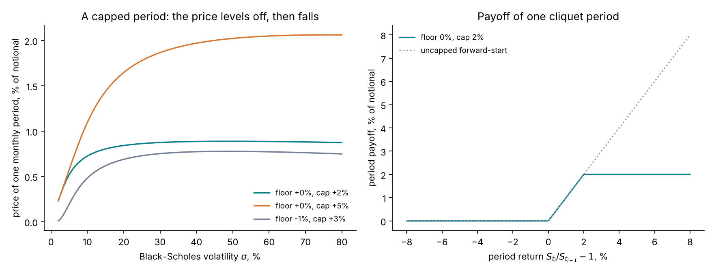
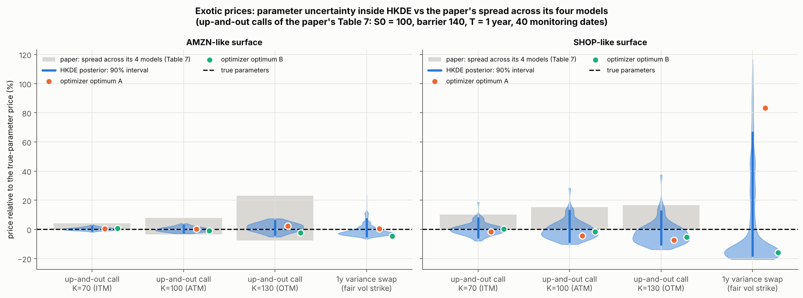
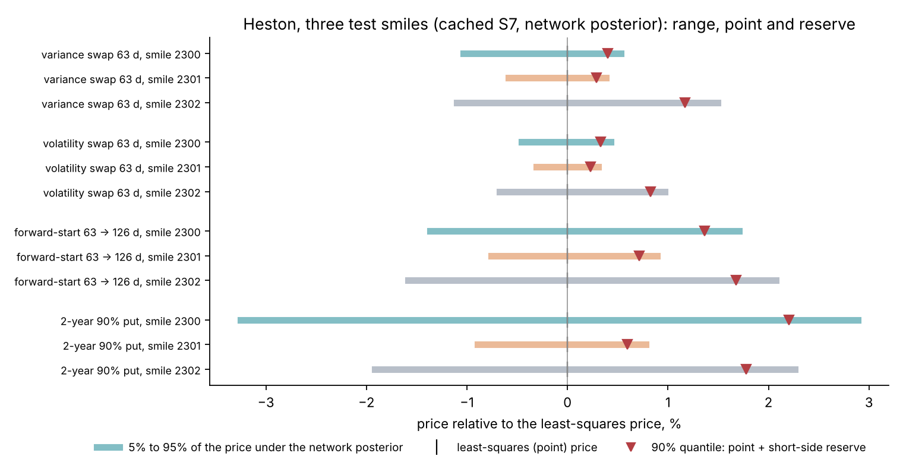
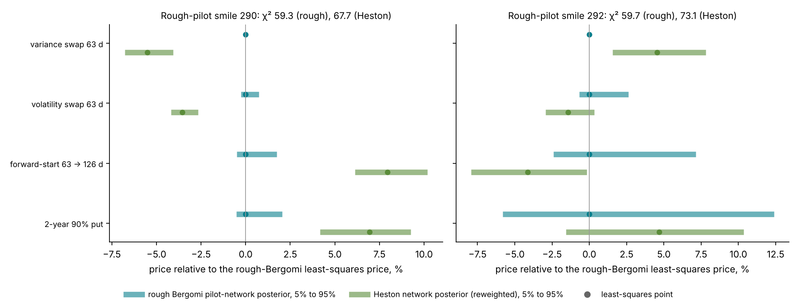

# Lecture 6. Marking a product the smile does not quote

[Course index](README.md) · Previous: [Lecture 5. Implied volatility and the smile](05-implied-volatility-and-the-smile.md) · Next: [Lecture 7. Calibration as estimation](07-calibration-as-estimation.md)

**What this lecture is for.** This lecture explains why the problem of the course matters to the people who will hear the tutorial. It states the procedure that marks a product the smile does not quote, defines the products a bank sells that the smile does not pin down (the variance swap, the volatility swap, the forward-start call and the cliquet), and shows that their prices move when the calibration moves within what the quotes allow. It then summarizes what the literature has measured about this calibration risk and states what the regulations ask a bank to report about it: a range of plausible values and a point at 90% confidence. It ends with the baselines the course uses for the inputs that the quotes do not determine.

**Where it sits in the course.** Part I ended with the observation that today's smile does not determine the forward smile (Lecture 5). This lecture opens Part II and turns that observation into the practitioner's problem. Lecture 7 then treats calibration as estimation and shows where the classical tools fall short, Lecture 8 shows what a posterior adds, and Lecture 9 shows how a network learns the posterior from simulations. Heston and rough Bergomi, which appear in some of this lecture's figures, are built in Lectures 10 and 13. The four products defined here are the products priced under the posterior in Lectures 11 and 15.

**Its part in the argument.** This lecture states the problem and the argument of the course (Section 6.8). Every later lecture tests a part of that argument.

## 6.1 The marking procedure

A product the smile does not quote is marked in six steps.

1. **Read the chain.** Keep the out-of-the-money quotes that have a bid, and compute each quote's implied volatility (Lecture 5).
2. **Smooth the smile.** Fit a smooth smile to each expiry, free of static arbitrage, and interpolate across expiries in total variance (Lecture 5). Gatheral and Jacquier (2014) build such surfaces with the SVI parametrization. The course reads the chain onto its 63-point design grid with a smoothing spline per expiry (Lecture 5, Section 5.4).
3. **Read the forward-variance curve.** Read it from the variance-swap strip, at the maturities whose strikes support the strip (Lecture 5, Section 5.9). Bergomi (2005) calibrates the curve to variance-swap levels, which vanillas replicate statically. Bayer, Friz and Gatheral (2016) use the log-contract strip on a surface fitted with SVI, because variance-swap quotes are poor and wide. El Euch, Gatheral and Rosenbaum (2019) fix the curve "to match at-the-money volatilities".
4. **Calibrate.** Calibrate the model's remaining parameters to the smile (Lectures 7 and 8).
5. **Price.** Price the product with the calibrated model. This price is the mark.
6. **Report the uncertainty.** Report how uncertain the mark is, because the rules ask for it (Section 6.6).

In formulas, the mark and the reserve are

$$
\text{mark}(\Pi) = p_\Pi(\hat\theta;\ \xi_0), \qquad \text{reserve}(\Pi) = q_{0.9}\big(p_\Pi\big) - p_\Pi(\hat\theta;\ \xi_0) .
$$

Here $p_\Pi(\theta; \xi_0)$ is the model price of a product with payoff $\Pi$ (Lecture 1, Section 1.7), $\xi_0$ is the forward-variance curve of step 3, $\hat\theta$ are the parameters of step 4, and $q_{0.9}(p_\Pi)$ is the 90% point of a range of plausible prices (Section 6.6). The mark needs only $\hat\theta$. The reserve needs the range, and the range needs to know how far $\theta$ can move while the model still reproduces the quotes. The rest of this lecture shows why that distance matters, product by product.

The course treats the 63 grid values of step 2 as independent quotes with a stated noise. That is an observation model (Lecture 7), not a property of the chain: the grid values are read from a spline through many quotes, which correlates neighbouring points (Lecture 7, Section 7.1). Lecture 16 instead uses a thin chain's own quotes, at their own strikes and maturities.

## 6.2 What the smile pins down

Lecture 2 showed that the vanilla prices at one maturity $T$ determine the risk-neutral law of the terminal price $X_T = S_T/F_0(T)$, and with it the price of every payoff $g(X_T)$ at that maturity. A bank therefore needs no model for:

- vanillas at the quoted maturities and strikes, which it marks at their quotes;
- any payoff of $X_T$ at a quoted maturity, which it can replicate with a strip of vanillas;
- the variance swap at a quoted maturity, by the log-contract argument of Lecture 5 (Section 6.3).

It needs a model for everything else, in three cases:

1. **Strikes and maturities outside the quotes.** The tutorial's 2-year 90% put lies beyond the last design maturity of one year. Its price needs the law of $X_2$, which no quote gives. A model extrapolates it, and the extrapolation depends on the model's parameters.
2. **Payoffs that depend on the price at several dates.** The forward-start call, the cliquet and the barrier option depend on the joint law of $S$ at several dates. Lecture 2, Section 2.10 showed that the vanillas do not determine this joint law.
3. **Payoffs that depend on the path's variance.** The volatility swap pays $\sqrt{Q_T}$, a nonlinear function of the realized variance. Its price depends on the whole distribution of $Q_T$, while the vanillas determine only its mean.

Section 6.3 defines the four products of the tutorial in this order.

## 6.3 Four products and what they depend on

### The variance swap: priced by the smile

A variance swap with maturity $T$ pays $N\,(Q_T - K_{\text{var}})$ at $T$, where $Q_T = \frac{252}{n}\sum_{i=1}^{n} r_i^2$ is the realized variance of the $n$ daily log returns (Lecture 1, Section 1.2) and $N$ is a notional. The fair strike makes the swap cost nothing: $K_{\text{var}} = \mathbb{E}^{\mathbb{Q}}[Q_T]$. For continuous paths $Q_T \approx \frac{1}{T}\int_0^T V_t\,dt$, and Lecture 5, Section 5.9 derived

$$
K_{\text{var}}(T) = \frac{1}{T}\,\mathbb{E}^{\mathbb{Q}}\Big[\int_0^T V_t\,dt\Big] = \frac{1}{T}\int_0^T \xi_0(t)\,dt = \frac{1}{T}\Big(2\int_{-\infty}^{0} p(k, T)\,e^{-k}\,dk + 2\int_0^{\infty} c(k, T)\,e^{-k}\,dk\Big) .
$$

The last expression is a strip of out-of-the-money vanillas. The variance swap is therefore priced by the smile at maturity $T$, in every model with continuous paths.

Under Heston the model's strike is a function of its parameters, and so inherits their calibration uncertainty (Lecture 10, Section 10.4). Under rough Bergomi, with continuous monitoring and a fixed curve, it is the integral of the input curve and inherits none (Lecture 13). A real variance swap uses daily returns, and Lecture 13 shows that the daily-monitored rough-Bergomi strike depends on the model's parameters, by a few tenths of a percent to about one percent of the strike.

### The volatility swap: priced by the spread of realized variance

A volatility swap pays $N\,(\sqrt{Q_T} - K_{\text{vol}})$, with fair strike $K_{\text{vol}} = \mathbb{E}^{\mathbb{Q}}[\sqrt{Q_T}]$. The square root is concave, so by Jensen's inequality $K_{\text{vol}} \le \sqrt{\mathbb{E}[Q_T]} = \sqrt{K_{\text{var}}}$. The size of the gap follows from a second-order Taylor expansion of $\sqrt{x}$ around $\mu = \mathbb{E}[Q_T]$:

$$
\sqrt{x} = \sqrt{\mu} + \frac{x - \mu}{2\sqrt{\mu}} - \frac{(x - \mu)^2}{8\,\mu^{3/2}} + O\big((x - \mu)^3\big).
$$

Taking expectations, the linear term vanishes because $\mathbb{E}[Q_T - \mu] = 0$, and the quadratic term becomes the variance:

$$
K_{\text{vol}} \;\approx\; \sqrt{K_{\text{var}}} \;-\; \frac{\mathrm{Var}(Q_T)}{8\,K_{\text{var}}^{3/2}} .
$$

This is the **convexity correction** of Brockhaus and Long (2000). It says that the volatility swap is priced by the mean of the realized variance, which the smile gives, minus a term in its variance, which the smile does not give directly. In a stochastic-volatility model, $\mathrm{Var}(Q_T)$ grows with the volatility of variance.

Lecture 10, Section 10.9 measures the gap under Heston, by Monte Carlo and by the convexity correction.

**Interpretation.** Two calibrations that agree on the forward-variance curve, and therefore on every variance swap, can disagree on every volatility swap by as much as their volatilities of variance disagree. The smile carries information about the volatility of variance only through the curvature of the smile and only through a model (Lectures 10 and 13). In rough Bergomi the corresponding parameter is $\eta$. The short-dated skew alone pins only $\rho\eta$; the full surface separates $\eta$ from $\rho$, mainly through the long-dated at-the-money level relative to the forward-variance curve, a route that relies on $\xi_0$ being read correctly (Lecture 13, Section 13.11).

### The forward-start call: priced by the forward smile

A forward-start call with strike-setting date $T_1$ and maturity $T_2$ pays $(S_{T_2}/S_{T_1} - 1)^+$ at $T_2$: it is a call struck at the money on the day $T_1$. Write $\tau = T_2 - T_1$. The tutorial's product has $T_1 = 63$ and $T_2 = 126$ business days.

Under Black–Scholes, with a constant or a deterministic volatility, the forward-start price depends only on the forward variance $\int_{T_1}^{T_2}\sigma(t)^2\,dt$, while a vanilla at $T_2$ depends on $\int_0^{T_2}\sigma(t)^2\,dt$ (Lecture 4, Section 4.12). Under Heston the forward-start price is the at-the-money call over $\tau$ started from the variance $V_{T_1}$, averaged over the law of $V_{T_1}$ (Lecture 10, Section 10.10).

**Interpretation.** Today's at-the-money volatilities give the forward variance. They do not give the dispersion of $V_{T_1}$, which the concave conditional price turns into a lower forward-start price (Jensen's inequality again), nor the smile that will prevail at $T_1$. This is why the forward-start call is the textbook product of smile dynamics (Bergomi 2004) and of calibration risk (Schoutens, Simons and Tistaert 2004).

### The cliquet: a chain of forward starts with caps and floors

A **cliquet** pays a sum of period returns over dates $t_0 < t_1 < \dots < t_m$, each capped and floored:

$$
\Pi_{\text{cliquet}} = \sum_{i=1}^{m} \min\Big(\max\big(R_i,\ F\big),\ C\Big), \qquad R_i = \frac{S_{t_i}}{S_{t_{i-1}}} - 1,
$$

with a local floor $F$ and cap $C$, often with a global floor or cap on the sum as well. Each term is a forward-start structure. Under Black–Scholes with zero carry, one period of length $\tau$ is a forward-start call spread plus a constant, because $\min(\max(R, F), C) = F + (R - F)^+ - (R - C)^+$ and $R - F = X - (1 + F)$ with $X = S_{t_i}/S_{t_{i-1}}$:

$$
p_{\text{period}} = F + c\big(\ln(1 + F),\ \tau;\ \sigma\big) - c\big(\ln(1 + C),\ \tau;\ \sigma\big).
$$

*Figure 6.1.* How to read the figure: the right panel shows the payoff: zero for a negative return, the return itself up to 2%, and 2% beyond. In the left panel, the period with floor 0% and cap 2% is worth 0.725% of notional at 10% volatility, 0.842% at 20% and 0.875% at 30%, reaches its maximum of 0.888% at a volatility of 48.6%, and then falls. The cap removes the upside that a higher volatility would otherwise add. A wider cap of 5% moves the maximum to 76% volatility.

**Interpretation.** The price of a capped period responds less and less to volatility and then responds negatively: its vega changes sign. No single implied volatility describes a cliquet, and its value depends on the forward smile of every period, at the strikes of its floor and cap. This is why cliquets were among the products whose prices differed most across calibrations in Schoutens, Simons and Tistaert (2004).

## 6.4 One smile, several calibrations

Section 6.3 showed that the four products depend on features of the model that the smile does not fix directly: the variance curve beyond the quotes, the volatility of variance, and the forward smile. A calibration fixes them through the model's parameters. The question is how much those parameters can move while the model still reproduces the quotes within their noise.

The simplest measurement is a **profile**: hold one parameter fixed at a grid of values, refit the others by least squares (Lecture 7), and record the fit and the product prices at each value.

Lecture 11, Section 11.2 computes such a profile for a well-identified Heston smile, on which the band of plausible calibrations is narrow, and so are the product ranges.

Two other cases need more care.

- **Heston with jumps (HKDE).** The design document's study of 9 October 2026 calibrated Heston with Kou double-exponential jumps (Agazzotti et al. 2025) to synthetic surfaces. Thirty optimizer starts ended at two optima with almost equal fit and different exotic prices ([design document, "Why Heston is the check and not the example"](../design/calibration-design-document.md#why-heston-is-the-check-and-not-the-example)).

*Figure 6.2 (from the design document).* How to read the figure: each panel is one option surface and each column one exotic, priced relative to its price under the true parameters. The blue violin is the spread of prices under the HKDE posterior, with its 90% interval as a thick line. The orange and green dots are the two optimizer end points, and the grey bar is the spread across the four models of the paper's Table 7. On the surface resembling the paper's SHOP case, the posterior range of each barrier option is wider than the grey bar, and the variance swap ranges from −18% to +67%.

- **Rough Bergomi.** The short-dated skew pins only the product $\rho\eta$, and Lecture 13 shows how far the full surface separates $\eta$ and what that does to the products.

## 6.5 What the literature has measured

Calibration risk, the dependence of exotic prices on how a model is calibrated, has been measured in four ways.

| Study | What was varied | What it found |
| --- | --- | --- |
| Schoutens, Simons and Tistaert (2004) | The model: seven models (Heston, Heston with jumps, Barndorff-Nielsen–Shephard, and four Lévy models with stochastic time changes), each calibrated to the same Eurostoxx 50 smile | All seven reproduced the vanillas closely; their prices of barrier, lookback and cliquet options differed substantially |
| Detlefsen and Härdle (2006) | The objective function (the error measure minimized), for Heston and Bates calibrated to DAX implied-volatility surfaces from April 2003 to March 2004 | The calibrated parameters and the exotic prices moved with the objective, within one model |
| Guillaume and Schoutens (2012) | The calibration procedure under Heston: objective, weights and inputs | Exotic prices spread across procedures that all fit the vanillas |
| Cont (2006) | The general frame | The set of models consistent with the vanilla prices defines a range of prices for each payoff, $\big[\inf_{\mathbb{Q}}\mathbb{E}^{\mathbb{Q}}[\Pi],\ \sup_{\mathbb{Q}}\mathbb{E}^{\mathbb{Q}}[\Pi]\big]$; its width is a coherent measure of model uncertainty |

The first three studies vary the calibration by hand and read the spread. None of them attaches probabilities to the calibrations it compares. Lecture 8 shows that a posterior does: it weights each calibration by how well it reproduces the quotes, given their noise.

## 6.6 What the rules ask for

Three sets of rules ask a bank to report the uncertainty of model-based values. The wording below was checked against the primary texts.

**EU prudent valuation: Commission Delegated Regulation (EU) 2016/101 of 26 October 2015.** Banks deduct additional valuation adjustments (AVAs) from their capital. Two articles concern calibration.

- Article 9 (market price uncertainty): for a valuation input whose range of plausible values is based on exit prices, the bank "shall estimate a point within the range where they are 90 % confident they could exit the valuation exposure at that price or better" (Art. 9(5)(a)(i)).
- Article 11 (model risk): the bank estimates a model-risk AVA "by considering valuation model risk which arises due to the potential existence of a range of different models or model calibrations, which are used by market participants" (Art. 11(1)). "Where possible", it determines "a range of plausible valuations produced from alternative appropriate modelling and calibration approaches" and estimates "a point within the resulting range of valuations where they are 90 % confident they could exit the valuation exposure at that price or better" (Art. 11(3)). Otherwise it applies an expert-based approach (Art. 11(4)).

Article 11(1) then excludes part of that risk from the model-risk AVA: institutions "shall not consider valuation model risk which arises due to calibrations from market derived parameters, which shall be captured according to Article 9". The exclusion is mandatory. The uncertainty of a model's parameters calibrated to market quotes, such as the vanillas, is therefore reported under Article 9, while the choice among models and calibration approaches stays under Article 11. Both articles ask for the same object: a range of plausible values and its 90% point.

**Fair-value disclosure: IFRS 13, paragraph 93(h).** For recurring Level 3 fair-value measurements (those that rely on unobservable inputs), a bank describes the sensitivity of the fair value to changes in the unobservable inputs. For financial instruments, if changing those inputs to reasonably possible alternative assumptions would change the fair value significantly, it states that fact and discloses the effect.

**Model risk management.** In the United States, SR 26-2, "Revised Guidance on Model Risk Management", issued on 17 April 2026 by the Federal Reserve, the OCC and the FDIC, supersedes SR 11-7 of 4 April 2011. It defines model risk as "the potential for adverse financial consequences associated with models, which may result from decisions made based on model output", and states that "effective model use depends on a clear understanding of a model's limitations". In the United Kingdom, PRA Supervisory Statement SS1/23 (published 17 May 2023, effective 17 May 2024, updated in April 2026) states that model uncertainty "should be understood as the inherent uncertainty in the parameter estimates and results of statistical models, including the uncertainty in the results due to model choices or model misuse".

**The 90% point and the reserve.** The rules name the object and leave its construction to the bank. In the course's notation, let $p_\Pi$ be the price of a product, distributed over the plausible calibrations, and let $\hat p$ be the point price the bank reports. For a position the bank has sold, a higher price is adverse, so

$$
\text{prudent value} = q_{0.90}(p_\Pi), \qquad \text{reserve}_{\text{short}} = q_{0.90}(p_\Pi) - \hat p .
$$

For a position it holds, a lower price is adverse: the prudent value is $q_{0.10}(p_\Pi)$ and the reserve is $\hat p - q_{0.10}(p_\Pi)$. The reserve is reported as a share of $\hat p$.

*Figure 6.3.* How to read the figure: the numbers are cached in `tutorial_final/results/calibration/heston/s7/products.json`. The posterior there is the amortized network's (checkpoint `heston-net-v3`, Lecture 12), not an exact one; in study S3 the network alone missed the exact posterior's criterion on 20% of the test smiles (design document, S3). Each bar is the 5%–95% range of one product's price under the network posterior of one Heston test smile, relative to the least-squares price (the vertical line at 0); the triangle is the 90% quantile, and its distance from 0 is the short-side reserve. The ranges differ by product and by smile: the variance swap's 90% range is 0.97% to 2.59% of its mean, the forward-start's 1.65% to 3.65% with a reserve of 0.71% to 1.68% of its price, and the 2-year put's 1.68% to 6.15% with a reserve of 0.60% to 2.21%. Lectures 8 and 9 explain how such a posterior is computed.

## 6.7 Three ranges, and baselines that fix what the quotes do not

A reserve built from one model's posterior measures one kind of uncertainty. Three nested ranges are worth keeping apart:

1. **Within-model.** The range of prices over the calibrations of one model that the quotes allow. This is what the posterior gives (Lecture 8).
2. **Across-model.** The range over several models, each calibrated to the same quotes. Article 11(1) names it ("a range of different models"), and Schoutens, Simons and Tistaert measured it.
3. **Model-free.** The range over every arbitrage-free joint law consistent with the vanillas. Martingale optimal transport computes it (Beiglböck, Henry-Labordère and Penkner 2013). It is the outer limit of Cont's measure, and it is usually too wide to act on.

*Figure 6.4.* How to read the figure: the numbers are cached in `tutorial_final/results/calibration/rough-pilot/s7-across/across-models.json`. The rough-Bergomi ranges come from the pilot network's posterior, which is too wide; the Heston ranges from the Heston network's draws reweighted by importance sampling with the Fourier likelihood (design document, S7). On smile 290 (left), Heston fits nearly as well as rough Bergomi ($\chi^2$ of 67.7 against 59.3 on 63 quotes), yet its least-squares prices differ: the variance swap by −5.5%, the volatility swap by −3.5%, the forward-start by +7.9% and the 2-year put by +6.9%. The two models' 90% ranges do not overlap for any product. On smile 292 (right; $\chi^2$ of 73.1 against 59.7), the forward-start differs by −4.1% and the ranges overlap for three products out of four. On a third smile, 291, Heston cannot fit at all ($\chi^2$ of 1,347).

**Interpretation.** Whether the gap between two models that both fit the smile exceeds the within-model ranges depends on the smile. On smile 290 the forward-start's gap, 7.9%, is larger than its 90% range under either model, 3.8% under Heston and 2.2% under rough Bergomi, and larger than either model's reserve, 1.6%. On smile 292 it is not: the gap is −4.1%, against ranges of 8.1% and 9.3% and a rough-Bergomi reserve of 6.0%. The posterior range is a within-model quantity and can understate model uncertainty, as on smile 290; it is not the whole of it. The tutorial reports it as within-model and says so (design document, "Within-model against across-model").

**Baselines that fix what the quotes do not.** A calibration must also say something about the inputs the quotes do not determine: a parameter the smile does not identify, and the forward-variance curve beyond the last quoted maturity. Two simple ways are to fix the parameter and to extrapolate the curve flat. Fixing a parameter the smile does not identify is documented for SABR's $\beta$ (Hagan et al. 2002) and for Heston's $\kappa$ (Bergomi 2003; Janek et al. 2011). For the Hurst exponent $H$ of rough Bergomi (Lecture 13) no source documents it. The course's $H = 0.10$ is a baseline chosen by analogy, at the order of magnitude that Gatheral, Jaisson and Rosenbaum (2018) estimate from realized volatility. Extrapolation beyond the last maturity has no single convention. The course's flat continuation of the last forward-variance level is its second baseline, one simple rule among several. Each of these choices is a prior of zero width. Lecture 8 replaces such a choice by a prior with a stated width: its Section 8.2 gives $H$ a uniform prior from 0.02 to 0.35. Lectures 15 and 16 measure what that changes.

## 6.8 The argument of the course

The rest of the course tests one argument about the range of Section 6.6. It has four claims.

1. **Where the quotes determine what a product depends on, the classical answer is right.** Least squares with its Gauss–Newton interval and the delta method (Lecture 7) then give the same range as the posterior (Lecture 8, Section 8.3). The course shows this rather than hiding it: on Black–Scholes (Lecture 8), and on SPY's smile under Heston (Lecture 11) and rough Bergomi (Lecture 15).
2. **Where they do not, the two answers part.** The classical route fixes the input the quotes leave open, by a baseline of Section 6.7, and gives it no range. The posterior gives that input a prior with a stated width, carries it into the range, and lets the prior be tested. Three cases carry this claim:
   - **beyond the last quote:** a product that needs the forward-variance curve past the last quoted maturity (Lecture 15, Section 15.6);
   - **a thin chain:** quotes so few and so wide that they leave the curve and $H$ open. The baselines fix $H$ or the curve beyond the last quote, and fit the rest of the curve along weakly informed directions (Lecture 16);
   - **a name that quotes almost nothing,** in a sector of names that quote more (Lecture 8, Section 8.10).

   A direction that the quotes inform only weakly has the same effect in a milder form. The Gauss–Newton interval then has the wrong shape (Lecture 7, Section 7.7), or a single fit misses a second optimum (Section 6.4).
3. **Simulation-based inference makes the posterior checkable for a model priced only by simulation.** One posterior of such a model is affordable without it when a classical fit gives a good proposal (Lecture 14, Section 14.5). A check of the posterior's coverage needs posteriors on thousands of simulated chains, and only an amortized network makes that affordable (Lecture 9; Lecture 14, Section 14.4). The network also gives a proposal where a classical fit fails; the course has not yet shown that on a thin chain (Lecture 16).
4. **The posterior is exact for its model, its prior and its noise model, and for nothing else.** The course states each of them and tests it (Lecture 8, Section 8.12; Lecture 16, Sections 16.6 and 16.7).

Lecture 16, Section 16.8 gathers the evidence for each claim, and says what the pending runs decide.

## 6.9 Summary

1. A product the smile does not quote is marked in six steps: read the chain, smooth the smile, read the forward-variance curve, calibrate the remaining parameters, price the product, and report how uncertain the mark is. The reserve needs a range, which a single calibration does not give.
2. The smile prices every payoff of $X_T$ at a quoted maturity, including the variance swap. Rough Bergomi reproduces the variance-swap curve by construction; Heston's depends on $v_0$ and $\theta_H$ (Lectures 10 and 13).
3. The volatility swap is the variance-swap strike's square root minus a convexity correction $\mathrm{Var}(Q_T)/(8K_{\text{var}}^{3/2})$, which grows with the volatility of variance.
4. The forward-start call depends on the forward variance and on the dispersion of the variance at the strike-setting date.
5. A capped and floored cliquet period has a vega that changes sign; no single volatility describes it.
6. Within one model, the calibrations the quotes allow move these prices: along the vol-of-vol profile of one well-identified Heston smile by about ±1.2% for the forward-start, under that smile's full posterior by up to 4.4% (the 2-year put; both in Lecture 11), and by much more when the smile leaves a direction weakly identified, as for Heston with jumps.
7. EU prudent valuation asks for a range of plausible values and its 90% point; IFRS 13 asks for sensitivities to reasonably possible alternative inputs; SR 26-2 and SS1/23 ask for an understanding of model and parameter uncertainty.
8. The within-model range is the posterior's; the across-model and model-free ranges are wider. The posterior covers the first only.
9. Inputs the quotes do not determine need a choice. Fixing a parameter the smile does not identify is documented for SABR's $\beta$ and Heston's $\kappa$, but not for $H$. The course's $H = 0.10$ and its flat curve beyond the last quote are baselines, each a prior of zero width.
10. The argument of the course: where the quotes determine a product's inputs, the classical range is right and the posterior returns it; where they do not, the posterior gives the open input a stated, testable range; simulation-based inference makes such posteriors checkable for a model priced only by simulation.

## References

- Agazzotti, G., Aglieri Rinella, C., Aguilar, J.-P., Kirkby, J. L. (2025). Calibration and option pricing with stochastic volatility and double exponential jumps. *Journal of Computational and Applied Mathematics* 465, 116563. [doi](https://doi.org/10.1016/j.cam.2025.116563)
- Bayer, C., Friz, P., Gatheral, J. (2016). Pricing under rough volatility. *Quantitative Finance* 16(6), 887–904. [doi](https://doi.org/10.1080/14697688.2015.1099717). Preprint: WIAS 2071.
- Beiglböck, M., Henry-Labordère, P., Penkner, F. (2013). Model-independent bounds for option prices: a mass transport approach. *Finance and Stochastics* 17(3), 477–501. [doi](https://doi.org/10.1007/s00780-013-0205-8)
- Bergomi, L. (2003). Dynamic aspects of smile models. Société Générale, slides.
- Bergomi, L. (2004). Smile dynamics. *Risk*, September 2004.
- Bergomi, L. (2005). Smile dynamics II. *Risk*, October 2005.
- Brockhaus, O., Long, D. (2000). Volatility swaps made simple. *Risk*, January 2000.
- Cont, R. (2006). Model uncertainty and its impact on the pricing of derivative instruments. *Mathematical Finance* 16(3), 519–547. [doi](https://doi.org/10.1111/j.1467-9965.2006.00281.x)
- Detlefsen, K., Härdle, W. K. (2006). Calibration risk for exotic options. SFB 649 Discussion Paper 2006-001, Humboldt-Universität zu Berlin; DAX implied-volatility surfaces from April 2003 to March 2004. [doi](https://doi.org/10.18452/3928). A journal version (*Journal of Derivatives*, 2007) is cited elsewhere but could not be confirmed.
- El Euch, O., Gatheral, J., Rosenbaum, M. (2019). Roughening Heston. *Risk*, May 2019.
- Gatheral, J., Jacquier, A. (2014). Arbitrage-free SVI volatility surfaces. *Quantitative Finance* 14(1), 59–71. [arXiv](https://arxiv.org/abs/1204.0646)
- Gatheral, J., Jaisson, T., Rosenbaum, M. (2018). Volatility is rough. *Quantitative Finance* 18(6), 933–949. [doi](https://doi.org/10.1080/14697688.2017.1393551)
- Guillaume, F., Schoutens, W. (2012). Calibration risk: illustrating the impact of calibration risk under the Heston model. *Review of Derivatives Research* 15(1), 57–79. [doi](https://doi.org/10.1007/s11147-011-9069-2)
- Hagan, P., Kumar, D., Lesniewski, A., Woodward, D. (2002). Managing smile risk. *Wilmott Magazine*.
- Janek, A., Kluge, T., Weron, R., Wystup, U. (2011). FX smile in the Heston model. In *Statistical Tools for Finance and Insurance*, Springer. [arXiv](https://arxiv.org/abs/1010.1617)
- Schoutens, W., Simons, E., Tistaert, J. (2004). A perfect calibration! Now what? *Wilmott Magazine*, March 2004.
- Commission Delegated Regulation (EU) 2016/101 of 26 October 2015 on regulatory technical standards for prudent valuation under Article 105(14) of Regulation (EU) No 575/2013. [EUR-Lex](https://eur-lex.europa.eu/legal-content/EN/TXT/HTML/?uri=CELEX:32016R0101)
- IFRS Foundation. IFRS 13 *Fair Value Measurement*, paragraph 93(h).
- Board of Governors of the Federal Reserve System, OCC, FDIC (2026). SR 26-2: Revised Guidance on Model Risk Management, 17 April 2026. [Federal Reserve](https://www.federalreserve.gov/supervisionreg/srletters/SR2602.htm)
- Prudential Regulation Authority (2023). Supervisory Statement SS1/23, Model risk management principles for banks. [Bank of England](https://www.bankofengland.co.uk/prudential-regulation/publication/2023/may/model-risk-management-principles-for-banks-ss)

Figures: `scripts/course/lecture08.py`, except Figure 6.2, which is the design document's.
