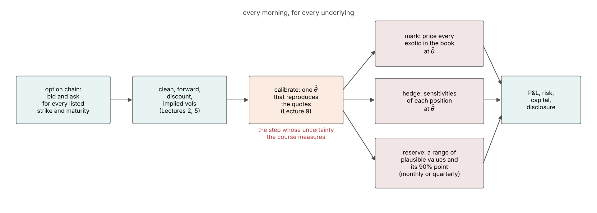
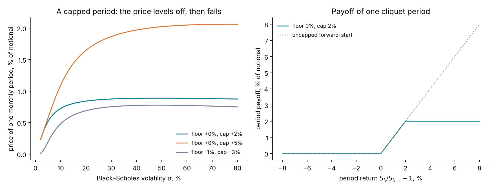
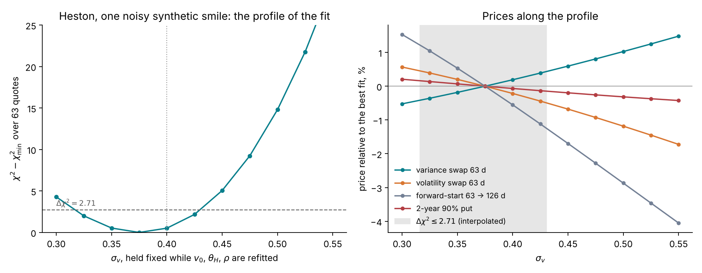
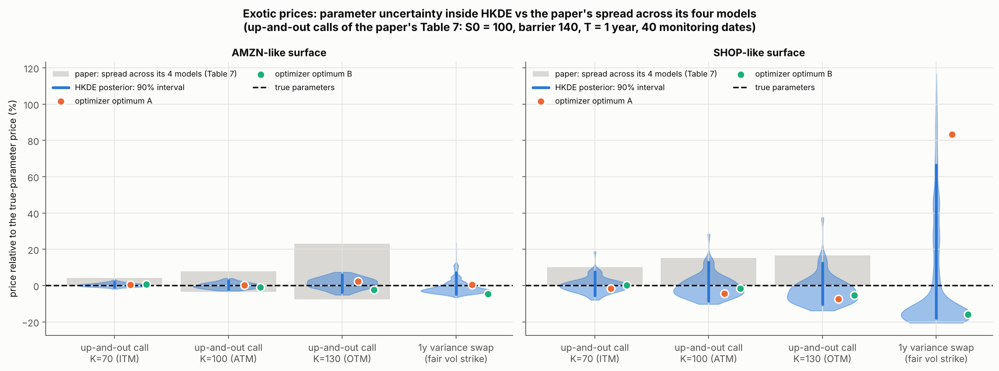
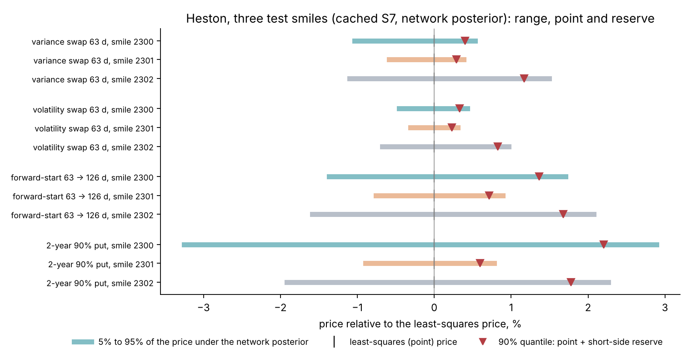
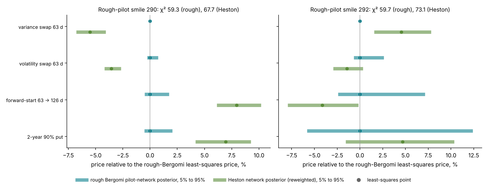

# Lecture 8. Calibration on a derivatives desk

[Course index](README.md) · Previous: [Lecture 7. Rough volatility: the rough Bergomi model](07-rough-bergomi.md) · Next: [Lecture 9. Calibration as estimation](09-calibration-as-estimation.md)

**What this lecture is for.** This lecture explains why the problem of the course matters to the people who will hear the tutorial. It describes what a derivatives desk does every morning with the models of Part I, derives the prices of the products a desk sells that the smile does not pin down (the variance swap, the volatility swap, the forward-start call and the cliquet), and shows that these prices move when the calibration moves within what the quotes allow. It then summarizes what the literature has measured about this calibration risk and states what the regulations ask a bank to report about it: a range of plausible values and a point at 90% confidence.

**Where it sits in the course.** Part I built the models and ended with the observation that today's smile does not determine the forward smile (Lecture 5) and that rough Bergomi reproduces the smile's term structure with three parameters (Lecture 7). This lecture is Part II on its own: it turns those observations into the practitioner's problem. Lecture 9 then describes how desks calibrate today and where the classical tools fall short, and Lecture 10 shows what a posterior adds. The four products derived here are the products priced under the posterior in Lectures 10 and 14.

## 8.1 What a desk does every morning

A derivatives desk holds a book of positions: listed vanillas, which have quotes, and products sold to clients, which do not. Every morning, and intraday for liquid underlyings, it runs the same chain of steps for each underlying.

*Figure 8.1.* How to read the figure: the chain starts with the bid and ask of every listed option (Lecture 1). Cleaning, the forward, the discount factor and the implied volatilities follow (Lectures 2 and 5). The calibration chooses one parameter vector $\hat\theta$ that reproduces the quotes (Lecture 9). That one vector then feeds three uses: the marks of the unquoted products, the hedge ratios, and, at a slower pace, the reserves. The course is about the calibration box: the marks, hedges and reserves inherit its uncertainty.

The three uses, written as formulas, all evaluate a function of the parameters at one point:

$$
\text{mark}(\Pi) = p_\Pi(\hat\theta;\ \xi_0), \qquad \text{hedge}(\Pi) = \frac{\partial p_\Pi}{\partial S}(\hat\theta;\ \xi_0), \qquad \text{reserve}(\Pi) = q_{0.9}\big(p_\Pi\big) - p_\Pi(\hat\theta;\ \xi_0) .
$$

Here $p_\Pi(\theta; \xi_0)$ is the model price of a product with payoff $\Pi$ (Lecture 1, Section 1.7), $\xi_0$ is the forward-variance curve read from the chain (Lecture 5, Section 5.9), and $q_{0.9}(p_\Pi)$ is the 90% point of a range of plausible prices (Section 8.9). The mark and the hedge need only $\hat\theta$. The reserve needs the range, and the range needs to know how far $\theta$ can move while the model still reproduces the quotes. The rest of this lecture shows why that distance matters, product by product.

## 8.2 What the smile pins down

Lecture 2 showed that the vanilla prices at one maturity $T$ determine the risk-neutral law of the terminal price $X_T = S_T/F_0(T)$, and with it the price of every payoff $g(X_T)$ at that maturity. A desk therefore needs no model for:

- vanillas at the quoted maturities and strikes, which it marks at their quotes;
- any payoff of $X_T$ at a quoted maturity, which it can replicate with a strip of vanillas;
- the variance swap at a quoted maturity, by the log-contract argument of Lecture 5 (Section 8.3).

It needs a model for everything else, in three cases:

1. **Strikes and maturities outside the quotes.** The tutorial's 2-year 90% put lies beyond the last design maturity of one year. Its price needs the law of $X_2$, which no quote gives. A model extrapolates it, and the extrapolation depends on the model's parameters.
2. **Payoffs that depend on the price at several dates.** The forward-start call, the cliquet and the barrier option depend on the joint law of $S$ at several dates. Lecture 2, Section 2.10 showed that the vanillas do not determine this joint law.
3. **Payoffs that depend on the path's variance.** The volatility swap pays $\sqrt{Q_T}$, a nonlinear function of the realized variance. Its price depends on the whole distribution of $Q_T$, while the vanillas determine only its mean.

Sections 8.3 to 8.6 derive the four products of the tutorial in this order.

## 8.3 The variance swap: priced by the smile

A variance swap with maturity $T$ pays $N\,(Q_T - K_{\text{var}})$ at $T$, where $Q_T = \frac{252}{n}\sum_{i=1}^{n} r_i^2$ is the realized variance of the $n$ daily log returns (Lecture 1, Section 1.2) and $N$ is a notional. The fair strike makes the swap cost nothing: $K_{\text{var}} = \mathbb{E}^{\mathbb{Q}}[Q_T]$. For continuous paths $Q_T \approx \frac{1}{T}\int_0^T V_t\,dt$, and Lecture 5, Section 5.9 derived

$$
K_{\text{var}}(T) = \frac{1}{T}\,\mathbb{E}^{\mathbb{Q}}\Big[\int_0^T V_t\,dt\Big] = \frac{1}{T}\int_0^T \xi_0(t)\,dt = \frac{1}{T}\Big(2\int_{-\infty}^{0} p(k, T)\,e^{-k}\,dk + 2\int_0^{\infty} c(k, T)\,e^{-k}\,dk\Big) .
$$

The last expression is a strip of out-of-the-money vanillas. The variance swap is therefore priced by the smile at maturity $T$, in every model with continuous paths.

**What this means for each model of the course.** Rough Bergomi takes $\xi_0(t)$ as an input, read from the chain (Lecture 7), so $\mathbb{E}[V_t] = \xi_0(t)$ exactly and the model's variance-swap price does not depend on $(H, \eta, \rho)$. Heston has a parametric curve. Its variance solves $dV_t = \kappa(\theta_H - V_t)\,dt + \sigma_v\sqrt{V_t}\,dW_t$ (Lecture 6), so taking expectations gives $\frac{d}{dt}\mathbb{E}[V_t] = \kappa(\theta_H - \mathbb{E}[V_t])$, whose solution is $\mathbb{E}[V_t] = \theta_H + (v_0 - \theta_H)e^{-\kappa t}$. Averaging over $[0, T]$:

$$
K_{\text{var}}^{\text{Heston}}(T) = \theta_H + (v_0 - \theta_H)\,\frac{1 - e^{-\kappa T}}{\kappa T} .
$$

The Heston variance swap moves with $v_0$ and $\theta_H$, so it inherits their calibration uncertainty. Under rough Bergomi, with continuous monitoring and a fixed curve $\xi_0$, it inherits none: its price is the integral of the input curve. The repository prices it exactly so, from the curve and without the simulated paths (`products.variance_swap`), so its zero range under rough Bergomi is a consistency check of the curve input, not a test of the path simulation.

**Daily monitoring.** A real variance swap uses daily returns, and then the strike is no longer the integral of $\xi_0$ alone. Write one day's log return as $r = \int_t^{t+\Delta}\sqrt{V_s}\,dB_s - \tfrac12\int_t^{t+\Delta}V_s\,ds$, where $B$ is the Brownian motion of the price and $\Delta = 1/252$. Squaring and taking expectations,

$$
\mathbb{E}[r^2] = \mathbb{E}\Big[\int_t^{t+\Delta} V_s\,ds\Big] - \mathbb{E}\Big[\int_t^{t+\Delta}\sqrt{V_s}\,dB_s\int_t^{t+\Delta}V_u\,du\Big] + \tfrac14\,\mathbb{E}\Big[\Big(\int_t^{t+\Delta}V_s\,ds\Big)^2\Big] .
$$

The first term is $\xi_0\Delta$ for a flat curve. The middle term is the leverage: under rough Bergomi $V_u$ depends on the shock $dW_s$ at every earlier time $s$ through the kernel $\sqrt{2H}(u-s)^{H-\frac12}$ of Lecture 7, and $dB_s$ has correlation $\rho$ with $dW_s$, so to first order in $\eta$, $\mathbb{E}[\sqrt{V_s}\,dB_s\,V_u] = \rho\eta\sqrt{2H}\,\xi_0^{3/2}(u-s)^{H-\frac12}\,ds$ for $u > s$. Integrating over $t \leq s \lt u \leq t + \Delta$, with $\int_0^\Delta\int_s^\Delta (u-s)^{H-\frac12}\,du\,ds = \Delta^{H+\frac32}/\big((H+\tfrac12)(H+\tfrac32)\big)$,

$$
\mathbb{E}[r^2] \approx \xi_0\Delta - \frac{\rho\,\eta\sqrt{2H}\;\xi_0^{3/2}\,\Delta^{H+\frac32}}{(H+\frac12)(H+\frac32)} + \tfrac14\,\xi_0^2\Delta^2 .
$$

With $\rho < 0$ the daily-monitored strike is above the continuous one. For $\xi_0 = 0.04$ the first-order excess is 0.29% of the strike at the prior centre $(H, \eta, \rho) = (0.185, 2.0, -0.595)$, 0.32% at the best fit of pilot smile 293, $(0.068, 1.32, -0.66)$, and 0.62% for a steep skew, $(0.07, 1.9, -0.9)$. A Monte Carlo check over 63 days, with 16 time steps per day and 8,192 paths, gives 0.53% (standard error 0.05), 0.38% (0.01) and 0.94% (0.05): the exponential in $V$ adds terms of higher order in $\eta$ (`scripts/course/lecture08.py`). A daily-monitored rough-Bergomi variance swap therefore does depend on $(H, \eta, \rho)$, by a few tenths of a percent to about one percent of the strike, and $\xi_0$ itself is read from noisy quotes. The tutorial prices the swap with continuous monitoring and a fixed curve, and Lecture 10 states what this leaves out.

## 8.4 The volatility swap: priced by the spread of realized variance

A volatility swap pays $N\,(\sqrt{Q_T} - K_{\text{vol}})$, with fair strike $K_{\text{vol}} = \mathbb{E}^{\mathbb{Q}}[\sqrt{Q_T}]$. The square root is concave, so by Jensen's inequality $K_{\text{vol}} \le \sqrt{\mathbb{E}[Q_T]} = \sqrt{K_{\text{var}}}$. The size of the gap follows from a second-order Taylor expansion of $\sqrt{x}$ around $\mu = \mathbb{E}[Q_T]$:

$$
\sqrt{x} = \sqrt{\mu} + \frac{x - \mu}{2\sqrt{\mu}} - \frac{(x - \mu)^2}{8\,\mu^{3/2}} + O\big((x - \mu)^3\big).
$$

Taking expectations, the linear term vanishes because $\mathbb{E}[Q_T - \mu] = 0$, and the quadratic term becomes the variance:

$$
K_{\text{vol}} \;\approx\; \sqrt{K_{\text{var}}} \;-\; \frac{\mathrm{Var}(Q_T)}{8\,K_{\text{var}}^{3/2}} .
$$

This is the **convexity correction** of Brockhaus and Long (2000). It says that the volatility swap is priced by the mean of the realized variance, which the smile gives, minus a term in its variance, which the smile does not give directly. In a stochastic-volatility model, $\mathrm{Var}(Q_T)$ grows with the volatility of variance.

*Figure 8.2.* How to read the figure: both panels use Heston with $v_0 = \theta_H = 0.04$ and $\kappa = 2$, so the forward-variance curve is flat and $K_{\text{var}} = 0.04$, a volatility of 20%, for every $\sigma_v$. The left panel simulates $Q_T$ over 63 days with 32,768 paths. With $\sigma_v = 0.3$ its standard deviation is 0.0144; with $\sigma_v = 0.9$ it is 0.0430, three times larger, and the distribution piles up at low values with a long right tail. The right panel shows that the variance-swap strike stays at 20% while the volatility-swap strike falls, from 19.96% at $\sigma_v = 0.1$ to 19.14% at $\sigma_v = 0.5$ and 17.26% at $\sigma_v = 1.0$ (Monte Carlo standard errors below 0.01 volatility points). The convexity correction (squares) matches the Monte Carlo strike to 0.04 points up to $\sigma_v = 0.5$ and overstates the correction beyond, by 0.8 points at $\sigma_v = 1.0$, because the higher terms of the Taylor series are no longer small.

**Interpretation.** Two calibrations that agree on the forward-variance curve, and therefore on every variance swap, can disagree on every volatility swap by as much as their volatilities of variance disagree. The smile carries information about the volatility of variance only through the curvature of the smile and only through a model (Lectures 6 and 7). In rough Bergomi the corresponding parameter is $\eta$. The short-dated skew alone pins only $\rho\eta$; the full surface separates $\eta$ from $\rho$, mainly through the long-dated at-the-money level relative to the forward-variance curve, a route that relies on $\xi_0$ being read correctly (Lecture 7, Section 7.11).

## 8.5 The forward-start call: priced by the forward smile

A forward-start call with strike-setting date $T_1$ and maturity $T_2$ pays $(S_{T_2}/S_{T_1} - 1)^+$ at $T_2$: it is a call struck at the money on the day $T_1$. Write $\tau = T_2 - T_1$. The tutorial's product has $T_1 = 63$ and $T_2 = 126$ business days.

**Under Black–Scholes.** The payoff $(S_{T_2}/S_{T_1} - 1)^+$ is a number, paid at $T_2$ per unit of notional. At $T_1$ it is the payoff of a call with strike 1 on the ratio $S_t/S_{T_1}$, which starts at 1. With zero carry its value at $T_1$ is the forward-unit price $c(0, \tau; \sigma)$ of Lecture 4, a constant that does not depend on $S_{T_1}$, and a constant known at $T_1$ is worth the same today:

$$
p_{\text{FS}} = c(0, \tau; \sigma) = 2N\Big(\tfrac12\sigma\sqrt{\tau}\Big) - 1 \;\approx\; 0.4\,\sigma\sqrt{\tau} .
$$

**With a deterministic volatility $\sigma(t)$.** The same argument holds with the total variance over $[T_1, T_2]$ in place of $\sigma^2\tau$. The forward-start price depends on $\int_{T_1}^{T_2}\sigma(t)^2\,dt$, the forward variance, while a vanilla at $T_2$ depends on $\int_0^{T_2}\sigma(t)^2\,dt$.

*Figure 8.3.* How to read the figure: term structure A is flat at 20%. Term structure B is 25% for three months and then 13.2%, chosen so that the total variance to six months is the same, $0.2^2 \times 0.5 = 0.02$. On the six-month quotes the two are indistinguishable: the at-the-money call costs 0.0564 of the forward under both, and the variance swap strike is 0.04 under both. The three-month call tells them apart, 0.0399 against 0.0498. The forward-start call prices at 0.0399 under A and 0.0264 under B, 34% lower. A desk that quotes only the six-month smile cannot price the forward-start; a desk that also quotes three months can, in this deterministic world, because the two maturities fix the forward variance.

**Under stochastic volatility.** In Heston the pair $(S_t, V_t)$ is Markov, and the forward-start payoff in units of $S_{T_1}$ depends only on the return after $T_1$. Conditional on the information at $T_1$, its value is therefore the Heston at-the-money call over $\tau$ started from the variance $V_{T_1}$, written $c_H(0, \tau; V_{T_1})$. Averaging over the law of $V_{T_1}$:

$$
p_{\text{FS}}^{\text{Heston}} = \mathbb{E}^{\mathbb{Q}}\big[\,c_H(0, \tau;\ V_{T_1})\,\big] = \int_0^\infty c_H(0, \tau;\ v)\; q_{V_{T_1}}(v)\,dv .
$$

The law of $V_{T_1}$ is known in closed form: $2c\,V_{T_1}$ is non-central chi-square with $4\kappa\theta_H/\sigma_v^2$ degrees of freedom and non-centrality $2c\,v_0 e^{-\kappa T_1}$, where $c = 2\kappa/\big(\sigma_v^2(1 - e^{-\kappa T_1})\big)$ (Cox, Ingersoll and Ross 1985). The script computes the integral by quadrature and checks it by Monte Carlo.

*Figure 8.4.* How to read the figure: both panels use Heston with $v_0 = \theta_H = 0.04$, $\kappa = 2$ and $\rho = -0.7$, and $T_1 = 0.25$, $T_2 = 0.5$ years. In the left panel, the solid lines are the density of $V_{T_1}$: with $\sigma_v = 0.3$ it is spread around 0.03; with $\sigma_v = 0.9$ it has a spike near zero and a long right tail. The dashed lines are the conditional price $c_H(0, \tau; v)$, which is concave in $v$. At $v = 0.04$ it is 0.0390 for $\sigma_v = 0.3$, close to the Black–Scholes rule $0.4\sqrt{v\tau} = 0.0400$, and 0.0339 for $\sigma_v = 0.9$, 15% lower, because a large vol of vol lowers the at-the-money implied volatility. The forward-start price is the average of the dashed curve under the solid density. In the right panel, the desk's natural estimate prices the forward-start with Black–Scholes at the forward at-the-money volatility implied by today's three- and six-month at-the-money volatilities, $\sigma_{\text{fwd}}^2 = (\sigma_{\text{imp}}(T_2)^2 T_2 - \sigma_{\text{imp}}(T_1)^2 T_1)/\tau$. The true Heston price is within 0.2% of this estimate for $\sigma_v \le 0.3$, and falls below it as $\sigma_v$ grows: by 1.2% at $\sigma_v = 0.5$ and 5.5% at $\sigma_v = 1.0$. At $\sigma_v = 0.9$ the quadrature gives 0.02883, and 16,384 Monte Carlo paths give 0.02887 with a standard error of 0.00011.

**Interpretation.** Today's at-the-money volatilities give the forward variance. They do not give the dispersion of $V_{T_1}$, which the concave conditional price turns into a lower forward-start price (Jensen's inequality again), nor the smile that will prevail at $T_1$. This is why the forward-start call is the textbook product of smile dynamics (Bergomi 2004) and of calibration risk (Schoutens, Simons and Tistaert 2004).

## 8.6 The cliquet: a chain of forward starts with caps and floors

A **cliquet** pays a sum of period returns over dates $t_0 < t_1 < \dots < t_m$, each capped and floored:

$$
\Pi_{\text{cliquet}} = \sum_{i=1}^{m} \min\Big(\max\big(R_i,\ F\big),\ C\Big), \qquad R_i = \frac{S_{t_i}}{S_{t_{i-1}}} - 1,
$$

with a local floor $F$ and cap $C$, often with a global floor or cap on the sum as well. Each term is a forward-start structure. Under Black–Scholes with zero carry, one period of length $\tau$ is a forward-start call spread plus a constant, because $\min(\max(R, F), C) = F + (R - F)^+ - (R - C)^+$ and $R - F = X - (1 + F)$ with $X = S_{t_i}/S_{t_{i-1}}$:

$$
p_{\text{period}} = F + c\big(\ln(1 + F),\ \tau;\ \sigma\big) - c\big(\ln(1 + C),\ \tau;\ \sigma\big).
$$

*Figure 8.5.* How to read the figure: the right panel shows the payoff: zero for a negative return, the return itself up to 2%, and 2% beyond. In the left panel, the period with floor 0% and cap 2% is worth 0.725% of notional at 10% volatility, 0.842% at 20% and 0.875% at 30%, reaches its maximum of 0.888% at a volatility of 48.6%, and then falls. The cap removes the upside that a higher volatility would otherwise add. A wider cap of 5% moves the maximum to 76% volatility.

**Interpretation.** The price of a capped period responds less and less to volatility and then responds negatively: its vega changes sign. No single implied volatility describes a cliquet, and its value depends on the forward smile of every period, at the strikes of its floor and cap. This is why cliquets were among the products whose prices differed most across calibrations in Schoutens, Simons and Tistaert (2004).

## 8.7 One model, several calibrations

Sections 8.3 to 8.6 showed that the four products depend on features of the model that the smile does not fix directly: the variance curve beyond the quotes, the volatility of variance, and the forward smile. A calibration fixes them through the model's parameters. The question is how much those parameters can move while the model still reproduces the quotes within their noise.

The simplest measurement is a **profile**: hold one parameter fixed at a grid of values, refit the others by least squares (Lecture 9), and record the fit and the product prices at each value.

*Figure 8.6.* How to read the figure: the synthetic smile is drawn from Heston with $v_0 = 0.04$, $\theta_H = 0.05$, $\sigma_v = 0.4$, $\rho = -0.7$ and $\kappa = 2$, on the 63 design contracts, with the tutorial's quote noise added once. The best fit has $\sigma_v = 0.376$ and $\chi^2 = 71.7$ on 63 quotes. The profile is computed at 11 values of $\sigma_v$ spaced by 0.025 and interpolated by a cubic spline. In the left panel, the objective rises by less than 2.71 (the 90% threshold for one parameter, Lecture 9) for $\sigma_v$ between 0.316 and 0.431; across that band the refitted $\rho$ moves the other way, from −0.875 to −0.660, which keeps the skew. In the right panel, within the band the forward-start price moves from −1.25% to +1.22% of its value at the best grid point, the volatility swap from −0.49% to +0.45%, the variance swap from −0.42% to +0.43%, and the 2-year put from −0.15% to +0.16%.

**Interpretation.** On the full design grid, Heston is well identified: the band of plausible calibrations is narrow, and so are the product ranges. Along this profile the forward-start, which depends most on $\sigma_v$, moves most. The profile varies $\sigma_v$ only: under the full posterior of the same smile (Lecture 10, Section 10.9) the 2-year put has the widest range, 4.39% against 3.17% for the forward-start, because the put moves with $\theta_H$, which the profile does not vary. Lecture 9 shows on 200 Heston test smiles that the classical interval works for this model (study S6 of the design document).

Two other cases need more care.

- **Heston with jumps (HKDE).** The design document's study of 9 October 2026 calibrated Heston with Kou double-exponential jumps (Agazzotti et al. 2025) to synthetic surfaces. Thirty optimizer starts ended at two optima with almost equal fit and different exotic prices ([design document, "Why Heston is the check and not the example"](../design/calibration-design-document.md#why-heston-is-the-check-and-not-the-example)).

*Figure 8.7 (from the design document).* How to read the figure: each panel is one option surface and each column one exotic, priced relative to its price under the true parameters. The blue violin is the spread of prices under the HKDE posterior, with its 90% interval as a thick line. The orange and green dots are the two optimizer end points, and the grey bar is the spread across the four models of the paper's Table 7. On the surface resembling the paper's SHOP case, the posterior range of each barrier option is wider than the grey bar, and the variance swap ranges from −18% to +67%.

- **Rough Bergomi.** The short-dated skew pins only the product $\rho\eta$. The full surface also separates $\eta$, mainly through the long-dated at-the-money level relative to $\xi_0$: in the pilot of study S2 the posterior standard deviation is a median 5% of the posterior mean for $\eta$, against 10% for $H$ (Lecture 7, Section 7.11; design document, S2). That separation holds only as far as $\xi_0$ is read correctly. The volatility swap, the forward-start and the out-of-grid put all depend on $\eta$, which explains most of their posterior variance in the pilot (design document, S7). On three pilot test smiles (`tutorial_final/results/calibration/rough-pilot/s7/products.json`), the 90% range of the forward-start under the pilot network's posterior is 2.2% to 9.3% of its posterior mean, and the short-side reserve 1.0% to 6.0% of its point price; the pilot network's intervals are 1.3 to 1.6 times too wide (design document, study S5), so these figures overstate the exact ranges.

## 8.8 What the literature has measured

Calibration risk, the dependence of exotic prices on how a model is calibrated, has been measured in four ways.

| Study | What was varied | What it found |
| --- | --- | --- |
| Schoutens, Simons and Tistaert (2004) | The model: seven models (Heston, Heston with jumps, Barndorff-Nielsen–Shephard, and four Lévy models with stochastic time changes), each calibrated to the same Eurostoxx 50 smile | All seven reproduced the vanillas closely; their prices of barrier, lookback and cliquet options differed substantially |
| Detlefsen and Härdle (2006) | The objective function (the error measure minimized), for Heston and Bates calibrated to DAX implied-volatility surfaces from April 2003 to March 2004 | The calibrated parameters and the exotic prices moved with the objective, within one model |
| Guillaume and Schoutens (2012) | The calibration procedure under Heston: objective, weights and inputs | Exotic prices spread across procedures that all fit the vanillas |
| Cont (2006) | The general frame | The set of models consistent with the vanilla prices defines a range of prices for each payoff, $\big[\inf_{\mathbb{Q}}\mathbb{E}^{\mathbb{Q}}[\Pi],\ \sup_{\mathbb{Q}}\mathbb{E}^{\mathbb{Q}}[\Pi]\big]$; its width is a coherent measure of model uncertainty |

The first three studies vary the calibration by hand and read the spread. None of them attaches probabilities to the calibrations it compares. Lecture 10 shows that a posterior does: it weights each calibration by how well it reproduces the quotes, given their noise.

## 8.9 What the rules ask for

Three sets of rules ask a bank to report the uncertainty of model-based values. The wording below was checked against the primary texts.

**EU prudent valuation: Commission Delegated Regulation (EU) 2016/101 of 26 October 2015.** Banks deduct additional valuation adjustments (AVAs) from their capital. Two articles concern calibration.

- Article 9 (market price uncertainty): for a valuation input whose range of plausible values is based on exit prices, the bank "shall estimate a point within the range where they are 90 % confident they could exit the valuation exposure at that price or better" (Art. 9(5)(a)(i)).
- Article 11 (model risk): the bank estimates a model-risk AVA "by considering valuation model risk which arises due to the potential existence of a range of different models or model calibrations, which are used by market participants" (Art. 11(1)). "Where possible", it determines "a range of plausible valuations produced from alternative appropriate modelling and calibration approaches" and estimates "a point within the resulting range of valuations where they are 90 % confident they could exit the valuation exposure at that price or better" (Art. 11(3)). Otherwise it applies an expert-based approach (Art. 11(4)).

Article 11(1) then excludes part of that risk from the model-risk AVA: institutions "shall not consider valuation model risk which arises due to calibrations from market derived parameters, which shall be captured according to Article 9". The exclusion is mandatory. The uncertainty of a model's parameters calibrated to market quotes, such as the vanillas, is therefore reported under Article 9, while the choice among models and calibration approaches stays under Article 11. Both articles ask for the same object: a range of plausible values and its 90% point.

**Fair-value disclosure: IFRS 13, paragraph 93(h).** For recurring Level 3 fair-value measurements (those that rely on unobservable inputs), a bank describes the sensitivity of the fair value to changes in the unobservable inputs. For financial instruments, if changing those inputs to reasonably possible alternative assumptions would change the fair value significantly, it states that fact and discloses the effect.

**Model risk management.** In the United States, SR 26-2, "Revised Guidance on Model Risk Management", issued on 17 April 2026 by the Federal Reserve, the OCC and the FDIC, supersedes SR 11-7 of 4 April 2011. It defines model risk as "the potential for adverse financial consequences associated with models, which may result from decisions made based on model output", and states that "effective model use depends on a clear understanding of a model's limitations". In the United Kingdom, PRA Supervisory Statement SS1/23 (published 17 May 2023, effective 17 May 2024, updated in April 2026) states that model uncertainty "should be understood as the inherent uncertainty in the parameter estimates and results of statistical models, including the uncertainty in the results due to model choices or model misuse".

**The 90% point and the reserve.** The rules name the object and leave its construction to the bank. In the course's notation, let $p_\Pi$ be the price of a product, distributed over the plausible calibrations, and let $\hat p$ be the point price the desk reports. For a position the desk has sold, a higher price is adverse, so

$$
\text{prudent value} = q_{0.90}(p_\Pi), \qquad \text{reserve}_{\text{short}} = q_{0.90}(p_\Pi) - \hat p .
$$

For a position it holds, a lower price is adverse: the prudent value is $q_{0.10}(p_\Pi)$ and the reserve is $\hat p - q_{0.10}(p_\Pi)$. The reserve is reported as a share of $\hat p$.

*Figure 8.8.* How to read the figure: the numbers are cached in `tutorial_final/results/calibration/heston/s7/products.json`. The posterior there is the amortized network's (checkpoint `heston-net-v3`, Lecture 12), not an exact one; in study S3 the network alone missed the exact posterior's criterion on 20% of the test smiles (design document, S3). Each bar is the 5%–95% range of one product's price under the network posterior of one Heston test smile, relative to the least-squares price (the vertical line at 0); the triangle is the 90% quantile, and its distance from 0 is the short-side reserve. The ranges differ by product and by smile: the variance swap's 90% range is 0.97% to 2.59% of its mean, the forward-start's 1.65% to 3.65% with a reserve of 0.71% to 1.68% of its price, and the 2-year put's 1.68% to 6.15% with a reserve of 0.60% to 2.21%. Lecture 10 explains how such a posterior is computed.

## 8.10 Three ranges

A reserve built from one model's posterior measures one kind of uncertainty. Three nested ranges are worth keeping apart:

1. **Within-model.** The range of prices over the calibrations of one model that the quotes allow. This is what the posterior gives (Lecture 10).
2. **Across-model.** The range over several models, each calibrated to the same quotes. Article 11(1) names it ("a range of different models"), and Schoutens, Simons and Tistaert measured it.
3. **Model-free.** The range over every arbitrage-free joint law consistent with the vanillas. Martingale optimal transport computes it (Beiglböck, Henry-Labordère and Penkner 2013). It is the outer limit of Cont's measure, and it is usually too wide to act on.

*Figure 8.9.* How to read the figure: the numbers are cached in `tutorial_final/results/calibration/rough-pilot/s7-across/across-models.json`. The rough-Bergomi ranges come from the pilot network's posterior, which is too wide; the Heston ranges from the Heston network's draws reweighted by importance sampling with the Fourier likelihood (design document, S7). On smile 290 (left), Heston fits nearly as well as rough Bergomi ($\chi^2$ of 67.7 against 59.3 on 63 quotes), yet its least-squares prices differ: the variance swap by −5.5%, the volatility swap by −3.5%, the forward-start by +7.9% and the 2-year put by +6.9%. The two models' 90% ranges do not overlap for any product. On smile 292 (right; $\chi^2$ of 73.1 against 59.7), the forward-start differs by −4.1% and the ranges overlap for three products out of four. On a third smile, 291, Heston cannot fit at all ($\chi^2$ of 1,347).

**Interpretation.** Whether the gap between two models that both fit the smile exceeds the within-model ranges depends on the smile. On smile 290 the forward-start's gap, 7.9%, is larger than its 90% range under either model, 3.8% under Heston and 2.2% under rough Bergomi, and larger than either model's reserve, 1.6%. On smile 292 it is not: the gap is −4.1%, against ranges of 8.1% and 9.3% and a rough-Bergomi reserve of 6.0%. The posterior range is a within-model quantity and can understate model uncertainty, as on smile 290; it is not the whole of it. The tutorial reports it as within-model and says so (design document, "Within-model against across-model").

## 8.11 Summary

1. A desk calibrates one parameter vector each morning and uses it to mark, hedge and reserve. The reserve needs a range, which a single calibration does not give.
2. The smile prices every payoff of $X_T$ at a quoted maturity, including the variance swap. Rough Bergomi reproduces the variance-swap curve by construction; Heston's depends on $v_0$ and $\theta_H$.
3. The volatility swap is the variance-swap strike's square root minus a convexity correction $\mathrm{Var}(Q_T)/(8K_{\text{var}}^{3/2})$, which grows with the volatility of variance.
4. The forward-start call depends on the forward variance and on the dispersion of the variance at the strike-setting date. Under Heston it is the average of a concave conditional price over the law of $V_{T_1}$, up to 5.5% below the estimate from today's at-the-money volatilities.
5. A capped and floored cliquet period has a vega that changes sign; no single volatility describes it.
6. Within one model, the calibrations the quotes allow move these prices: along the vol-of-vol profile of one well-identified Heston smile by about ±1.2% for the forward-start, under that smile's full posterior by up to 4.4% (the 2-year put, Lecture 10), and by much more when the smile leaves a direction weakly identified, as for Heston with jumps.
7. EU prudent valuation asks for a range of plausible values and its 90% point; IFRS 13 asks for sensitivities to reasonably possible alternative inputs; SR 26-2 and SS1/23 ask for an understanding of model and parameter uncertainty.
8. The within-model range is the posterior's; the across-model and model-free ranges are wider. The posterior covers the first only.

## References

- Agazzotti, G., Aguilar, J.-P., Aglieri Rinella, C., Kirkby, J. L. (2025). Calibration and option pricing with stochastic volatility and double exponential jumps. *Journal of Computational and Applied Mathematics* 465, 116563. [doi](https://doi.org/10.1016/j.cam.2025.116563)
- Beiglböck, M., Henry-Labordère, P., Penkner, F. (2013). Model-independent bounds for option prices: a mass transport approach. *Finance and Stochastics* 17(3), 477–501. [doi](https://doi.org/10.1007/s00780-013-0205-8)
- Bergomi, L. (2004). Smile dynamics. *Risk*, September 2004.
- Brockhaus, O., Long, D. (2000). Volatility swaps made simple. *Risk*, January 2000.
- Cont, R. (2006). Model uncertainty and its impact on the pricing of derivative instruments. *Mathematical Finance* 16(3), 519–547. [doi](https://doi.org/10.1111/j.1467-9965.2006.00281.x)
- Cox, J. C., Ingersoll, J. E., Ross, S. A. (1985). A theory of the term structure of interest rates. *Econometrica* 53(2), 385–407. [doi](https://doi.org/10.2307/1911242)
- Detlefsen, K., Härdle, W. K. (2006). Calibration risk for exotic options. SFB 649 Discussion Paper 2006-001, Humboldt-Universität zu Berlin; DAX implied-volatility surfaces from April 2003 to March 2004. [doi](https://doi.org/10.18452/3928). A journal version (*Journal of Derivatives*, 2007) is cited elsewhere, including in the design document, but could not be confirmed.
- Guillaume, F., Schoutens, W. (2012). Calibration risk: illustrating the impact of calibration risk under the Heston model. *Review of Derivatives Research* 15(1), 57–79. [doi](https://doi.org/10.1007/s11147-011-9069-2)
- Schoutens, W., Simons, E., Tistaert, J. (2004). A perfect calibration! Now what? *Wilmott Magazine*, March 2004.
- Commission Delegated Regulation (EU) 2016/101 of 26 October 2015 on regulatory technical standards for prudent valuation under Article 105(14) of Regulation (EU) No 575/2013. [EUR-Lex](https://eur-lex.europa.eu/legal-content/EN/TXT/HTML/?uri=CELEX:32016R0101)
- IFRS Foundation. IFRS 13 *Fair Value Measurement*, paragraph 93(h).
- Board of Governors of the Federal Reserve System, OCC, FDIC (2026). SR 26-2: Revised Guidance on Model Risk Management, 17 April 2026. [Federal Reserve](https://www.federalreserve.gov/supervisionreg/srletters/SR2602.htm)
- Prudential Regulation Authority (2023). Supervisory Statement SS1/23, Model risk management principles for banks. [Bank of England](https://www.bankofengland.co.uk/prudential-regulation/publication/2023/may/model-risk-management-principles-for-banks-ss)

Figures: `scripts/course/lecture08.py`, except Figure 8.7, which is the design document's.
