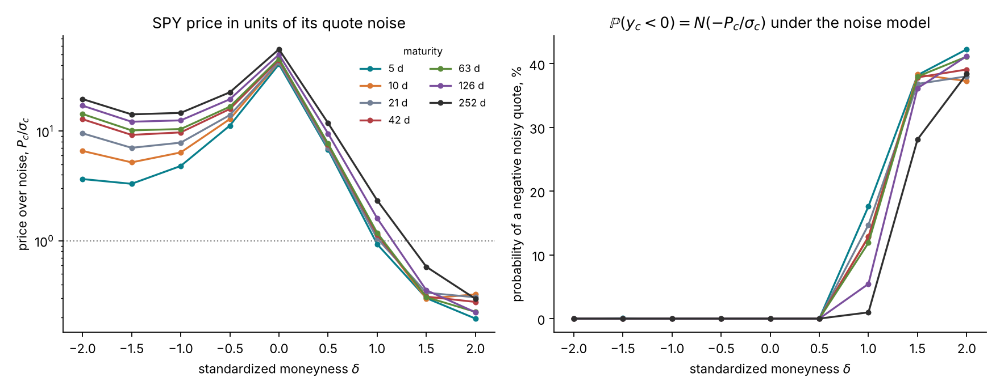
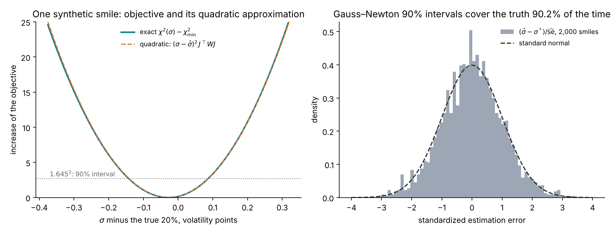
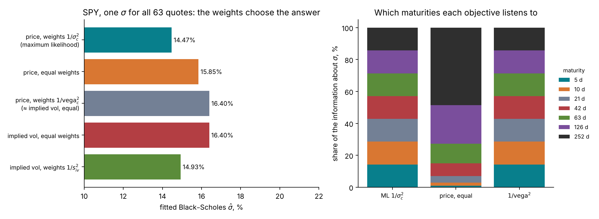
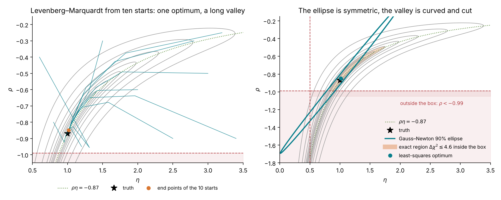
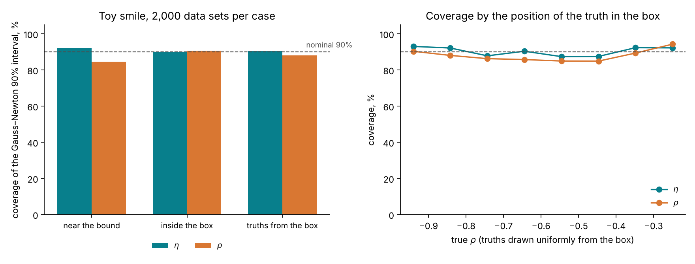
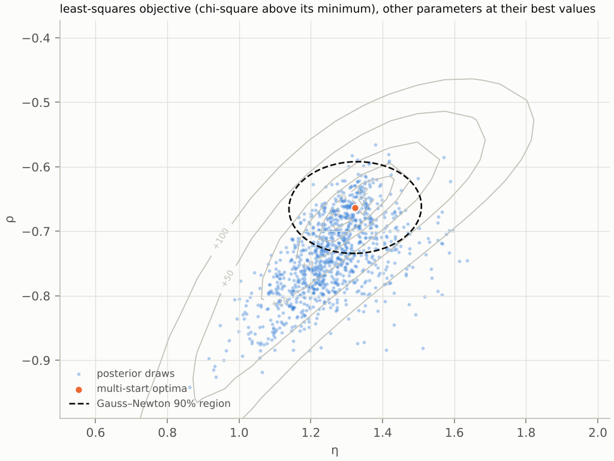
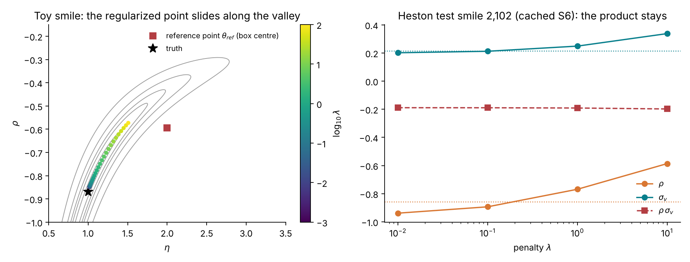

# Lecture 9. Calibration as estimation

[Course index](README.md) · Previous: [Lecture 8. Calibration on a derivatives desk](08-calibration-on-a-desk.md) · Next: [Lecture 10. Bayesian calibration](10-bayesian-calibration.md)

**What this lecture is for.** This lecture recasts model calibration as a problem of statistical estimation, and uses that view to examine the tools desks use today. It states the observation model of a quote, derives the likelihood and shows that weighted least squares is maximum likelihood, explains how the choice of objective changes the answer, derives the Gauss–Newton optimizer and the Gauss–Newton covariance with its three conditions of validity, and then tests those conditions: on Black–Scholes, where they hold; on a toy smile with a curved, truncated valley, where they fail in shape; and on the tutorial's cached studies of Heston and rough Bergomi. It ends with multi-start optimization, regularization, deep calibration and the notions of identifiability and ill-posedness.

**Where it sits in the course.** Lecture 8 showed that the products a desk marks depend on how far the parameters can move while the model still fits the quotes. This lecture measures that distance the classical way, with one optimum and a local covariance. Lecture 10 measures it with a posterior and compares the two. The observation model and the likelihood defined here are the ones every later lecture uses: Lecture 11 explains why this likelihood is expensive for rough Bergomi, and Lectures 12 and 13 build and check a network that bypasses it.

## 9.1 A quote as an observation

The data of a calibration are the 63 out-of-the-money prices $y = (y_1, \dots, y_{63})$ read from the chain on the design grid (Lecture 5, Section 5.4), in forward units. Each $y_c$ is a mid price: an estimate of the price at which the contract would trade, uncertain by roughly its half-spread. The model gives a price $P_c(\theta; \xi_0)$ for each contract, for parameters $\theta$ and the forward-variance curve $\xi_0$, which is read from the same chain and held fixed.

To compare quotes with model prices, a model of the difference is needed. The tutorial's **observation model** is

$$
y_c = P_c(\theta;\ \xi_0) + \sigma_c\,\varepsilon_c, \qquad \varepsilon_c \sim \mathcal{N}(0, 1) \text{ independent}, \qquad \sigma_c = \mathrm{vega}_c(\sigma_{\text{ref}}) \times s_{\text{iv}}(\delta_c) .
$$

The noise standard deviation $\sigma_c$ is a volatility noise $s_{\text{iv}}(\delta)$, rising linearly from 0.3 volatility points at the money to 1.0 point at $|\delta| = 2$, converted into price units by the vega at $\sigma_{\text{ref}} = 20\%$ (Lecture 5, Section 5.3). On SPY, the real half-spreads are below this design noise at every grid point, so the design noise is used (Lecture 5).

The observation model is a modelling choice, made explicit so that it can be checked and changed. Four of its assumptions are worth naming.

1. **The noise is Gaussian in price.** A bid-ask interval bounds the price; a Gaussian has unbounded tails. The Gaussian is chosen because it gives a simple likelihood, and the half-spread sets its scale.
2. **The noise standard deviations are known.** They are fixed per contract from the design rule, not estimated.
3. **The noise is independent across contracts.** The grid prices are read from a smoothing spline through many quotes (Lecture 5), which correlates neighbouring points. The tutorial ignores this correlation.
4. **The model's price is the truth up to noise.** This is the assumption that fails when the model is wrong; Lecture 10 tests it with a posterior predictive check.

*Figure 9.1.* How to read the figure: the left panel shows the ratio $P_c/\sigma_c$, the signal-to-noise ratio of each quote, using SPY's prices of 21 October 2026. It is 55.8 for the one-year at-the-money option and 0.195 for the one-week call at $\delta = 2$; 21 of the 63 quotes have a ratio below 3, all on the call side. The right panel shows the consequence: under a Gaussian noise model, a quote whose price is small against its noise is negative with probability $N(-P_c/\sigma_c)$, up to 42% for the one-week wing call.

**Negative noisy prices are kept.** A real price cannot be negative, but a simulated noisy quote can. The tutorial keeps such quotes in its simulations because they are valid draws from the declared observation model, and because the inference network reads the quotes as $y_c/\sigma_c$, which is defined for any value (design document, "The noise model"). Removing them would change the noise model into a truncated one without saying so. Implied volatilities, which do not exist for such quotes, are used only for plots and for the real chain, where cleaning removes quotes below intrinsic value.

## 9.2 The likelihood

Under the observation model, the quotes are independent normal variables with means $P_c(\theta; \xi_0)$ and standard deviations $\sigma_c$. Their joint density, seen as a function of $\theta$ for the observed $y$, is the **likelihood**:

$$
p(y \mid \theta, \xi_0) = \prod_{c=1}^{63} \frac{1}{\sqrt{2\pi}\,\sigma_c}\exp\!\Big(-\frac{(y_c - P_c(\theta; \xi_0))^2}{2\sigma_c^2}\Big),
\qquad
\log p(y \mid \theta, \xi_0) = -\tfrac12\,\chi^2(\theta) + \text{const},
$$

with the **chi-square objective**

$$
\chi^2(\theta) = \sum_{c=1}^{63}\Big(\frac{y_c - P_c(\theta; \xi_0)}{\sigma_c}\Big)^2 .
$$

The constant does not depend on $\theta$. The likelihood is largest where the model prices are closest to the quotes, with each quote's distance measured in units of its own noise.

**A check of fit.** If the model is right and $\theta$ is at its true value, $\chi^2$ is a sum of 63 squared standard normals: a chi-square variable with 63 degrees of freedom, with mean 63 and standard deviation $\sqrt{2 \times 63} = 11.2$. At the fitted value, with $d$ parameters estimated, it is approximately chi-square with $63 - d$ degrees of freedom. A minimum far above that range says the model cannot reproduce the quotes within their noise.

## 9.3 Least squares is maximum likelihood

The **maximum-likelihood estimate** maximizes $p(y \mid \theta, \xi_0)$. Since the logarithm is increasing and the constant does not depend on $\theta$,

$$
\hat\theta = \arg\max_\theta \log p(y \mid \theta, \xi_0) = \arg\min_\theta \chi^2(\theta) = \arg\min_\theta \sum_{c} w_c\,\big(P_c(\theta; \xi_0) - y_c\big)^2, \qquad w_c = \frac{1}{\sigma_c^2} .
$$

Weighted least squares with weights $1/\sigma_c^2$ is maximum likelihood under the observation model. A desk that calibrates by least squares is therefore already computing a statistical estimate, and the choice of weights is a choice of noise model, whether stated or not.

**A first test: Black–Scholes on Black–Scholes data.** Simulate 63 quotes from Black–Scholes with $\sigma = 20\%$ and the design noise, and fit one $\sigma$.

*Figure 9.2.* How to read the figure: in the left panel the fitted value is $\hat\sigma = 19.97\%$ and the objective at the minimum is $\chi^2 = 57.2$ on 62 degrees of freedom, inside the expected range. The exact objective (solid) and its quadratic approximation (dashed, Section 9.6) are indistinguishable. The 90% interval, where the objective is within $1.645^2 = 2.71$ of its minimum, is $\hat\sigma \pm 1.645 \times 0.0695$ volatility points. The right panel repeats the fit on 2,000 synthetic smiles. The estimation error divided by its estimated standard error follows a standard normal, and the 90% interval contains the true 20% in 90.2% of the smiles. The mean of $\chi^2$ at the fit is 61.8, close to its expected 62.

**Interpretation.** When the model is right, has one parameter, and is identified by every quote, least squares and its interval do exactly what they promise. The rest of the lecture removes these conditions one at a time.

## 9.4 Which objective

Desks do not always minimize price errors weighted by $1/\sigma_c^2$. Two other objectives are common: price errors with equal weights, and implied-volatility errors with equal weights. They are related through the vega. To first order, a price difference is the vega times an implied-volatility difference:

$$
y_c - P_c(\theta) \;\approx\; \mathrm{vega}_c\,\big(\sigma_{\text{imp}}(y_c) - \sigma_{\text{imp}}(P_c(\theta))\big),
$$

so that

$$
\sum_c \frac{(y_c - P_c)^2}{\mathrm{vega}_c^2} \approx \sum_c \big(\sigma_{\text{imp}}(y_c) - \sigma_{\text{imp}}(P_c)\big)^2,
\qquad
\sum_c \frac{(y_c - P_c)^2}{\sigma_c^2} \approx \sum_c \frac{\big(\sigma_{\text{imp}}(y_c) - \sigma_{\text{imp}}(P_c)\big)^2}{s_{\text{iv}}(\delta_c)^2} .
$$

Price errors weighted by $1/\mathrm{vega}^2$ are implied-volatility errors with equal weights, and the maximum-likelihood objective is implied-volatility errors weighted by $1/s_{\text{iv}}^2$. The approximations hold near the optimum when the residuals are small. When the model is wrong, the residuals are not small and the objectives disagree.

*Figure 9.3.* How to read the figure: Black–Scholes cannot fit SPY's smile (Lecture 5), so the fitted $\hat\sigma$ depends on what the objective emphasizes. Maximum likelihood gives 14.47%; equal price weights 15.85%; price weights $1/\mathrm{vega}^2$ and equal implied-volatility weights both 16.40%, as the first-order equivalence predicts; and implied-volatility weights $1/s_{\text{iv}}^2$ give 14.93%, close to but not equal to maximum likelihood, because the residuals are large. The right panel explains the spread. With equal price weights, the one-year quotes carry 49% of the information about $\sigma$ and the one-week quotes 1%, because long-dated options have the largest vegas. The other two objectives weight every maturity equally, 14.3% each.

**Interpretation.** For a correct model, every sensible objective gives nearly the same answer, with different precision. For a misspecified model, the objective chooses which quotes the model sacrifices, and the answer moves by two volatility points here. This is the effect Detlefsen and Härdle (2006) measured for Heston and Bates on DAX options, where the calibrated parameters and the exotic prices moved with the error measure. The tutorial uses $w_c = 1/\sigma_c^2$ throughout, so that the classical and the Bayesian routes use the same information and differ only in what they return.

## 9.5 Solving it: Gauss–Newton and Levenberg–Marquardt

For a model with a few parameters, the minimum of $\chi^2$ is found by iterating a linear approximation. Write the weighted residuals $r_c(\theta) = (y_c - P_c(\theta))/\sigma_c$ and their Jacobian $J_{cj} = \partial P_c/\partial\theta_j \,/\, \sigma_c$, so that $\chi^2(\theta) = r(\theta)^\top r(\theta)$. Near the current point $\theta$, a step $\Delta$ changes the residuals by approximately $-J\Delta$:

$$
\chi^2(\theta + \Delta) \approx \big(r - J\Delta\big)^\top\big(r - J\Delta\big) .
$$

Setting the derivative in $\Delta$ to zero gives the **Gauss–Newton step**, the solution of the normal equations

$$
J^\top J\,\Delta = J^\top r .
$$

The Gauss–Newton step is exact for a model linear in $\theta$ and fast near the minimum. Far from it, the linear approximation can be poor and the step too long. **Levenberg–Marquardt** (Levenberg 1944; Marquardt 1963) damps it:

$$
\big(J^\top J + \lambda\,\mathrm{diag}(J^\top J)\big)\Delta = J^\top r .
$$

A large $\lambda$ gives a short step along the gradient, which is safe; a small $\lambda$ gives the Gauss–Newton step, which is fast. The algorithm lowers $\lambda$ after a step that reduces $\chi^2$ and raises it after a step that does not. Parameter bounds are enforced by projecting each step back into the allowed box, or by a trust-region method that respects bounds (the course's scripts fit the multi-parameter models with the bounded trust-region solver of `scipy.optimize.least_squares`, the one Black–Scholes volatility with a bounded scalar search, and draw the paths of Figure 9.4 with a plain Levenberg–Marquardt loop). The derivatives $\partial P_c/\partial\theta_j$ come from the formula for Black–Scholes, from finite differences of the Fourier price for Heston (Lecture 6), and from finite differences of Monte Carlo prices for rough Bergomi, which need common random numbers to exist at all (Lecture 7; design document, "The Gauss–Newton interval").

## 9.6 The Gauss–Newton covariance and the delta method

The same linear approximation gives the uncertainty of $\hat\theta$. Suppose the model is right, with true value $\theta^*$, so that $r(\theta^*) = \varepsilon$ is a vector of independent standard normals. At the optimum the gradient vanishes, $J^\top r(\hat\theta) = 0$. Linearizing $r(\hat\theta) \approx \varepsilon - J(\hat\theta - \theta^*)$ and substituting:

$$
J^\top\big(\varepsilon - J(\hat\theta - \theta^*)\big) = 0 \quad\Longrightarrow\quad \hat\theta - \theta^* \approx (J^\top J)^{-1}J^\top\varepsilon .
$$

The right side is a linear function of $\varepsilon$, so $\hat\theta$ is approximately normal, with covariance

$$
\widehat{\mathrm{Cov}}(\hat\theta) = (J^\top J)^{-1}\,J^\top\,\mathrm{Cov}(\varepsilon)\,J\,(J^\top J)^{-1} = (J^\top J)^{-1} = \big(J_P^\top W J_P\big)^{-1},
$$

where $J_P$ is the unweighted Jacobian $\partial P_c/\partial\theta_j$ and $W = \mathrm{diag}(1/\sigma_c^2)$. The matrix $J^\top J$ is the curvature of $\tfrac12\chi^2$ at its minimum, the **Fisher information** of the quotes about $\theta$. A 90% interval for $\theta_j$ is $\hat\theta_j \pm 1.645\sqrt{\widehat{\mathrm{Cov}}_{jj}}$.

**The delta method.** A product price is a function of the parameters, $p_\Pi(\theta)$. Linearizing it around $\hat\theta$ gives its variance:

$$
\widehat{\mathrm{Var}}\big(p_\Pi(\hat\theta)\big) \approx \nabla_\theta p_\Pi^\top\;\widehat{\mathrm{Cov}}(\hat\theta)\;\nabla_\theta p_\Pi .
$$

A product whose gradient points along a poorly identified direction inherits that direction's width; a product whose gradient is orthogonal to it does not. The variance swap under rough Bergomi has zero gradient and therefore zero width (Lecture 8).

**Three conditions.** The interval is right when three conditions hold (design document, "The Gauss–Newton interval"):

1. **Information.** Every direction of the parameter space is informed by many quotes, so that $J^\top J$ has no small eigenvalue.
2. **An interior optimum.** $\hat\theta$ lies inside the allowed parameter region, not on its boundary, so that the normal approximation is not cut off.
3. **A nearly quadratic objective.** $\chi^2$ is close to its quadratic approximation over the width of the interval, so that the model is close to linear in $\theta$ there.

Black–Scholes on Black–Scholes data meets all three (Figure 9.2). The next section builds a case that breaks the first and the third, and near the boundary the second.

## 9.7 Where it fails: a toy smile with a curved, truncated valley

Lecture 7 shows that rough Bergomi's smile identifies the product $\rho\eta$ through the skew and $\eta^2$ through the curvature, with the curvature read from the noisy wings. A two-parameter toy captures exactly this. Nine "quotes" at $x_j \in \lbrace -1, -0.75, \dots, 1\rbrace$ are

$$
y_j = \rho\,\eta\,x_j + 0.05\,\eta^2\,x_j^2 + s_j\,\varepsilon_j, \qquad s_j = 0.01 + 0.1\,x_j^2, \qquad \eta \in (0.5,\ 3.5),\quad \rho \in (-0.99,\ -0.2).
$$

The odd part of the smile, the skew, carries $\rho\eta$ and is large against the noise: at $x = 0.5$ it is 0.435 in size against a noise of 0.035. The even part, the curvature, carries $\eta^2$, is small, and is largest in the wings, where the noise is largest: at $x = 1$ it is 0.05 against a noise of 0.11. The box is the rough-Bergomi range of $\eta$ and $\rho$ (design document, "The prior"). At the truth $(\eta, \rho) = (1.0, -0.87)$, the Gauss–Newton standard deviation of $\rho\eta$ is 0.028, 3% of its value, and that of $\eta$ is 0.48, nearly half of its value: the product is identified and the factors are not. The valley of the objective runs along the hyperbola $\rho = -0.87/\eta$ and is cut by $\rho = -0.99$ at $\eta = 0.88$.

*Figure 9.4.* How to read the figure: the grey contours are $\chi^2$ for one simulated data set; the dotted line is $\rho\eta = -0.87$; the shaded band below $\rho = -0.99$ is outside the box. The least-squares optimum is $(1.015, -0.849)$ with $\chi^2 = 4.1$ on 7 degrees of freedom. In the left panel, ten starts spread over the box all travel down to the valley and along it to the same optimum, within 0.001. In the right panel, the exact region of $\Delta\chi^2 \le 4.6$ (the 90% level for two parameters), restricted to the box, is a curved banana from $\eta = 0.82$ to $1.75$ and $\rho = -0.99$ to $-0.49$. The Gauss–Newton 90% ellipse is a straight, thin ellipse along the tangent of the valley at the optimum. It reaches $\eta = 0.01$, below the box, and $\rho = -1.69$, below $-1$, where the model is undefined. Its one-parameter 90% interval for $\rho$ is $(-1.50, -0.20)$. The Fisher information has eigenvalues 2.7 and 2,284, a condition number of 854, and its weak eigenvector points along the valley.

The figure shows each condition failing. The information along the valley is small (condition 1), the valley is curved over the width of the interval (condition 3), and the interval crosses the boundary (condition 2).

**How often the interval is wrong.** Coverage, the share of data sets whose interval contains the truth, measures the interval's honesty in repeated use.

*Figure 9.5.* How to read the figure: each bar uses 2,000 simulated data sets. With the truth near the bound, $(1.0, -0.87)$, the interval for $\eta$ covers 92.3% of the time and the interval for $\rho$ 84.7%, and 76% of the $\rho$ intervals extend below $-1$. With the truth inside the box, $(2.0, -0.435)$, coverage is 90.1% and 90.8% and fewer than 1% of the intervals extend below $-1$. With truths drawn uniformly from the box, coverage is 90.4% for $\eta$ and 88.0% for $\rho$; grouped by the true $\rho$ (right), the $\rho$ coverage ranges from 85% to 94%.

**Interpretation.** The coverage of the Gauss–Newton interval in this toy is close to nominal on average. Its failure is one of shape: a symmetric interval around a point on a curved, truncated valley includes impossible values most of the time near the bound and misses the curvature of the plausible set. A product priced by the delta method from this interval inherits the same shape error. Lecture 10 computes the exact region and shows that it can be read directly as a probability.

## 9.8 Evidence from the tutorial's studies

Study S6 of the design document measured the classical route on the tutorial's two models: 200 Heston test smiles priced by Fourier, and 8 rough-Bergomi pilot smiles priced by Monte Carlo, each with ten optimizer starts (`tutorial_final/results/calibration/heston/s6/classical.json`, `tutorial_final/results/calibration/rough-pilot/s6/classical.json`).

*Figure 9.6.* How to read the figure: in the left panel, a ratio of 1 means the two intervals have the same width. For Heston the median ratio is 1.03 for $v_0$, 1.02 for $\theta_H$, 1.03 for $\sigma_v$ and 1.02 for $\rho$; for $\sigma_v$ and $\rho$ the 90th percentile is 1.47 and 1.34, and single smiles reach ratios of 3.6 for $\sigma_v$ and 8.0 for $\rho$, or fall to 0.01 for $\sigma_v$ (computed from the cached intervals). On 11 of the 200 smiles the information matrix is singular, because the optimum sits at a bound of the box, and no interval exists. In the right panel, Heston's Gauss–Newton coverage is 90%, 87%, 92% and 90%, against the posterior's 90%, 89%, 90% and 87%: the classical route works on Heston. On the 8 rough-pilot smiles, Gauss–Newton covers 100% for $H$, 86% for $\eta$ and 71% for $\rho$, against the pilot posterior's 88%, 75% and 75%; one smile has no interval, with its optimum at $\rho = -0.99$. Eight smiles cannot separate the two routes. A rough-Bergomi least-squares fit costs a median 605 CPU-seconds per smile, against 10 for Heston.

The rough-Bergomi figure of the study shows the toy's geometry on a real model.

*Figure 9.7 (from the design document).* How to read the figure: the contours are the objective, lower is better; the valley runs along $\rho\eta \approx -0.87$ and is cut by $\rho = -1$ on the left; the orange dots are the multi-start optima, the dashed ellipse is the Gauss–Newton region at the best optimum, and the blue region holds 90% of the posterior draws. The ellipse covers the middle of the valley only, and the truth ($\eta = 1.42$, $\rho = -0.76$) lies outside the ellipse and inside the posterior's cloud.

## 9.9 Multi-start optimization

A **multi-start** runs the optimizer from several starting points and keeps the distinct optima. It is the desk's practical way to build "a range of plausible calibrations" (Lecture 8).

What it returns depends on the shape of the objective. When the objective has several separated minima, as in the Heston-with-jumps study of Lecture 8, a multi-start finds them, which a single start cannot. When the objective has one minimum at the bottom of a long valley, as in Figure 9.4, every start ends at the same point. On the tutorial's studies, ten starts found one optimum on 97% of the Heston smiles and on all 8 rough-pilot smiles.

A multi-start therefore answers the question "are there several optima?" and not the question "how wide is the plausible set around one optimum?". When it returns several optima, it attaches no weights to them: two optima with $\chi^2$ of 60 and 62 count the same as two with 60 and 120. The range it builds depends on the number of starts, their spread, and the threshold at which two end points count as distinct.

## 9.10 Regularization

**Tikhonov regularization** adds a penalty that pulls the solution toward a reference point $\theta_{\text{ref}}$, often yesterday's calibration or the centre of a plausible range:

$$
\hat\theta_\lambda = \arg\min_\theta\ \Big[\chi^2(\theta) + \lambda\,\big\|\theta - \theta_{\text{ref}}\big\|^2\Big] .
$$

The penalty makes the problem well posed: it adds $\lambda I$ to the curvature, which removes the small eigenvalue of the valley, so the solution is unique and stable from day to day.

**Regularization is a prior in disguise.** Multiply the objective by $-\tfrac12$ and exponentiate:

$$
\exp\!\Big(-\tfrac12\chi^2(\theta) - \tfrac{\lambda}{2}\|\theta - \theta_{\text{ref}}\|^2\Big) \;\propto\; p(y \mid \theta)\;\times\;\mathcal{N}\!\Big(\theta;\ \theta_{\text{ref}},\ \tfrac{1}{\lambda}I\Big),
$$

so $\hat\theta_\lambda$ is the mode of a posterior under a Gaussian prior centred on $\theta_{\text{ref}}$ with variance $1/\lambda$ in each coordinate. (The design document's Appendix E.3 gives $1/(2\lambda)$; with its own objective, which is $\chi^2$ as here, the derivation above gives $1/\lambda$.) Regularization returns the posterior's mode and discards its width.

*Figure 9.8.* How to read the figure: in the left panel, the penalty is $\lambda\sum_j\big((\theta_j - \theta_{\text{ref},j})/w_j\big)^2$, scaled by the box widths $w_j$, with $\theta_{\text{ref}}$ the box centre $(2.0, -0.595)$. As $\lambda$ grows from $10^{-3}$ to $10^2$, the regularized point slides along the valley from $(1.015, -0.849)$ through $(1.128, -0.764)$ at $\lambda = 2.15$ to $(1.508, -0.573)$ at $\lambda = 100$. It stays in the valley because moving across it would cost much more fit than moving along it. In the right panel (cached S6 results), the unregularized optimum of Heston smile 2,102 sits at the bound $\rho = -0.95$. As $\lambda$ goes from 0.01 to 10, $\sigma_v$ moves from 0.20 to 0.34 and $\rho$ from −0.94 to −0.59, while their product stays between −0.189 and −0.198, because at this low volatility of variance the smile pins only $\rho\sigma_v$. The truth is $\sigma_v = 0.213$, $\rho = -0.859$.

**Interpretation.** Where the smile identifies a parameter, the penalty leaves it alone. Where it does not, the penalty chooses the answer, and the answer depends on $\lambda$ and $\theta_{\text{ref}}$, which the quotes do not inform. Crépey (2003) and Cont and Tankov (2004) develop this approach for local volatility and for jump models.

## 9.11 Deep calibration

For models priced by Monte Carlo, each evaluation of $\chi^2$ is a Monte Carlo run: about 5 CPU-seconds per surface for rough Bergomi (Lecture 11), and hundreds of evaluations per fit. **Deep calibration** replaces the pricer by a neural network.

1. Simulate a bank of parameter vectors $\theta^{(i)}$ from a box and price each one: $P(\theta^{(i)})$, the 63 model prices.
2. Train a network $f_\psi(\theta) \approx P(\theta)$ by least squares on the bank, once.
3. Calibrate every morning by least squares with $f_\psi$ in place of $P$, in milliseconds.

Horvath, Muguruza and Tomas (2021) do this for rough Bergomi, mapping parameters to the implied-volatility grid. Hernandez (2017) trained instead the **one-step inverse map**, a network from the quotes directly to $\hat\theta$, which is amortized point estimation: it learns, from simulated pairs, the function that a least-squares fit would compute. Bayer et al. (2019) compare the two routes, prefer the two-step one (a neural pricer, then a classical optimizer) for its stability out of sample, and use their fast pricer for a Bayesian analysis of the calibrated model.

The neural pricer's error enters the calibration as an extra error on every model price. It is harmless if it is small against the quote noise $\sigma_c$, and it must be measured on held-out surfaces.

*Figure 9.9.* How to read the figure: the network is a three-layer perceptron with 128 units per layer, trained on 3,000 Heston surfaces ($\kappa = 2$) priced on the design grid in 66 seconds, for 325 epochs in 19 seconds (wall-clock times on the course's machine; the 3,000 Fourier surfaces cost more than the training). In the left panel its held-out root-mean-square error is 0.16 $\sigma_c$ at the median contract and 0.25 $\sigma_c$ at the worst; 99% of its absolute errors are below 0.50 $\sigma_c$. In the centre panel, least squares with this pricer lands a median 0.18 to 0.33 Gauss–Newton standard deviations from least squares with the exact pricer, and up to 1.8 for $\sigma_v$: an error of 0.2 $\sigma_c$ on 63 prices moves the fit by a fraction of its own uncertainty, and occasionally by more. In the right panel, the one-step inverse map recovers $\sigma_v$ with a root-mean-square error of 0.042, against a median Gauss–Newton standard deviation of 0.030, and $\rho$ with 0.046 against 0.016: it is fast and returns a point, and no interval. The tutorial's own Heston pricer, larger and trained on 50,000 surfaces, has a held-out error of 0.029 $\sigma_c$ at the median contract and 0.041 $\sigma_c$ at the worst (design document, study S4).

**Interpretation.** Deep calibration solves the cost problem of least squares and keeps its output, one point. A neural pricer also makes the likelihood cheap, so that a posterior can be sampled on it: the neural-likelihood route of study S4 runs four Metropolis chains of 20,000 steps on the tutorial's Heston pricer at a median 12 CPU-seconds per smile (design document, study S4). Lecture 10 introduces such chains, and Lecture 12 shows how a network can return the posterior directly.

## 9.12 Identifiability and ill-posedness

Two words name what this lecture has measured.

A parameter is **identified** if different values of it give different distributions of the data. It is **locally identified** at $\theta$ if the Fisher information $J^\top J$ is invertible there. It is **weakly identified** in a direction if $J^\top J$ has a small eigenvalue along it: the data move very little when $\theta$ moves that way. In the toy smile the weak direction is the valley, with eigenvalue 2.7 against 2,284. In rough Bergomi it is $\eta$ at fixed $\rho\eta$ (Lecture 7). In Heston at low vol of vol it is $\sigma_v$ at fixed $\rho\sigma_v$ (Figure 9.8).

An inverse problem is **ill-posed**, in the sense of Hadamard, if its solution does not exist, is not unique, or does not depend continuously on the data. Calibration to a smile is the textbook case: the map from parameters to prices is smooth, and its inverse amplifies the quote noise along the weak directions by the inverse of their small eigenvalues. Three responses are available. Least squares with Gauss–Newton reports the amplification locally, as a long interval. Regularization suppresses it with a penalty, and hides it. A posterior (Lecture 10) reports it globally, as a distribution over the whole plausible set.

## 9.13 Summary

1. A quote is a noisy observation of a model price. The tutorial's observation model is Gaussian in price, independent across contracts, with a known noise $\sigma_c = \mathrm{vega}_c \times s_{\text{iv}}(\delta_c)$; it is a stated choice, and it keeps negative noisy prices.
2. The log-likelihood is $-\tfrac12\chi^2$, so weighted least squares with weights $1/\sigma_c^2$ is maximum likelihood, and $\chi^2$ at the fit tests the model against its degrees of freedom.
3. Equal price weights, vega weights and implied-volatility weights are different noise models. For a misspecified model they give different answers: from 14.47% to 16.40% for Black–Scholes on SPY.
4. Gauss–Newton and Levenberg–Marquardt solve the normal equations $J^\top J\Delta = J^\top r$; the same linearization gives $\widehat{\mathrm{Cov}}(\hat\theta) = (J^\top W J)^{-1}$ and, by the delta method, the variance of any product price.
5. The interval is right when the information is ample, the optimum interior and the objective nearly quadratic. Black–Scholes meets all three; a curved, truncated valley breaks them, and the ellipse then includes impossible values and misses the curvature.
6. On the tutorial's studies, the classical interval works on Heston and is undecided on 8 rough-pilot smiles, where the valley is visible.
7. A multi-start finds separate optima but not the width of one, and attaches no weights. Regularization is the mode of a Gaussian-prior posterior and discards its width.
8. Deep calibration makes least squares fast with a neural pricer whose error must be small against $\sigma_c$; it still returns one point.

## References

- Bayer, C., Horvath, B., Muguruza, A., Stemper, B., Tomas, M. (2019). On deep calibration of (rough) stochastic volatility models. [arXiv:1908.08806](https://arxiv.org/abs/1908.08806)
- Cont, R., Tankov, P. (2004). Non-parametric calibration of jump–diffusion option pricing models. *Journal of Computational Finance* 7(3), 1–49. [doi](https://doi.org/10.21314/JCF.2004.123)
- Crépey, S. (2003). Calibration of the local volatility in a generalized Black–Scholes model using Tikhonov regularization. *SIAM Journal on Mathematical Analysis* 34(5), 1183–1206. [doi](https://doi.org/10.1137/S0036141001400202)
- Detlefsen, K., Härdle, W. K. (2006). Calibration risk for exotic options. SFB 649 Discussion Paper 2006-001, Humboldt-Universität zu Berlin. [doi](https://doi.org/10.18452/3928)
- Engl, H. W., Hanke, M., Neubauer, A. (1996). *Regularization of inverse problems*. Kluwer.
- Hernandez, A. (2017). Model calibration with neural networks. *Risk*, June 2017.
- Horvath, B., Muguruza, A., Tomas, M. (2021). Deep learning volatility: a deep neural network perspective on pricing and calibration in (rough) volatility models. *Quantitative Finance* 21(1), 11–27. [doi](https://doi.org/10.1080/14697688.2020.1817974)
- Levenberg, K. (1944). A method for the solution of certain non-linear problems in least squares. *Quarterly of Applied Mathematics* 2(2), 164–168.
- Marquardt, D. W. (1963). An algorithm for least-squares estimation of nonlinear parameters. *Journal of the Society for Industrial and Applied Mathematics* 11(2), 431–441. [doi](https://doi.org/10.1137/0111030)
- Seber, G. A. F., Wild, C. J. (1989). *Nonlinear regression*. Wiley.

Figures: `scripts/course/lecture09.py`, except Figure 9.7, which is the design document's.
