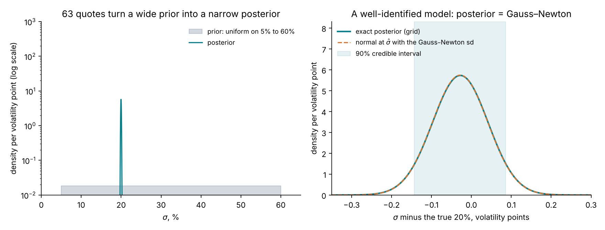
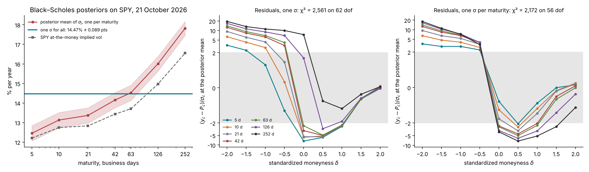
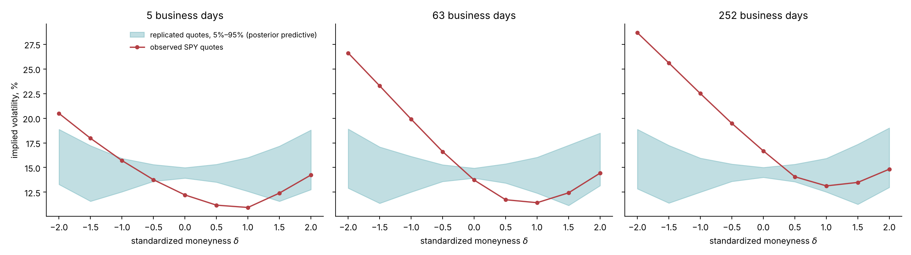
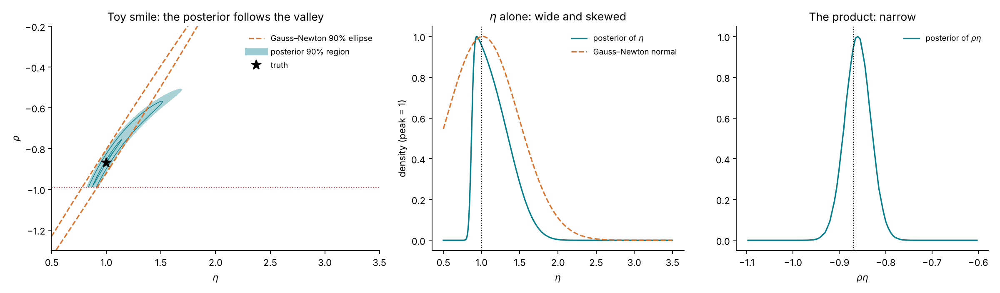
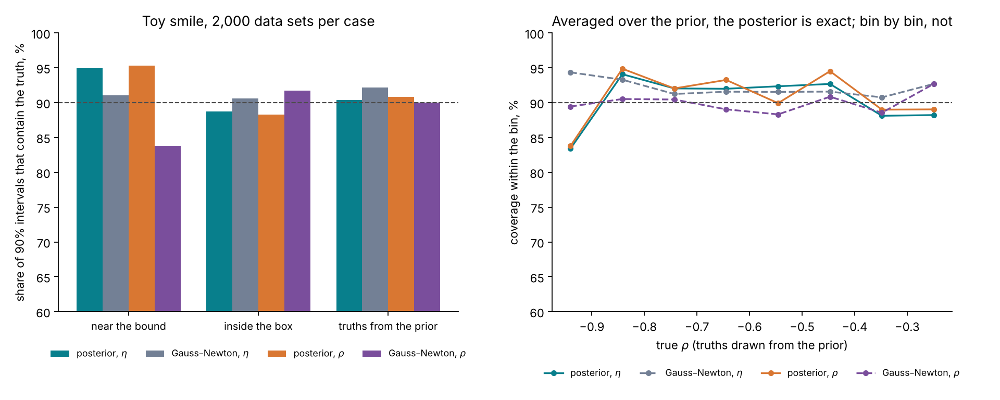
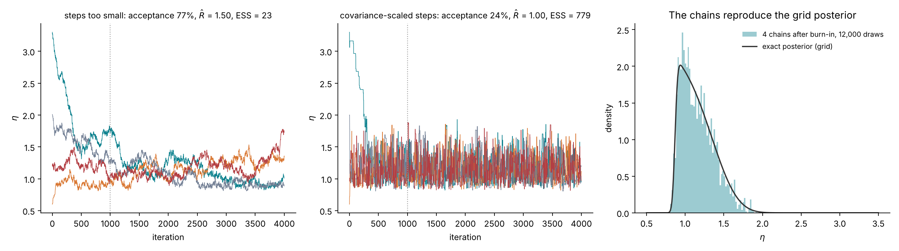
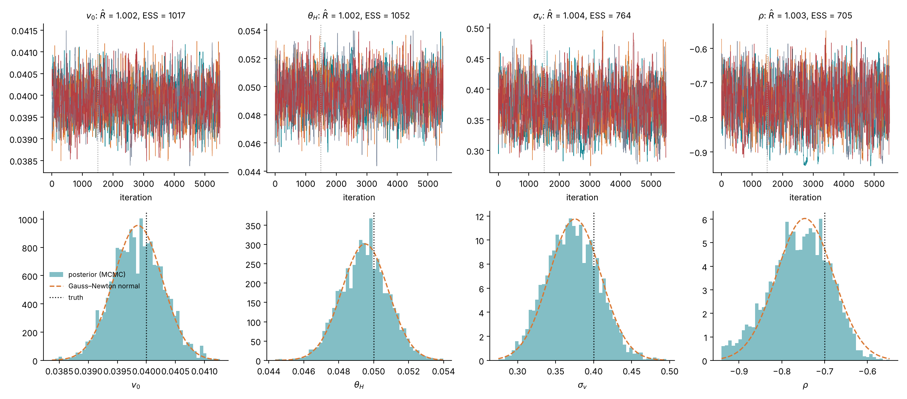
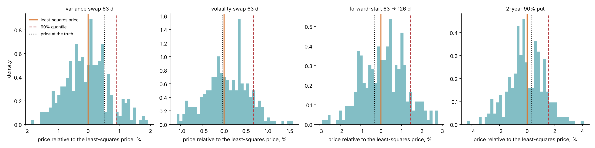
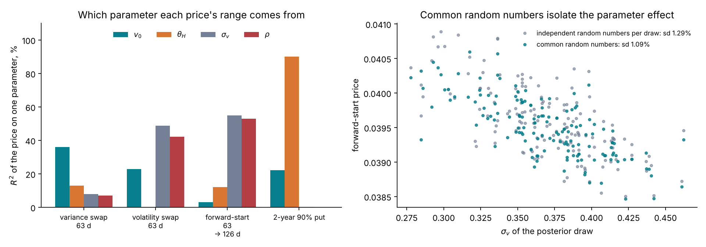
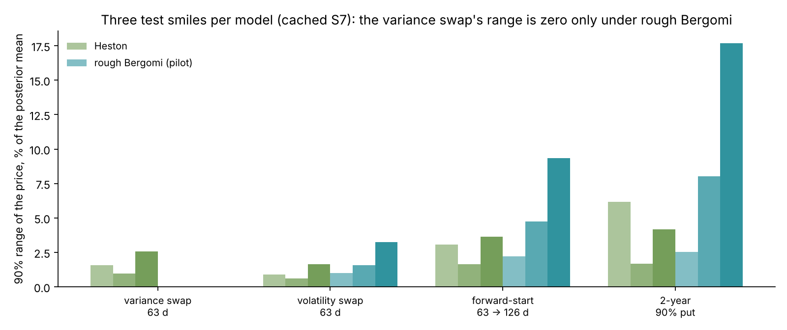

# Lecture 10. Bayesian calibration

[Course index](README.md) · Previous: [Lecture 9. Calibration as estimation](09-calibration-as-estimation.md) · Next: [Lecture 11. Why the exact posterior is expensive](11-why-the-exact-posterior-is-expensive.md)

**What this lecture is for.** This lecture replaces the single calibrated point of Lecture 9 by a probability distribution over the parameters, the posterior, and shows what a desk gains from it. It states Bayes' rule for a calibration and the tutorial's prior, computes exact posteriors on a grid for Black–Scholes and for the toy smile of Lecture 9, checks a posterior against real quotes with a posterior predictive check, and compares credible intervals with confidence intervals by simulation. It then derives the Metropolis–Hastings sampler with its two diagnostics, samples a four-parameter Heston posterior, pushes the posterior through to the prices of the products of Lecture 8 with common random numbers, and reads off the 90% quantile, the reserve and the parameter each price range comes from. It closes with what the posterior does not cover.

**Where it sits in the course.** Lecture 8 asked for a range of plausible prices for products the smile does not pin down. Lecture 9 built that range from one optimum and a local covariance, and showed where the construction breaks. This lecture builds it from the posterior, which is exact under the stated model and the stated prior, whatever the shape of the plausible set. Its one drawback is cost: every evaluation of the posterior density is one priced surface. For Black–Scholes and Heston that is cheap. For rough Bergomi it is a Monte Carlo run, which is the subject of Lecture 11.

## 10.1 Bayes' rule for a calibration

The quotes $y$ and the parameters $\theta$ have a joint distribution, written two ways by the product rule of probability:

$$
p(\theta, y \mid \xi_0) = p(y \mid \theta, \xi_0)\,p(\theta) = p(\theta \mid y, \xi_0)\,p(y \mid \xi_0) .
$$

The first factorization says how the data arise: a parameter value is drawn from the **prior** $p(\theta)$, and the quotes are drawn from the observation model of Lecture 9 given that value, with density the likelihood $p(y \mid \theta, \xi_0)$. Dividing the two factorizations by $p(y \mid \xi_0)$ gives **Bayes' rule**:

$$
p(\theta \mid y, \xi_0) = \frac{p(y \mid \theta, \xi_0)\,p(\theta)}{p(y \mid \xi_0)}, \qquad p(y \mid \xi_0) = \int p(y \mid \theta, \xi_0)\,p(\theta)\,d\theta .
$$

The left side is the **posterior**: the distribution of the parameters given the quotes actually observed. The denominator, the **evidence**, does not depend on $\theta$; it only makes the posterior integrate to one. With the Gaussian observation model of Lecture 9, $\log p(y \mid \theta, \xi_0) = -\tfrac12\chi^2(\theta) + \text{const}$, so

$$
\log p(\theta \mid y, \xi_0) = -\tfrac12\,\chi^2(\theta) + \log p(\theta) + \text{const} .
$$

The same objective that least squares minimizes now shapes a distribution. Least squares keeps the lowest point of $\chi^2$. The posterior keeps all of it: a parameter value whose $\chi^2$ is 2 above the minimum has posterior density $e^{-1} = 0.37$ times that of the optimum (for a flat prior), and one 10 above has $e^{-5} = 0.007$ times.

From the posterior follow three things least squares does not return.

1. **A distribution over the whole plausible set**, of whatever shape, including curved valleys, truncation at bounds and several modes.
2. **Weights.** Two calibrations with $\chi^2$ of 60 and 62 are weighted $1$ to $e^{-1}$, and two with 60 and 120 are weighted $1$ to $e^{-30}$; a multi-start treats both pairs alike (Lecture 9, Section 9.9).
3. **A distribution for any function of the parameters.** A product price $p_\Pi(\theta)$ has the posterior distribution of $p_\Pi(\theta)$ when $\theta$ is drawn from $p(\theta \mid y, \xi_0)$. Its quantiles are the range and the prudent value that Lecture 8 asks for.

## 10.2 The prior

The prior states which parameter values are possible before the quotes are seen. The tutorial uses independent uniform distributions on boxes (design document, "The prior"; `src/sbi4finance/calibration/tasks.py`).

| Model | Parameter | Prior | What it encodes |
| --- | --- | --- | --- |
| Rough Bergomi | $H$ | Uniform(0.02, 0.35) | Rough to nearly Markovian; equity estimates cluster near 0.1 |
| | $\eta$ | Uniform(0.5, 3.5) | Mild to violent volatility of variance; SPX fits report values near 2 |
| | $\rho$ | Uniform(−0.99, −0.2) | Negative correlation only: the equity skew |
| Heston ($\kappa = 2$ fixed) | $v_0$ | Uniform(0.01, 0.16) | Spot volatility from 10% to 40% |
| | $\theta_H$ | Uniform(0.01, 0.16) | Long-run volatility from 10% to 40% |
| | $\sigma_v$ | Uniform(0.1, 1.5) | Volatility of variance |
| | $\rho$ | Uniform(−0.95, −0.1) | Negative correlation only |

The forward-variance curve $\xi_0$ is not in the table. It is read from the chain and held fixed (Lecture 5); the posterior is conditional on it.

**Why uniform.** A uniform prior on a box makes the posterior proportional to the likelihood inside the box and zero outside:

$$
p(\theta \mid y, \xi_0) \propto \exp\!\big(-\tfrac12\chi^2(\theta)\big)\,\mathbf 1\lbrace\theta \in B\rbrace .
$$

The posterior is then the least-squares objective of Lecture 9, exponentiated and restricted to the box, and the two routes can be compared directly. The box itself is information: it says that a correlation of −0.995 or a vol of vol of 5 is not considered. Its edges matter only where the likelihood reaches them, as it does for $\rho$ in the toy smile.

**Uniform is not "uninformative".** A prior uniform in $\eta$ is not uniform in $\eta^2$: if $\eta \sim \text{Uniform}(0.5, 3.5)$, then $v = \eta^2$ has density $\frac{1}{3}\cdot\frac{1}{2\sqrt v}$ on $(0.25, 12.25)$, which favours small values. Every prior favours something; the uniform box is chosen because it is simple to state, simple to sample, and matches what the training bank of Lecture 12 simulates. Where the quotes inform a parameter well, the choice hardly matters. Where they do not, as for $\eta$ at fixed $\rho\eta$, the posterior partly reflects the prior, and the lecture's exercises change it.

**Logit coordinates.** Samplers and neural networks work best on unbounded coordinates. Each parameter is mapped to the real line by

$$
u_i = \frac{\theta_i - a_i}{b_i - a_i} \in (0, 1), \qquad z_i = \log\frac{u_i}{1 - u_i} \in \mathbb R, \qquad \theta_i = a_i + \frac{b_i - a_i}{1 + e^{-z_i}} ,
$$

where $(a_i, b_i)$ is the prior range. A density changes under a change of variables by the absolute derivative of the map. Here $d\theta_i / dz_i = (b_i - a_i)\,u_i(1 - u_i)$, and the uniform prior density is $1/(b_i - a_i)$, so the prior density of $z_i$ is

$$
p(z_i) = \frac{1}{b_i - a_i}\cdot(b_i - a_i)\,u_i(1 - u_i) = u_i(1 - u_i),
$$

the logistic density, and the log posterior in logit coordinates is

$$
\log p(z \mid y, \xi_0) = -\tfrac12\,\chi^2\big(\theta(z)\big) + \sum_i \log\big(u_i(1 - u_i)\big) + \text{const} .
$$

The last sum, the log-Jacobian, is easy to forget. Without it, a sampler in $z$ would target a posterior under a flat prior on $z$, which is improper and puts most of its mass at the edges of the box in $\theta$.

## 10.3 A first posterior: Black–Scholes on Black–Scholes quotes

With one parameter the posterior can be computed exactly on a grid: evaluate $-\tfrac12\chi^2(\sigma)$ at 2,001 points of the prior range, exponentiate, and normalize by numerical integration. The quotes are 63 synthetic Black–Scholes prices at $\sigma = 20\%$ with the design noise, the same data set as Figure 9.2; the prior is uniform on 5% to 60%.

*Figure 10.1.* How to read the figure: the left panel shows the prior, flat at 0.018 per volatility point, and the posterior, a spike at 20%. The prior's standard deviation is 15.9 volatility points; the posterior's is 0.0696, 228 times smaller. The right panel zooms in. The posterior mean is 19.972%, the 90% credible interval is 19.857% to 20.086%, and the dashed curve, a normal density centred at the least-squares estimate with the Gauss–Newton standard deviation of 0.0695 points, lies on top of the exact posterior.

**Why the two agree.** Expand $\chi^2$ to second order around its minimum $\hat\sigma$:

$$
\chi^2(\sigma) \approx \chi^2(\hat\sigma) + (\sigma - \hat\sigma)^2\,J^\top J \quad\Longrightarrow\quad p(\sigma \mid y) \propto \exp\!\Big(-\frac{(\sigma - \hat\sigma)^2}{2\,(J^\top J)^{-1}}\Big)
$$

inside the box. The posterior is then the normal density with mean $\hat\sigma$ and variance $(J^\top J)^{-1}$, the Gauss–Newton variance. The approximation holds when the three conditions of Lecture 9 hold: much information, an optimum away from the bounds, and a nearly quadratic objective over the posterior's width. This is the **Bernstein–von Mises theorem** in the form a desk needs: when the classical interval is right, the posterior agrees with it (van der Vaart 1998, Chapter 10). The posterior differs from the Gauss–Newton interval only where the conditions fail, which is where the difference matters.

## 10.4 A posterior for a wrong model: Black–Scholes on SPY

The same computation on SPY's 63 grid quotes of 21 October 2026 asks: if Black–Scholes were true, which volatility would the quotes support?

*Figure 10.2.* How to read the figure: in the left panel the horizontal line is the posterior of a single $\sigma$, 14.47% with a standard deviation of 0.089 points (90%: 14.32% to 14.62%). The red curve and band are the posterior means and 90% intervals of a separate $\sigma_j$ for each maturity, from 12.45% at 5 days to 17.82% at 252 days, each with a standard deviation of 0.22 to 0.24 points; the dashed curve is SPY's at-the-money implied volatility, from 12.21% to 16.55%. The centre panel shows the residuals $(y_c - P_c)/\sigma_c$ of the single-$\sigma$ fit on a scale that is linear within ±2 and logarithmic beyond. A correct model puts 95% of them in the grey band; here 35% are there, the largest is 19.4, and $\chi^2 = 2{,}561$ on 62 degrees of freedom, against an expected 62 ± 11. The right panel gives a $\sigma$ to each maturity: $\chi^2$ falls only to 2,172 on 56 degrees of freedom, and 30% of the residuals are within ±2. The puts are too expensive and the calls too cheap at every maturity, which no single volatility per maturity can produce.

**The width of a posterior is conditional on the model.** The posterior of $\sigma$ is narrow, 0.089 points, because 63 quotes inform one number very precisely about what it would be if the model were right. It does not say that the model is right. A desk that read the narrow posterior as small model risk would be wrong by the whole smile. The fit must be checked before the width is read.

**The posterior predictive check.** The model's own forecast of new quotes, given the observed ones, is the **posterior predictive distribution**:

$$
p(\tilde y \mid y, \xi_0) = \int p(\tilde y \mid \theta, \xi_0)\,p(\theta \mid y, \xi_0)\,d\theta .
$$

It is sampled in two steps: draw $\theta^{(m)}$ from the posterior, then draw replicated quotes $\tilde y^{(m)} = P(\theta^{(m)}; \xi_0) + \sigma\odot\varepsilon^{(m)}$ from the observation model. If the model is right, the observed quotes look like one more replicate, and each quote falls outside the central 90% of its replicates about one time in ten (Gelman, Meng and Stern 1996).

*Figure 10.3.* How to read the figure: each panel is one maturity, in implied-volatility units. The blue band holds the central 90% of 400 replicated smiles; the red curve is the observed smile. At 5, 63 and 252 days, 5, 7 and 5 of the 9 observed quotes lie outside the band, against about 1 expected. The band is widest in the wings because the quote noise is set by the vega at 20% (Lecture 9, Section 9.1): at the posterior's 14.5% the vega at $|\delta| = 2$ is 6.2 times smaller, so the noise there is about 6.2 volatility points instead of 1.0. Between 12% and 13% of the replicated quotes have no implied volatility, almost all of them in the wings, where the noisy price falls below zero, and they are left out of the band.

The check fails, as it should: Black–Scholes cannot produce a skew. The same check is run on the tutorial's real smile with rough Bergomi (design document, study S8; Lecture 13), where it is the test that the posterior's width can be trusted.

## 10.5 Identification read off the posterior

Return to the toy smile of Lecture 9, Section 9.7: nine quotes $y_j = \rho\eta\,x_j + 0.05\,\eta^2 x_j^2 + s_j\varepsilon_j$, a uniform prior on the box $\eta \in (0.5, 3.5)$, $\rho \in (-0.99, -0.2)$, the truth $(1.0, -0.87)$ near the bound, and the same simulated data set as Figure 9.4. With two parameters, the posterior is computed exactly on a grid of $321 \times 241$ points.

*Figure 10.4.* How to read the figure: in the left panel the shaded area is the posterior's 90% highest-density region, the smallest region holding 90% of the posterior probability; the dotted line is the bound $\rho = -0.99$; the dashed lines are the two long sides of the Gauss–Newton ellipse, whose ends lie outside the plotted area. The posterior follows the curved valley and stops at the bound. The centre panel shows the marginal posterior of $\eta$: its 90% interval is 0.88 to 1.58, with median 1.13, against the Gauss–Newton interval 0.24 to 1.79, which crosses the bottom of the box. The posterior of $\eta$ rises steeply at the left, where the bound cuts the valley, and has a long right tail. The right panel shows the posterior of $\rho\eta$: its 90% interval is −0.906 to −0.815, with median −0.861, a width of ±5% around the true −0.87. For $\rho$ the posterior interval is −0.967 to −0.542, against the Gauss–Newton −1.50 to −0.20.

The posterior reads off what the smile identifies, the product $\rho\eta$, and what it does not, the split between $\rho$ and $\eta$, without a separate identifiability analysis. Every posterior interval lies inside the box. Its median for $\eta$, 1.13, is above the least-squares 1.015, because the bound removes the part of the valley at small $\eta$ and leaves the long part at large $\eta$.

## 10.6 Credible and confidence intervals

The posterior's 90% interval and the Gauss–Newton 90% interval answer different questions.

A **confidence interval** $C(y)$ is a procedure whose output contains the true value in 90% of repeated data sets, for every fixed true value:

$$
\Pr\big(\theta^* \in C(y) \;\big|\; \theta^*\big) = 0.9 \quad\text{for every } \theta^* .
$$

The Gauss–Newton interval aims at this and reaches it only approximately.

A **credible interval** $C(y)$ holds 90% of the posterior probability for the data actually observed:

$$
\Pr\big(\theta \in C(y) \;\big|\; y\big) = \int_{C(y)} p(\theta \mid y)\,d\theta = 0.9 .
$$

The two meet on average. Draw the truth from the prior and the data from the model, and compute the probability that the credible interval contains the truth:

$$
\int\!\!\int \mathbf 1\lbrace\theta^* \in C(y)\rbrace\,p(y \mid \theta^*)\,p(\theta^*)\,dy\,d\theta^*
= \int \Big[\int \mathbf 1\lbrace\theta^* \in C(y)\rbrace\,p(\theta^* \mid y)\,d\theta^*\Big]\,p(y)\,dy
= \int 0.9\;p(y)\,dy = 0.9 .
$$

The first equality uses $p(y \mid \theta^*)\,p(\theta^*) = p(\theta^* \mid y)\,p(y)$ from Section 10.1; the inner integral is 0.9 by the definition of the credible interval. The coverage of credible intervals, averaged over truths drawn from the prior, is exactly nominal. No approximation enters. This identity is the basis of simulation-based calibration, the test of Lecture 13. At a single fixed truth, the coverage of a credible interval can be above or below 90%.

*Figure 10.5.* How to read the figure: each case uses 2,000 simulated data sets, a fresh set from the ones of Figure 9.5, so the Gauss–Newton numbers differ from that figure by sampling error. The posterior intervals are the 5% and 95% quantiles of each marginal posterior. With truths drawn from the prior (left, third group), the posterior intervals cover 90.4% for $\eta$ and 90.8% for $\rho$, within the simulation's standard error of 0.7 points of 90%, as the identity requires; the Gauss–Newton intervals cover 92.2% and 90.0%. At the truth near the bound, the posterior covers 95.0% and 95.3% and Gauss–Newton 91.1% and 83.8%. At the truth inside the box, the posterior covers 88.8% and 88.3% and Gauss–Newton 90.6% and 91.8%. The right panel groups the truths drawn from the prior by their $\rho$: the posterior's coverage is 88% to 95% in seven of the eight bins and 83.4% (for $\eta$) and 83.8% (for $\rho$) in the bin nearest the bound.

**Interpretation.** The posterior's guarantee is exact and holds on average over the prior; it is the right guarantee for a desk that calibrates many smiles whose parameters vary as the prior describes. In the bin nearest the bound the posterior under-covers because its intervals are equal-tailed: they always exclude the lowest 5% of the posterior mass, which for a truth at the bound is where the truth is. In this toy, the Gauss–Newton interval's coverage is also close to nominal on average. Its defect is the one Lecture 9 showed: it is a symmetric interval on a curved, truncated valley, and most of its intervals near the bound include values the model does not allow. The posterior's intervals never do.

## 10.7 Sampling a posterior: Metropolis–Hastings

A grid works in one or two dimensions. In four, a grid of 100 points per parameter has $10^8$ points; at a millisecond per Heston surface that is 28 hours. A posterior in more than two dimensions is represented instead by draws $\theta^{(1)}, \dots, \theta^{(M)}$, and any posterior expectation is estimated by an average, $\mathbb E[f(\theta) \mid y] \approx \frac1M\sum_m f(\theta^{(m)})$.

**The algorithm.** Write $\pi(\theta)$ for the unnormalized posterior, $p(y \mid \theta)\,p(\theta)$. The **Metropolis–Hastings** algorithm (Metropolis et al. 1953; Hastings 1970) builds a Markov chain whose long-run distribution is $\pi$. From the current state $\theta$:

1. Propose $\theta'$ from a proposal density $q(\theta' \mid \theta)$.
2. Accept it with probability $\alpha(\theta, \theta') = \min\!\Big(1,\ \dfrac{\pi(\theta')\,q(\theta \mid \theta')}{\pi(\theta)\,q(\theta' \mid \theta)}\Big)$; otherwise stay at $\theta$.

The normalizing constant $p(y)$ appears in both $\pi(\theta')$ and $\pi(\theta)$ and cancels, which is why it never needs computing.

**Why it works.** A chain with transition density $T(\theta \to \theta')$ leaves $\pi$ unchanged if it satisfies **detailed balance**, $\pi(\theta)\,T(\theta \to \theta') = \pi(\theta')\,T(\theta' \to \theta)$: integrating both sides over $\theta$ gives $\int \pi(\theta)\,T(\theta \to \theta')\,d\theta = \pi(\theta')$, so a draw from $\pi$ stays a draw from $\pi$ after one step. For $\theta' \neq \theta$, the Metropolis–Hastings transition is $T(\theta \to \theta') = q(\theta' \mid \theta)\,\alpha(\theta, \theta')$, and

$$
\pi(\theta)\,q(\theta' \mid \theta)\,\alpha(\theta, \theta') = \min\!\big(\pi(\theta)\,q(\theta' \mid \theta),\ \pi(\theta')\,q(\theta \mid \theta')\big),
$$

which is symmetric in $\theta$ and $\theta'$. Detailed balance holds. With a proposal that can reach every region of positive posterior density, the chain's distribution converges to $\pi$ from any start.

**Random-walk proposals and their scale.** The course's samplers use $\theta' = \theta + L\,\varepsilon$ with $\varepsilon \sim \mathcal N(0, I)$ and $LL^\top = \Sigma_{\text{prop}}$. The proposal is symmetric, so the ratio reduces to $\pi(\theta')/\pi(\theta)$. Steps that are too small are almost always accepted and move slowly; steps that are too large are almost always rejected. For a target close to a $d$-dimensional normal with covariance $\Sigma$, the efficient choice is $\Sigma_{\text{prop}} = (2.38^2/d)\,\Sigma$, with an acceptance rate near 23% in high dimension (Roberts, Gelman and Gilks 1997). $\Sigma$ is not known in advance; it is taken from the Gauss–Newton covariance or from a first, discarded run.

**Two diagnostics.** A chain gives correlated draws, and its early draws depend on the start. Two numbers check a run of $m$ chains with $n$ draws each, after the first part (the **burn-in**) is discarded.

- **Split-$\hat R$** (Gelman and Rubin 1992; Gelman et al. 2013). Split each chain in halves, giving $2m$ sequences of length $n' = n/2$. Let $W$ be the mean of the within-sequence variances and $B$ be $n'$ times the variance of the sequence means. Then
  $$
  \hat R = \sqrt{\frac{\tfrac{n'-1}{n'}\,W + \tfrac{1}{n'}\,B}{W}} .
  $$
  If all sequences sample the same distribution, $B/n'$ is small and $\hat R \to 1$; if a chain is stuck or still drifting, $\hat R > 1$. The current rule is $\hat R < 1.01$ (Vehtari et al. 2021, who also propose a rank-normalized version; the course's scripts compute the classical split form).
- **Effective sample size.** With $\rho_t$ the autocorrelation of the chain at lag $t$, the variance of a chain average of $N = mn$ draws is that of $N/\tau$ independent draws, with $\tau = 1 + 2\sum_{t \geq 1}\rho_t$. The **effective sample size** is $N/\tau$. The sum is truncated where the sums of adjacent pairs $\rho_{2k} + \rho_{2k+1}$ first turn negative (Geyer 1992). The Monte Carlo error of a posterior mean is the posterior standard deviation divided by $\sqrt{\text{ESS}}$; a few hundred effective draws give 90% quantiles good to a few percent of the posterior's width.

*Figure 10.6.* How to read the figure: each panel shows four chains of 4,000 steps from four starts spread over the box, with the first 1,000 steps (left of the dotted line) discarded. In the left panel the proposal has standard deviations of 0.02 in $\eta$ and 0.01 in $\rho$: ⟦toy_small⟧. In the centre panel the proposal covariance is the posterior covariance computed on the grid, times $2.38^2/2$: ⟦toy_tuned⟧. The right panel compares the 12,000 retained draws of the second run with the grid posterior of Figure 10.4.

## 10.8 A Heston posterior by Markov chain Monte Carlo

The Heston task has four parameters, $(v_0, \theta_H, \sigma_v, \rho)$ with $\kappa = 2$ fixed, the prior box of Section 10.2 and the 63 contracts of the design grid. Each posterior evaluation is one Heston surface priced by the Fourier integral of Lecture 6. The test smile is the synthetic one of Lecture 8, Figure 8.6: the truth is $(v_0, \theta_H, \sigma_v, \rho) = (0.04, 0.05, 0.4, -0.7)$, a spot volatility of 20% and a long-run volatility of 22.4%, with the design noise added once.

The sampler works in logit coordinates with the log-Jacobian of Section 10.2. It runs in two stages. In the first, four chains start from points scattered around the least-squares optimum and use a proposal built from the Gauss–Newton covariance in logit coordinates, scaled by $2.38^2/4$; these ⟦n_adapt⟧ steps per chain are discarded. In the second, the proposal covariance is the covariance of the first stage's draws, scaled the same way, and each chain runs ⟦n_keep⟧ more steps, which are kept.

*Figure 10.7.* How to read the figure: ⟦heston_fig⟧

⟦heston_interp⟧

The tutorial's study S3 ran the same check on four held-out Heston test smiles, with four chains of 6,000 steps after 1,000 of burn-in per smile: $\hat R$ was at most 1.011, every parameter had at least 413 effective draws, and the four chains of one smile cost about 400 CPU-seconds (design document, study S3). Those chains are the exact posterior against which the amortized network of Lecture 12 is checked.

## 10.9 From the posterior to product prices

A product price is a function of the parameters, so its posterior distribution is obtained by pricing the product at posterior draws:

$$
p_\Pi^{(m)} = p_\Pi\big(\theta^{(m)};\ \xi_0\big), \qquad \theta^{(m)} \sim p(\theta \mid y, \xi_0), \qquad m = 1, \dots, M .
$$

The values $\lbrace p_\Pi^{(m)}\rbrace$ are draws from the posterior distribution of the price. No linearization enters, unlike the delta method of Lecture 9. Jacquier and Jarrow (2000) used the same construction, with Markov chain Monte Carlo, to carry parameter uncertainty into Black–Scholes option values and hedge ratios.

**Common random numbers.** The prices of Lecture 8's products are Monte Carlo estimates, $\hat p_\Pi(\theta; \omega) = p_\Pi(\theta) + e(\theta; \omega)$, where $e$ is the Monte Carlo error for the random stream $\omega$. If every draw uses its own stream, the spread of the estimates is

$$
\mathrm{Var}\big(\hat p_\Pi^{(m)}\big) = \mathrm{Var}_{\text{post}}\big(p_\Pi(\theta)\big) + \mathbb E\big[s^2(\theta)\big],
$$

the posterior variance of the price plus the Monte Carlo variance $s^2$: the noise widens the range. If every draw uses the same stream $\omega$, the errors are nearly the same function of $\omega$ for nearby $\theta$, $e(\theta; \omega) \approx e(\bar\theta; \omega) + \nabla_\theta e(\bar\theta; \omega)^\top(\theta - \bar\theta)$. The first term is common to all draws: it shifts the whole price distribution by one Monte Carlo error and does not widen it. The range then measures the parameters, and the common shift is reported separately as the Monte Carlo standard error of the point price (Glasserman 2004). The repository's pricer uses, in addition, antithetic pairs and control variates (`src/sbi4finance/calibration/products.py`), and prices the variance swap from the exact mean of the path law, so its Monte Carlo error is zero.

**The point, the range and the reserve.** Three numbers are read off the price draws (design document, "The point price, the range and the reserve"; Lecture 8):

- the **point price** $\hat p_\Pi$, the price at the least-squares calibration;
- the **90% range**, from the 5% to the 95% quantile of the draws;
- the **reserve**: for a position the desk has sold, the prudent value is the 90% quantile $q_{0.9}$, and the reserve is $q_{0.9} - \hat p_\Pi$; for a position it holds, $\hat p_\Pi - q_{0.1}$.

*Figure 10.8.* How to read the figure: ⟦products_fig⟧

⟦products_interp⟧

## 10.10 Which parameter each range comes from

The **law of total variance** splits the posterior variance of a price into the part explained by one parameter and the rest:

$$
\mathrm{Var}(p_\Pi) = \mathrm{Var}\big(\mathbb E[p_\Pi \mid \theta_i]\big) + \mathbb E\big[\mathrm{Var}(p_\Pi \mid \theta_i)\big], \qquad S_i = \frac{\mathrm{Var}\big(\mathbb E[p_\Pi \mid \theta_i]\big)}{\mathrm{Var}(p_\Pi)} .
$$

$S_i$ is the share of the price's variance that knowing $\theta_i$ alone would remove. If $\mathbb E[p_\Pi \mid \theta_i]$ is linear in $\theta_i$, $S_i$ equals the squared correlation between the price and $\theta_i$ across the posterior draws, the $R^2$ of a regression of the price on $\theta_i$ alone. When the parameters are correlated under the posterior, the shares overlap: a parameter correlated with the one that matters inherits part of its share, and the shares need not sum to one.

*Figure 10.9.* How to read the figure: ⟦shares_fig⟧

## 10.11 The variance swap: Heston against rough Bergomi

Lecture 8 derived the variance swap's fair strike as the average of the forward-variance curve, $K_{\text{var}} = \frac1T\int_0^T \xi_0(t)\,dt$. The two models treat that curve differently.

Under Heston, the curve is a function of the parameters, $\mathbb E[V_t] = \theta_H + (v_0 - \theta_H)e^{-\kappa t}$, so

$$
K_{\text{var}}^{\text{Heston}}(T) = \frac1T\int_0^T\big(\theta_H + (v_0 - \theta_H)e^{-\kappa t}\big)dt = \theta_H + (v_0 - \theta_H)\,\frac{1 - e^{-\kappa T}}{\kappa T},
$$

and its posterior range is that of the linear combination $\frac{1 - e^{-\kappa T}}{\kappa T}\,v_0 + \big(1 - \frac{1 - e^{-\kappa T}}{\kappa T}\big)\theta_H$, with weights 0.787 and 0.213 for $\kappa = 2$ and $T = 63/252$. Under rough Bergomi, the curve is an input read from the chain, $\mathbb E[V_t] = \xi_0(t)$ for every $(H, \eta, \rho)$ (Lecture 7), so the variance swap's posterior range is exactly zero. It is the control of the product study: a nonzero range under rough Bergomi would reveal an error in the pricing or in the handling of the curve.

*Figure 10.10.* How to read the figure: each group of bars is one product; the green bars are three Heston test smiles and the blue bars three rough-Bergomi smiles of the pilot study; the height is the 90% range as a share of the posterior mean (`tutorial_final/results/calibration/heston/s7/products.json`, `tutorial_final/results/calibration/rough-pilot/s7/products.json`). Under Heston the variance swap's range is 1.57%, 0.97% and 2.59% on the three smiles; under rough Bergomi it is zero on all three. The other products have ranges under both models: the volatility swap 0.61% to 1.64% under Heston and 0.98% to 3.26% under rough Bergomi, the forward-start 1.65% to 3.65% and 2.22% to 9.34%, the two-year put 1.68% to 6.15% and 2.54% to 17.69%. The rough-Bergomi ranges come from the pilot network's posterior, whose intervals are 1.3 to 1.6 times too wide (design document, study S5), so they overstate the exact posterior's ranges; the full study replaces them with ⟨S7⟩.

Under rough Bergomi, every product's range comes from $(H, \eta, \rho)$ alone, and in the pilot study the volatility of variance $\eta$ explains most of it: a single-parameter $R^2$ of 0.77 to 0.96 for the volatility swap and 0.94 to 0.97 for the forward-start (design document, study S7).

## 10.12 What the posterior does not cover

The posterior is exact for the model, the prior and the observation model it is given. It does not cover what it is not given.

1. **The choice of model.** The posterior range is within-model. The gap between rough Bergomi and Heston calibrated to the same smile, 4% to 8% of the forward-start's price in the pilot, is larger than either model's reserve (Lecture 8, Section 8.10; design document, study S7). Across-model and model-free bounds remain separate numbers.
2. **The observation model.** The noise scale $s_{\text{iv}}(\delta)$, its independence across contracts and its Gaussian shape are assumptions (Lecture 9, Section 9.1). A noise scale twice as large would make every posterior about twice as wide.
3. **The prior box.** Values outside the box have zero posterior probability, whatever the quotes say. The posterior predictive check and the position of the posterior against the bounds show when the box binds.
4. **The forward-variance curve.** $\xi_0$ is read from the chain and held fixed. Its uncertainty, which comes from the same quotes, is not propagated.
5. **Numerical error.** The Fourier ladder and the Monte Carlo pricer have errors of their own, kept below 0.1 and 0.25 quote-noise units by construction (design document, "Heston" and "Rough Bergomi: a Monte Carlo run"). The Monte Carlo error of each product price is reported beside its range.
6. **Approximate inference.** A sampler that has not converged, or a network that approximates the posterior (Lecture 12), adds its own error. $\hat R$, the effective sample size, simulation-based calibration and the audit of Lecture 13 measure it.

## 10.13 Summary

1. Bayes' rule turns the least-squares objective into a distribution: $\log p(\theta \mid y, \xi_0) = -\tfrac12\chi^2(\theta) + \log p(\theta) + \text{const}$. The posterior gives the whole plausible set with weights, and a distribution for any product price.
2. The tutorial's priors are uniform boxes, sampled in logit coordinates with the log-Jacobian $\sum_i \log(u_i(1 - u_i))$. Uniform is a choice, not an absence of information.
3. When the three conditions of Lecture 9 hold, the posterior is the Gauss–Newton normal (Bernstein–von Mises): 19.972% ± 0.0696 points for Black–Scholes on Black–Scholes quotes.
4. A posterior's width is conditional on the model. Black–Scholes on SPY gives 14.47% ± 0.089 points and $\chi^2 = 2{,}561$ on 62 degrees of freedom; the posterior predictive check puts 5 to 7 of 9 quotes outside their 90% bands.
5. On the toy smile, the posterior follows the curved, truncated valley: $\rho\eta$ to ±5%, $\eta$ from 0.88 to 1.58, every interval inside the box.
6. Credible intervals cover exactly on average over the prior, by an identity that needs no approximation; at a fixed truth they can over- or under-cover.
7. Metropolis–Hastings samples any posterior whose density can be evaluated up to a constant; $\hat R$ and the effective sample size check the run.
8. Product prices at posterior draws, with common random numbers, give the range, the 90% quantile and the reserve, and the law of total variance names the parameter each range comes from. Under Heston the variance swap has a range; under rough Bergomi it has none.

Each posterior evaluation here was one priced surface: microseconds for Black–Scholes and ⟦ms_per_eval⟧ for Heston. For rough Bergomi it is a Monte Carlo run of 5.0 CPU-seconds, and an exact posterior by these chains costs about 17 CPU-hours per smile (design document, "The cost of the exact posterior"). Lecture 11 explains why that cost cannot be avoided by a better pricer, and what can be done instead.

## References

- Gelman, A., Carlin, J. B., Stern, H. S., Dunson, D. B., Vehtari, A., Rubin, D. B. (2013). *Bayesian data analysis*, 3rd edition. CRC Press.
- Gelman, A., Meng, X.-L., Stern, H. (1996). Posterior predictive assessment of model fitness via realized discrepancies. *Statistica Sinica* 6, 733–807.
- Gelman, A., Rubin, D. B. (1992). Inference from iterative simulation using multiple sequences. *Statistical Science* 7(4), 457–472. [doi](https://doi.org/10.1214/ss/1177011136)
- Geyer, C. J. (1992). Practical Markov chain Monte Carlo. *Statistical Science* 7(4), 473–483. [doi](https://doi.org/10.1214/ss/1177011137)
- Glasserman, P. (2004). *Monte Carlo methods in financial engineering*. Springer.
- Hastings, W. K. (1970). Monte Carlo sampling methods using Markov chains and their applications. *Biometrika* 57(1), 97–109.
- Jacquier, E., Jarrow, R. (2000). Bayesian analysis of contingent claim model error. *Journal of Econometrics* 94(1–2), 145–180. [doi](https://doi.org/10.1016/S0304-4076(99)00020-2)
- Metropolis, N., Rosenbluth, A. W., Rosenbluth, M. N., Teller, A. H., Teller, E. (1953). Equation of state calculations by fast computing machines. *Journal of Chemical Physics* 21(6), 1087–1092. [doi](https://doi.org/10.1063/1.1699114)
- Roberts, G. O., Gelman, A., Gilks, W. R. (1997). Weak convergence and optimal scaling of random walk Metropolis algorithms. *Annals of Applied Probability* 7(1), 110–120. [doi](https://doi.org/10.1214/aoap/1034625254)
- van der Vaart, A. W. (1998). *Asymptotic statistics*. Cambridge University Press.
- Vehtari, A., Gelman, A., Simpson, D., Carpenter, B., Bürkner, P.-C. (2021). Rank-normalization, folding, and localization: an improved $\hat R$ for assessing convergence of MCMC. *Bayesian Analysis* 16(2), 667–718. [doi](https://doi.org/10.1214/20-BA1221)

Figures: `scripts/course/lecture10.py`.
