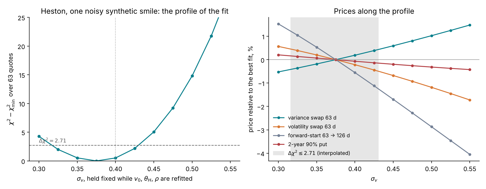
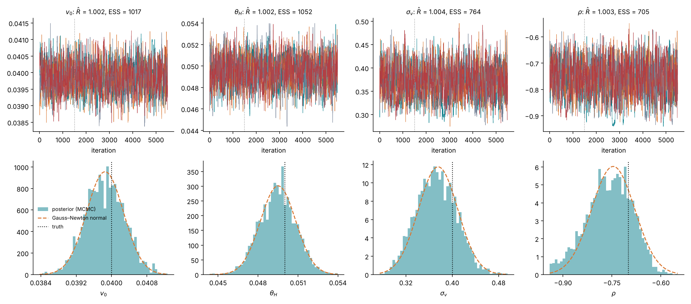
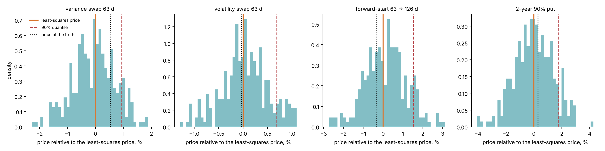
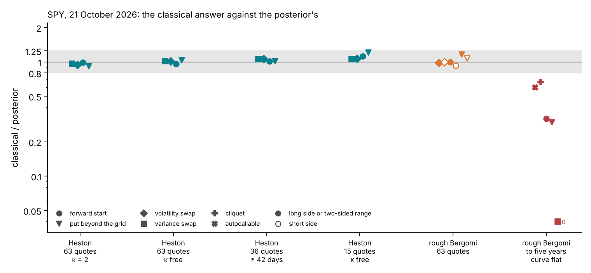
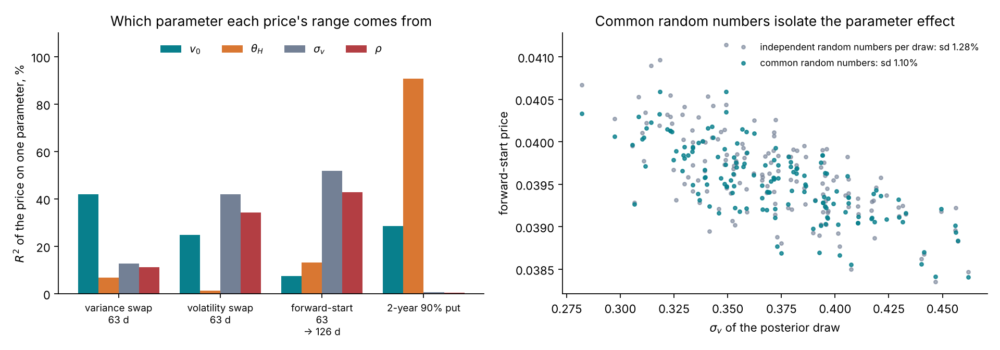

# Lecture 11. Calibrating Heston

[Course index](README.md) · Previous: [Lecture 10. The Heston model](10-heston.md) · Next: [Lecture 12. The amortized workflow on Heston](12-the-amortized-workflow-on-heston.md)

**What this lecture is for.** This lecture calibrates the Heston model of Lecture 10 by the two routes of Part II: least squares with its Gauss–Newton interval, and the exact posterior. It fits the model to the SPY smile of 21 October 2026 by least squares and states where the fit fails. On a synthetic smile it profiles one parameter, samples the exact posterior by Markov chain Monte Carlo, and prices the products of Lecture 6 under it. It then compares the exact posterior with the classical interval on SPY, and names the parameter each price range comes from. It ends with the classical route on 200 test smiles and with deep calibration, which replaces the pricer by a neural network.

**Where it sits in the course.** Lectures 7 and 8 developed calibration as estimation and as a posterior, on Black–Scholes and on a toy smile. Lecture 10 built Heston, whose Fourier likelihood makes the exact posterior affordable. This lecture applies both routes to Heston. On SPY's smile the posterior and the classical interval agree, as the Bernstein–von Mises theorem of Lecture 8 predicts. The exact posteriors computed here are the reference against which Lecture 12 checks the amortized network.

**Its part in the argument.** This lecture gives the first claim of the argument on real quotes (Lecture 6, Section 6.8): on SPY's smile, where the quotes determine Heston's parameters, the exact posterior and the classical interval agree (Section 11.4).

## 11.1 Fitting Heston to the SPY smile

**The fit.** The model is fitted to the 63 SPY quotes of Lecture 5 by weighted least squares,

$$
\hat\theta = \arg\min_\theta \sum_{c=1}^{63}\Big(\frac{P_c(\theta) - y_c}{\sigma_c}\Big)^2,
$$

over $(v_0, \theta, \kappa, \sigma_v, \rho)$ within wide bounds, from three starting points, with the repository's Fourier pricer at 4,096 nodes and a final check at 8,192. Lecture 7, Section 7.3 explains why the weights $1/\sigma_c^2$ make this the maximum-likelihood estimate under the tutorial's noise model. The two fits below, with $\kappa$ free and with $\kappa = 2$ fixed, took 87 CPU-seconds and 956 surface evaluations.

| | $v_0$ | $\theta$ | $\kappa$ | $\sigma_v$ | $\rho$ | RMS residual | largest residual | within $2\sigma_c$ |
| --- | --- | --- | --- | --- | --- | --- | --- | --- |
| $\kappa$ free | 0.0177 (13.3%) | 0.0509 (22.6%) | 3.78 | 1.37 | −0.628 | 0.84 | 2.29 | 62 of 63 |
| $\kappa = 2$ fixed | 0.0182 (13.5%) | 0.0657 (25.6%) | 2 | 1.14 | −0.631 | 1.03 | 2.93 | 58 of 63 |

The residuals are in units of the quote noise $\sigma_c$. By this measure Heston fits SPY's grid on this date: a model that is exactly right would give a root-mean-square residual near 1.

*Figure 11.1.* How to read the figure: the fit with $\kappa$ free is shown.

- **Left.** The model follows the one-year smile closely. At one week it is above the market between $\delta = -1.5$ and the money and below it at $\delta = +2$, by 2.2 volatility points.
- **Centre.** The residuals have structure. From two weeks to two months, the model is above the quotes at $\delta = -1$ and $-0.5$ (by 0.5 to 1.3 noise units) and below them at the money (by 1.1 to 1.7) and at $\delta = +0.5$ (by 0.9 to 1.5). At one week it is above from $\delta = -1$ to the money (by 1.4 to 2.3). At $\delta = -2$ it is below the quotes at every maturity (by 0.4 to 1.5). Near the money the model's short smiles are too curved: the quadratic estimator of Lecture 5 gives a curvature of 25.4 at two weeks against SPY's 18.1, 16.5 at one month against 11.0, and 9.0 at two months against 5.9.
- **Right.** With the same estimator, the model's skew is 1.15 at one week against SPY's 0.86, and 0.91 against 0.72 at two weeks; from two months on the two agree. The fitted skew follows a power law with exponent −0.41 over the grid, against SPY's −0.32. Below one week, outside the grid, the model's skew flattens toward its limit of 1.62 (dashed).

**Where the fit fails.** Four facts qualify the good residuals.

1. **The parameters are extreme.** To produce a steep skew at short maturities, the fit uses a vol-of-vol of 1.37 a year with $v_0 = 0.0177$. The Feller condition fails by a factor of five: $2\kappa\theta = 0.385$ against $\sigma_v^2 = 1.89$. The variance process implied by these parameters spends much of its time near zero.
2. **The shape is wrong in a structured way.** The large vol-of-vol that produces the short skew also over-curves the short smiles (centre panel), and the model's skew is a flat-then-falling curve on log–log axes rather than SPY's straight line (Lecture 10, Section 10.8).
3. **The noise model is loose in the wings on this date.** The quote noise $\sigma_c$ is set as a volatility noise times the vega at $\sigma_{\text{ref}} = 20\%$ (Lecture 5, Section 5.3). SPY's implied volatilities were well below 20% on this date, and at the market's own implied volatility the same $\sigma_c$ corresponds to 0.30 volatility points at the money but 7.0 points for the one-week call at $\delta = +2$ and 5.1 points for the one-year call at $\delta = +2$. The 2.2-point miss at the one-week $\delta = +2$ call is therefore only $0.2\,\sigma_c$. Lecture 7 returns to this choice.
4. **The variance swaps are inconsistent with the market.** The fitted $(v_0, \theta, \kappa)$ imply variance-swap volatilities (Lecture 10, Section 10.4) of 13.8%, 14.2%, 15.0%, 16.2%, 17.2%, 19.0% and 20.6% at the 7 design maturities. SPY's replicated values (Lecture 5) are 13.6%, 15.0%, 16.2%, 17.6%, 18.4%, 20.1% and 21.8%: the model is below by 0.8 to 1.4 volatility points from two weeks on. The replication uses strikes down to $\delta = -8$, which the fit does not see. The fitted model puts less variance in the far put wing than the market does, as its negative residuals at $\delta = -2$ already suggest.

**Interpretation.** One day's 63 quotes, with this noise model, do not reject Heston. What they show is that Heston can match the short skew only with an extreme vol-of-vol, which distorts the short smiles, and that its variance-swap curve is tied to its smile parameters and need not agree with the market's. These are the two defects that rough Bergomi addresses in Lecture 13: its skew follows a power law in $T$ with one parameter, and its forward-variance curve is an input.

## 11.2 A profile of one parameter

Lecture 6, Section 6.4 introduces the simplest measurement of how far the parameters can move while the model still reproduces the quotes, a **profile**: hold one parameter fixed at a grid of values, refit the others by least squares (Lecture 7), and record the fit and the product prices at each value.

*Figure 11.2.* How to read the figure: the synthetic smile is drawn from Heston with $v_0 = 0.04$, $\theta_H = 0.05$, $\sigma_v = 0.4$, $\rho = -0.7$ and $\kappa = 2$, on the 63 design contracts, with the tutorial's quote noise added once. The best fit has $\sigma_v = 0.376$ and $\chi^2 = 71.7$ on 63 quotes. The profile is computed at 11 values of $\sigma_v$ spaced by 0.025 and interpolated by a cubic spline. In the left panel, the objective rises by less than 2.71 (the 90% threshold for one parameter, Lecture 7) for $\sigma_v$ between 0.316 and 0.431; across that band the refitted $\rho$ moves the other way, from −0.875 to −0.660, which keeps the skew. In the right panel, within the band the forward-start price moves from −1.25% to +1.22% of its value at the best grid point, the volatility swap from −0.49% to +0.45%, the variance swap from −0.42% to +0.43%, and the 2-year put from −0.15% to +0.16%.

**Interpretation.** On the full design grid, Heston is well identified: the band of plausible calibrations is narrow, and so are the product ranges. Along this profile the forward-start, which depends most on $\sigma_v$, moves most. The profile varies $\sigma_v$ only: under the full posterior of the same smile (Section 11.3) the 2-year put has the widest range, 4.39% against 3.17% for the forward-start, because the put moves with $\theta_H$, which the profile does not vary. Section 11.6 shows on 200 Heston test smiles that the classical interval works for this model (study S6 of the design document).

## 11.3 The exact posterior by Markov chain Monte Carlo

The Heston task has four parameters, $(v_0, \theta_H, \sigma_v, \rho)$ with $\kappa = 2$ fixed, the prior box of Lecture 8, Section 8.2 and the 63 contracts of the design grid. Each posterior evaluation is one Heston surface priced by the Fourier integral of Lecture 10, on the quadrature rung of 1,024 nodes up to $u = 600$, with the repository's full quadrature ladder (Lecture 10, Section 10.12) as the fallback where that rung violates the price bounds. The test smile is the synthetic one of Section 11.2, Figure 11.2: the truth is $(v_0, \theta_H, \sigma_v, \rho) = (0.04, 0.05, 0.4, -0.7)$, a spot volatility of 20% and a long-run volatility of 22.4%, with the design noise added once.

The sampler works in logit coordinates with the log-Jacobian of Lecture 8, Section 8.2. It runs in two stages. In the first, four chains start from points scattered around the least-squares optimum and use a proposal built from the Gauss–Newton covariance in logit coordinates, scaled by $2.38^2/4$; these 1,500 steps per chain are discarded. In the second, the proposal covariance is the covariance of the first stage's draws, scaled the same way, and each chain runs 4,000 more steps, which are kept.

*Figure 11.3.* How to read the figure: the top row shows the four chains of each parameter over 5,500 steps; the 1,500 adaptation steps, left of the dotted line, are discarded. The chains mix: $\hat R$ is 1.002 for $v_0$ and $\theta_H$, 1.004 for $\sigma_v$ and 1.003 for $\rho$, the 16,000 kept draws are worth 1,017, 1,052, 764 and 705 independent draws, and the acceptance rate is 25% to 28%. The bottom row compares each marginal posterior (histogram) with the normal density of the Gauss–Newton interval at the least-squares point (dashed), and marks the truth (dotted). For $v_0$, $\theta_H$ and $\sigma_v$ the two agree: posterior standard deviations of 0.00044, 0.00135 and 0.034 against Gauss–Newton values of 0.00042, 0.00132 and 0.034. For $\rho$ the posterior is skewed toward the bound at −0.95: its 90% interval is −0.882 to −0.652, against the Gauss–Newton −0.855 to −0.637, and its standard deviation is 0.069 against 0.066. Every true value lies inside its posterior 90% interval: $v_0$ from 0.0392 to 0.0406, $\theta_H$ from 0.0473 to 0.0517, $\sigma_v$ from 0.317 to 0.429.

**Interpretation.** The Heston smile is well identified, and its posterior is close to the Gauss–Newton normal, as Bernstein–von Mises predicts and as study S6 found on 200 smiles against the network posterior (Section 11.6). The posterior adds two things the point estimate hides. First, $\sigma_v$ and $\rho$ are correlated at 0.92 under the posterior: a larger vol of vol with a less negative correlation gives nearly the same skew. This is the ridge of the profile of Section 11.2 (Figure 11.2), where the refitted $\rho$ moved from −0.85 to −0.67 across the band $0.325 \leq \sigma_v \leq 0.425$; the posterior 90% interval of $\sigma_v$, 0.317 to 0.429, matches that band. Second, $v_0$ and $\theta_H$ are correlated at −0.54: the shortest quotes pin $v_0$, and the longer ones pin an average of $v_0$ and $\theta_H$. The run cost 22,000 posterior evaluations in 496 to 624 seconds over three runs, about 25 milliseconds per Heston surface, on the course's two-core machine while other jobs shared it.

The tutorial's study S3 ran the same check on four held-out Heston test smiles, with four chains of 6,000 steps after 1,000 of burn-in per smile: $\hat R$ was at most 1.011, narrowly above the 1.01 threshold the design document sets for these chains, every parameter had at least 413 effective draws, and the four chains of one smile cost about 400 CPU-seconds (design document, study S3). Those chains are the exact posterior against which the amortized network is checked in Lecture 12, Section 12.5; the network alone met S3's agreement criterion on 80% of the 50 test smiles and missed it on 20%.

**The products under this posterior.** Lecture 8, Section 8.7 gives the method: each product is priced at the posterior draws with common random numbers, and the point price, the 90% range and the reserve are read off the price draws.

*Figure 11.4.* How to read the figure: each panel is one product; the histogram is its price at 300 posterior draws, relative to the least-squares price (solid line); the dashed line is the 90% quantile and the dotted line the price at the true parameters. Every price uses the same 8,192 paths, at about 0.43 seconds per parameter set. The table gives the numbers.

| Product | Least-squares price | Monte Carlo standard error of the point | 90% range, % of the posterior mean | Short reserve, % of the point | Long reserve, % of the point | Price at the truth, relative to the point |
| --- | --- | --- | --- | --- | --- | --- |
| Variance swap 63 d | 0.04191 | 0 (exact mean) | 2.56% | 0.94% | 1.03% | +0.53% |
| Volatility swap 63 d | 0.19992 | 0.015% | 1.71% | 0.69% | 0.57% | −0.03% |
| Forward-start 63 → 126 d | 0.03949 | 0.48% | 3.17% | 1.52% | 1.13% | −0.32% |
| 2-year 90% put | 0.07157 | 0.55% | 4.39% | 1.77% | 1.76% | +0.29% |

Prices are in forward units, the volatility swap in volatility units; the standard errors are shares of the point price, from the pricer's antithetic pairs and control variates at 8,192 paths. Two independent checks show what such an error means. The Monte Carlo point price of the put, 0.07157, is 0.72% below the Fourier price at the same parameters, 0.07209, about 1.3 standard errors; the forward-start's, 0.03949, is 0.22% below the quadrature price of Lecture 10, 0.03957. With common random numbers this error is shared by every draw: it shifts the whole histogram and leaves the range and the reserve, which are differences, almost unchanged. The ranges are a few percent, the size of the cached ranges of study S7 on three other Heston test smiles under the network posterior (Lecture 6, Figure 6.3), and every price at the truth lies inside its range. The variance swap's range, 2.56%, is much wider than the ±0.4% of the profile of Section 11.2, and the put's, 4.39%, much wider than ±0.13%. The profile moved $\sigma_v$ and refitted the rest to their best values; these two prices move with $v_0$ and $\theta_H$, which the profile did not vary (Section 11.5). A range read off one direction of the parameter space misses the others; the posterior includes all of them.

**The effect of common random numbers.** On the first 150 draws, the forward-start's standard deviation across draws is 0.000434 (1.10% of its price) with common random numbers and 0.000505 (1.28%) with an independent stream per draw. By the formula above, the Monte Carlo noise per price is $\sqrt{0.000505^2 - 0.000434^2} \approx 0.00026$, and it inflates the apparent spread by 16%. For the put the inflation is 3%. For the volatility swap it is within sampling error, because its control variate removes most of the noise; for the variance swap, priced from the exact mean, it is zero.

## 11.4 The posterior and the classical interval on SPY

Sections 11.2 and 11.3 compared the two routes on a smile that Heston generated. A quick check compares them on SPY's smile of 21 October 2026 (`tutorial_final/checks/heston_checks.py`, results in `heston_checks.json`). It uses five sets of quotes: the 63 quotes of the design grid, with $\kappa$ fixed at 2 or free in $(0.25, 8)$; the 36 quotes up to 42 days, with $\kappa$ fixed; and a $3 \times 5$ grid of 15 quotes, at 21, 63 and 126 days and $\delta$ from $-1$ to $1$, with $\kappa$ fixed or free. For each set the check computes the exact posterior by random-walk Metropolis on the Fourier likelihood, under the uniform prior box, and the least-squares fit with its Gauss–Newton covariance. It prices the four products of Lecture 6 at 300 posterior draws with common random numbers, and by the delta method of Lecture 7, Section 7.6.

*Figure 11.5.* How to read the figure: each of the four left-hand columns is one Heston case, and each marker one product. The vertical axis is the delta-method 90% range over the exact posterior's, on a log scale; the grey band runs from 0.8 to 1.25. The two right-hand columns are rough Bergomi on the same smile, the subject of Lecture 15, Sections 15.4 and 15.6. The numbers are in `images/v2-evidence-numbers.json`, drawn by `scripts/course/realignment.py`.

The figure shows four of the five cases; the fifth, 15 quotes with $\kappa$ fixed, gives ratios of 0.98 to 1.05. In all five cases the delta-method 90% ranges of the products are between 0.92 and 1.21 times the exact posterior's. In four of them the Gauss–Newton 90% intervals of the parameters are also 0.94 to 1.08 times as wide as the posterior's. With four parameters, or five when $\kappa$ is free, and these quotes, the posterior is close to the Gauss–Newton normal, as the Bernstein–von Mises theorem predicts (Lecture 8, Section 8.3). The exception is the 15-quote grid with $\kappa$ free: there the Gauss–Newton interval of $\theta_H$ is 0.73 times as wide as the posterior's, and that of $\kappa$ extends below zero, outside the prior box (`tutorial_final/checks/heston_checks.png`).

**The exact posterior with $\kappa = 2$.** On the 63 quotes with $\kappa$ fixed, the exact posterior is the feasibility run of the tutorial's slot 4 (`tutorial_final/curriculum/04-slot4-heston-in-bayesflow.md`), whose 12,000 draws the check reuses. Its mean equals the least-squares fit with $\kappa = 2$ of Section 11.1. It needs a vol-of-vol about twice its Feller limit: no posterior draw satisfies the Feller condition. It prices variance swaps 0.6 to 1.7 volatility points below SPY's replicated strikes, from two weeks to one year. That run is to be redone as study S8-H before its numbers are quoted as results.

## 11.5 Which parameter each range comes from

The **law of total variance** splits the posterior variance of a price into the part explained by one parameter and the rest:

$$
\mathrm{Var}(p_\Pi) = \mathrm{Var}\big(\mathbb E[p_\Pi \mid \theta_i]\big) + \mathbb E\big[\mathrm{Var}(p_\Pi \mid \theta_i)\big], \qquad S_i = \frac{\mathrm{Var}\big(\mathbb E[p_\Pi \mid \theta_i]\big)}{\mathrm{Var}(p_\Pi)} .
$$

$S_i$ is the share of the price's variance that knowing $\theta_i$ alone would remove. If $\mathbb E[p_\Pi \mid \theta_i]$ is linear in $\theta_i$, $S_i$ equals the squared correlation between the price and $\theta_i$ across the posterior draws, the $R^2$ of a regression of the price on $\theta_i$ alone. When the parameters are correlated under the posterior, the shares overlap: a parameter correlated with the one that matters inherits part of its share, and the shares need not sum to one.

*Figure 11.6.* How to read the figure: in the left panel, each group of bars is one product and each bar the $R^2$ of its price on one parameter across the 300 draws. The 2-year put's range comes from the long-run variance: $\theta_H$ alone explains 91% of it, $v_0$ 29%, $\sigma_v$ and $\rho$ under 1%. The forward-start's comes from the vol of vol and the correlation: $\sigma_v$ explains 52% and $\rho$ 43%, and because the two are correlated at 0.92 these shares overlap. The volatility swap is a mix: $\sigma_v$ 42%, $\rho$ 34%, $v_0$ 25%. The variance swap is the instructive case: no single parameter explains more than 42% ($v_0$), because its strike is the combination $0.787\,v_0 + 0.213\,\theta_H$ (Lecture 10, Section 10.4) of two parameters whose posterior correlation is −0.54, and each alone is a poor predictor of the combination; the two together explain all of it. The design document's study S7 found the same pattern on three other Heston smiles: $v_0$ explaining 0.40 to 0.54 of the variance swap and $\theta_H$ 0.76 to 0.91 of the put. The right panel shows the forward-start price against the $\sigma_v$ of each of 150 draws: with common random numbers (blue) the points trace the parameter effect; with independent streams (grey) the Monte Carlo noise scatters them.

## 11.6 The classical route on 200 smiles

Study S6 of the design document measured the classical route on the tutorial's two models: 200 Heston test smiles priced by Fourier, and 8 rough-Bergomi pilot smiles priced by Monte Carlo, each with ten optimizer starts (`tutorial_final/results/calibration/heston/s6/classical.json`, `tutorial_final/results/calibration/rough-pilot/s6/classical.json`).

*Figure 11.7.* How to read the figure: the "posterior" of study S6 is the amortized network's (checkpoint `heston-net-v3` for Heston, the pilot network for rough Bergomi; Lectures 12 and 15), not an exact posterior; in study S3 the Heston network alone met the agreement criterion with the exact posterior on 80% of 50 test smiles (design document, S3). In the left panel, a ratio of 1 means the two intervals have the same width. For Heston the median ratio is 1.03 for $v_0$, 1.02 for $\theta_H$, 1.03 for $\sigma_v$ and 1.02 for $\rho$; for $\sigma_v$ and $\rho$ the 90th percentile is 1.47 and 1.34, and single smiles reach ratios of 3.6 for $\sigma_v$ and 8.0 for $\rho$, or fall to 0.01 for $\sigma_v$ (computed from the cached intervals). On 15 of the 200 smiles the optimum sits at a bound of the box, and on 11 of these no interval exists. The study computes the information matrix in the logit coordinates of its search (`src/sbi4finance/calibration/classical.py`), where $d\theta/dz \to 0$ at a bound, so the column of $J$ for that parameter vanishes and $J^\top J$ is singular. The $\theta$-coordinate information of Lecture 7, Section 7.6 would stay finite there, and its interval would extend past the bound. In the right panel, Heston's Gauss–Newton coverage is 90%, 87%, 92% and 90%, against the network posterior's 90%, 89%, 90% and 87%: the classical route works on Heston. On the 8 rough-pilot smiles, Gauss–Newton covers 100% for $H$, 86% for $\eta$ and 71% for $\rho$, against the pilot network posterior's 88%, 75% and 75%; one smile has no interval, with its optimum at $\rho = -0.99$. Eight smiles cannot separate the two routes. A rough-Bergomi least-squares fit costs a median 605 CPU-seconds per smile, against 10 for Heston.

## 11.7 Deep calibration and the neural pricer

For models priced by Monte Carlo, each evaluation of $\chi^2$ is a Monte Carlo run: about 5 CPU-seconds per surface for rough Bergomi (Lecture 14), and hundreds of evaluations per fit. **Deep calibration** replaces the pricer by a neural network.

1. Simulate a bank of parameter vectors $\theta^{(i)}$ from a box and price each one: $P(\theta^{(i)})$, the 63 model prices.
2. Train a network $f_\psi(\theta) \approx P(\theta)$ by least squares on the bank, once.
3. Calibrate each smile by least squares with $f_\psi$ in place of $P$, in milliseconds.

Horvath, Muguruza and Tomas (2021) do this for rough Bergomi, mapping parameters to the implied-volatility grid. Hernandez (2017) trained instead the **one-step inverse map**, a network from the quotes directly to $\hat\theta$, which is amortized point estimation: it learns, from simulated pairs, the function that a least-squares fit would compute. Bayer et al. (2019) compare the two routes, prefer the two-step one (a neural pricer, then a classical optimizer) for its stability out of sample, and use their fast pricer for a Bayesian analysis of the calibrated model.

The neural pricer's error enters the calibration as an extra error on every model price. It is harmless if it is small against the quote noise $\sigma_c$, and it must be measured on held-out surfaces.

*Figure 11.8.* How to read the figure: the bank has 3,300 Heston surfaces ($\kappa = 2$), 3,000 for training and 300 for testing, drawn uniformly from the prior box shrunk by 5% of its width at each edge, where the first quadrature rung is accurate, and priced on the design grid in 66 seconds. The network is a three-layer perceptron with 128 units per layer, trained for 325 epochs in 18 seconds. These are wall-clock times of the run that produced the figure; on the shared two-core machine other runs of the same script took up to 115 and 269 seconds. In the left panel its held-out root-mean-square error is 0.16 $\sigma_c$ at the median contract and 0.25 $\sigma_c$ at the worst; 99% of its absolute errors are below 0.50 $\sigma_c$. In the centre panel, least squares with this pricer lands a median 0.18 to 0.33 Gauss–Newton standard deviations from least squares with the exact pricer, and up to 1.8 for $\sigma_v$: an error of 0.2 $\sigma_c$ on 63 prices moves the fit by a fraction of its own uncertainty, and occasionally by more. In the right panel, the one-step inverse map recovers $\sigma_v$ with a root-mean-square error of 0.042, against a median Gauss–Newton standard deviation of 0.030, and $\rho$ with 0.046 against 0.016: it is fast and returns a point, and no interval. The tutorial's own Heston pricer, larger and trained on 50,000 surfaces, has a held-out error of 0.029 $\sigma_c$ at the median contract and 0.041 $\sigma_c$ at the worst (design document, study S4).

**Interpretation.** Deep calibration solves the cost problem of least squares and keeps its output, one point. A neural pricer also makes the likelihood cheap, so that a posterior can be sampled on it: the neural-likelihood route of study S4 runs four Metropolis chains of 20,000 steps on the tutorial's Heston pricer at a median 12 CPU-seconds per smile (design document, study S4). Lecture 8, Section 8.8 introduces such chains, and Lecture 9 shows how a network can return the posterior directly. Lecture 12, Section 12.6 compares the two routes on Heston.

## 11.8 Summary

1. Fitted to SPY on 21 October 2026, Heston has residuals within the quote noise, with a vol-of-vol of 1.37, the Feller condition violated fivefold, over-curved short smiles, and variance-swap strikes 0.8 to 1.4 points below the market's.
2. A profile holds one parameter fixed and refits the others. On a well-identified synthetic smile the forward-start moves by about ±1.2% along the vol-of-vol profile, and the profile misses the directions it does not vary.
3. The exact posterior of that smile, sampled by Metropolis–Hastings, is close to the Gauss–Newton normal, except for $\rho$, which is skewed toward its bound; $\sigma_v$ and $\rho$ are correlated at 0.92. The four products have 90% ranges of 1.7% to 4.4% under it.
4. On SPY's smile, with 63, 36 or 15 quotes and $\kappa$ fixed or free, the delta-method 90% ranges of the four products are 0.92 to 1.21 times the exact posterior's, as the Bernstein–von Mises theorem predicts. The exact posterior with $\kappa = 2$ needs a vol-of-vol about twice its Feller limit and prices variance swaps 0.6 to 1.7 volatility points below SPY's replicated strikes.
5. The law of total variance names the parameter each range comes from: $\theta_H$ for the 2-year put, $\sigma_v$ and $\rho$ for the forward-start, and the combination $0.787\,v_0 + 0.213\,\theta_H$ for the 63-day variance swap.
6. On 200 Heston test smiles the classical interval matches the network posterior's coverage; at a bound, the logit-coordinate information becomes singular and no interval exists.
7. Deep calibration makes least squares fast with a neural pricer whose error must be small against $\sigma_c$; it still returns one point.

## References

- Bayer, C., Horvath, B., Muguruza, A., Stemper, B., Tomas, M. (2019). On deep calibration of (rough) stochastic volatility models. [arXiv:1908.08806](https://arxiv.org/abs/1908.08806)
- Hernandez, A. (2017). Model calibration with neural networks. *Risk*, June 2017.
- Horvath, B., Muguruza, A., Tomas, M. (2021). Deep learning volatility: a deep neural network perspective on pricing and calibration in (rough) volatility models. *Quantitative Finance* 21(1), 11–27. [doi](https://doi.org/10.1080/14697688.2020.1817974)

Figures: `scripts/course/lecture06.py` (Figure 11.1), `scripts/course/lecture08.py` (Figure 11.2), `scripts/course/lecture10.py` (Figures 11.3, 11.4 and 11.6), `scripts/course/realignment.py` (Figure 11.5) and `scripts/course/lecture09.py` (Figures 11.7 and 11.8).
