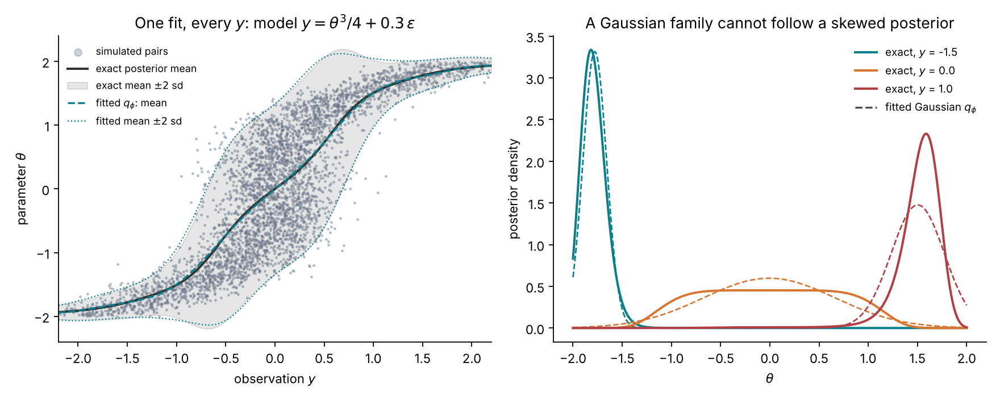
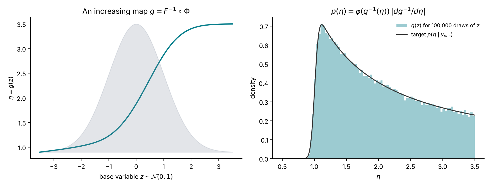
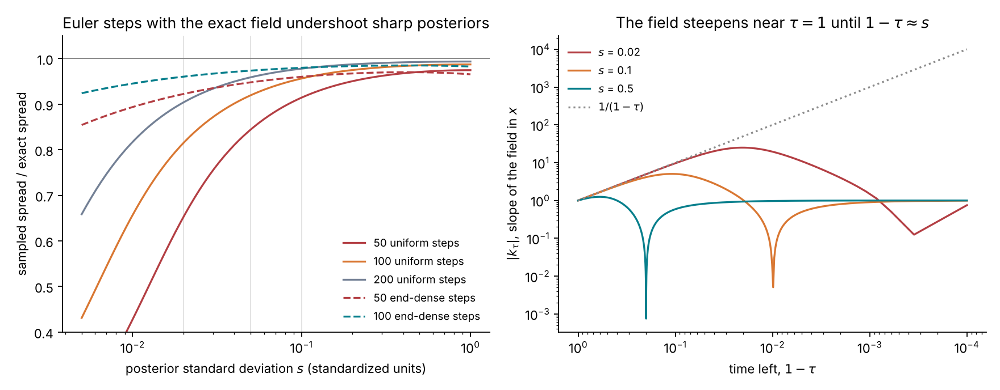
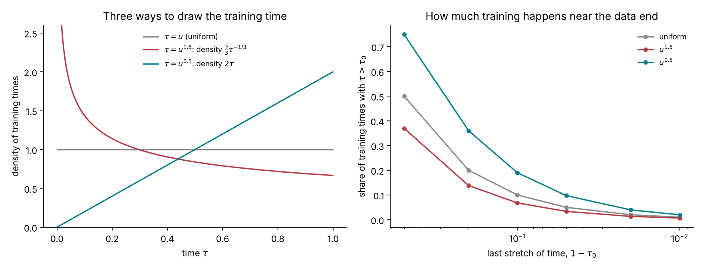
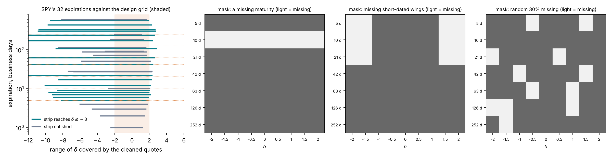
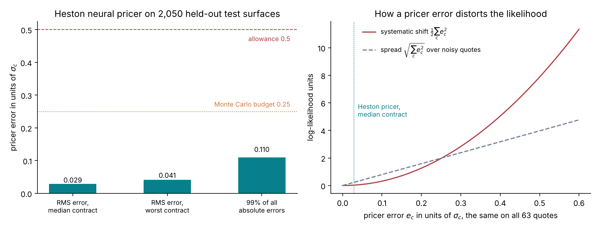

# Lecture 12. Amortized inference

[Course index](README.md) · Previous: [Lecture 11. Why the exact posterior is expensive](11-why-the-exact-posterior-is-expensive.md) · Next: [Lecture 13. Validating an amortized posterior](13-validating-an-amortized-posterior.md)

**What this lecture is for.** This lecture builds the method that makes the rough-Bergomi posterior affordable. It shows why parameters simulated from the prior, paired with the surfaces they generate, already contain the posterior of every surface; how a network is trained to extract it (neural posterior estimation); and how the tutorial's network represents a posterior, by flow matching. It then describes the tutorial's network concretely: what it reads, what it returns, the training bank it learns from, the training choices that the Heston experiments forced, how it can read a real chain with missing quotes, and the alternative route through a neural pricer.

**Where it sits in the course.** Lecture 11 showed that the exact posterior of rough Bergomi costs at least 17 CPU-hours per smile, and about 41 at the training bank's average cost per surface, because every step of a Markov chain prices a Monte Carlo surface. This lecture moves that cost into a training bank priced once. The network it produces returns the posterior of a new smile in 1.4 seconds. Lecture 13 checks that the answer is right, on average and for each smile, before Part IV's last lecture uses it to price products.

## 12.1 Simulated pairs carry the posterior

Draw parameters from the prior and simulate data from the model. Each draw produces a pair $(\theta, y)$ from the joint distribution

$$
p(\theta, y) = p(\theta)\,p(y \mid \theta) .
$$

The same joint distribution can be factored the other way, by the definition of conditional probability:

$$
p(\theta, y) = p(y)\,p(\theta \mid y) .
$$

The second factorization says that among simulated pairs whose data equal a given $y$, the parameters are distributed exactly as the posterior $p(\theta \mid y)$. The simulator never evaluates the likelihood $p(y \mid \theta)$; it only draws from it. This is the starting point of **simulation-based inference** (Cranmer, Brehmer and Louppe 2020).

The crudest way to use it is to keep the simulated pairs whose data fall close to the observation and read their parameters. This is rejection approximate Bayesian computation. It is too wasteful for 63 quotes, but it shows the principle on a model small enough to draw.

**A toy version of the smile's identification problem.** Take two parameters with the tutorial's prior ranges, $\eta \sim \mathcal{U}(0.5, 3.5)$ and $\rho \sim \mathcal{U}(-0.99, -0.2)$, and one observation that measures only their product, as the level of the short-dated at-the-money skew does in rough Bergomi (Lecture 7). The full surface identifies $\eta$ separately, mainly through the long-dated at-the-money level against the forward-variance curve, so that identification depends on $\xi_0$ being exact (Lecture 10); the toy keeps only the skew:

$$
y = \rho\,\eta + 0.05\,\varepsilon, \qquad \varepsilon \sim \mathcal{N}(0, 1) .
$$

The exact posterior for an observation $y_{\text{obs}}$ is proportional to the likelihood inside the prior box. Its marginal for $\eta$ integrates $\rho$ out in closed form:

$$
p(\eta \mid y_{\text{obs}}) \;\propto\; \frac{1}{\eta}\Big[\Phi\Big(\frac{-0.2\,\eta - y_{\text{obs}}}{0.05}\Big) - \Phi\Big(\frac{-0.99\,\eta - y_{\text{obs}}}{0.05}\Big)\Big], \qquad 0.5 < \eta < 3.5 ,
$$

where the factor $1/\eta$ comes from changing variables from $\rho$ to $\rho\eta$.

*Figure 12.1.* How to read the figure: 400,000 pairs were simulated from the prior and the model.

- **Left.** Each grey dot is one pair. The red band keeps the 4,214 pairs (1.05%) whose $y$ lies within 0.01 of $y_{\text{obs}} = -1$.
- **Centre.** The parameters of the kept pairs lie along the curve $\rho\eta = -1$, inside the exact posterior's contours. The curve is the toy's version of the $\rho$–$\eta$ valley of the design document: the data fix the product and leave the factors free along it.
- **Right.** The kept values of $\eta$ reproduce the exact marginal. Their 90% interval is 1.07 to 3.27, against 1.07 to 3.29 for the exact posterior. The marginal is cut sharply on the left at $|y_{\text{obs}}|/0.99 = 1.01$, because $\rho$ cannot be below −0.99, and decays slowly to the right, where it is cut by the prior's upper bound.

**Interpretation and limit.** The figure contains the whole idea of amortized inference: the posterior of any observation is already inside the simulated pairs, and nothing about the likelihood has to be computed. The rejection step is what does not scale. With 63 quotes, the chance that a simulated surface falls within a small distance of the observed one on every quote is negligible. A network replaces the band: it learns, from all pairs at once, how the parameters vary with the data.

## 12.2 Neural posterior estimation

Let $q_\phi(\theta \mid y)$ be a family of conditional densities with parameters $\phi$, for example a neural network that outputs a density over $\theta$ for each $y$. **Neural posterior estimation** fits $\phi$ by maximizing the likelihood of the simulated parameters given their simulated data, that is, by minimizing

$$
\mathcal{L}(\phi) = \mathbb{E}_{p(\theta, y)}\big[-\log q_\phi(\theta \mid y)\big] \approx -\frac{1}{n}\sum_{i=1}^{n} \log q_\phi(\theta_i \mid y_i)
$$

over the $n$ simulated pairs (Papamakarios and Murray 2016; Greenberg, Nonnenmacher and Macke 2019).

**Why the minimizer is the posterior.** Write the joint expectation as an expectation over $y$ of an expectation over the posterior, and add and subtract $\log p(\theta \mid y)$:

$$
\mathcal{L}(\phi) = \mathbb{E}_{p(y)}\Big[\mathbb{E}_{p(\theta \mid y)}\Big[\log\frac{p(\theta \mid y)}{q_\phi(\theta \mid y)}\Big]\Big] - \mathbb{E}_{p(y)}\Big[\mathbb{E}_{p(\theta \mid y)}\big[\log p(\theta \mid y)\big]\Big] = \mathbb{E}_{p(y)}\Big[\mathrm{KL}\big(p(\cdot \mid y)\,\big\|\,q_\phi(\cdot \mid y)\big)\Big] + \text{const}.
$$

The constant does not depend on $\phi$. The Kullback–Leibler divergence is non-negative and is zero only when the two densities coincide. If the family is rich enough to contain the posterior, the minimizer is therefore $q_\phi(\theta \mid y) = p(\theta \mid y)$ for almost every $y$ the prior and the model can produce. One fit serves every observation: this is what **amortized** means. The cost of inference is paid in training, and each new observation costs one evaluation of the network.

*Figure 12.2.* How to read the figure: the model is $y = \theta^3/4 + 0.3\,\varepsilon$ with $\theta \sim \mathcal{U}(-2, 2)$. Its posterior is narrow where the cube is steep and wide where it is flat. The family $q_\phi$ is a Gaussian whose mean and log standard deviation are linear combinations of 13 smooth functions of $y$, fitted to 40,000 simulated pairs by minimizing $\mathcal{L}(\phi)$.

- **Left.** The fitted mean and band (teal) lie on the exact ones (black and grey) across all observations, including the wide region around $y = 0$ and the narrow tails. At $y = 1$, for example, the exact posterior has mean 1.506 and standard deviation 0.257, and the fit gives 1.503 and 0.270.
- **Right.** The fit has the right mean and spread, but a Gaussian cannot take the posterior's shape. At $y = 0$ the posterior is flat-topped, because the cube is flat near zero. At $y = 1$ it is skewed, with a long left tail and a sharp right edge: above its mode near $\theta = 1.6$ the cube rises steeply, so the likelihood falls fast. The prior's bound at $\theta = 2$ plays no part there, since the posterior density at 2 is 0.4% of its peak. At $y = -1.5$ the posterior is cut by the bound at $-2$, 1.8 posterior standard deviations from its mean.

**Interpretation.** The objective recovers the best member of the family, for every observation at once. The posterior of the smile is not Gaussian either: Figure 12.1 showed a curved valley cut by the prior box. The family must be flexible enough to represent such shapes. The next two sections build one.

## 12.3 Flexible densities by change of variables

A **normalizing flow** represents a density as the image of a simple one under an invertible map (Papamakarios et al. 2021). Let $z \sim \mathcal{N}(0, I)$ and $\theta = g(z)$ with $g$ invertible and differentiable. The change-of-variables formula gives the density of $\theta$:

$$
p(\theta) = \varphi\big(g^{-1}(\theta)\big)\,\Big|\det \frac{\partial g^{-1}}{\partial \theta}\Big| ,
$$

where $\varphi$ is the standard normal density. In one dimension any continuous density can be reached this way: with $F$ the target's cumulative distribution function and $\Phi$ the standard normal one, the map $g = F^{-1}\circ\Phi$ sends $\mathcal{N}(0, 1)$ exactly to the target, because $\Phi(z)$ is uniform and $F^{-1}$ of a uniform has distribution $F$.

*Figure 12.3.* How to read the figure: the left panel shows $g = F^{-1}\circ\Phi$ for the marginal posterior of $\eta$ in Figure 12.1, over the standard normal density (shaded). The map is flat on the left, where the posterior has its sharp edge at $\eta \approx 1$, and steep on the right, where it spreads mass thinly up to 3.5. The right panel pushes 100,000 standard normal draws through $g$; their histogram matches the target.

**From one dimension to several, and to conditional densities.** In several dimensions a flow composes simple invertible layers whose Jacobian determinants are cheap, and conditions each layer on the data $y$. Such a network can be trained by the objective of Section 12.2, because $\log q_\phi$ is computable through the change-of-variables formula. The tutorial uses a different construction of $g$, which does not require invertible layers: it defines the map as the solution of an ordinary differential equation and learns its velocity.

## 12.4 Flow matching

**The path.** Draw a noise vector $z \sim \mathcal{N}(0, I)$ and a target $\theta$ from the distribution to be learned, independently, and connect them by a straight line in time $\tau \in [0, 1]$:

$$
x_\tau = (1 - \tau)\,z + \tau\,\theta, \qquad \frac{dx_\tau}{d\tau} = \theta - z .
$$

Each line has a constant velocity. Many lines pass through the same point $x$ at the same time $\tau$, from different pairs.

**The averaged velocity field.** Define the velocity at $(x, \tau)$ as the average velocity of the lines that pass there:

$$
v(x, \tau) = \mathbb{E}\big[\theta - z \,\big|\, x_\tau = x\big] .
$$

**It carries the noise to the target.** Let $p_\tau$ be the law of $x_\tau$. For any smooth test function $f$, differentiate $\mathbb{E}[f(x_\tau)]$ in $\tau$ and use the tower property of conditional expectation:

$$
\frac{d}{d\tau}\mathbb{E}\big[f(x_\tau)\big] = \mathbb{E}\big[f'(x_\tau)\,(\theta - z)\big] = \mathbb{E}\big[f'(x_\tau)\,v(x_\tau, \tau)\big] = \int f'(x)\,v(x, \tau)\,p_\tau(x)\,dx = -\int f(x)\,\partial_x\big(p_\tau v\big)(x)\,dx ,
$$

where the last step integrates by parts. Since this holds for every $f$, the densities satisfy the **continuity equation** $\partial_\tau p_\tau + \partial_x(p_\tau\,v) = 0$. The law of the solutions of the ordinary differential equation $dx/d\tau = v(x, \tau)$, started from $x_0 \sim \mathcal{N}(0, I)$, satisfies the same equation with the same initial law. So, under regularity conditions that make the solution unique, following the field from $\tau = 0$ to $\tau = 1$ turns standard normal draws into draws from the target (Lipman et al. 2023; Liu, Gong and Liu 2023).

**It can be learned by regression.** The conditional mean minimizes the expected squared error. The field is therefore the minimizer of

$$
\mathcal{L}(\phi) = \mathbb{E}_{z,\,\theta,\,\tau}\Big\| u_\phi\big((1 - \tau)z + \tau\theta,\ \tau\big) - (\theta - z)\Big\|^2
$$

over functions $u_\phi$. The loss needs only pairs $(z, \theta)$ and a time $\tau$; no density and no inverse map are computed.

**For a posterior.** Give the network the data as an extra input, $u_\phi(x, \tau, y)$, and draw $(\theta, y)$ from the simulated pairs. The same argument, for each $y$, makes the learned field transport $\mathcal{N}(0, I)$ to $p(\theta \mid y)$ for every observation the prior can produce (Wildberger et al. 2023). This is the tutorial's inference network.

*Figure 12.4.* How to read the figure: the target is a mixture of two Gaussians, with weight 0.4 at −1.0 (standard deviation 0.3) and weight 0.6 at 1.2 (standard deviation 0.2). For such a target the field has a closed form, so no network is involved.

- **Left.** The training lines cross each other: a point near $x = 0$ at $\tau = 0.5$ is crossed by lines heading to both components.
- **Centre.** The colour is the averaged velocity, positive (red) upward and negative (blue) downward. The black paths follow it. Unlike the training lines, they never cross: each starting point has one path, and the paths separate near $x = 0$ into the two components.
- **Right.** 50,000 standard normal draws are moved along the field with 400 small steps. At $\tau = 0.5$ and $0.8$ their histograms match the exact laws $p_\tau$ (dotted). At $\tau = 1$ they match the target: 60.2% of the draws end above 0, against a weight of 60%, and the largest gap between histogram and density over 60 bins is 0.015.

## 12.5 Sampling with a finite number of steps

To draw from the learned posterior, the tutorial integrates $dx/d\tau = u_\phi(x, \tau, y)$ from $\tau = 0$ to $1$ with Euler steps, $x_{i+1} = x_i + (\tau_{i+1} - \tau_i)\,u_\phi(x_i, \tau_i, y)$. The step count is a choice made at sampling time, after training. It matters most for sharp posteriors.

**The Gaussian case in closed form.** Let the target be $\mathcal{N}(\mu, s^2)$ in one standardized coordinate. Then $x_\tau$ and $\theta - z$ are jointly Gaussian, with

$$
\mathbb{E}[x_\tau] = \tau\mu, \quad \mathrm{Var}(x_\tau) = (1 - \tau)^2 + \tau^2 s^2, \quad \mathrm{Cov}(x_\tau, \theta - z) = \tau s^2 - (1 - \tau),
$$

so the conditional mean is linear in $x$ (design document, Appendix F.2):

$$
v(x, \tau) = \mu + k_\tau\,(x - \tau\mu), \qquad k_\tau = \frac{\tau s^2 - (1 - \tau)}{(1 - \tau)^2 + \tau^2 s^2} .
$$

The deviation of a draw from the mean path obeys $d(\text{deviation})/d\tau = k_\tau \times \text{deviation}$, so the exact flow multiplies the initial spread of 1 by $\exp\big(\int_0^1 k_\tau\,d\tau\big) = s$. An Euler step of size $h$ multiplies it by $1 + h\,k_\tau$ instead. Since $1 + x \le e^{x}$, with a gap of order $x^2/2$, Euler steps shrink the spread more than the exact flow wherever $h|k_\tau|$ is not small.

**Where the field is steep.** For $s \ll 1$ and $1 - \tau \gg s$, $k_\tau \approx -1/(1 - \tau)$: the field's slope grows as the end approaches, until $1 - \tau$ reaches $s$. A sharp posterior's field is steep exactly at the last steps, so uniform steps undershoot there. A grid dense near the end, $\tau_i = 1 - (1 - i/n)^2$, makes the steps short where the field is steep.

*Figure 12.5.* How to read the figure:

- **Left.** With 50 uniform steps the sampled spread is 0.65 of the exact one at $s = 0.02$, 0.84 at $s = 0.05$ and 0.91 at $s = 0.1$. With 100 steps on the end-dense grid it is 0.96, 0.97 and 0.98. These are the numbers of the design document's Appendix F.2, reproduced here from the closed form. Two hundred uniform steps give 0.90, 0.96 and 0.98, close to 100 end-dense steps at twice the cost.
- **Right.** On logarithmic axes with time running to the right, $|k_\tau|$ follows $1/(1 - \tau)$ until $1 - \tau \approx s$ and then returns to 1. The narrow dips are where $k_\tau$ changes sign. The steep stretch is long for $s = 0.02$ and absent for $s = 0.5$.

**Why this matters for the tutorial.** In the network's standardized coordinates, Heston's initial variance $v_0$ has a posterior standard deviation near 0.02, because the one-week quotes pin it. With 50 uniform steps, the first two Heston networks returned $v_0$ intervals a median 25% too narrow against the exact posterior, and covered the truth on 73% to 78% of held-out smiles instead of 90% (design document, Appendix F.2). The tutorial samples with 100 end-dense steps.

## 12.6 Where in time the loss is trained

The training loss averages over the time $\tau$. How $\tau$ is drawn decides which parts of the field the network learns best. BayesFlow's default draws $\tau = u^{1.5}$ with $u$ uniform, which favours the noise end; the tutorial draws $\tau = u^{0.5}$. Since $\mathbb{P}(u^{a} \le t) = t^{1/a}$, the two densities are

$$
p(\tau) = \tfrac{2}{3}\,\tau^{-1/3} \quad (a = 1.5), \qquad p(\tau) = 2\tau \quad (a = 0.5) .
$$

*Figure 12.6.* How to read the figure: the left panel shows the three densities. In the right panel, the share of training times with $\tau > 0.9$ is 19% under $u^{0.5}$, 10% under the uniform rule and 6.8% under $u^{1.5}$. Within the last 1% of time the shares are 2.0%, 1.0% and 0.67%.

**Interpretation.** Section 12.5 showed that a sharp posterior's field has its structure near $\tau = 1$. Its location, the posterior mean, is also set there, because the path only commits to a final value when little time is left. Training more often near the data end puts the network's effort where a sharp posterior's location is decided. On Heston this change reduced the median error of the $v_0$ posterior mean from 0.35 to 0.16 posterior standard deviations (Section 12.9).

## 12.7 What the tutorial's network reads and returns

The tutorial's network for rough Bergomi is BayesFlow's flow-matching network (Radev et al. 2022, version 2.0.14 in the repository), with a velocity network of four hidden layers of 256 units (design document, "The inference network").

| Item | Content | Size |
| --- | --- | --- |
| Conditions | The 63 quotes divided by their noise standard deviations, $y_c/\sigma_c$, and the logarithms of the 7 forward-variance levels $\xi_0$ | 70 |
| Targets | $H$, $\eta$, $\rho$, each mapped to the real line by the logit of its position in the prior box | 3 |
| Output | Draws from the joint posterior of the three targets | 1,000 per smile in the study |

**Why these inputs.** Dividing each quote by its noise makes the quote noise a standard normal in every input, whatever the maturity or strike, so the network sees each quote in units of its own precision. The logarithm of the forward-variance levels puts quiet and volatile markets on one additive scale. The curve is a condition, not a target: it is read from the market (Lecture 5) and the network learns the posterior of $(H, \eta, \rho)$ given it. Both conditions and targets are then standardized by their training means and standard deviations, which are frozen after training.

**Why logits.** A bounded parameter $\theta \in (a, b)$ is mapped to $z = \mathrm{logit}\big((\theta - a)/(b - a)\big) = \log\frac{\theta - a}{b - \theta}$. The flow then works on the whole real line and cannot produce a value outside the prior box. A uniform prior becomes a logistic law with variance $\pi^2/3 = 3.29$. Densities in the two coordinates differ by the Jacobian $d\theta/dz = (\theta - a)(b - \theta)/(b - a)$, which the audit of Lecture 13 includes.

*Figure 12.7.* How to read the figure:

- **Left.** The scaled quotes range from 0.20 (the one-week call at $\delta = 2$) to 55.8 (the one-year at-the-money option) for SPY, and from 0.75 to 78.6 for the simulated surface (`tutorial_final/results/calibration/smile/example-rough.json`). A value near 0.2 says that the quote is a fifth of its noise: such a quote carries little information by itself. The two surfaces have the same noise standard deviations, because SPY's real half-spreads are below the design noise everywhere and the design floor applies (Lecture 5, Section 5.4). The gap between them is therefore in the prices. SPY's value is below the example's at every grid point, by a factor between 0.05 (calls at $\delta = 2$) and 0.86 (the one-year at-the-money option). SPY's one-month at-the-money volatility is 12.8%, about half the example's flat 25%, and a far out-of-the-money option's price falls much faster than in proportion to the volatility.
- **Centre.** SPY's curve rises from $\log\xi_0 = -3.98$ (13.6% in volatility units) to $-2.91$ (23.4%). The example's is flat at $\log 0.0625 = -2.77$. Lecture 14 shows that SPY's steep, concave rise lies outside the curves the training prior produces.
- **Right.** The logistic density has heavier tails than the normal with the same variance; both are centred at the middle of the prior box.

**Training settings.** The reference run trains on the 100,000 training surfaces in batches of 256, with a fresh quote error in every batch (Section 12.9). The optimizer is AdamW with weight decay $5 \times 10^{-3}$ and gradient norms clipped at 1.5. The learning rate rises from $5 \times 10^{-5}$ to $5 \times 10^{-4}$ over the first 5% of steps and then decays to zero along a cosine. The checkpoint kept is the epoch with the smallest validation loss. The number of epochs, the cores and the training time are ⟨S2⟩. After training, 1,000 posterior draws for one smile take 1.4 seconds on the clock (3.6 CPU-seconds), after 5.9 seconds to load the network and compile the sampler once (`tutorial_final/results/calibration/costs/costs.json`; design document, "Training settings and cost").

## 12.8 The training bank

The network learns from a bank of simulated surfaces, generated once on a cluster. Each surface is one draw of $(H, \eta, \rho)$, one draw of a curve $\xi_0$, one Monte Carlo pricing of the 63 contracts (Lecture 7), and the Monte Carlo standard errors of the prices. Four independent random streams per surface, for the parameters, the pricing, the quotes and the curve, are seeded from the surface's identity, so any surface can be regenerated alone (design document, "The simulator and the training bank"). The full bank has 100,000 training surfaces, 5,000 for validation, 5,000 for testing and 2,000 for simulation-based calibration, 112,000 in all. Only the pilot bank of 2,200 surfaces has been generated so far; the full bank is study S1, ⟨S1⟩.

*Figure 12.8.* How to read the figure:

- **Left.** Each surface is priced on three time grids, starting at $2^{15}$ paths and doubling until every standard error is below a quarter of its quote noise. The first rung sufficed for 77% of the 10-day blocks, 74% of the 63-day blocks and 69% of the one-year blocks. About 1% of blocks needed $2^{19}$ paths, at most 0.3% needed $2^{20}$, and none needed $2^{21}$ (`tutorial_final/results/calibration/rough-pilot/s1/bank-quality.json`).
- **Right.** The rough bank's Monte Carlo errors have a median of 0.040 noise standard deviations, a 99% quantile of 0.22 and a largest value of 0.250, at the budget. The Heston bank's quadrature errors are $10^{-8}$ at the median and 0.056 at the largest, against a budget of 0.1 (`heston/s1/bank-quality.json`).

**Cost.** The rough pilot bank cost 26,241 CPU-seconds, 11.9 per surface or 3.3 CPU-hours per 1,000 surfaces. At that rate the full bank costs about 370 CPU-hours, under two hours on 200 cores. The Heston bank of 60,000 surfaces cost 0.046 CPU-seconds per surface, 0.013 CPU-hours per 1,000.

**A consequence of Monte Carlo error in the bank.** Lecture 11 showed that pricing with standard error $s_c$ and adding quote noise $\sigma_c$ produces data distributed as a model with noise variance $\sigma_c^2 + s_c^2$. A network trained on such data learns the posterior of that slightly noisier model: at most 3% wider in standard deviation within the budget, and 0.1% wider at the pilot bank's median error (design document, Appendix G.3).

## 12.9 Fresh noise in every batch, and what three Heston networks taught

The bank stores clean prices. The quote noise is drawn at training time. Since the conditions are $y_c/\sigma_c = P_c/\sigma_c + \varepsilon_c$ with $\varepsilon_c \sim \mathcal{N}(0, 1)$, a fresh noise draw for every surface in every batch costs nothing. The network then never sees the same noisy surface twice, and its training expectation over the noise is exact rather than a sum over a few stored draws.

The design document reports three Heston networks trained on the same bank, each changing one thing (design document, "The simulator and the training bank" and Appendix F.2).

*Figure 12.9.* How to read the figure: simulation-based calibration, explained in Lecture 13, measures whether the network's posteriors are calibrated over 2,000 held-out smiles; a distance below the dashed band of 0.036 passes.

- **Left.** Network 1, trained for 40 epochs on four fixed noise draws per surface, fails for $v_0$ (0.086) and $\theta_H$ (0.051): its 90% intervals covered the truth on 78% and 85% of smiles. Network 2 changed two things at once, 500 epochs instead of 40 and fresh noise in every batch, and fails in the same way (0.110 and 0.043). The design document traces the failure to the sampler of Section 12.5: 50 uniform steps undershoot $v_0$'s sharp posterior. Because network 2 changed both the training length and the noise augmentation, the study does not show what fresh noise alone does. Network 3, with the end-dense sampler and training times drawn as $\tau = u^{0.5}$, passes for all four targets, with distances 0.025 and 0.018 for $v_0$ and $\theta_H$ (`heston/s2/validation.json`).
- **Right.** With the sampler fixed, network 2's $v_0$ posterior had the right width but a mean a median 0.35 posterior standard deviations away from the exact one, and 28% of 50 test smiles met the agreement criterion of study S3 on all four parameters. Network 3, trained at $\tau = u^{0.5}$, reduced the error to 0.16 and raised the share to 80%.

**Interpretation.** Each failure appeared where the posterior is sharpest, because a small absolute error is a large error relative to a narrow posterior. The lesson for the rough-Bergomi network is to check the sampler and the training-time distribution before blaming the bank or the architecture, and to measure each change with the checks of Lecture 13.

## 12.10 Real chains: quotes on a varying set

The network of Sections 12.7 to 12.9 reads exactly 63 quotes on the design grid. A real chain has different strikes and maturities every day, so the tutorial reads it at the design grid through a smile fit (Lecture 5). The design document's Stage D removes that step: each quote becomes a token $(\delta, T, y_c/\sigma_c)$, a set transformer (Lee et al. 2019) pools any number of tokens into a fixed-size summary, and the result does not depend on the order of the tokens.

**Why training with masks gives the right posterior.** If each training surface loses a random subset $S$ of its quotes before it reaches the network, the training pairs are draws from $p(\theta)\,p(y_S \mid \theta)$ for random $S$. By Section 12.2 the minimizer is then $p(\theta \mid y_S, \xi_0)$ for every subset the mask distribution covers: the posterior given exactly the quotes that are present. The mask distribution must therefore cover the patterns real chains show (design document, Appendix F.4).

**The assumption behind it.** The masks are drawn independently of $\theta$ and $\xi_0$. A network trained this way returns $p(\theta \mid y_S, \xi_0)$. The posterior a real chain calls for is $p(\theta \mid y_S, S, \xi_0)$, which conditions also on which quotes are missing. The two coincide only if the pattern of missing quotes carries no information about $\theta$ beyond the observed quotes: in the language of missing data, the quotes are missing at random. Real gaps need not be. The cleaning rules drop quotes with zero bids or wide relative spreads (Lecture 5), and a far out-of-the-money option reaches a zero bid sooner when volatility is low, so how far a chain reaches in $\delta$ depends on the level of volatility, that is on $\xi_0$ and the parameters. Figure 12.10 shows SPY's call side stopping short of $\delta = 2$ at short maturities. Where the pattern depends on the parameters, independent masks give a posterior that ignores that information.

*Figure 12.10.* How to read the figure: in the left panel each horizontal bar is one SPY expiration; the shaded band is the design grid's $-2 \le \delta \le 2$, and the dotted lines are the design maturities. The 17 teal bars reach $\delta \le -8$ and $\delta \ge 1.8$, which the forward-variance replication requires (Lecture 5); the 15 grey ones stop short. The put side extends to $\delta = -14.5$, while the call side never passes $\delta = 2.8$, and the ten expirations of up to 10 business days stop between $\delta = 1.2$ and $2.1$. The right panels show three mask patterns of the kind such chains call for: a whole maturity missing, the wings of the short maturities missing, and isolated quotes missing at random.

## 12.11 The alternative: a neural pricer and a chain

The same bank can train the other neural object of the literature: a pricer $f_\psi(\theta, \xi_0)$ that returns the 63 clean prices, fitted by least squares in units of $\sigma_c$ (deep calibration; Horvath, Muguruza and Tomas 2021). With it the likelihood becomes

$$
\tilde p(y \mid \theta, \xi_0) = \prod_{c=1}^{63} \mathcal{N}\big(y_c;\ f_{\psi,c}(\theta, \xi_0),\ \sigma_c^2\big),
$$

which costs microseconds, and a Markov chain on it returns a posterior in seconds. This is neural likelihood estimation through a pricer (Papamakarios, Sterratt and Murray 2019 learn the likelihood directly).

**How a pricer error distorts the likelihood.** Write the pricer's error in noise units as $e_c = (f_{\psi,c} - P_c)/\sigma_c$. Then $(y_c - f_{\psi,c})/\sigma_c = \varepsilon_c - e_c$, and

$$
\tilde\ell - \ell = \sum_c\Big[\varepsilon_c\,e_c - \tfrac12 e_c^2\Big] .
$$

This is the expression of Lecture 11 with the Monte Carlo error replaced by the pricer's error, with one difference: $e_c$ is a fixed function of $\theta$, not a random draw. It does not average out across evaluations; it moves the posterior. Its systematic part is $-\tfrac12\sum_c e_c^2$: 0.125 per quote at $e_c = 0.5$, 7.9 over 63 quotes (design document, Appendix F.5).

*Figure 12.11.* How to read the figure: the left panel summarizes the Heston pricer of study S4, a network of four layers of 256 units trained for 300 epochs in 368 CPU-seconds on the clean prices of the training surfaces. On 2,050 held-out test surfaces its RMS error is 0.029 noise standard deviations at the median contract and 0.041 at the worst, and 99% of its absolute errors are below 0.11 (`heston/s4/pricer-route.json`). The right panel plots the two terms of $\tilde\ell - \ell$ for an error that is the same on all quotes: at the Heston pricer's median error both are below 0.25 log-likelihood units.

**When to use which route.** On Heston, four chains of 20,000 steps on the pricer cost a median 12 CPU-seconds per smile and reproduce the exact posterior on all 50 test smiles of study S3 (Lecture 13). The pricer route keeps the likelihood explicit, so a change of noise model or of quote set needs no retraining; it needs a chain per smile. The amortized posterior needs no chain and returns 1,000 draws in 1.4 seconds; it is retrained when the noise model, the prior or the design grid changes. The tutorial uses the amortized posterior as its route and the pricer route as an independent check (design document, "The neural-pricer route"). For rough Bergomi the pricer's error has to be measured again, because it learns from Monte Carlo prices whose own errors reach 0.25 noise standard deviations; that measurement is study S4, ⟨S4⟩.

## 12.12 Where the likelihood still enters

The likelihood enters neither training nor sampling of the amortized network. The Monte Carlo pricer is used in four places: once, to price the training bank; in the exact chain of study S9, whose cost is so far extrapolated rather than measured; in the audit of Lecture 13, which reweights proposals fitted to the network's draws with the Monte Carlo likelihood of the observed smile; and in the posterior predictive check of a real smile, which prices 200 posterior draws (Lecture 13, Section 13.8). The cost of inference has moved from every smile to the bank. A fraction of it returns in the audit and in the posterior predictive check, where the network's answer for one smile is checked; the second is not included in the 429 CPU-seconds per smile of Lecture 11.

## 12.13 Summary

1. Pairs simulated from the prior and the model are draws from the joint distribution, so their parameters, among pairs with data near the observation, follow the posterior. No likelihood is evaluated.
2. Neural posterior estimation minimizes $\mathbb{E}[-\log q_\phi(\theta \mid y)]$, which equals the expected Kullback–Leibler divergence from the posterior plus a constant. One fit serves every observation.
3. A flexible family is needed, because posteriors are skewed and cut by the prior box. Normalizing flows build one by change of variables.
4. Flow matching learns the average velocity of straight lines from noise to target by regression. The continuity equation shows that following that field carries $\mathcal{N}(0, I)$ to the posterior.
5. Euler steps undershoot sharp posteriors: 50 uniform steps give 0.65 of the spread at $s = 0.02$; 100 end-dense steps give 0.96. Training times drawn as $\tau = u^{0.5}$ put more training where a sharp posterior's location is set.
6. The tutorial's network reads 63 scaled quotes and 7 log forward-variance levels and returns draws of logit-mapped $(H, \eta, \rho)$. Its bank costs 3.3 CPU-hours per 1,000 surfaces, about 370 CPU-hours in all, and its Monte Carlo errors widen the learned posterior by at most 3%.
7. Fresh noise in every batch is free. On Heston, the first two networks failed in the same way although the second changed both the training length and the noise augmentation; the sampler and the training-time distribution were the changes after which the network passed. The study did not test fresh noise on its own.
8. Masked training on token sets extends the network to real chains with missing quotes, provided the quotes are missing at random: the pattern of gaps must carry no information about the parameters beyond the observed quotes.
9. A neural pricer with a chain is the alternative route. Its error enters the likelihood as a fixed distortion and must be measured; on Heston it is 0.03 noise standard deviations.

## References

- Cranmer, K., Brehmer, J., Louppe, G. (2020). The frontier of simulation-based inference. *Proceedings of the National Academy of Sciences* 117(48), 30055–30062. [doi](https://doi.org/10.1073/pnas.1912789117)
- Papamakarios, G., Murray, I. (2016). Fast ε-free inference of simulation models with Bayesian conditional density estimation. *Advances in Neural Information Processing Systems* 29. [arXiv](https://arxiv.org/abs/1605.06376)
- Greenberg, D., Nonnenmacher, M., Macke, J. (2019). Automatic posterior transformation for likelihood-free inference. *ICML 2019*, PMLR 97, 2404–2414. [proceedings](https://proceedings.mlr.press/v97/greenberg19a.html)
- Papamakarios, G., Nalisnick, E., Rezende, D. J., Mohamed, S., Lakshminarayanan, B. (2021). Normalizing flows for probabilistic modeling and inference. *Journal of Machine Learning Research* 22(57), 1–64. [JMLR](https://jmlr.org/papers/v22/19-1028.html)
- Lipman, Y., Chen, R. T. Q., Ben-Hamu, H., Nickel, M., Le, M. (2023). Flow matching for generative modeling. *ICLR 2023*. [arXiv](https://arxiv.org/abs/2210.02747)
- Liu, X., Gong, C., Liu, Q. (2023). Flow straight and fast: learning to generate and transfer data with rectified flow. *ICLR 2023*. [arXiv](https://arxiv.org/abs/2209.03003)
- Wildberger, J., Dax, M., Buchholz, S., Green, S. R., Macke, J. H., Schölkopf, B. (2023). Flow matching for scalable simulation-based inference. *NeurIPS 36*. [proceedings](https://proceedings.neurips.cc/paper_files/paper/2023/hash/3663ae53ec078860bb0b9c6606e092a0-Abstract.html)
- Radev, S. T., Mertens, U. K., Voss, A., Ardizzone, L., Köthe, U. (2022). BayesFlow: learning complex stochastic models with invertible neural networks. *IEEE Transactions on Neural Networks and Learning Systems* 33(4), 1452–1466. [doi](https://doi.org/10.1109/TNNLS.2020.3042395)
- Lee, J., Lee, Y., Kim, J., Kosiorek, A., Choi, S., Teh, Y. W. (2019). Set transformer: a framework for attention-based permutation-invariant neural networks. *ICML 2019*, PMLR 97, 3744–3753. [proceedings](https://proceedings.mlr.press/v97/lee19d.html)
- Papamakarios, G., Sterratt, D., Murray, I. (2019). Sequential neural likelihood: fast likelihood-free inference with autoregressive flows. *AISTATS 2019*, PMLR 89, 837–848. [proceedings](https://proceedings.mlr.press/v89/papamakarios19a.html)
- Horvath, B., Muguruza, A., Tomas, M. (2021). Deep learning volatility: a deep neural network perspective on pricing and calibration in (rough) volatility models. *Quantitative Finance* 21(1), 11–27. [doi](https://doi.org/10.1080/14697688.2020.1817974)

Figures: `scripts/course/lecture12.py`.
