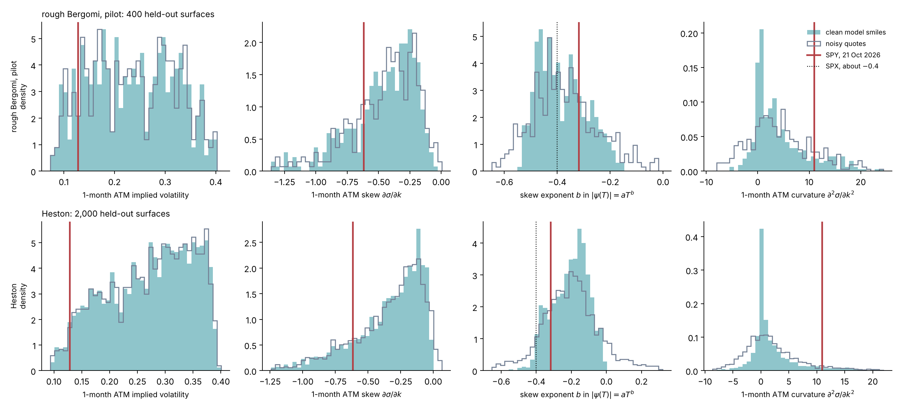
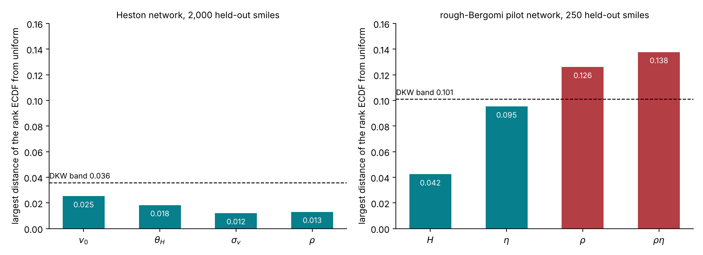
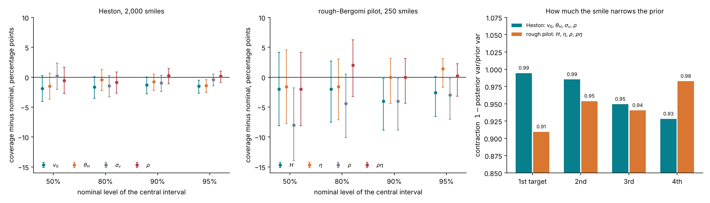
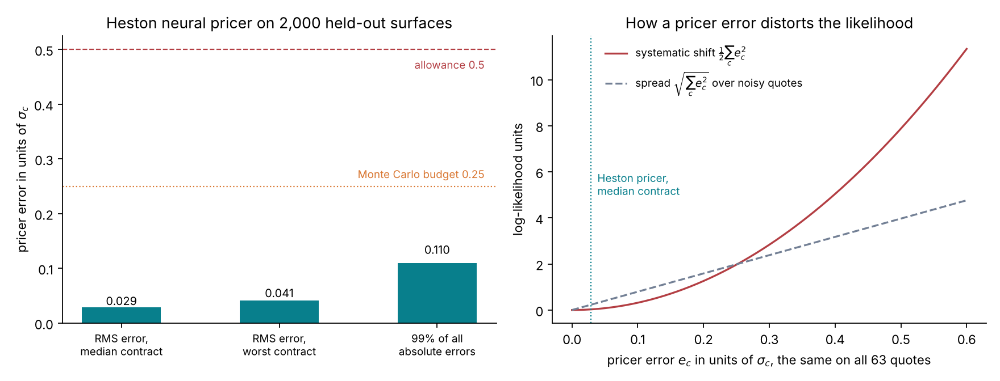
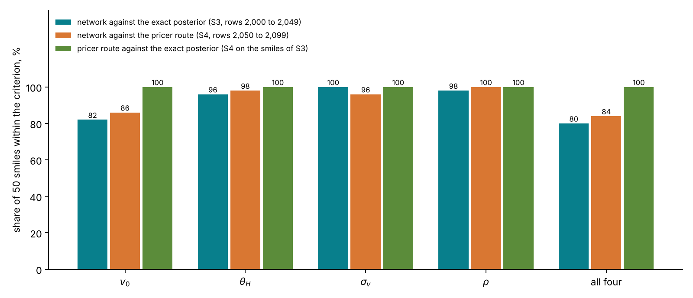
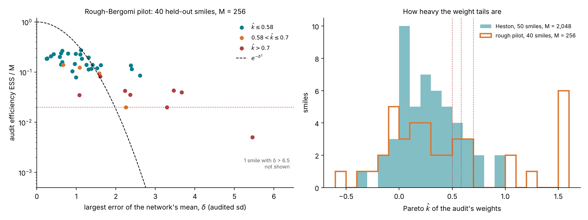
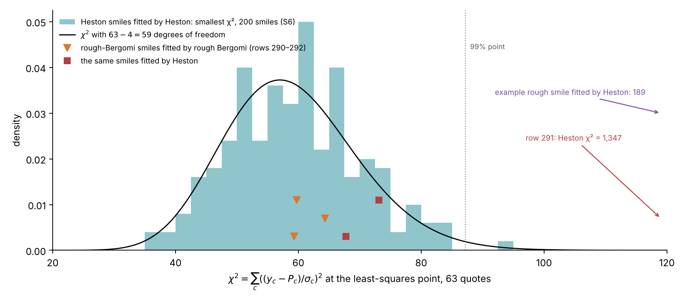
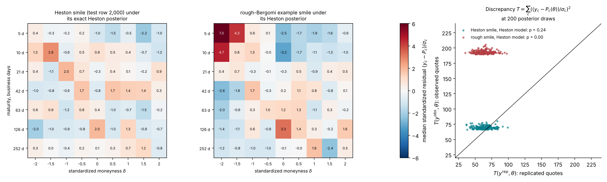
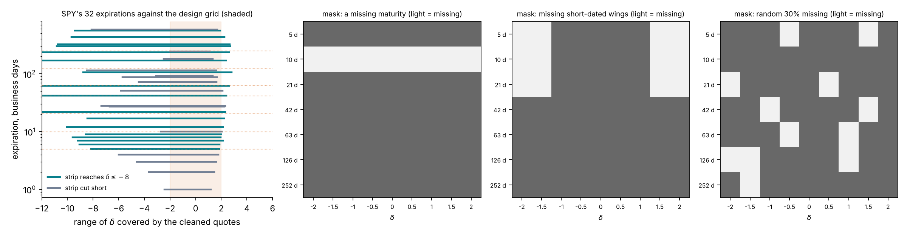

# Lecture 12. The amortized workflow on Heston

[Course index](README.md) · Previous: [Lecture 11. Calibrating Heston](11-calibrating-heston.md) · Next: [Lecture 13. The rough Bergomi model](13-rough-bergomi.md)

**What this lecture is for.** This lecture runs the amortized workflow of Lecture 9 on Heston, where every step can be checked against an exact posterior. It shows what the network reads and returns, with the BayesFlow code that builds it, the bank it learns from, and what three Heston networks taught about training. It then applies the checks one by one: the prior predictive check, simulation-based calibration, coverage and contraction, agreement with the exact posterior and with a neural-pricer route, the audit of one smile, and the posterior predictive check. It ends with how the prior and the noise can be changed without retraining, and how the network can read a real chain with missing quotes.

**Where it sits in the course.** Lecture 9 built amortized inference and derived its averaged checks on toys. Lecture 10 built Heston, and Lecture 11 computed its exact posteriors. This lecture trains a network on Heston surfaces and compares it with those exact posteriors. Part IV repeats the workflow on rough Bergomi, whose exact posterior is expensive: Lecture 13 builds the model, Lecture 14 explains the cost, and Lectures 15 and 16 apply the network to SPY and to a thin chain.

## 12.1 What the network reads and returns

The tutorial's network for Heston is BayesFlow's flow-matching network (Radev et al. 2022, version 2.0.14 in the repository), with a velocity network of four hidden layers of 256 units (`tutorial_final/checkpoints/heston/training.json`).

| Item | Content | Size |
| --- | --- | --- |
| Conditions | The 63 quotes divided by their noise standard deviations, $y_c/\sigma_c$ | 63 |
| Targets | $v_0$, $\theta_H$, $\sigma_v$, $\rho$, with $\kappa = 2$ fixed, each mapped to the real line by the logit of its position in the prior box | 4 |
| Output | Draws from the joint posterior of the four targets | 1,000 per smile in the studies |

**Why these inputs.** Dividing each quote by its noise makes the quote noise a standard normal in every input, whatever the maturity or strike, so the network sees each quote in units of its own precision. Heston needs no other condition, because its forward-variance curve is a function of its parameters (Lecture 10, Section 10.4). The rough-Bergomi network also reads the logarithms of the 7 forward-variance levels $\xi_0$; Lecture 15, Section 15.1 describes those inputs. Both conditions and targets are then standardized by their training means and standard deviations, which are frozen after training.

**Why logits.** A bounded parameter $\theta \in (a, b)$ is mapped to $z = \mathrm{logit}\big((\theta - a)/(b - a)\big) = \log\frac{\theta - a}{b - \theta}$. The flow then works on the whole real line and cannot produce a value outside the prior box. A uniform prior becomes a logistic law with variance $\pi^2/3 = 3.29$. Densities in the two coordinates differ by the Jacobian $d\theta/dz = (\theta - a)(b - \theta)/(b - a)$, which the audit of Section 12.7 includes.

**The code.** `build_workflow` in `src/sbi4finance/calibration/inference.py` builds the network and its adapter:

```python
def build_workflow(task, checkpoint_dir=None, *, subnet_widths=(256, 256, 256, 256), optimizer=None,
                   time_power_law_alpha=0.5):
    """FlowMatching on logit-constrained targets; conditions standardized with training statistics."""
    _checked_task(task)
    import bayesflow as bf

    names = task["parameter_names"]
    adapter = bf.Adapter()
    for name, (lower, upper) in zip(names, task["prior_bounds"], strict=True):
        adapter = adapter.constrain(name, lower=float(lower), upper=float(upper), inclusive="none")
    conditions = ["observations"] + (["context"] if tasks.context_size(task) else [])
    adapter = (adapter.convert_dtype("float64", "float32")
               .concatenate(list(names), into="inference_variables")
               .concatenate(conditions, into="inference_conditions"))
    return bf.BasicWorkflow(
        adapter=adapter,
        inference_network=bf.networks.FlowMatching(subnet_kwargs={"widths": list(subnet_widths)},
                                                   integrate_kwargs={"method": "euler", "steps": EULER_STEPS},
                                                   time_power_law_alpha=time_power_law_alpha),
        standardize=["inference_variables", "inference_conditions"],
        optimizer=optimizer,
        checkpoint_filepath=None if checkpoint_dir is None else str(checkpoint_dir),
        save_weights_only=False, save_best_only=True,
    )
```

The adapter maps each target to the real line by the logit of its prior box (`constrain`), and gathers the targets into the inference variables and the scaled quotes into the conditions. The `context` condition holds the forward-variance levels of rough Bergomi; a Heston task has none. `standardize` scales the conditions and the targets by their training means and standard deviations, and `save_best_only=True` keeps the epoch with the smallest validation loss. The sampler stored with the network, `EULER_STEPS = 50` uniform steps, is replaced at sampling time by the 100 end-dense steps of Lecture 9, Section 9.5 (`use_sampler`, in the same file). BayesFlow draws training times as $\tau = u^{1+\alpha}$, with $\alpha$ the argument `time_power_law_alpha`. Its default, 0.5, gives $\tau = u^{1.5}$. The Heston network was trained with $\alpha = -0.5$, which gives the $\tau = u^{0.5}$ of Lecture 9, Section 9.6 (`tutorial_final/checkpoints/heston/training.json`).

The quote noise is drawn afresh in every batch by `fresh_noise`, in the same file:

```python
def fresh_noise(seed):
    """BayesFlow batch augmentation: a new standard-normal quote error on every scaled quote of every batch."""
    rng = np.random.default_rng(np.random.SeedSequence([0x46524553, _integer(seed, "noise seed")]))

    def augment(batch):
        batch = dict(batch)
        batch["observations"] = batch["observations"] + rng.standard_normal(np.shape(batch["observations"]))
        return batch

    augment.rng = rng  # its state is saved with a resumable training run
    return augment
```

The training data are the clean prices over their noise (`clean_training_data`), and the training script passes this function to BayesFlow's `fit_offline` as its augmentation (`tutorial_final/studies/train_calibration.py`). Section 12.2 explains why.

**Training settings.** The network trains on the 50,000 training surfaces of the Heston bank in batches of 256, with a fresh quote error in every batch. The optimizer is AdamW with weight decay $5 \times 10^{-3}$ and gradient norms clipped at 1.5. The learning rate rises from $5 \times 10^{-5}$ to $5 \times 10^{-4}$ over the first 5% of steps and then decays to zero along a cosine (`offline_optimizer` in `inference.py`). Of the 500 epochs, the checkpoint kept is epoch 487, the one with the smallest validation loss. Training took 32 minutes on 4 cores (`tutorial_final/checkpoints/heston/training.json`). Lecture 15, Section 15.1 gives the settings of the rough-Bergomi network.

## 12.2 The bank, fresh noise in every batch, and what three Heston networks taught

**The bank.** The network learns from a bank of simulated surfaces, generated once. Each Heston surface is one draw of $(v_0, \theta_H, \sigma_v, \rho)$ from the prior box and one Fourier pricing of the 63 contracts on the quadrature ladder of Lecture 10, Section 10.12. The bank has 60,000 surfaces: 50,000 for training, 5,000 for validation and 5,000 for testing (`tutorial_final/curriculum/04-slot4-heston-in-bayesflow.md`). The quadrature errors of its stored prices are $10^{-8}$ noise standard deviations at the median and 0.056 at the largest, against a budget of 0.1 (`heston/s1/bank-quality.json`). The bank cost 0.046 CPU-seconds per surface, 0.013 CPU-hours per 1,000, or 46 CPU-minutes in all. The rough-Bergomi bank, priced by Monte Carlo, is described in Lecture 15, Section 15.1.

**Fresh noise in every batch.** The bank stores clean prices. The quote noise is drawn at training time. Since the conditions are $y_c/\sigma_c = P_c/\sigma_c + \varepsilon_c$ with $\varepsilon_c \sim \mathcal{N}(0, 1)$, a fresh noise draw for every surface in every batch costs nothing. The network then never sees the same noisy surface twice, and its training expectation over the noise is exact rather than a sum over a few stored draws.

**Three Heston networks.** The design document reports three Heston networks trained on the same bank, each changing one thing (design document, "The simulator and the training bank" and Appendix F.2).


*Figure 12.1.* How to read the figure: simulation-based calibration, explained in Lecture 9, Section 9.7, measures whether the network's posteriors are calibrated over 2,000 held-out smiles; a distance below the dashed band of 0.036 passes.

- **Left.** Network 1, trained for 40 epochs on four fixed noise draws per surface, fails for $v_0$ (0.086) and $\theta_H$ (0.051): its 90% intervals covered the truth on 78% and 85% of smiles. Network 2 changed two things at once, 500 epochs instead of 40 and fresh noise in every batch, and fails in the same way (0.110 and 0.043). The design document traces the failure to the sampler of Lecture 9, Section 9.5: 50 uniform steps undershoot $v_0$'s sharp posterior. Because network 2 changed both the training length and the noise augmentation, the study does not show what fresh noise alone does. Network 3, with the end-dense sampler and training times drawn as $\tau = u^{0.5}$, passes for all four targets, with distances 0.025 and 0.018 for $v_0$ and $\theta_H$ (`heston/s2/validation.json`).
- **Right.** With the sampler fixed, network 2's $v_0$ posterior had the right width but a mean a median 0.35 posterior standard deviations away from the exact one, and 28% of 50 test smiles met the agreement criterion of study S3 (Section 12.5) on all four parameters. Network 3, trained at $\tau = u^{0.5}$, reduced the error to 0.16 and raised the share to 80%.

**Interpretation.** Each failure appeared where the posterior is sharpest, because a small absolute error is a large error relative to a narrow posterior. The lesson for the rough-Bergomi network is to check the sampler and the training-time distribution before blaming the bank or the architecture, and to measure each change with the checks of Sections 12.3 to 12.8.

## 12.3 The prior predictive check

**What has to be checked, and against what.** A learned posterior can fail in ways the training loss does not reveal. The loss of Lecture 9, Section 9.2 measures an average over the prior, so a network can have a small loss and still be wrong for the smiles that matter. Each check below compares the network with something known. The table lists them in the order a reader meets them.

| Check | Question it answers | What is known | When it runs | Study | Section |
| --- | --- | --- | --- | --- | --- |
| Prior predictive check | Does the prior produce smiles like real ones? | Smile statistics of the real chain | Once | prior predictive, S8 | 12.3 |
| Simulation-based calibration | Is the posterior calibrated on average? | True parameters of 2,000 simulated surfaces | Once | S2 | 12.4 |
| Recovery, contraction, coverage | What does a smile identify? | True parameters of simulated surfaces | Once | S2 | 12.4 |
| Agreement with the exact Heston posterior | Is the workflow right where the exact answer exists? | Fourier likelihood, chains and reweighting | Once | S3 | 12.5 |
| Agreement with the neural-pricer route | Do two independent simulation-based routes agree? | A chain on the neural pricer | Once | S4 | 12.6 |
| Audit by importance sampling | Is the network right for this smile? | The Monte Carlo likelihood of this smile | Every smile | S5 | 12.7 |
| Posterior predictive check | Can the model produce this smile? | The quotes and their noise | Every real smile | S8 | 12.8 |

The table follows the design document's validation plan, with the prior predictive check added in front (design document, "Validation plan" and "Prior predictive check").

**Definition.** The prior predictive distribution is the distribution of data the model produces before any data are seen:

$$
p(y) = \int p(y \mid \theta, \xi_0)\, p(\theta)\, p(\xi_0)\, d\theta\, d\xi_0 .
$$

A draw from it is one surface of the training bank: parameters and a curve from the prior, prices from the model, noise from the noise model. The network is trained only on such draws. If the real smile looks unlike all of them, the network is asked to extrapolate, and nothing in its training controls the answer (Gabry et al. 2019).

**The statistics.** A smile has 63 numbers, so the check compares a few statistics instead. For each maturity, a quadratic in log-moneyness $k$ is fitted by least squares to the implied volatilities of the five quotes nearest the money:

$$
\sigma_{\text{imp}}(k) \approx c_0 + c_1 k + c_2 k^2 .
$$

The at-the-money level is $c_0$, the skew is $\psi = c_1 = \partial\sigma/\partial k$ at $k = 0$, and the curvature is $2c_2$. The skew's term structure is summarized by the exponent $b$ of a power law $|\psi(T)| = a\,T^{b}$, fitted on log–log axes across the 7 maturities. Rough Bergomi predicts $b \approx H - \tfrac12$ at short maturities (Lecture 13); Heston predicts a skew that tends to a constant, $b \to 0$ (Lecture 10, Section 10.8). The same functions compute the statistics for the bank and for SPY (`sbi4finance.calibration.surface.smile_statistics` and `skew_power_law`).



*Figure 12.2.* How to read the figure: each panel is one statistic. The filled histogram is the statistic of the clean model prices, the outline the same statistic read from the noisy quotes, and the red line the SPY value of 21 October 2026. The top row uses the 400 test surfaces of the rough pilot bank, the bottom row 2,000 held-out Heston surfaces (`rough-pilot/prior-predictive/prior-predictive.json`, `heston/prior-predictive/prior-predictive.json`; SPY from `spy/surface.json`).

- **One-month at-the-money volatility.** The rough prior's clean smiles span 10.3% to 37.1% (5% to 95%), the range of the curve prior. SPY's 12.8% lies at the 12% quantile of the rough prior and the 3% quantile of the Heston prior, whose initial and long-run variances start at 0.01, 10% in volatility.
- **One-month skew.** The rough prior has a median of −0.41 (90%: −0.96 to −0.16). SPY's −0.62 lies at the 23% quantile of the rough prior and the 16% quantile of the Heston prior.
- **Skew exponent.** The rough prior centres on the SPX value of about −0.4 (Bayer, Friz and Gatheral 2016): median −0.40, 90% range −0.51 to −0.22. SPY's −0.32 lies at the 75% quantile. The Heston prior reaches −0.4 only in its tail: 90% of its clean smiles lie between −0.38 and −0.05, and SPY sits at its 17% quantile.
- **One-month curvature.** The rough prior has a median of 2.6 and a 90% range of −1.3 to 16.3. SPY's 11.0 lies at its 87% quantile and at the Heston prior's 94% quantile. Read from noisy quotes, the curvature spreads much wider (rough: −5.1 to 17.3 for the central 90%), because a second derivative of noisy quotes amplifies the noise. The noisy curvature is therefore a poor guide to $\eta$. The short-dated skew pins only the product $\rho\eta$; the full surface identifies $\eta$ separately, mainly through the long-dated at-the-money level against the forward-variance curve, so that identification depends on $\xi_0$ being exact (Lecture 13, Section 13.11).

**Interpretation.** On these four statistics, SPY is an ordinary draw from the rough prior and a tail draw from the Heston prior. The statistics do not see the shape of the forward-variance curve, which is a condition of the network rather than a smile statistic. Lecture 15 shows that SPY's curve lies outside the pilot bank's curve prior and inside the full bank's, so passing this check on the pilot bank does not mean that the pilot network has seen inputs like SPY's.

**A caution on reading H from the exponent.** On 93% of the rough prior's clean smiles, the exponent fitted from one week to one year lies below $H - \tfrac12$, by a median of 0.046, and its correlation with $H$ is 0.77 (`rough-pilot/prior-predictive/prior-predictive.json`). The fitted exponent therefore tends to understate $H$ when read as $b + \tfrac12$. The posterior uses all 63 quotes and does not rely on this map.

**Limits.** The SPY values come from one date. The SPY design grid is read through a smoothing spline (Lecture 5), so its statistics compare with the clean distribution rather than the noisy one. The design document plans to add further dates, ⟨S8⟩. Here ⟨S8⟩ stands for the same four statistics on further dates of SPY's chain, which the design document plans under study S8; no run in `tutorial_final/CLUSTER-RUNS.md` produces them yet.

## 12.4 Simulation-based calibration, coverage and contraction on Heston

Lecture 9, Sections 9.7 and 9.8 derive simulation-based calibration (SBC), contraction and coverage, and show on a toy what each one sees and what it misses. SBC and coverage average over the prior, and a posterior that ignores the data passes them, so contraction must be read with them. This section reports the three checks for the Heston network on 2,000 held-out smiles.

**Simulation-based calibration.** Figure 12.3 shows the SBC distances of the Heston network, beside those of the rough-Bergomi pilot network.



*Figure 12.3.* How to read the figure: a bar below its dashed band passes; red bars fail.

- **Heston network, 2,000 held-out smiles (left).** The distances are 0.025, 0.018, 0.012 and 0.013 for $v_0$, $\theta_H$, $\sigma_v$ and $\rho$, all below the band of 0.036 (`heston/s2/validation.json`). This is the third network of Section 12.2; the first two failed for $v_0$ and $\theta_H$.
- **Rough-Bergomi pilot network (right).** Lecture 15, Section 15.2 reads this panel.

**Coverage and contraction.**



*Figure 12.4.* How to read the figure: in the left and centre panels, a point at zero is a calibrated interval, and its bar is the Wilson interval; the right panel shows the contraction of each target (`heston/s2/validation.json`, `rough-pilot/s2/validation.json`).

- **Heston (left panel, and the teal bars on the right).** The 50%, 80%, 90% and 95% intervals cover the truth on 48.1% to 50.2%, 78.4% to 79.6%, 88.7% to 90.3% and 93.5% to 95.2% of the 2,000 smiles across the four targets. The contraction is 0.99, 0.99, 0.95 and 0.93 for $v_0$, $\theta_H$, $\sigma_v$ and $\rho$: a Heston smile identifies every parameter.
- **Rough-Bergomi pilot (centre panel, and the orange bars on the right).** Lecture 15, Section 15.2 reads these.

## 12.5 Agreement with the exact Heston posterior

SBC and coverage average over surfaces. Heston allows a stronger check, smile by smile, because its likelihood is a Fourier integral and its exact posterior is affordable (Lecture 10, Section 10.11).

**The criterion.** For each target $j$, two numbers compare the network's posterior with the exact one: the standardized mean error and the width ratio,

$$
e_j = \frac{\big|\,\bar\theta_j^{\text{net}} - \bar\theta_j^{\text{exact}}\big|}{s_j^{\text{exact}}}, \qquad r_j = \frac{W_j^{\text{net}}}{W_j^{\text{exact}}},
$$

where $W$ is the width of the central 90% interval. A smile meets the criterion when $e_j < 0.3$ and $|r_j - 1| < 0.25$ for every target (design document, Appendix G.4, kept from the SVJ design).

**What the criterion means.** Suppose the exact posterior is Gaussian and the network's has the right width but a mean 0.3 standard deviations off. Its 90% interval $\bar\theta^{\text{net}} \pm 1.645\,s$ contains a value drawn from the exact posterior with probability

$$
\Phi(1.645 - 0.3) - \Phi(-1.645 - 0.3) = 0.885 .
$$

A width ratio of 0.75 with the right mean gives $2\Phi(0.75 \times 1.645) - 1 = 0.783$, and a ratio of 1.25 gives 0.960. When both limits act together, a mean 0.3 standard deviations off and a width ratio of 0.75, the coverage is $\Phi(0.75 \times 1.645 - 0.3) - \Phi(-0.75 \times 1.645 - 0.3) = 0.762$. The criterion therefore allows 90% intervals that cover as little as 76% and as much as 96% under the exact posterior.

**The exact posterior, computed twice.** On the 50 test smiles at rows 2,000 to 2,049, the exact posterior is obtained by importance reweighting of 2,048 proposals with the Fourier likelihood: the audit of Section 12.7, with an exact likelihood. On the first four smiles it is also obtained by four random-walk chains of 6,000 steps each, of which the first 1,000 are discarded as burn-in (design document, "The Heston check (S3)"). On the other 46 smiles the reweighted network is itself the reference, so the comparison there tests the network, not the reweighting.


*Figure 12.5.* How to read the figure:

- **Left.** Each point is one smile and one target. Points in the shaded box meet the criterion for that target. The network meets it on 82% of smiles for $v_0$, 96% for $\theta_H$, 100% for $\sigma_v$ and 98% for $\rho$, and on 80% (40 of 50) for all four together (`heston/s3/heston-check.json`). Of the 10 smiles that miss, 9 miss on $v_0$: 8 by the mean, between 0.32 and 0.55 posterior standard deviations, and 1 by the width, at 1.48. Two of the eight also miss on $\theta_H$'s mean, at 0.35 and 0.39, which accounts for $\theta_H$'s 96%. The tenth misses on $\rho$'s mean, at 0.31.
- **Right.** Each row is one target on one smile, in units of the exact posterior from the chains (grey, centred at 0). Blue is the network, green the network reweighted by the audit, and the star the true value. The reweighted posterior agrees with the chains on all four smiles: its means are within 0.17 posterior standard deviations and its widths between 0.94 and 1.21 of the chains'. The chains have $\hat R$ at most 1.011 and at least 413 effective draws per target. On smile 2,001 the true $\sigma_v$ and $\rho$ lie 3.0 and 3.3 standard deviations below the means of the chains (`heston/s3/posterior-draws.npz`). Against the reweighted posterior they are 3.20 and 3.41 with its weighted summary (`heston/s3/heston-check.json`), 3.15 and 3.44 with its 1,000 resampled draws. The network follows the exact posterior there; a true value in the tail is a property of that smile's noise, and SBC on 2,000 smiles is what checks that such tails occur as often as they should.

**Why $v_0$.** $v_0$ has the sharpest posterior of the four, because the one-week quotes pin the initial variance (Lecture 9, Section 9.5). A small absolute error of the network is a large error relative to a narrow posterior.

**The audit as a correction.** The audit's efficiency on these smiles has a median of 32% and a range of 4.5% to 65%. Its $\hat k$ exceeds 0.7 on 4 of the 50 smiles, two of them among the ten that miss; with 2,048 proposals the sample-size threshold of Lecture 8, Section 8.9 is also 0.70. The workflow's output for a smile is the network corrected by its audit, and that output meets the criterion against the chains on all four smiles that have them. Four smiles are a small test: on the other 46 the corrected output has no independent reference. The network alone meets it on 80% of smiles (design document, "The Heston check (S3)").

## 12.6 Agreement with the neural-pricer route

**A neural pricer and a chain.** The same bank can train the other neural object of the literature: a pricer $f_\psi(\theta, \xi_0)$ that returns the 63 clean prices, fitted by least squares in units of $\sigma_c$ (deep calibration, Lecture 11, Section 11.7; Horvath, Muguruza and Tomas 2021). With it the likelihood becomes

$$
\tilde p(y \mid \theta, \xi_0) = \prod_{c=1}^{63} \mathcal{N}\big(y_c;\ f_{\psi,c}(\theta, \xi_0),\ \sigma_c^2\big),
$$

which costs microseconds, and a Markov chain on it returns a posterior in seconds. This is neural likelihood estimation through a pricer (Papamakarios, Sterratt and Murray 2019 learn the likelihood directly).

**How a pricer error distorts the likelihood.** Write the pricer's error in noise units as $e_c = (f_{\psi,c} - P_c)/\sigma_c$. Then $(y_c - f_{\psi,c})/\sigma_c = \varepsilon_c - e_c$, and

$$
\tilde\ell - \ell = \sum_c\Big[\varepsilon_c\,e_c - \tfrac12 e_c^2\Big] .
$$

This is the expression of Lecture 14, Section 14.2 with the Monte Carlo error replaced by the pricer's error, with one difference: $e_c$ is a fixed function of $\theta$, not a random draw. It does not average out across evaluations; it moves the posterior. Its systematic part is $-\tfrac12\sum_c e_c^2$: 0.125 per quote at $e_c = 0.5$, 7.9 over 63 quotes (design document, Appendix F.5).



*Figure 12.6.* How to read the figure: the left panel summarizes the Heston pricer of study S4, a network of four layers of 256 units trained for 300 epochs in 368 CPU-seconds on the clean prices of the training surfaces. On 2,050 held-out test surfaces its RMS error is 0.029 noise standard deviations at the median contract and 0.041 at the worst, and 99% of its absolute errors are below 0.11 (`heston/s4/pricer-route.json`). The right panel plots the two terms of $\tilde\ell - \ell$ for an error that is the same on all quotes: at the Heston pricer's median error both are below 0.25 log-likelihood units.

**When to use which route.** On Heston, four chains of 20,000 steps on the pricer cost a median 12 CPU-seconds per smile and reproduce the exact posterior on all 50 test smiles of study S3 (Figure 12.7). The pricer route keeps the likelihood explicit, so a change of noise model or of quote set needs no retraining; it needs a chain per smile. The amortized posterior needs no chain and returns 1,000 draws in 1.4 seconds; it is retrained when the noise model, the prior or the design grid changes. The tutorial uses the amortized posterior as its route and the pricer route as an independent check (design document, "The neural-pricer route"). For rough Bergomi the pricer's error has to be measured again, because it learns from Monte Carlo prices whose own errors reach 0.25 noise standard deviations; that measurement is study S4, ⟨S4⟩.

**The agreement check.** For rough Bergomi an exact posterior is expensive (Lecture 14). The chain on the neural pricer's likelihood is then a second simulation-based route. The two routes share the training bank and nothing else: one network learns the posterior, the other learns the prices, and the chain uses the explicit Gaussian likelihood. If both agree, neither has a systematic error larger than the pricer's. If they disagree, the audit with the Monte Carlo likelihood decides (design document, "Agreement with the neural-pricer route").

The study rehearses this on Heston, where the exact posterior is also available, so the pricer route can itself be checked.



*Figure 12.7.* How to read the figure: each group of bars is one target; the colours are the three comparisons.

- **Pricer route against the exact posterior (green).** 100% on every target, on the 50 smiles of Section 12.5 (`heston/s4-exact/pricer-route.json`). The mean errors have medians of 0.03 to 0.045 posterior standard deviations and a largest value of 0.27, and the width ratios lie between 0.79 and 1.11. The pricer's held-out error is 0.03 noise standard deviations (Figure 12.6), small enough that its likelihood is the exact one for practical purposes.
- **Network against the pricer route (orange).** On 50 new test smiles, rows 2,050 to 2,099, the network meets the criterion on 86%, 98%, 96% and 100% of smiles, and on 84% for all four (`heston/s4/pricer-route.json`). On the smiles of Section 12.5 the same comparison gives 80%.
- **Network against the exact posterior (blue).** 82%, 96%, 100%, 98%, and 80% for all four, as in Figure 12.5.

**Interpretation.** Measured against the pricer route, the network gets the same verdict as against the exact posterior, and the same target, $v_0$, is the one it misses. This is what the pricer route is for on rough Bergomi. Its own condition is the pricer's error: for rough Bergomi the pricer learns from Monte Carlo prices whose errors reach 0.25 noise standard deviations, so its error must be measured again, ⟨S4⟩.

Here ⟨S4⟩ stands for the held-out error of the rough-Bergomi neural pricer, from study S4 on the full rough bank (run R10 in `tutorial_final/CLUSTER-RUNS.md`).

## 12.7 The audit in practice

The checks so far run once, on simulated smiles. A real smile needs a check of its own, because SBC can pass while the network is wrong for a particular smile. The audit is that check. It follows neural importance sampling (Dax et al. 2023) and runs on every smile. Lecture 8, Section 8.9 derives the method. The network's draws shape a defensive proposal: a Student $t$ law with 5 degrees of freedom, mixed with 10% of the prior. The proposals are reweighted by the likelihood of the smile itself, and the effective sample size and the Pareto shape $\hat k$ of the weights say whether the reweighted sample can be trusted.

**The Heston audit.** On Heston the audit draws 2,048 proposals and weights them with the exact Fourier likelihood, so the sample-size threshold for $\hat k$ is 0.70 (Lecture 8, Section 8.9). Section 12.5 reported its efficiency, a median of 32%, and its use as a correction. One audit costs a median of 32 CPU-seconds (`heston/s3/heston-check.json`).



*Figure 12.8.* How to read the figure: the right panel is the histogram of $\hat k$ over the audited smiles, with dotted lines at 0.5, 0.58 and 0.7. On the 50 Heston smiles of Section 12.5, audited with 2,048 proposals and the exact likelihood (filled), $\hat k$ is below 0.5 on 39 and above 0.7 on 4. The left panel and the outlined histogram are the rough-Bergomi pilot's audits, with 256 proposals and a Monte Carlo likelihood; Lecture 15, Section 15.2 reads them.

**What the audit cannot see.** The audit uses the same model and noise model as the network, so it cannot detect a model that fails to produce the smile (Lecture 8, Section 8.9). The next check addresses that.

## 12.8 Goodness of fit and the posterior predictive check

Every check so far assumes the model is true, because every test surface was simulated from it. A real smile may lie outside what the model can produce. A network applied to such a smile returns a posterior without warning.

**A global measure of fit.** At the true parameters, the standardized residuals $(y_c - P_c)/\sigma_c$ are 63 independent standard normals, so their sum of squares $\chi^2 = \sum_c ((y_c - P_c)/\sigma_c)^2$ follows a $\chi^2$ law with 63 degrees of freedom. At the least-squares point of a model with $d$ parameters, the fit absorbs $d$ directions of the noise. For a model that is linear in its parameters, the residual vector is the projection of the noise onto the $63 - d$ directions orthogonal to the model's tangent space, so the smallest $\chi^2$ follows a $\chi^2_{63-d}$ law: mean $63 - d$ and standard deviation $\sqrt{2(63 - d)}$, about 11. A value far above that says that no parameter value of the model reproduces the quotes within their noise.



*Figure 12.9.* How to read the figure: the histogram is the smallest $\chi^2$ of the multi-start least squares of study S6 on 200 Heston smiles fitted by Heston (`heston/s6/classical.json`), and the curve is the $\chi^2_{59}$ density.

- **Correct model.** The 200 values have a mean of 59.4, a median of 59.3 and a 5% to 95% range of 43.0 to 78.4, against 42.3, 58.3 and 77.9 for $\chi^2_{59}$. One of 200 exceeds the law's 99% point of 87.2. The linear approximation is accurate for Heston on the design grid.
- **Three rough-Bergomi smiles (test rows 290 to 292).** Fitted by rough Bergomi, their smallest $\chi^2$ are 59.3, 64.3 and 59.7, inside the $\chi^2_{60}$ range (`rough-pilot/s7-across/across-models.json`). Fitted by Heston, they are 67.7, 1,347 and 73.1. The second smile is far outside anything Heston can produce. The first and third are inside the range of a correct fit: on those two smiles the global measure cannot tell the models apart.
- **The example rough smile.** The surface at the centre of the rough prior ($H = 0.185$, $\eta = 2.0$, $\rho = -0.595$, a flat curve at 25%; `smile/example-rough.json`) has $\chi^2 = 55.2$ at its true parameters. Fitted by Heston, its smallest $\chi^2$ is 189, with a probability below $10^{-14}$ under $\chi^2_{59}$.

**The posterior predictive check.** A global number says whether the model fits, not where it fails. The posterior predictive distribution of a replicated smile is

$$
p(y^{\text{rep}} \mid y) = \int p(y^{\text{rep}} \mid \theta, \xi_0)\, p(\theta \mid y, \xi_0)\, d\theta .
$$

The check draws $\theta$ from the posterior, computes the model prices $P_c(\theta)$, and compares the observed quotes with them. Two summaries are used. The first is the standardized residual of each quote, $(y_c - P_c(\theta))/\sigma_c$, whose median over draws is mapped on the design grid; the design document flags quotes whose median exceeds 2 in absolute value. The second is the discrepancy $T(y, \theta) = \sum_c ((y_c - P_c(\theta))/\sigma_c)^2$, computed for the observed quotes and for a replicated smile at each draw. The posterior predictive p-value is

$$
p_B = \mathbb{P}\big(T(y^{\text{rep}}, \theta) \ge T(y, \theta) \,\big|\, y\big),
$$

which is near 0 when the observed quotes are further from the model than its own replications are (Gelman, Meng and Stern 1996). The data are used twice, to fit and to check, so the p-value is conservative: it is rarely small under a correct model and can miss mild misfits.



*Figure 12.10.* How to read the figure: each heat map cell is one quote, by maturity (rows) and $\delta$ (columns), coloured by the median of its standardized residual over 200 posterior draws. The right panel plots, for each draw, the observed discrepancy against the replicated one; points above the diagonal are draws for which the observed quotes fit worse than replicated ones.

- **Correct model (left).** Heston test smile 2,000, under its exact Heston posterior from the chains of Section 12.5. The residuals look like noise: 4 of the 63 quotes (6%) have a median beyond ±2, the largest is 2.8, and they show no pattern across maturities or strikes. The p-value is 0.24.
- **Wrong model (centre).** The rough-Bergomi example smile under its exact Heston posterior. That posterior was computed for this figure by least squares from six starts followed by four random-walk chains of 3,000 steps with the Fourier likelihood, 500 steps of burn-in, $\hat R$ at most 1.010 and at least 663 effective draws per parameter, in about 250 CPU-seconds (`scripts/course/lecture13.py`). The residuals have a pattern. The one-week puts at $\delta = -2$ and $-1.5$ and the two-week put at $\delta = -2$ sit 7.3, 4.3 and 4.7 noise standard deviations above Heston's prices, while the one- and two-week at-the-money quotes sit 2.5 and 3.2 below. The short-dated smile is steeper and more curved than Heston can make it, which is the failure Lecture 10, Section 10.8 predicts for Heston's short-maturity skew. Nine quotes (14%) have a median beyond ±2, and the p-value is 0.00: the observed discrepancy, a median of 193, is above every replicated one.

**The check on the real smile.** The design document proposes that at most 10% of a real smile's quotes may lie beyond two standard deviations; under the correct model of Figure 12.10, 6% did. The check on SPY's smile under its rough-Bergomi posterior is part of study S8, in Lecture 15, Section 15.3.

## 12.9 Changing the prior and the noise without retraining

Section 12.6 noted that the amortized posterior is retrained when the noise model, the prior or the design grid changes. For the prior and the noise there are two ways around retraining (`tutorial_final/curriculum/06-slot6-priors-and-misspecification.md`).

**Reweighting to a new prior.** For draws $\theta^{(i)}$ from the posterior under the prior $p_0$, the posterior under a prior $p_1$ is approximated by the weights

$$
w^{(i)} \propto \frac{p_1(\theta^{(i)})}{p_0(\theta^{(i)})}, \qquad \mathrm{ESS} = \frac{\big(\sum_i w^{(i)}\big)^2}{\sum_i \big(w^{(i)}\big)^2} .
$$

This works when $p_1$ puts its mass inside the posterior's support. The Pareto shape $\hat k$ of Lecture 8, Section 8.9 diagnoses it.

**The Feller prior on SPY.** The new prior is the old one restricted to $\sigma_v^2 \le 2\kappa\theta_H$, the Feller condition of Lecture 10, Section 10.2. On the 12,000 exact draws of SPY's Heston posterior (Lecture 11, Section 11.4), the Feller ratio $\sigma_v^2/(2\kappa\theta_H)$ ranges from 3.8 to 6.3, with a median of 5.0. None of the draws survives, so the reweighting is undefined. Only a new chain or a retrained network can give the new posterior, and its best fit to the quotes can be no better than the unconstrained one, which lies outside the new prior. The prior and the data disagree, and that is a diagnosis of the model as much as of the prior.

**A network trained with the prior and the noise as conditions.** Sensitivity-aware amortized inference (Elsemüller et al. 2024) trains one network with the settings of the prior and the likelihood as extra conditions, so that the posterior under any setting is one pass. The planned Heston network has two such conditions. The first is the prior's centre $m$ and width $w$: each parameter is drawn from a normal with mean $m$ and standard deviation $w$ times the box's half-width, truncated to the box, with $m$ drawn over the box and $w \in [0.1, 1]$ per smile. The second is a noise multiplier $c \in [0.5, 3]$ on each quote's noise standard deviation. The bank of Section 12.2 would be regenerated with $(m, w, c)$ drawn per smile, in about 46 CPU-minutes, plus about 32 minutes of training on 4 cores, perhaps more. The noise needs this network, because reweighting a narrower posterior to a wider one, for a larger noise, is unreliable. The network has not been built yet.

## 12.10 Real chains: quotes on a varying set

The network of Sections 12.1 and 12.2 reads exactly 63 quotes on the design grid. A real chain has different strikes and maturities every day, so the tutorial reads it at the design grid through a smile fit (Lecture 5). The design document's Stage D removes that step: each quote becomes a token $(\delta, T, y_c/\sigma_c)$, a set transformer (Lee et al. 2019) pools any number of tokens into a fixed-size summary, and the result does not depend on the order of the tokens.

**Why training with masks gives the right posterior.** If each training surface loses a random subset $S$ of its quotes before it reaches the network, the training pairs are draws from $p(\theta)\,p(y_S \mid \theta)$ for random $S$. By Lecture 9, Section 9.2 the minimizer is then $p(\theta \mid y_S, \xi_0)$ for every subset the mask distribution covers: the posterior given exactly the quotes that are present. The mask distribution must therefore cover the patterns real chains show (design document, Appendix F.4).

**The assumption behind it.** The masks are drawn independently of $\theta$ and $\xi_0$. A network trained this way returns $p(\theta \mid y_S, \xi_0)$. The posterior a real chain calls for is $p(\theta \mid y_S, S, \xi_0)$, which conditions also on which quotes are missing. The two coincide only if the pattern of missing quotes carries no information about $\theta$ beyond the observed quotes: in the language of missing data, the quotes are missing at random. Real gaps need not be. The cleaning rules drop quotes with zero bids or wide relative spreads (Lecture 5), and a far out-of-the-money option reaches a zero bid sooner when volatility is low, so how far a chain reaches in $\delta$ depends on the level of volatility, that is on $\xi_0$ and the parameters. Figure 12.11 shows SPY's call side stopping short of $\delta = 2$ at short maturities. Where the pattern depends on the parameters, independent masks give a posterior that ignores that information.



*Figure 12.11.* How to read the figure: in the left panel each horizontal bar is one SPY expiration; the shaded band is the design grid's $-2 \le \delta \le 2$, and the dotted lines are the design maturities. The 17 teal bars reach $\delta \le -8$ and $\delta \ge 1.8$, which the forward-variance replication requires (Lecture 5); the 15 grey ones stop short. The put side extends to $\delta = -14.5$, while the call side never passes $\delta = 2.8$, and the ten expirations of up to 10 business days stop between $\delta = 1.2$ and $2.1$. The right panels show three mask patterns of the kind such chains call for: a whole maturity missing, the wings of the short maturities missing, and isolated quotes missing at random.

## 12.11 Summary

1. The Heston network is BayesFlow's flow matching on the 63 quotes in units of their noise. Its adapter maps the four parameters to logits of the prior box and standardizes conditions and targets. It trains in 32 minutes on 4 cores, with fresh quote noise in every batch.
2. Fresh noise in every batch is free. On Heston, the first two networks failed in the same way although the second changed both the training length and the noise augmentation; the sampler and the training-time distribution were the changes after which the network passed. The study did not test fresh noise on its own.
3. A prior predictive check compares the smiles the prior produces with real ones. On four statistics, SPY's smile of 21 October 2026 is an ordinary draw from the rough prior and a tail draw from the Heston prior.
4. The Heston network passes simulation-based calibration on 2,000 smiles for all four targets. Its 95% intervals cover 93.5% to 95.2% of the truths, and its contraction is 0.93 to 0.99: a Heston smile identifies every parameter.
5. Against the exact Heston posterior, the network meets the agreement criterion on 80% of 50 smiles, missing mostly on $v_0$, the sharpest posterior. The network corrected by its audit meets it on all four smiles that have independent chains, a small test.
6. A neural pricer with a chain is the alternative route. Its error enters the likelihood as a fixed distortion and must be measured; on Heston it is 0.03 noise standard deviations. The pricer route reproduces the exact Heston posterior on 50 of 50 smiles and reaches the same verdict on the network.
7. The audit reweights proposals from a defensive mixture with the likelihood of the smile itself. On the 50 Heston smiles its $\hat k$ is below 0.5 on 39 and above 0.7 on 4. It cannot see a model that fails to produce the smile.
8. The smallest $\chi^2$ of a correct model follows $\chi^2_{63-d}$; the posterior predictive check locates where a wrong model misses. Heston misses the short-dated wings of a rough-Bergomi smile by up to 7.3 noise standard deviations.
9. Draws can be moved to a new prior by weights when the new prior puts its mass where the draws are. Under the Feller condition no exact draw of SPY's Heston posterior survives, so the reweighting is undefined. A network trained with the prior and the noise as conditions (Elsemüller et al. 2024) is the planned alternative, and the only one for the noise.
10. Masked training on token sets extends the network to real chains with missing quotes, provided the quotes are missing at random: the pattern of gaps must carry no information about the parameters beyond the observed quotes.

**Status of the Heston checks.** `tutorial_final/CLAIMS.md` records three claims on Heston, each generated from its result file.

- C7, verified: simulation-based calibration passes for all four targets on 2,000 held-out smiles (`heston/s2/validation.json`).
- C5, not met for the network alone: the network alone meets the agreement criterion on all four parameters for 80% of 50 smiles. With the importance-sampling correction it agrees with the exact chains on 4 of the 4 smiles tried (`heston/s3/heston-check.json`).
- C6: the neural-pricer route agrees with the exact posterior on 50 of 50 smiles (`heston/s4-exact/pricer-route.json`). The network and the pricer route agree on 84% of 50 smiles, so the claim is not met for the network alone (`heston/s4/pricer-route.json`).

## References

- Radev, S. T., Mertens, U. K., Voss, A., Ardizzone, L., Köthe, U. (2022). BayesFlow: learning complex stochastic models with invertible neural networks. *IEEE Transactions on Neural Networks and Learning Systems* 33(4), 1452–1466. [doi](https://doi.org/10.1109/TNNLS.2020.3042395)
- Gabry, J., Simpson, D., Vehtari, A., Betancourt, M., Gelman, A. (2019). Visualization in Bayesian workflow. *Journal of the Royal Statistical Society Series A* 182(2), 389–402. [arXiv:1709.01449](https://arxiv.org/abs/1709.01449)
- Bayer, C., Friz, P., Gatheral, J. (2016). Pricing under rough volatility. *Quantitative Finance* 16(6), 887–904. [doi](https://doi.org/10.1080/14697688.2015.1099717)
- Horvath, B., Muguruza, A., Tomas, M. (2021). Deep learning volatility: a deep neural network perspective on pricing and calibration in (rough) volatility models. *Quantitative Finance* 21(1), 11–27. [doi](https://doi.org/10.1080/14697688.2020.1817974)
- Papamakarios, G., Sterratt, D., Murray, I. (2019). Sequential neural likelihood: fast likelihood-free inference with autoregressive flows. *AISTATS 2019*, PMLR 89, 837–848. [proceedings](https://proceedings.mlr.press/v89/papamakarios19a.html)
- Dax, M., Green, S. R., Gair, J., Pürrer, M., Wildberger, J., Macke, J. H., Buonanno, A., Schölkopf, B. (2023). Neural importance sampling for rapid and reliable gravitational-wave inference. *Physical Review Letters* 130, 171403. [arXiv:2210.05686](https://arxiv.org/abs/2210.05686)
- Gelman, A., Meng, X.-L., Stern, H. (1996). Posterior predictive assessment of model fitness via realized discrepancies. *Statistica Sinica* 6(4), 733–807. [pdf](https://www.cs.columbia.edu/~blei/fogm/2023F/readings/GelmanMengStern1996.pdf)
- Lee, J., Lee, Y., Kim, J., Kosiorek, A., Choi, S., Teh, Y. W. (2019). Set transformer: a framework for attention-based permutation-invariant neural networks. *ICML 2019*, PMLR 97, 3744–3753. [proceedings](https://proceedings.mlr.press/v97/lee19d.html)
- Elsemüller, L., Olischläger, H., Schmitt, M., Bürkner, P.-C., Köthe, U., Radev, S. T. (2024). Sensitivity-aware amortized Bayesian inference. *Transactions on Machine Learning Research*. [arXiv:2310.11122](https://arxiv.org/abs/2310.11122)

Figures: `scripts/course/lecture12.py` (Figures 12.1, 12.6 and 12.11) and `scripts/course/lecture13.py` (the others). The code is quoted from `src/sbi4finance/calibration/inference.py`.
