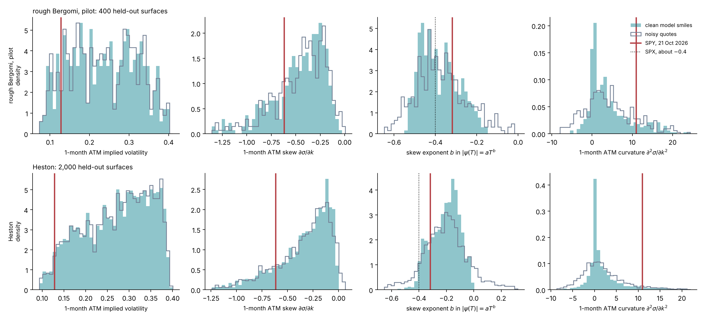
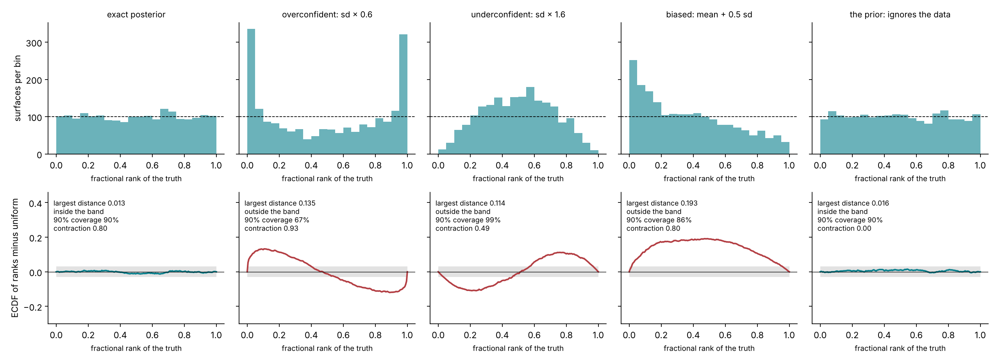
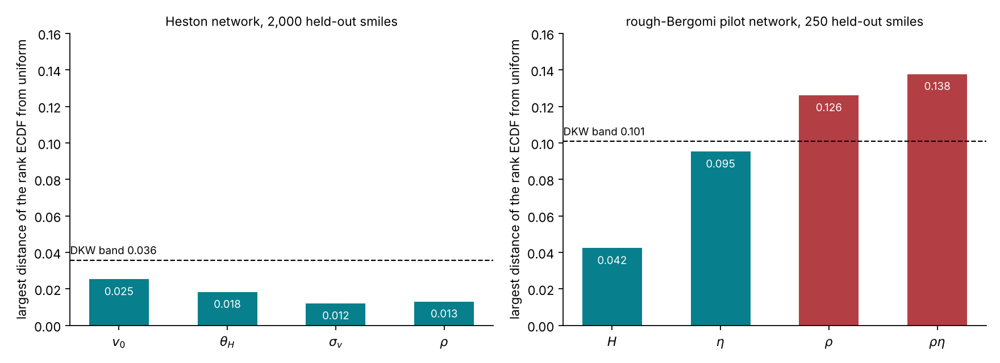
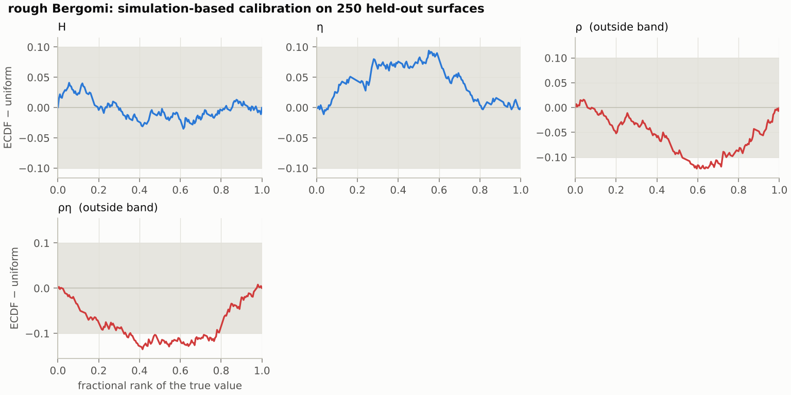
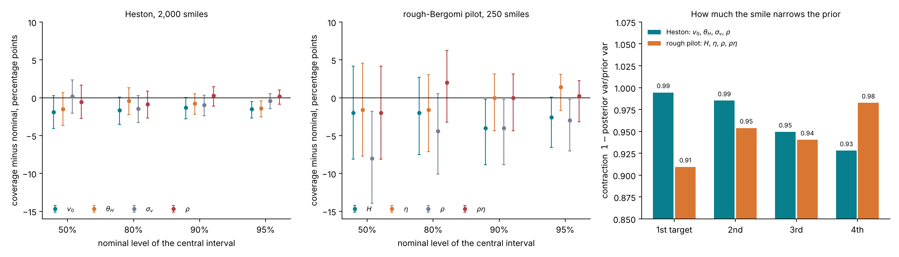
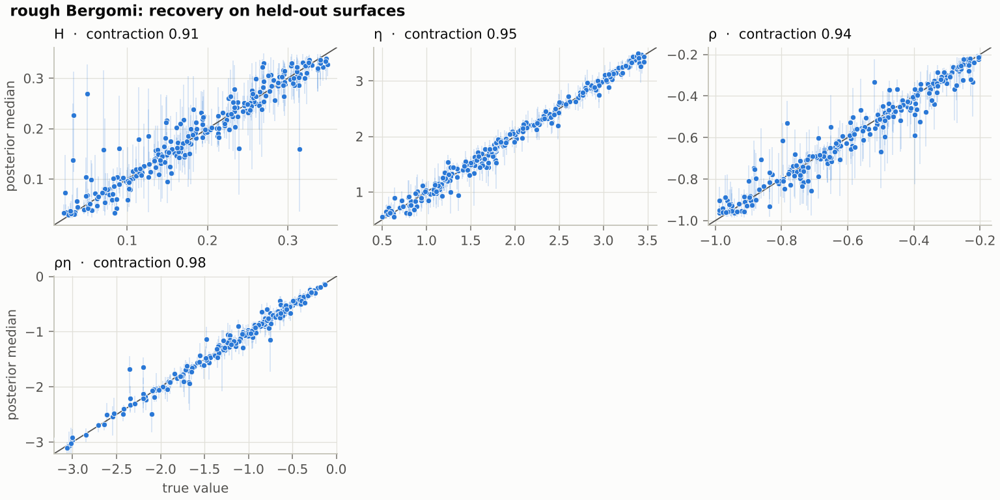
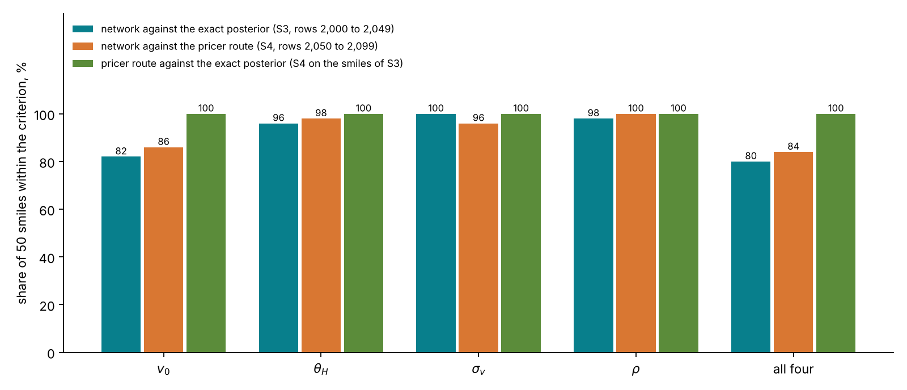
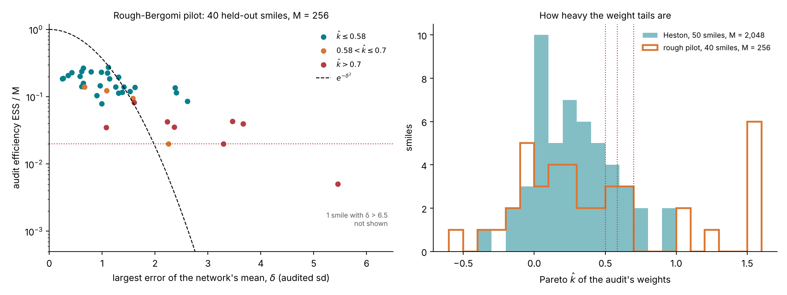
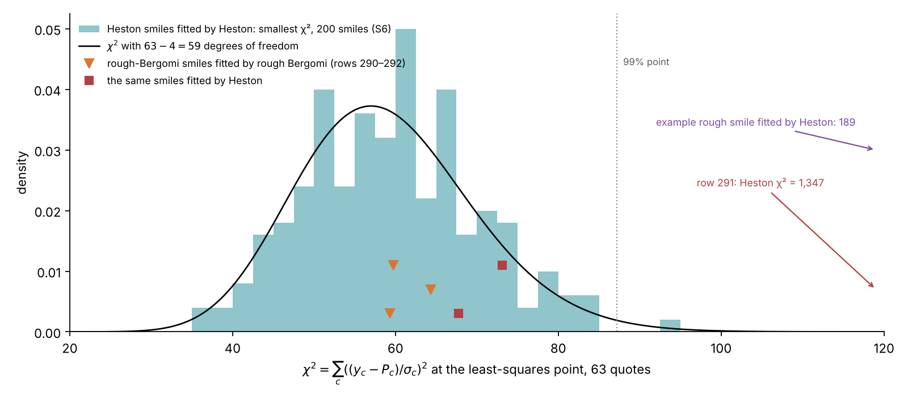
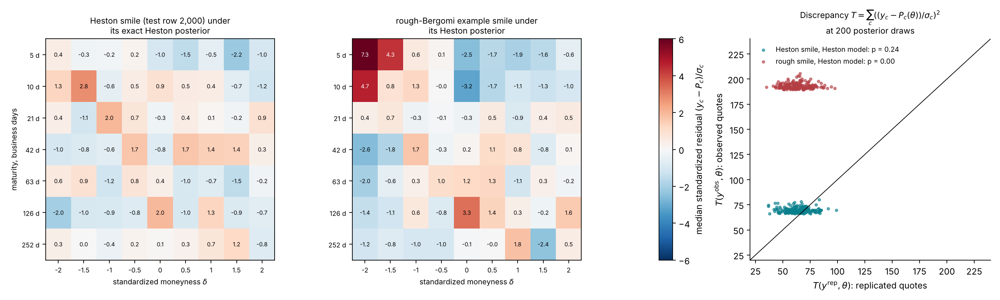

# Lecture 13. Validating an amortized posterior

[Course index](README.md) · Previous: [Lecture 12. Amortized inference](12-amortized-inference.md) · Next: [Lecture 14. The study and the tutorial](14-the-study-and-the-tutorial.md)

**What this lecture is for.** A trained network returns a posterior for any smile, and nothing in its output says whether that posterior is right. This lecture builds the checks that decide it. It derives each check from first principles, shows on a toy what each one sees and what it misses, and reports what the tutorial's studies found when the checks were applied to the Heston network and to the rough-Bergomi pilot network. It ends with the check that runs on a real smile: whether the model can produce that smile at all.

**Where it sits in the course.** Lecture 12 built the amortized posterior: a flow-matching network trained on simulated surfaces, which returns 1,000 posterior draws in 1.4 seconds. This lecture asks whether those draws can be trusted, on average and for one smile. Lecture 14 then collects the results of all the studies and shows how the tutorial presents them. The Bayesian calibration lecture (Lecture 10) introduced the posterior and the posterior predictive check on models with cheap likelihoods; here the same ideas are applied to a posterior that a network produced.

## 13.1 What has to be checked, and against what

A learned posterior can fail in ways the training loss does not reveal. The loss of Lecture 12 measures an average over the prior, so a network can have a small loss and still be wrong for the smiles that matter. Each check below compares the network with something known. The table lists them in the order a reader meets them.

| Check | Question it answers | What is known | When it runs | Study | Section |
| --- | --- | --- | --- | --- | --- |
| Prior predictive check | Does the prior produce smiles like real ones? | Smile statistics of the real chain | Once | prior predictive, S8 | 13.2 |
| Simulation-based calibration | Is the posterior calibrated on average? | True parameters of 2,000 simulated surfaces | Once | S2 | 13.3 |
| Recovery, contraction, coverage | What does a smile identify? | True parameters of simulated surfaces | Once | S2 | 13.4 |
| Agreement with the exact Heston posterior | Is the workflow right where the exact answer exists? | Fourier likelihood, chains and reweighting | Once | S3 | 13.5 |
| Agreement with the neural-pricer route | Do two independent simulation-based routes agree? | A chain on the neural pricer | Once | S4 | 13.6 |
| Audit by importance sampling | Is the network right for this smile? | The Monte Carlo likelihood of this smile | Every smile | S5 | 13.7 |
| Posterior predictive check | Can the model produce this smile? | The quotes and their noise | Every real smile | S8 | 13.8 |

The table follows the design document's validation plan, with the prior predictive check added in front (design document, "Validation plan" and "Prior predictive check").

## 13.2 Before any data: the prior predictive check

**Definition.** The prior predictive distribution is the distribution of data the model produces before any data are seen:

$$
p(y) = \int p(y \mid \theta, \xi_0)\, p(\theta)\, p(\xi_0)\, d\theta\, d\xi_0 .
$$

A draw from it is one surface of the training bank: parameters and a curve from the prior, prices from the model, noise from the noise model. The network is trained only on such draws. If the real smile looks unlike all of them, the network is asked to extrapolate, and nothing in its training controls the answer (Gabry et al. 2019).

**The statistics.** A smile has 63 numbers, so the check compares a few statistics instead. For each maturity, a quadratic in log-moneyness $k$ is fitted by least squares to the implied volatilities of the five quotes nearest the money:

$$
\sigma_{\text{imp}}(k) \approx c_0 + c_1 k + c_2 k^2 .
$$

The at-the-money level is $c_0$, the skew is $\psi = c_1 = \partial\sigma/\partial k$ at $k = 0$, and the curvature is $2c_2$. The skew's term structure is summarized by the exponent $b$ of a power law $|\psi(T)| = a\,T^{b}$, fitted on log–log axes across the 7 maturities. Rough Bergomi predicts $b \approx H - \tfrac12$ at short maturities (Lecture 7); Heston predicts a skew that tends to a constant, $b \to 0$ (Lecture 6). The same functions compute the statistics for the bank and for SPY (`sbi4finance.calibration.surface.smile_statistics` and `skew_power_law`).

*Figure 13.1.* How to read the figure: each panel is one statistic. The filled histogram is the statistic of the clean model prices, the outline the same statistic read from the noisy quotes, and the red line the SPY value of 21 October 2026. The top row uses the 400 test surfaces of the rough pilot bank, the bottom row 2,000 held-out Heston surfaces (`rough-pilot/prior-predictive/prior-predictive.json`, `heston/prior-predictive/prior-predictive.json`; SPY from `spy/surface.json`).

- **One-month at-the-money volatility.** The rough prior's clean smiles span 10.3% to 37.1% (5% to 95%), the range of the curve prior. SPY's 12.8% lies at the 12% quantile of the rough prior and the 3% quantile of the Heston prior, whose initial and long-run variances start at 0.01, 10% in volatility.
- **One-month skew.** The rough prior has a median of −0.41 (90%: −0.96 to −0.16). SPY's −0.62 lies at the 23% quantile of the rough prior and the 16% quantile of the Heston prior.
- **Skew exponent.** The rough prior centres on the SPX value of about −0.4 (Bayer, Friz and Gatheral 2016): median −0.40, 90% range −0.51 to −0.22. SPY's −0.32 lies at the 75% quantile. The Heston prior reaches −0.4 only in its tail: 90% of its clean smiles lie between −0.38 and −0.05, and SPY sits at its 17% quantile.
- **One-month curvature.** The rough prior has a median of 2.6 and a 90% range of −1.3 to 16.3. SPY's 11.0 lies at its 87% quantile and at the Heston prior's 94% quantile. Read from noisy quotes, the curvature spreads much wider (rough: −5.1 to 17.3 for the central 90%), because a second derivative of noisy quotes amplifies the noise. The noisy curvature is therefore a poor guide to $\eta$. The short-dated skew pins only the product $\rho\eta$; the full surface identifies $\eta$ separately, mainly through the long-dated at-the-money level against the forward-variance curve, so that identification depends on $\xi_0$ being exact (Lecture 10).

**Interpretation.** On these four statistics, SPY is an ordinary draw from the rough prior and a tail draw from the Heston prior. The statistics do not see the shape of the forward-variance curve, which is a condition of the network rather than a smile statistic. Lecture 14 shows that SPY's curve lies outside the curve prior, so passing this check does not mean that the network has seen inputs like SPY's.

**A caution on reading H from the exponent.** On 93% of the rough prior's clean smiles, the exponent fitted from one week to one year lies below $H - \tfrac12$, by a median of 0.046, and its correlation with $H$ is 0.77 (`rough-pilot/prior-predictive/prior-predictive.json`). The fitted exponent therefore tends to understate $H$ when read as $b + \tfrac12$. The posterior uses all 63 quotes and does not rely on this map.

**Limits.** The SPY values come from one date. The SPY design grid is read through a smoothing spline (Lecture 5), so its statistics compare with the clean distribution rather than the noisy one. The design document plans to add further dates, ⟨S8⟩.

## 13.3 Calibrated on average: simulation-based calibration

**The idea.** Simulation provides the one thing real data never do: the true parameters. Draw $\theta^\star$ from the prior, simulate $y$ from the model, and draw $L$ values $\theta^{(1)}, \dots, \theta^{(L)}$ from the network's posterior $q(\theta \mid y)$. Record the rank of $\theta^\star$ among them,

$$
r = \left|\left\lbrace \ell : \theta^{(\ell)} < \theta^\star \right\rbrace\right| \in \lbrace 0, 1, \dots, L \rbrace ,
$$

**Why the rank is uniform when the posterior is exact.** The pair $(\theta^\star, y)$ is a draw from the joint distribution $p(\theta)\,p(y \mid \theta)$. By the second factorization of Lecture 12, Section 12.1, the same joint is $p(y)\,p(\theta \mid y)$, so given $y$ the true value $\theta^\star$ is distributed as $p(\theta \mid y)$. If $q = p$, then $\theta^\star, \theta^{(1)}, \dots, \theta^{(L)}$ are $L + 1$ independent draws from one distribution given $y$. Every ordering of exchangeable draws is equally likely, so $\theta^\star$ is equally likely to occupy each of the $L + 1$ positions, and $r$ is uniform on $\lbrace 0, \dots, L \rbrace$. This holds for every $y$, so it holds averaged over $y$ (Talts et al. 2018). With ties broken at random and a uniform jitter added, the fractional rank $u = (r + U)/(L + 1)$ is uniform on $(0, 1)$. For $L \to \infty$, $u$ becomes $Q(\theta^\star \mid y)$, the network's cumulative distribution function at the truth, and the statement is the probability integral transform.

**How the test is judged.** Over $B$ simulated surfaces, the empirical distribution function $F_B$ of the fractional ranks is compared with the uniform one. The Dvoretzky–Kiefer–Wolfowitz inequality, with Massart's constant, bounds the largest gap:

$$
\mathbb{P}\Big(\sup_u |F_B(u) - u| > \varepsilon\Big) \le 2\,e^{-2B\varepsilon^2} .
$$

For $P$ targets tested together at family-wise level $\alpha$, setting $P \cdot 2 e^{-2B\varepsilon^2} = \alpha$ gives the band

$$
\varepsilon = \sqrt{\frac{\ln(2P/\alpha)}{2B}} .
$$

With $\alpha = 5\%$ it is 0.0356 for $P = 4$ and $B = 2{,}000$, 0.1007 for $P = 4$ and $B = 250$, and 0.0304 for one target and $B = 2{,}000$. The band comes from an inequality that holds for every distribution and from a union bound over the targets, both conservative, so it is wider than the tailored band of Säilynoja, Bürkner and Vehtari (2022) and can miss a mild miscalibration (design document, "Simulation-based calibration").

*Figure 13.2.* How to read the figure: the toy model is $\theta \sim \mathcal{N}(0, 1)$ and $y = \theta + 0.5\,\varepsilon$, whose exact posterior is $\mathcal{N}(0.8\,y,\ 0.2)$. Each column replaces the exact posterior by a wrong one and runs SBC on 2,000 surfaces with 400 draws each. The top row is the rank histogram, with the uniform level dashed. The bottom row is the ECDF of the ranks minus the uniform CDF, with the band of 0.030 shaded.

- **Exact posterior.** Flat histogram, a largest distance of 0.013, inside the band. Its 90% intervals cover the truth on 90% of surfaces.
- **Overconfident, standard deviation × 0.6.** The truth often falls outside the narrow posterior, so ranks pile up at 0 and 1. The ECDF difference is a sideways S, positive then negative, with a largest distance of 0.135. Coverage of the 90% interval falls to 67%.
- **Underconfident, × 1.6.** The truth sits too often in the middle. The shape is the reverse S, with a distance of 0.114 and a coverage of 99%.
- **Biased, mean + 0.5 sd.** The posterior sits too high, so the truth ranks low. The ECDF difference is a positive hump, with a distance of 0.193. Coverage is still 86%: a shift of half a standard deviation costs little coverage, which is why coverage alone is a weak check.
- **The prior, ignoring the data.** Given any $y$, the "posterior" is $\mathcal{N}(0, 1)$. The truth is a draw from the prior, so its rank is uniform: the distance is 0.016, inside the band, and the coverage is 90%. The contraction, defined in Section 13.4, is 0 instead of 0.80.

**What SBC cannot see.** The last column is the main limit: SBC averages over the prior, and a posterior that ignores the data passes it. SBC is also marginal, one target at a time, so it is a necessary condition, not a sufficient one. The next sections add what it misses.

**Results.** Figure 13.3 shows the SBC distances of the two networks.

*Figure 13.3.* How to read the figure: a bar below its dashed band passes; red bars fail.

- **Heston network, 2,000 held-out smiles.** The distances are 0.025, 0.018, 0.012 and 0.013 for $v_0$, $\theta_H$, $\sigma_v$ and $\rho$, all below the band of 0.036 (`heston/s2/validation.json`). This is the third network of Lecture 12, Section 12.9; the first two failed for $v_0$ and $\theta_H$.
- **Rough-Bergomi pilot network, 250 held-out smiles.** The distances are 0.042 for $H$ and 0.095 for $\eta$, inside the band of 0.101, and 0.126 for $\rho$ and 0.138 for $\rho\eta$, outside it (`rough-pilot/s2/validation.json`). The pilot network was trained on 1,600 surfaces; the full bank's network replaces it, ⟨S2⟩.

*Figure 13.4 (from the design document).* How to read the figure: each panel is one target, drawn as the bottom row of Figure 13.2, with the band of 0.10 shaded. $H$ stays near zero. $\eta$ has a positive hump, up to 0.095 near rank 0.55: its posterior sits slightly too high, but inside the band. $\rho$ and $\rho\eta$ have negative dips in the middle of the rank range, down to −0.13: the truth ranks high among the draws too often, so the posterior of $\rho$ sits too low, that is, too negative. The design document measures the bias as a median 0.3 posterior standard deviations ("Statistical calibration and identification (S2)"). By Figure 13.2, a dip without a sideways S is a bias, not an overconfidence.

## 13.4 What a smile identifies: contraction, coverage and recovery

**Contraction.** For each target, contraction compares the average posterior variance with the prior variance,

$$
\text{contraction} = 1 - \frac{\mathbb{E}_y\big[\mathrm{Var}(\theta \mid y)\big]}{\mathrm{Var}(\theta)} .
$$

It is 0 when the data teach nothing and 1 when they fix the target exactly. The tutorial computes it in the logit coordinates of the prior box (Lecture 12, Section 12.7), where a uniform prior has variance $\pi^2/3 = 3.29$. The product $\rho\eta$ is not uniform on its range, and its prior variance there is 1.42, computed by Monte Carlo from the box (design document, "Recovery, contraction and coverage"). Dividing by 3.29 instead would overstate how much the smile identifies $\rho\eta$.

**Coverage.** Coverage at level $\gamma$ is the share of simulated surfaces whose central $\gamma$ posterior interval contains the truth. For a calibrated posterior it equals $\gamma$. With $n$ surfaces and an observed share $\hat p$, the Wilson interval

$$
\frac{\hat p + \frac{z^2}{2n} \pm z\sqrt{\frac{\hat p(1 - \hat p)}{n} + \frac{z^2}{4n^2}}}{1 + \frac{z^2}{n}}, \qquad z = 1.96,
$$

gives the range of shares compatible with the data at 95% confidence (Wilson 1927).

**Recovery.** A recovery plot compares the posterior median with the true value over held-out surfaces. Points on the diagonal are perfect recovery; a flat cloud means the smile does not identify the target.

*Figure 13.5.* How to read the figure: in the left and centre panels, a point at zero is a calibrated interval, and its bar is the Wilson interval; the right panel shows the contraction of each target (`heston/s2/validation.json`, `rough-pilot/s2/validation.json`).

- **Heston.** The 50%, 80%, 90% and 95% intervals cover the truth on 48.1% to 50.2%, 78.4% to 79.6%, 88.7% to 90.3% and 93.5% to 95.2% of the 2,000 smiles across the four targets. The contraction is 0.99, 0.99, 0.95 and 0.93 for $v_0$, $\theta_H$, $\sigma_v$ and $\rho$: a Heston smile identifies every parameter.
- **Rough-Bergomi pilot.** The 95% intervals cover the truth on 92.0% to 96.4% of the 250 smiles. The largest shortfall is $\rho$'s 50% interval, at 42% with a Wilson interval of 36% to 48%, which excludes 50%: the bias of Figure 13.4 moves the centre of the posterior, and a narrow central interval feels it most. The 90% intervals of $H$ and $\rho$ cover 86%, with a Wilson interval of 81.2% to 89.8%, which also excludes 90%. The contraction is 0.91 for $H$, 0.95 for $\eta$, 0.94 for $\rho$ and 0.98 for $\rho\eta$.

*Figure 13.6 (from the design document).* How to read the figure: each point is one held-out surface, at its true value (horizontal) and posterior median (vertical), with its 90% interval as a faint vertical line; the panel titles give the contraction. The correlations between truth and median are 0.94 for $H$, 0.99 for $\eta$, 0.97 for $\rho$ and 0.99 for $\rho\eta$ (`rough-pilot/s2/validation.json`). $H$ scatters most, with a few medians far above small true values, and its intervals are the longest. $\rho$ shows the bias: below −0.8, many medians sit below the diagonal. $\eta$ and $\rho\eta$ lie close to the diagonal across their whole range.

**Interpretation.** The pilot smile identifies all three parameters, not only $\rho\eta$. In these simulations $\xi_0$ is known exactly, which is what lets the long-dated level identify $\eta$ (Section 13.2). Within one smile, the posterior correlation of $\eta$ and $\rho$ in logit coordinates has a median of 0.34 (10% to 90%: −0.20 to 0.75): the ridge of Lecture 10 exists, but it is short at this noise level. $H$, with the lowest contraction, is the least identified target. Whether this holds for real quotes depends on the noise in the wings, which the real chain measures (design document, "Statistical calibration and identification (S2)").

## 13.5 Agreement with the exact Heston posterior

SBC and coverage average over surfaces. Heston allows a stronger check, smile by smile, because its likelihood is a Fourier integral and its exact posterior is affordable (Lecture 11).

**The criterion.** For each target $j$, two numbers compare the network's posterior with the exact one: the standardized mean error and the width ratio,

$$
e_j = \frac{\big|\,\bar\theta_j^{\text{net}} - \bar\theta_j^{\text{exact}}\big|}{s_j^{\text{exact}}}, \qquad r_j = \frac{W_j^{\text{net}}}{W_j^{\text{exact}}},
$$

where $W$ is the width of the central 90% interval. A smile meets the criterion when $e_j < 0.3$ and $|r_j - 1| < 0.25$ for every target (design document, Appendix G.4, kept from the SVJ design).

**What the criterion means for a desk.** Suppose the exact posterior is Gaussian and the network's has the right width but a mean 0.3 standard deviations off. Its 90% interval $\bar\theta^{\text{net}} \pm 1.645\,s$ contains a value drawn from the exact posterior with probability

$$
\Phi(1.645 - 0.3) - \Phi(-1.645 - 0.3) = 0.885 .
$$

A width ratio of 0.75 with the right mean gives $2\Phi(0.75 \times 1.645) - 1 = 0.783$, and a ratio of 1.25 gives 0.960. When both limits act together, a mean 0.3 standard deviations off and a width ratio of 0.75, the coverage is $\Phi(0.75 \times 1.645 - 0.3) - \Phi(-0.75 \times 1.645 - 0.3) = 0.762$. The criterion therefore allows 90% intervals that cover as little as 76% and as much as 96% under the exact posterior.

**The exact posterior, computed twice.** On the 50 test smiles at rows 2,000 to 2,049, the exact posterior is obtained by importance reweighting of 2,048 proposals with the Fourier likelihood: the audit of Section 13.7, with an exact likelihood. On the first four smiles it is also obtained by four random-walk chains of 6,000 steps each, of which the first 1,000 are discarded as burn-in (design document, "The Heston check (S3)"). On the other 46 smiles the reweighted network is itself the reference, so the comparison there tests the network, not the reweighting.

*Figure 13.7.* How to read the figure:

- **Left.** Each point is one smile and one target. Points in the shaded box meet the criterion for that target. The network meets it on 82% of smiles for $v_0$, 96% for $\theta_H$, 100% for $\sigma_v$ and 98% for $\rho$, and on 80% (40 of 50) for all four together (`heston/s3/heston-check.json`). Of the 10 smiles that miss, 9 miss on $v_0$: 8 by the mean, between 0.32 and 0.55 posterior standard deviations, and 1 by the width, at 1.48. Two of the eight also miss on $\theta_H$'s mean, at 0.35 and 0.39, which accounts for $\theta_H$'s 96%. The tenth misses on $\rho$'s mean, at 0.31.
- **Right.** Each row is one target on one smile, in units of the exact posterior from the chains (grey, centred at 0). Blue is the network, green the network reweighted by the audit, and the star the true value. The reweighted posterior agrees with the chains on all four smiles: its means are within 0.17 posterior standard deviations and its widths between 0.94 and 1.21 of the chains'. The chains have $\hat R$ at most 1.011 and at least 413 effective draws per target. On smile 2,001 the true $\sigma_v$ and $\rho$ lie 3.0 and 3.3 standard deviations below the means of the chains (`heston/s3/posterior-draws.npz`). Against the reweighted posterior they are 3.20 and 3.41 with its weighted summary (`heston/s3/heston-check.json`), 3.15 and 3.44 with its 1,000 resampled draws. The network follows the exact posterior there; a true value in the tail is a property of that smile's noise, and SBC on 2,000 smiles is what checks that such tails occur as often as they should.

**Why $v_0$.** $v_0$ has the sharpest posterior of the four, because the one-week quotes pin the initial variance (Lecture 12, Section 12.5). A small absolute error of the network is a large error relative to a narrow posterior.

**The audit as a correction.** The audit's efficiency on these smiles has a median of 32% and a range of 4.5% to 65%. Its $\hat k$ exceeds 0.7 on 4 of the 50 smiles, two of them among the ten that miss; with 2,048 proposals the sample-size threshold of Section 13.7 is also 0.70. The workflow's output for a smile is the network corrected by its audit, and that output meets the criterion against the chains on all four smiles that have them. Four smiles are a small test: on the other 46 the corrected output has no independent reference. The network alone meets it on 80% of smiles (design document, "The Heston check (S3)").

## 13.6 Agreement with the neural-pricer route

For rough Bergomi no exact posterior is affordable. A second simulation-based route exists: a Markov chain on the likelihood of a neural pricer (Lecture 12, Section 12.11). The two routes share the training bank and nothing else: one network learns the posterior, the other learns the prices, and the chain uses the explicit Gaussian likelihood. If both agree, neither has a systematic error larger than the pricer's. If they disagree, the audit with the Monte Carlo likelihood decides (design document, "Agreement with the neural-pricer route").

The study rehearses this on Heston, where the exact posterior is also available, so the pricer route can itself be checked.

*Figure 13.8.* How to read the figure: each group of bars is one target; the colours are the three comparisons.

- **Pricer route against the exact posterior (green).** 100% on every target, on the 50 smiles of Section 13.5 (`heston/s4-exact/pricer-route.json`). The mean errors have medians of 0.03 to 0.045 posterior standard deviations and a largest value of 0.27, and the width ratios lie between 0.79 and 1.11. The pricer's held-out error is 0.03 noise standard deviations (Lecture 12, Figure 12.11), small enough that its likelihood is the exact one for practical purposes.
- **Network against the pricer route (orange).** On 50 new test smiles, rows 2,050 to 2,099, the network meets the criterion on 86%, 98%, 96% and 100% of smiles, and on 84% for all four (`heston/s4/pricer-route.json`). On the smiles of Section 13.5 the same comparison gives 80%.
- **Network against the exact posterior (blue).** 82%, 96%, 100%, 98%, and 80% for all four, as in Figure 13.7.

**Interpretation.** Measured against the pricer route, the network gets the same verdict as against the exact posterior, and the same target, $v_0$, is the one it misses. This is what the pricer route is for on rough Bergomi. Its own condition is the pricer's error: for rough Bergomi the pricer learns from Monte Carlo prices whose errors reach 0.25 noise standard deviations, so its error must be measured again, ⟨S4⟩.

## 13.7 Right for this smile: the importance-sampling audit

The checks so far run once, on simulated smiles. A real smile needs a check of its own, because SBC can pass while the network is wrong for a particular smile. The audit is that check. It follows neural importance sampling (Dax et al. 2023) and is part of the daily run.

**Self-normalized importance sampling.** Let $\pi(\theta) = p(\theta)\,L(\theta)/Z$ be the posterior of one smile, with $L(\theta) = p(y \mid \theta, \xi_0)$ and $Z$ unknown. For any density $q$ that is positive where $\pi$ is, and any function $h$,

$$
\mathbb{E}_\pi[h] = \frac{\mathbb{E}_q[h\,w]}{\mathbb{E}_q[w]}, \qquad w(\theta) = \frac{p(\theta)\,L(\theta)}{q(\theta)},
$$

because $\mathbb{E}_q[h\,w] = \int h\,p\,L\,d\theta = Z\,\mathbb{E}_\pi[h]$ and $\mathbb{E}_q[w] = Z$. With $M$ draws $\theta^{(m)} \sim q$, the estimate $\sum_m w^{(m)} h(\theta^{(m)}) / \sum_m w^{(m)}$ converges to $\mathbb{E}_\pi[h]$, and $Z$ cancels. The weighted draws are a sample of the exact posterior.

**Efficiency.** The estimate's variance is governed by the spread of the weights. The effective sample size

$$
\mathrm{ESS} = \frac{\big(\sum_m w^{(m)}\big)^2}{\sum_m \big(w^{(m)}\big)^2}
$$

counts how many equal-weight draws the sample is worth, and the efficiency is $\mathrm{ESS}/M$. As $M$ grows, it tends to $\mathbb{E}_q[w]^2 / \mathbb{E}_q[w^2] = 1 / \mathbb{E}_\pi[\pi/q]$, which is 1 only when $q = \pi$.

**A closed form.** Let the posterior be $\mathcal{N}(0, I_d)$ in standardized coordinates and the proposal $\mathcal{N}(\delta e_1, \lambda^2 I_d)$: a network whose mean is off by $\delta$ posterior standard deviations in one coordinate and whose width is $\lambda$ times the true one in all $d$. Completing the square in the Gaussian integral $\int \pi^2/q$ gives

$$
\frac{\mathrm{ESS}}{M} \;\longrightarrow\; \left(\frac{\sqrt{2\lambda^2 - 1}}{\lambda^2}\right)^{d} \exp\!\left(-\frac{\delta^2}{2\lambda^2 - 1}\right), \qquad \lambda^2 > \tfrac12 .
$$

At the right width, $\lambda = 1$, the efficiency is $e^{-\delta^2}$: 0.37 at $\delta = 1$ and 0.018 at $\delta = 2$. For $\lambda^2 \le \frac12$ the integral diverges: the weights have infinite variance, and a proposal narrower than $1/\sqrt2$ of the posterior gives an estimate whose error does not shrink like $1/\sqrt{M}$.

**The tail of the weights, $\hat k$.** A finite sample cannot show an infinite variance directly. Pareto-smoothed importance sampling fits a generalized Pareto law to the largest weights, the largest $\min(0.2M, 3\sqrt{M})$ of them, and reports its shape $\hat k$ (Zhang and Stephens 2009; Vehtari et al. 2024). A Pareto tail with shape $k$ has a finite variance only for $k < \frac12$ and a finite mean only for $k < 1$. Below 0.5 the estimate is reliable. Above it, Vehtari et al. (2024) set a threshold that depends on the sample size, $\min(1 - 1/\log_{10} M,\ 0.7)$: 0.58 for the $M = 256$ proposals of the rough audit and 0.70 for the $M = 2{,}048$ of the Heston audit. Above the threshold the estimate is unreliable, whatever the efficiency says. The design document's rule, $\hat k > 0.7$, is the large-sample value.

**The defensive proposal.** The audit's proposal $q$ is a Student $t$ law with 5 degrees of freedom, centred at the mean $\hat\mu$ of the network's draws in logit coordinates, with shape matrix $1.2^2\hat\Sigma$, where $\hat\Sigma$ is the draws' covariance, mixed with 10% of the prior (`sbi4finance.calibration.correction.fit_proposal` and `propose`). A $t$ law with $\nu$ degrees of freedom has covariance $\nu/(\nu - 2)$ times its shape matrix, so the proposal's $t$ part has covariance $\tfrac53 \times 1.44\,\hat\Sigma = 2.4\,\hat\Sigma$:

$$
q = 0.9\,t_5(\hat\mu, 1.2^2\hat\Sigma) + 0.1\,p(\theta) \quad\Longrightarrow\quad w = \frac{p\,L}{q} \le \frac{p\,L}{0.1\,p} = 10\,L .
$$

The prior component bounds every weight by ten times the likelihood, so the weights have a finite variance however narrow or misplaced the network's law (Hesterberg 1995). It does not prevent a few draws from carrying most of the weight. When the likelihood is concentrated far from where most proposals fall, the few proposals that land there dominate: six of the 40 pilot audits below have $\hat k$ between 1.8 and 12.8, and the toy of Figure 13.9 reaches $\hat k = 0.93$ with the defensive proposal. The $t$ tails and the wide shape cover the posterior where the network is too narrow. The densities are evaluated in the network's logit coordinates, with the Jacobian of the logit map included, as in Lecture 12, Section 12.7.

**The Monte Carlo likelihood inside the audit.** For rough Bergomi, $L(\theta)$ is evaluated by pricing each proposal's 63 contracts at $2^{13}$ paths per maturity block, with common random numbers across proposals. Lecture 11, Section 11.2 showed that the plain plug-in likelihood averages to the likelihood of noise variance $\sigma_c^2 + s_c^2$, where $s_c$ is each price's standard error. The same convolution identity gives the fix: the Gaussian density at the Monte Carlo prices with variance $\sigma_c^2 - s_c^2$ averages exactly to the likelihood with noise variance $\sigma_c^2$, the declared model, whenever $s_c < \sigma_c$. The audit uses it (`correction.gaussian_loglik` with `mc_variance`, `tutorial_final/studies/audit.py`). It doubles a block's paths, up to four times, when its standard error exceeds $0.5\,\sigma_c$, and flags a surface as not auditable when a proposal's error stays above $0.9\,\sigma_c$, where the estimate becomes too noisy to weight with. The pilot audit of study S5 was computed with an earlier version that used $\sigma_c^2 + s_c^2$ and so targeted a noise variance $\sigma_c^2 + 2s_c^2$; with $a = s_c/\sigma_c$ this widens the audited posterior by about $a^2$ in standard deviation, about 1% at $a = 0.1$ and 4% at $a = 0.2$. The pilot numbers below come from that version and are to be rerun ⟨S5⟩. At $2^{13}$ paths, a quarter of the bank's first rung, the standard errors are about twice those of the first rung at the same parameters, since they scale as the inverse square root of the path count. With common random numbers the errors are not independent across proposals: the part they share multiplies every weight by the same factor and cancels in the self-normalized estimate. How much of the error is shared has not been measured.

*Figure 13.9.* How to read the figure: the posterior is $\mathcal{N}(0, I_3)$; each point is the median of 60 audits with $M = 256$. Teal is a Gaussian proposal equal to the network's law; orange is the audit's defensive proposal built from it, with a broad Gaussian of standard deviation 4 standing in for the prior. Black is the closed form.

- **Left: a shifted network.** The teal points follow $e^{-\delta^2}$ up to $\delta \approx 1$: 0.40 at $\delta = 1$ against 0.37. Beyond that they lie above the curve: at $\delta = 2$ the median efficiency is 0.088, against 0.018 in theory. The rare large weights that drag the true efficiency down are not yet among 256 draws, so the measured efficiency is too optimistic. $\hat k$ reports it: its median passes 0.7 at $\delta = 2.25$ (0.82). The defensive proposal costs efficiency when the network is right, 0.70 at $\delta = 0$, and degrades more slowly when it is wrong.
- **Centre: a network of the wrong width.** The teal points follow the closed form for $\lambda \ge 0.8$. Left of $\lambda = 1/\sqrt2$ the weights have infinite variance, yet the measured efficiency stays between 0.11 and 0.39: a finite sample hides the problem. The defensive proposal keeps an efficiency of 0.55 even at $\lambda = 0.5$. At $\lambda = 1.5$, a network as much too wide as the rough pilot's (below), the defensive proposal's efficiency is 0.35.
- **Right: the tail of the weights.** For the plain proposal, $\hat k$ rises as the network gets narrower and reaches 0.74 at $\lambda = 0.5$. For the defensive proposal it stays far below 0.5 at every $\lambda \le 2$, because its weights are bounded and its covariance, 2.4 times the network's, covers the target. At $\lambda = 3$ both rise again, to 0.45 and 0.93: a proposal so wide that a handful of draws carry the weight is also flagged, because 256 draws are then too few. The dotted lines mark 0.5, the threshold 0.58 for $M = 256$, and 0.7.

**The rough-Bergomi pilot audit.**

*Figure 13.10.* How to read the figure:

- **Left.** Each point is one of 40 held-out pilot smiles (test rows 250 to 289), audited with $M = 256$ proposals at 8,192 paths per block (`rough-pilot/s5/audit.json`). The horizontal axis is the largest error of the network's posterior mean among $H$, $\eta$ and $\rho$, in audited standard deviations; the vertical axis is the efficiency. Teal points have $\hat k \le 0.58$, orange points lie between 0.58 and 0.7, and red points above 0.7. One smile with an error of 17.9 lies off the scale. The efficiency has a median of 14% and a 5% to 95% range of 1.9% to 24%. Nine smiles (22.5%) have $\hat k > 0.7$, the design document's rule; thirteen (32.5%) exceed 0.58, the threshold of Vehtari et al. (2024) for $M = 256$. Four smiles (10%) have an efficiency below 2%. One audit costs a median 425 CPU-seconds.
- **Right.** On the 50 Heston smiles of Section 13.5, audited with 2,048 proposals and the exact likelihood, $\hat k$ is below 0.5 on 39 and above 0.7 on 4. On the 40 rough pilot smiles it is below 0.5 on 25. Six smiles have $\hat k$ between 1.8 and 12.8 and are drawn at the right edge: their weight tails are so heavy that the audited posterior rests on a few draws.

**What the audit says about the pilot network.** On the 30 smiles with a reliable audit by the design document's rule, an efficiency above 5% and $\hat k < 0.7$ (27 smiles at the 0.58 threshold), the pilot network's means are a median 0.37, 0.62 and 0.42 audited standard deviations from the audited ones for $H$, $\eta$ and $\rho$, and its 90% intervals are 1.26, 1.61 and 1.35 times as wide. A network trained on 1,600 surfaces is calibrated on average for $H$ and $\eta$, biased for $\rho$ (Section 13.3), and too wide for each smile. The efficiency ceiling near 25% is consistent with Figure 13.9: a defensive proposal around a network about 1.5 times too wide has an efficiency near 0.35 in three dimensions even before the mean errors and the non-Gaussian shape of the real posterior are counted. Two cautions apply. An audited posterior built from a few dozen effective draws is itself coarse, so part of the largest errors is the audit's. And the flag threshold, $\hat k$ above 0.7 or above the sample-size threshold, an efficiency floor, or both, is an open decision for the organizers; the full study reports both on 500 test smiles, ⟨S5⟩.

**What the audit cannot see.** The audit evaluates the likelihood under the same model and the same noise model as the network. If the model cannot produce the smile, the audit reweights toward the best wrong answer and can still report a high efficiency. The next check addresses that.

## 13.8 Can the model produce this smile? Goodness of fit and the posterior predictive check

Every check so far assumes the model is true, because every test surface was simulated from it. A real smile may lie outside what the model can produce. A network applied to such a smile returns a posterior without warning.

**A global measure of fit.** At the true parameters, the standardized residuals $(y_c - P_c)/\sigma_c$ are 63 independent standard normals, so their sum of squares $\chi^2 = \sum_c ((y_c - P_c)/\sigma_c)^2$ follows a $\chi^2$ law with 63 degrees of freedom. At the least-squares point of a model with $d$ parameters, the fit absorbs $d$ directions of the noise. For a model that is linear in its parameters, the residual vector is the projection of the noise onto the $63 - d$ directions orthogonal to the model's tangent space, so the smallest $\chi^2$ follows a $\chi^2_{63-d}$ law: mean $63 - d$ and standard deviation $\sqrt{2(63 - d)}$, about 11. A value far above that says that no parameter value of the model reproduces the quotes within their noise.

*Figure 13.11.* How to read the figure: the histogram is the smallest $\chi^2$ of the multi-start least squares of study S6 on 200 Heston smiles fitted by Heston (`heston/s6/classical.json`), and the curve is the $\chi^2_{59}$ density.

- **Correct model.** The 200 values have a mean of 59.4, a median of 59.3 and a 5% to 95% range of 43.0 to 78.4, against 42.3, 58.3 and 77.9 for $\chi^2_{59}$. One of 200 exceeds the law's 99% point of 87.2. The linear approximation is accurate for Heston on the design grid.
- **Three rough-Bergomi smiles (test rows 290 to 292).** Fitted by rough Bergomi, their smallest $\chi^2$ are 59.3, 64.3 and 59.7, inside the $\chi^2_{60}$ range (`rough-pilot/s7-across/across-models.json`). Fitted by Heston, they are 67.7, 1,347 and 73.1. The second smile is far outside anything Heston can produce. The first and third are inside the range of a correct fit: on those two smiles the global measure cannot tell the models apart.
- **The example rough smile.** The surface at the centre of the rough prior ($H = 0.185$, $\eta = 2.0$, $\rho = -0.595$, a flat curve at 25%; `smile/example-rough.json`) has $\chi^2 = 55.2$ at its true parameters. Fitted by Heston, its smallest $\chi^2$ is 189, with a probability below $10^{-14}$ under $\chi^2_{59}$.

**The posterior predictive check.** A global number says whether the model fits, not where it fails. The posterior predictive distribution of a replicated smile is

$$
p(y^{\text{rep}} \mid y) = \int p(y^{\text{rep}} \mid \theta, \xi_0)\, p(\theta \mid y, \xi_0)\, d\theta .
$$

The check draws $\theta$ from the posterior, computes the model prices $P_c(\theta)$, and compares the observed quotes with them. Two summaries are used. The first is the standardized residual of each quote, $(y_c - P_c(\theta))/\sigma_c$, whose median over draws is mapped on the design grid; the design document flags quotes whose median exceeds 2 in absolute value. The second is the discrepancy $T(y, \theta) = \sum_c ((y_c - P_c(\theta))/\sigma_c)^2$, computed for the observed quotes and for a replicated smile at each draw. The posterior predictive p-value is

$$
p_B = \mathbb{P}\big(T(y^{\text{rep}}, \theta) \ge T(y, \theta) \,\big|\, y\big),
$$

which is near 0 when the observed quotes are further from the model than its own replications are (Gelman, Meng and Stern 1996). The data are used twice, to fit and to check, so the p-value is conservative: it is rarely small under a correct model and can miss mild misfits.

*Figure 13.12.* How to read the figure: each heat map cell is one quote, by maturity (rows) and $\delta$ (columns), coloured by the median of its standardized residual over 200 posterior draws. The right panel plots, for each draw, the observed discrepancy against the replicated one; points above the diagonal are draws for which the observed quotes fit worse than replicated ones.

- **Correct model (left).** Heston test smile 2,000, under its exact Heston posterior from the chains of Section 13.5. The residuals look like noise: 4 of the 63 quotes (6%) have a median beyond ±2, the largest is 2.8, and they show no pattern across maturities or strikes. The p-value is 0.24.
- **Wrong model (centre).** The rough-Bergomi example smile under its exact Heston posterior. That posterior was computed for this figure by least squares from six starts followed by four random-walk chains of 3,000 steps with the Fourier likelihood, 500 steps of burn-in, $\hat R$ at most 1.010 and at least 663 effective draws per parameter, in about 250 CPU-seconds (`scripts/course/lecture13.py`). The residuals have a pattern. The one-week puts at $\delta = -2$ and $-1.5$ and the two-week put at $\delta = -2$ sit 7.3, 4.3 and 4.7 noise standard deviations above Heston's prices, while the one- and two-week at-the-money quotes sit 2.5 and 3.2 below. The short-dated smile is steeper and more curved than Heston can make it, which is the failure Lecture 6 predicts for Heston's short-maturity skew. Nine quotes (14%) have a median beyond ±2, and the p-value is 0.00: the observed discrepancy, a median of 193, is above every replicated one.

**The check on the real smile.** The study runs the same check on the SPY smile under its rough-Bergomi posterior, with 200 posterior draws. The design document proposes that at most 10% of quotes may lie beyond two standard deviations; under the correct model of Figure 13.12, 6% did. Short-dated far out-of-the-money puts, where jumps in the price dominate, are where rough Bergomi is expected to miss (design document, "What it misses"). The posterior, its residuals and its p-value are ⟨S8⟩.

## 13.9 What the checks do not establish

1. **SBC and coverage average over the prior.** They pass a posterior that ignores the data, so contraction must be read with them. They are marginal, one target at a time, so they cannot show a wrong dependence between targets.
2. **The Heston check is on Heston.** It shows that the workflow, the architecture and the training choices can reproduce an exact posterior on a related model. It does not prove that the rough-Bergomi network does.
3. **The pricer route shares the bank.** An error common to the bank, the prior or the noise model is invisible to the comparison of the two routes.
4. **The audit and the pricer route assume the model.** They check the network against the model's own likelihood, not the model against the market.
5. **The posterior predictive check has limited power.** Two of the three rough smiles of Figure 13.11 are fitted by Heston within noise. A model can pass the fit and still price a product differently: Lecture 14 shows Heston and rough Bergomi pricing the forward-start call 7.9% apart on one of these two smiles.
6. **Every check inherits the noise model.** The width of the posterior is set by the quote noise $\sigma_c$. If $\sigma_c$ is wrong, a calibrated posterior is calibrated for the wrong noise. Lecture 14 lists this as the first risk.

## 13.10 Summary

1. A prior predictive check compares the smiles the prior produces with real ones. On four statistics, SPY's smile of 21 October 2026 is an ordinary draw from the rough prior and a tail draw from the Heston prior.
2. If the posterior is exact, the rank of the true parameter among posterior draws is uniform, because the truth is one more exchangeable draw. Overconfidence, underconfidence and bias each leave their own shape in the ranks. A posterior that ignores the data passes.
3. The Heston network passes SBC on 2,000 smiles for all four targets. The rough pilot network passes for $H$ and $\eta$ and fails for $\rho$ and $\rho\eta$, whose posterior is biased toward more negative $\rho$.
4. Contraction measures what the smile identifies: 0.91 to 0.98 for the rough pilot targets, 0.93 to 0.99 for Heston. Coverage of the 95% intervals lies between 92.0% and 96.4%.
5. Against the exact Heston posterior, the network meets the agreement criterion on 80% of 50 smiles, missing mostly on $v_0$, the sharpest posterior. The network corrected by its audit meets it on all four smiles that have independent chains, a small test.
6. The neural-pricer route reproduces the exact Heston posterior on 50 of 50 smiles and reaches the same verdict on the network.
7. The audit reweights proposals from a defensive mixture with the likelihood of the smile itself. Its efficiency falls like $e^{-\delta^2}$ for a network $\delta$ standard deviations off, and $\hat k$ flags heavy-tailed weights that a finite sample hides. The defensive mixture keeps the weights' variance finite but does not stop a few draws from dominating; the threshold for $\hat k$ depends on the number of proposals, 0.58 for 256. On the rough pilot the audit shows a network calibrated on average for $H$ and $\eta$, biased for $\rho$, and 1.3 to 1.6 times too wide for each smile.
8. The smallest $\chi^2$ of a correct model follows $\chi^2_{63-d}$; the posterior predictive check locates where a wrong model misses. Heston misses the short-dated wings of a rough-Bergomi smile by up to 7.3 noise standard deviations. The check on SPY is ⟨S8⟩.

## References

- Talts, S., Betancourt, M., Simpson, D., Vehtari, A., Gelman, A. (2018). Validating Bayesian inference algorithms with simulation-based calibration. [arXiv:1804.06788](https://arxiv.org/abs/1804.06788)
- Säilynoja, T., Bürkner, P.-C., Vehtari, A. (2022). Graphical test for discrete uniformity and its applications in goodness-of-fit evaluation and multiple sample comparison. *Statistics and Computing* 32. [arXiv:2103.10522](https://arxiv.org/abs/2103.10522)
- Massart, P. (1990). The tight constant in the Dvoretzky–Kiefer–Wolfowitz inequality. *Annals of Probability* 18(3), 1269–1283. [Project Euclid](https://projecteuclid.org/euclid.aop/1176990746)
- Wilson, E. B. (1927). Probable inference, the law of succession, and statistical inference. *Journal of the American Statistical Association* 22(158), 209–212. [doi](https://doi.org/10.1080/01621459.1927.10502953)
- Gabry, J., Simpson, D., Vehtari, A., Betancourt, M., Gelman, A. (2019). Visualization in Bayesian workflow. *Journal of the Royal Statistical Society Series A* 182(2), 389–402. [arXiv:1709.01449](https://arxiv.org/abs/1709.01449)
- Bayer, C., Friz, P., Gatheral, J. (2016). Pricing under rough volatility. *Quantitative Finance* 16(6), 887–904. [doi](https://doi.org/10.1080/14697688.2015.1099717)
- Dax, M., Green, S. R., Gair, J., Pürrer, M., Wildberger, J., Macke, J. H., Buonanno, A., Schölkopf, B. (2023). Neural importance sampling for rapid and reliable gravitational-wave inference. *Physical Review Letters* 130, 171403. [arXiv:2210.05686](https://arxiv.org/abs/2210.05686)
- Hesterberg, T. (1995). Weighted average importance sampling and defensive mixture distributions. *Technometrics* 37(2), 185–194. [pdf](https://www.stat.cmu.edu/technometrics/90-00/vol-37-02/v3702185.pdf)
- Zhang, J., Stephens, M. A. (2009). A new and efficient estimation method for the generalized Pareto distribution. *Technometrics* 51(3), 316–325. [doi](https://doi.org/10.1198/tech.2009.08017)
- Vehtari, A., Simpson, D., Gelman, A., Yao, Y., Gabry, J. (2024). Pareto smoothed importance sampling. *Journal of Machine Learning Research* 25(72), 1–58. [JMLR](https://jmlr.org/papers/v25/19-556.html)
- Gelman, A., Meng, X.-L., Stern, H. (1996). Posterior predictive assessment of model fitness via realized discrepancies. *Statistica Sinica* 6(4), 733–807. [pdf](https://www.cs.columbia.edu/~blei/fogm/2023F/readings/GelmanMengStern1996.pdf)

Figures: `scripts/course/lecture13.py`, except Figures 13.4 and 13.6, which are the design document's.
