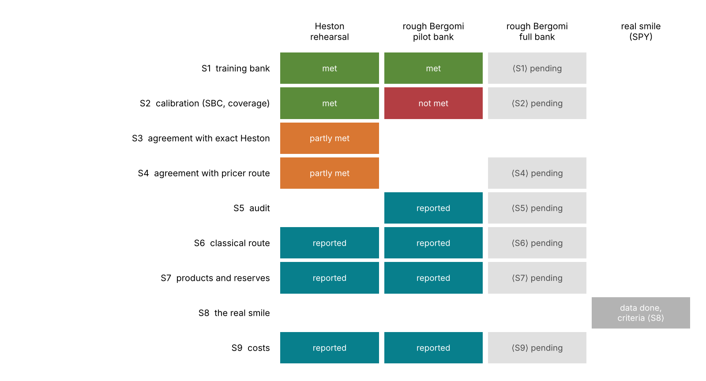
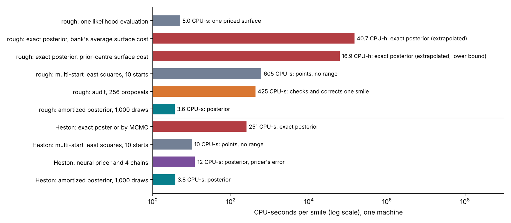
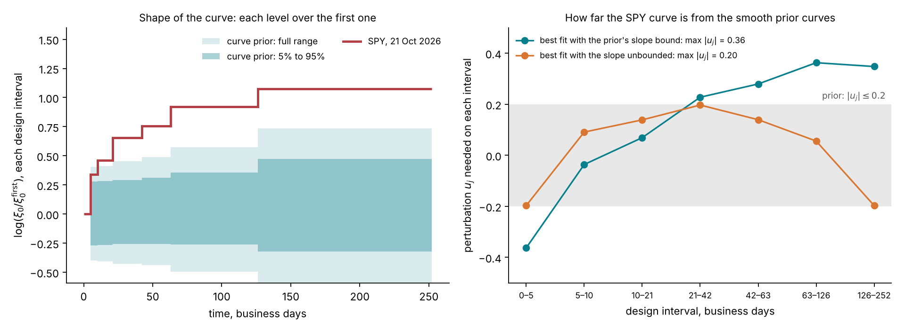
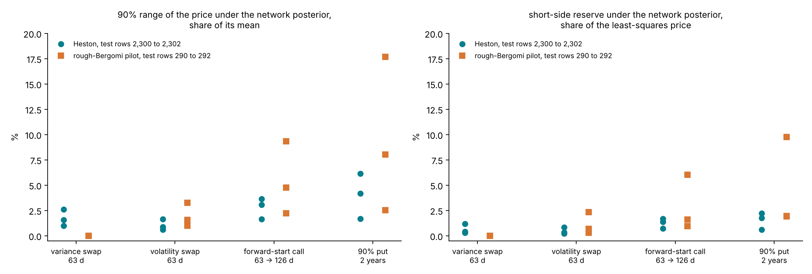
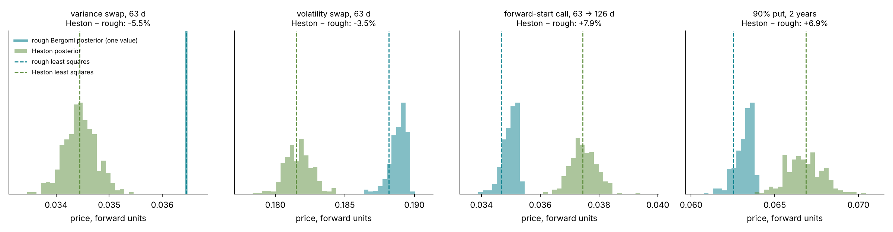
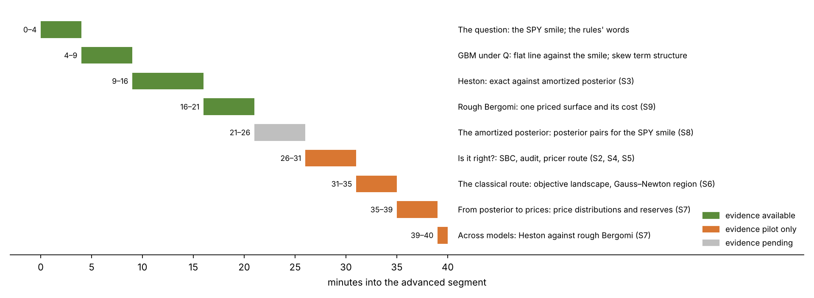
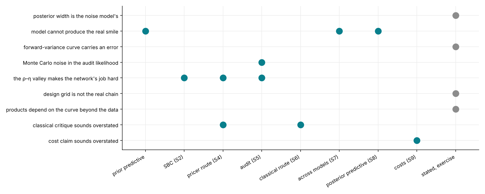
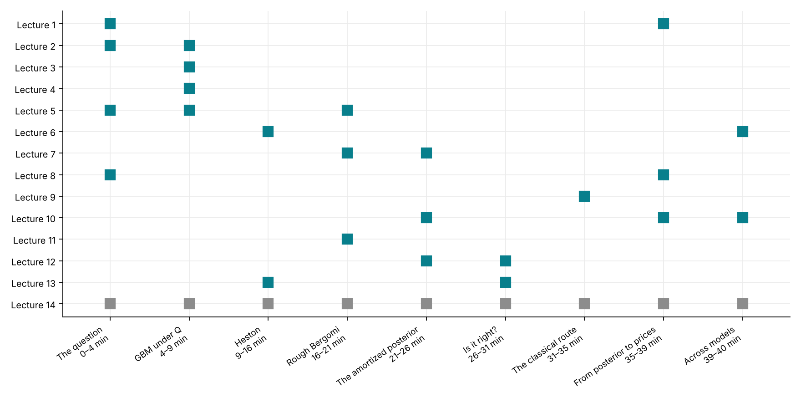

# Lecture 14. The study and the tutorial

[Course index](README.md) · Previous: [Lecture 13. Validating an amortized posterior](13-validating-an-amortized-posterior.md) · Next: [Course index](README.md)

**What this lecture is for.** The previous thirteen lectures built the method. This lecture collects the evidence for it. It states the two claims the tutorial makes, lists the nine feasibility studies that test them with their criteria, and reports what each study has found so far and what is still to run. It then shows the real SPY smile's status, the product ranges and reserves, and the gap between two models calibrated to the same smile. It ends with the tutorial's 40-minute segment, its notebook, the risks, the open decisions, and a map from each lecture to the part of the tutorial it supports.

**Where it sits in the course.** This is the last lecture. Lecture 13 built the checks; this lecture reads their results together with the costs of Lecture 11 and the product prices of the Bayesian calibration lecture (Lecture 10). Numbers that need the full rough-Bergomi bank or the SPY posterior are written ⟨Sn⟩ and are filled in when study Sn runs.

## 14.1 The two claims

The tutorial's advanced segment makes two separate claims (design document, "The two claims").

1. **The smile does not pin down the parameters a desk needs for products outside it.** The posterior shows which directions the smile leaves open, $\eta$ at fixed $\rho\eta$, and turns the bid-ask widths into a price range and a reserve. The variance swap's range is zero by construction under rough Bergomi, for continuous monitoring and a fixed $\xi_0$; it is a consistency check of the curve input rather than a finding. The volatility swap's and the forward-start call's are not: ⟨S7⟩% of the price at the 90% quantile.
2. **Amortization makes the Bayesian answer affordable for a model priced by Monte Carlo.** The amortized posterior costs 3.6 CPU-seconds per smile (1.4 seconds on the clock), against at least 17 CPU-hours for the exact posterior, and about 41 at the training bank's average cost per surface. The design document adds that it is validated by simulation-based calibration on thousands of synthetic smiles and audited smile by smile. So far that holds for Heston, with SBC on 2,000 smiles and the exact check on 50. For rough Bergomi it rests on 250 pilot smiles, where SBC fails for $\rho$ and $\rho\eta$; the full bank's 2,000 are ⟨S2⟩.

The two claims need different evidence. The first needs the posterior to be right, so that its range is the range the smile allows; that is what Lecture 13's checks establish. The second needs costs measured on one machine, for every route, and a demonstration that the cheap route gives the same answer as the expensive one. Figures 14.4 and 14.5 below carry the first claim, and Figure 14.2 the second.

## 14.2 The nine studies and where they stand

The design document's feasibility study answers nine questions, each with a stated criterion. The table condenses its tracking table ("Planned feasibility study"); "pilot" means the bank of 2,200 rough-Bergomi surfaces and a network trained on 1,600 of them.

| Study | Question | Criterion | Result so far | Pending |
| --- | --- | --- | --- | --- |
| S1 | Cost and quality of the training bank | Monte Carlo error $s_c \le 0.25\,\sigma_c$ on every quote; cost per 1,000 surfaces reported | Heston: 60,000 surfaces, largest error 0.056 against a budget of 0.1. Rough pilot: every quote within budget, median 0.04, largest 0.250; 3.3 CPU-hours per 1,000 surfaces | Full rough bank, ⟨S1⟩ |
| S2 | Calibration and identification | SBC inside the simultaneous band for every target on 2,000 surfaces; 95% coverage between 93% and 97% | Heston: met, 95% coverage 93.5% to 95.2%. Rough pilot, 250 smiles: $H$ and $\eta$ inside, $\rho$ and $\rho\eta$ outside; 95% coverage 92.0% to 96.4% | Full rough network, ⟨S2⟩ |
| S3 | Agreement with the exact Heston posterior | Means within 0.3 sd and 90% widths within 25%, on 50 smiles, every target | Network alone: 40 of 50. Network with its audit: agrees with independent chains on the 4 smiles that have them; on the other 46 the audit is itself the reference | none |
| S4 | Agreement with the neural-pricer route | Same criterion on 50 rough smiles; pricer error below $0.5\,\sigma_c$ | Heston rehearsal: pricer error 0.03; pricer route matches the exact posterior on 50 of 50; network matches the pricer route on 84% of 50 | Rough, ⟨S4⟩ |
| S5 | The audit | Efficiency and $\hat k$ on 500 smiles; flag rate; cost | Rough pilot, 40 smiles: efficiency median 14%; 23% flagged at $\hat k > 0.7$, 33% above the sample-size threshold 0.58; 425 CPU-seconds per smile | Full, ⟨S5⟩ |
| S6 | The classical route | Gauss–Newton against posterior coverage on 200 smiles; modes; regularization | Heston: Gauss–Newton coverage 87% to 92%, network posterior 87% to 90%; one optimum on 97% of smiles. Rough pilot, 8 smiles: one optimum on every smile | Full rough, ⟨S6⟩ |
| S7 | Products and reserves | Ranges and reserves with Monte Carlo errors; variance-swap range zero; Heston-against-rough gap | Heston and rough pilot, 3 smiles each (Section 14.5); forward-start gap between models 4% to 8% | Full rough, ⟨S7⟩ |
| S8 | The real smile | Skew exponent; posterior; audit; at most ⟨proposed: 10%⟩ of quotes beyond two standard deviations | SPY data done: exponent −0.32; every grid point read from quotes. An adverse finding: the forward-variance curve lies outside the curve prior | Every criterion item: posterior, audit, residuals, ⟨S8⟩ |
| S9 | Costs | One table, one machine, every route | Done with the pilot networks (Section 14.3) | Training time, ⟨S2⟩ |

*Figure 14.1.* How to read the figure: each row is one study and each column one stage of the work. Green means the criterion is met, teal that the study has run and is reported without a pass or fail, orange that it is partly met, red that it is not met, light grey that it is pending, and dark grey that the data are in but no criterion item has been evaluated. An empty cell is a stage the study does not cover; the SPY audit and products belong to S8, not to S5 and S7. The Heston column is complete: every Heston study has run. The pilot column has one failure, the SBC of $\rho$ and $\rho\eta$ (Lecture 13, Section 13.3). The full-bank column is pending in every row, because the full bank has not been generated. S3 and S4 use the same criterion and are marked the same way. S3 is "partly met" because the network alone meets the criterion on 40 of 50 smiles, and the network with its audit is tested against independent chains on only 4. S4 is "partly met" because the pricer route matches the exact posterior on all 50 smiles while the network matches the pricer route on 42 of 50; the design document now marks it the same way. S8 has its data and none of its criterion items, and its one finding so far, the curve outside the prior, is adverse.

**Interpretation.** Every study that can be completed on Heston has been completed, and the rough-Bergomi method has been rehearsed end to end on the pilot bank. The decisive results for the first claim, the rough posterior's calibration and the product ranges on the full bank and on SPY, are the pending ones.

## 14.3 What each route costs

Study S9 measures every route on one machine, in CPU-seconds that count every thread, with the repository's locked environment (design document, "Hardware, software and timing conventions of the study"; `costs/costs.json`, which records 4 CPUs).

**How the exact cost is extrapolated.** An exact chain for rough Bergomi has not been run. Its cost is the number of likelihood evaluations needed for 400 effective draws, taken from the Heston chains of S3, times the cost of one rough evaluation:

$$
\text{CPU-hours} = \underbrace{30.73}_{\text{evaluations per effective draw}} \times 400 \times \frac{4.96\ \text{s}}{3600\ \text{s/h}} = \frac{12{,}293 \times 4.96}{3600} = 16.9 .
$$

Lecture 11, Section 11.3 explains where the rate of 30.73 comes from and how it grows with the number of parameters. The 4.96 CPU-seconds price the surface at the centre of the prior at the first rung of the path ladder. Pricing a surface to the bank's error budget costs 11.9 CPU-seconds on average over the pilot bank (`rough-pilot/s1/bank-quality.json`), which gives $12{,}293 \times 11.9 / 3600 = 40.7$ CPU-hours. A chain on a noisy likelihood needs more evaluations still (Lecture 11, Section 11.5). The 16.9 CPU-hours are therefore a lower bound.

*Figure 14.2.* How to read the figure: the horizontal axis is logarithmic, so each grid line is a factor of ten; the line separates the rough-Bergomi routes (top) from the Heston ones (bottom). The label after each bar gives the cost and what the route returns.

- **Rough Bergomi.** One likelihood evaluation, a priced surface at $2^{15}$ paths per block, costs 5.0 CPU-seconds (3.9 seconds on the clock). The exact posterior costs at least 16.9 CPU-hours, and 40.7 at the bank's average cost per surface. Multi-start least squares with ten starts costs 605 CPU-seconds and returns points without a range (`rough-pilot/s6/classical.json`). The audit costs 425 CPU-seconds (`rough-pilot/s5/audit.json`). The amortized posterior costs 3.6 CPU-seconds for 1,000 draws, 1.4 seconds on the clock, plus 5.9 seconds once to load the network and compile its sampler.
- **Heston.** The exact posterior costs 251 CPU-seconds, multi-start least squares 10, four chains on the neural pricer 12 (`heston/s4/pricer-route.json`), and the amortized posterior 3.8.

**Interpretation.** For rough Bergomi the exact posterior costs at least 16,800 times the amortized one in CPU time, and 40,400 times at the bank's average cost. With the audit, an amortized posterior costs 429 CPU-seconds, still at least 142 times less than the exact one. The bank, about 370 CPU-hours, is paid once; the exact route costs at least 16.8 CPU-hours more than the audited amortized route on every smile, so the bank pays for itself after 9 to 22 smiles (Lecture 11, Section 11.4). Neither figure includes the network's training, ⟨S2⟩, or the posterior predictive check of a real smile. For Heston the exact posterior costs four minutes, which is why Heston is the check and not the example.

## 14.4 The real smile: what is done and what is pending

The real smile is the SPY chain at the close of 21 October 2026, from Cboe's delayed quotes: 13,114 options in 35 expirations, of which 32 keep at least 8 quotes after cleaning (design document, "The real smile (S8)"). Lecture 5 read it onto the design grid. Four results are in.

1. The skew's term-structure exponent from one week to one year is −0.32.
2. Every grid point is read from quotes: 35 from two expirations, 28 from one, none extrapolated (`spy/surface.json`).
3. The real half-spreads lie below the design noise at every point, so the observation's noise standard deviations are the design's.
4. The forward-variance curve lies outside the curve prior. The rest of this section explains why that matters.

**The curve prior.** The training bank draws each forward-variance curve as a smooth curve with perturbations,

$$
\xi_{0,j} = \sigma_0^2\,(1 + s\,\bar t_j)\,e^{u_j}, \qquad \sigma_0 \sim \mathcal{U}(0.10, 0.40),\quad s \sim \mathcal{U}(-0.3, 0.6),\quad u_j \sim \mathcal{U}(-0.2, 0.2),
$$

where $\bar t_j$ is the midpoint of the $j$-th design interval in years (design document, "The prior"). The ratio of the last level to the first is therefore bounded:

$$
\frac{\xi_{0,7}}{\xi_{0,1}} \le \frac{1 + 0.6 \times 0.750}{1 + 0.6 \times 0.0099}\,e^{0.4} = 2.15 .
$$

SPY's ratio is 2.93: its forward volatility rises from 13.6% on the first interval to 23.4% on the last.

*Figure 14.3.* How to read the figure:

- **Left.** Each curve is divided by its first level and drawn in logarithms, so all start at zero. The shaded bands are the 5% to 95% range and the full range of 20,000 curves drawn from the prior. The SPY curve is inside the full range on the second interval and leaves it from the third interval on. None of the 20,000 prior curves reaches SPY's final ratio; the largest reaches 2.09.
- **Right.** For each slope $s$, the best $\sigma_0$ makes the largest perturbation $|u_j|$ as small as possible; the figure shows the resulting $u_j$ for the best slope. With the slope held to the prior's bound, the best fit sits at $s = 0.6$, the bound, and needs $|u_j|$ up to 0.36, against an allowed 0.2. Its perturbations rise steadily from −0.36 to +0.36: the prior's largest slope is too small for the curve's rise. With the slope unbounded, the best fit needs a slope of 2.7 a year and $|u_j|$ up to 0.20. Its perturbations are negative at both ends and positive in the middle, which says that the SPY curve is concave: it rises steeply over the first weeks and then flattens.

**Why this matters.** The network conditions on the curve. On SPY it conditions on a curve it has never seen, so its posterior for this smile is an extrapolation, however well the smile statistics of Lecture 13, Figure 13.1 sit inside the prior. The audit evaluates the Monte Carlo likelihood with the real curve, so it is the check that applies to this smile. The design document draws the consequence: the curve prior must cover such curves before the full bank is generated. A calm market's curve rises steeply and concavely, and a stressed market's falls (design document, "The real smile (S8)"). The posterior, the audit score, the product prices and the posterior predictive residuals for SPY are ⟨S8⟩.

## 14.5 Products and reserves

The products are those of the design document: a 63-day variance swap, a 63-day volatility swap, an at-the-money forward-start call that starts at 63 days and ends at 126, and a two-year put struck at 90% of the forward, which lies outside the design grid. Each product is priced at 400 draws of the network posterior, the network's draws without the audit's correction, and at the least-squares point, with common random numbers (Lecture 10; `tutorial_final/studies/products_study.py`).

**The three numbers per product.** Write $\Pi^{(i)}$ for the price at posterior draw $i$, $\bar\Pi$ for their mean, $q_\alpha$ for their $\alpha$ quantile, and $\Pi(\hat\theta)$ for the price at the least-squares point. The study reports

$$
\text{range} = \frac{q_{0.95} - q_{0.05}}{\bar\Pi}, \qquad \text{reserve for a short position} = \frac{q_{0.90} - \Pi(\hat\theta)}{\Pi(\hat\theta)},
$$

and, for each parameter, the share of the price variance across draws that a regression on that parameter alone explains (`tutorial_final/studies/products_study.py`; `sbi4finance.calibration.products.reserve`). The reserve is the distance from the point price to the 90% quantile on the side that hurts the position: the object Article 11 of the prudent-valuation regulation asks for (Lecture 8).

*Figure 14.4.* How to read the figure: each point is one smile; circles are Heston test rows 2,300 to 2,302, squares rough-Bergomi pilot rows 290 to 292 (`heston/s7/products.json`, `rough-pilot/s7/products.json`).

- **Variance swap.** Under Heston the range is 1.0% to 2.6% and the reserve 0.3% to 1.2%. Heston's variance-swap strike is the average of its forward-variance curve $\theta_H + (v_0 - \theta_H)e^{-\kappa t}$, which moves with the parameters; $v_0$ alone explains 40% to 54% of its price variance. Under rough Bergomi the range is exactly zero: the curve $\xi_0$ is an input, and for continuous monitoring the variance swap's price is its average. The zero holds for a fixed $\xi_0$ and checks that the products are priced consistently with the curve input; an error in the curve read from the chain moves the price without any range showing it.
- **Volatility swap.** Heston 0.6% to 1.6%; rough 1.0% to 3.3%, with $\eta$ explaining 77% to 96% of the price variance.
- **Forward-start call.** Heston 1.6% to 3.7%, reserve 0.7% to 1.7%; rough 2.2% to 9.3%, reserve 1.0% to 6.1%, with $\eta$ explaining 94% to 97%.
- **Two-year 90% put.** Heston 1.7% to 6.2%, driven by $\theta_H$ (76% to 91%). Over the put's two years, Heston's expected average variance is $\theta_H + (v_0 - \theta_H)\,(1 - e^{-\kappa T})/(\kappa T) = \theta_H + 0.25\,(v_0 - \theta_H)$ at $\kappa = 2$ and $T = 2$, so the long-run variance carries three quarters of the weight. That is why it drives the price, even though the smile pins $\theta_H$ well (contraction 0.99, Lecture 13, Section 13.4); rough 2.5% to 17.7%, reserve 1.9% to 9.7%, driven by $\eta$ (68% to 94%) and then $H$ on two of the three smiles. The rough put also needs the curve beyond one year, which the study holds flat; that part of its range is extrapolation, not calibration.

**Interpretation.** Under rough Bergomi every product's range comes from $(H, \eta, \rho)$, and mostly from $\eta$: the pilot posterior's standard deviation of $\eta$ is a median 5% of its mean (design document, "Statistical calibration and identification (S2)"), and these products amplify what is left. That identification of $\eta$ comes mainly from the long-dated at-the-money level against $\xi_0$, so it assumes the curve is exact (Lecture 13, Section 13.2). The pilot network's intervals are 1.3 to 1.6 times too wide for each smile (Lecture 13, Section 13.7), so these ranges overstate the posterior's. The full bank's network, or the audited draws, will set the reported numbers, ⟨S7⟩. Pricing the 401 parameter sets of one smile costs 327 to 355 CPU-seconds, and the Monte Carlo least squares 209 to 290.

## 14.6 Within-model against across-model

The range of Section 14.5 is a range within one model. A desk also uses other models, and their prices can differ by more than either model's range. The study calibrates Heston to the same three rough-Bergomi smiles. Heston's posterior for each smile is the Heston network's draws corrected by importance sampling with the Fourier likelihood; rough Bergomi's is the pilot network posterior of Section 14.5, without correction (`tutorial_final/studies/across_models.py`; design document, "Products and reserves (S7)").

*Figure 14.5.* How to read the figure: each panel is one product for smile 290. Teal is the price under the rough-Bergomi network posterior, green under the Heston network posterior reweighted with the Fourier likelihood, and the dashed lines the two least-squares prices; the panel title gives Heston's point price relative to rough Bergomi's (`rough-pilot/s7-across/across-models.json`, `rough-pilot/s7/price-draws.npz`, `rough-pilot/s7-across/heston-price-draws.npz`).

- **The fit.** Heston fits this smile nearly as well as rough Bergomi: smallest $\chi^2$ of 67.7 against 59.3 on 63 quotes, both inside the range of a correct fit (Lecture 13, Figure 13.11). Its audit's efficiency is 50%.
- **The prices.** Heston prices the variance swap 5.5% lower, the volatility swap 3.5% lower, the forward-start call 7.9% higher and the two-year put 6.9% higher than rough Bergomi. For every product the two models' 90% ranges are disjoint. That includes the variance swap: Heston's curve is implied by its parameters, while rough Bergomi takes the market's.
- **The other two smiles.** On smile 291 Heston cannot fit at all, with $\chi^2 = 1{,}347$; its audit's efficiency is 0.05%, and its posterior collapses to a point, the signal that the model, not its parameters, is wrong. Its forward-start price, 7.6% below rough Bergomi's, is the price of a rejected model and is not a comparison of two calibrations. On smile 292 Heston fits with $\chi^2 = 73.1$ against 59.7 and prices the forward-start 4.1% lower. There the forward-start reserve is 6.1% under rough Bergomi and 3.2% under Heston, and three of the four products' ranges overlap.

**Interpretation.** The per-smile picture differs. On smile 290 both models fit, the forward-start prices differ by 7.9%, the ranges are disjoint, and the gap is about five times either model's own reserve of 1.6%: there the within-model posterior understates the calibration uncertainty a desk faces. On smile 292 both models fit and the 4.1% gap is smaller than rough Bergomi's own reserve; the pilot network's over-wide intervals inflate that reserve (Section 14.5). On smile 291 the comparison does not apply. Three smiles cannot say how often the gap exceeds the within-model range; the full bank's comparison is ⟨S7⟩ and the SPY smile's ⟨S8⟩. The design document hands this gap to the tutorial's final segment on misspecification (slot 6).

## 14.7 The tutorial's advanced segment

The advanced segment lasts 40 minutes and makes the two claims of Section 14.1 (design document, "Tutorial narrative").

| Minutes | Act | Message | Evidence on screen |
| --- | --- | --- | --- |
| 0–4 | The question | A desk calibrates to today's smile and marks a forward-start option. Ten calibrations fit equally well. Which price, and what reserve? | The SPY smile; the regulation's words |
| 4–9 | GBM under Q | Black–Scholes gives one volatility; the market gives a smile whose skew steepens as $T^{H - 1/2}$ | Flat line against the smile; the skew term structure on log–log axes |
| 9–16 | Heston | The smile explained; the Fourier likelihood; the exact posterior; the network against the exact answer | Lecture 13, Figure 13.7 |
| 16–21 | Rough Bergomi | Why rough; why Monte Carlo only; why no exact posterior | One priced surface and its cost |
| 21–26 | The amortized posterior | The posterior for the SPY smile in seconds; the $\rho$–$\eta$ valley; $H$ from the term structure | Posterior pairs over $H$, $\eta$, $\rho$, ⟨S8⟩ |
| 26–31 | Is it right? | SBC on 2,000 surfaces; the audit of this surface; the neural-pricer route agrees | ⟨S2⟩; the audit on 500 test smiles ⟨S5⟩ and on SPY ⟨S8⟩; ⟨S4⟩ |
| 31–35 | The classical route | Multi-start finds the valley's ends and weighs none; the Gauss–Newton ellipse cannot follow the valley | ⟨S6⟩ |
| 35–39 | From posterior to prices | Variance swap: zero range. Volatility swap and forward-start: a range and a reserve | ⟨S7⟩ |
| 39–40 | Across models | Heston and rough Bergomi price the forward-start ⟨S7⟩% apart on the full bank's smiles, ⟨S8⟩% on SPY; within-model can understate the uncertainty | The Heston-against-rough table |

*Figure 14.6.* How to read the figure: each bar is one act, placed at its minutes; the text gives the act and its evidence. The first four acts, 21 minutes, have their evidence: the SPY smile and its skew (Lecture 5), the Heston check (Lecture 13) and the rough-Bergomi cost (Section 14.3). Acts 6 to 9, 14 minutes, have pilot evidence that the full bank replaces. Act 5, the SPY posterior, has none yet.

**The notebook.** The segment runs on one marimo notebook, `tutorial_final/notebooks/slot5_calibration.py`. It reads the accepted results in `tutorial_final/results/calibration` and marks missing ones as pending, so it runs at every stage of the study. Three cells compute live, each in seconds on a laptop: drawing 1,000 samples from the Heston network for a chosen smile; pricing one rough-Bergomi smile at $2^{13}$ paths per block from sliders for $H$, $\eta$ and $\rho$, about 2 CPU-seconds; and recomputing the reserve table from stored per-draw prices with a confidence-level slider. The cells, in order (design document, "Notebook outline"):

1. **The smile.** One maturity's smile against the single Black–Scholes volatility, and the skew term structures of both models on log–log axes.
2. **Heston.** The exact-posterior check, and exact against network posterior for a chosen smile.
3. **Rough Bergomi.** The live pricing cell and the cost table of S9.
4. **Amortized posterior.** Posterior pairs for held-out smiles, the $\rho\eta$ ridge and the recovery figure.
5. **Diagnostics.** The SBC figures, the audit summary and the neural-pricer overlay. A live audit is not affordable on a laptop.
6. **Classical route.** The coverage table and the objective's landscape.
7. **Products.** Price distributions under the posterior, with the live reserve slider.
8. **Across models, and exercises.** Heston against rough Bergomi on the same smile; double $\sigma_c$ and reweight; drop the two shortest maturities; calibrate Heston to a rough surface.

## 14.8 Risks and open decisions

The main risks are of method rather than schedule (design document, "Risks and open decisions").

| Risk | Effect | Mitigation |
| --- | --- | --- |
| The posterior width is the noise model's | The reserve is as arbitrary as $\sigma_c$ | State it; derive $\sigma_c$ from bid-ask widths; the exercise that doubles $\sigma_c$; report the range in noise units too |
| The model cannot produce the real smile | A confident, wrong posterior; the audit passes because it uses the same model | Prior and posterior predictive checks; the Heston comparison; hand-over to slot 6 |
| $\xi_0$ from the chain carries its own error | A biased level at every maturity | Report the replication error; show the sensitivity of $H$, $\eta$, $\rho$ to a bumped curve |
| Monte Carlo noise in the audit likelihood | Weights biased where $s_c$ is not small | Common random numbers; Monte Carlo variances added to the noise; more paths on flagged smiles |
| The valley makes the network's job hard | Posterior too narrow along the valley | SBC on $\rho\eta$ and on $\eta$; the audit; the pricer route |
| The design grid is not the real chain | Interpolation error enters as data | Report the smile-fit residuals; Stage D reads the chain as quoted |
| Products depend on $\xi_0$ beyond the data | The out-of-grid product's range mixes calibration and extrapolation | Keep the forward-start inside one year; state the two-year put's extrapolation |
| The classical critique sounds overstated | Loss of credibility with quants | Same weights for both routes; report Gauss–Newton coverage as measured; name the pricer route as the strong competitor |
| The cost claim sounds overstated | Loss of credibility with practitioners | One machine, CPU-seconds, the exact chain measured |

*Figure 14.7.* How to read the figure: each row is one risk of the table, each column a check or study; a teal dot means the design document names that check as the risk's mitigation, and a grey dot in the last column means the mitigation is to state the limit or show it in an exercise. Two risks are guarded by three checks each: a smile the model cannot produce (prior predictive, across models, posterior predictive) and the $\rho$–$\eta$ valley (SBC, pricer route, audit). Four risks have no check at all, only a statement or an exercise. The first of them, a posterior width set by the noise model, is the one no amount of validation removes: every check of Lecture 13 is calibrated for the declared $\sigma_c$.

Two results already bear on these risks. The SPY curve lies outside the curve prior (Section 14.4), which is a version of the second risk for the network's conditions rather than its smile. And the last risk's mitigation is only half met: the exact rough chain is still extrapolated rather than measured (Section 14.3).

**Decisions for the organizers** (design document, "Decisions for the organizers"):

- The headline product: the at-the-money forward-start call, or a capped cliquet of three periods.
- The noise scale: 0.3 to 1.0 volatility points across $\delta$, or a scale read from the real chain's bid-ask widths.
- The prior ranges of $H$, $\eta$ and $\rho$, and whether to allow positive $\rho$. Section 14.4 adds the curve prior's ranges to this item.
- The real underlying: SPY, listed and liquid, or SPX, the index desks quote.
- The audit flag: $\hat k$ above 0.7, an efficiency floor, or both.
- Heston in the lesson: seven minutes as the exact check, or four.
- Stage D in the tutorial: the set-based network shown, or mentioned.
- Hosting of the bank and the networks: a GitHub release or Hugging Face.

## 14.9 From the lectures to the tutorial

Each act of the segment rests on several lectures. The map below shows which.

*Figure 14.8.* How to read the figure: each row is a lecture and each column an act, in the order of the segment; a square means that the lecture supplies a concept, a derivation or a figure the act uses. Lecture 14, in grey, supplies the evidence for every act. The models of Part I feed the first four acts; the inference lectures of Parts III and IV feed the last five.

| Lecture | What it contributes to the tutorial |
| --- | --- |
| 1. Options, quotes and volatility | What a desk prices and marks; the products of Section 14.5 |
| 2. No-arbitrage without a model | Forward units, the forward and discount read from the chain |
| 3. Brownian motion and Itô's lemma | The mathematics behind "GBM under Q" and the drift that disappears |
| 4. The Black–Scholes model | The flat line against the smile |
| 5. Implied volatility and the smile | The SPY smile, its skew exponent of −0.32, the design grid, the forward-variance curve |
| 6. The Heston model | The exact check and the across-model comparison |
| 7. The rough Bergomi model | The model, its power-law skew, its Monte Carlo pricer and its cost |
| 8. Calibration on a desk | The question of the first act and the reserve the rules ask for |
| 9. Calibration as estimation | The classical route: least squares, Gauss–Newton intervals, multi-start |
| 10. Bayesian calibration | The posterior, the valley, the propagation to prices and reserves |
| 11. Why the exact posterior is expensive | The 17-to-41 CPU-hours and why no exact posterior is shown for rough Bergomi |
| 12. Amortized inference | The network that returns the SPY posterior in 1.4 seconds |
| 13. Validating an amortized posterior | SBC, the Heston check, the pricer route, the audit, the posterior predictive check |
| 14. The study and the tutorial | The evidence, its status and the risks |

## 14.10 Summary

1. The tutorial makes two claims: the smile leaves the parameters that exotic products need partly open, and amortization makes the posterior that shows it affordable.
2. Nine studies test the claims. Every Heston study has run; the rough-Bergomi method has been rehearsed end to end on a pilot bank of 2,200 surfaces; the full bank and the SPY posterior are pending.
3. For rough Bergomi the exact posterior costs an extrapolated 16.9 CPU-hours per smile at least, and 40.7 at the bank's average cost per surface; the amortized posterior costs 3.6 CPU-seconds and its audit 425. The bank pays for itself after 9 to 22 smiles, before training.
4. SPY's forward-variance curve rises by a factor of 2.9 in variance, beyond the curve prior's maximum of 2.15. The curve prior must be widened before the full bank is generated.
5. Under rough Bergomi the variance swap has no range, for continuous monitoring and a fixed curve, and every other product's range comes mostly from $\eta$. On the pilot smiles the forward-start's range is 2.2% to 9.3% of its price, overstated by a pilot network that is too wide.
6. On pilot smile 290, Heston and rough Bergomi both fit and price the forward-start 7.9% apart, about five times either model's own reserve: there the within-model range understates the uncertainty. On smile 292 the 4.1% gap is within rough Bergomi's reserve, and on smile 291 Heston is rejected. The full-bank and SPY comparisons are pending.
7. The tutorial presents the result in nine acts over 40 minutes, on one notebook that marks pending evidence. Four of its risks are guarded only by stating them, the first of which, the noise model, sets the width of every posterior in the course.

## References

- Bayer, C., Friz, P., Gatheral, J. (2016). Pricing under rough volatility. *Quantitative Finance* 16(6), 887–904. [doi](https://doi.org/10.1080/14697688.2015.1099717)
- Horvath, B., Muguruza, A., Tomas, M. (2021). Deep learning volatility: a deep neural network perspective on pricing and calibration in (rough) volatility models. *Quantitative Finance* 21(1), 11–27. [doi](https://doi.org/10.1080/14697688.2020.1817974)
- Commission Delegated Regulation (EU) 2016/101 of 26 October 2015, regulatory technical standards for prudent valuation, Article 11. [legislation.gov.uk](https://www.legislation.gov.uk/eur/2016/101)
- Calibration design document of this repository: [docs/design/calibration-design-document.md](../design/calibration-design-document.md), sections "The two claims", "Planned feasibility study", "Tutorial narrative" and "Risks and open decisions".

Figures: `scripts/course/lecture14.py`.
