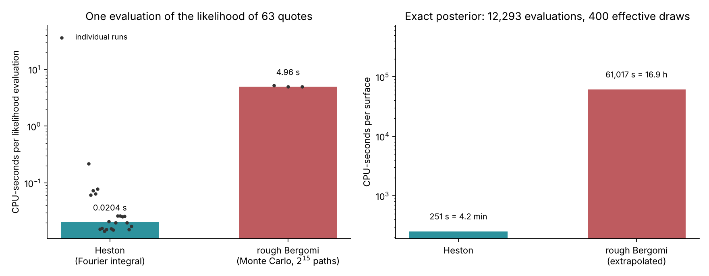

# Lecture 14. Why the exact posterior is expensive

[Course index](README.md) · Previous: [Lecture 13. The rough Bergomi model](13-rough-bergomi.md) · Next: [Lecture 15. A liquid smile: SPY](15-a-liquid-smile-spy.md)

**What this lecture is for.** This lecture measures the cost of the exact Bayesian calibration of the course's models and explains where the cost comes from. It shows that one evaluation of the rough-Bergomi likelihood is one Monte Carlo surface, derives what Monte Carlo error does to the likelihood, explains why a Markov chain needs thousands of such evaluations, and converts the result into CPU-hours for one smile and for the many smiles that a valuation across a book or the validation of a method needs. It ends with the alternatives to the exact chain: importance sampling from a Gauss–Newton proposal, which gives SPY's exact posterior in about 85 CPU-minutes, and amortized inference, the route the tutorial develops.

**Where it sits in the course.** Parts II and III showed what a posterior adds to a calibration: an honest range for the parameters and for the prices of products the smile does not pin down. They used Black–Scholes and Heston, models with a closed-form or Fourier pricer, for which the posterior is cheap. Lecture 13 built rough Bergomi, the model that fits the smile's term structure, and priced it by Monte Carlo at about 5 CPU-seconds for the surface at the centre of the prior. This lecture combines the two facts. It shows that the exact posterior of rough Bergomi costs at least 16.9 CPU-hours per smile by a random-walk chain, and 40.7 at the training bank's average cost per surface, and about 85 CPU-minutes by importance sampling from a Gauss–Newton proposal on SPY's 63 quotes. The amortized posterior of Lecture 9 removes most of that cost; Lectures 15 and 16 apply it to rough Bergomi and check that the cheaper answer is still right.

## 14.1 The likelihood and where its cost lies

The observation model of Lecture 7, Section 7.1 treats each of the 63 quotes as the model price plus independent Gaussian noise with a known standard deviation $\sigma_c$:

$$
y_c = P_c(\theta;\xi_0) + \sigma_c\,\varepsilon_c, \qquad \varepsilon_c \sim \mathcal{N}(0, 1) .
$$

The log-likelihood of the parameters $\theta$ is therefore

$$
\ell(\theta) = \log p(y \mid \theta, \xi_0) = -\frac12 \sum_{c=1}^{63} \left(\frac{y_c - P_c(\theta;\xi_0)}{\sigma_c}\right)^2 + \text{const}.
$$

The sum itself costs nothing. All the cost of one evaluation is in the 63 model prices $P_c(\theta;\xi_0)$. For Heston they are Fourier integrals that share one characteristic function per maturity (Lecture 10). For rough Bergomi each is an expectation over simulated paths of the Volterra driver (Lecture 13), estimated on three time grids with at least $2^{15}$ paths each.

*Figure 14.1.* How to read the figure: both panels use a logarithmic scale. The left panel shows the median of the timing runs of study S9 (`tutorial_final/results/calibration/costs/costs.json`). One Heston evaluation costs 0.020 CPU-seconds; the 20 runs range from 0.014 to 0.22, the largest being the first call. One rough-Bergomi evaluation costs 4.96 CPU-seconds; its three runs range from 4.93 to 5.23. The ratio is 243. The right panel multiplies each cost by the 12,293 evaluations that 400 effective posterior draws require (Section 14.3). The exact Heston posterior costs 251 CPU-seconds, about 4 minutes. The exact rough-Bergomi posterior would cost 61,017 CPU-seconds, 16.9 CPU-hours. This bar is an extrapolation, not a run, and it is a lower bound. The 4.96 CPU-seconds price the surface at the centre of the prior at the first rung of the path ladder, $2^{15}$ paths per block. A chain visits the whole posterior, and pricing a surface to the bank's error budget costs 11.9 CPU-seconds on average over the pilot bank, because a quarter to a third of the maturity blocks need more paths (`rough-pilot/s1/bank-quality.json`; Lecture 15, Section 15.1). At that cost per evaluation the chain needs 40.7 CPU-hours (hatched bar). A chain on a noisy likelihood also needs more evaluations than 12,293 (Section 14.5).

**Interpretation.** Heston's exact posterior is affordable, which is why Heston serves as the check on which the amortized posterior is compared with the exact answer (Lecture 12). Rough Bergomi's is not affordable by a chain, for one smile and much less for the many smiles of Section 14.4.

## 14.2 The likelihood is only estimated

A Monte Carlo pricer returns an estimate $\hat P_c$ with a standard error $s_c$, not the price $P_c$. By the central limit theorem, to a good approximation,

$$
\hat P_c = P_c + s_c\,\zeta_c, \qquad \zeta_c \sim \mathcal{N}(0, 1),
$$

independent of the quote noise $\varepsilon_c$. Write $a_c = s_c / \sigma_c$ for the Monte Carlo error in units of the quote noise. The tutorial's training bank enforces $a_c \le 0.25$ on every quote (Lecture 15, Section 15.1). This section derives what such an error does to the likelihood.

**The plug-in log-likelihood.** Replacing $P_c$ by $\hat P_c$ in $\ell$ gives $\hat\ell$. Since $y_c - \hat P_c = \sigma_c(\varepsilon_c - a_c\zeta_c)$,

$$
\hat\ell - \ell = -\frac12\sum_c \Big[(\varepsilon_c - a_c\zeta_c)^2 - \varepsilon_c^2\Big] = \sum_c \Big[a_c\,\varepsilon_c\,\zeta_c - \tfrac12 a_c^2\,\zeta_c^2\Big] .
$$

**Its mean.** Given the quotes, $\zeta_c$ has mean 0 and $\zeta_c^2$ has mean 1, so

$$
\mathbb{E}_\zeta\big[\hat\ell - \ell\big] = -\frac12 \sum_c a_c^2 .
$$

The plug-in log-likelihood is biased downward: the Monte Carlo error adds spurious misfit.

**Its spread.** The two terms are uncorrelated, because $\mathbb{E}[\zeta] = \mathbb{E}[\zeta^3] = 0$. Using $\mathrm{Var}(\zeta) = 1$ and $\mathrm{Var}(\zeta^2) = 2$,

$$
\mathrm{Var}_\zeta\big[\hat\ell - \ell\big] = \sum_c \Big[a_c^2\,\varepsilon_c^2 + \tfrac12 a_c^4\Big] \approx C\Big(a^2 + \tfrac12 a^4\Big),
$$

where the approximation uses $\mathbb{E}[\varepsilon_c^2] = 1$ and a common value $a$ for all $C = 63$ quotes.

**The independence assumption.** These formulas treat the Monte Carlo errors $\zeta_c$ of different quotes as independent. They are not: the nine quotes of one maturity are priced on the same paths, so their errors are correlated. The mean $-\frac12\sum_c a_c^2$ does not depend on the correlation. Averaged over the quote noise, the variance of the first term does not either, because $\mathbb{E}[\varepsilon_c\varepsilon_d] = 0$ for $c \ne d$. The variance of the second term grows with the correlation, since $\mathrm{Var}(\sum_c \zeta_c^2) = 2\sum_{c,d}\mathrm{corr}(\zeta_c, \zeta_d)^2$.

**Its exponential is unbiased for a slightly noisier model.** The Gaussian density of one quote, evaluated at the estimate, averages over the Monte Carlo error to a Gaussian with the two variances added:

$$
\mathbb{E}_{\zeta}\Big[\mathcal{N}\big(y_c;\ P_c + s_c\zeta_c,\ \sigma_c^2\big)\Big] = \mathcal{N}\big(y_c;\ P_c,\ \sigma_c^2 + s_c^2\big),
$$

because the sum of two independent Gaussian errors is Gaussian with the summed variance. The plug-in likelihood is therefore an unbiased estimate of the likelihood of a model whose quote noise is $\sqrt{\sigma_c^2 + s_c^2}$ instead of $\sigma_c$. At the budget $a_c = 0.25$ the posterior computed this way is at most $\sqrt{1 + 0.0625} - 1 = 3.1\%$ wider in standard deviation than the declared one, and 12% wider at $a_c = 0.5$ (design document, Appendix G.3).

*Figure 14.2.* How to read the figure:

- **Left.** Each histogram is $\hat\ell - \ell$ over 200,000 simulated sets of 63 quotes, with independent Monte Carlo errors of the stated size. The means are −0.08, −1.96 and −7.87, and the standard deviations 0.40, 2.02 and 4.21, matching the formulas above (−0.08, −1.97, −7.88 and 0.40, 2.02, 4.21). If every quote sat at the budget's ceiling, $a = 0.25$, the log-likelihood would be off by about 2 units in a typical evaluation. That is as large as the difference between a parameter value at the posterior mode and one two posterior standard deviations away, which is 2 units of log-likelihood for a Gaussian posterior. The bank's actual errors are much smaller than the ceiling: their median is 0.040 and their 90% quantile 0.11 (`rough-pilot/s1/bank-quality.json`). With every quote at the median error, the shift would be −0.05 and the standard deviation 0.32; with every quote at the 90% quantile, −0.39 and 0.89. A real surface lies between these two cases.
- **Right.** A one-parameter example makes the consequence visible. The 63 design quotes are Black–Scholes prices at 20% with design noise; the model is Black–Scholes; its prices are computed by plain Monte Carlo with $2^{15}$ paths per maturity, which gives $a_c$ a median of 0.17 and a largest value of 0.38. The black curve uses exact prices. The red dots draw new random numbers at each value of $\sigma$: they scatter around the black curve with a standard deviation of 2.3 units. The teal curve reuses the same random numbers at every $\sigma$, which is called **common random numbers**: it is smooth, lies 1.2 units below the exact curve at its maximum, and has its maximum at 19.99% against 19.98%. Its shape follows the exact curve to within a standard deviation of 0.76 units over the range shown.

**Interpretation.** Common random numbers turn a noisy likelihood into a smooth one with a small fixed bias. A smooth function is what an optimizer needs (least squares, Lecture 7) and what a Markov chain can explore efficiently. The cost is that one fixed set of paths defines the function: a second seed measures how much the answer depends on that choice (design document, "The likelihood is only estimated").

## 14.3 How many evaluations an exact chain needs

The posterior of rough Bergomi has no closed form. Lecture 8, Section 8.8 represented a posterior by draws from a random-walk Metropolis chain: from the current value $\theta$, propose $\theta' = \theta + \lambda\,\Sigma^{1/2} Z$ with $Z \sim \mathcal{N}(0, I)$, and accept it with probability

$$
\alpha(\theta, \theta') = \min\Big(1,\ \frac{p(\theta')\,p(y \mid \theta')}{p(\theta)\,p(y \mid \theta)}\Big).
$$

Each step costs one likelihood evaluation. Successive draws are correlated, so $n$ steps are worth fewer than $n$ independent draws. The **effective sample size** measures how many:

$$
n_{\text{eff}} = \frac{n}{1 + 2\sum_{t \ge 1} \rho_t},
$$

where $\rho_t$ is the autocorrelation of the chain at lag $t$ (Geyer 1992). The cost of a posterior is the number of evaluations per effective draw, $n / n_{\text{eff}}$, times the number of effective draws required, times the cost of one evaluation.

**How the cost grows with dimension.** For a $d$-dimensional Gaussian target with independent coordinates, Roberts, Gelman and Gilks (1997) show that the best step size is $\lambda = 2.38/\sqrt{d}$, which gives an acceptance rate near 0.234 as $d$ grows, and that the chain then moves a distance of order $1/\sqrt{d}$ per step. The number of steps per effective draw grows linearly with $d$, roughly as $d/0.3$. If the coordinates are correlated and the proposal does not know it, the step must be small enough for the narrowest direction, and the chain crawls along the wide one.

*Figure 14.3.* How to read the figure:

- **Left.** Each point is one chain of 60,000 steps on a Gaussian target. With independent coordinates and the optimal step, the chain needs 4.7 evaluations per effective draw in one dimension, 11.5 in three, 14.7 in four and 65.7 in sixteen, close to the dotted line $d/0.3$. Its acceptance rate falls from 0.44 to 0.25. When every pair of coordinates has correlation 0.9 and the proposal is isotropic, the chain needs 169 evaluations per effective draw in three dimensions and 5,274 in sixteen. The star is the Heston chains of study S3 (4 parameters, `tutorial_final/results/calibration/costs/costs.json`): 30.7 evaluations per effective draw. The star and the dots are not measured the same way. The dots divide all 60,000 steps, 5,000 of them burn-in, by the effective sample size of one coordinate. The star (`tutorial_final/studies/costs.py`) divides all 24,000 steps of the four chains, burn-in included, by the smallest effective sample size among the four parameters, and takes the median over the four smiles that have chains. Counting the burn-in raises it by 24,000/20,000 = 1.2. Taking the slowest of four parameters raises it again. The four smiles give 20.5, 28.6, 32.8 and 58.1 evaluations per effective draw (`heston/s3/heston-check.json`); on the slowest, smile 2,001, $v_0$ has 413 effective draws and the other parameters more than 1,500. The chains' proposal covariance was estimated from the network's draws and scaled by $2.38^2/d$ (`tutorial_final/studies/heston_check.py`), not taken from the exact posterior. These choices together explain why the star lies about twice above the ideal of 14.7; the study does not separate their contributions.
- **Right.** Each line multiplies the evaluations per effective draw by 4.96 CPU-seconds. For 400 effective draws, the Heston-like rate gives 16.9 CPU-hours, the design document's figure, at the prior-centre cost per evaluation; at the bank's average cost per surface it gives 40.7. An ideal three-parameter chain would need 6.3 CPU-hours, and an unadapted chain on a ridge with correlation 0.9 would need 93.

**Why 400 effective draws.** A 90% interval is set by the 5% and 95% quantiles, which are estimated from the tails of the draws. With 400 effective draws about 20 fall beyond each quantile, enough for a quantile accurate to a few percent of the posterior's width. The design document asks for four chains with a rank-normalized $\hat R$ below 1.01 and more than 400 effective draws (Vehtari et al. 2021; design document, "Bayesian MCMC: exact but slow"); $\hat R$ checks that the chains agree. The S3 chains reach $\hat R = 1.011$ on smile 2,001, just above that threshold, and at most 1.004 on the other three smiles (`heston/s3/heston-check.json`).

**Why gradients do not help here.** Hamiltonian Monte Carlo (Neal 2011) needs far fewer steps per effective draw than a random walk, because it uses the gradient $\nabla_\theta \ell$ to move along the posterior. A Monte Carlo pricer can return a gradient by differentiating along the paths, but each gradient costs several prices, its own Monte Carlo error enters the dynamics, and the tutorial's pricer does not provide one. The random walk is the honest baseline.

## 14.4 Who needs many posteriors

Two uses need many posteriors. A valuation across a book prices every underlying, for example at month-end, and each underlying's smile needs its own posterior. The validation of a method needs posteriors on thousands of simulated smiles: simulation-based calibration on 2,000 (Lecture 9, Section 9.7), or coverage on 1,000 simulated thin chains (Lecture 16, Section 16.4). The total cost is the cost per smile times the number of smiles, plus any cost paid once.

*Figure 14.4.* How to read the figure: every cost is on one machine, at 4.96 CPU-seconds a rough-Bergomi likelihood evaluation (study S9).

- **Left.** Both axes are logarithmic. The exact rough-Bergomi chain costs at least 16.9 CPU-hours per posterior, so 100 posteriors cost at least 1,695 CPU-hours; at the bank's average cost per surface (dashed), 40.7 and 4,073. Importance sampling from a Gauss–Newton proposal (Section 14.5) costs 1,024 evaluations, about 85 CPU-minutes, so 100 posteriors cost about 141 CPU-hours. The network costs 3.6 CPU-seconds per posterior (study S9). Its audit prices 512 proposals, each after a pilot pricing at a quarter of the paths (Section 14.5), about 53 CPU-minutes, so the network with its audit costs about 88 CPU-hours for 100 posteriors, and the network alone 0.1. The exact Heston chain, at 251 CPU-seconds, lies between the network alone and the audited network.
- **Right.** The amortized route pays once for its training bank: 112,000 surfaces at the pilot's rate of 3.3 CPU-hours per 1,000, about 370 CPU-hours (design document, "The simulator and the training bank"). Against the exact chain it pays after 23 posteriors at the lower bound, and after 9 at the bank's average cost. Against importance sampling it pays after about 260 posteriors if the network is not audited each time, and after about 700 if every posterior is audited. The amortized lines do not include the network's training, whose time is ⟨S2⟩.

**Interpretation.** The exact posterior of rough Bergomi is not out of reach for one smile: importance sampling gave it in about 85 CPU-minutes on SPY, with common random numbers, because a Gauss–Newton fit there provides a good proposal. Across a book the chain is expensive, but importance sampling is not, and an audited network saves only about a third of its cost: the amortized route then pays only after hundreds of posteriors. The network's large saving is where no audit of each posterior is needed. A validation is the main such case: simulation-based calibration on 2,000 simulated smiles costs about 2 CPU-hours with the network, and about 2,800 CPU-hours by importance sampling. The other case is where the Gauss–Newton proposal fails, as it can on a thin chain (Section 14.5; Lecture 16). ⟨S2⟩ is the training time of the full bank's network, from study S2 (run R3 of `tutorial_final/CLUSTER-RUNS.md`).

## 14.5 The alternatives to the exact chain

Four ways of making the posterior cheaper are available before amortization.

**1. A pseudo-marginal chain with fresh Monte Carlo noise.** Section 14.2 showed that the exponentiated plug-in likelihood is unbiased for a likelihood with noise variance $\sigma_c^2 + s_c^2$. Andrieu and Roberts (2009) proved that a Metropolis chain using an unbiased, positive likelihood estimate, recomputed for each proposal and kept for the current state, has exactly the intended posterior as its stationary law. Here that posterior is the one with the slightly inflated noise. The price is efficiency: when the chain's current state was accepted with a lucky overestimate of the likelihood, proposals are rejected until another lucky draw comes.

*Figure 14.5.* How to read the figure: the target is a standard normal in one dimension, and the log-likelihood estimate is the exact value plus Gaussian noise with mean $-\tfrac12\sigma_n^2$ (which makes its exponential unbiased) and standard deviation $\sigma_n$. In the left panel, with $\sigma_n = 0.5$ the chain mixes like an exact one (acceptance 36%); with $\sigma_n = 3$ it sits at one value for hundreds of steps (acceptance 2%). In the right panel, with chains of 150,000 steps, the effective draws per step fall to 53% of the exact chain's at $\sigma_n = 1$, 33% at 1.25, 7.8% at 2 and below 0.5% beyond 3, where the estimates themselves become unreliable because the chains move so rarely. Doucet, Pitt, Deligiannidis and Kohn (2015) recommend $\sigma_n$ near 1.2. If all 63 quotes sat at the budget's ceiling with independent errors, they would give $\sigma_n \approx 2.0$ (Figure 14.2), which would cost the chain a factor of about 13 in effective draws (7.8% of the exact chain's). Reaching $\sigma_n = 1.2$ from the ceiling needs $a_c$ near 0.15, that is $(0.25/0.15)^2 \approx 2.8$ times more paths per evaluation, since the standard error falls as the inverse square root of the path count. With the bank's typical errors, $\sigma_n$ lies between 0.32 and 0.89 (Section 14.2). The grid points that bracket that range, $\sigma_n = 0.25$ and $1.0$, keep 99% and 53% of the exact chain's effective draws, and $\sigma_n = 0.5$ keeps 88%. The correlation of errors within a maturity block, ignored here, makes $\sigma_n$ somewhat larger (Section 14.2).

**2. Common random numbers.** Fixing the random numbers makes the likelihood smooth (Figure 14.2) and lets the chain run at the efficiency of Section 14.3. It does not make an evaluation cheaper: 12,293 evaluations at 4.96 CPU-seconds remain 16.9 CPU-hours.

**3. A surrogate pricer.** Train a fast approximation $f_\psi(\theta, \xi_0) \approx P(\theta; \xi_0)$ of the 63 prices, once, on simulated surfaces, and run the chain on the likelihood $\mathcal{N}(y;\ f_\psi(\theta, \xi_0),\ \mathrm{diag}\,\sigma_c^2)$. This is the neural-pricer route of deep calibration (Horvath, Muguruza and Tomas 2021), used for a posterior rather than for a point. Each evaluation costs microseconds, and four Heston chains of 20,000 steps on such a pricer cost 12 CPU-seconds per smile (study S4). The posterior is correct up to the pricer's error, which must be measured on held-out surfaces and kept well below the quote noise. Lecture 11, Section 11.7 introduces the neural pricer, and Lecture 12, Section 12.6 develops this route as the strongest alternative to the amortized posterior and uses it as an independent check.

**4. Importance sampling from a Gauss–Newton proposal.** Importance sampling turns draws from a proposal into a sample of the exact posterior, and needs no chain (Lecture 8, Section 8.9). The proposal can come from the classical fit: the Gauss–Newton normal at the least-squares point (Lecture 7, Section 7.6). On SPY's 63 quotes, a defensive Student-$t$ proposal fitted to the Gauss–Newton normal reached $\hat k = -0.64$ and an efficiency of 0.45 with 1,024 proposals (`tutorial_final/checks/rough_spy_is/rough_spy_is_seed0.json`, `importance`). Each proposal is one likelihood evaluation, at 5.0 CPU-seconds (study S9, `tutorial_final/results/calibration/costs/costs.json`): about 85 CPU-minutes for the posterior of one liquid smile. The check priced every proposal with common random numbers, so its posterior is that of one fixed-seed pricer, and Lecture 15, Section 15.4 compares it with Gauss–Newton on the same pricer. The unbiased likelihood of Lecture 8, Section 8.9 needs a seed per proposal. Its weights then also carry Monte Carlo noise, and each proposal needs a pilot pricing to choose its path count, so the posterior of rough Bergomi itself costs more than 85 CPU-minutes, by a factor of the order of the audit's below. The route needs the Gauss–Newton normal to cover the posterior. On SPY's front three months, a case withdrawn as evidence (Lecture 16, Section 16.3), the Gauss–Newton proposal failed, and two rounds took about 4 CPU-hours (`tutorial_final/checks/desk_case/`).

**The fifth way: learn the posterior itself.** Every route above still runs a chain, or prices a set of proposals, for each smile. Simulation-based inference (Cranmer, Brehmer and Louppe 2020) offers another option: simulate pairs of parameters and surfaces from the prior and the model, once, and train a network to return the posterior directly for any surface. The Monte Carlo cost is spent on the training bank, not on each smile. This is **amortized inference**, the subject of Lecture 9.

**What the network costs.** The network returns 1,000 draws in 1.4 seconds (3.6 CPU-seconds; study S9). Its audit, importance sampling from the network's draws (Lecture 15, Section 15.2), prices 512 proposals, each on its own seed after a pilot pricing at a quarter of the paths: about 53 CPU-minutes on SPY's 63 quotes at 5.0 CPU-seconds, more where proposals need more paths (⟨S5⟩ measures it), and about 4 CPU-minutes on EWG's quotes at about 0.4 CPU-seconds (`tutorial_final/checks/thin_chains/timing.json`). The saving matters most where many posteriors are needed (Section 14.4). Simulation-based calibration on 2,000 smiles costs about 2 CPU-hours with the network, against about 2,800 CPU-hours at 85 CPU-minutes a smile. The case for amortization is therefore that the exact posterior, and the check of its coverage, become affordable.

**Where the likelihood still enters.** The likelihood enters neither training nor sampling of the amortized network. The Monte Carlo pricer is used in four places: once, to price the training bank; in the exact chain of study S9, whose cost is so far extrapolated rather than measured; in the audit (Lecture 12, Section 12.7; for rough Bergomi, Lecture 15, Section 15.2), which reweights proposals fitted to the network's draws with the Monte Carlo likelihood of the observed smile; and in the posterior predictive check of a real smile, which prices 200 posterior draws (Lecture 12, Section 12.8; on SPY, Lecture 15, Section 15.3). The cost of inference has moved from every smile to the bank. A fraction of it returns in the audit and in the posterior predictive check, where the network's answer for one smile is checked; the second is not included in the costs of Figure 14.4.

## 14.6 Summary

1. The likelihood of 63 quotes costs the price of 63 contracts: 0.020 CPU-seconds under Heston and 4.96 under rough Bergomi, 243 times more.
2. Monte Carlo prices bias the plug-in log-likelihood by $-\tfrac12\sum_c a_c^2$ and add noise with variance about $C(a^2 + \tfrac12 a^4)$. With every quote at the budget's ceiling $a = 0.25$, the shift is −1.97 and the variance 4.06, a standard deviation of about 2; with the bank's typical errors the standard deviation is 0.3 to 0.9. The exponentiated plug-in likelihood is unbiased for a model with noise variance $\sigma_c^2 + s_c^2$, at most 3% wider at the budget.
3. Common random numbers make the Monte Carlo likelihood smooth, at the price of a fixed bias that a second seed measures.
4. A random-walk chain needs evaluations per effective draw that grow linearly with dimension, and much faster on unadapted correlated targets. The Heston chains needed 30.7; at that rate 400 effective draws of rough Bergomi cost at least 16.9 CPU-hours, and 40.7 at the bank's average cost per surface.
5. Across 100 smiles, such as the underlyings of a book at month-end, the exact chain costs 1,695 to 4,073 CPU-hours, importance sampling from a Gauss–Newton proposal about 141, the network with its audit about 88, and the network alone 0.1. The one-time training bank is recovered after 9 to 23 posteriors against the chain, but only after about 260 against importance sampling, or 700 if every posterior is audited, before the training time ⟨S2⟩. The network's decisive saving is in validation, which needs no audit of each posterior.
6. Pseudo-marginal chains would lose a factor of about 13 if every quote sat at the budget's ceiling, and at most a factor of about 2 with the bank's typical errors; common random numbers do not make evaluations cheaper. A surrogate pricer and an amortized posterior move the cost into a one-time training step.
7. Importance sampling from a Gauss–Newton proposal gives SPY's posterior from 1,024 evaluations, about 85 CPU-minutes, with $\hat k = -0.64$ and an efficiency of 0.45, on a pricer with common random numbers; with a seed per proposal, as the unbiased likelihood needs, it costs more. On SPY's front three months the proposal failed. The network returns 1,000 draws in 3.6 CPU-seconds, and its audit prices 512 proposals after pilot pricings, about 53 CPU-minutes on SPY. Simulation-based calibration on 2,000 smiles costs about 2 CPU-hours with the network, and about 2,800 at 85 CPU-minutes a smile.

## References

- Roberts, G. O., Gelman, A., Gilks, W. R. (1997). Weak convergence and optimal scaling of random walk Metropolis algorithms. *Annals of Applied Probability* 7(1), 110–120. [doi](https://doi.org/10.1214/aoap/1034625254)
- Geyer, C. J. (1992). Practical Markov chain Monte Carlo. *Statistical Science* 7(4), 473–483. [doi](https://doi.org/10.1214/ss/1177011137)
- Vehtari, A., Gelman, A., Simpson, D., Carpenter, B., Bürkner, P.-C. (2021). Rank-normalization, folding, and localization: an improved $\hat R$ for assessing convergence of MCMC. *Bayesian Analysis* 16(2), 667–718. [doi](https://doi.org/10.1214/20-BA1221)
- Neal, R. M. (2011). MCMC using Hamiltonian dynamics. In Brooks, S., Gelman, A., Jones, G., Meng, X.-L. (eds.), *Handbook of Markov Chain Monte Carlo*, 113–162. Chapman and Hall/CRC. [arXiv](https://arxiv.org/abs/1206.1901)
- Andrieu, C., Roberts, G. O. (2009). The pseudo-marginal approach for efficient Monte Carlo computations. *Annals of Statistics* 37(2), 697–725. [doi](https://doi.org/10.1214/07-AOS574)
- Doucet, A., Pitt, M. K., Deligiannidis, G., Kohn, R. (2015). Efficient implementation of Markov chain Monte Carlo when using an unbiased likelihood estimator. *Biometrika* 102(2), 295–313. [doi](https://doi.org/10.1093/biomet/asu075)
- Glasserman, P. (2004). *Monte Carlo methods in financial engineering*. Springer. Chapter 7, on finite-difference sensitivities with common random numbers. [doi](https://doi.org/10.1007/978-0-387-21617-1)
- Horvath, B., Muguruza, A., Tomas, M. (2021). Deep learning volatility: a deep neural network perspective on pricing and calibration in (rough) volatility models. *Quantitative Finance* 21(1), 11–27. [doi](https://doi.org/10.1080/14697688.2020.1817974)
- Cranmer, K., Brehmer, J., Louppe, G. (2020). The frontier of simulation-based inference. *Proceedings of the National Academy of Sciences* 117(48), 30055–30062. [doi](https://doi.org/10.1073/pnas.1912789117)

Figures: `scripts/course/lecture11.py`.
