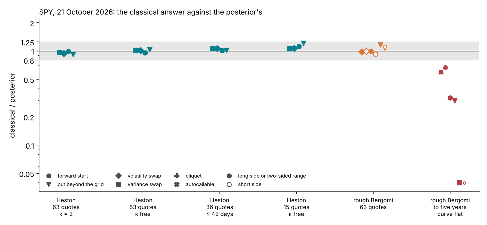
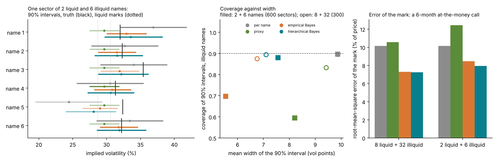
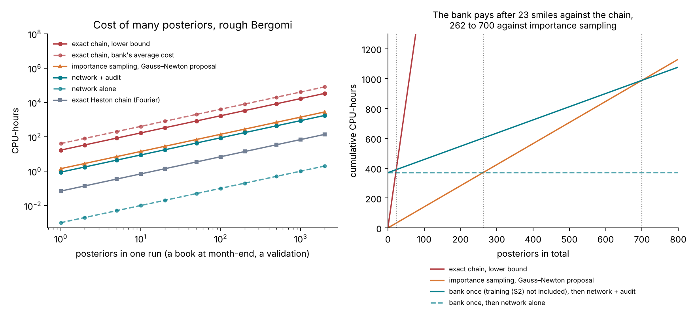

# The case for Bayes and simulation-based inference: argument, evidence and options

24 October 2026. Owner: Francesco Muia. [Course index](README.md) · [Plan](v2-plan.md) ·
[Cluster runs](../../tutorial_final/CLUSTER-RUNS.md).

This page is the argument of the course and of the tutorial in one place. It says what is claimed, what supports
each claim today, what is still pending, and which options would make the argument solid. The details and checks
are in [the plan](v2-plan.md), Section 2, and in the lectures it cites.

## 1. The argument

1. A bank marks products that no option quotes, and the prudent-valuation rules ask it to report a range for that
   mark, with a point at 90% confidence (Lecture 6, Section 6.6).
2. Where the quotes determine what the product depends on, the classical answer is right. Least squares and the
   delta method then give the same range as the posterior, and the course shows this rather than hiding it.
3. Where the quotes do not determine it, the two answers part. The classical route fixes the missing inputs by a
   convention and gives them no range. The posterior states them as a prior, carries them into the range, and lets
   the prior be tested.
4. Three cases of "the quotes do not determine it" carry the argument: the curve beyond the last quote, a thin
   chain, and a name that quotes almost nothing but belongs to a sector of names that quote more.
5. For a model priced only by simulation, one posterior is affordable when a classical fit gives a good proposal
   for importance sampling. Amortization is what makes the method checkable: coverage measured on thousands of
   simulated chains, and proposals where the classical fit fails.

So the case for Bayes is the inputs the quotes miss, and the case for simulation-based inference is that the
Bayesian answer becomes checkable, and usable across many names, for a model with no closed-form price.

## 2. What supports each claim today

| Claim | Evidence so far | Status | Strength |
| --- | --- | --- | --- |
| On a liquid smile the answers agree | SPY's 63 quotes under rough Bergomi: delta-method reserves 0.94 to 1.13 times the posterior's at the 90% quantile; Heston on 63, 36 and 15 quotes: ranges 0.92 to 1.21 times (Lecture 15, Section 15.4; Lecture 11, Section 11.4) | Quick checks, done | Strong, and expected |
| Beyond the last quote they part | Flat extrapolation gives 0.30 to 0.67 of the posterior's 90% range for SPY products to five years, and zero for a three-year variance swap (Lecture 15, Section 15.6) | Quick check, done | Clear, but the prior sets its size: the forward start's range is 19.4% to 36.8% of its price as the prior's sd goes from 0.1 to 0.3 |
| On a thin chain they part | Locally, on 15 SPY quotes with the curve uncertain to 10% per level, the contraction of $\rho$ falls from 0.61–0.65 to 0.12–0.16, and the local interval of $\rho$ crosses its prior box (Lecture 13, Section 13.11) | Suggestive; the test is pending (S10, S10-E, S11) | Not yet shown |
| Pooling helps a name that quotes almost nothing | A simulated Black–Scholes sector of 2 liquid and 6 illiquid names: hierarchical Bayes covers 88.0%, the proxy 59.5%, empirical Bayes 69.7%; fitting each name alone covers 89.7% with intervals 30% wider and a mark error 28% larger (Lecture 8, Section 8.10) | Quick check, done | Clear mechanism; simulated, with the model right by construction |
| A classical fit can miss a second calibration | Heston with jumps on a synthetic smile: two optima price a variance swap 83% above and 16% below the truth; the posterior covers both (slot 1) | Study of 9 October | Clear, synthetic |
| One posterior of a simulation-only model is affordable | Random-walk chain at least 16.9 CPU-hours; importance sampling from a Gauss–Newton proposal about 85 CPU-minutes on SPY, with common random numbers; the network 3.6 CPU-seconds, its audit about 53 CPU-minutes (Lecture 14) | Measured or estimated | Honest: per audited smile, the network saves only about a third |
| Validation needs amortization | Simulation-based calibration on 2,000 smiles: about 2 CPU-hours with the network, about 2,800 by importance sampling, at least 34,000 by a chain (Lecture 14, Figure 14.4) | Network side measured by S2 (R3) | Decisive |
| Classical proposals fail where the quotes are thin | On SPY's front three months the Gauss–Newton proposal failed, and two rounds took about 4 CPU-hours; that case is withdrawn as evidence (Lecture 14, Section 14.5; Lecture 16, Section 16.3) | Not measured on EWG | Not yet shown |

*Figure 1.* The classical answer over the posterior's, case by case (Lecture 15, Figure 15.7). Inside the grey band,
0.8 to 1.25, the two agree. The right-hand column is the long end with the curve held flat.

*Figure 2.* Pooling (Lecture 8, Figure 8.8). Left: on one simulated sector, the proxy covers 1 of 6 names, empirical
Bayes 4 and the hierarchical model 5. Centre: the hierarchical model sits near the nominal 90% with narrower
intervals than fitting each name alone. Right: it also gives the most accurate mark.

*Figure 3.* The cost of many posteriors (Lecture 14, Figure 14.4). Against a random-walk chain the bank pays after
9 to 23 posteriors; against importance sampling, after about 260 without an audit of each and about 700 with one.

## 3. The narrative of the tutorial

The afternoon tells one story in four steps.

1. **The problem** (slot 1). A bank needs a range for a product the quotes do not pin down. The posterior gives it;
   Black–Scholes on two SPY quotes shows the idea and its limit, the model.
2. **The method** (slots 2 to 4). A network trained on simulations returns the posterior; on Heston it is checked
   against the exact posterior. On a liquid smile the posterior agrees with the classical interval, and the
   tutorial says so: the method returns the classical answer where that answer is right.
3. **Where it matters** (slot 5). Rough Bergomi on SPY agrees on the grid and parts beyond the last quote. EWG, a
   real thin chain, is the case where the quotes leave $H$ and the curve open: coverage on 1,000 simulated
   EWG-like chains, and EWG's own posterior.
4. **What it depends on** (slot 6). The prior, the noise model and the model itself; pooling across names; how
   misspecification is found.

The message on cost is precise: the network does not make one posterior much cheaper than a good classical
proposal does; it makes the method checkable, and it gives a proposal where the classical fit has none.

## 4. What the pending runs decide

The thin-chain results come from runs R7 (S11), R8 (S10) and R9 (S10-E) of
[`CLUSTER-RUNS.md`](../../tutorial_final/CLUSTER-RUNS.md). Read them with these rules, and report every outcome.

| If, on EWG-like chains | Then the tutorial says |
| --- | --- |
| A baseline's one-sided bounds are breached clearly more than 10% of the time (the 95% interval of its breach rate lies above 10%) while the audited posterior's are not | The thin chain is the headline example: where the quotes leave the inputs open, the classical range is too narrow, and the posterior's is not |
| Gauss–Newton covers at its nominal rate too | The case for Bayes rests on the long end and on pooling; the thin chain shows that the method agrees with the classical answer there as well |
| The posterior is breached too, under the "wide" law of the unquoted level | The posterior is right only under its own prior; the lesson is to state and test the prior, which slot 6 does |
| More than 10% of chains have an unreliable audit | The network is not good enough as a proposal on thin chains; the claim on proposals is not made |
| Rough Bergomi fails EWG's predictive check | Model error exceeds every within-model range; EWG becomes slot 6's example of misspecification |

## 5. Options to make the argument solid

| Option | What it would show | Work and cost | Recommendation |
| --- | --- | --- | --- |
| A. Run R0 to R10 as planned | The network's calibration (S2, S2-T), the audit's reliability (S5), SPY's posterior (S8), and the thin-chain evidence (S10, S10-E, S11) | About 930 CPU-hours and two GPU jobs; code ready and reviewed | Necessary: the weekend's runs |
| B. A Gauss–Newton-proposal arm in S10 | Whether a classical fit can replace the network as the proposal on a thin chain. If it can, the claim on proposals is dropped and simulation-based inference rests on validation | About a day of code and a test; 20 to 30 CPU-hours on 200 of S10's chains | Do next: the cheapest way to make the claim on proposals specific |
| C. The long end as an accepted study | The long-end result with SPY's audited posterior (S8) in place of the Gaussian approximation, with the prior's sd from 0.1 to 0.3 | A few CPU-hours after R6; small changes to `checks/long_end/` | Do after R6: it turns a quick check into a result |
| D. Pooling on real thin chains | Pooling on market data: EWI and EWQ, which say almost nothing alone, borrowing from EWG | Two more thin networks (EWI's and EWQ's layouts, two GPU jobs), their audited posteriors (a few CPU-hours), and a hierarchical step on $(H, \eta, \rho)$ by reweighting each name's draws; two to three days of work | Only if time allows before the freeze of slot 5 on 6 November |
| E. A second liquid smile, SPX | That the agreement on a liquid smile is not specific to SPY | A new chain, a network trained on its layout | Not needed for the argument; after the tutorial |

**Option B in more detail.** For each of 200 of S10's chains, build a proposal from the Gauss–Newton fit: a Student-$t$
on its normal approximation in the fit's coordinates. The fit ties some forward-variance levels and says nothing
about the last one, so draw the tied and unquoted levels from the curve prior given the fitted levels. Mix with 10%
of the prior, as the network's proposal is. Price and weight exactly as the network's audit does. Compare $\hat k$,
the effective sample size and the coverage of the two arms on the same chains.

**Option D in more detail.** Run S11 on EWI and EWQ with a thin network trained on each layout. Each name's posterior
is then available under the common prior. The hierarchical model puts $(H, \eta, \rho)$ of the three names in one
law with unknown centre and spread; its posterior follows by reweighting each name's draws by the ratio of the
hierarchical density to the common prior, as in Lecture 8, Section 8.10. EWI and EWQ quote with median widths of 8
to 36 volatility points, so pooling will decide most of their marks: that is the point, and it must be said. Their
expiries (29, 57, 148 and 238 calendar days) match fewer design maturities than EWG's, so their layouts are smaller,
and their dividends must be checked against rule 3 of Lecture 16, Section 16.1 before they are used.

## 6. What not to claim

- That the posterior differs from Gauss–Newton on SPY's grid. It does not.
- That the network makes one posterior much cheaper than importance sampling from a good classical proposal.
- Milliseconds. The network takes 1.4 seconds for 1,000 draws, and its audit about 53 CPU-minutes on SPY.
- That banks use rough volatility in production, or that fixing $H$ at 0.10 is practice ([practice-sources.md](practice-sources.md)).
- Any result of the front-month case, or of the 15-quote and three-times-noise checks, which are withdrawn.
