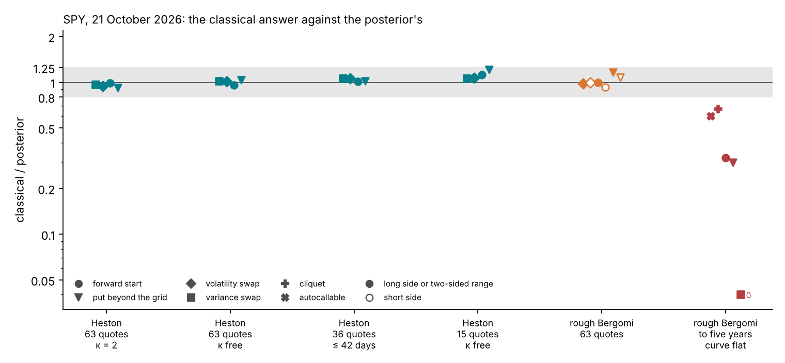
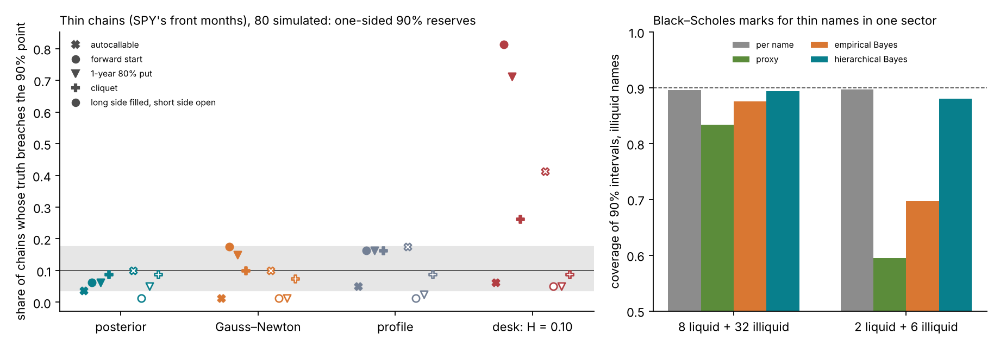
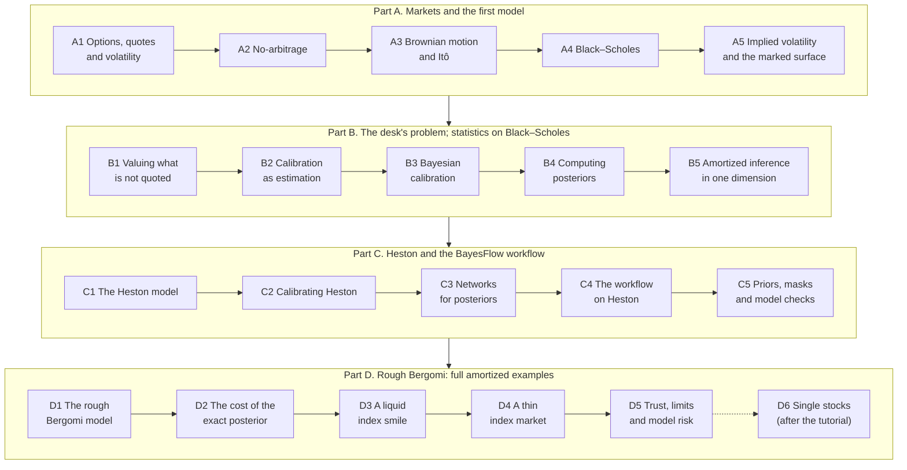
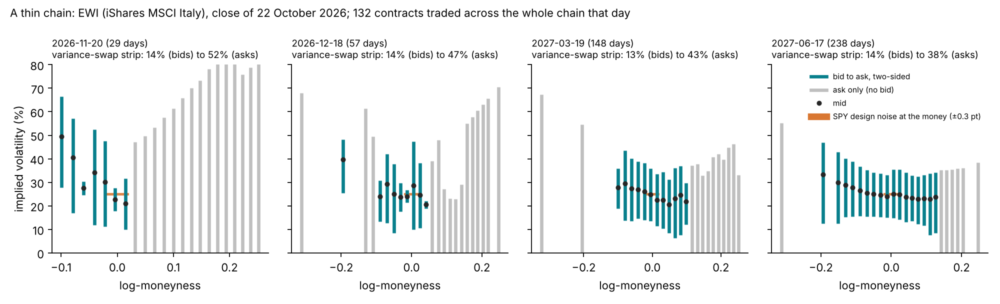
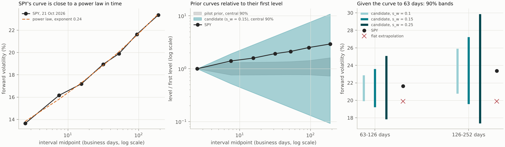

# Course version 2: reassessment and plan

Draft for review. 24 October 2026. Owner: Francesco Muia. [Course index](README.md).

This document reassesses the fourteen lectures of [the course](README.md) and plans their realignment. It checks the order of the material, the role each model plays, and how the advanced lectures justify Bayesian calibration and simulation-based inference. It then lists the studies that must run before version 2 can be written, with instructions, budgets and dates. The course stays a superset of the ICAIF '26 tutorial: each tutorial notebook is a selection of course sections.

Three rules guide the new structure.

1. **Black–Scholes for the simple concepts.** Every statistical concept is introduced on Black–Scholes, where it can be computed on a grid and seen in one figure.
2. **Heston for the workflow.** Every concept of the amortized workflow, and of BayesFlow in particular, is taught on Heston, where an exact posterior exists to check it.
3. **Rough Bergomi for the full examples.** Rough Bergomi carries the complete amortized examples, because its exact posterior is too expensive to compute routinely.

## Summary

1. **The finance lectures stay.** Lectures 1 to 5 are sound and build from the basics. They need three additions: thin option chains, discrete dividends with American calls, and how a desk marks a volatility surface.
2. **The rest has three problems.**
   - *Statistics arrives late.* The likelihood, the posterior and their checks appear in Lectures 9 to 13, after both advanced models. The simple concepts are spread over lectures that mix Black–Scholes, toys, Heston and rough Bergomi.
   - *The amortized workflow is not taught on one model.* What the Heston networks taught (the sampler, fresh noise in every batch, the exact check) sits next to rough-Bergomi pilot results in the same sections.
   - *The desk is simplified, and Bayes is justified on the wrong evidence.* The course says a desk calibrates one parameter vector each morning and reserves around it. Banks mark a surface, verify it independently and reserve the inputs the market does not quote. The course also argues for the posterior partly from its shape over SPY's quoted grid. There, the newest checks find that the posterior and the classical interval agree.
3. **The realigned argument.** On a liquid index smile the posterior and the classical interval agree, which is evidence that both are right there. They part where reserves live: in the inputs the quotes do not see, such as the long end of the variance curve or a thin market's missing maturities, and in the conventions desks use to fill them. Those conventions are priors of zero width. The posterior replaces them with stated priors and returns a range whose coverage can be tested. Amortization makes this affordable across a book and makes the tests possible.
4. **A new structure: four parts, 21 lectures.** Nothing is discarded. Every section of version 1 has a place (Section 4). Three lectures are new (C5, D4, D6). Five are assembled from sections now spread over several lectures (B1, B4, B5, C2, C4).
5. **Two regimes.** Index options and single-stock options behave differently and are calibrated separately (Section 1.2). The tutorial's products are index structured products, so the tutorial and the core of the course stay in the index regime. Single stocks become an advanced lecture, after the tutorial.
6. **Evidence in hand.** Quick checks of 23 and 24 October already show where the classical answer and the posterior part, and how often each covers the truth (Figures 1 and 2). They are not accepted studies yet.
7. **One decision cannot wait.** The curve prior of the full rough-Bergomi bank must change before the bank is generated. The same change makes the thin-market example possible (Section 6.1).
8. **Order of work.** Tutorial-critical studies come first, then the lectures that feed slots 1 to 6, then the rest (Sections 6 to 8).

## 1. What the realigned course argues

### 1.1 How a bank values a product that is not quoted

Version 1 describes a desk that calibrates one parameter vector each morning and uses it to mark, hedge and reserve ([Lecture 1, Section 1.7](01-options-quotes-and-volatility.md); [Lecture 8, Section 8.1](08-calibration-on-a-desk.md)). The real picture differs in four ways, and version 2 should teach it.

**Three roles.**

- *The trading desk* marks a smooth implied-volatility surface every day, inside the bid–ask, informed by trades and broker quotes. It calibrates the exotic model to that marked surface, not to raw quotes. Parameters the vanillas do not pin, such as a vol-of-vol or the long end of the variance curve, are set by the trader's judgement or by a convention.
- *Product control* verifies the marks independently, against broker quotes and consensus services, in which contributing banks submit their marks and receive the consensus. It computes the valuation reserves.
- *Model validation* approves a model for a product, tests whether its parameters are identified and stable, and sets limits on its use.

**The marked surface.** A desk does not interpolate raw quotes. It fits a parametric smile to each expiry, such as SVI, constrained to be free of arbitrage (Gatheral and Jacquier 2014). It interpolates across expiries in total variance, and extrapolates beyond the quoted strikes and expiries by a rule.

**The reserves.** EU prudent valuation asks for market price uncertainty on calibrated inputs (Article 9), for close-out costs (Article 10), and for model risk across models and calibration approaches (Article 11), each at a 90% point ([Lecture 8, Section 8.9](08-calibration-on-a-desk.md)). IFRS 13 asks for the sensitivity of Level 3 values to reasonably possible alternative inputs. In practice, a reserve on an unobservable input is often computed by repricing the trade with that input moved, one input at a time, over a range taken from consensus data or from history. A thin name is marked from a proxy, plus a spread.

**Conventions are priors of zero width.**

- Fixing $H = 0.10$ is a prior with all its mass on one value.
- Extrapolating the variance curve flat beyond the last quote is a prior of zero width on the long end.
- Marking a thin name at its proxy is a prior of zero width centred on the proxy, so the name's own quotes get no weight.

Each is a choice of prior, made without saying so and without a width.

**What the posterior adds.** The posterior replaces each convention by a prior with a stated width, combines it with whatever the quotes say, and returns a joint range for every product at once. Its 90% point is the object the rules name. Simulation-based calibration then tests whether the range covers as often as it claims. A bump range has no such test built in.

**Who uses it.** The trader's daily mark is one number, and the posterior adds little to it. The users are product control, at each month-end across the whole book, and model validation, which must test the calibration on many smiles. Slot 1's slide "Every smile, every morning" should become "every name, every month-end, every validation run".

### 1.2 Index options and single-stock options are different regimes

Francesco's note of 24 October makes a point that version 1 does not make. Index options and single-stock options are different markets, and a model is calibrated to the market of the product it prices.

| | Equity index (S&P 500, Euro Stoxx 50; SPY, country ETFs) | Single stock |
| --- | --- | --- |
| Smile | Steep, persistent downside skew | Flatter and more symmetric; distorted around earnings |
| Dominant risk | Systematic risk and correlation | Company events: earnings, regulatory decisions |
| Exercise | European on the index (SPX, SX5E); American on ETFs (SPY, EWI) | American, with discrete cash dividends |
| What the model needs | Stochastic or rough volatility | Event variance on known dates; often price jumps |
| Natural proxy | A related index | Peer stocks; the name's own history |

Four consequences shape version 2.

1. **The tutorial stays in the index regime.** Its products (the forward-start call, the cliquet, the autocallable) are index structured products, and its smile is SPY's. Its thin-market example should therefore be a thin index product (Section 6.7), not a single stock. This replaces an earlier suggestion to use a single stock (Stellantis) as the thin case.
2. **Proxies and pooling stay within a regime.** A thin index borrows strength from related indices; a thin stock borrows from peer stocks. A hierarchical prior across peers does not substitute one name's parameters for another's: it estimates how far each name sits from its peers.
3. **Single stocks need more model.** They need discrete dividends and American exercise (A2), event variance on earnings dates, and often a jump component. Rough Bergomi handles an earnings date naturally: the forward-variance curve is an input and can carry a spike on the event's interval. Heston's exponential curve cannot. The design document's study of Heston with Kou jumps (HKDE) belongs to this regime: it used simulated surfaces that mimic the AMZN and SHOP calibrations of Agazzotti et al. (2025).
4. **Single stocks become an advanced lecture (D6), after the tutorial.**

Two statements of the note need a qualification.

- It says that Bayesian methods suit liquid index surfaces because they regularize the surface and prevent overfitting. That holds for non-parametric surfaces, such as local volatility. For a model with three or four parameters fitted to 63 quotes, the evidence of Section 1.3 shows the posterior agreeing with the classical interval; the Bayesian value lies beyond the quotes.
- It says never to mix index and single-stock information. Index information does reach single-stock prices, but through correlation and dispersion models, which are outside this course. What must never happen is pricing a single stock with index parameters.

The note ends by asking whether the target is index exotics and structured notes, or single-stock options around events. For this tutorial it is index exotics and structured notes.

### 1.3 What the evidence says about Bayesian calibration

*Figure 1.* How to read the figure: each column is one case and each marker one product. The vertical axis is the classical answer divided by the posterior's, on a log scale. For Heston it is the delta-method 90% range over the posterior's 90% range. For rough Bergomi it is the delta-method one-sided 90% reserve over the posterior's, filled for the long side and open for the short side. The two right-hand columns divide a desk convention's reserve or range by the posterior's. The grey band runs from 0.8 to 1.25. Rough Bergomi's variance swap is left out where both answers are zero by construction. The square at the bottom right, marked 0, is the three-year variance swap at the long end: flat extrapolation gives it no range at all. All numbers are in `images/v2-evidence-numbers.json`, drawn by `scripts/course/realignment.py` from the quick checks in `tutorial_final/checks/`.

- **Heston on SPY**, with 63, 36 or 15 quotes and $\kappa$ fixed or free: the ratios lie between 0.92 and 1.21.
- **Rough Bergomi on SPY's 63 quotes**: 0.93 to 1.16. With three times the quote noise: 0.89 to 1.20. On 15 quotes: 0.93 to 1.73, the largest being the short side of the put beyond the grid.
- **SPY's front three monthly smiles only** (27 quotes): 0.78 to 1.44. The ratios are asymmetric: the classical reserve is too small on one side and too large on the other. The front-month posterior is far from Gaussian; the Gauss–Newton proposal failed there (Section 1.4).
- **The desk convention $H = 0.10$ on the same front months**: 0.20 to 1.10. The forward-start's long-side reserve is a fifth of the posterior's.
- **The long end** (products to five years, with the variance curve unquoted beyond the LEAPs): flat extrapolation gives 0.30 to 0.67 of the posterior's range, and zero for the three-year variance swap. The posterior's range itself moves by a factor of about two with the width of the random-walk prior on the long end: the forward start's 90% range goes from 19.4% to 36.8% of its price as the prior's standard deviation goes from 0.1 to 0.3 per square-root year. The prior must therefore be defended.

*Figure 2.* How to read the figure: the left panel uses 80 simulated thin chains (SPY's front-month quote design), with true parameters drawn from the front-month posterior. Each marker is the share of chains whose true price lies beyond a method's one-sided 90% point, for one product and one side; the nominal share is 10%, and the grey band is the 95% range of a binomial share on 80 chains, 3.75% to 17.5%. The right panel is a simulated Black–Scholes sector. Its liquid names quote the full grid; its illiquid names quote one at-the-money option, with 3 volatility points of noise. The panel shows the share of illiquid names whose 90% interval covers the truth.

- The posterior breaches between 1.25% and 10% for every product and side (1 to 8 of the 80 chains).
- Gauss–Newton breaches 17.5% (forward start) and 15% (one-year put) on the long side. The profile likelihood breaches 16.25% (13 of 80) on the long side for three of the four products.
- The convention $H = 0.10$ breaches 81% (forward start) and 71% (put) on the long side.
- In the sector with 2 liquid and 6 illiquid names, the proxy's band covers 59.5% of the illiquid names, empirical Bayes 69.7% and hierarchical Bayes 88.0%. The hierarchical band is narrower than each name's own (7.6 against 9.9 volatility points).

Five conclusions follow.

1. **Where the quotes inform the parameters, the two answers agree,** as the Bernstein–von Mises theorem predicts ([Lecture 10, Sections 10.3 and 10.8](10-bayesian-calibration.md)). The course should present this as a strength: the method returns the classical answer where the classical answer is right.
2. **They part where the quotes are silent**: beyond the quoted maturities, on thin layouts, and wherever a convention fills the gap. There the conventions under-reserve badly, and the classical interval breaches up to 17.5% on one side.
3. **Pooling across names helps thin names.** In the Black–Scholes sector the hierarchical interval covers close to its nominal rate and is narrower than each name's own. It is also the cheapest example of all: Black–Scholes on a grid.
4. **These are quick checks on one date.** The front-month case also gave every method a variance curve to one year read from SPY's full smile, which a thin market would not have. Work package WP4 corrects this (Section 6.5).
5. **Model error can exceed every within-model range.** Calibrated to SPY's full surface, rough Bergomi prices the one-year forward start 27% above its front-month mark. That is outside every method's 90% range on the front months. One parameter set does not fit both ends: the front-month fit has a $\chi^2$ of 216 on the 36 later quotes, against 48 for the full-surface fit (`checks/desk_case/real_market.json`). D4 and S11 report this, and D5 discusses it.

### 1.4 What the evidence says about simulation-based inference

| Route to the rough-Bergomi posterior of one smile | Cost | Source |
| --- | --- | --- |
| Random-walk Metropolis on the Monte Carlo likelihood | at least 16.9 CPU-hours (extrapolated) | study S9 (C8); [Lecture 11](11-why-the-exact-posterior-is-expensive.md) |
| Importance sampling from a Gauss–Newton proposal, SPY's 63 quotes | about 75 CPU-minutes of likelihood evaluations (1,024 proposals) | `checks/rough_spy_is.py` |
| The same on the front months, where the Gauss–Newton proposal failed and a second round was needed | about 4 CPU-hours | `checks/desk_case/` |
| The amortized network, 1,000 draws | 1.4 seconds on the clock (3.6 CPU-seconds) | study S9 |
| The network and its audit | about 7 CPU-minutes (425 CPU-seconds in the pilot) | study S5, pilot |

Three readings follow.

- **Version 1 compares the network with the slowest exact route.** A careful practitioner would use importance sampling from a Gauss–Newton proposal, which costs about 75 CPU-minutes on a liquid smile. The course must say so ([D2](#part-d-rough-bergomi-full-amortized-examples)).
- **The case for amortization has three parts.**
  - *Per smile:* seconds instead of 75 CPU-minutes, and a usable proposal where Gauss–Newton fails.
  - *Per book:* a month-end run over hundreds of names.
  - *Per validation run:* simulation-based calibration on 2,000 smiles costs about 2 CPU-hours amortized, against about 2,500 CPU-hours at 75 CPU-minutes each. The coverage study of Figure 2, limited today to 80 chains, can then run on thousands.
- **The claim is never "milliseconds".**

### 1.5 What the course does not claim

- That a liquid index smile needs Bayes to calibrate its quoted vanillas.
- That the posterior range is the whole of model risk. It is a within-model range ([Lecture 8, Section 8.10](08-calibration-on-a-desk.md)).
- That the prior is objective. Where the quotes are silent, the range is the prior's, and the course must show the prior's effect.
- That the amortized posterior is exact. It is checked, corrected by the audit, and reported with its failures.

## 2. Lecture-by-lecture assessment

| Lecture (version 1) | Verdict | Main issues | Action in version 2 |
| --- | --- | --- | --- |
| [1](01-options-quotes-and-volatility.md) Options, quotes and volatility | Keep | Marking described as one calibration (1.7); liquid SPY data only | A1: add thin chains (EWI) and the two regimes; send marking to B1 |
| [2](02-no-arbitrage-without-a-model.md) No-arbitrage without a model | Keep | American exercise treated for puts only | A2: add discrete dividends and American calls before an ex-date |
| [3](03-brownian-motion-and-ito.md) Brownian motion and Itô's lemma | Keep | None | A3, unchanged |
| [4](04-black-scholes.md) Black–Scholes | Keep | None | A4: add a deterministic term structure and the forward start under it (from 8.5) |
| [5](05-implied-volatility-and-the-smile.md) Implied volatility and the smile | Keep, extend | The noise model (5.3) is a statistical choice made inside a finance lecture; no marked surfaces; strip truncation shown on SPY only | A5: add SVI marks, interpolation and extrapolation rules, strips on thin chains; move 5.3's rationale to B2 |
| [6](06-heston.md) Heston | Keep, trim | 7,264 words; the five inversions and the quadrature ladder are implementation detail; role stated as "the check" | C1: inversions and ladder to a "further detail" section; add Heston's products (from 8.4–8.5) and jumps; new role statement |
| [7](07-rough-bergomi.md) Rough Bergomi | Keep | Identification assumes $\xi_0$ exact (7.11) | D1: add identification when $\xi_0$ is uncertain or quotes are few; add the daily-monitored variance swap (from 8.3) |
| [8](08-calibration-on-a-desk.md) Calibration on a desk | Rewrite and split | Desk too simple; products derived under models taught before and after; the HKDE figure appears without its model | B1 (desk, rules, ranges, Black–Scholes products); C1 (Heston products); C2 (profile); D1 (rough variance swap) |
| [9](09-calibration-as-estimation.md) Calibration as estimation | Keep the core | Mixes Black–Scholes with Heston and rough evidence (9.8, 9.11); no interval reading of a bid–ask; no bump reserve | B2 on Black–Scholes and the toy; 9.8 to C2 and D3; 9.11 to C2 |
| [10](10-bayesian-calibration.md) Bayesian calibration | Keep the core, split | Strong Black–Scholes material, then Heston chains and rough products in the same lecture; no pooling; no priors from history or peers | B3 (Black–Scholes, toy, priors, pooling); B4 (sampling); C2 (Heston); D3 (10.11); D5 (10.12) |
| [11](11-why-the-exact-posterior-is-expensive.md) Why the exact posterior is expensive | Revise | Compares with Metropolis only; "every morning" framing | D2: add importance sampling from Gauss–Newton; month-end and validation arithmetic |
| [12](12-amortized-inference.md) Amortized inference | Split | Generic toys, Heston lessons and the rough network in one lecture; no BayesFlow code | B5 (toys rebuilt on Black–Scholes); C3 (families, samplers, summaries, masks); C4 (Heston workflow); D3 (rough network and bank) |
| [13](13-validating-an-amortized-posterior.md) Validating an amortized posterior | Split | Every check mixes Heston results with rough pilot results | B4 and B5 (theory and toys); C4 (Heston results); D3 (rough results); D5 (what the checks do not establish) |
| [14](14-the-study-and-the-tutorial.md) The study and the tutorial | Move out | A status report that will go stale; the tutorial map belongs to the curriculum | D2–D3 (costs, products, across models); D5 (risks); a status page; the curriculum |

## 3. Issues that cut across lectures

1. **Order.** Version 1 builds all models first and the statistics after. Version 2 interleaves them: the Black–Scholes model, then statistics on Black–Scholes; Heston, then the workflow on Heston; rough Bergomi, then the full examples.
2. **One role per model.** The three rules at the top of this document.
3. **Repetition.** The 17-to-41 CPU-hour figure appears in Lectures 6, 7, 10, 11, 12 and 14. The variance-swap strike is derived in Lectures 5, 6, 7 and 8, and restated in Lecture 10. The caveat that $\eta$'s identification relies on $\xi_0$ appears in Lectures 7, 8, 10 and 13. In version 2 each is derived once, in its owner lecture, and referred to elsewhere.
4. **Length.** Lectures 6, 7, 10, 12 and 13 run from 6,300 to 8,400 words. Each version-2 lecture keeps a core and moves implementation detail to a "further detail" section at its end.
5. **Status mixed into the text.** Every advanced lecture carries ⟨Sn⟩ placeholders and pilot caveats. Version 2 cites results by claim ID from `tutorial_final/CLAIMS.md` and keeps the status of every study on one page.
6. **No exercises.** Every lecture gets three to six exercises, analytic and computational. Their solutions live in a marimo notebook per lecture; the student version blanks them (decision D17 of the curriculum).
7. **No BayesFlow code.** C4 shows the simulator, the adapter, the workflow, training and diagnostics as code from `src/sbi4finance/calibration/inference.py`.
8. **Figures as importable functions.** Each `scripts/course/lectureNN.py` becomes a module with one function per figure. A tutorial notebook then imports the figures of the sections it selects.
9. **Desk practice and regimes** (Sections 1.1 and 1.2).

## 4. The structure of version 2

In the tables, new material is in bold. "Settled" means that the material exists in version 1 or in a committed check and can be written now. The last column names the tutorial slot that selects from the lecture ([curriculum](../../tutorial_final/curriculum/00-overview.md)).

### Part A. Markets and the first model

| Lecture | Content | From version 1 | Status | Slot |
| --- | --- | --- | --- | --- |
| A1 Options, quotes and volatility | 1.1–1.8; **liquid and thin chains: SPY against EWI (Figure 3); the two regimes; where exotics are written** | L1 | Settled | 1 |
| A2 No-arbitrage without a model | 2.1–2.11; **discrete dividends; American calls before an ex-date; de-Americanizing quotes with a tree; why parity cannot pin a rate on a thin chain** | L2; `checks/thin_chains/ewi_chain.py` | Settled | — |
| A3 Brownian motion, SDEs and Itô's lemma | 3.1–3.10 | L3 | Settled | — |
| A4 The Black–Scholes model | 4.1–4.12; **a deterministic term structure; the forward start under it** | L4; L8 8.5 (first part) | Settled | 1 |
| A5 Implied volatility, the smile and the marked surface | 5.1–5.12 except 5.3's rationale; **SVI per expiry and arbitrage constraints in practice; interpolation in total variance; extrapolation rules; strips on thin chains (over EWI's quoted strikes, the variance-swap strip lies between 14% on the bids and 52% on the asks at the first expiry, and between 14% and 38% at the last)** | L5 | Settled | 1, 4, 5 |

*Figure 3.* How to read the figure: each panel is one EWI expiry at the close of 22 October 2026. A teal bar spans a quote's bid to its ask in implied volatility; a grey bar is a quote with an ask and no bid; dots are mids; the orange bar is SPY's design noise at the money, ±0.3 volatility points. EWI's median bid–ask width is 36, 23, 24 and 21 volatility points at the four expiries; 45 of its 94 out-of-the-money quotes have a bid; the whole chain traded 132 contracts that day. Each panel's title gives the variance-swap strip over the quoted strikes, computed on the bids and on the asks. The strip at the true prices lies between the two; strikes beyond the quoted ones would add to it. The quotes carry little information about the smile beyond its level, which is what a desk's proxy marking assumes. The derived data are in `tutorial_final/checks/thin_chains/ewi_2026-10-22.json`; the raw quotes are not committed (decision D6).

### Part B. The desk's problem; statistics on Black–Scholes

| Lecture | Content | From version 1 | Status | Slot |
| --- | --- | --- | --- | --- |
| B1 How a bank values what is not quoted | **The three roles; the marked surface; the reserves (market price uncertainty, close-out costs, model risk, Level 3 sensitivity); bump reserves; conventions as priors of zero width; liquid and thin names; the two regimes.** What the smile pins (8.2); the cliquet under Black–Scholes (8.6); calibration risk in the literature (8.8); the rules (8.9); three ranges (8.10); the HKDE two-optima figure as a motivating example (8.7) | L8 8.1–8.2, 8.6–8.10 | Settled | 1 |
| B2 Calibration as estimation | The observation model (5.3's rationale, 9.1), with **the interval reading of a bid–ask, ask-only quotes as upper bounds, and correlated market-maker quotes**; the likelihood; least squares; objectives on SPY; Gauss–Newton and the delta method; **the profile likelihood as a range; the bump reserve**; the toy valley; multi-start; regularization; identifiability | L5 5.3; L9 9.1–9.7, 9.9, 9.10, 9.12 | Settled | 1 |
| B3 Bayesian calibration | Bayes' rule; priors; Black–Scholes grid posteriors; misspecification and the predictive check on SPY; the toy's identification; credible against confidence; propagation, the range and the reserve (slot 1's one-quote example); **conventions as degenerate priors; priors from history and peers; a Black–Scholes variance curve with a random-walk long end; pooling across names by empirical and hierarchical Bayes (Figure 2, right)** | L10 10.1–10.6, 10.9 (method); `checks/bs_hierarchy.py` | Settled, except the Black–Scholes long-end example (WP8) | 1, 6 |
| B4 Computing posteriors | Grids; Metropolis–Hastings and its diagnostics on the toy; **importance sampling as an exact method: the self-normalized estimate, the effective sample size, the Gaussian closed form, $\hat k$, defensive mixtures**; pseudo-marginal chains | L10 10.7; L13 13.7 (theory and Figure 13.9); L11 11.5 | Settled | 2 |
| B5 Amortized inference in one dimension | Simulated pairs carry the posterior (**rejection on one Black–Scholes quote**); neural posterior estimation and the Kullback–Leibler identity; **a network learns slot 1's posterior**; simulation-based calibration and its failure shapes; contraction; when amortization pays | L12 12.1–12.2; L13 13.3 (toys); curriculum slot 2 | Partly: the Black–Scholes network is slot 2's build item (WP8) | 2 |

### Part C. Heston and the BayesFlow workflow

| Lecture | Content | From version 1 | Status | Slot |
| --- | --- | --- | --- | --- |
| C1 The Heston model | 6.1–6.5, 6.8–6.9; **Heston's products: the variance swap, the volatility swap and its convexity correction, the forward start**; **jumps (Bates, Kou) and the HKDE study**; a "further detail" section with the five inversions and the quadrature ladder | L6; L8 8.4–8.5 | Settled | 4 |
| C2 Calibrating Heston | Least squares on SPY (6.10); the profile (8.7); the exact posterior by Metropolis (10.8); **on SPY with 63, 36 or 15 quotes and $\kappa$ fixed or free, the posterior and the classical interval agree (Figure 1)**; products and their drivers (10.9–10.10); deep calibration and the neural pricer (9.11); the classical route on 200 smiles (9.8); **Heston's defects on SPY: the Feller ratio and variance swaps below the market** | L6 6.10–6.11; L8 8.7; L9 9.8, 9.11; L10 10.8–10.10; `checks/heston_checks.py`; slot 4's feasibility run | Settled except S8-H | 4 |
| C3 Networks for posteriors | Normalizing flows; flow matching; the Euler sampler and its undershoot; where in time the loss is trained; **summary networks by data shape**; masks and missing at random; **the flow carrying noise to SPY's Heston posterior** | L12 12.3–12.6, 12.10; slot 3 | Partly: slot 3's five-snapshot figure | 3 |
| C4 The BayesFlow workflow on Heston | **Code: simulator, adapter, networks, workflow, diagnostics**; the bank; fresh noise in every batch; the three Heston networks; the prior predictive check; SBC, coverage, contraction and recovery; the exact check; the neural-pricer route; the audit with the exact likelihood; the posterior predictive check on SPY | L12 12.7–12.9 (Heston), 12.11; L13 13.2–13.8 (Heston parts); slot 4 | Settled except S8-H | 4 |
| C5 Priors, masks and model checks on Heston | **Reweighting to a new prior; the Feller prior on SPY, under which no draw survives; sensitivity-aware amortization with the prior and the noise as conditions; masked training for thin layouts; the four misspecification detectors; amortized multilevel models as the route to pooling** | Slot 6; new | Pending: S12 | 6 |

### Part D. Rough Bergomi: full amortized examples

| Lecture | Content | From version 1 | Status | Slot |
| --- | --- | --- | --- | --- |
| D1 The rough Bergomi model | 7.1–7.15; **identification when $\xi_0$ is uncertain or the quotes are few**; the daily-monitored variance swap (8.3) | L7; L8 8.3; `checks/rough_checks.py` | Settled | 5 |
| D2 The cost of the exact posterior | The estimated likelihood (11.2); Metropolis (11.3); **importance sampling from a Gauss–Newton proposal (75 CPU-minutes) and when it fails (4 CPU-hours)**; pseudo-marginal chains and surrogate pricers (11.5); **what amortization buys per smile, per book at month-end, and per validation run** | L11; L14 14.3 | Partly: costs on the full bank (S9) | 1, 5 |
| D3 Example 1: a liquid index smile | The bank (12.8) and the network (12.7); validation of the rough network; SPY's posterior and its predictive check; **Bayes against the classical route on the quoted grid: they agree, and part on the put beyond the grid**; products and reserves; **the long end beyond the LEAPs**; Heston against rough Bergomi | L12 12.7–12.8, 12.12; L13 rough parts; L14 14.4–14.6; L10 10.11; `checks/rough_spy_is.py`; `checks/long_end/` | Pending: S1, S2, S4, S5, S7, S8 | 5 |
| D4 Example 2: a thin index market | **SPY's front months with the variance curve known only to 63 days; the network that infers the curve; reserves by every method and their coverage on 1,000 simulated chains; a real thin index chain, with the network as the importance-sampling proposal; model error between front and back months** | `checks/desk_case/`; new | Pending: S2-T, S10, S11 | 5 (contrast), 6 |
| D5 Trust, limits and model risk | What the checks do not establish (13.9); what the posterior does not cover (10.12); within- and across-model ranges (8.10, 14.6); the risks (14.8); **misspecification on real data** | L13 13.9; L10 10.12; L14 14.8 | Text settled; numbers from D3 and D4 | 6 |
| D6 Single stocks (after the tutorial) | **Events as spikes in $\xi_0$, with priors from past earnings moves; discrete dividends and American exercise; jumps; pooling across peer stocks; dispersion as a pointer** | HKDE study; new | Planned: S13, S14 | Take-home |

Version 1's Section 14.2 (the studies' status) becomes a status page linked to `CLAIMS.md`; Sections 14.7 and 14.9 (the segment and the map to the lectures) move to the curriculum.

## 5. The evidence behind each claim

| Claim taught in version 2 | Evidence | Status | Lecture |
| --- | --- | --- | --- |
| On a liquid index smile, the posterior and the classical interval agree | `heston_checks`, `rough_spy_is` (Figure 1) | Quick checks | C2, D3 |
| They part beyond the quotes and on thin layouts | `rough_spy_is_cases`, `desk_case`, `long_end` (Figure 1) | Quick checks; the desk case is redone in WP4 | D3, D4 |
| Desk conventions under-reserve | `desk_case` ($H$ fixed), `long_end` (flat extrapolation) | Quick checks | B1, D4 |
| Posterior reserves cover; Gauss–Newton breaches on one side | `desk_case/validate.py`, 80 chains (Figure 2) | Quick check; S10 at scale | D4 |
| Pooling helps thin names | `bs_hierarchy` (Figure 2) | Quick check | B3 |
| Model error can exceed every within-model range | `desk_case/real_market.py`: front months against the full surface | Quick check; S11 on a real thin chain | D4, D5 |
| The amortized posterior is calibrated | Heston: S2, SBC inside the band for 4 of 4 targets on 2,000 smiles. Rough: the pilot's SBC fails for $\rho$ and $\rho\eta$ (C7) | Heston verified; rough pending (S2, S2-T) | C4, D3, D4 |
| The network agrees with the exact posterior | Heston: S3 (C5) and S4 (C6). The network alone meets the criterion on all four parameters for 80% of 50 smiles; with the importance-sampling correction it agrees on 4 of 4 smiles tried; the neural-pricer route agrees on 50 of 50 | Not met by the network alone; met with the correction | C4 |
| The audit corrects the network on each smile | S5 pilot: 22% of 40 rough smiles flagged at $\hat k > 0.7$ (C7) | Pending the full study | C4, D3 |
| Costs of every route | S9 (C8); `rough_spy_is`; `desk_case` | S9 verified; the importance-sampling costs are quick checks | D2 |
| SPY under rough Bergomi | S8 | Pending | D3 |
| The candidate curve prior covers SPY and extrapolates it | `checks/curve_prior` (Figure 4) | Quick check | D3, D4 |

## 6. Studies and runs

### 6.1 G0′: the curve prior of the full bank (decide before the bank)

**The problem.** The pilot's curve prior draws each level as $\sigma_0^2(1 + s\,\bar t_j)\,e^{u_j}$. Its ratio of last to first level is at most 2.15, while SPY's is 2.93 ([Lecture 14, Section 14.4](14-the-study-and-the-tutorial.md)). The thin-market example also needs a prior on the levels beyond the last quoted expiry that is a stated belief, not only a coverage device.

**The candidate.** A power law in time with a random walk in log time:

$$
\log\xi_j = 2\log\sigma_0 + b\,\big(\log\bar t_j - \log\bar t_1\big) + W_j, \qquad W_1 = 0, \qquad W_{j+1} - W_j \sim \mathcal{N}\big(0,\ s_w^2\,(\log\bar t_{j+1} - \log\bar t_j)\big),
$$

where $\bar t_j$ is the midpoint of the $j$-th design interval, $\sigma_0$ is log-uniform on $(0.08, 0.60)$ and $b$ is uniform on $(-0.6, 0.6)$. A positive $b$ is a rising curve, as in a calm market; a negative $b$ is an inverted curve, as in a stressed one. The scale $s_w$ is fixed; 0.10, 0.15 and 0.25 were tested.

*Figure 4.* How to read the figure:

- **Left.** SPY's seven forward-variance levels of 21 October 2026, in volatility units, against the interval midpoints on a log axis. A power law with exponent 0.244 fits them with a residual standard deviation of 0.025 in log variance.
- **Centre.** The central 90% of prior curves, each divided by its first level. The pilot prior (grey) leaves SPY's curve outside its central 90% at every level after the first. The candidate (teal) contains it at every level; 29% of its curves rise at least as much as SPY's, and 29% fall as much.
- **Right.** If only the first five levels are known, as on a market quoted to 63 days, the candidate predicts the two later levels with the 90% bands shown. At $s_w = 0.15$ the band for the 126-to-252-day level is 19.6% to 27.2%, with a median of 23.1%; SPY's level is 23.4%. Flat extrapolation gives 19.9%, 1.49 predictive standard deviations below the median. One date illustrates the prior; it does not validate it.

The numbers are in `tutorial_final/checks/curve_prior/curve_prior.json`, computed by `curve_prior.py` in the same folder.

**Instructions.**

1. In `src/sbi4finance/calibration/tasks.py`, give the block `context_prior.forward_variance` a field `kind`. The value `"linear_wobble"` is the pilot's prior and the default when the field is absent, so the pilot bank can still be regenerated. The value `"power_law_walk"` takes `level_bounds` (log-uniform), `exponent_bounds` and `walk_sd`.
2. Branch `draw_context` on the kind. It returns the levels and the pair $(\sigma_0, b)$, as it now returns $(\sigma_0, s)$. Branch the checks in `validate_task` the same way, and add the new arguments to `rough_task`.
3. Update `configs/tasks/calibration_rough_bank.json`. Add tests: positive levels, reproducible draws from a surface's seed, and the envelope of Figure 4.
4. Run a mini-pilot of 200 surfaces (about 40 CPU-minutes at the pilot's 11.9 CPU-seconds per surface). Compute the prior predictive smile statistics of [Lecture 13, Section 13.2](13-validating-an-amortized-posterior.md) with SPY marked, and the cost per surface.
5. Accept when three conditions hold. SPY's curve lies inside the central 90% of the prior's curves at every level; the smile statistics cannot check this, because they do not see the curve. SPY's four smile statistics lie inside the central 95% of the mini-pilot's. The mean cost per surface is within 30% of 11.9 CPU-seconds.
6. Use $s_w = 0.15$ for the bank. The thin-market example can move to a narrower prior ($s_w = 0.10$) by reweighting, without retraining, because reweighting from a wider prior to a narrower one keeps the weights bounded.

**The range of $\rho$.** The desk-case brief asked for $\rho$ up to about 0.5 for a thin underlying. That range belongs to the single-stock bank of S13 (D6), where spot–volatility correlation can be weak or positive. The index bank keeps the pilot's range, $\rho \in (-0.99, -0.2)$.

### 6.2 S1: the full bank

- **What changes.** Only the curve prior of 6.1. The bank still stores clean prices on the 63 design contracts, the seven curve levels, the parameters and the Monte Carlo standard errors.
- **Where and what it costs.** On Oscar with `cluster/calibration_bank_array.sbatch`: 112,000 surfaces at about 11.9 CPU-seconds is about 370 CPU-hours, more if the wider curves need more paths. The `cluster-setup` skill describes the lanes.
- **Add a product bank.** For 5,000 held-out surfaces, also price the products of the desk case (autocallable, forward start, one-year put, cliquet) and of slot 5 at the true parameters, with an independent seed. At 16,384 paths this costs about 3.5 CPU-seconds per surface (1.0 for the desk products and 2.5 for slot 5's; `checks/desk_case/timing.json`), about 5 CPU-hours in all. It gives S10 its truths.
- **Acceptance (G1).** As in the design document: every quote within the Monte Carlo budget, and the cost reported.

### 6.3 Two networks from one bank

**S2, the liquid network (unchanged plan).** Conditions: the 63 scaled quotes and the seven log curve levels. Targets: $H$, $\eta$, $\rho$. It is slot 5's primary network and the low-risk route.

**S2-T, the network that infers the curve.** It is trained on the same bank, with three changes made at training time:

1. **The curve becomes a target.** Targets: $H$, $\eta$, $\rho$ and the seven log levels, ten in all. The curve is then inferred jointly with the parameters, and its uncertainty reaches every product. This answers the open item of [Lecture 10, Section 10.12](10-bayesian-calibration.md), point 4.
2. **Variance swaps enter as noisy observations.** For each maturity whose strip a chain supports, the network sees the variance-swap level $\frac1T\int_0^T\xi_0$ plus replication noise (a standard deviation of 0.5 volatility points, as in the long-end check), with a mask for the maturities a chain does not support.
3. **Layouts and noise vary.** Each training surface gets a layout: the full grid (40%); the maturities up to 21, 42, 63 or 126 days (40%); or random gaps of 10% to 50% of the quotes (20%). Masked quotes enter as zeros with a mask indicator. The quote noise is multiplied by a factor $c$, log-uniform on $(1, 4)$, given to the network as $\log c$, so that wider markets than SPY are covered.

The velocity network widens from four hidden layers of 256 units to four of 512, a starting point to tune on the validation loss. Its acceptance (G2-T) is SBC inside the simultaneous band for all ten targets on the bank's 2,000 SBC surfaces, under each of three layouts: the full grid, maturities to 63 days, and maturities to 126 days. On the short layouts the contraction of the long levels is expected to be small: that is the point of the example, and it must be reported as such.

### 6.4 Validation of both networks (S2, S4, S5)

The plan of the design document applies to both networks. The audit (S5) runs on 500 test surfaces for the liquid network and on 200 for each of S2-T's two short layouts. At the pilot's 425 CPU-seconds per audit, that is about 59 CPU-hours for the liquid network and at most 47 for S2-T, whose short layouts price fewer quotes. The neural-pricer route (S4) needs only the liquid network's targets and is unchanged.

### 6.5 WP4: SPY, and the corrected front-month case

1. **S8 on SPY** with the liquid network: posterior, audit, posterior predictive check (gate G4).
2. **S2-T on SPY's full grid**, with the curve inferred: compare its posterior of $(H, \eta, \rho)$ with the liquid network's, and its curve with the replicated one.
3. **The corrected desk case.** Rerun the front-month case with the curve known only to 63 days: the levels on $[63, 126]$ and $[126, 252]$ days come from the prior of 6.1. Use S2-T's posterior as the importance-sampling proposal, in one round. Report how much each product's range and reserve widen against `checks/desk_case/`, where every method was given the curve to one year.

### 6.6 S10: reserves at scale on thin layouts

- **Purpose.** Replace the 80-chain validation of Figure 2 by 1,000 chains, the way simulation-based calibration replaces a handful of checks.
- **Design.** Truths from the product bank of 6.2; each chain is the front-month layout (maturities up to 63 days) with fresh quote noise; the curve beyond 63 days is unknown to every method.
- **Methods, each with one-sided 90% reserves for each product and side.**
  - The posterior: 256 of S2-T's draws per chain. Their 27 quotes, priced at 32,768 paths, give the audit's weights; their products, priced at 8,192 paths with common random numbers, give the ranges.
  - Gauss–Newton with the delta method on $(H, \eta, \rho)$, with the curve extrapolated flat beyond 63 days, since the quotes do not inform it.
  - The profile likelihood, read from the same priced draws ($\Delta\chi^2 \le 1.64$). With 256 draws its extremes are approximate; the desk case used 3,072.
  - The desk convention: $H = 0.10$ and a flat curve.
  - The desk's bump reserve: each unobservable input moved over a stated range ($H$, $\eta$, $\rho$ and the two long levels), the adverse moves summed. The ranges are decision V7; report them also at half and double width.
- **Outputs.** Breach rates with Wilson intervals; reserve sizes; their ratio to the posterior's. Figure 2 at scale.
- **Cost.** One draw's 27 quotes cost 1.8 CPU-seconds at 32,768 paths, and its products 0.25 at 8,192 paths (`checks/desk_case/timing.json`). The 256 draws then cost about 9 CPU-minutes per chain. The classical fits and the truth's prices cost about 3.3 CPU-minutes per chain, as in the 80-chain validation. In all, about 200 CPU-hours for 1,000 chains, on Oscar, in array jobs under two hours each.

### 6.7 S11: a real thin index chain

**Choosing the name.** EWI is too thin: its quotes say almost nothing beyond the smile's level (Figure 3). The example needs an index product whose quotes are informative but sparse. Francesco downloads the Cboe delayed-quote files of three candidates, from the same endpoint as SPY's and EWI's: for example EWG (Germany), EWQ (France) and FEZ (Euro Stoxx 50). The selection script, adapted from `checks/thin_chains/ewi_chain.py`, reports for each name the two-sided quotes per expiry, the median bid–ask width in volatility points and the strikes each strip covers. The rule: three to five expiries to one year, and a median width of 2 to 8 volatility points near the money.

**Steps,** in `tutorial_final/checks/thin_index/` (adapted from the desk-case brief):

1. **Data.** Commit the derived quotes with the source and the time; the raw file stays out unless decision D6 changes.
2. **Surface.** Forwards from Treasury rates and the dividend schedule; American exercise removed by the tree of `ewi_chain.py`; quote noise from each quote's own half-spread, with the interval reading as a sensitivity.
3. **The curve.** Strip variance swaps only where the strikes support them; elsewhere the levels are unknown, with the prior of 6.1.
4. **The posterior.** Read the chain onto the design grid where its strikes allow, run S2-T to get a proposal, and compute the exact posterior by importance sampling at the chain's own quotes. Where the network's layout does not match, fall back to adaptive importance sampling from a Gauss–Newton or prior proposal, adapted until $\hat k < 0.5$. Report the cost of each route.
5. **Reserves** by every method of S10, and their coverage on at least 80 simulated chains of the same design, in batches under two hours.
6. **Model error.** Fit the front months and the back months separately, as `checks/desk_case/real_market.py` did for SPY, and report whether one parameter set fits both.

Pooling the name with related indices is S14, after the tutorial.

### 6.8 S12: masks and sensitivity-aware networks on Heston

This is the material of C5 and slot 6, and it runs on a laptop or on the container.

1. **A masked Heston network.** Regenerate the Heston bank's training stream with the layouts of 6.3 (point 3) and train once (about 46 CPU-minutes for the bank, if regenerated, and about 32 minutes of training on four cores). Check SBC per layout.
2. **A sensitivity-aware Heston network.** Prior centre and width, and the noise multiplier, as conditions (Elsemüller et al. 2024), as specified in the slot 6 file.
3. **The four misspecification detectors** of slot 6 on SPY and on a rough-Bergomi smile.

### 6.9 WP8: the Black–Scholes assets of Part B

1. Slot 2's one-quote network and its SBC (already a build item of slot 2).
2. A Black–Scholes variance curve with a random-walk long end: closed-form prices, a grid posterior of the unquoted forward variance, and a long-dated forward start whose range comes from the prior. It is the Black–Scholes version of `checks/long_end`.
3. A bump reserve on Black–Scholes, against the posterior's reserve, for B2 and B3.
4. The Black–Scholes sector of `checks/bs_hierarchy.py`, as B3's pooling example.

### 6.10 After the tutorial

- **S13, single stocks (D6).** A liquid single stock and a thin one in the same sector; earnings as a spike in $\xi_0$, with a prior from the name's past earnings moves; discrete dividends and American exercise; Heston with jumps against rough Bergomi with event variance. It needs its own bank, with $\rho$ allowed above zero.
- **S14, pooling across names.** Amortized multilevel models (Habermann et al. 2025) for rough Bergomi across related indices or peer stocks; the Black–Scholes sector is the template.
- **Stage D.** A set network that reads a real chain without the design grid.
- **SPX.** The index desks calibrate to, with European exercise.

### 6.11 Budget

| Item | Where | CPU budget | Depends on | Target date |
| --- | --- | --- | --- | --- |
| G0′ mini-pilot | container or Oscar | about 1 CPU-hour | decisions V2, V3 | Sat 24 – Sun 25 Oct |
| S1 full bank and product bank | Oscar | about 375 CPU-hours | G0′ | Wed 28 Oct (G1) |
| S2 and S2-T training | Oscar, GPU | ⟨S2⟩ | S1 | Fri 30 Oct (G2) |
| SBC for both networks | Oscar | about 10 CPU-hours | S2, S2-T | Fri 30 Oct |
| S5 audits | Oscar | about 105 CPU-hours | S2, S2-T | Tue 3 Nov (G3) |
| S8 and WP4 | Oscar | about 5 CPU-hours | S2, S2-T | Wed 4 Nov (G4) |
| S10 | Oscar | about 200 CPU-hours | S2-T, product bank | Fri 6 Nov |
| S11 | container and Oscar | about 30 CPU-hours | data, S2-T | Fri 6 Nov, or after the tutorial |
| S12 | container | about 5 CPU-hours | none | Wed 28 Oct |
| WP8 | container | under 1 CPU-hour | none | Tue 27 Oct |

The total is about 730 CPU-hours, almost all on Oscar, plus the training of the two networks.

## 7. Writing version 2

### 7.1 Rules for every lecture

1. Each lecture opens with what it is for and where it sits, as in version 1, and adds a list of prerequisites by lecture and section.
2. Each concept has one owner lecture; the others refer to it in one sentence.
3. Every number comes from a committed file and, once accepted, from `CLAIMS.md` by ID. Status and placeholders stay on the status page.
4. Every result has at least one figure, drawn by a function in `scripts/course/`, with a paragraph on how to read it.
5. Each lecture ends with three to six exercises. The solutions are in a marimo notebook per lecture, in a new folder `notebooks/course/`, from which the student version is generated.
6. Each section carries a tag in its heading's first line: core, tutorial slot, take-home, or further detail. A tutorial notebook selects by these tags.
7. Plain English, one idea per sentence, mathematics in LaTeX.

### 7.2 Per lecture

- **A1.** Keep 1.1–1.8. Add a section on liquid and thin chains with Figure 3, the two regimes, and where index and single-stock exotics are written (index notes; single-stock certificates such as worst-of baskets). Replace the closing paragraph of 1.7 by a pointer to B1.
- **A2.** Add discrete dividends and the early-exercise premium of calls before an ex-date. On EWI it is 0.18 on the December 57 call, more than that quote's half-spread of 0.125, and 0.50 on the June 55 call, inside its half-spread of 1.75. Add de-Americanization, and the parity regression that returns implied rates from −4.6% to 56% on EWI.
- **A3.** Unchanged.
- **A4.** Add the deterministic term structure and the forward start under it (L8 8.5, first part, Figure 8.3).
- **A5.** Move 5.3's rationale to B2 and keep 5.3's arithmetic. Add a section on marked surfaces: SVI per expiry, the arbitrage constraints of 5.8 used as constraints of the fit, interpolation in total variance, wing and long-end extrapolation rules. Add strips on thin chains.
- **B1.** Assemble from L8 8.1–8.2 and 8.6–8.10, rewritten around Sections 1.1 and 1.2 of this plan. Keep the HKDE figure as a forward reference to C1. Define the products by what they depend on; price them later under each model.
- **B2.** L9 9.1–9.7, 9.9, 9.10 and 9.12, plus 5.3's rationale. Add the interval and censored readings of a bid–ask, the profile likelihood as a range, and the bump reserve, all on Black–Scholes and the toy.
- **B3.** L10 10.1–10.6, with 10.9's method on Black–Scholes products. Add conventions as degenerate priors, priors from history and peers, the Black–Scholes long end (WP8) and the sector (`bs_hierarchy`).
- **B4.** L10 10.7, L13 13.7 (theory and Figure 13.9) and L11 11.5. Present importance sampling as an exact method before it reappears as the audit.
- **B5.** L12 12.1–12.2 and L13 13.3, with the toys rebuilt on one Black–Scholes quote, and slot 2's live demonstration.
- **C1.** L6 without 6.6–6.7 and 6.10–6.11, which move to a further-detail section and to C2. Add L8 8.4–8.5 (volatility swap, forward start) and jumps.
- **C2.** L6 6.10, L8 8.7, L10 10.8–10.10, L9 9.8 and 9.11, and `heston_checks`. State plainly that on SPY the posterior and the classical interval agree, and why.
- **C3.** L12 12.3–12.6 and 12.10, slot 3's figures.
- **C4.** Slot 4's notebook as a lecture: code, the three networks, every Heston check, and the predictive check on SPY.
- **C5.** Slot 6's file as a lecture, on Heston, with S12's results.
- **D1.** L7, plus `rough_checks` and L8 8.3.
- **D2.** L11 revised with the importance-sampling costs and the three uses of amortization.
- **D3.** The rough parts of L12 to L14, `rough_spy_is` and `long_end`, filled with S1 to S8.
- **D4.** New, from WP4, S10 and S11.
- **D5.** L13 13.9, L10 10.12, L14 14.8, and the real-data misspecification of D4.

### 7.3 Order of writing

The lectures that feed the tutorial come first, in slot order: B1, B3 (one-quote example), D2 (slot 1); B5, B4 (slot 2); C3 (slot 3); C1, C2, C4 (slot 4); D1, D3 and part of D4 (slot 5); C5, D5 (slot 6). Part A and the rest of B follow; D6 comes after the tutorial.

## 8. Timeline

| Date | Work | Gate |
| --- | --- | --- |
| Sat 24 Oct | Decisions V1–V3; implement the curve prior; mini-pilot | G0′ |
| Sun 25 Oct | Accept the mini-pilot; launch S1 and the product bank on Oscar; start writing B1 and B3 | |
| Mon 26 – Tue 27 Oct | S12 on Heston; WP8 on Black–Scholes; download three thin index chains and choose one (V6) | |
| Wed 28 Oct | Bank quality | G1 |
| Thu 29 – Fri 30 Oct | Train S2 and S2-T; SBC; write C3 and C4; freeze slot 4 | G2 |
| Sat 31 Oct – Mon 2 Nov | Audits (S5); S8 and WP4 on SPY; launch S10; S11's exact posterior | |
| Tue 3 Nov | Audit verdict | G3 |
| Wed 4 Nov | SPY's predictive check; freeze slots 1 to 3 | G4 |
| Thu 5 – Fri 6 Nov | S10's results; draft D2 to D5; freeze slots 5 and 6 | |
| Mon 9 Nov | Full timed run-through | |
| After 15 Nov | The remaining lectures; D6 (S13); S14; Stage D; SPX | |

## 9. Decisions

| ID | Decision | Recommendation | By |
| --- | --- | --- | --- |
| V1 | Adopt the structure of Section 4 | Yes | Sun 25 Oct |
| V2 | Curve prior of the full bank | The power law with a log-time random walk of Section 6.1, $s_w = 0.15$, after the mini-pilot | Sun 25 Oct (blocks S1) |
| V3 | Range of $\rho$ in the index bank | Keep $\rho \in (-0.99, -0.2)$; positive values only in a single-stock bank | With V2 |
| V4 | A second network that infers the curve | Yes, from the same bank (S2-T); the liquid network stays slot 5's primary | Wed 28 Oct |
| V5 | A thin-market contrast in slot 5 | Yes, about five minutes from D4 | Fri 30 Oct |
| V6 | The real thin case | A thin index ETF chosen from three candidates; EWI as the extreme illustration; single stocks after the tutorial | Mon 26 Oct |
| V7 | The bump ranges for the desk baseline of S10 | Stated expert ranges, reported also at half and double width | Fri 30 Oct |
| V8 | Exercises, and student and solved notebooks, for every lecture | Yes (curriculum D17) | Fri 30 Oct |
| V9 | Lecture 14 out of the series | A status page and the curriculum | With V1 |
| V10 | SPY or SPX | SPY for the tutorial; the course says index desks calibrate to SPX; SPX after the tutorial | Fri 30 Oct |

## 10. What changes in the tutorial curriculum

- **Slot 1.** Slide 9 becomes "every name, every month-end, every validation run". Slide 2 adds the marked surface and the three roles in one line each. Slide 4 adds that desks fill unquoted inputs by conventions, which are priors without a width. One sentence says that the afternoon is about index products.
- **Slot 2.** Unchanged, except one line naming importance sampling as the exact route the audit uses.
- **Slot 3.** Adds one sentence on masks for thin layouts.
- **Slot 4.** Adds C2's finding in one line: on SPY, with any of the quote sets tried, Heston's posterior and the classical interval agree.
- **Slot 5.**
  - The title "The smile fits many calibrations" (decision D13) overstates the liquid case: on SPY's grid the classical interval and the posterior agree. Proposed title: "Where the quotes stop: which price do you mark?"
  - The cost slide shows both exact routes: at least 17 CPU-hours by Metropolis, about 75 CPU-minutes by importance sampling from Gauss–Newton.
  - A five-minute contrast from D4: the same smile cut to its front months, the curve beyond 63 days inferred, and the reserves of every method against their coverage.
- **Slot 6.** Adds the Black–Scholes sector (one slide) and the long-end prior's effect (one slide), and states the two regimes in its close.
- **The "Say / Do not say" table of slot 5** gains three lines: do not quote the exact cost as 17 CPU-hours without the importance-sampling figure; do not say the posterior differs from Gauss–Newton on SPY's grid; do not use index parameters for a single stock.

## Sources

- Course lectures 1–14 in this folder, and [the design document](../design/calibration-design-document.md).
- Quick checks: [`tutorial_final/checks/README.md`](../../tutorial_final/checks/README.md), with `heston_checks.py`, `rough_checks.py`, `rough_spy_is.py`, `rough_spy_is_cases.py`, `bs_hierarchy.py`, `long_end/`, `desk_case/`, and the two added on 24 October, `thin_chains/ewi_chain.py` and `curve_prior/curve_prior.py`.
- The tutorial curriculum: [`tutorial_final/curriculum/`](../../tutorial_final/curriculum/00-overview.md).
- Commission Delegated Regulation (EU) 2016/101, prudent valuation, Articles 9 to 11. [EUR-Lex](https://eur-lex.europa.eu/legal-content/EN/TXT/HTML/?uri=CELEX:32016R0101)
- IFRS 13, *Fair Value Measurement*, paragraph 93(h): the sensitivity of Level 3 measurements to unobservable inputs.
- Agazzotti, G., Aglieri Rinella, C., Aguilar, J.-P., Kirkby, J. L. (2025). Calibration and option pricing with stochastic volatility and double exponential jumps. *Journal of Computational and Applied Mathematics* 465, 116563. [doi](https://doi.org/10.1016/j.cam.2025.116563)
- Gatheral, J., Jacquier, A. (2014). Arbitrage-free SVI volatility surfaces. *Quantitative Finance* 14(1), 59–71. [arXiv](https://arxiv.org/abs/1204.0646)
- Bergomi, L. (2016). *Stochastic volatility modeling*. Chapman and Hall/CRC.
- Elsemüller, L., Olischläger, H., Schmitt, M., Bürkner, P.-C., Köthe, U., Radev, S. T. (2024). Sensitivity-aware amortized Bayesian inference. *Transactions on Machine Learning Research*. [arXiv](https://arxiv.org/abs/2310.11122)
- Habermann, D., Schmitt, M., Kühmichel, L., Bulling, A., Radev, S. T., Bürkner, P.-C. (2025). Amortized Bayesian multilevel models. arXiv:2408.13230, version 3. [arXiv](https://arxiv.org/abs/2408.13230)
- Schmitt, M., Bürkner, P.-C., Köthe, U., Radev, S. T. (2024). Detecting model misspecification in amortized Bayesian inference with neural networks. *DAGM GCPR 2023*, LNCS 14264, 541–557. [doi](https://doi.org/10.1007/978-3-031-54605-1_35)
- Dax, M., Green, S. R., Gair, J., Pürrer, M., Wildberger, J., Macke, J. H., Buonanno, A., Schölkopf, B. (2023). Neural importance sampling for rapid and reliable gravitational-wave inference. *Physical Review Letters* 130(17), 171403. [arXiv](https://arxiv.org/abs/2210.05686)
- S&P Global, Totem service overview (consensus data for fair-value levelling and valuation uncertainty). [PDF](https://cdn.ihsmarkit.com/www/pdf/Totem.pdf)
- UBS KeyInvest Italy, a worst-of Express certificate on Eni, Raiffeisen Bank International and Stellantis (an example of single-stock certificates sold in Italy). [Page](https://keyinvest-it.ubs.com/product/detail/key-facts/isin/DE000UQ5Z1M7)
- Figures: `scripts/course/realignment.py` (Figures 1–3) and `tutorial_final/checks/curve_prior/curve_prior.py` (Figure 4). Per-draw costs: `tutorial_final/checks/desk_case/timing.py`.
- `scripts/course/check_v2_plan.py` checks the numbers of this plan against the stored files.
