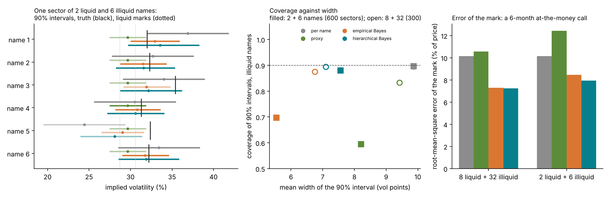
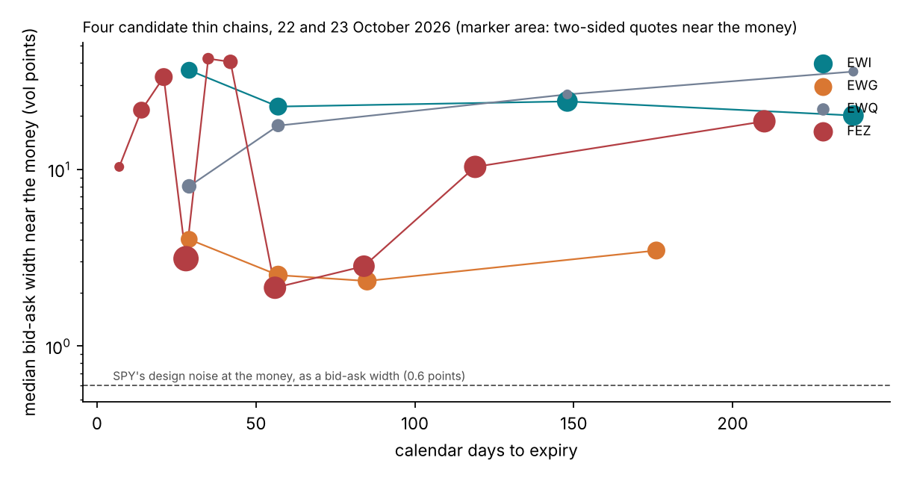

# Course version 2: plan

24 October 2026, revised after the review of the same day. Owner: Francesco Muia. [Course index](README.md).

This plan says what version 2 of the course argues, which example carries the argument, what was wrong in earlier
runs, and what is still to run. The runs themselves, with commands and costs, are in
[`tutorial_final/CLUSTER-RUNS.md`](../../tutorial_final/CLUSTER-RUNS.md). The practices the course may describe,
with their sources, are in [practice-sources.md](practice-sources.md). The course stays a superset of the ICAIF '26
tutorial.

## Summary

1. **Sixteen lectures in four parts.** Markets and Black–Scholes (1–5); calibration and Bayes on Black–Scholes
   (6–9); Heston and the BayesFlow workflow (10–12); rough Bergomi, with a liquid smile and a thin chain (13–16).
   Simple concepts use Black–Scholes, the workflow uses Heston, and the full examples use rough Bergomi.
2. **The argument.** On a liquid smile the posterior and the classical interval agree, as theory predicts.
   They part where the quotes do not determine what the product needs: a thin chain, and maturities beyond the
   last quote. Amortization, with an audit of each chain, makes the exact posterior affordable on every chain and
   its coverage testable on a thousand simulated chains. On one liquid smile its saving over importance sampling
   from a Gauss–Newton proposal is small; in validation it is decisive (Section 2.4).
3. **The example.** EWG (iShares MSCI Germany): a real thin chain, informative but sparse, chosen on merit from
   four candidates (Section 3).
4. **Two reviews found nineteen errors.** The most serious ones are a curve leaked from SPY's full chain, an audit
   that was not unbiased, and adaptive rounds that did not adapt. All are fixed in the code (Section 4).
5. **What is missing.** Every result on the full rough-Bergomi bank: about 930 CPU-hours and two GPU jobs
   (the runbook).
6. **The argument in one page,** with what decides it and the options to strengthen it: [argument.md](argument.md).

## 1. The marking procedure

The course marks a product the smile does not quote in seven steps. Each convention below was checked, and each
check is reproducible from a committed file.

1. **Quotes.** Cboe delayed quotes at the close, out of the money, with a bid below the ask. Raw files are not
   committed; `data/SOURCES.md` gives their URLs.
2. **Clock.** Maturities are NYSE trading days over 252, the model's clock. Counting weekdays instead would make
   EWG's April expiry 126 days instead of 120. SPY's surface of 21 October still counts weekdays, which overstates
   its maturities by about 5% at three to six months and 4% at one year.
3. **Rate and forward.** The rate is the 3-month Treasury yield, flat: 4.22% on 22 October. For EWG the forward is
   the spot carried at that rate, since EWG paid no December distribution in 2024 or 2025. Put–call parity on
   American options gives a forward 0.15% to 0.46% lower, because the puts in the pairs carry early-exercise
   value. That would move EWG's put volatilities down and its call volatilities up, by up to 1.24 half-spreads.
   SPY's surface uses the parity forward.
4. **Exercise.** Out-of-the-money puts are priced as European. On EWG their early-exercise value is at most 0.31
   of a half-spread, at the six-month expiry. The calls carry none, because no dividend falls before June 2027.
5. **Noise.** Each quote's noise sd is its half-spread in price units, floored at the design noise. Converting the
   half-spread with the vega at 20% volatility, as SPY's pipeline does, would understate it up to 3.6 times in
   EWG's put wing. A noise scale s of 0.5 and 2 tests the choice that the half-spread is one sd.
6. **Calibration.** The posterior is computed at the chain's own quotes, by importance sampling from the network's
   draws. The design-grid readings only shape the proposal. The forward-variance curve is inferred, with the prior
   of Section 2.3. Three classical baselines are fitted to the same quotes:
   - Gauss–Newton with one curve level per quoted interval, flat beyond the last quote;
   - the same fit with a power law beyond the last quote;
   - the fit with H fixed at 0.10.
   The course calls these its baselines. Fixing a parameter the smile does not identify is documented practice for
   SABR's β and Heston's κ; for H no source documents it ([practice-sources.md](practice-sources.md)).
7. **Products and ranges.** Products are priced under the posterior draws by Monte Carlo with common random
   numbers. Each range is the one-sided 90% bound on each side, the point the prudent-valuation rules name
   (Regulation (EU) 2016/101, Article 9).

The model is rough Bergomi on the hybrid scheme's grids: 8 steps a day to 63 days and 2 a day beyond. On 12
mini-pilot surfaces, a grid twice as fine moves a quote by a median of 0.02 of SPY's design noise sd. The 90th
percentile is 0.15 and the largest move 1.0, on a surface with η = 3.4 and ρ = −0.96
(`tutorial_final/checks/grid_bias_minipilot/`). EWG's noise is two to fifteen times larger. Study S1-G measures
the bias on the full bank.

## 2. The argument and its evidence

### 2.1 On a liquid smile the posterior and the classical answer agree

*Figure 1.* Each column is one case and each marker one product. The vertical axis is the classical answer over
the posterior's, on a log scale; the grey band runs from 0.8 to 1.25.
- *Heston:* the delta-method 90% range over the exact posterior's.
- *Rough Bergomi, 63 quotes:* the delta-method reserve over the posterior's, at the 5% quantile for the long side
  (filled) and the 95% for the short side (open). The variance swap is left out, because both answers are zero when
  the curve is given.
- *Right-hand column:* the range with the curve held flat beyond the LEAPs over the posterior's.

The numbers are in `images/v2-evidence-numbers.json`, drawn by `scripts/course/realignment.py`.

- **Heston on SPY** with 63, 36 or 15 quotes, κ fixed or free: the ratios lie between 0.92 and 1.21.
- **Rough Bergomi on SPY's 63 quotes**, with the curve read from SPY's own strip and the same pricer for both
  methods: 0.93 to 1.16, and 0.94 to 1.13 at the course's reserve, the 10% and 90% quantiles.

With three or four parameters and these quotes the posterior is close to the Gauss–Newton normal, as the
Bernstein–von Mises theorem predicts. The course presents this as a strength: the method returns the classical
answer where that answer is right.

### 2.2 Beyond the last quote they part, and the prior decides

With the curve unquoted beyond SPY's LEAPs, flat extrapolation gives 0.30 to 0.67 of the posterior's 90% range for
products to five years. For the three-year variance swap it gives zero. The posterior's range depends on the width
of the random-walk prior beyond the last quote. The forward start's 90% range goes from 19.4% to 36.8% of its price
as the prior's sd goes from 0.1 to 0.3 per square-root year (`tutorial_final/checks/long_end/`). The prior must
therefore be stated and tested. Study S10 tests it with two other laws for the unquoted level (Section 5).

### 2.3 Pooling helps thin names

*Figure 2.* A simulated Black–Scholes sector (`tutorial_final/checks/bs_hierarchy.py`). The liquid names quote the
full grid, and the illiquid names one at-the-money option with 3 volatility points of noise. Left: the first
simulated sector of 2 liquid and 6 illiquid names, each method's 90% interval per name, and the truth. Centre:
coverage against mean width over all sectors. Right: the error of each method's mark for a six-month call that no
illiquid name quotes. With 2 liquid and 6 illiquid names:

| Method | Coverage | Mean width (vol points) | Error of the mark |
| --- | --- | --- | --- |
| Per name | 89.7% | 9.9 | 10.2% |
| Proxy: the liquid names' mean | 59.5% | 8.2 | 12.4% |
| Empirical Bayes | 69.7% | 5.5 | 8.5% |
| Hierarchical Bayes | 88.0% | 7.6 | 7.9% |

With 8 liquid and 32 illiquid names the four methods cover 89.6%, 83.3%, 87.5% and 89.4%. When the sector is
small, its hyperparameters are uncertain, and only the hierarchical model carries that uncertainty into each name.
It also gives the most accurate mark. The sector is simulated and the model is right by construction; pooling real
thin chains is option D of [argument.md](argument.md).

### 2.4 Why simulation-based inference

| Route to one rough-Bergomi posterior | Cost | Source |
| --- | --- | --- |
| Random-walk Metropolis on the Monte Carlo likelihood | at least 16.9 CPU-hours (extrapolated) | S9 |
| Importance sampling from a Gauss–Newton proposal, SPY's 63 quotes | 1,024 evaluations at 5.0 CPU-seconds: about 85 CPU-minutes, on a pricer with common random numbers; more with a seed per proposal, as the unbiased likelihood needs | S9, `checks/rough_spy_is.py` |
| The network, 1,000 draws | 3.6 CPU-seconds (1.4 seconds on the clock) | S9 |
| The network's audit on SPY's 63 quotes | 512 evaluations at 5.0 CPU-seconds, each after a pilot pricing at a quarter of the paths: about 53 CPU-minutes | S9; measured by S5 |
| The network's audit on EWG's quotes | 512 evaluations at about 0.4 CPU-seconds, with the same pilot: about 4 CPU-minutes | `checks/thin_chains/timing.json` |

A validation needs many posteriors. Simulation-based calibration on 2,000 smiles costs about 2 CPU-hours with the
network. At 85 CPU-minutes a smile it would cost about 2,800 CPU-hours. Study S10's 1,000 audited thin chains will
cost an estimated 180 CPU-hours with the network as proposal. Against importance sampling from a Gauss–Newton
proposal, the training bank pays only after about 260 posteriors if they are not audited, or 700 if each is
(Lecture 14, Figure 14.4). The case for amortization is therefore that the exact posterior, and the check of its
coverage, become affordable, not that one posterior becomes much cheaper. The course never claims milliseconds.

### 2.5 What is not shown yet, and what would weaken the argument

The thin-chain results are pending (S10, S10-E, S11). Two outcomes would weaken the argument, and the course will
report them if they occur.
- If Gauss–Newton covers at its nominal rate on EWG-like chains, the case for Bayes rests on the long end and on
  pooling.
- If rough Bergomi fails EWG's predictive check, model error exceeds every within-model range.

[argument.md](argument.md) states the argument in one page, the rules for reading the pending runs, and the options
that would make it solid.

## 3. The example: why EWG

*Figure 3.* For each expiry to one year: the median bid–ask width of the two-sided out-of-the-money quotes with
|log-moneyness| at most 0.1, in volatility points. The marker area is the number of such quotes. The dashed line is
SPY's design noise at the money read as a bid–ask width. The data are `tutorial_final/checks/thin_chains/`.

| Chain | Expiries to one year (calendar days) | Two-sided quotes near the money | Median width (vol points) |
| --- | --- | --- | --- |
| EWI, MSCI Italy | 29, 57, 148, 238 | 7 to 11 | 20 to 36 |
| EWG, MSCI Germany | 29, 57, 85, 176 | 7 to 9 | 2.3 to 4.0 |
| EWQ, MSCI France | 29, 57, 148, 238 | 2 to 5 | 8.0 to 36 |
| FEZ, Euro Stoxx 50 | monthly 28, 56, 84; others to 210 | 12 to 17 monthly | 2.1 to 3.1 monthly; 10 to 42 otherwise |

The rule for the most robust example:
1. Bayes must matter: the quotes must leave the product's inputs open, but say something.
2. Simulation-based inference must matter: the likelihood must be expensive, as under rough Bergomi.
3. Nothing the model ignores may dominate: dividends before the last expiry, events, early exercise.
4. The claim must be testable: coverage on simulated chains with the chain's own design, and an exact posterior on
   the real chain.

EWI and EWQ say almost nothing beyond the smile's level, so their posterior would be their prior. FEZ is liquid in
its monthly expiries, wide elsewhere, and pays dividends in December and March. EWG has four usable expiries to six
months, median half-spreads of 1.2 to 2.0 volatility points near the money (4 to 7 times SPY's design noise there),
and no dividend before June 2027. A single stock would add
earnings and dividends that rough Bergomi ignores.

**EWG's layout.** The design contracts EWG quotes are 27: seven each at 21, 42 and 63 days, and six at 126 days.
They are read from the expiries at 21, 40, 58 and 120 trading days. Their noise is 2.0 to 15.0 times SPY's design
noise, with a median of 3.8 (`configs/thin/ewg_layout.json`). The thin network S2-T is trained on this layout and
infers the curve. The audit then uses EWG's 61 cleaned quotes at their own strikes and maturities.

## 4. What was wrong, and what changed

| Problem | Why it mattered | Fix |
| --- | --- | --- |
| "SPY's front three months" was used as the thin market | It hid SPY's later quotes but kept SPY's tight noise, and gave every method SPY's curve to one year, read from the full chain. Its real-data comparison was dominated by model error | Replaced by EWG's layout and noise, with the curve inferred (S2-T, S10, S11). The front-month results are withdrawn |
| The 15-quote and three-times-noise checks gave every method the same full-chain curve | They described a market that knows its variance-swap curve | Withdrawn from the evidence |
| "Desk convention" for H = 0.10 and the flat curve | No source documents fixing H as practice | Called the course's baselines; sourced statements only |
| The desk's roles were described | Not needed, and not sourced | Removed; the plan describes the marking procedure only |
| The index-only choice of example | It was a preference, not an argument | The example is chosen by the rule of Section 3 |
| The audit priced all proposals on one seed | The reweighted posterior was shifted and too narrow | One seed per proposal, the full Monte Carlo covariance, and the bank's own error in the likelihood |
| A failing proposal dropped its whole surface | The audit's statistics came from easier surfaces | Priced again with more paths, or counted |
| Classical fits started at the network's median | The classical route borrowed from the network | Started from the quotes and the prior box |
| Thin-chain noise used the vega at 20% volatility; the forward came from parity; maturities counted holidays | EWG's quotes were weighted and placed wrongly, by up to a few half-spreads | Section 1, steps 2 to 5 |
| Shards could not be rerun, and a running bank could pick up an edited config | Lost CPU-hours, or a mixed bank | Idempotent shards; the job map records the config's hash |
| The audit's path count was chosen from the same pricing whose prices enter the likelihood | A price and its estimated error are correlated, so accepted prices were shifted by up to 0.37 of their Monte Carlo sd | A pilot pricing chooses the count; the prices come from an independent pricing |
| The thin audit's second round shrank its proposal toward the spread of all points, prior draws included | Round 2 added nothing; the gates on reliable audits would fail more often | It shrinks toward the previous round's proposal |
| The thin audit's defensive prior lacked its truncation constant (0.734) | Prior draws got 1.36 times too much weight | The constant is included |
| R4's chunked training crashed; S11 could lose its draws; the thin checkpoint could not be accepted; a resumed training with other epochs ran at a learning rate of zero; the S5 audit could not be resumed in place | Lost runs | Fixed and tested on the test bank (the runbook lists all nine findings of the second review) |

Smaller fixes: the S10 truth is priced on the methods' seed; Heston's control variate is exact under the Euler
scheme; studies load only the splits they use; an audit counts as reliable only if every proposal was priced; S10-E
reports its distinct truths and a bootstrap over them.

## 5. The studies still to run

The runbook gives the commands, costs and acceptance checks. In order:

- **S1, S1-G.** The full bank of 112,000 surfaces with the new curve prior (about 360 CPU-hours), its quality and
  its grid bias.
- **S2, S2-T.** The liquid network (curve given) and the thin network (curve inferred), each with its SBC.
- **S5.** The audit of the liquid network on 200 surfaces.
- **S8.** SPY's posterior and predictive check.
- **S11.** EWG's posterior at noise scales 0.5, 1 and 2, with its predictive check.
- **S10.** Breach rates of every method on 1,000 simulated EWG-like chains, with truths drawn from the prior. Only
  the forward start from six months to one year depends on the unquoted level. Its truth is also priced with that
  level flat, and with the prior's last increment doubled. The first arm is correct for the posterior by
  construction, the second for the flat fit, and the third for neither.
- **S10-E.** The same on 300 chains whose truths come from EWG's posterior, where the prior is not the truths' law.
- **S4, S6, S7, S9.** The remaining studies of the design document, on the full bank.

The curve prior of the bank passed gate G0′ on a 200-surface mini-pilot on 24 October.
- It covers SPY's curve: inside the central 90% of prior curves at every level.
- It covers SPY's four smile statistics: ranks 0.28, 0.25, 0.79 and 0.83 in the prior predictive.
- It costs 11.5 CPU-seconds a surface (the pilot: 11.9).
- No quote missed the Monte Carlo budget.

## 6. The structure: sixteen lectures

Version 1 has fourteen lectures; the first plan proposed twenty-one. Sixteen suffice: the statistics lectures
absorb the computing and one-dimensional amortization material, Heston's workflow fits in three lectures, and the
limits of the checks close the thin-chain lecture. A single-stock lecture is left for after the tutorial. The
section-by-section mapping is in [v2-outline.md](v2-outline.md).

| Part | Lectures |
| --- | --- |
| I. Markets and the first model | 1 Options, quotes and volatility · 2 No-arbitrage without a model · 3 Brownian motion, SDEs and Itô's lemma · 4 The Black–Scholes model · 5 Implied volatility and the smile |
| II. Calibration and Bayes on Black–Scholes | 6 Marking a product the smile does not quote · 7 Calibration as estimation · 8 Bayesian calibration · 9 Amortized inference |
| III. Heston and the BayesFlow workflow | 10 The Heston model · 11 Calibrating Heston · 12 The amortized workflow on Heston |
| IV. Rough Bergomi: the full examples | 13 The rough Bergomi model · 14 Why the exact posterior is expensive · 15 A liquid smile: SPY · 16 A thin chain: EWG |

## 7. Decisions taken

| Decision | Choice | Reason |
| --- | --- | --- |
| Structure | Sixteen lectures (Section 6) | No section of version 1 is lost; nothing is repeated |
| Curve prior of the bank | Power law in time times a random walk in log time, walk sd 0.15 | Passed G0′ |
| Range of ρ | (−0.99, −0.2), as in the pilot | EWG is an index ETF; positive ρ belongs to single stocks |
| Thin example | EWG of 22 October 2026 | Section 3 |
| Noise | Half-spread as one sd, with scales 0.5 and 2 as sensitivity | The simplest stated choice, tested both ways |
| Forward and clock for thin chains | Carry forward; NYSE trading days | Section 1 |
| Model | Rough Bergomi on the bank's grids; bias measured (S1-G) | Refining the grid doubles every cost; all methods share the pricer |
| Baselines | Gauss–Newton with flat or power-law extension; H fixed at 0.10 | Stated as the course's own |
| Liquid smile | SPY for the tutorial; SPX later | The data in hand |
| Raw quotes | Not committed; URLs in `data/SOURCES.md` | Francesco's instruction |
| Version 1's Lecture 14 | A status page and the curriculum | It was a status report |

## 8. Timeline

| Dates | Work |
| --- | --- |
| Sat 24 – Sun 25 Oct | R0 to R4 on Oscar: the bank, its checks, both networks |
| Mon 26 – Tue 27 Oct | R5 to R8: audits, SPY, EWG, coverage |
| Wed 28 Oct | R9, R10; results into Lectures 15 and 16 |
| Thu 29 Oct – Fri 6 Nov | Tutorial slots 5 and 6 from Lectures 13 to 16; run-through on Mon 9 Nov |

## 9. Changes to the tutorial curriculum

- **Slot 1.** "Every smile, every morning" becomes "every name at month-end, every validation run". The slide on
  unquoted inputs presents fixing a parameter or extending a curve flat as zero-width choices; it does not call
  them desk conventions.
- **Slot 5.** The title "The smile fits many calibrations" overstates the liquid case. Proposed: "Where the quotes
  stop: which price do you mark?". The cost slide shows both exact routes. A five-minute contrast shows EWG.
- **Slot 6.** The Black–Scholes sector (Figure 2) and the long-end prior's effect, one slide each.
- **Say / do not say (slot 5).**
  - Do not say the posterior differs from Gauss–Newton on SPY's grid.
  - Do not say banks use rough Bergomi in production.
  - Do not quote the exact cost without the importance-sampling figure.

## Sources

- Lectures 1–14 of version 1 (commit 19a6ea4) and [the design document](../design/calibration-design-document.md).
- Quick checks: [`tutorial_final/checks/README.md`](../../tutorial_final/checks/README.md).
- Practices and regulation: [practice-sources.md](practice-sources.md).
- Chain data: `data/SOURCES.md`; NYSE holidays: the exchange's 2026–2028 calendar, cited in
  `src/sbi4finance/calibration/chain.py`.
- `scripts/course/check_v2_plan.py` checks every number of this plan against the stored files.
