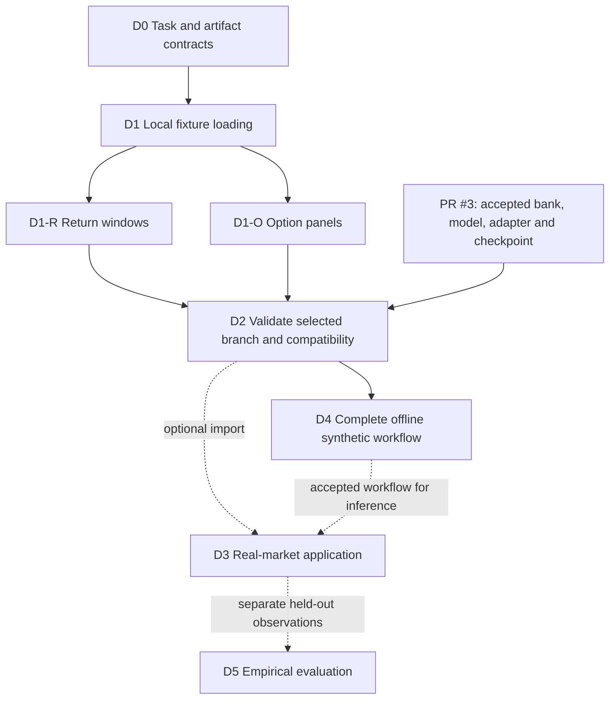

# Data implementation roadmap

Status: proposed implementation sequence, 11 October 2026. This revision plans the work; it adds no loaders, datasets, trained models or provider accounts.

PR #4 now has three complementary parts: the [scientific scenario and evidence specification](../inference-scenarios-and-data.md), this implementation roadmap, and the [options-format reference](../data-loading-plan.md) with its [source audit](../data-source-landscape.md). Start here to choose the next implementation slice; follow the linked subplan for tasks, deliverables and acceptance.

The required result is one selected **S synthetic teaching workflow** that works offline without market files. **M market application** and **E empirical evaluation** are separate optional branches. These letters are evidence levels, not the simulator plan's M0–M8 milestone identifiers. Data acquisition does not block S, but a validated simulator, inference method and checkpoint remain real scientific dependencies.

## Sequence and subplans

Preserve the D0–D4 identifiers already cited by [PR #3](https://github.com/fmuia/sbi4finance/pull/3). D1 now has explicit returns and options subplans; D5 adds empirical evaluation. **Execution order is D0 → D1 and the selected observation branch → D2 → D4. D3 is optional and does not precede D4 as a dependency.**

| Milestone | Deliverable | Dependencies | Scope |
|---|---|---|---|
| [D0 Contracts](milestones/00-contracts.md) | Versioned local observation/target contracts, units, provenance and compatibility rules | Reviewed scenario specification; align with PR #3 M0 | Shared foundation |
| [D1 Local fixtures](milestones/01-local-fixtures.md) | Local manifest/table loading, integrity checks and explicit errors | D0 | Shared foundation |
| [D1-R Return windows](milestones/01a-return-windows.md) | Deterministic local price/return preparation and chronological windows | D1 | Returns branch |
| [D1-O Option panels](milestones/01b-option-panels.md) | Premium/IV panel normalization, contract context and quality report | D1 | Options branch |
| [D2 Validation and compatibility](milestones/02-compatibility.md) | Frozen fixture design, leakage checks and integration with shared task/bank/checkpoint contracts | D1 plus selected branch; actual integration needs PR #3 artifacts | Shared integration |
| [D4 Synthetic teaching](milestones/04-synthetic-teaching.md) | Complete selected S path using local synthetic artifacts and a validated checkpoint | D2 plus accepted selected simulator/inference/pricing track | Required delivery |
| [D3 Market application](milestones/03-market-application.md) | One compatible real fixture and optional market demonstration | D2 local checks for selected branch's import; compatible accepted workflow for inference | Optional M |
| [D5 Empirical evaluation](milestones/05-empirical-evaluation.md) | Separate evaluation observations, split protocol and bounded empirical report | D3 plus accepted relevant workflow and held-out observations | Optional E |

The table is authoritative. The two incoming observation branches at D2 mean **whichever branch is selected**, not a requirement to implement both before delivery. Local contract checks within D2 can pass before PR #3 integration exists; D2's integration and D4 remain pending until real, validated scientific artifacts are available. An optional import in D3 can proceed in parallel with model development, without claiming a completed market-inference example.

## Implementation boundaries

Reviewed against PR #3 at [`6bfafe4`](https://github.com/fmuia/sbi4finance/tree/6bfafe49b80b504d5630b1f3dccad9ad13872a28/docs/simulator-plan). Reconcile interfaces with its current implementation before adding code; unmerged documentation is not an existing library API.

| Responsibility | This data workstream | Simulator/inference workstream in PR #3 |
|---|---|---|
| Scientific meaning | Encode the agreed observation conventions and information boundaries | M0 defines model/measure, prior, initialization, targets and numerical experiment |
| Small local artifacts | Read/write manifests and observation tables; deterministic normalization and quality reports | Supply genuinely generated examples and numerical reference labels |
| Simulation/pricing | Consume reference outputs; preserve diagnostics outside conditioning | Own process kernels, state continuation, pricing engines and numerical validation |
| Large synthetic banks | Consume the shared contract and verifier; test fixture-to-bank compatibility | M2 owns IDs/RNG, shards, grouped splits, generation, verifier and batch reader |
| Neural interface | Check the loaded observation/context against the task and checkpoint contract | Own adapters, transforms, normalization, training, posterior validation and checkpoints |
| Teaching | Provide local inputs and data-status/evidence labels; verify absence of provider dependencies | M8 owns scientific acceptance of the selected complete workflow |
| Real observations | Optional source normalization/acquisition and protected evaluation records | Apply accepted inference/pricing procedures and interpret resulting model adequacy |

Do not build a second bank writer, simulator, pricing implementation or neural adapter here. If a shared component is missing, implement it once in its owning workstream and record the dependency. A hand-constructed parser fixture can unblock IO tests; it cannot stand in for a validated simulator, recovered truth or accepted checkpoint.

## Defaults and bounded first implementation

- Small artifacts use a readable table plus JSON manifest; larger synthetic arrays reuse PR #3's NumPy shards. Additional storage systems are deferred.
- Begin with local files and no provider dependencies. Declare any directly used runtime dependency in the existing environment when code lands.
- Implement common D0/D1 first. Return preparation can be the first branch because the repo already has a returns scaffold; that engineering order does not choose the live curriculum or validate its cache for SVJ.
- Start with fixed window lengths and fixed European panels. A checkpoint supports only the context/grids/masks on which it was specified and validated.
- Public research files and the provider audit are optional D3 candidates, not required fixtures. Recheck source capabilities, access and terms when acquisition is actually needed.

**First implementation slice:** D0 plus D1's manifest/table reader and generated schema fixtures. Deliver one return-window record, one option-panel record, unavailable-label handling, deterministic integrity checks and meaningful malformed-input tests. Use parser fixtures labelled as such; no provider call, model training or claim of scientific validation belongs in this slice. Then implement the selected D1-R/D1-O preparation subplan and proceed to D2.

## Acceptance and tracking

For each milestone record: planned/in progress/accepted/blocked, implementation commit, delivered artifact paths, verification performed, unresolved dependencies and evidence scope. A parser-only result is partial D1/D2 work, not D4 acceptance. A missing market fixture affects D3/D5 only. A missing scientific checkpoint can block D4 while local ingestion progresses.

Acceptance checks are implementation completion criteria, not repeated permission requests. Do not require another approval for routine work already authorized. Changes to the statistical target, curriculum, provider spending or external commitments retain their own scope decisions.

Each subplan states focused tests for the functionality being implemented. This documentation PR adds no executable tests. When implementation begins, run the new component's meaningful checks and relevant existing repository checks; broader statistical/model validation stays with the selected scientific track.

## Deferred scope

No automatic downloads in notebooks, universal provider framework, account creation, purchase, broad historical collection or live data dependency. Portfolio/joint P–Q modeling, general irregular-data inference, American/exotic solvers and new posterior architectures remain separately scoped scientific work. Lack of real quotes does not block a synthetic American demonstration, but lack of a validated American pricer does.
