# SVJ advanced example: technical design and narrative

Oct 10, 2026 · @AI & Analytics Solutions SAS di Muia Francesco

> **Snapshot of the Claude Doc.** This file reproduces [the design document](https://claude.ai/artifact/7f1YVjdrFGBz6FPCtSCY4u#f22b36a4-33f2) as of revision 153, exported on 13 Oct 2026; the doc remains the source of truth. Only the presentation differs: equations are GitHub math blocks, the two interactive diagrams are static SVGs, and section links point to the headings of this file. What the branch built and measured is in [the pipeline document](../svj-pipeline.md) and [the results summary](../svj-results-summary.md).

The advanced example of the ICAIF '26 tutorial should calibrate a stochastic-volatility model with jumps (SVJ) from daily returns and carry the posterior into value-at-risk. The feasibility study finished on 10 Oct 2026, and its results are in the section Feasibility study.

## Executive summary

This section states the whole method in seven steps, with its mathematics. Each step needs the one before it, and each ends with a link to the section that gives the details.

### 1. The quantity a risk team needs

The input is the last T = 1,000 daily returns of one name, y\_{1:T}. The output is the value-at-risk and the expected shortfall of the H-day return R\_{T,H} = y\_{T+1} + … + y\_{T+H}, for H = 1 or 10:

```math
\mathrm{VaR}_{99\%} = -\,q_{0.01}\big(R_{T,H} \mid y_{1:T}\big), \qquad \mathrm{ES}_{97.5\%} = -\,\mathbb{E}\big[R_{T,H} \mid R_{T,H} \le q_{0.025}\big]
```

This must be done every morning, for thousands of names.

Details: [The practitioner problem](#the-practitioner-problem).

### 2. The model that generates the returns

The model is SVJ, in its daily discrete form. It has eight parameters ϑ = (μ, θ, κ, σ\_v, ρ, λ, μ\_J, σ\_J) and a latent variance v\_t:

```math
\begin{aligned}
y_t &= \mu + \sqrt{v_{t-1}}\,\varepsilon^1_t + B_t\,\xi_t, \qquad B_t \sim \mathrm{Bernoulli}(\lambda),\ \ \xi_t \sim \mathcal{N}(\mu_J, \sigma_J^2),\\
v_t &= v_{t-1} + \kappa(\theta - v_{t-1}) + \sigma_v\sqrt{v_{t-1}}\,\big(\rho\,\varepsilon^1_t + \sqrt{1-\rho^2}\,\varepsilon^2_t\big).
\end{aligned}
```

Simulating from the model is cheap. Inverting it is the hard part.

Details: [The model](#the-model).

### 3. The forecast needs a posterior

The forecast must average over everything that is not known on day T. Two quantities are unknown: the parameters ϑ and today's variance v\_T. The forecast is therefore the predictive distribution:

```math
p(R_{T,H} \mid y_{1:T}) = \int \underbrace{p(R_{T,H} \mid v_T, \vartheta)}_{\text{simulate forward}}\ \underbrace{p(v_T, \vartheta \mid y_{1:T})}_{\text{posterior}}\ dv_T\, d\vartheta
```

The first factor is easy: run the daily model forward H days from v\_T. The whole problem is the second factor, the joint posterior of nine targets.

Details: [From one day to a forecast](#from-one-day-to-a-forecast).

### 4. Why the posterior is expensive

Bayes' rule needs the likelihood, which integrates over the whole latent variance path:

```math
p(y_{1:T} \mid \vartheta) = \int p(v_0 \mid \vartheta) \prod_{t=1}^{T} p(y_t \mid v_{t-1}, \vartheta)\, p(v_t \mid v_{t-1}, y_t, \vartheta)\ dv_{0:T}
```

This integral has 1,001 dimensions and no closed form. A particle filter gives an unbiased estimate L̂(ϑ), with E\[L̂(ϑ)\] = p(y\_{1:T} ∣ ϑ). Particle MCMC built on L̂ gives the exact posterior, but it costs 5 to 29 CPU-minutes per name. For 2,000 names that is 158 to 963 CPU-hours every day.

Details: [Why the likelihood is intractable](#why-the-likelihood-is-intractable).

### 5. The classical shortcut and its failure

The usual route replaces the posterior with a point estimate ϑ̂:

```math
p(R_{T,H} \mid y_{1:T}, \hat\vartheta) = \int p(R_{T,H} \mid v_T, \hat\vartheta)\, p(v_T \mid y_{1:T}, \hat\vartheta)\, dv_T
```

This plug-in forecast drops the uncertainty in ϑ. That uncertainty is largest for the jump parameters, because four years hold only about ten jumps. Two failures follow in the study:

- Wald intervals for the jump frequency and the mean jump cover the truth in only 68% and 60% of series, against a nominal 95%.
- The plug-in 10-day ES at the posterior median is too low, with a score of Z2 = −0.10 against −0.02 for the predictive ES.

Details: [Classical estimators and where they fail](#classical-estimators-and-where-they-fail).

### 6. Amortized inference makes the posterior cheap

The idea is to pay the cost of inference once, in training. Write ω = (ϑ, v\_T) for the nine targets. Pairs are simulated from the prior and the model, (ω, y) \~ p(ϑ) p(v\_T, y ∣ ϑ). Two networks are trained on these pairs:

- a summary network s\_ψ(y), which compresses the 1,000 returns into 32 statistics;
- a velocity network u\_φ, trained by flow matching to carry noise z \~ N(0, I) to the targets.

The training loss is:

```math
\mathcal{L}(\phi, \psi) = \mathbb{E}\,\Big\| u_\phi\big((1-\tau)\,z + \tau\,\omega,\ \tau,\ s_\psi(y)\big) - (\omega - z) \Big\|^2
```

The minimizer of this loss transports N(0, I) to p(ω ∣ y) for every y the prior can produce. A new name then needs no optimizer and no sampler, only 50 Euler steps of the trained network. Training costs 64 minutes on 2 cores, and each name then costs 1.4 CPU-seconds. Against particle MCMC, training pays for itself after about 21 names.

Details: [Amortized design](#amortized-design).

### 7. Trust, then forecast

The network gives only an approximation of the posterior, so two checks guard it.

**Calibration on average.** Simulation-based calibration checks that the rank of the true value among the posterior draws is uniform. The study passes for all 9 targets.

**Correctness for one name.** The audit fits a proposal q(ϑ) to the network's draws and reweights M = 3,000 proposals with the particle filter:

```math
w^{(m)} = \frac{p(\vartheta^{(m)})\,\hat L(\vartheta^{(m)})}{q(\vartheta^{(m)})}, \qquad \text{audit score} = \frac{\big(\sum_m w^{(m)}\big)^2}{M \sum_m \big(w^{(m)}\big)^2}
```

The weighted draws converge to the exact posterior, because L̂ is unbiased. A low score sends the name to particle MCMC.

The forecast then evaluates the integral of step 3 by simulation. From each posterior draw (ϑ^(m), v\_T^(m)), the model is run H days forward. The pooled returns give the predictive distribution, and the VaR and the ES are read off its quantiles.

Details: [Validation plan](#validation-plan), [From posterior to risk](#from-posterior-to-risk).

### The two claims

1. A point estimate misstates the uncertainty of the tail parameters, and this shows in the ES more than in the 99% VaR.
2. Amortization, checked name by name by the audit, makes the posterior affordable for a whole portfolio. It is about 270 times cheaper than particle MCMC before the audit, and about 10 times cheaper with an audit of every name.

Details: [Feasibility study](#feasibility-study).

## Course map

This document is both the design of the tutorial's advanced example and a short course on the method behind it. The course has eight lessons. Each lesson explains the ideas, the computations and the figures in the body, and leaves the derivations to an appendix.

| Lesson | Sections | What it teaches | Derivations |
| --- | --- | --- | --- |
| 1. The problem | [The practitioner problem](#the-practitioner-problem) | Why a daily VaR for single names needs latent volatility, jumps and a measure of its own uncertainty | [Appendix A](#appendix-a-current-var-practice-and-what-it-misses) |
| 2. The model | [Executive summary of the model](#executive-summary-of-the-model), [Notation and key terms](#notation-and-key-terms), [The model](#the-model) | What the SVJ model does, its parameters and prior, one day of its simulation, and how it runs forward into a forecast | [Appendix B](#appendix-b-from-the-continuous-time-model-to-the-daily-model) |
| 3. The likelihood | [Why the likelihood is intractable](#why-the-likelihood-is-intractable) | Why the probability of the data has no formula, and how a particle filter estimates it | [Appendix C](#appendix-c-the-likelihood-and-the-particle-filter) |
| 4. Classical estimation | [Classical estimators and where they fail](#classical-estimators-and-where-they-fail) | Maximum likelihood, standard errors, Wald intervals, moment methods and MCMC, and where each breaks | [Appendix D](#appendix-d-frequentist-estimation), [Appendix E](#appendix-e-bayesian-computation) |
| 5. Amortized inference | [Amortized design](#amortized-design) | How two networks trained on simulations return the posterior in about a second | [Appendix F](#appendix-f-amortized-inference) |
| 6. Validation | [Validation plan](#validation-plan) | SBC, recovery, agreement with particle MCMC, the misspecification check and the daily audit | [Appendix G](#appendix-g-validation) |
| 7. From posterior to risk | [From posterior to risk](#from-posterior-to-risk) | How posterior draws become VaR and ES, how uncertain the risk number is, and how to backtest it | [Appendix H](#appendix-h-from-posterior-to-risk) |
| 8. Evidence | [Feasibility study](#feasibility-study) | The measured results, each with its figure and a guide to reading it | – |

The course assumes probability at the level of conditional densities and Bayes' rule, the normal distribution, maximum likelihood and some Python. It assumes no prior knowledge of particle filters or neural networks. A reader in a hurry can start with the Executive summary, which states the whole method in seven steps, and then read the [Summary](#summary), the executive summary of the model and the results table of the feasibility study. The sections [Why not HKDE on option surfaces](#why-not-hkde-on-option-surfaces), [Tutorial narrative](#tutorial-narrative) and [Risks and open decisions](#risks-and-open-decisions) are design notes for the organizers.

## Summary

The advanced example should estimate a Heston-type stochastic-volatility model with return jumps (SVJ) from about four years of daily returns. The model is the Bates (1996) specification under the physical measure, in the daily discretization of Eraker, Johannes and Polson (2003).

The example meets the three selection criteria:

- **Users' pain.** Risk teams compute VaR and ES daily for thousands of names, and supervisors ask them to quantify parameter uncertainty.
- **Widely used model class.** Stochastic volatility with jumps is the standard description of equity returns in the empirical literature.
- **The frequentist route fails.** A few years of data hold a handful of jumps, so jump parameters are weakly identified, sit near boundaries, and break Wald intervals. A forecast at a point estimate then understates the expected shortfall.

The likelihood integrates over a latent variance path, so the exact Bayesian route is particle MCMC. In the study it costs 5 to 29 CPU-minutes per series, which rules it out for daily use across a portfolio.

Amortized inference trains a network once on simulated pairs of parameters and return series. Training takes 64 minutes on 2 CPU cores. The network then returns the joint posterior of the eight parameters and of today's variance for a new series in about 1.4 CPU-seconds.

The network is calibrated on average but can be off for a single series. An importance-sampling audit with the particle filter checks each series, corrects its posterior, and flags names that need particle MCMC. The audit costs 18 to 146 CPU-seconds per series.

The posterior gives a predictive VaR and ES that include parameter uncertainty. A forecast from a point estimate ignores that uncertainty. In the study, a forecast at the posterior median leaves the 99% VaR almost unchanged but makes the 10-day 97.5% ES too low, with a Z2 score of −0.10 against −0.02 for the predictive ES.

The tutorial therefore makes two separate claims:

1. Point estimates misstate the uncertainty of the tail parameters. Wald intervals for the jump parameters cover the truth in 60% to 68% of series, and a forecast at a point estimate gives a 10-day ES that is too low (Z2 of −0.10 against −0.02).
2. Amortization makes the Bayesian answer affordable for a portfolio, about 270 times cheaper per series than particle MCMC before the audit, and about 10 times cheaper with an audit of every name.

The section Feasibility study holds the evidence for both claims, with one figure per result.

## At a glance

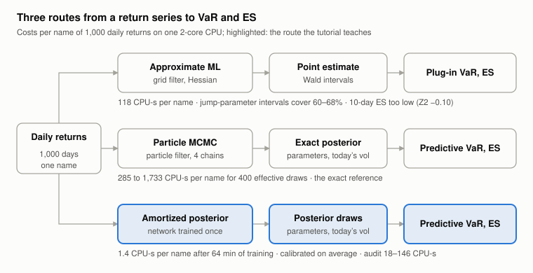

How to read the figure: each row is one route from the same input, the last 1,000 daily returns of one name, to a VaR and an ES. The boxes give the method, what it returns and the risk number it supports, and the line under each row gives the measured cost and the main finding. The highlighted row is the route the tutorial teaches.

Approximate ML returns a point estimate for 118 CPU-seconds per name, and particle MCMC the exact posterior for 285 to 1,733. The amortized posterior costs 1.4 CPU-seconds per name, and an importance-sampling audit with the filter checks it series by series.

## Why not HKDE on option surfaces

The experiment of 9 Oct 2026 on the HKDE model, Heston stochastic volatility with Kou double-exponential jumps ([Agazzotti et al. 2025](https://arxiv.org/abs/2502.13824)), showed that calibration to an option surface does not need SBI. It used simulated surfaces that mimic the paper's AMZN and SHOP calibrations. The Fourier pricer gives the likelihood in closed form, so a point calibration costs 11.5 s with the authors' code and 0.85 s with an optimized pricer.

The Bayesian analysis still added value. Thirty optimizer starts ended at two optima with almost equal fit and different exotic prices. The posterior showed the directions the surface does not identify: the crash component and the split between mean reversion and long-run variance.

The least-squares fit itself did not fail. Its weakness was hidden non-identifiability, which a multi-start already exposes. HKDE therefore meets the first two criteria and misses the third: SBI would speed up a working method rather than replace a failing one.

One slide from that study stays in the tutorial. It shows that one surface supports a range of exotic prices, and that for the SHOP-like surface this range is wider than the spread across the paper's four models.

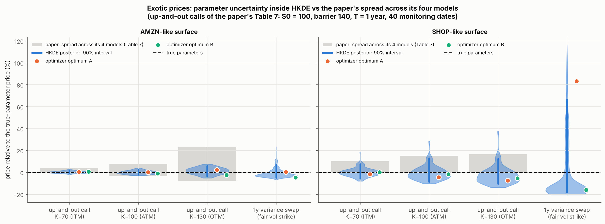

How to read the figure: each panel is one option surface, and each column one exotic product, priced relative to its price under the true parameters. The blue violin shows the spread of prices under the HKDE posterior, with its 90% interval as a thick line. The orange and green dots are the two optimizer end points, and the grey bar is the spread across the four models of the paper's Table 7. On the SHOP-like surface the posterior range of each barrier option is wider than the grey bar, and the variance swap ranges from −18% to +67%.

## The practitioner problem

A market-risk team reports VaR and ES every morning for thousands of names, so any estimation step must run in seconds per name. The current tools meet that constraint by giving up either the model or the uncertainty.

Historical simulation is by far the most common VaR method among banks (Pérignon and Smith 2010), often filtered with EWMA or GARCH volatility. These methods are fast and transparent. They do not separate persistent volatility from rare jumps, and they report no uncertainty about their own parameters.

[Appendix A](#appendix-a-current-var-practice-and-what-it-misses) describes these methods, gives the evidence on their use, and tests them on simulated SVJ data.

Supervisors ask for that uncertainty, and they evaluate the tail:

- **Model uncertainty.** PRA SS1/23 defines it as "the inherent uncertainty in the parameter estimates and results of statistical models". Its sensitivity analysis means "evaluating a model's output over a range of input values or parameters".
- **Prudent valuation.** The EU standard deducts a model-risk adjustment for "the potential existence of a range of different models or model calibrations" (Delegated Regulation (EU) 2016/101, Article 11).
- **Backtesting.** The Basel traffic light counts exceptions of the 99% one-day VaR over 250 days: up to 4 is green, 5 to 9 is yellow (amber in the current Basel framework), 10 or more is red.
- **Expected shortfall.** The FRTB capital rules use ES at 97.5%, which depends directly on the size of rare losses.

The SVJ model supplies the missing structure. Variance is latent and mean-reverting, and jumps are rare and large. Its weak point is estimation from a short sample.

Four years of daily data hold about ten jumps for a name with 2.5 jumps a year. The jump frequency and size are then uncertain, and that uncertainty moves the tail of the forecast. A point estimate hides it; a posterior carries it into the VaR and the ES.

The Bayesian answer exists, but its cost does not scale. In the study, particle MCMC costs 285 to 1,733 CPU-seconds per name, so 2,000 names need 158 to 963 CPU-hours every day. The amortized posterior costs 1.4 CPU-seconds per name, about 46 CPU-minutes for the same portfolio. The audit adds 18 to 146 CPU-seconds for each name it checks.

## Executive summary of the model

The model turns the last four years of daily returns of one asset into a forecast distribution of its future returns. The value-at-risk and the expected shortfall read off that distribution include the uncertainty about the model's own parameters.

### What goes in and what comes out

The input is the last 1,000 daily log returns of one name, about four years of data. The output has four parts:

1. A joint posterior of the eight parameters and of today's spot volatility, as 1,000 random draws.
2. The predictive distribution of the 1-day and 10-day return, built by simulating forward from each draw.
3. The 99% VaR and the 97.5% ES of that distribution, with a range for the VaR and its split into a part due to today's volatility and a part due to the parameters.
4. An audit score for the name, which says whether the network's posterior can be trusted for this series.

### When it is used

The model runs every morning for each single name a risk team follows. It can serve as a challenger model to historical simulation, as a benchmark in model validation, and as the source of the parameter range that supervisors ask for (see The practitioner problem). It does not replace a portfolio VaR engine, because it models one return series at a time and no dependence between names. The tutorial network is trained for windows of exactly 1,000 days.

### What it captures

Each feature of daily returns comes from one mechanism of the model, governed by a few parameters.

| Feature of daily returns | How the model produces it | Parameters in charge |
| --- | --- | --- |
| Volatility clustering: calm and turbulent spells last weeks | The variance is a persistent hidden process | half-life h, CV of variance c |
| Volatility returns to a normal level | The variance is pulled toward its long-run level θ | long-run volatility σ\_LR, half-life h |
| Fat tails | A random variance mixes normal laws, and jumps add rare large moves | c, jump frequency, jump size sd σ\_J |
| Single-day crashes | A jump arrives with probability λ on any day | jump frequency 252λ, mean jump μ\_J, σ\_J |
| Negative skewness | Jumps are negative on average, and volatility rises after falls | μ\_J, leverage ρ |
| Leverage effect: volatility rises after a fall | Return shocks and variance shocks are correlated | ρ |
| Risk that changes from day to day | Today's variance is a state, estimated again every day | spot volatility σ\_T |

### What it misses

- **Jumps in volatility.** In a crash, volatility often jumps up at once. Here it rises only through the diffusion. The SVCJ model of Eraker, Johannes and Polson (2003) adds such jumps.
- **Fat-tailed daily shocks.** On a day without a jump, the return is exactly normal given the variance.
- **Regime changes.** The eight parameters are fixed within the four-year window.
- **Slow decay of volatility shocks.** One mean-reverting factor gives an exponential decay; real volatility decays more slowly at long lags.
- **Information outside daily returns.** Earnings dates, intraday data, option prices and other names are not used.

The misspecification check flags windows where the data fall outside what the model can produce. On the S&P 500 it flags the windows that end in late 2008.

### The daily process, step by step

1. Take the last 1,000 daily log returns of the name, in percent.
2. Build the network input: for each day, the return and the logarithm of the squared return.
3. Run the summary network. It compresses the 1,000 × 2 input numbers into 32 summary statistics.
4. Run the inference network. Guided by the 32 statistics, it moves 1,000 draws of random noise in 50 small steps into 1,000 posterior draws of the nine targets. Steps 2 to 4 cost about 1.4 CPU-seconds per name.
5. Audit the draws. The particle filter estimates the likelihood of 3,000 proposals fitted to the network's draws, and the proposals are reweighted toward the exact posterior. The share of effective draws is the audit score. The audit costs 18 to 146 CPU-seconds per name, and a very low score sends the name to particle MCMC, at 5 to 29 CPU-minutes.
6. Forecast. From each draw of the parameters and today's variance, simulate 20 future paths of 10 days with the daily model, 20,000 paths in all (see From one day to a forecast, in The model).
7. Compute the risk numbers. The 99% VaR is minus the 1% quantile of the pooled returns, and the 97.5% ES is minus the average of the worst 2.5%.

Training happens once, before any of these steps: 2.56 million simulated series, 64 minutes on 2 CPU cores. The network is retrained only when the model, the prior, the window length or the input definition changes, or when a diagnostic fails.

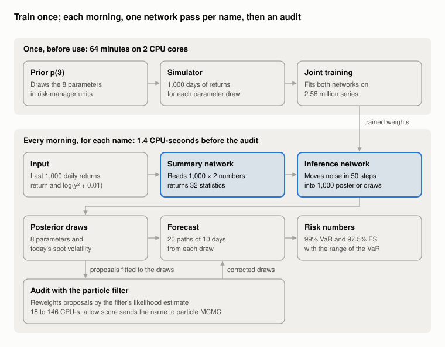

The upper band runs once; the lower band runs every morning for every name. The two accented boxes are the trained networks, and only the audit evaluates the likelihood of the model.

### An example of the output

For the S&P 500 window that ends on 31 Dec 2018, the network gives a predictive 1-day 99% VaR of 3.90%. The conditional VaR, the number an analyst would report if the parameters and today's variance were known, has a 90% posterior interval of 2.53% to 4.82%, and today's variance carries 86% of its posterior variance. The audit flags this window, with an efficiency of 0.2%, and sends it to particle MCMC. Particle MCMC gives a predictive VaR of 3.76% and a lower CV of variance, so the daily process reports 3.76%.

## Notation and key terms

Spot volatility is the standard deviation of the next day's return, leaving jumps aside, as it stands today. In the model it is √V\_t in continuous time and √v\_t in the daily model, so it is the square root of the variance V\_t, not V\_t itself. It is latent: no price or statistic reveals it exactly, so it must be inferred from past returns.

The document quotes spot volatility annualized, σ\_t = √(252 v\_t) / 100, a fraction that reads as a percentage. A daily variance of 2.48 %² is a daily standard deviation of 1.575%, and σ\_t = 0.25, or 25% a year.

### Four kinds of volatility

| Name | Definition | Observed? | Role in this course |
| --- | --- | --- | --- |
| Spot volatility | √v\_t, the standard deviation of the next day's return without jumps | No, latent | Its value on the last day, σ\_T, is the ninth inference target and the starting point of every forecast |
| Long-run volatility | σ\_LR = √(252 θ) / 100, the level to which spot volatility returns | No, a parameter | One of the eight parameters |
| Realized volatility | The standard deviation of past returns over a window, for example √(252 × mean of y² over 20 days) | Yes, computed from returns | A noisy and lagging estimate of spot volatility; historical simulation and EWMA build on it |
| Implied volatility | The volatility that makes a model price equal an option price; the VIX for the S&P 500 | Yes, from option prices | Not used for estimation; compared with the posterior spot volatility in the real-data results |

Jumps add to the variance of returns but not to spot volatility. At the prior median they contribute λ(μ\_J² + σ\_J²) = 0.0099 × 10 ≈ 0.10 %² per day, 3.8% of the total daily variance. They matter far more for the tail than for the variance.

### Symbols

| Symbol | Meaning | Units | Prior median |
| --- | --- | --- | --- |
| t, T | Trading day; T = 1,000 is the last day of the window | days | – |
| y\_t | Daily log return, 100 × (log S\_t − log S\_{t−1}) | % | – |
| v\_t | Variance after day t, which drives the return of day t + 1 | %² per day | – |
| V\_t | The same variance in the continuous-time model | %² per day | – |
| μ | Drift of the log price | % per day | 8/252 = 0.032 |
| θ | Long-run variance | %² per day | 2.48 |
| κ | Speed of mean reversion; half-life h = ln 2 / κ | per day | 0.023 (h = 30 days) |
| σ\_v | Volatility of variance; c = σ\_v / √(2κθ) | % per day | 0.20 (c = 0.6) |
| ρ | Correlation between return shocks and variance shocks | – | −0.37 |
| λ | Probability of a jump on a given day; 252λ jumps per year | per day | 0.0099 (2.5 a year) |
| B\_t | Jump indicator: 1 on a jump day, 0 otherwise | – | – |
| ξ\_t | Jump size, normal with mean μ\_J and standard deviation σ\_J | % | μ\_J = −1, σ\_J = 3 |
| ε¹\_t, ε²\_t | Independent standard normal shocks | – | – |
| ϑ | The eight parameters, in the unbounded coordinates of the prior table | – | – |
| σ\_T | Spot volatility at the end of the last day, annualized | fraction per year | – |
| y\_{1:T} | The observed window y\_1, …, y\_T | – | – |
| N | Number of particles in the particle filter | – | 50 to 4,000 |
| H | Forecast horizon; R\_{T,H} = y\_{T+1} + … + y\_{T+H} is the H-day return | days | 1 or 10 |

### Statistical vocabulary

| Term | Meaning | Lesson |
| --- | --- | --- |
| Likelihood p(y\_{1:T} ∣ ϑ) | The probability density of the observed returns, seen as a function of the parameters | 3 |
| Prior p(ϑ) | The distribution of the parameters before the data are seen | 2 |
| Posterior p(ϑ ∣ y\_{1:T}) | The distribution of the parameters after the data are seen; proportional to likelihood times prior | 4 to 7 |
| Posterior draw | One parameter vector sampled from the posterior; 1,000 draws stand for the whole posterior | 4 to 7 |
| Credible interval | An interval that holds the parameter with 90% or 95% posterior probability, read off posterior quantiles | 6 |
| Confidence interval | A rule that produces intervals covering the true value in 95% of repeated samples | 4 |
| Coverage | The share of series whose interval contains the true value; measurable on simulated data | 4, 6 |
| Maximum likelihood estimate (MLE) | The parameter value at which the likelihood is largest | 4 |
| Standard error | The estimated standard deviation of an estimator; for the MLE it comes from the curvature of the log-likelihood | 4 |
| Wald interval | Estimate ± 1.96 standard errors; a valid 95% confidence interval when the log-likelihood is close to a parabola | 4 |
| CDF | F(x) = P(X ≤ x), the probability that a quantity is at most x | 6 |
| ECDF | The empirical CDF: the share of a sample at or below x, a step function | 6 |
| Quantile | q\_α, the value with P(X ≤ q\_α) = α; the inverse of the CDF | 7 |
| VaR at 99% | Minus the 1% quantile of the return distribution: a loss exceeded with probability 1% | 7 |
| ES at 97.5% | Minus the average return over the worst 2.5% of outcomes | 7 |
| Predictive distribution | The distribution of future returns averaged over the posterior of the parameters and today's variance | 7 |
| Plug-in forecast | A forecast computed at a single parameter value, for example the MLE | 4, 7 |
| Particle filter | A simulation method that tracks the distribution of the hidden variance day by day and estimates the likelihood | 3 |
| Particle MCMC (PMMH) | A Markov chain over the parameters that uses the particle filter's likelihood estimate; exact but slow | 4, 6 |
| R-hat and ESS | Convergence checks for MCMC: R-hat compares chains; ESS is the number of independent draws a chain is worth | 4 |
| Importance sampling | Reweighting draws from a convenient distribution so that weighted averages target another distribution | 6 |
| Efficiency | The effective sample size of a set of weights divided by the number of draws | 6 |
| Amortized inference | Paying the cost of inference once, in training, so that each new data set needs only a pass through a network | 5 |
| SBC | Simulation-based calibration: the check that true values have uniform ranks among posterior draws | 6 |
| Contraction | 1 minus posterior variance over prior variance: the share of prior uncertainty the data remove | 6 |

## The model

The model has three ingredients: a latent variance that mean-reverts, return shocks correlated with variance shocks, and rare Gaussian jumps in returns. In continuous time it is the Bates (1996) model under the physical measure:

```math
\begin{aligned}
d\log S_t &= \mu\,dt + \sqrt{V_t}\,dW^{S}_t + dJ_t, \qquad J_t = \sum_{n=1}^{N_t} \xi_n, \quad \xi_n \sim \mathcal{N}(\mu_J, \sigma_J^2),\\
dV_t &= \kappa\,(\theta - V_t)\,dt + \sigma_v \sqrt{V_t}\,dW^{V}_t, \qquad d\langle W^{S}, W^{V} \rangle_t = \rho\,dt,
\end{aligned}
```

Time t is measured in trading days, and S\_t is the price. Each term has a plain meaning:

- **μ dt** is the drift of the log price, μ per day.
- **√V\_t dW^S\_t** is the diffusive shock. Its size is the spot volatility √V\_t, which changes over time.
- **dJ\_t** is the jump. It is zero on almost every day and equals a jump size on the rare day a jump arrives.
- **κ(θ − V\_t) dt** pulls the variance back toward its long-run level θ. The speed κ sets how fast; a shock to variance halves in ln 2 / κ days.
- **σ\_v √V\_t dW^V\_t** is the shock to variance. It scales with √V\_t, so variance moves less when it is low.
- **ρ** is the correlation between the price shock and the variance shock. A negative ρ means volatility tends to rise when the price falls (the leverage effect).

The jump term needs three definitions:

1. **N\_t is a counter.** It is the number of jumps that have arrived between time 0 and time t. It is a Poisson process with intensity λ: jumps arrive one at a time, independently of each other and of the Brownian motions, at an average rate of λ per day. N\_t is a random whole number, which is why it can be the upper limit of a sum.
2. **ξ\_n is the size of the n-th jump.** It is a change in log price, so a jump multiplies the price by exp(ξ\_n). The sizes are independent draws from a normal law with mean μ\_J and standard deviation σ\_J.
3. **J\_t is the running total of jump sizes.** It adds the sizes of all jumps that have arrived by time t. When no jump has arrived, N\_t = 0, the sum is empty and J\_t = 0.

If τ\_n is the arrival time of the n-th jump, the same object can be written without a random upper limit:

```math
J_t = \sum_{n=1}^{N_t} \xi_n = \sum_{n \ge 1} \xi_n\, \mathbf{1}\{\tau_n \le t\}, \qquad \Pr\big(N_{t+\Delta} - N_t = k\big) = e^{-\lambda \Delta} \frac{(\lambda \Delta)^k}{k!}, \quad k = 0, 1, 2, \dots
```

J\_t is flat between jumps and steps by ξ\_n at time τ\_n. Its increment dJ\_t is therefore zero except at a jump time, where it equals that jump's size. Over one day, the probability of no jump is e^{−λ}, of one jump λe^{−λ}, and of two or more about λ²/2. With 2.5 jumps a year, λ = 2.5/252 ≈ 0.01, so two jumps on one day have probability about 5 × 10⁻⁵.

The variance stays strictly positive when 2κθ ≥ σ\_v² (the Feller condition). In the coordinates of the prior table this is c ≤ 1. The prior allows c up to about 1.2, so some draws violate the condition; the discrete model handles this with a floor (Appendix B).

### The daily model

The study uses the daily Euler discretization of Eraker, Johannes and Polson (2003). Returns are in percent and the time step is one trading day:

```math
\begin{aligned}
y_t &= \mu + \sqrt{v_{t-1}}\,\varepsilon^{1}_t + B_t\,\xi_t, \qquad B_t \sim \mathrm{Bernoulli}(\lambda), \quad \xi_t \sim \mathcal{N}(\mu_J, \sigma_J^2),\\
v_t &= \max\!\Big( v_{t-1} + \kappa\,(\theta - v_{t-1}) + \sigma_v \sqrt{v_{t-1}}\,\big(\rho\,\varepsilon^{1}_t + \sqrt{1-\rho^2}\,\varepsilon^{2}_t\big),\ v_{\min} \Big),\\
v_0 &\sim \mathrm{Gamma}\big(1/c^2,\ \theta c^2\big), \qquad c = \sigma_v / \sqrt{2\kappa\theta}.
\end{aligned}
```

The shocks ε¹ and ε² are independent standard normals, and at most one jump occurs per day. The floor v\_min = 0.001 (%² per day, 0.5% annualized) keeps the variance positive. The initial variance follows the stationary Gamma law of the continuous-time variance, with mean θ.

The simulator, the particle filter and the network all use this discrete model. The discretization is therefore the model itself, not an approximation to correct later.

### One day of the model, step by step

The daily model is a recipe that turns yesterday's variance and three random draws into today's return and today's variance. The numbers below use the prior median: long-run volatility 25%, half-life 30 days, c = 0.6, ρ = −0.4, 2.5 jumps a year, μ\_J = −1% and σ\_J = 3%.

1. **Start of the day.** The variance v\_{t−1} is known to the model, though not to the observer. Take v\_{t−1} = θ = 2.48 %² per day: the day's diffusive standard deviation is √2.48 = 1.575%, or 25% a year.
2. **Draw the shocks.** Draw ε¹ and ε² from a standard normal. Set B\_t = 1 with probability λ = 2.5/252 ≈ 0.0099, and if B\_t = 1 draw a jump size ξ\_t from a normal law with mean −1% and standard deviation 3%.
3. **Compute the return.** y\_t = μ + 1.575 ε¹ + B\_t ξ\_t, with μ = 8/252 = 0.032%. With ε¹ = −2 and no jump, y\_t = −3.12%.
4. **Update the variance.** The mean-reversion term κ(θ − v\_{t−1}) is zero, because v\_{t−1} = θ. The shock term is σ\_v √v\_{t−1} (ρε¹ + √(1 − ρ²) ε²) = 0.203 × 1.575 × (0.8 + 0.917 ε²). With ε² = 0, the variance rises by 0.26 to 2.74 %², and spot volatility rises from 25.0% to 26.3%.
5. **Apply the floor.** If the new variance is below 0.001, set it to 0.001.

The variance shock has a standard deviation of σ\_v √v\_{t−1} = 0.32 %² per day, about 13% of the variance. A fall of two standard deviations raises the variance by 10% through ρ alone: this is the leverage effect.

A jump moves the price but not the variance. On a day with ξ\_t = −8% and ε¹ = 0, the return is about −8%, and tomorrow's variance is the same as after a quiet day. Only ε¹, the diffusive part of the return, enters the variance equation. EWMA and GARCH filters, by contrast, raise tomorrow's variance after any large return (Appendix A).

### The prior

The parameters are drawn and reported in coordinates a risk manager can judge. The inference targets are these coordinates on an unbounded scale (logarithm or inverse hyperbolic tangent).

| Quantity | Definition | Prior | 95% prior range |
| --- | --- | --- | --- |
| Drift | 252 μ, % per year | Normal(8, 10²) | −11.6 to 27.6 |
| Long-run volatility | σ\_LR = √(252 θ) / 100 | log σ\_LR \~ Normal(log 0.25, 0.40²) | 11% to 55% |
| Half-life of variance shocks | h = ln 2 / κ, days | log h \~ Normal(log 30, 0.70²) | 7.6 to 118 days |
| Volatility of variance | c = σ\_v / √(2κθ) | log c \~ Normal(log 0.6, 0.35²) | 0.30 to 1.19 |
| Leverage | ρ | (ρ + 1)/2 \~ Beta(2, 4) | −0.89 to 0.43 |
| Jump frequency | 252 λ, jumps per year | log(252λ) \~ Normal(log 2.5, 0.75²) | 0.57 to 10.9 |
| Mean jump size | μ\_J, % | Normal(−1, 2.5²) | −5.9 to 3.9 |
| Jump size volatility | σ\_J, % | log σ\_J \~ Normal(log 3, 0.45²) | 1.2 to 7.3 |
| Spot volatility at the last day | σ\_T = √(252 v\_T) / 100 | implied by the model | – |

The coefficient c is the coefficient of variation of the stationary variance. A prior on c, rather than on σ\_v, keeps the vol-of-variance consistent with κ and θ.

The jump-size prior reaches below the daily diffusive volatility, which is 1.6% at 25% annual volatility. Small jumps are then indistinguishable from diffusion. This is realistic, and the posterior has to show it.

Each prior states what is plausible for a liquid single stock before any data are seen:

- **Drift.** Normal with mean 8% and standard deviation 10% a year. Four years of returns say little about the drift, and the drift matters little for a 10-day risk number.
- **Long-run volatility.** Centred on 25%, with 95% of the mass between 11% and 55%. On the log scale the uncertainty is multiplicative: 25% multiplied or divided by 2.2.
- **Half-life.** Centred on 30 trading days, between 8 and 118 trading days: about a week and a half to five and a half months.
- **CV of variance.** Centred on 0.6, between 0.3 and 1.2. At c = 1 the stationary law of the variance is exponential, with its mode at zero.
- **Leverage.** The Beta(2, 4) law on (ρ + 1)/2 puts the mean of ρ at −1/3 and its mode at −0.5, and it allows positive values. Equity leverage is negative; some commodities show positive values.
- **Jump frequency.** Centred on 2.5 jumps a year, between 0.6 and 11.
- **Mean jump size.** Centred on −1%, between −5.9% and 3.9%. The sign is left open, because some names jump up on takeovers or earnings.
- **Jump size sd.** Centred on 3%, between 1.2% and 7.3%.

The prior also defines the training data of the network. Every simulated series starts from a parameter vector drawn from this table, so the network learns only about series that the prior makes plausible.

### Prior predictive check

A prior predictive check asks whether the prior produces return series that look like real ones. The check draws 4,000 parameter vectors from the prior, simulates one four-year series for each, and computes four statistics per series. It compares their distribution with the range of the same statistics over the S&P 500, in 1,000-day windows from 1999 to 2018.

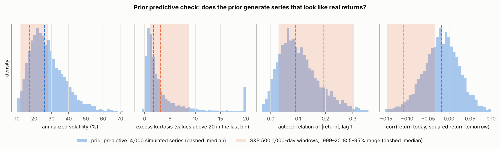

How to read the figure: each panel is one statistic. The blue histogram shows the 4,000 simulated series, and the blue dashed line their median. The orange band is the 5% to 95% range of the statistic across S&P 500 windows, and the orange dashed line its median. A good prior covers the band and leaves room on both sides for other assets.

- **Volatility.** The simulated median is 26%, with 90% of series between 14% and 49%. The S&P 500 range, 12% to 28%, sits mostly inside; its lower end is just below the simulated 5% quantile.
- **Excess kurtosis.** The simulated median is 1.8 and the S&P 500 median 3.1. The prior covers the S&P 500 range, and its long right tail comes from series with frequent or large jumps.
- **Volatility clustering**, measured by the first-order autocorrelation of absolute returns. The S&P 500 median, 0.19, lies in the upper half of the simulated distribution, whose median is 0.09.
- **Leverage**, measured by the correlation between today's return and tomorrow's squared return. The S&P 500 median is −0.11, and only 2.8% of simulated series show a stronger effect.

The prior is centred on a single stock, which has weaker leverage and clustering than an index. The S&P 500 lies in the tail of the prior for leverage: on its windows the posterior medians of ρ lie between −0.92 and −0.69 (see Real data), partly below the prior's 2.5% quantile of −0.89. A prior for index work would centre ρ lower.

### An example path

The figure below shows one four-year path simulated with long-run volatility 18%, half-life 35 days, c = 0.55, ρ = −0.6, two jumps a year, μ\_J = −2.5% and σ\_J = 3.5%. The next lessons use the same path to show the filter at work.

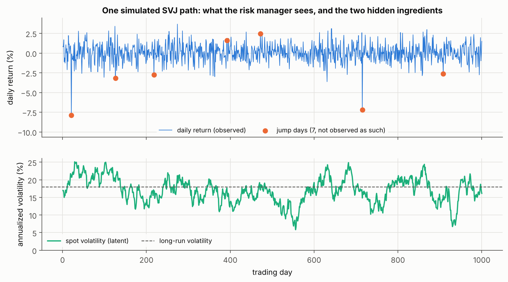

How to read the figure: the top panel shows what a risk manager sees, the daily returns. The orange dots mark the seven days with a jump, which are known only because the path is simulated. The bottom panel shows the spot volatility that generated the returns, against the long-run level of 18% (dashed).

Spot volatility wanders between 6% and 25% in spells of a few weeks, and the returns in the top panel are visibly larger when it is high. The two largest losses, −7.9% on day 21 and −7.2% on day 715, are jumps. The bottom panel shows no spike after them, because jumps do not move the variance. The five other jumps, with returns between −3.2% and +2.5%, are no larger than ordinary days in a volatile spell.

### From one day to a forecast

The daily model simulates returns one day at a time. Run forward from the last day of the window, the same recipe produces the forecast. This subsection states when the forecast is made, how far ahead it looks, and how it is built. [From posterior to risk](#from-posterior-to-risk) then turns the forecast into a VaR and an ES.

**The rolling window.** Every morning, the risk team takes the last T = 1,000 daily returns of each name. The last of them is the return to yesterday's close, so day T is yesterday. The forecast covers days T + 1 to T + H. The next morning, one new return enters the window and the oldest one leaves it. The posterior and the forecast are then computed again from the new window. The eight parameters change little from one morning to the next, because 999 of the 1,000 returns are the same. Today's variance v\_T can change a lot, because it depends mostly on the returns of the last few weeks. The real-data study moves the window by one week rather than one day, to save computing time ([Real data](#7-real-data)).

**The horizon.** The model does not set the horizon H; the risk numbers it serves do. The study uses two horizons:

- **H = 1 day.** The Basel backtest compares the 99% one-day VaR with the next day's loss, over 250 days ([The practitioner problem](#the-practitioner-problem)).
- **H = 10 days.** Capital rules measure risk over 10 days. The internal-models approach before the FRTB uses a 10-day 99% VaR. The FRTB computes the 97.5% ES over a base horizon of 10 days, which it extends up to 120 days for less liquid risk factors. The study stops at 10 days.

**The forward simulation.** A posterior draw holds the eight parameters ϑ and today's variance v\_T. Starting from v\_T, the daily model runs H days forward with new shocks and new jumps. The index h counts the days after day T:

```math
\begin{aligned}
y_{T+h} &= \mu + \sqrt{v_{T+h-1}}\,\varepsilon^{1}_{T+h} + B_{T+h}\,\xi_{T+h}, \qquad h = 1, \dots, H,\\
v_{T+h} &= \max\!\Big( v_{T+h-1} + \kappa\,(\theta - v_{T+h-1}) + \sigma_v \sqrt{v_{T+h-1}}\,\big(\rho\,\varepsilon^{1}_{T+h} + \sqrt{1-\rho^2}\,\varepsilon^{2}_{T+h}\big),\ v_{\min} \Big),\\
R_{T,H} &= y_{T+1} + \dots + y_{T+H}.
\end{aligned}
```

These are the equations of the daily model, with t replaced by T + h. Nothing in them is estimated again. The parameters come from the draw, and the starting variance is the draw's v\_T. Only the shocks ε¹ and ε², the jump indicator B and the jump size ξ are new draws.

**Two sources of spread.** One simulated path is one possible future. Paths from the same draw differ because the future shocks and jumps are unknown. Paths from different draws differ further, because ϑ and v\_T are uncertain. The predictive distribution pools the paths of all draws, so it contains both sources of spread. A plug-in forecast keeps the first source and part of the second, because it fixes ϑ at a point estimate.

**Why today's variance matters most at short horizons.** The variance reverts to its long-run level θ, so the effect of a start away from θ fades as the horizon grows. Ignoring the floor, the expected gap to θ shrinks by the factor 1 − κ every day:

```math
\mathbb{E}\big[v_{T+h} - \theta \mid v_T,\ \vartheta\big] = (1-\kappa)^{h}\,\big(v_T - \theta\big)
```

At a half-life of 30 days, κ = 0.023, and after 10 days the factor is 0.79. Only about a fifth of the gap closes within a 10-day horizon. Over 10 days or less, the forecast therefore depends mostly on today's variance. The same mechanism explains the S&P 500 example of the executive summary, where today's variance carries 86% of the posterior variance of the 1-day conditional VaR.

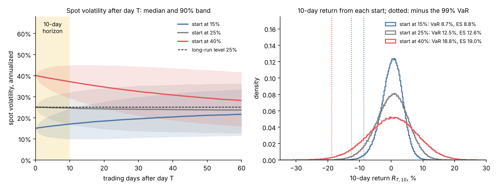

How to read the figure: the parameters are fixed at the prior median of One day of the model, and only today's spot volatility changes, from 15% (blue) to 25% (grey) and 40% (red). The left panel simulates the spot volatility over the 60 trading days after day T, with the median of 20,000 paths as a line and their 90% band as a shaded area. The yellow strip marks the 10-day horizon, and the dashed line the long-run level of 25%. The right panel shows the 10-day return from 400,000 paths for each start, with minus the 99% VaR as a dotted line. The parameters are fixed in this figure, so the spread comes from future shocks and jumps alone.

- **Volatility moves slowly toward its long-run level.** Within the 10-day horizon, the median spot volatility moves only from 15% to 17% and from 40% to 37%. After 60 days it stands at 22% and 28%.
- **Today's volatility sets the level of the 10-day risk.** The 10-day 99% VaR is 8.7% from a start at 15%, 12.5% from 25% and 18.8% from 40%. The same parameters thus give 10-day VaRs that differ by more than a factor of 2.
- **The forecast inherits the uncertainty of v\_T.** The posterior of today's variance is never a single value, as the filter band in [Why the likelihood is intractable](#why-the-likelihood-is-intractable) shows. Each posterior draw starts its paths from its own v\_T, so the predictive distribution mixes curves like those in the right panel.

## Why the likelihood is intractable

The likelihood is the probability density of the observed returns, given the parameters. For the SVJ model it has no formula, because the variance that drives each return is never observed. It can only be estimated by simulation, and the study uses a particle filter to do it.

### What the likelihood is

The likelihood p(y\_{1:T} ∣ ϑ) measures how probable the observed window is under a parameter vector ϑ. Maximum likelihood picks the ϑ that makes it largest, and Bayesian inference multiplies it by the prior. Any joint density splits into one-step-ahead densities, which is called the prediction decomposition:

```math
p(y_{1:T} \mid \vartheta) = \prod_{t=1}^{T} p(y_t \mid y_{1:t-1}, \vartheta)
```

Each factor is the density of one day's return given all earlier returns. The log-likelihood is the sum of their logarithms, so each day adds one term.

### If the variance were observed

Suppose the variance path v\_0, …, v\_T were known. Given yesterday's variance, today's return is a mixture of two normal laws: no jump with probability 1 − λ, and a jump with probability λ. Here φ(x; m, s²) is the normal density with mean m and variance s²:

```math
p(y_t \mid v_{t-1}, \vartheta) = (1-\lambda)\,\phi\big(y_t;\ \mu,\ v_{t-1}\big) + \lambda\,\phi\big(y_t;\ \mu + \mu_J,\ v_{t-1} + \sigma_J^2\big)
```

The jump branch has variance v\_{t−1} + σ\_J², because the return then adds a diffusive shock and an independent normal jump. With a known variance path, the likelihood would be a product of these mixtures and of the normal laws of the variance steps. Maximum likelihood would then be routine.

### The variance is latent

The variance path is not observed, so the likelihood must average over every path the model could have produced. That is an integral over T + 1 = 1,001 unknown variances:

```math
p(y_{1:T} \mid \vartheta) = \int p(v_0 \mid \vartheta) \prod_{t=1}^{T} p(y_t \mid v_{t-1}, \vartheta)\, p(v_t \mid v_{t-1}, y_t, \vartheta)\; dv_{0:T}
```

No grid and no plain Monte Carlo average can handle an integral of this dimension. The integral can still be computed one day at a time, because each return depends on the past only through yesterday's variance.

### The filtering recursion

The recursion carries one object from day to day: the filtering density p(v\_t ∣ y\_{1:t}, ϑ), which states what the returns so far say about the current variance. Each day takes two steps. The first averages the return density over yesterday's filtering density, and the result is the day's factor of the likelihood:

```math
p(y_t \mid y_{1:t-1}, \vartheta) = \int p(y_t \mid v_{t-1}, \vartheta)\; p(v_{t-1} \mid y_{1:t-1}, \vartheta)\; dv_{t-1}
```

The second step applies Bayes' rule. Each value of v\_{t−1} is weighted by how well it explains y\_t and then moved forward with the variance equation. The result is today's filtering density, which feeds the next day.

Leverage makes the move forward depend on today's return. Given v\_{t−1} and y\_t, the price shock ε¹ is known up to the jump, so part of the variance shock is known too. The new variance is then a mixture of two normal laws, cut at the floor (Appendix C derives it):

```math
\begin{aligned}
\text{no jump:}\quad & v_t \sim \mathcal{N}\Big(v_{t-1} + \kappa(\theta - v_{t-1}) + \sigma_v\rho\,(y_t - \mu),\ \ \sigma_v^2 (1-\rho^2)\, v_{t-1}\Big),\\
\text{jump:}\quad & v_t \sim \mathcal{N}\Big(v_{t-1} + \kappa(\theta - v_{t-1}) + \sigma_v\rho\,(y_t - \mu - m_\xi),\ \ \sigma_v^2 (1-\rho^2)\, v_{t-1} + \sigma_v^2\rho^2 s_\xi^2\Big),\\
& m_\xi = \mu_J + \frac{\sigma_J^2}{v_{t-1} + \sigma_J^2}\,(y_t - \mu - \mu_J), \qquad s_\xi^2 = \frac{\sigma_J^2\, v_{t-1}}{v_{t-1} + \sigma_J^2}
\end{aligned}
```

The weights of the two branches are the probabilities of no jump and of a jump on day t, given the return. Each is one term of the return density divided by their sum. The terms m\_ξ and s\_ξ² are the mean and variance of the jump size once the return is known.

### Why there is no closed form

For a linear model with normal shocks the filtering density stays normal, and the Kalman filter computes it exactly. Here three features break that structure: the variance enters the return through its square root, the jump makes each day a mixture, and the floor cuts the variance at v\_min. Even without the square root, the jump-or-no-jump split would double the number of mixture components every day, to 2^1,000 after four years. Only numerical approximations remain, a particle filter or a grid.

### The particle filter

A particle filter represents the filtering density by N random values of the variance, called particles. The study uses the fully adapted filter of Pitt and Shephard (1999), which takes four steps each day:

1. **Weigh.** Give each particle v\_{t−1}^(i) the weight w\_t^(i) = p(y\_t ∣ v\_{t−1}^(i)), the two-branch mixture above. The average weight estimates the day's likelihood factor.
2. **Resample.** Draw N particles from the current ones, with probabilities proportional to their weights, by systematic resampling. Particles that explain the return well are copied, and the others disappear.
3. **Decide the jump.** For each particle, draw the jump indicator with the probability of a jump given y\_t. If there is a jump, draw its size from its normal law given y\_t.
4. **Move.** Draw the new variance from the conditional normal law above, and apply the floor.

The product of the daily average weights estimates the likelihood:

```math
\hat L(\vartheta) = \prod_{t=1}^{T} \frac{1}{N} \sum_{i=1}^{N} w_t^{(i)}, \qquad \mathbb{E}\big[\hat L(\vartheta)\big] = p(y_{1:T} \mid \vartheta)
```

The estimate is unbiased: its average over repeated runs of the filter equals the true likelihood, for any N (Appendix C proves it). Particle MCMC is exact because of this property. After step 4, the particles are approximately distributed as p(v\_t ∣ y\_{1:t}, ϑ), the starting point of every forecast.

### One day of the filter, on the example path

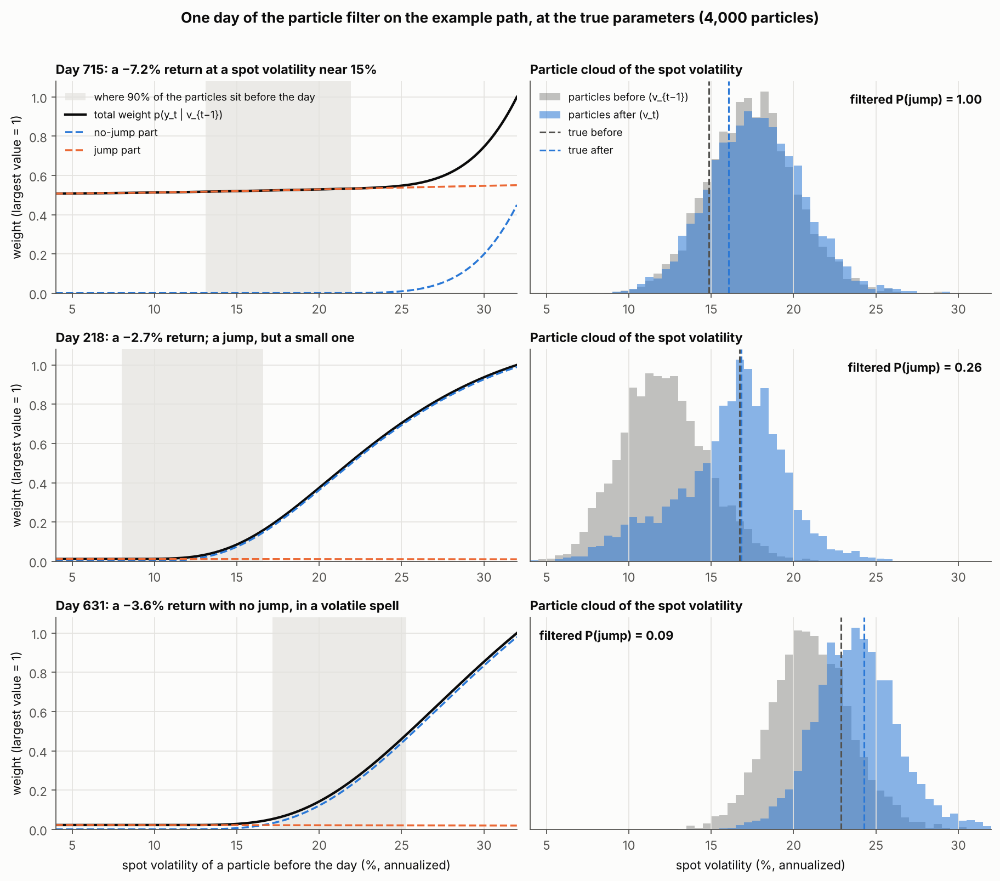

How to read the figure: each row is one day of the example path, filtered at the true parameters with 4,000 particles. The left panel plots the weight of a particle against its spot volatility before the day, split into the no-jump part (blue) and the jump part (orange). The grey band shows where 90% of the particles sit. The right panel shows the particle cloud before the day (grey) and after it (blue), with the true values as dashed lines.

- **Day 715, a −7.2% return at a spot volatility near 15%.** Without a jump, such a return would need a volatility above 30%, where no particle sits. Inside the band the jump part carries all the weight, and it is flat, so every particle survives the resampling. The filtered jump probability is 1.00, and the cloud barely moves.
- **Day 218, a −2.7% return.** The weight rises steeply with volatility, so high-volatility particles are copied and low ones are dropped. The median of the cloud moves from 12% to 17%. The filter gives a jump probability of only 0.26, although a jump did occur: a jump of this size cannot be told apart from a volatile day.
- **Day 631, a −3.6% return with no jump, in a volatile spell.** The weight again favours high volatility, and leverage adds to the rise. The cloud moves from 21% to 24%, close to the true 24.3%, and the jump probability is 0.09.

### The whole path

Running these steps over all 1,000 days gives the figure below. The top panel shows the true spot volatility (black), the filtered median (blue) and the filtered 90% band. The bottom panel shows the filtered probability of a jump on each day (blue) against the true jump days (orange).

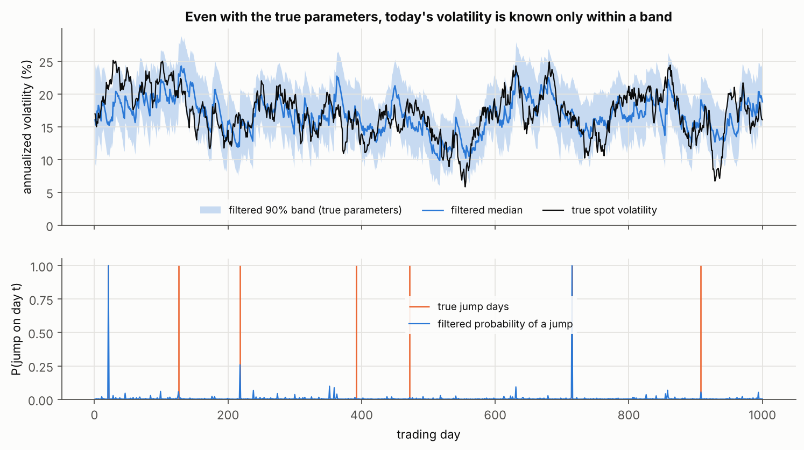

The band is 9 volatility points wide on average, and it covers the true value on 92% of days. Even with the true parameters, today's volatility is known only within this band. Only the two largest jumps get a jump probability above one half; the five smaller ones are absorbed by the diffusion, as on day 218.

Two consequences follow. First, a forecast must average over today's variance even when the parameters are known. Second, data with few large jumps say little about the jump distribution, so the parameter posterior stays wide in exactly the directions that drive the tail.

### How noisy the estimate is, and what it costs

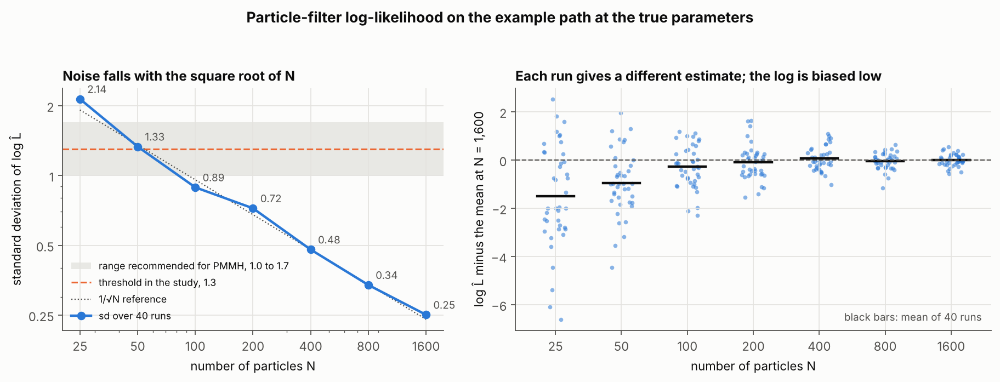

How to read the figure: the filter was run 40 times at each particle count N, on the example path at the true parameters. The left panel shows the standard deviation of the 40 log-likelihood estimates, on log scales. It falls from 2.14 at N = 25 to 0.25 at N = 1,600, in proportion to 1/√N. The right panel shows the 40 estimates themselves, minus their mean at N = 1,600. At small N they spread widely and sit below zero on average.

The downward shift is expected. The likelihood estimate is unbiased, so its logarithm is biased low by about half its variance (Appendix C). Particle MCMC mixes well when the standard deviation of the log-likelihood is between about 1.0 and 1.7 (Doucet et al. 2015). The study takes the smallest N among 50, 100, 200 and 400 that brings it below 1.3; on this path that is N = 100.

One evaluation of the likelihood costs N × T particle updates, 100,000 at N = 100. Particle MCMC needs tens of thousands of evaluations per series, which is why it costs 5 to 29 CPU-minutes per name in the study. The maximum-likelihood baseline in the next lesson replaces the particles by a fixed grid of 100 variance values, which gives a smooth likelihood that an optimizer can climb (Appendix C).

## Classical estimators and where they fail

Classical estimation treats the parameters as fixed unknown numbers and reports a point estimate with a confidence interval. For this model it estimates the volatility level well and the volatility dynamics less well, and its intervals for the jump parameters are unreliable. Bayesian MCMC gives the right answer, but at minutes per series.

### Two ways to state uncertainty

A frequentist treats the parameters as fixed and the data as random. A 95% confidence interval is a rule applied to the data, and the rule is valid if its intervals contain the true value in 95% of repeated samples. A Bayesian treats the parameters as uncertain and describes that uncertainty by a distribution. A 95% credible interval holds 95% of the posterior probability, given the data at hand.

The two meet in one measurable quantity, coverage. On simulated data the truth is known: draw a parameter vector, simulate a series, compute the interval, and record whether it contains the truth. A valid confidence interval covers the truth 95% of the time at every true value. An exact posterior covers it 95% of the time on average over truths drawn from the prior, which is how the study draws them.

### The classical routes

The table lists the routes a classical econometrician would take, and where each fails for the SVJ model estimated from returns.

| Route | Output | Key references | Where it fails for SVJ from returns |
| --- | --- | --- | --- |
| Method of moments (GMM, EMM, indirect inference) | Point estimate, asymptotic standard errors | Melino and Turnbull (1990); Gallant and Tauchen (1996); Andersen, Benzoni and Lund (2002); Chernov et al. (2003) | Moments of rare jumps are noisy; estimators are inefficient in small samples (Jacquier, Polson and Rossi 1994) |
| Approximate maximum likelihood | Point estimate, Hessian-based standard errors | Fridman and Harris (1998); Bates (2006) | Jump parameters sit near boundaries and are weakly identified; Wald intervals miscover |
| Plug-in forecast | VaR and ES at the point estimate | Standard practice; Christoffersen and Gonçalves (2005) on estimation risk | Ignores estimation error, so forecast tails are too thin |
| Bayesian MCMC (data augmentation, particle MCMC) | Full posterior | Jacquier, Polson and Rossi (1994); Kim, Shephard and Chib (1998); Eraker, Johannes and Polson (2003); Andrieu, Doucet and Holenstein (2010) | Correct, but minutes per series; does not scale to a portfolio |

### Maximum likelihood and the Wald interval

The maximum likelihood estimate ϑ̂ is the parameter vector that maximizes the log-likelihood ℓ(ϑ) = log p(y\_{1:T} ∣ ϑ). Near its maximum a smooth log-likelihood looks like a parabola, and the curvature of the parabola measures how sharply the data pin each parameter down. The curvature is the observed information, minus the matrix of second derivatives of ℓ at ϑ̂, and its inverse estimates the covariance of the estimator:

```math
\hat\vartheta = \arg\max_{\vartheta}\ \ell(\vartheta), \qquad \mathcal{I}(\hat\vartheta) = -\nabla^2 \ell(\hat\vartheta), \qquad \widehat{\mathrm{se}}_j = \sqrt{\big[\mathcal{I}(\hat\vartheta)^{-1}\big]_{jj}}
```

The Wald interval for parameter j is the estimate plus or minus 1.96 standard errors:

```math
\hat\vartheta_j \pm 1.96\; \widehat{\mathrm{se}}_j
```

The interval is named after Abraham Wald, whose large-sample tests rest on the approximate normality of the MLE (Wald 1943). The number 1.96 is the 97.5% quantile of the standard normal, so the interval covers the truth with probability 95% when the normal approximation holds. Three conditions make it hold: many informative observations for the parameter, a true value inside the parameter space and away from its edges, and a log-likelihood close to a parabola over the width of the interval. Appendix D derives the interval and these conditions.

A narrow peak gives a large curvature and a short interval, and a flat ridge gives a small curvature and a long one. A ridge that bends, or a maximum that sits on a bound, breaks the parabola, and the interval then misstates the uncertainty. Wald intervals also depend on the coordinates: an interval for the jump frequency built on the log scale differs from one built on the natural scale. The study builds them in the unbounded coordinates of the prior table, which usually favours the Wald interval.

### How the study computes the estimate

The likelihood has no formula, so the baseline approximates it with a deterministic grid filter, in the spirit of Fridman and Harris (1998) and Bates (2006). The grid filter follows the filtering recursion with a fixed grid in place of random particles:

1. Cut the range of the variance into M = 100 cells, uniform in √v, from 0 to √(θ(2 + 6c)).
2. Start from the stationary Gamma law of v\_0, integrated over each cell.
3. Each day, weigh each cell by the return density, normalize, and spread the mass over the next day's cells with the conditional normal law of v\_t, integrated over each cell. Mass below the first cell goes to the first cell, which mirrors the floor.
4. Add up the logarithms of the daily normalizing constants. The sum is the log-likelihood.

Because the grid is fixed, the log-likelihood is a smooth function of ϑ, and automatic differentiation in JAX gives its exact gradient. The optimizer L-BFGS-B, a quasi-Newton method with bounds, starts from the prior mean and from the amortized posterior median on a 50-cell grid. The better optimum is then polished on the 100-cell grid. The bounds are the prior mean plus or minus 6 prior standard deviations in each unbounded coordinate, with the jump frequency limited to 0.01 to 120 a year. This puts a floor of 0.2% on the jump-size sd. The Hessian comes from finite differences of the exact gradient, and one fit costs 118 CPU-seconds, the median over 40 series.

### Where the Wald interval fails: hidden jumps

Jumps break all three conditions. The clearest way to see it is a toy model with constant volatility and the same jumps (Merton 1976), whose likelihood is a two-component normal mixture with a closed form. The figure shows two simulated four-year series with a volatility of 25%, 2.5 jumps a year, a mean jump of −1% and a jump-size sd of 3%.

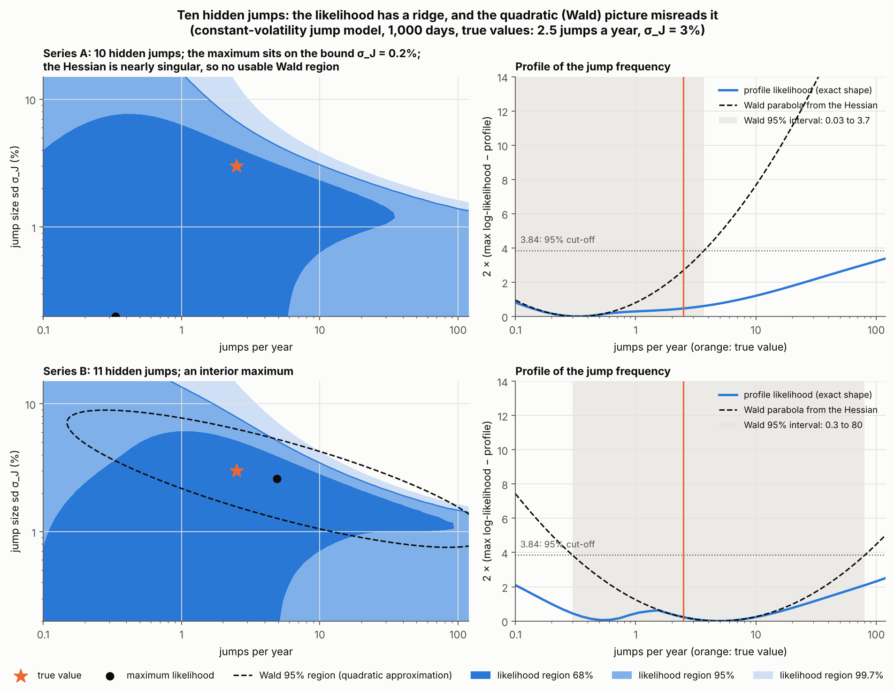

How to read the figure: the left panels map the likelihood over the jump frequency and the jump-size sd, with the other three parameters at their best values for each point. This is a profile likelihood. The blue regions hold the values that a likelihood-ratio test would not reject at 68%, 95% and 99.7%. The star marks the true value, the black dot the maximum, and the dashed ellipse the 95% region that the Wald approximation draws from the curvature at the maximum. The right panels show the profile for the jump frequency alone, as twice the drop in log-likelihood from the maximum. The blue curve is the exact profile, the dashed parabola the Wald approximation and the grey band the Wald interval; values below the dotted line at 3.84 form the 95% likelihood-ratio interval.

- **Series A, 10 jumps.** The likelihood is a ridge that runs from a few large jumps to many small ones. Its maximum sits on the bound σ\_J = 0.2%, at 0.33 jumps a year with a mean jump of −6.6%: the fit explains the largest loss, −7.4%, as one jump of fixed size and the other jump days as diffusion. The Hessian is nearly singular there. The Wald interval for the jump frequency, 0.03 to 3.7 a year, excludes everything above 3.7, although the profile stays under the 95% line up to 120 jumps a year.
- **Series B, 11 jumps.** The maximum is interior, at 4.9 jumps a year with σ\_J = 2.6%. The profile has two dips, near 0.5 and near 5 jumps a year, and no parabola fits both. The Wald interval, 0.3 to 80 jumps a year, spans a factor of 270.

Across 200 such series, with a median of 10 jumps each, the maximum sits on a bound in 62% of series, and the Hessian is not positive definite in 17%. The Wald intervals cover the true jump frequency in 60% of series and the true jump-size sd in 77%, against the nominal 95%.

Rare jumps alone do not cause this. If the jump days were observed, the jump count would be Poisson, and a Wald interval for the log jump frequency would cover the truth in 95% of series on average over the prior (Appendix D). The failure comes from jumps hidden among diffusive moves. The SVJ study shows the same pattern (Feasibility study, result 5). Of 40 fits, 15 put a parameter on a bound and 3 have a Hessian that is not positive definite. Wald intervals cover the jump frequency in 68% and the mean jump size in 60% of series.

### Boundaries and parameters that vanish

When the jump frequency is zero, the jump mean and variance drop out of the likelihood. Tests of "no jumps" then have non-standard distributions (Davies 1977; Andrews 2001). A Wald interval for a jump frequency near zero is not valid.

A four-year sample usually holds too few jumps to separate "few large jumps" from "many small jumps". On the example path, cutting the jump frequency to 37% of its true value, with all other parameters at their true values, changes the log-likelihood by only 0.3. A 95% likelihood-ratio test would need a change of 1.92 to tell the two values apart.

### Weak identification and skewed likelihoods

Mean reversion, vol-of-variance and leverage are identified only through the slow dynamics of volatility. With 1,000 days, the study finds contraction of 0.61 for the half-life and about 0.8 for vol-of-variance and leverage. Wald coverage for these three parameters is 0.80 to 0.93, below the nominal 0.95. Figure 1 of the tutorial proposal shows that one year of returns leaves leverage nearly unidentified in the Heston model. In this study, four years of returns identify leverage in the SVJ model much better, with a contraction of 0.81.

Bates (2006) gives the strongest frequentist competitor: approximate maximum likelihood for latent affine processes, with standard errors. It is accurate and fast for point estimation. It does not remove the boundary and identification problems, because they belong to the data rather than to the estimator.

### Moment-based estimators

The generalized method of moments (GMM) chooses the parameters so that model moments match sample moments: the variance, the kurtosis, the autocorrelations of absolute or squared returns, and the correlation between returns and later squared returns. Efficient and simulated variants take the moments from an auxiliary model or compute model moments by simulation (Gallant and Tauchen 1996; Andersen, Benzoni and Lund 2002). Standard errors come from the sandwich formula, which combines the sensitivity of the moments to the parameters with their sampling variance (Appendix D).

Two problems remain for this model. The moments that carry the jumps, such as the kurtosis, rest on the ten or so largest days of the window and are very noisy in four years of data. Moment estimators are also less efficient than likelihood methods in small samples (Jacquier, Polson and Rossi 1994). The study therefore uses approximate maximum likelihood as the classical baseline.

### Plug-in forecasts

A plug-in forecast fixes the parameters at a point estimate ϑ̂ and computes VaR and ES as if ϑ̂ were the truth. The predictive distribution instead averages the forecast over all parameter values that fit the data, weighted by the posterior. Averaging over parameters fattens the tails whenever the posterior spreads toward larger jumps or a more volatile variance, so the plug-in forecast understates the tail even when ϑ̂ is unbiased.

A textbook case shows the mechanism. For normal returns with an unknown mean and variance, estimated from n observations, the predictive law of the next return is a Student t with n − 1 degrees of freedom and a slightly larger scale (Appendix D). With n = 1,000 it is almost the plug-in normal law. The jump parameters, however, are learned from about ten jump days, and with n = 10 the predictive 99% quantile lies 27% further out than the plug-in one.

In the study a plug-in at the posterior median shows the effect. It is small for the 99% VaR, which is exceeded with probability 1.14% instead of 1% at 10 days. It is larger for the 97.5% ES, whose Z2 score is −0.10 against −0.02 for the predictive ES (Lesson 7).

### Bayesian MCMC: exact but slow

Bayesian inference treats the parameters as uncertain and updates the prior with the likelihood by Bayes' rule, p(ϑ ∣ y) ∝ p(y ∣ ϑ) p(ϑ). Here the posterior has no closed form, so it is represented by draws. Markov chain Monte Carlo (MCMC) produces such draws with a random walk whose long-run distribution is the posterior. The Metropolis–Hastings algorithm used in the study repeats three steps:

1. Propose a new parameter vector ϑ′ by adding a Gaussian step to the current one, ϑ.
2. Compute the acceptance ratio: likelihood times prior at ϑ′, divided by the same at ϑ.
3. Move to ϑ′ with probability min(1, ratio); otherwise stay at ϑ and record ϑ again.

The posterior enters only through a ratio, so its unknown normalizing constant cancels. The likelihood itself is not available, and two ways around this exist. Data-augmentation MCMC samples the variance path together with the parameters (Jacquier, Polson and Rossi 1994; Eraker, Johannes and Polson 2003). It mixes slowly, because the 1,001 variances and the parameters are strongly dependent. Particle MCMC, or PMMH (Andrieu, Doucet and Holenstein 2010), puts the particle filter's unbiased estimate in the ratio, and keeps the estimate of the current point until the next acceptance. This noisy chain still has the exact posterior as its long-run distribution (Appendix E proves it).

The study's PMMH reference runs four chains per series, started at random draws of the amortized posterior. The chains move in the unbounded coordinates of the prior table, so the prior density includes the Jacobian of the transform of ρ, (1 − ρ²)/2. The Gaussian step has the covariance of the amortized posterior times 2.38²/8, the scaling that suits random-walk proposals in eight dimensions (Roberts, Gelman and Gilks 1997). The particle count is the smallest of 50, 100, 200 and 400 that keeps the standard deviation of the log-likelihood below 1.3. Each chain runs 12,500 to 25,000 iterations, and the first 2,000 are discarded.

Two diagnostics check convergence (Vehtari et al. 2021). R-hat compares the spread within each chain with the spread between chains; values near 1 mean that the four chains explore the same distribution, and the study reaches at most 1.013. The effective sample size (ESS) is the number of independent draws the correlated chain is worth, and the study requires at least 400 for every target. Particle MCMC then costs 285 to 1,733 CPU-seconds per series, the cost that amortization removes.

## Amortized design

Amortized inference pays the cost of inference once, in training. A network is trained on millions of simulated return series whose parameters are known, and it then maps any new four-year series to its posterior in about a second. The network never evaluates the likelihood: it learns the posterior from simulations alone.

### The idea

The model is easy to simulate even though its likelihood is intractable. Drawing ϑ from the prior and then a series y from the simulator produces pairs (ϑ, y) from the joint distribution p(ϑ) p(y ∣ ϑ). The same joint distribution factors the other way, as p(y) p(ϑ ∣ y). Among simulated series that resemble the observed one, the parameters are therefore distributed as the posterior. A neural network trained on many pairs learns to return p(ϑ ∣ y) for any y; the method is called neural posterior estimation.

### What the network takes in and gives out

| Item | Content | Size per series |
| --- | --- | --- |
| Input | The last 1,000 daily returns, as two numbers per day: y\_t in percent and log(y\_t² + 0.01) | 1,000 × 2 |
| Summary statistics | Learned summaries of the series, the output of the summary network | 32 |
| Targets | The 8 parameter coordinates of the prior table and the log of today's spot volatility, log σ\_T | 9 |
| Output | Random draws from the joint posterior of the 9 targets | 1,000 × 9 in the study; any number on request |

Each output row is one plausible combination of the parameters and today's volatility, consistent with the data and the prior. Posterior medians and intervals are read off the columns, and the forecast simulates future paths from each row. The network returns no likelihood value and no single point estimate.

### Why the ninth target is today's volatility

The eight parameters are constant over the window. The ninth target is different: σ\_T is a property of the simulated path, the spot volatility at the end of the last day. The simulator records it for every training series, so the network learns its posterior jointly with the parameters. A forecast needs exactly this pair, and the network delivers both in one pass, so no filter has to run for each posterior draw.

The network is not retrained every day. It has learned a map from any 1,000-day window to the posterior for that window. Tomorrow the window moves forward by one day, and the same network applied to the new window returns the new posterior, including the new value of σ\_T. Retraining is needed only when the set-up changes: the model, the prior, the window length, the input definition, or a diagnostic that fails.

### The simulator and the training data

Each training batch draws 128 parameter vectors from the prior and simulates 1,000 days for each with the daily model, starting v\_0 from its stationary Gamma law. The vectorized NumPy simulator produces such a batch in 25 ms. Training is online: every batch is new, so the network never sees a series twice and cannot overfit a fixed training set. The reference run uses 2.56 million series.

### The two input channels

The network sees each day through two numbers. The first is the return y\_t in percent, which carries the sign; the sign is needed to learn the mean jump and the leverage effect. The second is log(y\_t² + 0.01). On a day without a jump it is close to log v\_{t−1} + log ε², so it tracks the log-variance with a noise of fixed size, whatever the level of volatility. The constant 0.01 avoids the logarithm of zero. The returns are not standardized, because their scale is what identifies the volatility level.

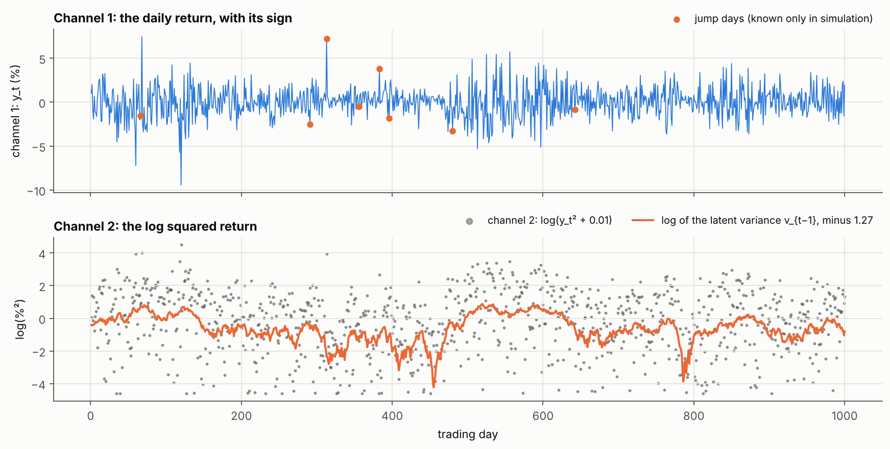

How to read the figure: the top panel shows the first channel for one simulated series, with the true jump days in orange. The bottom panel shows the second channel as grey dots. The orange line is the log of the true variance shifted by −1.27, the mean of log ε² for a standard normal ε. The dots scatter around the line with a standard deviation of 2.22, so one day says little about the variance, while many days together say a lot.

The figure also shows why jumps are hard to find. The largest loss, −9.4% on day 120, and the largest gain, +7.5% on day 68, are not jumps: they came in a volatile spell, at a spot volatility near 40%, and are moves of 3.9 and 2.8 standard deviations. The +7.3% on day 313 is a jump, at a spot volatility of 9%, a move of 12.5 standard deviations.

### The summary network: from 1,000 days to 32 numbers

The summary network compresses the input into 32 learned statistics, written s\_ψ(y), where ψ are its weights. It is BayesFlow's TimeSeriesNetwork: convolutions that look at short stretches of days, followed by recurrent layers that read the result in order. The table follows one series through it.

| Layer | What it does | Output size | Days behind each output |
| --- | --- | --- | --- |
| Input | Return and log squared return | 1,000 × 2 | 1 |
| Convolution 1 | 32 filters of width 8, moved 4 days at a time | 250 × 32 | 8 |
| Convolution 2 | 64 filters of width 5, moved 2 steps at a time | 125 × 64 | 24 |
| Convolution 3 | 64 filters of width 5, moved 2 steps at a time | 63 × 64 | 56 |
| Recurrent layers | A forward and a backward GRU with 64 units read the 63 steps; their final states are added | 64 | 1,000 |
| Skip branch | A width-4 convolution to 16 steps of 256 channels, read by its own two GRUs; added to the above | 64 | 1,000 |
| Output layer | A linear map | 32 | 1,000 |

A convolution slides small weighted windows along the series. The first layer looks at 8 consecutive days at a time, so it turns 1,000 days into 250 local features of 32 numbers each. After three layers each feature covers 56 days, long enough to measure local volatility and to spot isolated large moves.

A GRU (gated recurrent unit) reads a sequence one step at a time and updates a memory of 64 numbers at each step. The forward GRU ends on the most recent days, so its final memory can carry today's volatility; the backward GRU ends on the oldest days. The skip branch reads a coarser version of the sequence, which helps with slow features such as the half-life. A dropout of 5% during training regularizes the network.

The 32 statistics are not designed by hand. They are trained jointly with the inference network to keep whatever the posterior needs. Statistics that kept all the information in the series would be sufficient statistics. Learned ones may lose some of it; the posterior then stays calibrated but is wider than the exact one on average, which only the comparison with particle MCMC can reveal.

### The inference network: from noise to posterior draws

The inference network turns random noise into posterior draws, guided by the 32 statistics. It uses flow matching (Lipman et al. 2023; Wildberger et al. 2023): a learned velocity field moves points from a standard normal law at time τ = 0 to the posterior at time τ = 1.

Training uses straight lines. From here on, ϑ stands for the 9 standardized targets. For one simulated pair, take its targets ϑ, draw a noise vector z from a standard normal in 9 dimensions, and draw a time τ between 0 and 1. The point at time τ on the straight line from z to ϑ is x\_τ = (1 − τ) z + τ ϑ, and its velocity along the line is ϑ − z. The velocity network u\_φ, with weights φ, sees x\_τ, τ and the summaries s\_ψ(y), and is trained to predict that velocity:

```math
\mathcal{L}(\phi, \psi) = \mathbb{E}\,\Big\| u_\phi\big((1-\tau)\, z + \tau\,\vartheta,\ \tau,\ s_\psi(y)\big) - (\vartheta - z) \Big\|^2, \qquad (\vartheta, y) \sim p(\vartheta)\, p(y \mid \vartheta), \quad z \sim \mathcal{N}(0, I), \quad \tau = u^{1.5}, \ u \sim \mathcal{U}(0, 1)
```

One training example is one simulated series, one noise draw and one time. The loss is the squared error between the predicted and the actual velocity, averaged over a batch of 128 series. The time τ is drawn as u^1.5 with u uniform, which puts more examples near the noise end of the path.

Many lines pass through the same point x at the same time τ, coming from different noise draws and different targets. The network cannot predict the velocity of each line, so the squared-error loss makes it learn their average. Following that average velocity from noise at τ = 0 lands exactly on the posterior at τ = 1; Appendix F proves it.

Sampling integrates the learned velocity. Draw z from the standard normal and take 50 Euler steps of size 0.02:

```math
x_{k+1} = x_k + \tfrac{1}{50}\; u_\phi\big(x_k,\ \tfrac{k}{50},\ s_\psi(y)\big), \qquad k = 0, 1, \dots, 49, \qquad x_0 = z
```

The end point x\_50 is one posterior draw of the 9 standardized targets. Undoing the standardization and the transforms of the prior table gives the parameters in their usual units. One thousand noise draws, processed in one batch, give one thousand posterior draws.

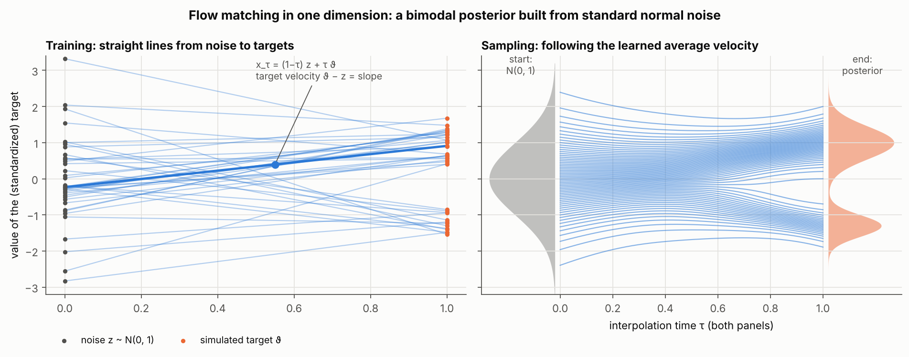

How to read the figure: the figure shows flow matching in one dimension, for a posterior with two modes. In the left panel each line joins a noise draw at τ = 0 (grey) to a simulated target at τ = 1 (orange), and the network is trained on the slopes of such lines; one line is highlighted. The right panel shows sampling with the exact average velocity, the one a perfectly trained network would learn. It carries the standard normal on the left into the two-mode posterior on the right. The paths never cross, and each noise value ends at one posterior draw.

### Inside the velocity network

The velocity network is BayesFlow's default TimeMLP, a stack of dense layers with three inputs: the current point x (9 numbers), the time τ, and the summaries s\_ψ(y) (32 numbers).

1. The point x and the summaries are each projected to 256 numbers, then joined and merged into one hidden vector of 256 numbers.
2. The time τ is expanded into 32 random Fourier features, sines and cosines of τ at random frequencies, so the network can react to small changes in τ.
3. Five residual blocks of 256 units follow, each with layer normalization and the smooth mish activation. In every block, the time features and the projected summaries scale and shift the hidden vector, a scheme called FiLM (Perez et al. 2018). Every layer thus knows where it is on the path and which series it serves.
4. A final linear layer returns the 9 velocities.

The targets are standardized before training: each of the nine coordinates is shifted and scaled by its running mean and standard deviation over the training batches. Without this, a target with a large spread, such as the drift in percent per year, would dominate the loss. The targets also live on unbounded scales, so every draw maps back to a valid parameter.

### Training

The two networks are trained together on the flow-matching loss, so the summaries learn to keep what the velocity field needs. The reference run uses 50 epochs of 400 batches of 128 series. The optimizer is Adam with gradient clipping, and the learning rate starts at 5 × 10⁻⁴ after a short warm-up and decays along a cosine. The hardware is a 2-core cloud CPU with the JAX backend and no GPU. Each epoch took about 77 s, so the reference run took 64 minutes. A validation set of 512 fixed series tracks the loss, and the feasibility study also reports a short-budget variant for participants' laptops (result 1).

The study samples with the fixed-step Euler solver above, compiled once, at 1.4 CPU-seconds per series for 1,000 draws. BayesFlow's default adaptive solver was much slower on this CPU. The calibration checks use the same solver, so they validate the sampler that is actually used.

### Where the likelihood enters

The likelihood of the SVJ model enters at no point of training or sampling, because the network only ever sees simulated pairs. The flow could also return the density of its own posterior at any point, by integrating the divergence of the velocity along the path (Appendix F); the study does not need it. Within the amortized workflow and its checks, the SVJ likelihood comes back in two places only: in the particle-MCMC reference, and in the audit, which weights proposals fitted to the network's draws by the particle filter's likelihood estimate.

## Validation plan

A learned posterior can be wrong in ways that the training loss does not reveal, so the amortized posterior is accepted only after five checks, each against a known answer. Three run once, after training. The misspecification check runs on every window, and the audit every day on every name.

| Check | Question it answers | Known answer | When it runs | Results |
| --- | --- | --- | --- | --- |
| Simulation-based calibration | Is the posterior calibrated on average? | True values of simulated series | Once | 2 |
| Recovery and contraction | What do four years of returns identify? | True values of simulated series | Once | 2 |
| Agreement with particle MCMC | Is the posterior right for a single series? | Exact posterior from particle MCMC | Once, on 4 series | 3 |
| Misspecification check | Do the real data look like the training data? | Summaries of simulated series | Every window | 7 |
| Audit by importance sampling | Is the network right for this name today? | Particle-filter likelihood | Every day, every name | 3, 7 |

### CDF, ECDF and ranks

Three tools from basic statistics underpin the checks. The cumulative distribution function (CDF) of a random quantity X is F(x) = P(X ≤ x), which rises from 0 to 1. The empirical CDF (ECDF) of a sample is the share of the sample at or below x, a step function that rises by 1/n at each of the n sample values. The fractional rank of a value among a set of draws is the share of the draws below it, a number between 0 and 1.

One fact links them. If X has a continuous CDF F, then F(X) is uniform between 0 and 1; this is the probability integral transform. A fractional rank is an estimate of F(X), so the ranks of a quantity drawn from the right distribution are uniform.

### Simulation-based calibration (SBC)

SBC (Talts et al. 2018) checks the posterior against the one thing simulation provides for free: the true parameters. The procedure has four steps:

1. Draw a true parameter vector ϑ\* from the prior and simulate a series y from it.
2. Draw L = 500 posterior draws from the network, given y.
3. Record the fractional rank of ϑ\* among the draws, separately for each of the nine targets.
4. Repeat for 1,000 held-out series.

If the posterior is exact, ϑ\* is just one more draw from it, so its rank is equally likely to take any value and the ranks are uniform (Appendix G proves it). Departures from uniformity have a shape that says what is wrong.

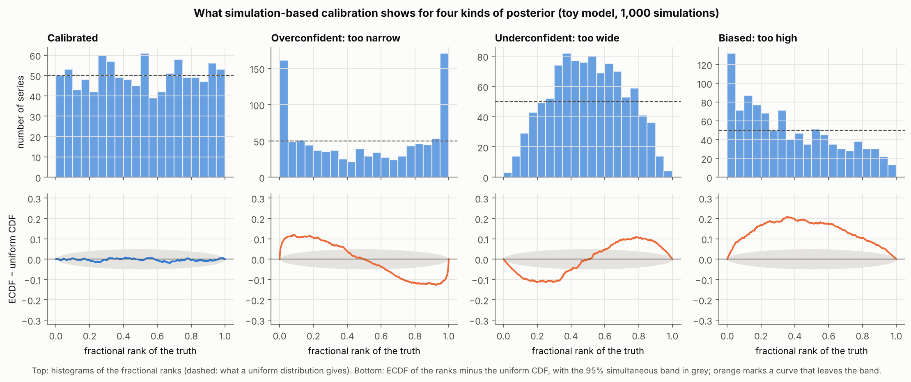

How to read the figure: the figure applies SBC to a toy model with four posteriors of known quality, 1,000 simulations each. The top row shows histograms of the fractional ranks, with the height a uniform distribution gives as a dashed line. The bottom row shows the same ranks as the ECDF minus the uniform CDF, the form the study uses, with the 95% simultaneous band in grey.

- **Calibrated.** The histogram is flat up to noise, and the ECDF difference stays inside the band.
- **Overconfident, too narrow.** The truth often falls outside the draws, so the ranks pile up at 0 and 1. The ECDF difference jumps up at once, then falls below zero: a sideways S.
- **Underconfident, too wide.** The truth sits in the middle of the draws too often. The histogram is a hump, and the ECDF difference is the mirrored S.
- **Biased, too high.** The truth falls in the low ranks too often, and the ECDF difference is one hump above zero. A posterior that is too low gives a hump below zero.

The study uses the ECDF form because it needs no choice of histogram bins and because a simultaneous band exists for it (Säilynoja, Bürkner and Vehtari 2022). A simultaneous 95% band contains the whole ECDF curve of a correct posterior with probability 95%; a pointwise band would be crossed somewhere along the curve far more often. With 1,000 series the band reaches about ±0.05 at the centre, and the study requires all nine curves to stay inside it. Each band has a 5% false-alarm rate, so with nine targets a correct posterior can leave one band by chance in up to 37% of studies. A single excursion is therefore a warning rather than a proof.

SBC has two blind spots. It averages over the prior, so errors of opposite sign on different series can cancel. It also passes a posterior that ignores part of the data: the prior itself is perfectly calibrated. SBC is therefore necessary but not sufficient, and the next checks cover what it misses.

### Recovery, contraction and coverage

A recovery plot compares, for each target, the posterior median with the true value over held-out series. Points along the diagonal mean that the data identify the target; a flat cloud means that the posterior stays close to the prior. Contraction sums this up in one number per target, computed in the unbounded coordinates of the prior table:

```math
\text{contraction} = 1 - \frac{\overline{\mathrm{Var}}_{\text{posterior}}}{\mathrm{Var}_{\text{prior}}}
```

The bar denotes the average over held-out series. A contraction of 0 means that the data teach nothing, and 1 that they pin the target down exactly.

Coverage is the share of held-out series whose 50%, 80%, 90% and 95% posterior intervals contain the truth. It should equal the nominal level up to binomial noise. With 1,000 series the standard error of a 95% coverage is 0.7 percentage points; with 40 series it is 3.4.

### Agreement with particle MCMC

SBC and recovery are averages over many series. The exact posterior of a single series comes from particle MCMC, and the study compares the two on four held-out series that span the prior: rare or frequent jumps, crossed with low or high vol-of-variance. The criterion is that, for each of the nine targets, the posterior means differ by less than 0.3 posterior standard deviations and the 90% interval widths agree within 25%.

The particle-MCMC reference starts from amortized posterior draws and uses the amortized posterior covariance for its proposal. This is the most favourable set-up for particle MCMC, so its measured cost is a lower bound. It also means that the reference could miss posterior mass far from the network's draws, which R-hat would not reveal.

### Misspecification check

All the checks above use simulated data, where the model is true by construction. Real returns can violate the model through jumps in volatility, fat-tailed daily shocks or regime changes. A network applied to such data still returns a posterior, without any warning. The check of Schmitt et al. (2024) asks whether the observed series looks like the training data, in the space of the 32 learned statistics:

1. Simulate 2,000 reference series from the prior and compute their summary statistics.
2. Compute the summary statistics of the observed window.
3. Measure how far the observed point lies from the reference cloud with the maximum mean discrepancy (MMD), a kernel distance between distributions (Gretton et al. 2012).
4. Compute the same distance for 500 further simulated series. The p-value is the share of them that lie at least as far away as the observed window.

A small p-value flags a window that the network was not trained for. Posterior predictive checks on kurtosis, volatility clustering, leverage and the largest loss complement the test. Appendix G gives the formulas.

### Audit by importance sampling

The fifth check corrects the amortized posterior for a given series, and it is part of the daily pipeline. It follows the idea of neural importance sampling (Dax et al. 2023):

1. Fit a multivariate Student t law with 5 degrees of freedom to the network's draws of the eight parameters, with its covariance inflated by 1.2². This law is the proposal q(ϑ).
2. Draw 3,000 proposals from q.
3. Run the particle filter on the series for each proposal. It returns the likelihood estimate L̂(ϑ) and one draw of today's variance from its final particles.
4. Give each proposal the weight w = p(ϑ) L̂(ϑ) / q(ϑ): prior times likelihood, divided by the proposal density, all in the unbounded coordinates.
5. Use the weighted proposals as the posterior. Their efficiency, the effective sample size (Σw)² / Σw² divided by 3,000, is the audit score.

As the number of proposals grows, the weighted sample converges to the exact posterior, because the likelihood estimate is unbiased (Appendix G). A proposal close to the posterior gives nearly equal weights and a high efficiency; a poor one puts most of the weight on a few draws. Even a perfect proposal cannot beat the noise of the likelihood estimate, which caps the efficiency at about e^(−σ²), where σ is the standard deviation of log L̂: about 18% at σ = 1.3.

The flow's own density could serve as the proposal, at the cost of integrating the divergence of the velocity along each path. A Student t law fitted to the draws is simpler, and its heavy tails keep the ratio p(ϑ) p(y ∣ ϑ) / q(ϑ) bounded. The audit costs 18 to 146 CPU-seconds per series, with a median of 35. A very low efficiency means that the network is off for this series and that the weighted sample rests on few effective draws; such names go to particle MCMC. The threshold is an open decision: in the study, efficiencies ranged from 0.2% to 10.5%.

## From posterior to risk

The posterior becomes a risk number in three steps: simulate future returns from every posterior draw, pool them into the predictive distribution, and read the VaR and the ES off that distribution. The same draws also say how uncertain the risk number itself is.

### VaR and ES

For an H-day return R\_{T,H} = y\_{T+1} + … + y\_{T+H}, the value-at-risk at level α is minus the (1 − α) quantile of its distribution, and the expected shortfall is minus the average return beyond that quantile:

```math
\mathrm{VaR}_{\alpha} = -\,q_{1-\alpha}\big(R_{T,H}\big), \qquad \mathrm{ES}_{\alpha} = -\,\mathbb{E}\big[R_{T,H} \mid R_{T,H} \le -\mathrm{VaR}_{\alpha}\big]
```

The study reports the 99% VaR, which supervisors backtest, and the 97.5% ES, which the FRTB capital rules use. Both are stated as positive losses in percent of the position.

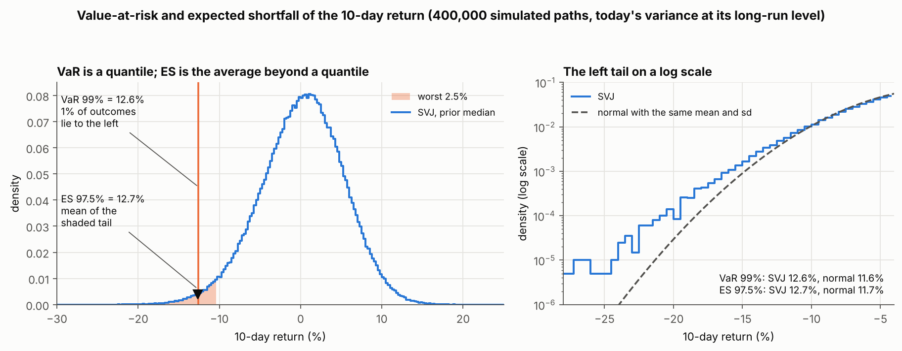

How to read the figure: the figure shows the 10-day return of the model at the prior median, with today's variance at its long-run level, from 400,000 simulated paths. In the left panel the orange line marks minus the 99% VaR, 12.6%: 1% of the outcomes lie to its left. The shaded area holds the worst 2.5% of outcomes, and the triangle marks their average, minus the 97.5% ES, 12.7%. The right panel plots the left tail on a log scale against a normal law with the same mean and standard deviation. The model's tail is heavier, so its VaR is 12.6% against 11.6% for the normal law, and its ES 12.7% against 11.7%.

For a normal law the 97.5% ES and the 99% VaR are almost equal, at 2.34 and 2.33 standard deviations. The 10-day return of the model keeps them almost equal as well, and both lie about 1 percentage point further out than for the normal law, because the whole left tail is heavier. For a much heavier tail, such as a Student t with 5 degrees of freedom, the 97.5% ES exceeds the 99% VaR by about 5%.

### From posterior draws to the predictive distribution

The predictive distribution averages the distribution of future returns over the joint posterior of the parameters and today's variance:

```math
p(R_{T,H} \mid y_{1:T}) = \int p(R_{T,H} \mid v_T, \vartheta)\; p(v_T, \vartheta \mid y_{1:T})\; dv_T\, d\vartheta
```

The integral is computed by simulation, in four steps:

1. Take the 1,000 posterior draws (ϑ^(m), v\_T^(m)). After the audit, these are 1,000 pairs resampled from the weighted proposals in proportion to their weights.
2. For each draw, simulate 20 paths of H = 10 days with the daily model, starting from v\_T^(m). The 1-day return is the first day of each path, and the 10-day return is the sum.
3. Pool the 20,000 simulated returns. They are draws from the predictive distribution.
4. The VaR is minus the 1% quantile of the pooled returns. The ES is minus the average of the pooled returns at or below their 2.5% quantile.

With 20,000 paths the Monte Carlo error of the 1% quantile is about 1% of its value. The backtests of the study use the network's draws, without the audit. The 10-day VaR comes directly from 10-day paths, rather than from the 1-day VaR scaled by √10 as many banks do.

### The plug-in forecast

The plug-in forecast fixes the parameters at a point estimate ϑ̂ and filters today's variance given ϑ̂. It keeps the uncertainty about today's variance and drops the uncertainty about the parameters:

```math
p(R_{T,H} \mid y_{1:T}, \hat\vartheta) = \int p(R_{T,H} \mid v_T, \hat\vartheta)\; p(v_T \mid y_{1:T}, \hat\vartheta)\; dv_T
```

The study builds two plug-in forecasts. The first uses the posterior median as ϑ̂, with 20,000 values of v\_T resampled from a 2,000-particle filter at that point. The second uses the approximate MLE, with v\_T drawn from the grid filter's law at the estimate. Both then simulate one 10-day path per value of v\_T.

### How uncertain is the risk number itself

The conditional VaR, VaR(ϑ, v\_T), is the number an analyst would report if the parameters and today's variance were known. For a 1-day horizon it is minus the 1% quantile of the two-component mixture (1 − λ) N(μ, v\_T) + λ N(μ + μ\_J, v\_T + σ\_J²), found by bisection. Its posterior distribution shows how uncertain the reported risk is, and two summaries of it go to the slide:

- the probability that the conditional VaR exceeds a reported VaR, such as the plug-in VaR, P(VaR(ϑ, v\_T) > VaR\_reported ∣ y);
- the split of its variance into a part due to today's variance and a part due to the parameters.

The split follows from the law of total variance:

```math
\mathrm{Var}\big[\mathrm{VaR}(\vartheta, v_T)\big] = \underbrace{\mathbb{E}_{\vartheta}\Big[\mathrm{Var}_{v_T \mid \vartheta}\big(\mathrm{VaR}(\vartheta, v_T)\big)\Big]}_{\text{today's variance}} + \underbrace{\mathrm{Var}_{\vartheta}\Big(\mathbb{E}_{v_T \mid \vartheta}\big[\mathrm{VaR}(\vartheta, v_T)\big]\Big)}_{\text{parameters}}
```

The first term averages, over parameter draws, the spread of the VaR that comes from not knowing today's variance. The second term is the spread across parameter draws of the average VaR. The inner terms need p(v\_T ∣ ϑ, y), which the particle filter gives at each parameter draw; the study uses 200 parameter draws and a 1,000-particle filter for each.

### Backtests with a known truth

A bank backtests its 99% VaR by counting exceptions, the days on which the loss exceeds the VaR. Over 250 days a correct VaR has 2.5 exceptions on average. The count is binomial, so even a correct VaR shows 5 or more exceptions, and leaves the Basel green zone, in 10.8% of years. One simulated path therefore says little about the quality of a VaR method.

On simulated series the true parameters ϑ\* and today's true variance v\_T\* are known. The probability that the next H-day loss exceeds a reported VaR is then computable from 50,000 simulated futures per series:

```math
p_{\text{exc}} = \Pr\big(R_{T,H} < -\mathrm{VaR}_{\text{reported}} \mid \vartheta^{*},\ v_T^{*}\big)
```

The average of p\_exc over many held-out series is the expected exceedance rate, which is 1% for a correct 99% VaR. This measure has far less noise than counting exceptions on one path. It compares the plug-in and the predictive VaR on the same series, and it separates two sources of error: a wrong point estimate and ignored parameter uncertainty.

For the ES, the study uses the statistic Z2 of Acerbi and Szekely (2014), in expectation over the true law of the loss L = −R\_{T,H}:

```math
Z_2 = 1 - \frac{\mathbb{E}\big[L\,\mathbf{1}(L > \mathrm{VaR}_{97.5\%})\big]}{0.025\;\mathrm{ES}_{97.5\%}}
```

Z2 is 0 for a correct ES and negative when the reported ES understates the loss beyond the VaR. When the reported VaR is right, Z2 = 1 − ES\_true / ES\_reported, so a score of −0.10 means that the reported ES is about 9% below the true one. A reported VaR that is too low pushes the score down as well, because more losses count as exceptions. Appendix H derives both measures.

## Feasibility study

The study answers seven questions with explicit pass criteria. The table tracks them; the subsections below hold the results and figures.

| # | Question | Pass criterion | Result | Status |
| --- | --- | --- | --- | --- |
| 1 | Training cost on a CPU | Reference model in at most 2 hours on 2 cores; a laptop variant in at most 15 minutes | Reference: 64 minutes for 2.56 million series. Laptop variant: 6.4 minutes, SBC 8 of 9, little information on jumps | Passed |
| 2 | Calibration | SBC rank ECDFs inside the 95% simultaneous band for all 9 targets, on 1,000 held-out series | 9 of 9 targets inside the band; 95% intervals cover 94% to 96% | Passed |
| 3 | Agreement with particle MCMC | On 4 test series, mean differences below 0.3 posterior sd and 90% widths within 25%, for all 9 targets | Amortized alone: largest differences 0.47 to 1.57 sd, on all 4 series. With importance sampling: within 0.4 sd on all 4, at 4 to 7 times less CPU than particle MCMC on 3 series | Mixed |
| 4 | Speed-up | Amortized posterior with 2,000 draws in under 1 s per series; PMMH cost to ESS 400 reported | 1.4 CPU-s per series for 1,000 draws (criterion of 2,000 draws in 1 s missed). Particle MCMC: 285 to 1,733 CPU-s; approximate ML: 118 CPU-s | Mixed |
| 5 | Frequentist coverage | Coverage of 95% Wald intervals against 95% posterior intervals, on 40 series drawn from the prior | Wald 0.68 and 0.60 for jump frequency and mean jump; posterior 0.88 and 0.98. 15 of 40 fits on a bound | Passed |
| 6 | VaR backtest | Expected exceedance of plug-in and predictive 99% VaR, 1-day and 10-day, on at least 500 series | 10-day VaR exceedance: predictive 1.03%, plug-in 1.14%. 10-day ES score Z2: predictive −0.02, plug-in −0.10 | Passed |
| 7 | Real data | S&P 500 (1999–2018) and WTI (to Oct 2026): rolling posterior, misspecification check, predictive VaR, check against the exact likelihood | Sensible rolling posteriors; 9 of 807 windows flagged, all but one in late 2008. Predictive VaR, network against exact: S&P 500 3.90% / 3.76%; WTI 7.61% / 8.69% | Mixed |

### Setup

All runs use one 2-core cloud virtual machine with 8 GB of memory and no GPU. The software is Python 3.13, BayesFlow 2.0.14 with Keras 3.15 on the JAX 0.11 CPU backend, NumPy 2.5 and numba 0.68.

The code has four parts: the model, prior and simulator (svj.py); the network training (train\_npe.py); the compiled particle filter and PMMH (pf\_numba.py); and the evaluation scripts that produce each figure. Every random stream is seeded.

### 1. Training cost

The reference network trains in 64 minutes on a 2-core CPU, within the 2-hour criterion. The run used 50 epochs of 400 batches of 128 series, which is 2.56 million simulated series, at 77 s per epoch.

The validation loss falls from 1.38 after the first epoch to 0.85 after 30 minutes. It averages 0.79 over the last ten epochs, and the final training loss is 0.80. Training and validation losses agree because every training series is new, so the network cannot overfit.

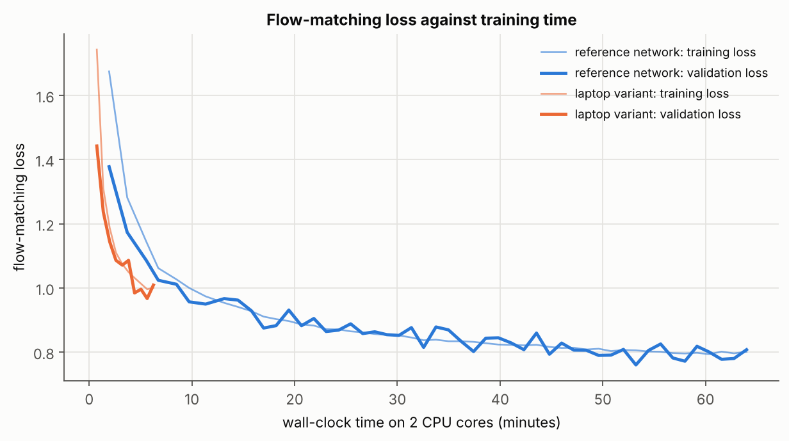

How to read the figure: the curves show the flow-matching loss against wall-clock time on 2 CPU cores, thin for the training batches and thick for the 512 validation series. Blue is the reference network and orange the laptop variant, which stops after 6.4 minutes at a loss near 1.0. The loss cannot reach zero, because many training lines pass through each point, so only its decrease matters. The training and validation curves overlap, which shows that the network does not overfit.

The laptop variant trains for 10 epochs of 200 batches, which is 256,000 series, in 6.4 minutes on the same 2 cores. This is within the 15-minute criterion. It passes SBC for 8 of 9 targets; the mean jump size falls outside the band. Its 95% intervals cover the truth in 93% to 95% of series.

The laptop variant learns the volatility level and dynamics almost as well as the reference network, but little about the jumps. Its contraction is 0.13 for the jump frequency and 0.11 for the jump-size sd, against 0.33 and 0.42 for the reference.

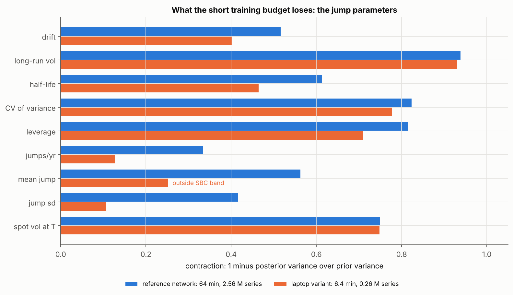

How to read the figure: each bar is the contraction of one target, 1 minus the ratio of posterior to prior variance, for the reference network (blue) and the laptop variant (orange). Longer bars mean that the data teach more. The two networks learn the volatility targets almost equally well, but the laptop variant loses most of the information on the jump parameters, and its mean jump size fails the SBC check.

### 2. Calibration and recovery

The amortized posterior is calibrated for all nine targets, so this check passed. The test used 1,000 held-out series simulated from the prior, with 500 posterior draws per series.

Every rank ECDF stays inside its 95% simultaneous band.

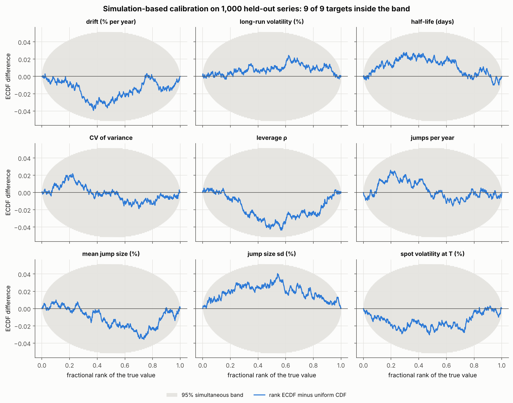

How to read the figure: each panel is one target. The curve is the ECDF of the fractional ranks of the 1,000 true values minus the uniform CDF, as in the toy figure of the Validation plan, and the grey ellipse is the 95% simultaneous band. All nine curves stay inside the band. The largest excursions have the shape of a small bias: a dip of −0.04 for leverage, as for a posterior slightly too low, and a rise of +0.04 for the jump-size sd, as for one slightly too high.

Interval coverage is close to nominal for every target. Across the nine targets, 50% intervals cover the truth in 46% to 51% of series, 90% intervals in 89% to 90%, and 95% intervals in 94% to 96%. The largest departure is the mean jump size, whose 50% intervals cover 46% of the true values.

Contraction is 1 minus the ratio of the average posterior variance to the prior variance. It measures how much of the prior uncertainty four years of returns remove.

The level of volatility is identified best: contraction is 0.94 for long-run volatility and 0.75 for today's volatility. The dynamics of volatility come next, with 0.82 for the CV of variance, 0.81 for leverage and 0.61 for the half-life. The jump parameters are identified worst, with 0.56 for the mean jump size, 0.42 for the jump size sd and 0.33 for the jump frequency. Drift sits at 0.52.

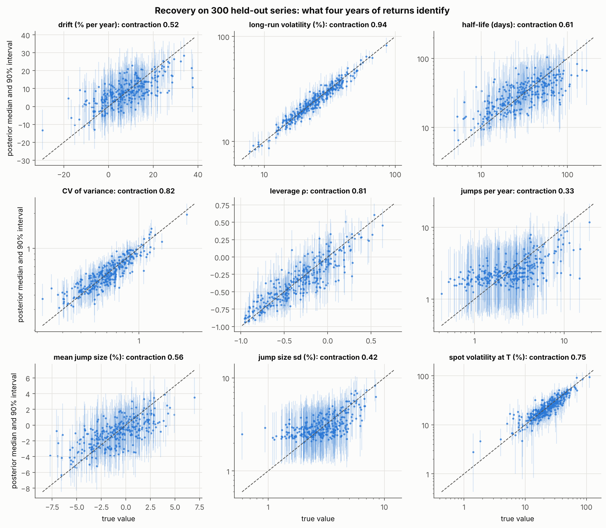

How to read the figure: each panel is one target, and each point one of 300 held-out series, at its true value (horizontal) and its posterior median (vertical), with the 90% interval as a vertical line. The dashed diagonal marks perfect recovery. Long-run and spot volatility hug the diagonal. The jump frequency and the jump-size sd form flat clouds near the prior medians of 2.5 jumps a year and 3%: four years of returns say little about them, and the posterior falls back on the prior.

Identification varies across series in the expected directions. Jump-frequency contraction is 0.24 for names with fewer than 1.8 jumps a year, and 0.43 for names with more than 3.4. Drift contraction falls from 0.67 at 7% to 20% volatility to 0.36 above 29%. Leverage contraction rises from 0.74 to 0.88 between the lowest and the highest third of CV of variance.

Leverage is better identified than expected before the study, with a contraction of 0.81. Calibration shows that the jump intervals are not too narrow on average. Whether they are wider than the exact posterior shows only in the comparison with particle MCMC (result 3).

### 3. Agreement with particle MCMC

The amortized posterior alone fails the agreement criterion on all four test series. An importance-sampling correction with the particle-filter likelihood removes most of the differences. On three series it costs 4 to 7 times less than particle MCMC; on the fourth, which lies in the tail of the prior, it saves little.

The four held-out series span the prior: rare or frequent jumps (15% and 85% quantiles of the jump frequency), crossed with low or high vol-of-variance. Particle MCMC runs four chains started at amortized draws, with proposals from the amortized posterior covariance, which favours it. The particle count is the smallest of 50, 100, 200 and 400 that brings the log-likelihood sd below 1.3. The first series ran 25,000 iterations per chain and the others 12,500, with 2,000 discarded. R-hat is at most 1.013 and bulk ESS at least 412 for every target.

| Series | Particles | Largest mean difference, amortized | Largest mean difference after importance sampling | Importance-sampling efficiency | CPU-s per 400 effective draws: particle MCMC / importance sampling |
| --- | --- | --- | --- | --- | --- |
| Rare jumps, low vol-of-variance | 100 | 0.47 sd (leverage) | below 0.3 sd | 10.5% | 304 / 45 |
| Rare jumps, high vol-of-variance | 400 | 1.57 sd (leverage) | 0.39 sd (spot volatility) | 1.5% | 1,733 / 1,315 |
| Frequent jumps, low vol-of-variance | 50 | 1.31 sd (jumps per year) | 0.36 sd (half-life) | 3.3% | 285 / 74 |
| Frequent jumps, high vol-of-variance | 100 | 0.87 sd (half-life) | below 0.3 sd | 8.0% | 429 / 59 |

Most amortized 90% intervals are within 25% of the reference width. The largest exceptions are 1.62 times wider for the mean jump size on the third series and 0.64 times as wide for spot volatility on the second. After importance sampling, all widths are within 25%.

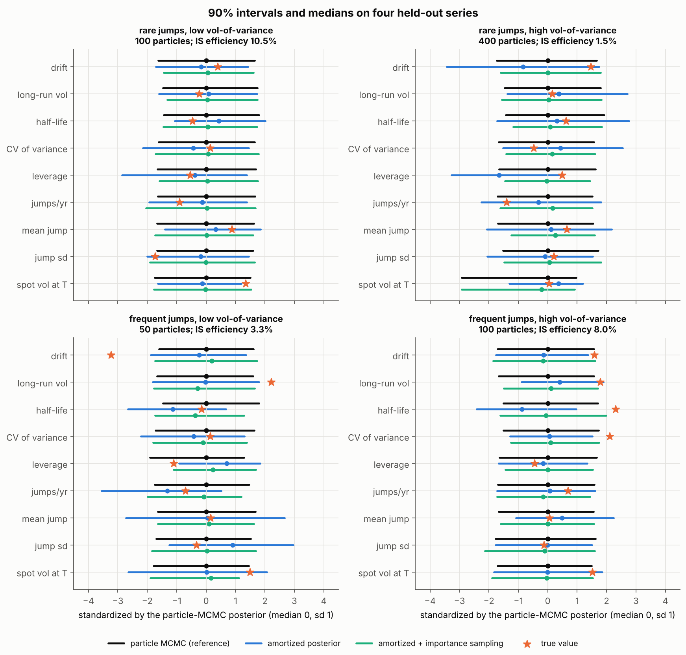

How to read the figure: each panel is one of the four series, and each row one target, with medians as dots and 90% intervals as lines. All values are standardized by the particle-MCMC posterior of that target, so the black reference interval runs from about −1.6 to +1.6 around 0. Blue is the amortized posterior, green the same after importance sampling, and the star the true value. A blue median far from 0, or a blue interval much longer or shorter than the black one, is a disagreement; the green intervals remove most of them.

The correction draws 3,000 proposals from a Student-t with 5 degrees of freedom, fitted to the amortized draws, with its scale inflated by a factor of 1.2. Each proposal is weighted by prior times filter likelihood over proposal density. The filter's likelihood estimate is unbiased, so the weighted sample converges to the exact posterior as the number of proposals grows. The share of effective draws, the efficiency, is a per-series quality score of the network.

SBC passes while single series deviate, because SBC averages ranks over many series. Errors of opposite sign on different series cancel in that average.

The hardest series has a true leverage of +0.68, outside the prior's 95% range, and a spot volatility of 4.4%. The network saw few training series like it. Its importance-sampling efficiency of 1.5% flags it, and such a series needs particle MCMC or a stronger network.

### 4. Speed

Once trained, the amortized posterior costs 1.4 CPU-seconds per series for 1,000 draws. That is 86 times less than one approximate-ML fit and about 270 times less than particle MCMC at its median cost. It misses the planned criterion of 2,000 draws in under 1 s per series: on this CPU, 2,000 draws take about 1.4 s of wall time per series.

All costs below are CPU-seconds per series on the same 2-core machine, measured as process CPU time.

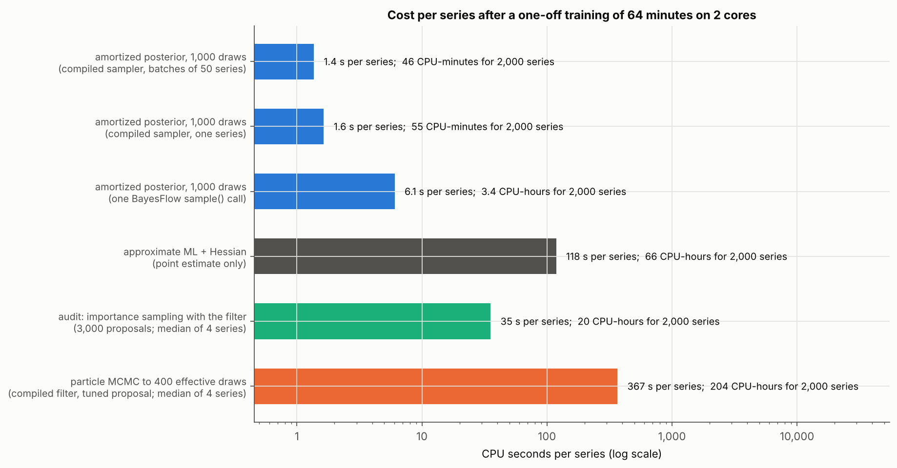

How to read the figure: each bar is the CPU time per series of one route, on a log scale, so each grid line marks a factor of 10. The label beside each bar gives the cost per series and for a 2,000-name portfolio. The three blue bars are the same amortized posterior run three ways; grey is approximate ML, green the audit and orange particle MCMC.

| Route | CPU-s per series | 2,000 names |
| --- | --- | --- |
| Amortized posterior, compiled sampler, batches of 50 series, 1,000 draws | 1.4 | 46 CPU-minutes |
| Amortized posterior, compiled sampler, one series, 1,000 draws | 1.6 | 55 CPU-minutes |
| Amortized posterior, one BayesFlow sample() call, 1,000 draws | 6.1 | 3.4 CPU-hours |
| Audit by importance sampling, 3,000 proposals | 18 to 146 (median 35) | 20 CPU-hours at the median |
| Approximate ML with Hessian | 118 | 66 CPU-hours |
| Particle MCMC, 400 effective draws | 285 to 1,733 (median 367) | 158 to 963 CPU-hours |

The sampler integrates the flow-matching ODE with 50 Euler steps. Each draw therefore costs 50 evaluations of the 5-layer velocity network, and the cost grows linearly with the number of draws. BayesFlow's sample() call compiles this loop again at every call, which explains its higher cost; a service compiles once.

Training costs at most 2.1 CPU-hours: 64 minutes on 2 cores. Against particle MCMC at its median cost, it pays for itself after 21 series. Against approximate ML, which gives only a point estimate, it pays for itself after 66 series.

### 5. Frequentist coverage

Approximate maximum likelihood does not give reliable intervals for the jump parameters. On 40 held-out series, 95% Wald intervals cover the true jump frequency in 68% of series and the true mean jump size in 60%. Posterior intervals on the same series cover them in 88% and 98%.

The baseline is the strongest classical route in the comparison table. A deterministic grid filter, in the spirit of Fridman and Harris (1998) and Bates (2006), gives the log-likelihood and its exact gradient. L-BFGS-B starts from the prior mean and from the amortized posterior median, and keeps the better optimum. The Hessian comes from finite differences of the gradient, and Wald intervals are built in the unbounded coordinates, which favours them.

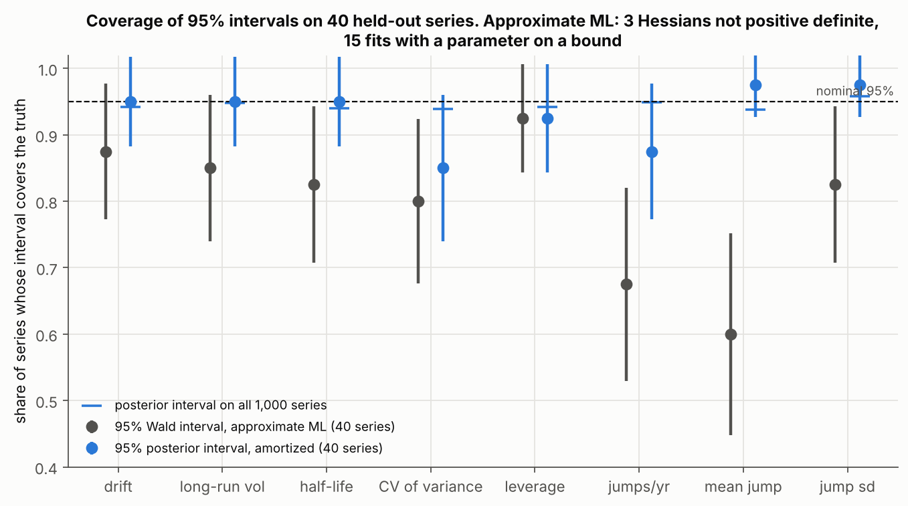

How to read the figure: each column is one parameter. The grey dot is the share of the 40 series whose 95% Wald interval contains the true value, and the blue dot the same share for the 95% posterior interval; the whiskers are 95% binomial intervals for that share. The blue tick is the posterior coverage on all 1,000 held-out series, a more precise estimate. Dots near the dashed line at 0.95 are well calibrated, and the grey dots for the jump frequency and the mean jump sit far below it.

Three problems cause the misses:

- 15 of the 40 fits put a parameter on a bound. In 12 of them, the jump-size sd collapsed to its floor of 0.2%, while the true values ranged from 1.5% to 4.7%.
- With the jump size fixed near zero, the jump frequency moves to one of two extremes: below 1 jump a year, or between 6 and 42 a year. The true median was 2.3.
- 3 of the 40 Hessians are not positive definite, so no interval exists. These count as misses; among the 37 valid fits, Wald coverage is 0.73 for the jump frequency and 0.65 for the mean jump.

Coverage alone hides the failure for the jump-size sd. Its Wald coverage is 0.83, but 15 of its 40 intervals span more than a factor of 100, so they carry no information. The posterior intervals for the same parameter span about a factor of 4 and miss the truth once in 40 series.

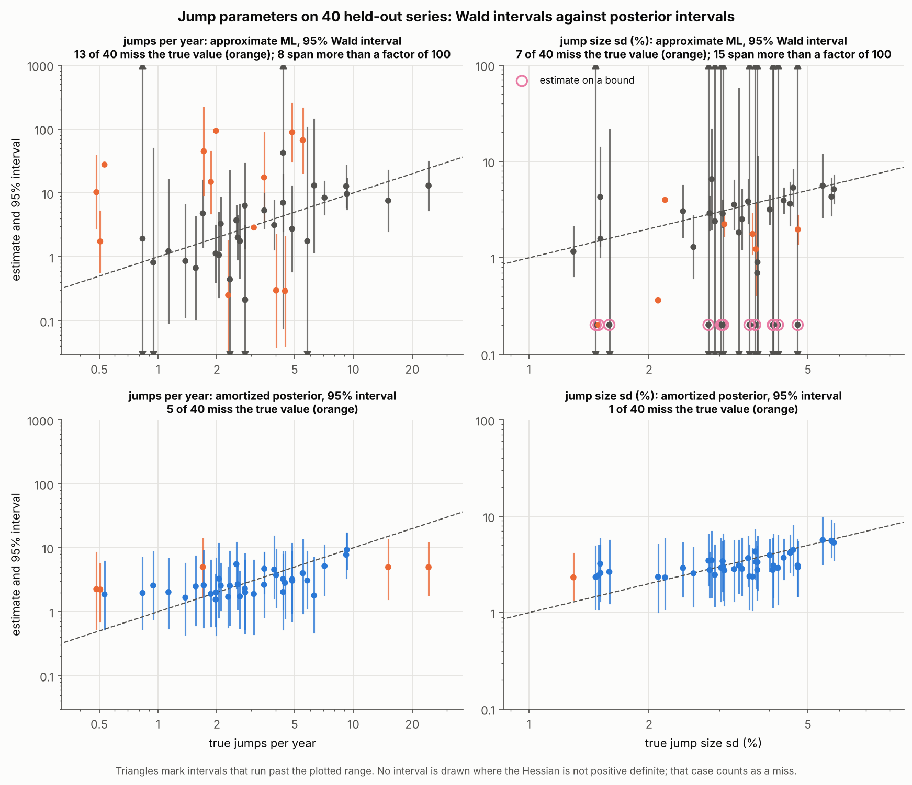

How to read the figure: each point is one of the 40 series, at its true value (horizontal) and its estimate (vertical), with the 95% interval as a vertical line, on log scales. The top row shows approximate ML with Wald intervals, and the bottom row the posterior median with the posterior interval. Orange marks an interval that misses the truth, a triangle an interval that runs off the plot, and a magenta circle an estimate on a bound. Many Wald intervals span a factor of 100 or more, while the posterior intervals are narrower and miss rarely.

The other parameters fare better. Wald coverage is 0.80 to 0.93 for drift, volatility level and volatility dynamics. Posterior coverage on the same series is 0.85 to 0.95. One approximate-ML fit costs 118 CPU-seconds, the median over the 40 series.

### 6. VaR and ES backtest

The predictive VaR and ES from the amortized posterior are calibrated. Plug-in forecasts at a point estimate understate risk, slightly for the 99% VaR and more for the 97.5% ES.

The test uses 500 held-out series. For each series and method, the true probability that the H-day loss exceeds the reported 99% VaR comes from 50,000 simulated futures under the true parameters and today's true variance. Four methods report risk:

- the predictive distribution of the amortized posterior;
- a plug-in at the posterior median, with today's variance filtered at that point;
- a plug-in at the approximate MLE, on the 40 series of the coverage study;
- a check that uses the true parameters with a filtered state, which should give 1%.

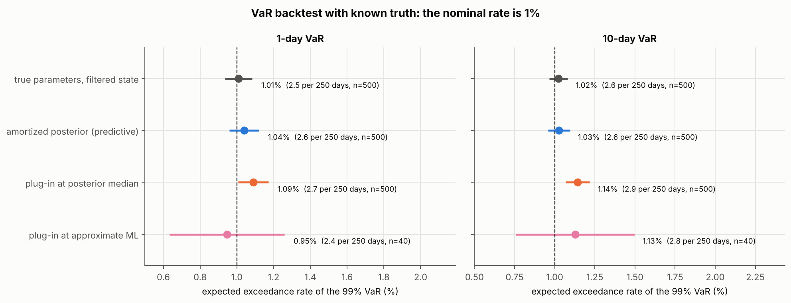

How to read the figure: each row is one method, and the dot is its expected exceedance rate of the 99% VaR, averaged over the held-out series, with a 95% interval. The dashed line marks the nominal 1%, and a dot to its right means a VaR that is too low on average. The label also converts the rate into expected exceptions over 250 days. The first row uses the true parameters with a filtered state, and it checks the test itself.

The check gives 1.01% at 1 day and 1.02% at 10 days, so the test itself is unbiased. The predictive VaR gives 1.04% and 1.03%. The plug-in at the posterior median gives 1.09% and 1.14%.

Paired on the same series, the plug-in excess over the predictive VaR is 0.05 percentage points at 1 day and 0.12 at 10 days, with standard errors of 0.02 and 0.01. In the median series, the plug-in VaR is 1.5% lower than the predictive VaR at 1 day and 2.4% lower at 10 days.

Over 250 days, these rates mean 2.7 expected exceptions for the plug-in VaR and 2.6 for the predictive VaR, against 2.5 at the nominal rate. Averaging the binomial probability over the series' exceedance probabilities, the probability of leaving the green zone within a year is 20.0% for the plug-in VaR and 18.3% for the predictive VaR (Appendix H.5).

The ES test uses the Acerbi–Szekely statistic in expectation. It is 0 for a correct ES and negative when the ES understates the loss beyond the VaR:

```math
Z_2 = 1 - \frac{\mathbb{E}\big[L\,\mathbf{1}(L > \mathrm{VaR}_{97.5\%})\big]}{0.025\;\mathrm{ES}_{97.5\%}}, \qquad L = -R_{T,H}
```

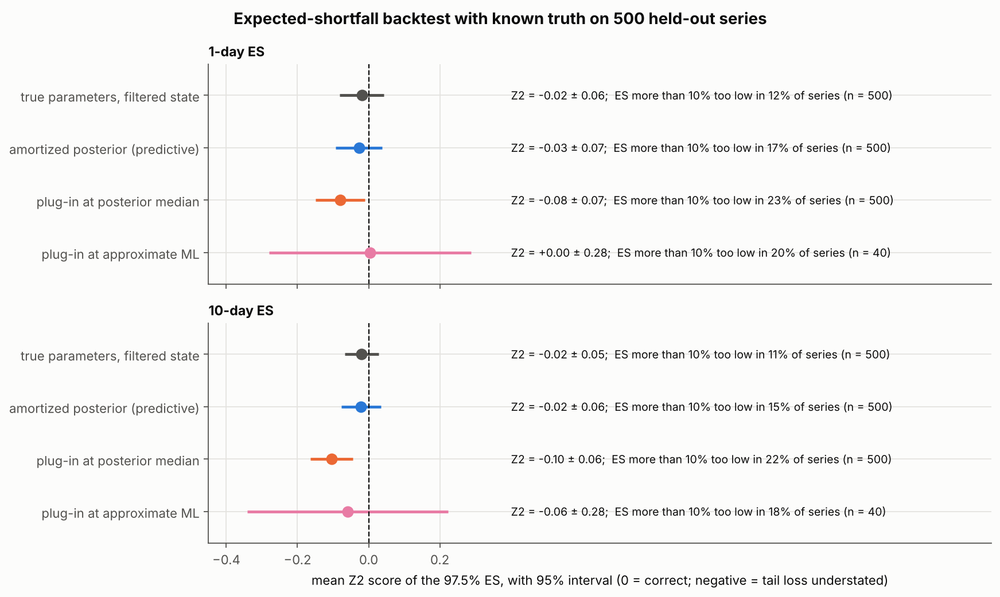

How to read the figure: each row is one method, and the dot is the mean Z2 score of its 97.5% ES, with a 95% interval. Zero means a correct ES, and a negative score means that the ES understates the loss beyond the VaR. The label also gives the share of series whose ES is more than 10% too low. The plug-in at approximate ML has a wide interval because it rests on 40 series only.

With the true parameters, Z2 is −0.02 at both horizons. The predictive ES scores −0.03 and −0.02. The plug-in ES scores −0.08 and −0.10, about 0.06 and 0.08 below the true-parameter check. Part of the gap comes from the plug-in VaR, which is exceeded too often; the rest is an ES that is too low by several percent.

Paired on the same series, the plug-in minus predictive difference is −0.05 at 1 day and −0.08 at 10 days, with standard errors of 0.014 and 0.010. The plug-in ES is more than 10% below the true ES in 22% to 23% of series, against 15% to 17% for the predictive ES. The plug-in at approximate ML is too noisy on 40 series to be separated from the other methods.

Parameter uncertainty therefore moves the expected shortfall more than the 99% VaR. This is consistent with the jump parameters being the least identified.

### 7. Real data

The amortized posterior gives sensible results on two real series. A check against the exact likelihood still finds errors on both. On the S&P 500 they barely move the VaR. On WTI the network understates current risk by about 12%.

The data are S&P 500 daily prices for 1999 to 2018 from the arch package, WTI daily spot prices to 6 Oct 2026, and the VIX for comparison. Each window holds the last 1,000 daily log returns.

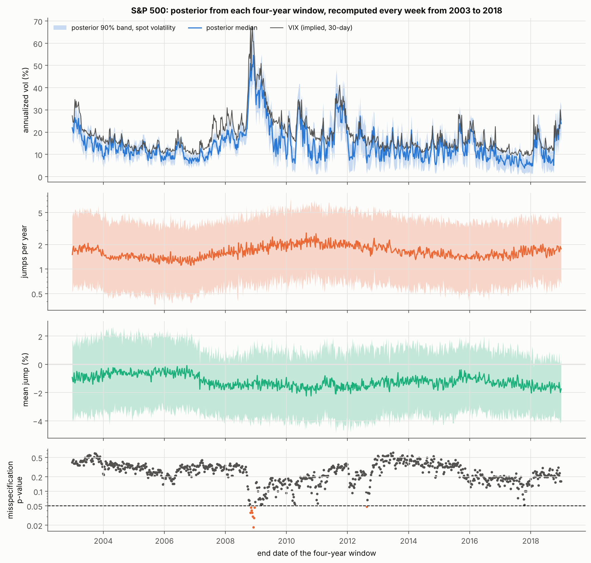

How to read the figure: each point on the horizontal axis is one four-year window, labelled by its end date. The top panel shows the posterior median of spot volatility (blue) with its 90% band, and the VIX (grey) on the same day. The two middle panels show the posterior medians and 90% bands of the jump frequency and of the mean jump size. The bottom panel shows the p-value of the misspecification check, with values below 0.05 in orange.

The posterior spot volatility tracks the VIX with a correlation of 0.93. It sits 3.9 points below the VIX in the median window, consistent with a variance risk premium in implied volatility. The jump frequency has posterior medians of 1.1 to 2.8 a year, with 90% bands of about 0.6 to 4.2. Leverage stays between −0.92 and −0.69.

The misspecification check follows Schmitt et al. (2024). It compares the learned summaries of each window with those of 2,000 simulated series, and takes p-values from 500 more. It flags 9 of 807 windows at the 5% level: the eight that end between 28 Oct and 17 Dec 2008, and one that ends on 20 Aug 2012.

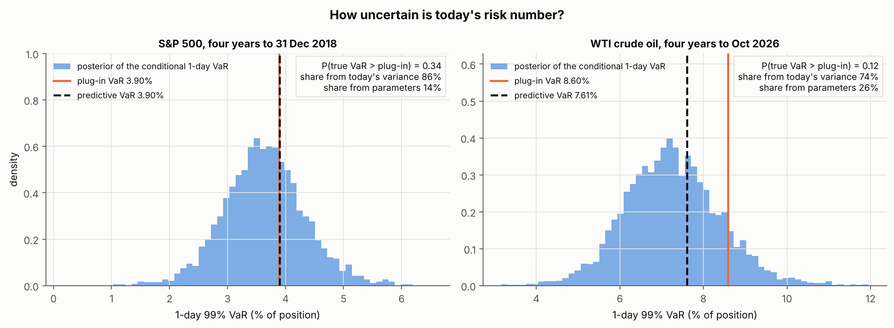

How to read the figure: each panel is one window. The histogram is the posterior of the conditional 1-day 99% VaR, one value per posterior draw. The orange line is the plug-in VaR and the black dashed line the predictive VaR. The box gives the probability that the conditional VaR exceeds the plug-in VaR, and the split of its variance between today's variance and the parameters.

For the S&P 500 window to 31 Dec 2018, the predictive and plug-in VaR are both 3.90%. The conditional VaR has a 90% interval of 2.53% to 4.82%, and today's variance carries 86% of its variance. For WTI, the predictive VaR is 7.61% and the plug-in VaR 8.60%. Its conditional VaR ranges from 5.5% to 9.2%, and the parameters carry 26% of its variance.

Both windows were then checked against the exact likelihood.

| Window | Check | Efficiency of the importance sampling | Predictive 1-day VaR: network / exact | Spot volatility: network / exact |
| --- | --- | --- | --- | --- |
| S&P 500 to 31 Dec 2018 | particle MCMC, 200 particles, 1,187 CPU-s | 0.2% | 3.90% / 3.76% | 24.1% / 24.2% |
| WTI to 6 Oct 2026 | importance sampling, 400 particles, 138 CPU-s | 1.6% | 7.61% / 8.69% (approximate) | 47.7% / 52.8% |

On the S&P 500 window, particle MCMC finds a CV of variance of 0.87 where the network finds 1.03, a gap of 2.5 posterior sd. Leverage is −0.73 against −0.80. The misspecification check did not flag this window, but the importance-sampling efficiency did. The VaR moves by only 0.14 points, because the spot volatility agrees.

The WTI window ends in an extreme spell, with realized volatility of 81% over the last 20 days and a largest daily move of 17.5%. The network puts spot volatility lower than the filter does, and its VaR is about 1 point lower than the corrected one. With an efficiency of 1.6%, about 48 effective draws, the corrected figure is approximate, and the audit flags this window for particle MCMC, as it flags the second test series at 1.5%. The plug-in with a filtered state gives 8.60%, close to the corrected figure.

## Tutorial narrative

The 40-minute advanced segment makes two separate claims. First, point estimates misstate the uncertainty of the tail parameters, and this shows in the expected shortfall. Second, amortization makes the Bayesian answer affordable for a portfolio, with an audit that checks it name by name.

| Minutes | Act | Message | Evidence on screen |
| --- | --- | --- | --- |
| 0–5 | The question | A risk team must report 10-day 99% VaR and 97.5% ES for 2,000 names each morning. The SVJ model is standard; estimating it every morning is the problem. | One four-year path with its crash days; the latent volatility it hides |
| 5–11 | Point estimates fail for the tail | Approximate ML returns a point and Wald intervals. For the jump parameters, these intervals cover the truth in 60% to 68% of series, and 15 of 40 fits sit on a bound. | Wald against posterior coverage; jump parameters with both kinds of interval; the HKDE slide as a second case |
| 11–15 | The exact answer is slow | Particle MCMC gives the posterior at 5 to 29 CPU-minutes per name, which is 158 to 963 CPU-hours for 2,000 names. | Measured cost per series and per portfolio |
| 15–22 | Amortize | Simulate, train once in 64 minutes on 2 cores, then infer in about a second per name. | The simulator; the training curve; posteriors for 100 series timed live; rolling S&P 500 posteriors |
| 22–30 | Validate the network | SBC shows calibration on average. Particle MCMC shows errors on single series. An importance-sampling audit with the filter corrects them and flags the hard names. | SBC; recovery; overlay of amortized, audited and particle-MCMC posteriors; audit efficiency; the WTI case |
| 30–37 | Consequences for risk | Ignoring parameter uncertainty leaves the 99% VaR almost unchanged but makes the 10-day 97.5% ES too low, with a Z2 score of −0.10 against −0.02. Today's variance carries most of the uncertainty of the risk number. | VaR and ES backtests; posterior of the conditional VaR with its state and parameter shares |
| 37–40 | Limits and hand-over | Priors decide the unidentified directions, the simulator must match the data, and the audit catches names where the network is off. | Prior sensitivity; the misspecification check flagging late 2008; pointer to the final segment |

### Notebook outline

The segment runs on one marimo notebook. Expensive steps are precomputed and loaded; the live cells fit a laptop CPU.

1. **Model and simulator.** Simulate and plot one path; run the prior predictive check. Live, under 5 s.
2. **Classical baseline.** Fit approximate ML to one series and show its Wald intervals, then the coverage figure from the study. Precomputed, with an optional live fit of about 2 minutes.
3. **Particle MCMC.** Load the reference chains; run 2,000 live iterations with 100 particles to show the cost per iteration. Live part about 25 s.
4. **Amortized posterior.** Load pretrained weights; sample one posterior; time 100 series in one batch. Live, about 1 to 2 minutes on a laptop CPU.
5. **Diagnostics.** SBC on 200 held-out series, recovery plots, and the overlay with particle MCMC. Live SBC about one minute; overlay precomputed.
6. **Audit.** Importance sampling with the filter for one series: 1,000 filter runs with 100 particles, about 12 CPU-seconds. Show the efficiency and the corrected posterior, then the WTI case. Live.
7. **Real data.** Rolling posteriors for the S&P 500 and the misspecification check. Precomputed, with one window live.
8. **Risk.** Predictive VaR and ES, the plug-in comparison, the uncertainty split and the backtest figures. Live, under one minute.
9. **Take-home exercises.** Change the prior on jump frequency; train the laptop variant in about 6 minutes; switch to jumps in variance (SVCJ).

## Risks and open decisions

The main risks are compute on participants' laptops, errors of the network on single series, and claims about frequentist methods and speed that must stay measured.

| Risk | Effect | Mitigation |
| --- | --- | --- |
| Training is too slow on laptops | No time to train in the room | Ship pretrained weights. The laptop variant trains in 6.4 minutes but learns little about jumps, so use it only to show training. Provide a cloud notebook as fallback |
| The network is off for a single name | A confident but wrong posterior for that name | Audit every name by importance sampling with the filter; a low efficiency sends the name to particle MCMC. In the study, errors reach 1.6 posterior sd on simulated series and 2.5 sd on the S&P 500 |
| The network is miscalibrated where the data say little | Overconfident intervals for jump parameters | Keep the reference training budget, which passes SBC for all 9 targets, for every risk result |
| Real returns fall outside the simulator | A confident but wrong posterior | Run the misspecification check, which flags the late-2008 windows of the S&P 500; prepare a variant with jumps in variance or fat-tailed shocks |
| The prior decides the unidentified directions | Results for the crash component depend on the prior | Show the prior sensitivity explicitly and hand over to the final segment on changing priors |
| The frequentist critique sounds overstated | Loss of credibility with econometricians | Claim only what was measured: Wald coverage of 0.60 to 0.68 for jump parameters and a 10-day ES with a Z2 score of −0.10 against −0.02. State that the 99% VaR moves little, and cite Bates (2006) as the strong frequentist route |
| The speed claim sounds overstated | Loss of credibility with practitioners | Quote CPU-seconds per name and per portfolio, not milliseconds |
| Installation and backend issues | Lost time in the room | Pin versions; provide a container image and a hosted notebook |
| The discrete model differs from continuous-time results | Confusion when comparing with published estimates | State that the daily Euler model is the model, as in Eraker, Johannes and Polson (2003) |

### Decisions for the organizers

- [ ] Fixed length of 1,000 days, or variable length from 500 to 2,500 days with missing days, for the tutorial network.
- [ ] SVJ (jumps in returns), or SVCJ (jumps in returns and variance), as the main example.
- [ ] Real assets for the demo: S&P 500 history bundled with the arch package (1999–2018), a recent public series, or one single stock with earnings jumps.
- [ ] Keras backend for participants: JAX or PyTorch.
- [ ] Hosting of pretrained weights and data: GitHub release or Hugging Face.
- [ ] Whether the maximum-likelihood baseline runs live or is precomputed.
- [ ] Audit threshold: the efficiency below which a name goes to particle MCMC. In the study, efficiencies ranged from 0.2% to 10.5%.

## Appendix A. Current VaR practice and what it misses

Most banks compute VaR by historical simulation on one year of unweighted data. The method is fast and transparent, but it reacts late to volatility, treats a jump as a lasting change in risk, and reports no uncertainty about itself. On simulated SVJ data, unweighted historical simulation is exceeded 3.5 times too often on the riskiest fifth of days.

### A.1 What banks use

**Historical simulation (HS).** The bank revalues today's portfolio under each of the last W daily risk-factor changes, gives each scenario weight 1/W, and reads VaR off the empirical quantile. For a single return series y:

```math
\mathrm{VaR}^{\mathrm{HS}}_{t+1} = -\,\hat q_{0.01}\big(y_{t-W+1}, \dots, y_t\big)
```

**Filtered historical simulation (FHS).** Each past return is first divided by the volatility estimate of its own day, then multiplied by today's estimate (Hull and White 1998; Barone-Adesi, Giannopoulos and Vosper 1999). With an EWMA volatility of decay δ:

```math
\hat\sigma^2_{t+1} = \delta\,\hat\sigma^2_{t} + (1-\delta)\,y_t^2, \qquad z_s = \frac{y_s}{\hat\sigma_s}, \qquad \mathrm{VaR}^{\mathrm{FHS}}_{t+1} = -\,\hat\sigma_{t+1}\;\hat q_{0.01}\big(z_{t-W+1}, \dots, z_t\big)
```

The evidence on what banks actually run is consistent over two decades:

- In public disclosures of US and international banks for 1996–2005, historical simulation was by far the most popular VaR method ([Pérignon and Smith 2010](https://hal-hec.archives-ouvertes.fr/hal-00528391)).
- In the EBA's 2025 benchmarking of all 43 EU banks with approved market-risk models, 67% use historical simulation (29 banks, against 9 using Monte Carlo and 2 parametric). 57% use the minimum look-back of one year, 77% use unweighted data, and most scale 1-day VaR to 10 days by √10 ([EBA 2026](https://eba.europa.eu/sites/default/files/2026-06/5430e673-4f48-4852-9018-31c1fc38118f/EBA%20Report%20results%20from%20the%202025%20Market%20Risk%20Benchmarking%20Exercise%20-%20IMA.pdf), section 4.2.2).
- HS and FHS are described as the most popular VaR forecast methods at commercial banks ([Escanciano and Pei 2012](https://e-archivo.uc3m.es/entities/publication/82e1de12-f8d3-4369-bcc2-f06931aab9fa)).

The typical bank model is therefore unweighted HS on one year of data; FHS is the main refinement.

### A.2 What these methods miss

1. **HS reacts late to volatility.** Every day in the window has the same weight, so a rise in volatility moves the 1% quantile only after several large losses have entered the window. Pritsker (2006) shows that HS is under-responsive to changes in conditional risk. O'Brien and Szerszen (2017) find that bank VaRs, mostly HS, were conservative before 2007 but had excessive and clustered exceedances in the crisis, where GARCH benchmarks did better.
2. **Neither method separates a jump from a change in volatility.** HS keeps a crash in its window for W days and then drops it at once. FHS feeds the crash into the EWMA variance, so its VaR jumps the next day and decays over weeks. In an SVJ world a jump says nothing about today's variance. It says something about the jump frequency and jump size, which are parameters.
3. **Neither method reports uncertainty about itself.** With W = 250, the 1% quantile rests on the two or three worst days of the year. The window length, the decay δ and the quantile estimator are fixed by convention, and the output is one number. Supervisors ask for the range of values a model could take (see The practitioner problem), and a single quantile does not give it.

### A.3 Evidence on simulated SVJ data

The test draws 400 parameter vectors from the prior and simulates 1,500 days for each. On the last 1,000 days, three methods report a 1-day 99% VaR every day. They are HS with 250 unweighted days, FHS with EWMA decay 0.94 and 500 days of filtered returns, and the true conditional VaR from the true parameters and today's true variance. Each VaR is compared with the next day's return.

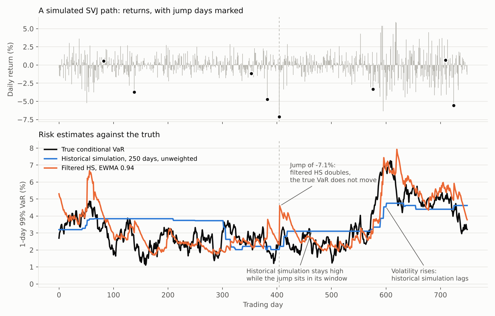

How to read the figure: the top panel shows the daily returns of one simulated path at the prior-median parameters, with jump days as black dots. The bottom panel shows three 1-day 99% VaR series: historical simulation over 250 days (blue), filtered historical simulation with EWMA decay 0.94 (orange), and the true conditional VaR from the true parameters and today's true variance (black). The dotted vertical line marks the −7.1% jump.

The example path shows all three gaps. A −7.1% jump arrives on a calm day. The next day FHS reports 4.6% against a true VaR of 2.4%. Sixty days later HS still reports 3.1% against a true 1.8%, because the jump is still in its window. When volatility rises around day 590, HS reports 3.3% against a true 6.5%, about half the true value.


How to read the figure: the left panel shows how often each method's VaR is exceeded, on all days, on the other days and on the fifth of days with the highest true VaR; the dashed line is the nominal 1%. The right panel shows the median ratio of reported to true VaR when no large jump occurred in the last 250 days, and in the 60 days after a large jump; a ratio of 1 means no bias. Whiskers are 95% intervals.

Across the 400 series:

- HS is exceeded on 1.53% of days, FHS on 1.18% and the true VaR on 0.99%. At 1.53%, a 250-day backtest expects 3.8 exceptions, close to the end of the green zone at 4.
- The excess is concentrated where it matters. On the fifth of days with the highest true VaR, HS is exceeded on 3.45% of days and FHS on 1.62%. On the other days both are close to 1%.
- After a large jump both methods overstate risk. In the 60 days that follow, the median ratio of reported to true VaR is 1.12 for HS and 1.20 for FHS, against 1.04 and 1.06 when no large jump occurred in the last 250 days.

HS is therefore too low when risk is high and too high after jumps. It overstates risk on average and is still exceeded too often. FHS fixes most of the lag but mistakes jumps for volatility.

### A.4 What the SVJ approach adds, and what it does not

The SVJ posterior separates the two sources of tail risk. Today's variance is a filtered state that moves the VaR from day to day. The jump frequency and size are parameters that move slowly as evidence accumulates. The posterior also attaches a range to the VaR, which HS and FHS cannot.

The comparison has limits that the tutorial should state:

- HS revalues a whole portfolio under joint historical scenarios and needs no model of dependence between risk factors. The SVJ example is a single name.
- The realistic use is as a challenger model for single names, a benchmark for model validation, or a source of the parameter range that SS1/23 asks for. It is not a replacement for a bank's portfolio HS engine.
- In the EU, most banks now on internal models are expected to move their capital calculation to the standardised approach under FRTB (EBA 2026, paragraph 41). The case for the tutorial therefore rests on risk management and model validation more than on regulatory capital.

### A.5 Evidence that the problem is real

The table separates what the sources show from what the tutorial proposes.

| Claim | What the source shows | Source |
| --- | --- | --- |
| HS dominates bank VaR | Most popular method in disclosures 1996–2005; 67% of EU internal-model banks in 2025, mostly one year and unweighted | [Pérignon and Smith 2010](https://hal-hec.archives-ouvertes.fr/hal-00528391); [EBA 2026](https://eba.europa.eu/sites/default/files/2026-06/5430e673-4f48-4852-9018-31c1fc38118f/EBA%20Report%20results%20from%20the%202025%20Market%20Risk%20Benchmarking%20Exercise%20-%20IMA.pdf) |
| HS VaR reacts late and fails in stress | HS under-responsive to conditional risk; HS VaR carries little information about future volatility; bank VaR exceedances excessive and clustered in 2007–2009 | [Pritsker 2006](https://www.federalreserve.gov/econres/feds/the-hidden-dangers-of-historical-simulation.htm); [Pérignon and Smith 2010](https://hal-hec.archives-ouvertes.fr/hal-00528391); [O'Brien and Szerszen 2017](https://www.federalreserve.gov/econres/feds/an-evaluation-of-bank-var-measures-for-market-risk-during-and-before-the-financial-crisis.htm) |
| Standard backtests may not catch it | The unconditional backtest is inconsistent for HS and FHS | [Escanciano and Pei 2012](https://e-archivo.uc3m.es/entities/publication/82e1de12-f8d3-4369-bcc2-f06931aab9fa) |
| Risk is computed daily, at scale | ES must be computed daily for the bank and for each trading desk on internal models | [Basel MAR33.2](https://www.bis.org/committees/bcbs/basel-framework/81327/chapter.pdf) |
| Supervisors ask for parameter uncertainty | Model uncertainty includes uncertainty in parameter estimates (PRA); model risk grows with "higher uncertainty about inputs and assumptions" (Fed and OCC); prudent valuation charges for a range of calibrations (EU) | [PRA SS1/23](https://www.bankofengland.co.uk/-/media/boe/files/prudential-regulation/supervisory-statement/2023/ss123.pdf); [SR 11-7](https://www.federalreserve.gov/supervisionreg/srletters/sr1107.htm); [Regulation (EU) 2016/101](https://eur-lex.europa.eu/legal-content/EN/TXT/HTML/?uri=CELEX:32016R0101) |
| Estimation risk in VaR is material and unsolved in practice | Estimation error widens VaR intervals substantially; regulators want model risk assessed, but no accepted method exists | [Christoffersen and Gonçalves 2005](https://doi.org/10.21314/JOR.2005.112); [Boucher et al. 2014](https://eprints.lse.ac.uk/56869) |

No source shows banks estimating an SVJ model per name for VaR. That step is the tutorial's proposal. The documented gap is a daily risk number with no measure of its own parameter uncertainty, and SVJ with amortized inference is one way to fill it.

## Appendix B. From the continuous-time model to the daily model

The daily model follows from the Bates equations by integrating over one trading day and making four approximations. At a 10-day horizon they change VaR and ES by at most 1.5% in the three settings tested. At a 1-day horizon they lower VaR and ES by 2% to 13%, depending on how much variance moves within a day.

### Step 1. Integrate over one day

Time is measured in trading days, so one step is Δ = 1. Integrating both equations from t − 1 to t gives two exact identities:

```math
\begin{aligned}
\log S_t - \log S_{t-1} &= \int_{t-1}^{t} \mu\,ds + \int_{t-1}^{t} \sqrt{V_s}\,dW^{S}_s + \big(J_t - J_{t-1}\big),\\
V_t - V_{t-1} &= \int_{t-1}^{t} \kappa\,(\theta - V_s)\,ds + \int_{t-1}^{t} \sigma_v \sqrt{V_s}\,dW^{V}_s .
\end{aligned}
```

The first integral equals μ. The other integrals depend on the path of the variance inside the day, which is unknown.

### Step 2. Hold the variance fixed within the day (Euler step)

The Euler–Maruyama step replaces V\_s by its value at the start of the day, v\_{t−1}. A Brownian increment over one day is a standard normal draw. Two independent draws ε¹ and ε² build the two correlated increments:

```math
\begin{aligned}
W^{S}_t - W^{S}_{t-1} &= \varepsilon^{1}_t, \qquad W^{V}_t - W^{V}_{t-1} = \rho\,\varepsilon^{1}_t + \sqrt{1-\rho^2}\,\varepsilon^{2}_t, \qquad \varepsilon^{1}_t, \varepsilon^{2}_t \overset{\text{iid}}{\sim} \mathcal{N}(0, 1),\\
\int_{t-1}^{t} \sqrt{V_s}\,dW^{S}_s &\approx \sqrt{v_{t-1}}\;\varepsilon^{1}_t,\\
\int_{t-1}^{t} \kappa(\theta - V_s)\,ds &\approx \kappa\,(\theta - v_{t-1}),\\
\int_{t-1}^{t} \sigma_v\sqrt{V_s}\,dW^{V}_s &\approx \sigma_v \sqrt{v_{t-1}}\,\big(\rho\,\varepsilon^{1}_t + \sqrt{1-\rho^2}\,\varepsilon^{2}_t\big).
\end{aligned}
```

The two increments have variance 1 and correlation ρ, as d⟨W^S, W^V⟩ = ρ dt requires. The drift error is small: with a 30-day half-life, κΔ = 0.023. The larger error comes from the variance shock within the day. In the continuous model the variance moves during the day, so the one-day return is a mixture of normals with random variance. In the daily model the one-day return is exactly normal given v\_{t−1}, apart from the jump.

### Step 3. Replace the Poisson count by a Bernoulli indicator

The jump part over one day sums K\_t = N\_t − N\_{t−1} jump sizes, where K\_t is Poisson with mean λ. The daily model allows at most one jump per day:

```math
J_t - J_{t-1} = \sum_{n=N_{t-1}+1}^{N_t} \xi_n, \quad K_t \sim \mathrm{Poisson}(\lambda) \qquad \longrightarrow \qquad B_t\,\xi_t, \quad B_t \sim \mathrm{Bernoulli}(\lambda), \quad \xi_t \sim \mathcal{N}(\mu_J, \sigma_J^2)
```

The two laws differ by terms of order λ². Two or more jumps on one day have probability about λ²/2, which is 5 × 10⁻⁵ at 2.5 jumps a year. The probability of a jump day is λ in the daily model and 1 − e^{−λ} in the continuous one; these also differ by about λ²/2. Jumps hit the price only, so no jump term enters the variance equation.

### Step 4. Keep the variance positive with a floor

The Euler step can make the variance negative, because its shock is normal and unbounded. The daily model therefore sets v\_t = max(·, v\_min) with v\_min = 0.001 %² per day (0.5% annualized). In the check below, the floor binds on 3% of days in setting B (c = 1.1) and on almost no days at the prior median.

### Step 5. Units and the starting variance

Returns are in percent: y\_t = 100 (log S\_t − log S\_{t−1}). The variance v\_t is then in %² per day, the drift μ in % per day, and λ in jumps per day. Annualized volatility is √(252 v)/100, and 252λ is the number of jumps per year.

The first variance v\_0 is drawn from the stationary law of the continuous-time variance, a Gamma law:

```math
V_\infty \sim \mathrm{Gamma}\!\left(\text{shape} = \frac{2\kappa\theta}{\sigma_v^2},\ \text{scale} = \frac{\sigma_v^2}{2\kappa}\right) = \mathrm{Gamma}\!\left(\frac{1}{c^2},\ \theta c^2\right), \qquad \mathbb{E}[V_\infty] = \theta, \qquad \frac{\mathrm{sd}(V_\infty)}{\mathbb{E}[V_\infty]} = c
```

This is why c is called the coefficient of variation of variance. The Gamma law is stationary for the continuous model, and close to stationary for the daily chain when κ is small.

### Step 6. The daily model

Steps 1 to 5 together give the model used everywhere in the study:

```math
\begin{aligned}
y_t &= \mu + \sqrt{v_{t-1}}\,\varepsilon^{1}_t + B_t\,\xi_t,\\
v_t &= \max\!\Big( v_{t-1} + \kappa\,(\theta - v_{t-1}) + \sigma_v \sqrt{v_{t-1}}\,\big(\rho\,\varepsilon^{1}_t + \sqrt{1-\rho^2}\,\varepsilon^{2}_t\big),\ v_{\min} \Big).
\end{aligned}
```

### Step 7. The conditional laws the particle filter uses

Given v\_{t−1}, the return is normal with mean μ and variance v\_{t−1} on a day without a jump, and normal with mean μ + μ\_J and variance v\_{t−1} + σ\_J² on a jump day. Averaging the two with weights 1 − λ and λ gives the mixture density in the section on the likelihood.

Given the return, the price shock ε¹ is known up to the jump size. Substituting it into the variance equation gives:

```math
\varepsilon^{1}_t = \frac{y_t - \mu - B_t\,\xi_t}{\sqrt{v_{t-1}}} \quad\Longrightarrow\quad v_t = v_{t-1} + \kappa(\theta - v_{t-1}) + \sigma_v\,\rho\,\big(y_t - \mu - B_t\,\xi_t\big) + \sigma_v\sqrt{(1-\rho^2)\,v_{t-1}}\;\varepsilon^{2}_t \quad \text{(before the floor)}
```

Without a jump, v\_t is normal with mean v\_{t−1} + κ(θ − v\_{t−1}) + σ\_v ρ (y\_t − μ) and variance σ\_v²(1 − ρ²) v\_{t−1}. With a jump, ξ\_t given y\_t is normal with mean m\_ξ and variance s\_ξ², and averaging over ξ\_t adds σ\_v² ρ² s\_ξ² to the variance. These are the two branches in the section on the likelihood. The filter uses them without further approximation, so it adds no error beyond Monte Carlo noise.

### How much the approximations matter

The check simulates the continuous model with 50 Euler sub-steps per day, Poisson jump counts per sub-step and a full-truncation floor at zero. It compares the result with the daily model, 400,000 paths each, starting from v\_0 = θ. The 2-standard-error bands come from 8 independent batches. Three settings span the prior:

| Setting | Long-run vol | Half-life | c | ρ | Jumps per year | μ\_J | σ\_J |
| --- | --- | --- | --- | --- | --- | --- | --- |
| A: prior median | 25% | 30 days | 0.6 | −0.4 | 2.5 | −1% | 3% |
| B: fast, rough variance | 25% | 8 days | 1.1 | −0.7 | 2.5 | −1% | 3% |
| C: frequent jumps | 25% | 30 days | 0.6 | −0.4 | 10 | −2% | 4% |

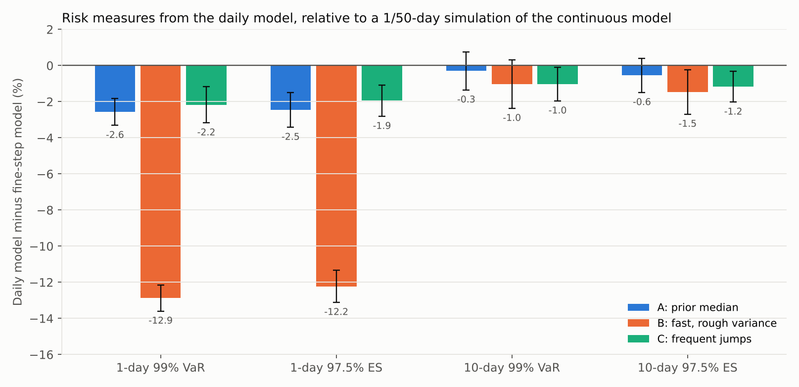

How to read the figure: each bar is the relative difference between a risk measure from the daily model and the same measure from a simulation of the continuous model with 50 steps per day, in one parameter setting. A negative bar means that the daily model reports less risk. The whiskers are two standard errors from 8 independent batches. The 1-day bars are clearly negative in all three settings, most of all in setting B, while the 10-day bars stay within 1.5% of zero.

The daily model gives lower 1-day risk. The 1-day 99% VaR is 2.6% lower in setting A, 12.9% lower in setting B and 2.2% lower in setting C. At 10 days the gap shrinks to 0.3% to 1.5%, close to the Monte Carlo error of about 1%.

The 1-day gap comes from Step 2. The continuous model lets variance move within the day, which fattens the tails of the one-day return; the daily model does not. Over 10 days the daily variance moves from day to day, which recovers most of that mixing. The gap is largest in setting B, where variance moves fastest.

Three consequences follow for the tutorial:

1. The simulator, the particle filter, the network and the forecasts all use the daily model, so the study is internally consistent.
2. Parameters estimated with the daily model are not exactly the continuous-time parameters. To match the 1-day tails of setting B, the daily model needs more vol-of-variance or larger jumps. Comparisons with published continuous-time estimates should allow for this.
3. The 10-day VaR and ES depend little on the time step. The 1-day numbers, used in the real-data examples, sit 2% to 13% below those of the continuous-time model with the same parameters.

## Appendix C. The likelihood and the particle filter

This appendix derives the densities used in Lesson 3, proves that the particle filter's likelihood estimate is unbiased, and describes the grid filter of the maximum-likelihood baseline. Throughout, ϑ is fixed and dropped from the notation, and φ(x; m, s²) is the normal density.

### C.1 The prediction decomposition

The rule p(a, b) = p(a) p(b ∣ a), applied T − 1 times, splits the joint density of the returns into one-day-ahead densities:

```math
p(y_{1:T}) = p(y_1)\, p(y_2 \mid y_1)\, p(y_3 \mid y_{1:2}) \cdots p(y_T \mid y_{1:T-1}) = \prod_{t=1}^{T} p(y_t \mid y_{1:t-1})
```

### C.2 The return density given yesterday's variance

Condition on the jump indicator B\_t and apply the law of total probability. Without a jump, y\_t = μ + √v\_{t−1} ε¹\_t is normal with mean μ and variance v\_{t−1}. With a jump, y\_t adds an independent normal ξ\_t, so it is normal with mean μ + μ\_J and variance v\_{t−1} + σ\_J²:

```math
p(y_t \mid v_{t-1}) = \Pr(B_t = 0)\, p(y_t \mid v_{t-1}, B_t = 0) + \Pr(B_t = 1)\, p(y_t \mid v_{t-1}, B_t = 1) = (1-\lambda)\,\phi(y_t; \mu, v_{t-1}) + \lambda\,\phi(y_t; \mu + \mu_J, v_{t-1} + \sigma_J^2)
```

### C.3 The jump, given the return

Bayes' rule gives the probability of a jump on day t once y\_t is known:

```math
\pi_t(v_{t-1}) = \Pr(B_t = 1 \mid y_t, v_{t-1}) = \frac{\lambda\,\phi(y_t; \mu + \mu_J, v_{t-1} + \sigma_J^2)}{(1-\lambda)\,\phi(y_t; \mu, v_{t-1}) + \lambda\,\phi(y_t; \mu + \mu_J, v_{t-1} + \sigma_J^2)}
```

On a jump day, ξ\_t and y\_t are jointly normal with Cov(ξ\_t, y\_t) = σ\_J² and Var(y\_t) = v\_{t−1} + σ\_J². The conditional law of a normal given another normal then gives the jump size:

```math
\xi_t \mid y_t, B_t = 1 \;\sim\; \mathcal{N}\big(m_\xi, s_\xi^2\big), \qquad m_\xi = \mu_J + \frac{\sigma_J^2}{v_{t-1} + \sigma_J^2}\,(y_t - \mu - \mu_J), \qquad s_\xi^2 = \sigma_J^2 - \frac{\sigma_J^4}{v_{t-1} + \sigma_J^2} = \frac{\sigma_J^2\, v_{t-1}}{v_{t-1} + \sigma_J^2}
```

### C.4 The variance, given the return

The return fixes the price shock up to the jump: ε¹\_t = (y\_t − μ − B\_t ξ\_t) / √v\_{t−1}. Substituting it into the variance equation of the daily model gives, before the floor:

```math
v_t = v_{t-1} + \kappa(\theta - v_{t-1}) + \sigma_v \rho\,(y_t - \mu - B_t \xi_t) + \sigma_v \sqrt{(1-\rho^2)\, v_{t-1}}\;\varepsilon^{2}_t
```

Without a jump this is normal, with mean v\_{t−1} + κ(θ − v\_{t−1}) + σ\_v ρ (y\_t − μ) and variance σ\_v² (1 − ρ²) v\_{t−1}. With a jump, v\_t is linear in the two independent normals ξ\_t and ε²\_t, so it is normal with mean v\_{t−1} + κ(θ − v\_{t−1}) + σ\_v ρ (y\_t − μ − m\_ξ) and variance σ\_v² (1 − ρ²) v\_{t−1} + σ\_v² ρ² s\_ξ². The floor then moves the probability mass below v\_min onto v\_min. These are the two branches of Lesson 3, mixed with weights 1 − π\_t and π\_t.

### C.5 The filtering recursion

The pair (y\_t, v\_t) depends on the past only through v\_{t−1}, so p(y\_t, v\_t ∣ v\_{t−1}, y\_{1:t−1}) = p(y\_t ∣ v\_{t−1}) p(v\_t ∣ v\_{t−1}, y\_t). Integrating out v\_{t−1} gives the predictive density of the return and the update of the filtering density:

```math
\begin{aligned}
p(y_t \mid y_{1:t-1}) &= \int p(y_t \mid v_{t-1})\; p(v_{t-1} \mid y_{1:t-1})\; dv_{t-1},\\
p(v_t \mid y_{1:t}) &= \frac{1}{p(y_t \mid y_{1:t-1})} \int p(v_t \mid v_{t-1}, y_t)\; p(y_t \mid v_{t-1})\; p(v_{t-1} \mid y_{1:t-1})\; dv_{t-1}.
\end{aligned}
```

The recursion starts from the stationary law of v\_0, and each day uses only the previous day's filtering density.

### C.6 The fully adapted particle filter

The filter replaces the filtering density by N particles. Given equally weighted particles v\_{t−1}^(1), …, v\_{t−1}^(N), one day takes four steps:

1. Compute the weights w^(i) = p(y\_t ∣ v\_{t−1}^(i)) and the daily estimate p̂\_t = (1/N) Σ\_i w^(i).
2. Choose N ancestor indices a^(i) so that particle j has on average N w^(j) / Σ\_k w^(k) offspring. Systematic resampling does this with one uniform draw U and the points (U + i − 1)/N for i = 1, …, N.
3. For each particle, draw B^(i) with probability π\_t(v\_{t−1}^(a(i))), and on a jump draw ξ^(i) from N(m\_ξ, s\_ξ²).
4. Draw v\_t^(i) from the conditional normal law of C.4, given v\_{t−1}^(a(i)), y\_t, B^(i) and ξ^(i), and apply the floor.

The filter is called fully adapted because the weights use the exact density of the new return and the new particles come from their exact conditional law given that return. The new particles are therefore equally weighted, and the likelihood estimate is L̂ = p̂\_1 p̂\_2 ⋯ p̂\_T.

### C.7 The likelihood estimate is unbiased

Let F\_t be everything the filter has drawn up to and including the particles v\_t^(1), …, v\_t^(N). The claim is that, for every day t and every bounded function f,

```math
\mathbb{E}\Big[\Big(\prod_{s=1}^{t} \hat p_s\Big)\, \frac{1}{N} \sum_{i=1}^{N} f\big(v_t^{(i)}\big)\Big] = \int f(v_t)\; p(v_t, y_{1:t})\; dv_t .
```

At t = 0 the product is empty and the particles are independent draws from p(v\_0), so the claim holds. Assume it holds at t − 1. Given F\_{t−1}, particle j receives on average N w^(j) / Σ\_k w^(k) offspring, and each offspring is moved with p(v\_t ∣ v\_{t−1}^(j), y\_t). The argument uses only this average, which systematic resampling preserves. Since p̂\_t = (1/N) Σ\_k w^(k) is known given F\_{t−1},

```math
\mathbb{E}\Big[\hat p_t\, \frac{1}{N}\sum_{i} f\big(v_t^{(i)}\big) \,\Big|\, F_{t-1}\Big] = \frac{1}{N}\sum_{j} w^{(j)} \int f(v)\, p\big(v \mid v_{t-1}^{(j)}, y_t\big)\, dv = \frac{1}{N}\sum_{j} g\big(v_{t-1}^{(j)}\big), \qquad g(u) = \int f(v)\, p(y_t, v \mid u)\, dv .
```

The product p̂\_1 ⋯ p̂\_{t−1} is also known given F\_{t−1}. Taking expectations and applying the claim at t − 1 to the function g gives ∫ g(u) p(u, y\_{1:t−1}) du = ∫ f(v) p(v, y\_{1:t}) dv, the claim at t. At t = T, the choice f = 1 gives E\[L̂\] = p(y\_{1:T}): the estimate is unbiased for every N (Del Moral 2004; Pitt et al. 2012).

The same identity with a general f shows that weighting by L̂ and keeping one final particle chosen at random yields draws of today's variance from the joint posterior. Particle MCMC and the audit both use this property.

### C.8 Why the logarithm is biased low

Jensen's inequality gives E\[log L̂\] ≤ log E\[L̂\] = log p(y\_{1:T}). For large T the log-estimate is close to normal; if its standard deviation is σ, unbiasedness of L̂ forces its mean to be log p(y\_{1:T}) − σ²/2. The variance σ² grows about linearly in T and falls as 1/N. On the example path the mean shift is −0.95 at N = 50 and −0.28 at N = 100, against −σ²/2 = −0.88 and −0.40 from the measured σ.

### C.9 The grid filter

The grid filter of the maximum-likelihood baseline follows the recursion of C.5 with a fixed grid. The interval from 0 to √(θ(2 + 6c)) is cut into M equal cells in √v, with variance values v\_j at the cell centres and cell edges e\_0 < e\_1 < ⋯ < e\_M on the variance scale. The mass vector α\_t holds the filtered probability of each cell. One day takes three steps:

```math
\begin{aligned}
\hat p_t &= \sum_{j} \alpha_{t-1}(j)\; p(y_t \mid v_j), \qquad \alpha^{+}_{t-1}(j) = \alpha_{t-1}(j)\, p(y_t \mid v_j) / \hat p_t,\\
P_t(j, k) &= \big(1 - \pi_t(v_j)\big)\Big[\Phi\Big(\tfrac{e_k - m_0(j)}{s_0(j)}\Big) - \Phi\Big(\tfrac{e_{k-1} - m_0(j)}{s_0(j)}\Big)\Big] + \pi_t(v_j)\Big[\Phi\Big(\tfrac{e_k - m_1(j)}{s_1(j)}\Big) - \Phi\Big(\tfrac{e_{k-1} - m_1(j)}{s_1(j)}\Big)\Big],\\
\alpha_t(k) &= \sum_{j} \alpha^{+}_{t-1}(j)\, P_t(j, k), \qquad \log L = \sum_{t=1}^{T} \log \hat p_t .
\end{aligned}
```

Here Φ is the standard normal CDF, and m\_0, s\_0 and m\_1, s\_1 are the means and standard deviations of the no-jump and jump branches of C.4, evaluated at v\_j. The first edge is set to −∞ and the last to +∞, so mass below the grid goes to the first cell, which mirrors the floor. The initial masses α\_0 integrate the stationary Gamma law over each cell. One evaluation costs about T × M² = 10⁷ operations at M = 100. The result is a deterministic and smooth function of ϑ, so automatic differentiation through all T steps gives the exact gradient of the approximate log-likelihood.

## Appendix D. Frequentist estimation

This appendix derives the Wald interval and states the conditions under which it is valid. It then shows how those conditions fail for jump parameters, and covers moment estimators and plug-in forecasts. The log-likelihood is ℓ(ϑ) = log p(y\_{1:T} ∣ ϑ), and ϑ\_0 is the true value.

### D.1 Why the MLE is approximately normal

The score s(ϑ) = ∇ℓ(ϑ) is zero at the MLE. A first-order expansion of the score around ϑ\_0 gives:

```math
0 = s(\hat\vartheta) \approx s(\vartheta_0) + \nabla^2 \ell(\vartheta_0)\,(\hat\vartheta - \vartheta_0) \quad\Longrightarrow\quad \hat\vartheta - \vartheta_0 \approx \mathcal{I}(\vartheta_0)^{-1}\, s(\vartheta_0), \qquad \mathcal{I}(\vartheta_0) = -\nabla^2 \ell(\vartheta_0)
```

The score is a sum of T one-day terms with mean zero, and the information equality gives Var\[s(ϑ\_0)\] = E\[−∇²ℓ(ϑ\_0)\]. A central limit theorem for the score then yields the normal approximation, and the Wald interval follows from it:

```math
\hat\vartheta \;\overset{\text{approx}}{\sim}\; \mathcal{N}\big(\vartheta_0,\ \mathcal{I}(\hat\vartheta)^{-1}\big), \qquad \Pr\Big(\big|\hat\vartheta_j - \vartheta_{0,j}\big| \le 1.96\, \widehat{\mathrm{se}}_j\Big) \approx 0.95
```

The argument needs three things. The true value must be interior, so that the score is zero at the maximum. The information about each parameter must grow with the sample, so that the expansion and the central limit theorem apply. And the higher-order terms must be small over the width of the interval, so that the log-likelihood is close to a parabola there.

### D.2 The coordinates matter

For a smooth function g, the delta method gives the standard error of g(ϑ̂) as |g′(ϑ̂)| times the standard error of ϑ̂. The Wald interval for g(ϑ) is not the image of the Wald interval for ϑ unless g is linear. Take a jump frequency estimated at 2 a year with a standard error of 0.8 on the log scale:

```math
\text{log scale: } 2\, e^{\pm 1.96 \times 0.8} = [0.42,\ 9.6], \qquad \text{natural scale: } 2 \pm 1.96 \times (2 \times 0.8) = [-1.1,\ 5.1]
```

The natural-scale interval includes impossible negative values. The study builds its intervals in the unbounded coordinates of the prior table, which avoids such absurdities and favours the Wald method.

### D.3 Profile likelihood and likelihood-ratio intervals

The profile log-likelihood of one parameter ψ maximizes over all the others: ℓ\_p(ψ) = max ℓ(ψ, other parameters). The likelihood-ratio interval collects the values that a likelihood-ratio test would not reject:

```math
\Big\{\psi : 2\big[\ell(\hat\vartheta) - \ell_p(\psi)\big] \le \chi^2_{1,\,0.95} = 3.84\Big\}
```

This interval does not depend on the coordinates, and it follows the true shape of the likelihood, ridges and second dips included. It agrees with the Wald interval when the log-likelihood is a parabola. It still relies on a χ² approximation, which fails at boundaries.

### D.4 Boundaries and vanishing parameters

When a true value lies on the edge of the parameter space, such as a jump-size sd of zero, the MLE cannot fall on the far side, and its law is not normal. For one parameter on a boundary, the likelihood-ratio statistic follows an equal mixture of a point mass at zero and a χ² with one degree of freedom (Chernoff 1954; Self and Liang 1987). When the jump frequency is zero, the jump mean and sd drop out of the likelihood entirely, and a test of "no jumps" involves parameters that exist only under the alternative (Davies 1977; Andrews 2001).

In the study the bounds are artificial, at the prior mean plus or minus 6 prior standard deviations. The MLE still lands on them: the likelihood keeps rising as σ\_J shrinks, and the fit then settles at one of two extremes, a few jumps of fixed size or many small ones.

### D.5 The contrast with observed jumps

If the jump days were observed, the number of jumps K in T\_y years would be Poisson with mean λ\_y T\_y, where λ\_y is the yearly jump rate. The estimate is λ̂\_y = K / T\_y, with standard error √K / T\_y, and the Wald interval can be built on either scale:

```math
\text{natural scale: } \hat\lambda_y \pm 1.96\,\frac{\sqrt{K}}{T_y}, \qquad \text{log scale: } \hat\lambda_y\, \exp\!\Big(\pm \frac{1.96}{\sqrt{K}}\Big)
```

With T\_y = 3.97 years and truths drawn from the jump-frequency prior, these intervals cover the truth in 92% and 95% of series, and a Bayesian interval with the same prior in 95%. At 0.5 jumps a year, about two jumps in the window, coverage drops to 86%, 81% and 86%. The failures in the SVJ study, with 60% to 68% coverage, therefore come from the jumps being hidden, not from their small number alone.

### D.6 Moment estimators and the sandwich formula

GMM stacks moment conditions g\_t(ϑ), such as y\_t² minus its model mean, whose sample average ḡ(ϑ) should be zero at the truth. It minimizes the weighted distance ḡ(ϑ)′ W ḡ(ϑ), and its variance is the sandwich:

```math
\mathrm{Var}(\hat\vartheta_{\mathrm{GMM}}) \approx \frac{1}{T}\,(G'WG)^{-1} G'W\,S\,W G\,(G'WG)^{-1}, \qquad G = \mathbb{E}\Big[\frac{\partial g_t}{\partial \vartheta'}\Big], \quad S = \text{long-run variance of } g_t
```

With the optimal weight W = S^(−1) this reduces to (G′S^(−1)G)^(−1) / T. For moments that measure the tails, such as the fourth moment, S involves the eighth moment of returns, which a handful of jump days dominates. Its estimate is then very noisy, and so are the standard errors.

### D.7 Plug-in and predictive: the Student t example

Let y\_1, …, y\_n be normal with unknown mean and variance, and take the usual non-informative prior p(μ, σ²) ∝ 1/σ². With sample mean ȳ and sample variance s², the predictive law of the next observation is a Student t:

```math
y_{n+1} \mid y_{1:n} \;\sim\; \bar y + s\,\sqrt{1 + \tfrac{1}{n}}\;\, t_{n-1}
```

The plug-in forecast uses N(ȳ, s²) instead. The ratio of the predictive to the plug-in 99% quantile, both measured from ȳ, is t\_{n−1, 0.99} √(1 + 1/n) / 2.326. It equals 1.27 for n = 10, 1.08 for n = 30, 1.02 for n = 100 and 1.002 for n = 1,000. The parameters that drive the tail of the SVJ model are learned from about ten jump days, which is why parameter uncertainty matters for the ES even with a four-year sample.

## Appendix E. Bayesian computation

This appendix shows why Metropolis–Hastings samples the posterior, why particle MCMC stays exact with a noisy likelihood, and how R-hat and the effective sample size are computed. The target is the posterior π(ϑ) = p(ϑ ∣ y) ∝ p(y ∣ ϑ) p(ϑ).

### E.1 Bayes' rule

The posterior is the prior reweighted by the likelihood and normalized:

```math
p(\vartheta \mid y) = \frac{p(y \mid \vartheta)\, p(\vartheta)}{p(y)}, \qquad p(y) = \int p(y \mid \vartheta)\, p(\vartheta)\, d\vartheta
```

The normalizing constant p(y), the evidence, is an integral over all parameters and is rarely available. MCMC never needs it.

### E.2 Metropolis–Hastings

From the current point ϑ, draw a proposal ϑ′ from q(ϑ′ ∣ ϑ) and accept it with probability

```math
\alpha(\vartheta, \vartheta') = \min\Big(1,\ \frac{p(y \mid \vartheta')\, p(\vartheta')\, q(\vartheta \mid \vartheta')}{p(y \mid \vartheta)\, p(\vartheta)\, q(\vartheta' \mid \vartheta)}\Big)
```

otherwise stay at ϑ. The chain then satisfies detailed balance with respect to π, because the probability flow from ϑ to ϑ′ is symmetric:

```math
\pi(\vartheta)\, q(\vartheta' \mid \vartheta)\, \alpha(\vartheta, \vartheta') = \min\big(\pi(\vartheta)\, q(\vartheta' \mid \vartheta),\ \pi(\vartheta')\, q(\vartheta \mid \vartheta')\big) = \pi(\vartheta')\, q(\vartheta \mid \vartheta')\, \alpha(\vartheta', \vartheta)
```

Detailed balance makes π a stationary law of the chain, and under mild conditions the chain converges to it from any start. For a symmetric random-walk proposal, q cancels from the ratio. For a roughly normal target in d dimensions, a normal step with covariance 2.38²/d times the posterior covariance mixes best, with an acceptance rate near 23% (Roberts, Gelman and Gilks 1997). The study uses d = 8 and the amortized posterior covariance.

### E.3 Why particle MCMC is exact

Let U be all the random numbers one run of the particle filter uses, with law m(U), and L̂(ϑ, U) the resulting estimate, with E\_U\[L̂(ϑ, U)\] = p(y ∣ ϑ). Define a target on the extended space of (ϑ, U):

```math
\bar\pi(\vartheta, U) \propto p(\vartheta)\, \hat L(\vartheta, U)\, m(U), \qquad \int \bar\pi(\vartheta, U)\, dU \propto p(\vartheta)\, \mathbb{E}_U\big[\hat L(\vartheta, U)\big] = p(\vartheta)\, p(y \mid \vartheta)
```

Its marginal in ϑ is the exact posterior. Now run Metropolis–Hastings on (ϑ, U) with the proposal q(ϑ′ ∣ ϑ) m(U′), that is, propose new parameters and run a fresh filter. The factors m(U′) and m(U) cancel, and the acceptance ratio becomes

```math
\frac{p(\vartheta')\, \hat L(\vartheta', U')\, q(\vartheta \mid \vartheta')}{p(\vartheta)\, \hat L(\vartheta, U)\, q(\vartheta' \mid \vartheta)}
```

which is exactly the ratio PMMH computes, with the stored estimate of the current point in the denominator. The chain therefore samples π̄, and its ϑ-component samples the exact posterior (Andrieu and Roberts 2009; Andrieu, Doucet and Holenstein 2010). Running a fresh filter at the current point at every iteration would break this argument. If the selected final particle is kept along with ϑ, the chain also samples today's variance from its joint posterior (Appendix C.7).

### E.4 The price of the noise

A lucky overestimate of the likelihood at the current point makes later proposals look poor in comparison, so the chain sticks there for many iterations. The noisier log L̂, the more often this happens, while the cost of each iteration grows with N, about as 1/σ² for a noise of standard deviation σ. Balancing the two gives an optimal σ of about 1.0 for a good proposal and up to 1.7 for a poor one (Doucet et al. 2015); related analyses give 0.92 (Pitt et al. 2012) and 1.8 for random-walk proposals (Sherlock et al. 2015). The study's threshold of 1.3 sits in this range.

### E.5 Data augmentation

The alternative samples the hidden variables with the parameters, in blocks: the variance path given the parameters and the jumps, the jump indicators and sizes given the path, and each parameter given everything else (Jacquier, Polson and Rossi 1994; Eraker, Johannes and Polson 2003). Each block has a tractable conditional law, but the blocks are strongly dependent. Given the full variance path, the vol-of-variance σ\_v is almost known, so its conditional draws barely move, and the path in turn barely moves given σ\_v. The chain then needs very many iterations to explore the posterior.

### E.6 R-hat and the effective sample size

Split each of the chains in half, which gives M sequences of length n. With W the average within-sequence variance and B / n the variance of the sequence means:

```math
\widehat{\mathrm{var}}^{+} = \frac{n-1}{n}\, W + \frac{B}{n}, \qquad \hat R = \sqrt{\frac{\widehat{\mathrm{var}}^{+}}{W}}
```

If the sequences have mixed, their means agree, B / n is small, and R-hat is close to 1. The rank-normalized version replaces the draws by the normal scores of their ranks first, which makes it robust to heavy tails (Vehtari et al. 2021). The effective sample size corrects the number of draws for autocorrelation:

```math
\mathrm{ESS} = \frac{M\, n}{1 + 2 \sum_{k \ge 1} \rho_k}
```

Here ρ\_k is the autocorrelation of the chain at lag k, and the sum is truncated once the estimated autocorrelations become noise. Bulk ESS applies this to the rank-normalized draws, and measures how well the centre of the posterior is estimated.

## Appendix F. Amortized inference

This appendix shows what objective neural posterior estimation minimizes, what learned summary statistics can and cannot keep, and why flow matching lands on the posterior. Here ϑ stands for the 9 standardized targets, x for a point in their space, and y for a return series.

### F.1 The objective of neural posterior estimation

A network q\_φ(ϑ ∣ y) should match the posterior p(ϑ ∣ y) for every series the prior can produce. Averaging the Kullback–Leibler divergence over the prior predictive p(y) gives:

```math
\mathbb{E}_{p(y)}\Big[\mathrm{KL}\big(p(\vartheta \mid y)\,\big\|\,q_\phi(\vartheta \mid y)\big)\Big] = -\,\mathbb{E}_{p(\vartheta)\,p(y \mid \vartheta)}\big[\log q_\phi(\vartheta \mid y)\big] + \text{constant}
```

The right-hand side needs only simulated pairs (ϑ, y), never the likelihood. It is smallest when q\_φ(· ∣ y) equals p(· ∣ y) for every y, because each divergence is zero only there. Training on simulations therefore recovers the posterior wherever the network is flexible enough. Flow matching minimizes a different loss with the same minimizer (F.3).

### F.2 Summary statistics

The inference network sees the series only through the summaries s = s\_ψ(y). At best it can learn p(ϑ ∣ s), which equals p(ϑ ∣ y) when s is sufficient. Otherwise p(ϑ ∣ s) is on average wider than the exact posterior, but it is still a correct posterior given s, and SBC still passes. Training the two networks jointly pushes s\_ψ to keep the information about ϑ, because −E\[log q(ϑ ∣ s\_ψ(y))\] can only fall when s\_ψ(y) tells more about ϑ. Only a comparison with an exact posterior, such as particle MCMC, shows how much is lost.

### F.3 Flow matching

Fix a series y, and write p\_1 for its posterior. Draw ϑ from p\_1 and noise z from N(0, I), and define the straight path from z to ϑ:

```math
x_\tau = (1-\tau)\, z + \tau\, \vartheta, \qquad \frac{d x_\tau}{d\tau} = \vartheta - z, \qquad \tau \in [0, 1]
```

Let p\_τ be the law of x\_τ: it is N(0, I) at τ = 0 and p\_1 at τ = 1. Each path has its own velocity ϑ − z, but at a given point x many paths cross. Their average velocity there defines the marginal velocity field. Because z = (x − τϑ)/(1 − τ) on a path through x, it can be written with the posterior mean of ϑ given the point:

```math
u^{*}(x, \tau) = \mathbb{E}\big[\vartheta - z \mid x_\tau = x\big] = \frac{\mathbb{E}\big[\vartheta \mid x_\tau = x\big] - x}{1 - \tau}
```

The field u\* carries p\_0 to p\_1. For any smooth test function f, differentiating along the paths and conditioning on x\_τ gives

```math
\frac{d}{d\tau}\,\mathbb{E}\big[f(x_\tau)\big] = \mathbb{E}\big[\nabla f(x_\tau)\cdot(\vartheta - z)\big] = \mathbb{E}\big[\nabla f(x_\tau)\cdot u^{*}(x_\tau, \tau)\big]
```

This is the weak form of the continuity equation ∂\_τ p\_τ + ∇·(p\_τ u\*) = 0. The ordinary differential equation dx/dτ = u\*(x, τ), started from N(0, I), solves the same equation, so its solution has law p\_τ at every τ and ends at the posterior (Lipman et al. 2023; Liu, Gong and Liu 2023).

The network never sees u\*, only the velocities of single paths. The training loss splits into two parts:

```math
\mathbb{E}\,\big\| u(x_\tau, \tau) - (\vartheta - z) \big\|^2 = \mathbb{E}\,\big\| u(x_\tau, \tau) - u^{*}(x_\tau, \tau) \big\|^2 + \mathbb{E}\,\big\| u^{*}(x_\tau, \tau) - (\vartheta - z) \big\|^2
```

The cross term vanishes because u\* is the conditional mean of ϑ − z given x\_τ. The second part does not depend on the network, so minimizing the loss on single paths minimizes the distance to u\*. That second part is also why the training loss stays well above zero.

Amortization adds the series as an input. Training on pairs (ϑ, y) drawn from p(ϑ) p(y ∣ ϑ), with the network u\_φ(x, τ, s\_ψ(y)), learns the field u\*(x, τ; y) for every series at once.

### F.4 The time distribution

The study draws τ = u^1.5 with u uniform on (0, 1), the BayesFlow default. Then P(τ ≤ t) = t^(2/3), so τ has density (2/3) t^(−1/3), which puts more training examples near the noise end of the path. Near τ = 0 the noise has not yet met the target, so the field is close to the straight pull E\[ϑ ∣ y\] − x; paths bound for different modes separate at intermediate τ.

### F.5 Sampling and its error

Sampling replaces the exact solution of the differential equation by K Euler steps of size 1/K, here K = 50. The error of the Euler scheme falls in proportion to 1/K. The calibration checks were run with the same 50-step sampler, so an error that made the posterior miscalibrated would show in them.

### F.6 The density of the learned posterior

A flow also gives the density of its draws, by the instantaneous change of variables (Chen et al. 2018):

```math
\log q(x_1 \mid y) = \log \mathcal{N}(x_0;\ 0, I) - \int_0^1 \nabla \cdot u_\phi\big(x_\tau, \tau, s_\psi(y)\big)\, d\tau
```

The divergence needs the trace of the Jacobian of the velocity at every step, which costs about 9 extra network passes per step in 9 dimensions. The study does not need the density: the audit uses a Student t proposal fitted to the draws instead.

### F.7 Standardization

Each target is standardized by a running mean and standard deviation over the training batches, and sampling applies the inverse map. The map is affine with a constant Jacobian, so it changes neither the calibration nor the ranks used by SBC.

## Appendix G. Validation

This appendix proves the SBC result, explains the simultaneous band, and gives the formulas behind contraction, the misspecification test and the importance-sampling audit.

### G.1 Why exact posteriors give uniform ranks

Draw ϑ\* from the prior and y from p(y ∣ ϑ\*). The pair (ϑ\*, y) then has the joint law p(ϑ) p(y ∣ ϑ) = p(y) p(ϑ ∣ y). Read from right to left, this says that given y, ϑ\* is a draw from the posterior p(ϑ ∣ y). If the L posterior draws ϑ^(1), …, ϑ^(L) also come from p(ϑ ∣ y), independently given y, then ϑ\* and the L draws are L + 1 independent draws from the same law. Any ordering of them is equally likely, so the rank of ϑ\* among them is uniform on {0, 1, …, L}:

```math
\Pr\Big(\#\{\ell : \vartheta^{(\ell)} < \vartheta^{*}\} = k\Big) = \frac{1}{L+1}, \qquad k = 0, 1, \dots, L
```

The result holds for every y, so it also holds averaged over y, which is what SBC measures (Talts et al. 2018). The converse fails: the prior itself, used as a posterior, also gives uniform ranks. SBC can detect a posterior that is wrong on average, but not one that ignores information.

### G.2 Simultaneous ECDF bands

With n simulated series and fractional ranks u\_1, …, u\_n, the ECDF is F\_n(z) = (1/n) #{i : u\_i ≤ z}. Under uniform ranks, n F\_n(z) is binomial with n trials and probability z, so a pointwise 95% band at z = 0.5 has half-width about 1.96 × √(0.25/n), 0.031 for n = 1,000. A curve is checked at many values of z at once, and a pointwise band would be crossed somewhere far more often than 5% of the time. The simultaneous band lowers the pointwise level until the probability that the whole curve stays inside is 95% (Säilynoja, Bürkner and Vehtari 2022). For n = 1,000 its half-width at the centre is about 0.05.

### G.3 Contraction and the law of total variance

The law of total variance splits the prior variance of a target into the expected posterior variance and the variance of the posterior mean across data sets:

```math
\mathrm{Var}(\vartheta) = \mathbb{E}_{y}\big[\mathrm{Var}(\vartheta \mid y)\big] + \mathrm{Var}_{y}\big(\mathbb{E}[\vartheta \mid y]\big) \quad\Longrightarrow\quad \text{contraction} = 1 - \frac{\mathbb{E}_{y}\big[\mathrm{Var}(\vartheta \mid y)\big]}{\mathrm{Var}(\vartheta)} = \frac{\mathrm{Var}_{y}\big(\mathbb{E}[\vartheta \mid y]\big)}{\mathrm{Var}(\vartheta)}
```

For an exact posterior, contraction is therefore the share of the prior variance that the posterior mean explains, like an R² of the posterior mean, and it lies between 0 and 1. The study estimates the prior variance by the variance of the true values over the held-out series.

### G.4 Coverage noise

A coverage estimated on n series is a binomial proportion. Its standard error is √(p(1 − p)/n): 0.7 percentage points for p = 0.95 and n = 1,000, and 3.4 points for n = 40. A coverage of 0.875 on 40 series is therefore about two standard errors below 0.95.

### G.5 The misspecification test

The maximum mean discrepancy between two distributions P and Q, measured with a kernel k, is

```math
\mathrm{MMD}^2(P, Q) = \mathbb{E}\,k(X, X') + \mathbb{E}\,k(Y, Y') - 2\,\mathbb{E}\,k(X, Y), \qquad X, X' \sim P, \quad Y, Y' \sim Q
```

It is zero when P = Q, and for a characteristic kernel, such as the one below, only then (Gretton et al. 2012). The study compares one observed summary vector s with the reference summaries r\_1, …, r\_R of R = 2,000 simulated series, using the inverse multiquadric kernel k(a, b) = 1 / √(1 + ‖a − b‖² / ℓ). The scale ℓ is the median squared distance between 200 reference summaries. With a single observed point, k(s, s) = 1 and the reference term is the same for every window, so the test statistic reduces to:

```math
D(s) = 1 - \frac{2}{R} \sum_{j=1}^{R} k(s, r_j), \qquad p\text{-value} = \frac{1 + \#\{i : D(s_i^{\text{null}}) \ge D(s)\}}{1 + 500}
```

Here s\_1^null, …, s\_500^null are the summaries of 500 further simulated series, which give the distribution of D when the model is right.

### G.6 Importance sampling with an estimated likelihood

The audit draws ϑ\_1, …, ϑ\_M from the proposal q, runs the filter at each, and sets w\_m = p(ϑ\_m) L̂\_m / q(ϑ\_m). Because the filter's estimate is unbiased given ϑ,

```math
\mathbb{E}\big[w_m\, f(\vartheta_m)\big] = \int q(\vartheta)\, \frac{p(\vartheta)\, p(y \mid \vartheta)}{q(\vartheta)}\, f(\vartheta)\, d\vartheta = p(y)\, \mathbb{E}\big[f(\vartheta) \mid y\big], \qquad \frac{\sum_m w_m f(\vartheta_m)}{\sum_m w_m} \;\longrightarrow\; \mathbb{E}\big[f(\vartheta) \mid y\big]
```

The self-normalized average converges to the posterior mean of any function f as M grows. Keeping, for each proposal, one final particle chosen at random extends the result to today's variance (Appendix C.7). The effective sample size of the weights and the efficiency are:

```math
\mathrm{ESS} = \frac{\big(\sum_m w_m\big)^2}{\sum_m w_m^2}, \qquad \text{efficiency} = \frac{\mathrm{ESS}}{M}
```

### G.7 Why the efficiency is capped

Suppose the proposal were the exact posterior, and write L̂ = p(y ∣ ϑ) e^η, where the noise η is normal with mean −σ²/2 and variance σ², so that E\[e^η\] = 1. The weights are then proportional to e^η, and

```math
\text{efficiency} \;\approx\; \frac{\mathbb{E}[e^{\eta}]^2}{\mathbb{E}[e^{2\eta}]} = e^{-\sigma^2}
```

At σ = 1.3, the threshold the study uses to choose the particle count, the cap is e^(−1.69) ≈ 18%. A proposal that differs from the posterior lowers the efficiency further, roughly by its own efficiency factor. The efficiencies measured on the four test series, 1.5% to 10.5%, thus combine both losses.

## Appendix H. From posterior to risk

This appendix shows how the predictive distribution is simulated, why its VaR is not the average of conditional VaRs, and where the variance split, the exception counts and the Z2 score come from.

### H.1 Simulating the predictive distribution

The predictive density is an average of conditional densities over the posterior:

```math
p(R_{T,H} \mid y) = \int p(R_{T,H} \mid \vartheta, v_T)\; p(\vartheta, v_T \mid y)\; d\vartheta\, dv_T
```

Drawing (ϑ^(m), v\_T^(m)) from the posterior and then R^(m,k) from p(R ∣ ϑ^(m), v\_T^(m)) produces draws from the joint law of (ϑ, v\_T, R). Keeping only R gives draws from the predictive distribution, and all quantiles and tail averages are read off the pooled sample. With M = 1,000 draws and K = 20 paths each, the pool holds 20,000 returns.

### H.2 The VaR of a mixture is not the average VaR

The predictive VaR is the quantile of a mixture, and a quantile is not linear in the mixed distributions. An equal mixture of N(0, 1) and N(0, 2²) shows the effect:

```math
\tfrac12\,\Phi(q) + \tfrac12\,\Phi(q/2) = 0.01 \;\Rightarrow\; q = -4.11, \qquad \tfrac12\,(-2.33) + \tfrac12\,(-4.65) = -3.49
```

The 99% VaR of the mixture is 4.11, 18% above the average of the two VaRs, 3.49. The tail of a mixture is dominated by its widest components. Averaging over parameter uncertainty therefore moves the VaR toward the riskier parameter values, and the ES even more, because it averages the whole tail.

### H.3 The ES estimator

From the pooled sample R\_1, …, R\_n, with q̂ the empirical 2.5% quantile, the study computes:

```math
\widehat{\mathrm{ES}}_{97.5\%} = -\,\frac{\sum_i R_i\, \mathbf{1}(R_i \le \hat q)}{\sum_i \mathbf{1}(R_i \le \hat q)}
```

With 20,000 returns the average runs over the worst 500 of them.

### H.4 The variance split

For any quantity X and parameters ϑ, the law of total variance follows from E\[X²\] = E\[E\[X² ∣ ϑ\]\]:

```math
\mathrm{Var}(X) = \mathbb{E}\big[X^2\big] - \mathbb{E}[X]^2 = \mathbb{E}\big[\mathrm{Var}(X \mid \vartheta) + \mathbb{E}[X \mid \vartheta]^2\big] - \mathbb{E}\big[\mathbb{E}[X \mid \vartheta]\big]^2 = \mathbb{E}\big[\mathrm{Var}(X \mid \vartheta)\big] + \mathrm{Var}\big(\mathbb{E}[X \mid \vartheta]\big)
```

With X the conditional VaR, the first term measures the uncertainty that remains when the parameters are known, which comes from today's variance. The second measures the uncertainty due to the parameters. The study estimates both from 200 parameter draws, with 1,000 particles each for the law of v\_T given the parameters and the data.

### H.5 Exception counts and the traffic light

If each day's loss exceeds the VaR with probability p, independently, the number of exceptions X in 250 days is binomial:

```math
\Pr(X = k) = \binom{250}{k}\, p^k (1-p)^{250-k}, \qquad \mathbb{E}[X] = 250\,p
```

At p = 1%, the expected count is 2.5, and the probability of 5 or more exceptions, which leaves the green zone, is 10.8%. The probability of 10 or more, the red zone, is 0.03%. When p differs across series, the probability of leaving the green zone for a portfolio of series is the average of the binomial tail over the series. Below about p = 1.6% the tail is convex in p, so a spread of p across series raises the average above the tail at the average p.

### H.6 The Z2 score

Acerbi and Szekely (2014) define, for losses L\_t, reported VaR\_t and ES\_t at the 97.5% level, and the exception indicators I\_t = 1(L\_t > VaR\_t):

```math
Z_2 = 1 - \frac{1}{0.025\,T} \sum_{t=1}^{T} \frac{L_t\, I_t}{\mathrm{ES}_t}
```

The study replaces the sum over days by its expectation under the true law of the loss, which removes the noise of a single path. If the reported VaR is the true 97.5% quantile, then E\[L I\] = 0.025 ES\_true, and the expected score is

```math
\mathbb{E}[Z_2] = 1 - \frac{\mathrm{ES}_{\text{true}}}{\mathrm{ES}_{\text{reported}}}
```

It is zero for a correct ES and negative when the reported ES is too low. When the reported VaR is also off, the score mixes the two errors: a VaR that is too low adds exceptions and pushes the score further down.

## References

Bibliographic details were checked against publisher, arXiv or regulator pages on 10 and 12 Oct 2026.

**Model and Bayesian estimation**

- Bates, D. S. (1996). Jumps and stochastic volatility: exchange rate processes implicit in Deutsche Mark options. *Review of Financial Studies* 9(1), 69–107. [doi](https://doi.org/10.1093/rfs/9.1.69)
- Eraker, B., Johannes, M., Polson, N. (2003). The impact of jumps in volatility and returns. *Journal of Finance* 58(3), 1269–1300. [doi](https://doi.org/10.1111/1540-6261.00566)
- Jacquier, E., Polson, N. G., Rossi, P. E. (1994). Bayesian analysis of stochastic volatility models. *Journal of Business & Economic Statistics* 12(4), 371–389. [doi](https://doi.org/10.1080/07350015.1994.10524553)
- Kim, S., Shephard, N., Chib, S. (1998). Stochastic volatility: likelihood inference and comparison with ARCH models. *Review of Economic Studies* 65(3), 361–393. [doi](https://doi.org/10.1111/1467-937X.00050)
- Pitt, M. K., Shephard, N. (1999). Filtering via simulation: auxiliary particle filters. *Journal of the American Statistical Association* 94(446), 590–599. [doi](https://doi.org/10.1080/01621459.1999.10474153)
- Andrieu, C., Doucet, A., Holenstein, R. (2010). Particle Markov chain Monte Carlo methods. *Journal of the Royal Statistical Society B* 72(3), 269–342. [doi](https://doi.org/10.1111/j.1467-9868.2009.00736.x)
- Doucet, A., Pitt, M. K., Deligiannidis, G., Kohn, R. (2015). Efficient implementation of Markov chain Monte Carlo when using an unbiased likelihood estimator. *Biometrika* 102(2), 295–313. [doi](https://doi.org/10.1093/biomet/asu075)
- Vehtari, A., Gelman, A., Simpson, D., Carpenter, B., Bürkner, P.-C. (2021). Rank-normalization, folding, and localization: an improved R-hat for assessing convergence of MCMC. *Bayesian Analysis* 16(2), 667–718. [doi](https://doi.org/10.1214/20-BA1221)
- Merton, R. C. (1976). Option pricing when underlying stock returns are discontinuous. *Journal of Financial Economics* 3(1–2), 125–144. [doi](https://doi.org/10.1016/0304-405X%2876%2990022-2)
- Roberts, G. O., Gelman, A., Gilks, W. R. (1997). Weak convergence and optimal scaling of random walk Metropolis algorithms. *Annals of Applied Probability* 7(1), 110–120. [doi](https://doi.org/10.1214/aoap/1034625254)
- Del Moral, P. (2004). Feynman–Kac formulae: genealogical and interacting particle systems with applications. Springer, New York. [doi](https://doi.org/10.1007/978-1-4684-9393-1)
- Andrieu, C., Roberts, G. O. (2009). The pseudo-marginal approach for efficient Monte Carlo computations. *Annals of Statistics* 37(2), 697–725. [doi](https://doi.org/10.1214/07-AOS574)
- Pitt, M. K., Silva, R. S., Giordani, P., Kohn, R. (2012). On some properties of Markov chain Monte Carlo simulation methods based on the particle filter. *Journal of Econometrics* 171(2), 134–151. [doi](https://doi.org/10.1016/j.jeconom.2012.06.004)
- Sherlock, C., Thiery, A. H., Roberts, G. O., Rosenthal, J. S. (2015). On the efficiency of pseudo-marginal random walk Metropolis algorithms. *Annals of Statistics* 43(1), 238–275. [doi](https://doi.org/10.1214/14-AOS1278)

**Classical estimation and testing**

- Melino, A., Turnbull, S. M. (1990). Pricing foreign currency options with stochastic volatility. *Journal of Econometrics* 45(1–2), 239–265. [doi](<https://doi.org/10.1016/0304-4076(90)90100-8>)
- Gallant, A. R., Tauchen, G. (1996). Which moments to match? *Econometric Theory* 12(4), 657–681. [doi](https://doi.org/10.1017/S0266466600006976)
- Fridman, M., Harris, L. (1998). A maximum likelihood approach for non-Gaussian stochastic volatility models. *Journal of Business & Economic Statistics* 16(3), 284–291. [doi](https://doi.org/10.1080/07350015.1998.10524767)
- Andersen, T. G., Benzoni, L., Lund, J. (2002). An empirical investigation of continuous-time equity return models. *Journal of Finance* 57(3), 1239–1284. [doi](https://doi.org/10.1111/1540-6261.00460)
- Chernov, M., Gallant, A. R., Ghysels, E., Tauchen, G. (2003). Alternative models for stock price dynamics. *Journal of Econometrics* 116(1–2), 225–257. [doi](<https://doi.org/10.1016/S0304-4076(03)00108-8>)
- Bates, D. S. (2006). Maximum likelihood estimation of latent affine processes. *Review of Financial Studies* 19(3), 909–965. [doi](https://doi.org/10.1093/rfs/hhj022)
- Davies, R. B. (1977). Hypothesis testing when a nuisance parameter is present only under the alternative. *Biometrika* 64(2), 247–254. [doi](https://doi.org/10.1093/biomet/64.2.247)
- Andrews, D. W. K. (2001). Testing when a parameter is on the boundary of the maintained hypothesis. *Econometrica* 69(3), 683–734. [doi](https://doi.org/10.1111/1468-0262.00210)
- Christoffersen, P., Gonçalves, S. (2005). Estimation risk in financial risk management. *Journal of Risk* 7(3), 1–28. [doi](https://doi.org/10.21314/JOR.2005.112)
- Acerbi, C., Szekely, B. (2014). Backtesting expected shortfall. MSCI Inc., December 2014. [MathWorks reference](https://www.mathworks.com/help/risk/esbacktestbysim.unconditional.html)
- Pérignon, C., Smith, D. R. (2010). The level and quality of Value-at-Risk disclosure by commercial banks. *Journal of Banking & Finance* 34(2), 362–377. [RePEc](https://ideas.repec.org/a/eee/jbfina/v34y2010i2p362-377.html)
- Hull, J., White, A. (1998). Incorporating volatility updating into the historical simulation method for value-at-risk. *Journal of Risk* 1(1), 5–19. [Risk.net](https://risk.net/node/2161156)
- Barone-Adesi, G., Giannopoulos, K., Vosper, L. (1999). VaR without correlations for portfolios of derivative securities. *Journal of Futures Markets* 19(5), 583–602. [RePEc](https://ideas.repec.org/a/wly/jfutmk/v19y1999i5p583-602.html)
- Pritsker, M. (2006). The hidden dangers of historical simulation. *Journal of Banking & Finance* 30(2), 561–582. [Fed working paper](https://www.federalreserve.gov/econres/feds/the-hidden-dangers-of-historical-simulation.htm)
- Escanciano, J. C., Pei, P. (2012). Pitfalls in backtesting historical simulation VaR models. *Journal of Banking & Finance* 36(8), 2233–2244. [e-archivo](https://e-archivo.uc3m.es/entities/publication/82e1de12-f8d3-4369-bcc2-f06931aab9fa)
- Boucher, C. M., Daníelsson, J., Kouontchou, P. S., Maillet, B. B. (2014). Risk models-at-risk. *Journal of Banking & Finance* 44, 72–92. [LSE](https://eprints.lse.ac.uk/56869)
- O'Brien, J., Szerszen, P. J. (2017). An evaluation of bank measures for market risk before, during and after the financial crisis. *Journal of Banking & Finance* 80, 215–234. [RePEc](https://ideas.repec.org/a/eee/jbfina/v80y2017icp215-234.html); [Fed working paper](https://www.federalreserve.gov/econres/feds/an-evaluation-of-bank-var-measures-for-market-risk-during-and-before-the-financial-crisis.htm)
- Wald, A. (1943). Tests of statistical hypotheses concerning several parameters when the number of observations is large. *Transactions of the American Mathematical Society* 54(3), 426–482. [doi](https://doi.org/10.1090/S0002-9947-1943-0012401-3)
- Chernoff, H. (1954). On the distribution of the likelihood ratio. *Annals of Mathematical Statistics* 25(3), 573–578. [doi](https://doi.org/10.1214/aoms/1177728725)
- Self, S. G., Liang, K.-Y. (1987). Asymptotic properties of maximum likelihood estimators and likelihood ratio tests under nonstandard conditions. *Journal of the American Statistical Association* 82(398), 605–610. [doi](https://doi.org/10.1080/01621459.1987.10478472)

**Amortized inference and validation**

- Lipman, Y., Chen, R. T. Q., Ben-Hamu, H., Nickel, M., Le, M. (2023). Flow matching for generative modeling. *ICLR 2023*. [OpenReview](https://openreview.net/forum?id=PqvMRDCJT9t)
- Wildberger, J., Dax, M., Buchholz, S., Green, S. R., Macke, J. H., Schölkopf, B. (2023). Flow matching for scalable simulation-based inference. *NeurIPS 36*, 16837–16864. [proceedings](https://proceedings.neurips.cc/paper_files/paper/2023/hash/3663ae53ec078860bb0b9c6606e092a0-Abstract.html)
- Dax, M., Green, S. R., Gair, J., Pürrer, M., Wildberger, J., Macke, J. H., Buonanno, A., Schölkopf, B. (2023). Neural importance sampling for rapid and reliable gravitational-wave inference. *Physical Review Letters* 130, 171403. [arXiv](https://arxiv.org/abs/2210.05686)
- Talts, S., Betancourt, M., Simpson, D., Vehtari, A., Gelman, A. (2018). Validating Bayesian inference algorithms with simulation-based calibration. [arXiv:1804.06788](https://arxiv.org/abs/1804.06788)
- Säilynoja, T., Bürkner, P.-C., Vehtari, A. (2022). Graphical test for discrete uniformity and its applications in goodness-of-fit evaluation and multiple sample comparison. *Statistics and Computing* 32(2), 32. [doi](https://doi.org/10.1007/s11222-022-10090-6)
- Schmitt, M., Bürkner, P.-C., Köthe, U., Radev, S. T. (2024). Detecting model misspecification in amortized Bayesian inference with neural networks. *DAGM GCPR 2023*, LNCS 14264, 541–557. [doi](https://doi.org/10.1007/978-3-031-54605-1_35)
- Radev, S. T., Schmitt, M., Schumacher, L., Elsemüller, L., Pratz, V., Schälte, Y., Köthe, U., Bürkner, P.-C. (2023). BayesFlow: amortized Bayesian workflows with neural networks. *Journal of Open Source Software* 8(89), 5702. [doi](https://doi.org/10.21105/joss.05702)
- Kühmichel, L., Huang, J. M., Pratz, V., et al. (2026). BayesFlow 2: multi-backend amortized Bayesian inference in Python. [arXiv:2602.07098](https://arxiv.org/abs/2602.07098)
- Brigo, D., Huser, R., Leonte, D. (2026). Uncertainty and explainability in deep rough volatility: a neural information-theoretic posterior approach. [arXiv:2609.31570](https://papers.cool/arxiv/2609.31570)
- Chen, R. T. Q., Rubanova, Y., Bettencourt, J., Duvenaud, D. (2018). Neural ordinary differential equations. *NeurIPS 31*. [proceedings](https://proceedings.neurips.cc/paper/2018/hash/69386f6bb1dfed68692a24c8686939b9-Abstract.html)
- Perez, E., Strub, F., de Vries, H., Dumoulin, V., Courville, A. (2018). FiLM: visual reasoning with a general conditioning layer. *Proceedings of the AAAI Conference on Artificial Intelligence* 32(1). [doi](https://doi.org/10.1609/aaai.v32i1.11671)
- Liu, X., Gong, C., Liu, Q. (2023). Flow straight and fast: learning to generate and transfer data with rectified flow. *ICLR 2023*. [OpenReview](https://openreview.net/forum?id=XVjTT1nw5z)
- Gretton, A., Borgwardt, K. M., Rasch, M. J., Schölkopf, B., Smola, A. (2012). A kernel two-sample test. *Journal of Machine Learning Research* 13, 723–773. [JMLR](https://jmlr.org/papers/v13/gretton12a.html)

**Regulation**

- Prudential Regulation Authority (2023). SS1/23 Model risk management principles for banks, footnotes 18 and 20. [PDF](https://www.bankofengland.co.uk/-/media/boe/files/prudential-regulation/supervisory-statement/2023/ss123.pdf)
- Commission Delegated Regulation (EU) 2016/101, Article 11 (model risk AVA). [EUR-Lex](https://eur-lex.europa.eu/legal-content/EN/TXT/HTML/?uri=CELEX:32016R0101)
- Basel Committee (1996). Supervisory framework for the use of backtesting in conjunction with the internal models approach to market risk capital requirements. [BIS](https://www.bis.org/publ/bcbs22.htm); current zones in Basel Framework MAR32. [BIS](https://www.bis.org/committees/bcbs/basel-framework/81326/chapter.pdf)
- Basel Framework MAR33.3: expected shortfall at the 97.5th percentile. [BIS](https://www.bis.org/committees/bcbs/basel-framework/81327/chapter.pdf)
- Basel Framework MAR33.2: ES computed daily for the bank-wide model and for each trading desk. [BIS](https://www.bis.org/committees/bcbs/basel-framework/81327/chapter.pdf)
- Board of Governors of the Federal Reserve System, OCC (2011). SR 11-7: Guidance on model risk management. [Federal Reserve](https://www.federalreserve.gov/supervisionreg/srletters/sr1107.htm)
- European Banking Authority (2026). Results from the 2025 market risk benchmarking exercise, Part 1: IMA. EBA/REP/2026/11, June 2026. [PDF](https://eba.europa.eu/sites/default/files/2026-06/5430e673-4f48-4852-9018-31c1fc38118f/EBA%20Report%20results%20from%20the%202025%20Market%20Risk%20Benchmarking%20Exercise%20-%20IMA.pdf)

**Data**

- S&P 500 daily prices, 1999–2018, bundled with the arch Python package (K. Sheppard).
- WTI crude oil daily spot prices (EIA), via the public dataset [datasets/oil-prices](https://github.com/datasets/oil-prices).
- CBOE VIX daily index, via the public dataset [datasets/finance-vix](https://github.com/datasets/finance-vix).
