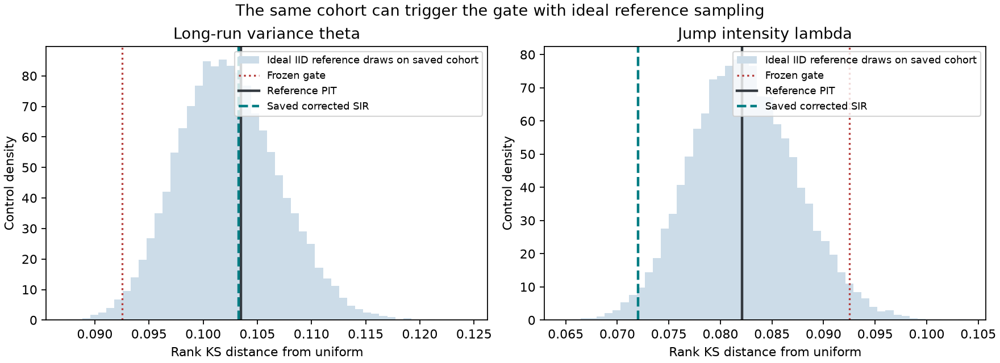
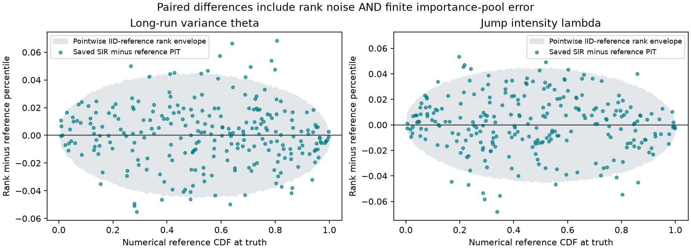
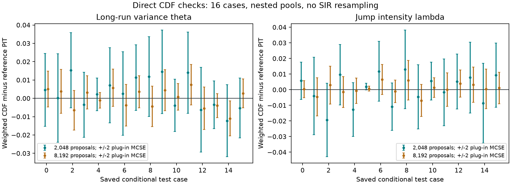

# HKDE calibration gate: what the saved failure tells us

**12 October 2026. Post-hoc explanation of the existing experiment.**
The uniformity threshold is mathematically calibrated, but the theta failure
on this cohort does not distinguish the corrected approximation from the
numerical reference. This audit changes no estimator, threshold, test outcome
or participant acceptance flag.

The [script](../scripts/audit_hkde_calibration_gate.py),
[machine-readable report](results/hkde-gate-audit/report.json) and
[marimo review](../notebooks/11_hkde_calibration_audit.py) make the explanation
reproducible. The original [correction report](hkde-corrected-inference.md)
remains the historical result.

## What we checked

The audit uses the already-inspected 256 test panels, their truths and saved
SIR ranks, the 65/129-point-per-axis numerical references, and the proposal
clouds saved for the first 16 conditional test cases. It verifies the bound
source/input hashes, case alignment, rank jitter and KS calculation, and
independently reconstructs reference percentiles by integrating likelihood
values directly. This avoids simply repeating the original mass-to-CDF code.

An independent [source/artifact replay](results/hkde-gate-audit/input-consistency.json)
also checks prior/quote stream replay,
contract/parameter order, numerical price-map consistency and used seed
identities. There is no identified mismatch in the declared numerical
generative model and likelihood. The independent reference is still numerical
and shares the Fourier price engine with generation; this is not an analytic
certificate of continuous-model pricing accuracy.

Two diagnostic controls were specified in the script before execution:

- 100,000 ideal uniform cohorts of size 256, to check the threshold's actual
  coordinatewise false-alarm rate.
- 20,000 ideal-reference rank experiments **conditional on the saved cohort**,
  separately for each parameter, to isolate the effect of drawing 512 posterior
  samples and randomizing ranks.

These controls generate diagnostic random numbers only. There are no new
financial observations, neural proposals, training runs or selected checkpoints.
They are explanatory controls, not another acceptance experiment.

## 1. The threshold itself is sound

For $N=256$ cases, two coordinates and family level $\alpha=0.05$, the
implemented Dvoretzky–Kiefer–Wolfowitz (DKW) bound is

$$\epsilon=\sqrt{\frac{\log(2\cdot2/0.05)}{2\cdot256}}=0.092513.$$

Under ideal independent uniform ranks across cases, its exact one-coordinate
rejection probability is **2.3395%**. The uniform control gives **2.349%**
(Monte Carlo SE 0.0479 percentage points). A union bound gives a two-coordinate
false-alarm probability of at most **4.6790%**, without assuming independence
between parameters. The nominal 5% does not cover every gate or every study
ever run in the project.

Thus the threshold is not numerically miscalculated or unexpectedly aggressive.
The observed theta statistic has an ideal-uniform tail probability of about
0.00789. The shift is unusual under that null; that number is neither the
probability our algorithm is wrong nor grounds for dismissing the result.
The question is what part of the workflow the alarm identifies.

## 2. An ideal reference sampler usually fails on these same cases

Let $u_i=F_{\mathrm{ref},i}(\theta_i^*)$ be the numerical reference marginal
CDF at case $i$'s generating truth. For $L=512$ independent draws from that
reference, the number below the truth has distribution

$$R_i\mid u_i\sim\operatorname{Binomial}(L,u_i),\qquad
Z_i=\frac{R_i+V_i}{L+1},\quad V_i\sim\operatorname{Uniform}(0,1).$$

This gives the rank distribution for an ideal **marginal** reference sampler
on the same observations and truths, without rerunning numerical inference.
Separate marginal binomials do not reproduce cross-parameter rank dependence;
we report coordinatewise results only.

| Saved-cohort comparison | Theta | Jump intensity |
|---|---:|---:|
| Saved corrected SIR KS | 0.10325 | 0.07203 |
| Numerical reference PIT KS | 0.10349 | 0.08212 |
| Ideal-reference rank KS, central 95% of controls | 0.09372–0.11192 | 0.07278–0.09261 |
| Ideal-reference controls exceeding the frozen gate | **98.85%** | 2.595% |
| Saved SIR KS percentile within those controls | 59.3rd | 1.72nd |



The corrected theta statistic is ordinary within the reference-sampling
control, and the reference sampler almost always triggers that same gate on
this particular cohort. This is strong evidence against attributing **this
theta alarm** to the correction alone. The jump-intensity statistic is more
uniform than most of its reference controls; it is not an identical result in
both coordinates or proof of superior calibration.

The 98.85% is **not** a population false-positive rate. We condition on a
cohort already selected for investigation because it failed. The calculation
does not establish that the shared shift is harmless, nor replace independent
population-calibration evidence. All nine average standardized quote errors
in this cohort are negative, consistent directionally with lower inferred
variance; this is a descriptive observation, not a newly selected test or a
causal explanation.

## 3. The correction is close, but it adds measurable noise

The difference between the two KS values is not a distance between posteriors.
We therefore compare the percentiles case by case. For the ideal rank control,

$$E[Z_i]-u_i=\frac{0.5-u_i}{513},\qquad
\operatorname{Var}(Z_i)=\frac{512u_i(1-u_i)+1/12}{513^2}.$$

| Paired rank-minus-reference quantity | Theta | Jump intensity |
|---|---:|---:|
| Observed mean difference | 0.00055 | 0.00116 |
| Observed RMS difference | 0.02173 | 0.02210 |
| Ideal-reference root expected squared difference | 0.01829 | 0.01838 |
| Central 95% control range of RMS differences | 0.01656–0.02005 | 0.01664–0.02012 |



There is extra dispersion beyond ideal posterior-resampling noise. The
observed RMS exceeds 19,999 of 20,000 theta controls and all 20,000 intensity
controls; these are descriptive finite-control counts, not zero tail
probabilities. A finite importance pool introduces additional approximation
error, so these results do not mean that the full SIR algorithm should obey
the ideal-binomial control exactly. Small average errors can also conceal
offsetting conditional errors.

The high paired correlation (about 0.9969) needs the same perspective: even an
ideal 512-draw randomized rank has correlation $512/513\approx0.99805$ with
its underlying uniform PIT across ideal prior-predictive cases. Correlation
alone is not a quality certificate.

## 4. Direct weighted-CDF checks support the finite-pool explanation

For the 16 cases with saved conditional proposal clouds, compute
$\widehat F_i(\theta_i^*)=\sum_j w_{ij}1\{\theta_{ij}<\theta_i^*\}$ directly.
There is no SIR resampling in this calculation. Compare with the reference
and a plug-in self-normalized importance-sampling (SNIS) standard error.

| Proposals | Theta CDF RMS error / RMS estimated SE | Intensity CDF RMS error / RMS estimated SE |
|---|---:|---:|
| 2,048 | 0.00884 / 0.00976 | 0.00940 / 0.00980 |
| 8,192 | 0.00513 / 0.00488 | 0.00345 / 0.00489 |



These errors are consistent in scale with estimated importance-sampling
uncertainty, and decrease at the larger budget. The plotted two-SE bars are
asymptotic, pointwise diagnostics, not simultaneous guarantees. The two budgets
use nested pools; they are 16 cases at two budgets, not 32 independent cases.
Their proposal seeds differ from the calibration-stage seeds. Since all 256
calibration clouds and individual SIR draws were not saved, this cannot fully
attribute the all-cohort residuals to pool error versus resampling.

## Consequence for the scientific gate

Use the status **conditional approximation accuracy demonstrated on tested
cases; shared calibration anomaly under investigation**. The mathematical
uniformity diagnostic remains useful. Its historical failure does not, by
itself, identify an inadequate neural correction. Conversely, agreement with
a numerical reference is not proof of general calibration.

The existing conditional parameter/joint/price checks, this direct-CDF audit,
and the reference controls support continuing explicitly provisional teaching
and analysis with the frozen estimator. They do not retrospectively accept the
raw neural flow, v1 correction, or current M8 participant release. The original
test remains failed and closed; notebook10's acceptance logic is unchanged.

No retraining or proposal change is motivated by the theta alarm at present.
A mandatory 1,024-panel rerun is unnecessary to explain this failure. Before
claiming general calibration or changing formal participant acceptance,
specify a prospective decision rule that combines scientifically meaningful
conditional/price errors with calibration evidence and clearly states how a
shared reference alarm is handled. If fresh replication is chosen, fix its
size and decision rule beforehand and retain every case. Do not enlarge a
test until it happens to pass or merely loosen the old threshold.

## Reproduce and review

From this checkout, with the pinned environment available:

```bash
PYTHONPATH=src pixi run hkde-calibration-audit --out /tmp/new-hkde-gate-audit
PYTHONPATH=src pixi run python scripts/check_hkde_saved_inputs.py --repo .
PYTHONPATH=src pixi run review-hkde-calibration
```

Choose a new output directory. The run saves its diagnostic settings, input
and source hashes, numerical control summaries, selected arrays and three
figures. The notebook uses these committed results and a small analytic
calculation; opening it starts no new inference, training, bank generation or
cluster job. The historical scientific assets and acceptance files are not
rewritten by either command.

The [review verification](results/hkde-gate-audit/verification.json) records a
fresh-process offline HTML export: **10 cells, zero errors, 1.07 seconds**.
The isolated copy contains no market fixtures, raw banks, neural checkpoint or
simulator package; external connections are blocked. The three figures were
visually inspected. Two analytic tests check the independent CDF integration
against a uniform posterior and truncated-normal posteriors. This verifies
the diagnostic implementation and lesson, not the participant inference gate.
