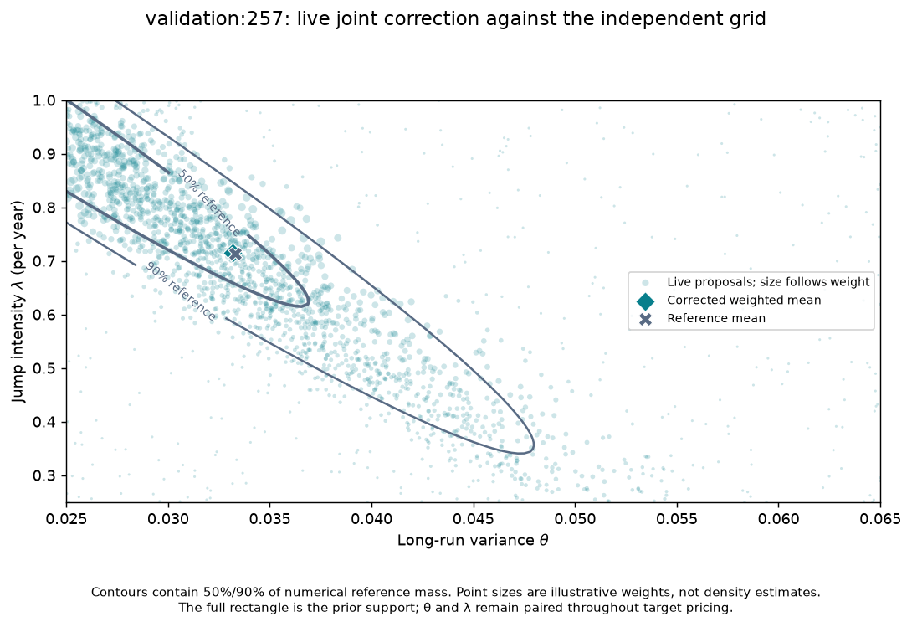
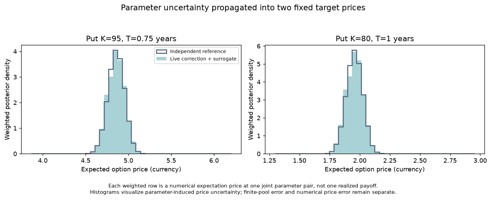

# Provisional live HKDE demonstration

**I4a is complete. Formal I4 scientific acceptance remains pending.** The
[shared-reference audit](hkde-calibration-gate-audit.md) supports exercising
the frozen estimator without treating the saved cohort's theta alarm as a
correction-specific defect. It does not establish population calibration.
The [plan amendment](hkde-teaching-integration-plan.md) makes that scope explicit.

## Run

From this checkout with the pinned environment installed:

```bash
pixi run demo-hkde-corrected
```

This opens the existing corrected lesson with `SBI4FINANCE_HKDE_DEMO=1`.
The notebook displays a provisional-demo banner, verifies the audit's input
and source bindings, and executes the existing algorithm on the same local
`validation:257` panel. The original seed and 2,048-proposal budget are fixed.
No new bank, training run, population test, tolerance change or seed selection
is involved. `pixi run review-hkde-corrected` retains the default cached mode.

To reproduce the isolated execution check with optional new output paths:

```bash
pixi run hkde-teaching-integration-check --live \
  --out /tmp/hkde-demo.json --artifacts /tmp/hkde-demo-plots
```

Omit `--live` to check cached mode with BayesFlow imports blocked. Both modes
block socket operations and exclude market files and raw banks from the
isolated copy. Live mode loads the published checkpoint and keeps its paired
parameter rows, likelihood weights and target prices together. The checker
records an accuracy failure rather than retrying or hiding it.

## Recorded run

The [execution report](results/hkde-provisional-demo/execution.json) records
one run, using seed **3667540760**. All eight existing case-level checks pass:

| Quantity | Actual result | Existing tolerance |
|---|---:|---:|
| Proposals | 2,048 | Fixed participant budget |
| Effective sample size / proposals | 0.68777 (ESS 1,408.55) | At least 0.5 |
| Largest normalized weight | 0.002085 | At most 0.01 |
| Maximum price-quantile error | 0.00530 currency | At most 0.03 |
| Maximum parameter-mean error | 0.01878 reference SD | At most 0.4 |

The corrected 5% / median / 95% price quantiles are:

| Held-out put | Live weighted result | Numerical reference |
|---|---|---|
| K=95, T=0.75 years | 4.69659 / 4.85592 / 5.01432 | 4.69582 / 4.85595 / 5.00902 |
| K=80, T=1 year | 1.84425 / 1.95487 / 2.06751 | 1.84251 / 1.95499 / 2.06321 |





The [saved weighted rows](results/hkde-provisional-demo/live-weighted-rows.npz)
preserve all 2,048 paired draws, weights, prices, observation and seed. Their
hash is recorded in the execution report. These are Q model-price
distributions, not future realized payoffs or market-price forecasts.

The live calculation took **5.06 seconds**, including checkpoint/framework
loading (2.16 s), proposal sampling/density (1.12 s), numerical likelihood
pricing/weighting (1.76 s), surrogate prices and reference comparisons.
The full isolated two-notebook check took **14.60 seconds**, including copying,
cached review and rendering. These are one local execution's timings, not a
warm-throughput benchmark. It rendered eight plots across 8 introductory and
20 advanced cell outputs; the two live figures were inspected.

The report distinguishes `execution_passed=true`, `live_accuracy_passed=true`
and `scientific_acceptance=false`. The historical corrected test is still
failed, the raw network remains provisional, and this one selected validation
case is not independent population-calibration evidence. No claim requires
real-market data; market fitting and empirical evaluation remain separate.

## Reuse and provenance

This follow-up adds one launch flag to the existing notebook and one `--live`
option to its existing checker. It reuses all scientific functions and leaves
the checkpoint, priors, likelihood, proposal, source-bound reports and thresholds
unchanged. Three additional tests exercise opt-in behavior and audit bindings;
the existing four input-boundary tests remain in place.
All seven pass, as do strict marimo checks. The separate
[cached-mode check](results/hkde-provisional-demo/cached-check.json) confirms that
default review still runs without importing BayesFlow or executing inference.

The combined base `9cb6d20e0999e3888c3c906b893350e5f229ad3f` joins published
[data handoff PR #21](https://github.com/fmuia/sbi4finance/pull/21) at `f385225`
and [simulator audit PR #19](https://github.com/fmuia/sbi4finance/pull/19) at
`88202d1`. The merge needed no conflict edits. Existing PRs and main remain
unmerged; the follow-up diff contains only the demo integration and its evidence.
