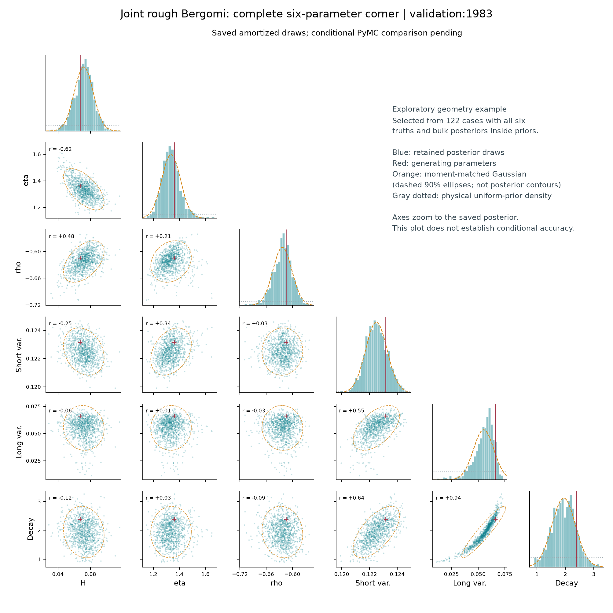
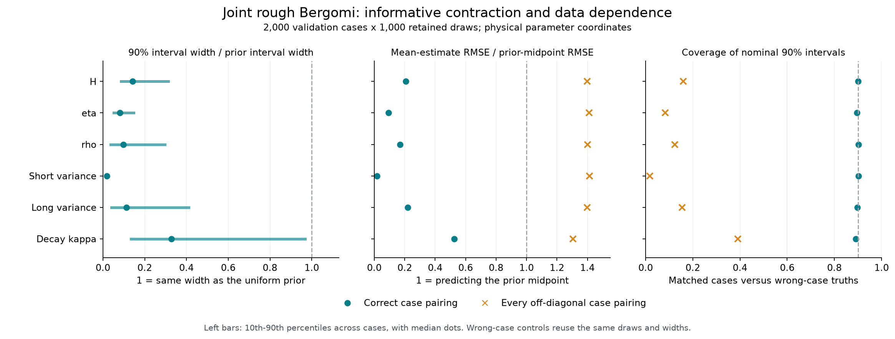
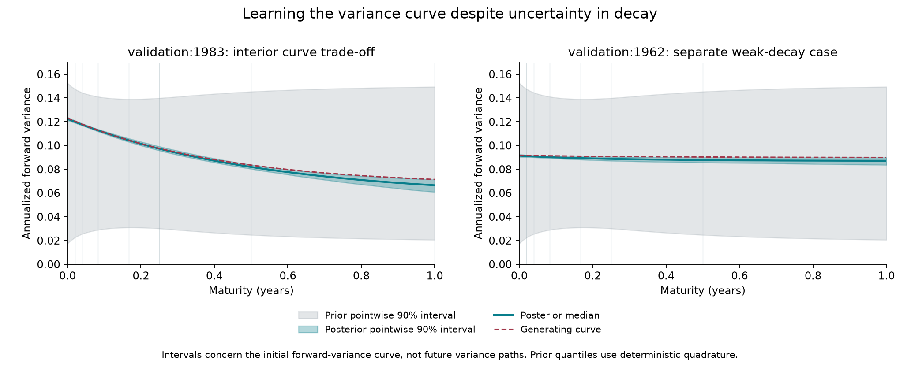

# Joint rough Bergomi: trade-offs and contraction checks

29 October 2026. These checks reuse the completed joint100k estimator's **2,000 validation cases with 1,000 saved draws each**. No new inference, simulations, training or MCMC ran. They address informativeness and learned posterior geometry; conditional PyMC validation remains unfinished.

The results strongly reject the specific failure mode of returning the prior. They also identify useful teaching examples of parameter dependence, including a curved ridge whose bulk is away from the prior boundaries.

**1. Which parameter trade-offs appear?**

The strongest widespread relationship is between the **long variance level and curve decay**. Across the 2,000 cases, the median absolute within-case Spearman correlation is **0.846**, and **62.75%** of cases have an absolute correlation of at least 0.8. The sign reverses with curve orientation: median −0.872 for rising curves and +0.840 for falling curves. Pooling these cases obscures the relationship; the overall median signed correlation is only +0.008. These orientation groups use the declared absolute level-difference criterion in the [geometry audit](pilot-results/2026-10-29/joint100k-tradeoffs/README.md).

The implemented initial curve is

```text
xi(t) = long + (short - long) * exp(-decay * t)
```

At short times its slope is approximately `decay * (long - short)`. Different long-level/decay combinations can preserve similar curve shapes over the observed maturities. Holding the short level and initial slope fixed gives `long = short + slope / decay`: a nonlinear relationship whose sign changes between rising and falling curves. This is a local explanation of the observed dependence, not an exact pricing invariance.

There is also an **eta/rho trade-off**. Its median within-case Spearman correlation is +0.497; 24.2% of cases exceed 0.8 in absolute value. Increasing eta can accompany rho moving closer to zero, stabilizing their negative product. For model intuition, the flat-curve, first-order expansion in [Bayer, Friz and Gatheral, equation 7.5](https://www.wias-berlin.de/preprint/2071/wias_preprints_2071.pdf) contains the rho-times-eta factor together with H-dependent maturity scaling. That approximation is explanatory and is not a quantitative approximation over our full prior. All reported empirical checks use the saved full-simulator study, not asymptotic prices.

Two complete six-parameter examples are retained:

| Case | Relationship | What the saved draws show |
| --- | --- | --- |
| validation:1983 | Long variance / decay | Spearman +0.975, Pearson +0.935; a curved ridge and asymmetric long-variance marginal. |
| validation:1941 | Eta / rho | Pearson and Spearman approximately +0.957; strong dependence, largely resembling a narrow ellipse. Strong correlation alone is not evidence of non-Gaussianity. |



[Complete corner for case 1941](pilot-results/2026-10-29/joint100k-sanity-figures/complete-corner-validation-1941.png). The orange overlays are moment-matched Gaussian comparisons, not fitted posterior credible contours.

Selection was exploratory and explicit. All six generating parameters had to lie at least 10% of their prior ranges inside the bounds; all six central 98% posterior intervals had to lie at least 5% inside, and central 99% intervals at least 2.5% inside. **122 cases qualified.** The two examples were chosen for their strong curve or eta/rho dependence, not for truth coverage. Both happen to contain all six truths in their marginal 90% intervals. This selection supports illustrations of geometry, not a new accuracy estimate. The minimum central 99% distance to any prior boundary is 4.89% of its range for case 1983 and 6.30% for case 1941.

**2. Are the posteriors contracting, rather than reproducing the prior?**

Yes. Rank calibration alone would not establish this: if simulated truths and returned samples both follow the prior, their unconditional ranks can be uniform even when observations are ignored. We therefore checked physical interval widths, parameter recovery, observation dependence and variance consistency on the saved panel.

The actual six priors are independent physical uniforms. For each case and parameter, the width ratio below is the saved posterior's central 90% interval width divided by the exact uniform prior's central 90% width. It is not a Gaussian approximation.

| Parameter | Median posterior/prior 90% width | Matched 90% coverage | Posterior-mean RMSE / prior-midpoint RMSE |
| --- | ---: | ---: | ---: |
| H | 14.2% | 90.00% | .208 |
| Eta | 8.0% | 89.50% | .094 |
| Rho | 9.9% | 90.15% | .168 |
| Short variance | 1.85% | 90.15% | .0186 |
| Long variance | 11.2% | 89.70% | .220 |
| Decay | 32.8% | 89.15% | .526 |

Thus, for example, eta's typical 90% interval is about 8% as wide as its prior interval, while its point estimate is substantially more accurate than ignoring prices and always predicting the prior midpoint. Coverage remains close to nominal across this development panel. [Exact values, case variation and reproducible analysis](pilot-results/2026-10-29/joint100k-contraction-audit/README.md).



The negative control re-pairs each saved posterior with every other case's truth: **3,998,000 ordered off-diagonal pairs**, without changing draws or interval widths. Coverage falls from 89–90% to **1.7–39.1%**, depending on the parameter, and normalized mean-estimation errors rise to 1.31–1.41 times the prior-midpoint baseline. A prior-only sampler would be unaffected in expectation by this loss of observation/truth matching. This demonstrates useful conditioning; the off-diagonal pairs are dependent and are not treated as millions of independent validation cases.

Two additional aggregate checks support the amount of uncertainty reported:

- Mean squared posterior-mean error divided by mean posterior variance ranges from **0.903 to 1.045** across the six parameters; the calibrated Bayes benchmark is approximately 1.
- `mean posterior variance + variance of posterior means`, divided by analytic prior variance, ranges from **0.976 to 1.031**.

These are descriptive global checks, not new acceptance thresholds. The old reported logit-contraction values reproduce exactly; those measure variance reduction after a logit transform and should not be confused with physical interval-width ratios. No saved draw was outside, exactly on, or clipped to a prior boundary. The input contract also excludes the generating curve and parameter labels from the joint inference conditions.

**Weak contraction can be the right result.** In the 217 cases where the true short/long difference is at most 10% of their midpoint, the median decay 90% interval retains **97.9%** of the prior width. With a difference of at least 50% of the midpoint, the median is **21.4%** (1,093 cases). These truth-selected groups describe broadness; they are not conditional-SBC tests.

When the short and long levels coincide, the curve is independent of decay conditional on those levels. Near that situation, decay is weakly identified even while the curve itself is learned accurately. Integrating uncertain levels can still change the decay marginal; it need not be exactly the prior.



The separate nearly-flat case 1962 was selected to illustrate weak decay and fails the posterior-interior filter, so it is not presented as an interior geometry showcase. The curve bands are pointwise intervals for the initial forward-variance curve, not future volatility-path bands or simultaneous curve coverage. Their prior bands use deterministic quadrature, with 128/256-node differences below 1.1e-8 variance units.

**What this supports for collaborators.** The estimator learns substantial information from prices, changes appropriately across cases, and exhibits useful coupled parameter directions. These diagnostics rule out the prior-returning failure mode. They do not establish the correct conditional six-dimensional posterior, its copula, or continuous-model price accuracy. The curved interior case 1983 is a concrete next PyMC reference candidate before presenting its geometry as a validated property of the model posterior. No scientific acceptance flags or existing teaching caches were changed.

Inputs are pinned to posterior `19c24d64290651f592d3c13d7d0a1616d0d8ae080d487d0298aee8f97779498b` and bank `eb72588b9b7665e0e416cb5d3a1bcf8cd78a1c97f2b43f18ea8246c749a871d8`. Source hashes and retained draw examples are in the linked contraction and geometry audits. [Plot provenance](pilot-results/2026-10-29/joint100k-sanity-figures/provenance.json) records exact figure inputs. Regenerate the plots from these compact committed inputs with `pixi run --locked -e core python scripts/plot_joint_posterior_sanity.py`; no cluster access or model execution is required.
