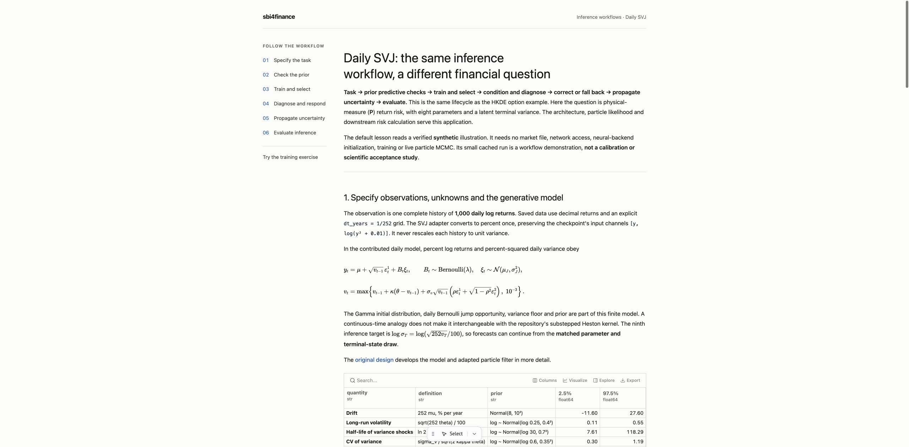

# Presenting and discussing tutorials with marimo

The optional `collaboration` environment adds a Studio lesson view, Lens visual
feedback and an MCP endpoint to the existing reactive notebooks. The notebook
remains the source of computation: the SVJ view projects its actual controls,
tables and figures. Its cached synthetic case and optional live inference use
the same code as the ordinary editor.



| Component | Role here |
|---|---|
| marimo Pair | Inspect live variables, edit/run cells and change controls through code mode. |
| marimo MCP | Connect an MCP client to the server; discover its tools and inspect the selected notebook. |
| Studio | Present the SVJ notebook as a lesson while retaining its native editor and live computation. |
| Lens | Point to a result, attach a note, and follow an agent's explanation or verified change. |

This optional environment pins marimo **0.25.1**, Studio **0.3.0**, Lens **0.2.3**
and the `mcp` Python package **2.3.0**. These integrations are evolving; consult
their installed agent guidance before using private APIs. The default scientific
environment remains available without the presentation packages.

## Open a lesson

Run from the repository root:

```bash
pixi install --locked -e collaboration
pixi run -e collaboration studio-build
pixi run -e collaboration studio-check
pixi run -e collaboration studio-svj
```

Open the printed URL, normally <http://127.0.0.1:8772>, and leave that browser tab
open. A running server alone does not create a live notebook session. The SVJ
lesson lives in [`notebooks/views/svj/lesson`](../notebooks/views/svj/lesson); its Studio configuration
applies to `notebooks/svj_var_pipeline.py`. Use Studio's notebook/preview controls
to move between the computation and its lesson view.

`studio-check` executes the cached lesson in an isolated worker using the locked
Pixi interpreter and checks all 16 projections. It forces the optional live-demo
flag off. Use this task instead of Studio 0.3's CLI runtime validator, which
re-enters Python projects through uv and can bypass the Pixi environment. The
check does not test browser layout or the live inference checkbox.

Keep view sources below `notebooks/`: Studio 0.3's source editor restricts reads
to the notebook's parent directory, even though its builder accepts wider paths.

For another existing tutorial, launch the generic editor task instead:

```bash
pixi run -e collaboration collaborate notebooks/10_hkde_corrected_workflow.py
```

The tasks share port 8772, so stop the first server before starting another on
that port. Restart a server after installing or changing its environment; an
already running kernel does not acquire the new packages automatically.

Use the local Python runtime for this integration. Slides, WebAssembly and
prepared/static Studio exports are separate delivery options, not established
outputs of this setup. The lesson does not change the selected curriculum or
the scientific acceptance status of either application.

## Pair with the right live notebook

For the native editor opened by `collaborate`, use the pinned CLI to discover
the browser's session and read its installed code-mode guidance:

```bash
pixi run -e collaboration marimo pair notebook list --url http://127.0.0.1:8772
pixi run -e collaboration marimo pair execute \
  --url http://127.0.0.1:8772 --file notebooks/10_hkde_corrected_workflow.py \
  -c 'import marimo._code_mode as cm; help(cm)'
```

Scope every call to the server and notebook. In the native editor, `--file`
resolves the current session after a reload. If it matches several sessions,
identify the intended one and use `--session SESSION_ID` instead; that option
takes precedence over `--file`.

Studio has a session-context caveat in the pinned versions: its embedded
editor's `session_id` can be absent from `marimo pair notebook list` and MCP's
`list_sessions`, which list canonical sessions. A consumer ID in an iframe can
still refer to the same kernel; a differing ID alone does not prove otherwise.
For Studio, read the `session_id` query parameter from the embedded editor
iframe's URL in the browser, then pass it explicitly:

```bash
pixi run -e collaboration marimo pair execute \
  --url http://127.0.0.1:8772 --session STUDIO_SESSION_ID \
  -c 'import marimo._code_mode as cm; help(cm)'
```

Use the actual browser URL value, not the placeholder above. Recheck it after a
reload. A Studio error saying that no workspace is attached can mean the call
lacks the visible workspace's session context; matching the notebook filename
is insufficient.

During a live session, change notebook cells through `marimo._code_mode`, not by
editing the notebook file on disk. Scratchpad bindings are temporary, but
in-place changes to existing objects can persist. Read cell code and values
before editing, explicitly run changed cells, and inspect their results. The
vendored [Pair skill](../.claude/skills/marimo-pair/SKILL.md) explains this workflow.

Studio and Lens also ship version-matched instructions. Read these through the
same Pair connection:

```python
import marimo_studio
import marimo_lens

help(marimo_studio.agent)
help(marimo_lens.agent)
```

These are agent scratchpad commands, not cells to add to a participant notebook.

## Discuss a result with Lens

Lens should mount after the notebook's marimo import runs. In its dock, press
**Select**, mark a point or region on a figure or table, add a note, and ask the
connected agent to address the current Lens selection. For example:

> Explain why the joint predictive and plug-in forecasts differ in this table.

The agent should inspect the selected output and its producing computation,
read `active_report` and the relevant joint draws, and return the checked
explanation to that result. The plotted variance and jump labels are auxiliary
synthetic truth; inference uses the observed returns. A successful technical
interaction does not establish calibration or market performance.

For a walkthrough, ask:

> Use Lens to walk me through observations, prior predictive checks, the
> inference decision, posterior uncertainty and the forecast.

The SVJ view provides semantic aliases for these five stops:

| Stop | Studio alias | What to explain |
|---|---|---|
| Observations | `observed-history` | Observed returns versus auxiliary synthetic variance and jump truth. |
| Prior checks | `prior-predictive-checks` | The separate 24-history prior sample and its descriptive checks. |
| Inference | `inference-decision` | Selected estimator, diagnostic reasons and declared response policy. |
| Posterior | `posterior-summary` | Joint parameter/state uncertainty and comparison with synthetic truth. |
| Forecast | `risk-uncertainty` | Propagation to percent log loss and comparison with plug-in parameters. |

A Trail uses current cell references resolved from these aliases; do not copy
ephemeral cell IDs from a previous server. Check that the producing cells are
idle and error-free, and read their current values before presenting a result.
The Trail's Next/Previous controls let the reader set the pace. Trails and Lens
selection/history state are transient; the tracked lesson remains the durable
teaching material. See the [Lens agent guide](https://marimo-team.github.io/marimo-lens/agents).

After inspecting the current results, an agent can create the five-step Trail
with this scratchpad recipe in the **Studio session**. It resolves the configured
aliases to saved source, then matches that source to the live cells, rejecting
stale or ambiguous matches. Send it through `marimo pair execute --url
http://127.0.0.1:8772 --session STUDIO_SESSION_ID --code-file -`:

```python
import tomllib
import marimo._code_mode as cm
import marimo_lens
import marimo_studio

ctx = cm.get_context()
workspace = marimo_studio.agent.current_workspace()
config = tomllib.loads((ctx.globals["ROOT"] / "pyproject.toml").read_text())
aliases = config["tool"]["marimo-studio"]["cells"]
route = [
    ("observed-history", "Observations", "Returns are observed; variance and jumps are synthetic truth."),
    ("prior-predictive-checks", "Prior checks", "These 24 histories come from the prior, separately from the illustration."),
    ("inference-decision", "Inference", "Read the selected estimator, diagnostics and response policy together."),
    ("posterior-summary", "Posterior", "Compare posterior uncertainty with truth without treating truth as input."),
    ("risk-uncertainty", "Forecast", "Follow joint parameter/state uncertainty into percent log-loss forecasts."),
]
steps = []
for alias, label, message in route:
    selected = await workspace.inspect_notebook(
        selectors=(aliases[alias]["ref"],), include_code=True
    )
    assert len(selected.cells) == 1, f"Ambiguous saved reference: {alias}"
    matches = [cell for cell in ctx.cells
               if cell.code.strip() == selected.cells[0].code.strip()]
    assert len(matches) == 1, f"Save/reconcile the live cell first: {alias}"
    cell = matches[0]
    assert cell.status == "idle" and not cell.errors, f"Cell not ready: {alias}"
    steps.append({"target": cell.id, "label": label, "message": message})

mounted = marimo_lens.agent.connect(ctx)
mounted.reveal(steps, duration_ms=None)
```

The recipe changes only the temporary walkthrough. Stop after showing it so the
reader can use Next/Previous; another reveal or an upstream cell change ends it.

## Check or connect MCP

The collaboration tasks enable marimo's MCP server. Check it against a native
editor session: run `pixi run -e collaboration collaborate
notebooks/svj_var_pipeline.py`, open its browser tab, then use another terminal:

```bash
pixi run -e collaboration mcp-check --list
pixi run -e collaboration mcp-check --notebook notebooks/svj_var_pipeline.py
```

The first command initializes MCP and lists available tools and sessions. The
second checks the selected kernel with scratchpad arithmetic and cell-status
inspection; it does not run or edit notebook cells. It refuses ambiguous
session selection. Use `--session SESSION_ID` when necessary, or `--url URL`
for a different server.

An MCP client's HTTP connection uses this endpoint; adapt the wrapper keys to
the client's configuration format:

```json
{
  "mcpServers": {
    "sbi4finance-marimo": {
      "url": "http://127.0.0.1:8772/mcp/server"
    }
  }
}
```

The launch tasks are for loopback development with authentication disabled.
If startup prints a required `Marimo-Server-Token` header, supply that header in
the client. The check script accepts `--server-token-file PATH`; an authenticated
server additionally uses `--auth-token-file PATH` for its bearer token. Keep
token values and personal client configuration out of the repository.

For a server that prints the required header, put its token value in a local
file outside the repository and run both commands with that file:

```bash
pixi run -e collaboration mcp-check --server-token-file /path/to/marimo-token --list
pixi run -e collaboration mcp-check --server-token-file /path/to/marimo-token \
  --notebook notebooks/svj_var_pipeline.py
```

Distinguish the advertised MCP tools from the transport. The pinned server's
tool list is the authority: inspection tools are read-only, while `execute_code`
can enter live code mode and apply changes. The check script deliberately uses
it only for inspection. The upstream [MCP guide](https://docs.marimo.io/guides/editor_features/mcp/)
still describes the server mainly as a read-only interface and recommends Pair
for driving a notebook.

The initial MCP trial reached notebook code but lacked the HTTP workspace
context needed by Studio's workspace APIs. Use Pair with the explicit Studio
session for workspace inspection and view operations. MCP's canonical session
listing need not include the iframe's consumer ID. A successful native MCP
check and a successful Studio Pair check are separate results.

## Verification scope

Checked on macOS arm64 with the locked collaboration environment on 2026-10-14:

- Production view build, source-editor reads and all 16 runtime projections pass.
- Lesson navigation and layout work at desktop and 390-pixel widths.
- The Studio checkbox runs live synthetic inference, updates the downstream
  outputs and returns to the cached case when unchecked.
- The documented five-step Lens Trail resolves current cells; Next/Previous work.
- Native MCP initialization, session listing and scratchpad inspection pass;
  selecting a nonexistent notebook fails before execution.
- All repository notebooks pass strict marimo lint. The scientific notebook
  sources and the default/GPU environment lock records are unchanged.

The collaboration lock also resolves Linux, but this integration's browser and
runtime checks were performed on macOS. These checks establish operation of the
presentation and collaboration tools, not new scientific acceptance.

## References

- [marimo Pair](https://docs.marimo.io/guides/generate_with_ai/marimo_pair/)
- [Studio documentation](https://marimo-team.github.io/marimo-studio/)
- [Lens compatibility and version guidance](https://marimo-team.github.io/marimo-lens/compatibility)
- [Shared inference workflow](shared-inference-workflow.md)
