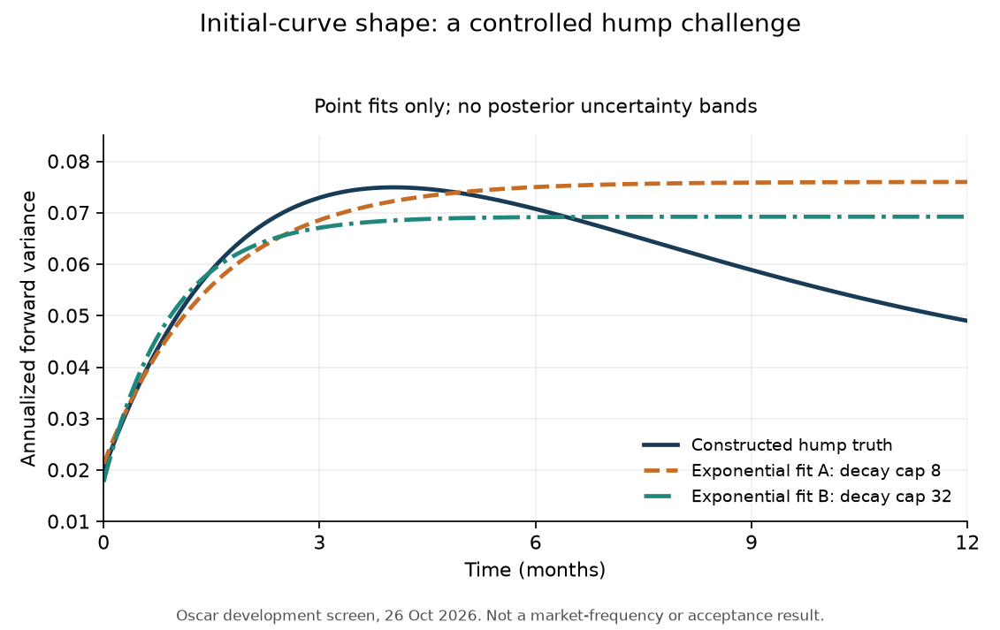
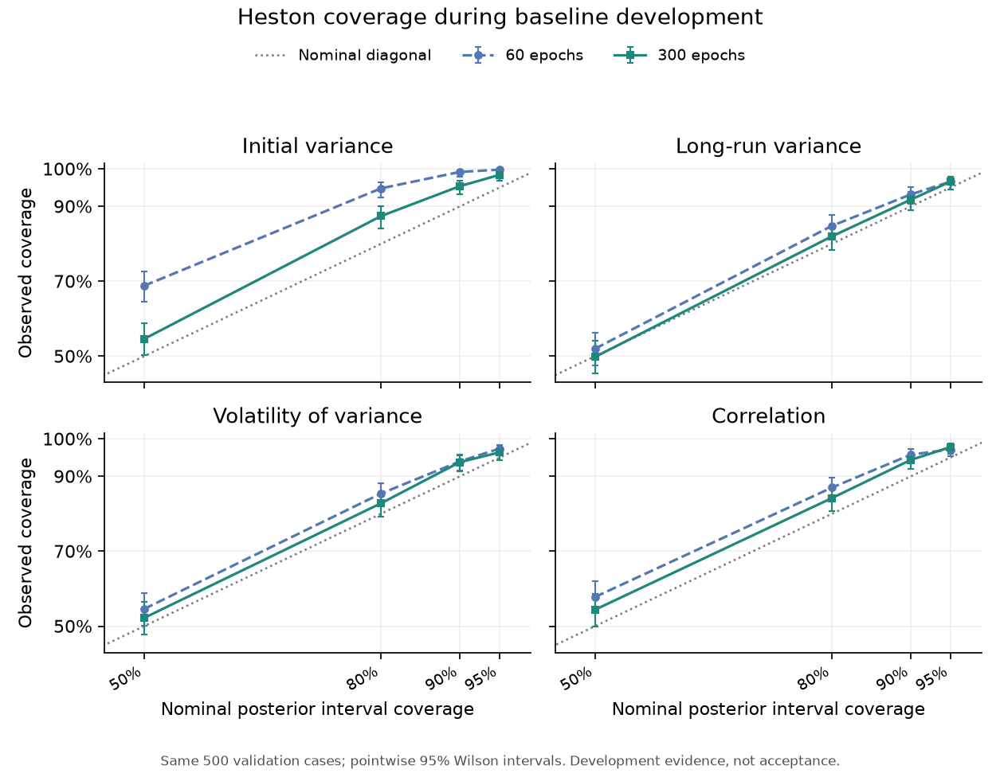

# Full-surface development on Oscar — 26 October 2026

**The CPU/GPU workflow works, and the first Heston development bank and estimators exist. Scientific acceptance is still open.** The rough pilot found material time-grid effects in difficult regions of the candidate prior. The monotone exponential initial curve is now the agreed simplified teaching family, with its relationship to the published hump family and its limitations documented. Large rough-bank generation remains on hold while numerical settings and the parameter prior are checked.

Sparse-chain support remains a separate downstream unit. No notebooks were executed or changed for these runs.

## What ran in parallel

| Work | Result |
| --- | --- |
| CPU and single-GPU readiness | Passed on Oscar, including real incremental generation, separate-process locking, retry reuse, prefix preservation, interrupted training recovery and exact same-seed reload. |
| Rough grid panel | Eight declared cases, three grids and two independent repetitions: all prices returned; three difficult cases exceeded the Monte Carlo precision caps. Base-to-refined price shifts are material in some regions. |
| Curve-family challenge | Flat/monotone controls and one hump case, followed by three exact-observation hump refits. Relaxing the decay bound improves the found fit but does not remove all discrepancies. |
| Heston data | A fresh 20k/5k/5k training/validation/test collection was generated and an immutable 20k snapshot published. Root seed is fixed at 271028. |
| Heston training | Spline/vector baselines on the same 20k surfaces with 60 and 300 epochs. The longer schedule improves calibration diagnostics; neither checkpoint is accepted as a tutorial reference yet. |
| PyMC references | Native four-core reruns completed in 6.2–8.5 minutes per case, but none meets all R-hat/ESS requirements. Fourier point checks show very small changes; conditional neural-accuracy verdicts remain inconclusive. |

The [rough numerical report](rough-numerical-pilot.md) and [curve-family screen](curve-family-screen.md) give the scientific details. The checked [JSON evidence](pilot-results/2026-10-26/) includes declarations, outcomes, source/runtime hashes and seeds. Inconclusive runs are retained rather than replaced with favourable seeds.

## Readiness and provenance

CPU readiness took 79.9 seconds. GPU readiness took 90.7 seconds on an NVIDIA RTX A6000. Both included generation, recovery and evaluation; these are execution timings, not scientific throughput estimates. The lock check used separate processes on one node, so it does not certify every cross-node filesystem behavior. [CPU evidence](pilot-results/2026-10-26/readiness-cpu.json), [GPU evidence](pilot-results/2026-10-26/readiness-gpu.json).

The run root is `/oscar/scratch/afengler/sbi4finance-full-core-20261026-wy2_j3o4`. Independent immutable checkouts preserve each phase:

- `9d903db`: readiness, initial pilots and the Heston bank/training workflow.
- `16f8c7e`: precision components, exact-observation curve follow-ups and the reference precision checker.
- `8566b29`: native parallel PyMC chains and partial-draw retention.

The project was transferred as verified Git bundles because the cluster checkout did not have GitHub credentials. The original experiments and archived environments were not overwritten. A short GPU readiness job moved from the condo queue to the permitted debug allocation when the condo GPU quota was occupied.

## Heston development findings

The bank contains 20,000 training surfaces and fixed 5,000-surface validation/test pools. Generation uses 500-row shards and a fresh root seed, 271028, distinct from the smoke/reference pilots. Continue expansion with the frozen generator/runtime and increasing training IDs; do not regenerate the first tranche or move holdouts. [Configuration](pilot-results/2026-10-26/heston-development/config.json), [immutable snapshot](pilot-results/2026-10-26/heston-development/snapshot-20k-manifest.json).

Both development evaluations use the first 500 validation surfaces and 1,000 posterior draws per surface. Final test data were not evaluated. The second training run changes optimization effort/schedule on the same bank, not the amount of unique data.

| Diagnostic | 60 epochs | 300 epochs |
| --- | ---: | ---: |
| Initial-variance SBC KS distance | 0.1144 | 0.0580 |
| Simultaneous DKW threshold across four parameters | 0.0712 | 0.0712 |
| SBC parameter checks passed | 3/4 | 4/4 |
| Initial-variance nominal 90% interval coverage | 99.2% | 95.4% |
| Theta / vol-of-vol / rho nominal 90% coverage | 93.2 / 94.0 / 95.8% | 91.8 / 93.8 / 94.4% |

The longer fit improves the first failure, but intervals remain conservative. Passing the rank screen does not establish conditional agreement with MCMC, adequate products or final acceptance. The same development pool influenced this diagnosis and must not be relabelled untouched acceptance evidence. [60-epoch evaluation](pilot-results/2026-10-26/heston-development/evaluation-60epochs.json), [300-epoch evaluation](pilot-results/2026-10-26/heston-development/evaluation-300epochs.json).

The 300-epoch GPU-trained model also loaded and produced finite draws on the local CPU environment. That is a portability check, not an additional inference-accuracy result. Model binaries remain development artifacts on Oscar rather than replacing tracked teaching checkpoints.

## Conditional references are still inconclusive

The first three four-chain runs used sequential chains and exceeded a 15-minute wall allowance. Oscar did not permit extending those running jobs. Native PyMC parallel chains and atomic partial trace files were then added and checked on known Gaussian targets and Heston. The same observations and seeds were rerun; these are replacements for incomplete computations, not independent extra reference evidence. Partial files retain tuning flags but cannot resume sampler/adaptation/RNG state.

| Development surface | Parallel elapsed time | Largest parameter R-hat | Smallest bulk / tail ESS | Meets all requirements? |
| --- | ---: | ---: | ---: | --- |
| validation:0 | 395 s | 1.040 | 158 / 129 | No |
| validation:1 | 512 s | 1.399 | 8.4 / 9.5 | No |
| validation:2 | 369 s | 1.038 | 113 / 70 | No |

The requirements remain R-hat at most 1.01 and bulk/tail ESS at least 400. These failures do not establish a neural-method failure or success. The comparison tool preserves an `inconclusive_reference` outcome and does not sample the neural estimator or emit an accuracy verdict against an unchecked target. [Reference evidence](pilot-results/2026-10-26/heston-reference-parallel/), [guarded comparison outcomes](pilot-results/2026-10-26/heston-reference-comparison/).

Case 1 has visible retained-draw drift: two chains' first-half mean vol-of-vol values around 1.17/1.07 move to about 1.46/1.46 in the second half. The other cases also approach prior boundaries. The next bounded reference experiment should use dispersed, data-only classical fits for initialization and regularized proposal conditioning in PyMC's transformed coordinates, retaining the same likelihood/prior/Jacobians. Keep the built-in sampler and test the hard case first; do not remove the drifting half post hoc, relax criteria or change prior bounds to manufacture convergence.

Doubling Fourier nodes and cutoffs at 16 deterministic chain/draw points per surface produced maximum price changes of 0.0000030, 0.0000072 and 0.0000030 quote-noise standard deviations. The largest absolute log-likelihood change was 0.000025. All selected points priced and the pricing sources matched the recorded reference. This supports pointwise pricing stability, not a posterior-refinement proof or convergence. The immediate reference problem is mixing/initialization/proposal conditioning. [Pointwise precision evidence](pilot-results/2026-10-26/heston-reference-precision/).

## Rough follow-ups did not close the numerical gate

Higher-path, independent 4×/8× components were run concurrently. For high variance, all four calls met the 0.25 Monte Carlo standard-error target, but the one-week far call still moved by −0.851 quote-noise standard deviations, with estimated difference SE 0.040. For the falling-curve control the largest shift was +0.283, SE 0.099; a more precisely estimated wing shift remains. These are pointwise comparisons, not global posterior/product acceptance. Checked reductions were computed locally from the recorded Oscar components; this required no new pricing or replacement seeds.

The low-H/high-eta case completed both 4× calls at 1,048,576 paths each, meeting the Monte Carlo target. Both 8× calls reached the 20-minute wall limit without final prices. That comparison is incomplete; it supplies no 8× accuracy verdict and was not automatically retried. [Checked reductions](pilot-results/2026-10-26/rough-fine-reduced/), [full numerical interpretation](rough-numerical-pilot.md).

Across the recorded development unit, 97 Slurm tasks completed and five timed out: the three initial sequential references and the two largest rough components. Reported CPU accounting totals about 4.68 hours; this is neither GPU-hours nor a confirmed large-campaign throughput estimate. Final bank generation succeeded without redrawing failed surface IDs. [Accounting](pilot-results/2026-10-26/accounting-summary.json).

## Decisions before scaling rough generation

1. The curve-family scope is agreed: use the monotone exponential as a simplified subfamily of the published five-coefficient specification. Keep the hump challenge as a visible limitation. The parameter prior still needs a numerical check; the hump study does not establish market-shape frequencies or general market adequacy.
2. Choose a defensible grid/precision policy or explicitly restrict the numerical/model target. More Monte Carlo paths alone do not remove time-discretization bias.
3. Improve Heston reference initialization/proposal conditioning using standard PyMC methods and independent data-based starts before expanding the reference library. Check conditional agreement, numerical sensitivity and product uncertainty before declaring the neural estimator accurate. Preserve failed, timed-out and inconclusive cases.
4. Expand only selected learning curves and configurations. The data-growth tools are ready; million-surface banks are capacity, not an immediate requirement.

The [central plan](../tutorial_final/NUMERICAL-EXPERIMENT-PLAN.md) still governs the full tutorial campaign. These results justify targeted scientific follow-ups and Heston development; they do not complete the campaign or approve a large rough bank.
