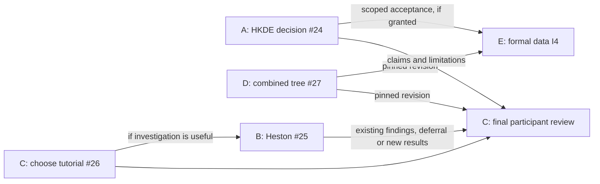

# Distributing the remaining work to agents

Prepared 12 October 2026. These are assignment briefs, not launched jobs.
The existing simulator and data implementations are largely complete and await
review. The remaining implementation should follow the actual outstanding
decisions, not create one new coding project for every open PR.

Repository: <https://github.com/fmuia/sbi4finance>.
Local root: `/Users/afengler/Projects/proj_sbi4finance`.
The briefs live in `sbi4finance-offline-tutorial/docs/`, published on
`feat/hkde-offline-tutorial` ([PR #19](https://github.com/fmuia/sbi4finance/pull/19)).
Each is self-contained and records the relevant branches, current evidence,
ordered milestones, commands and completion criteria.

**Curriculum handback, 12 October 2026:** the user selected the provisional
Q/options route for #26. The [route card](tutorial-participant-route.md) records
the two-hour schedule and required #22/#29 composition; the
[delivery record](tutorial-delivery-verification.md) now verifies fresh setup
and five isolated exports on D/#27's pinned `ca63424` source. Final H26.3
evidence from `8f565121d23b5b3e815be0e2bfde468db8e30211` is incorporated in
PR #31. Browser layout, interaction and offline runtime remain unverified;
static mirror checks do not complete full-route browser acceptance. #29 retains
provisional HKDE selected-case teaching and leaves formal I4 deferred.

## Integration checkpoint

The [combined review](stack-integration-review.md) consumes the selected heads,
including #29's provisional HKDE decision and participant-route commit
`be4a3baf6d5753337f93c1b95510310aea2d3d69`. The agreed notebook10 behavior is
#22's local panel, cached default and explicit 2,048-proposal demo. The selected
Q/options route replaces the earlier open curriculum choice. #26 completed
fresh setup and isolated execution on the pinned combined revision; browser
validation remains outstanding and formal I4 stays deferred. The assignments and original
briefs below retain their provenance; no new study or GitHub merge is authorized.

## Agent assignments and when to start

| Agent | Handover | Work that can start now | Dependency for later work |
|---|---|---|---|
| A — HKDE science | [#24 acceptance decision](hkde-acceptance-handover.md) | Review the shared calibration alarm; define the claim and prospective decision rule at 2,048 proposals. | A fresh study is optional and must be justified/frozen first. A provisional decision is a valid outcome. |
| B — Heston science | [#25 state/forecast decision](heston-validation-handover.md) | Review the signed-state conditional failure and identify defer / diagnostic lesson / bounded investigation options. | Additional experiments should serve the chosen teaching route; coordinate priority with C. Do not open the reserved test for selection. |
| C — Curriculum and delivery | [#26 tutorial selection](tutorial-selection-handover.md) | Compare P returns and Q options, inspect graphs, propose the smallest paced lesson and get the user/team's choice. | Final clean-environment/offline participant verification uses D's pinned combined revision and current scientific labels. |
| D — Integration coordinator | [#27 PR-stack integration](stack-integration-handover.md) | Inventory all current PR heads, compose existing code in an isolated checkout, resolve conflicts and verify the combined tree. | Incorporate explicitly selected agent follow-ups at recorded commits. GitHub merges remain the user's decision. |
| E — Conditional data I4 | [Formal participant acceptance](participant-acceptance-handover.md) | Readiness review and interface check only; existing I1–I3/I4a are already delivered. | Formal HKDE delivery must remain in the selected scope or be explicitly requested. A must supply acceptance for the actual 2,048-proposal route; use D's agreed integration base. Otherwise I4 stays deferred. |

**Recommended initial allocation:** A, C and D can work independently now.
Give B a bounded evidence review if another agent is available; do not start an
automatic training campaign. Assign E's implementation after its prerequisite
exists. This keeps several agents productive without making every scientific
question a prerequisite for software integration or tutorial selection.

The arrows concern later phases. C can prepare the comparison before D
finishes, and D can integrate the currently provisional implementation before
A/B reach a new scientific decision. A documented deferral does not block that
work. No model must be made to pass just to close its issue.

## How this covers the open PRs

The [integration handover's inventory](stack-integration-handover.md#open-pr-snapshot)
maps every open PR to its actual base and recorded head. These groups are
review/integration inputs, not missing implementations:

| Existing PRs | Treatment / receiving owner |
|---|---|
| #3 simulator plan; #4 data plan | D reconciles current plans; C uses them for curriculum scope. |
| #7–#14 simulator/bank ladder | D reviews and integrates completed code. B owns only a separately scoped Heston follow-up, not a rewrite of #11. |
| #15 HKDE inference/correction | D integrates the implementation; A owns the scientific decision. |
| #19 offline lesson and handover | D composes shared changes; C owns teaching decisions. The draft status is a review disposition, not evidence of missing kernels. |
| #5, #6, #16–#18 local data and cached teaching | D integrates the completed data boundary; do not recreate it in a new agent. |
| #20–#22 local teaching plan/integration/provisional live demo | I1–I3 and I4a are complete. D composes their combined bases; E handles only future formal I4 if eligible. |
| #28 rough held-out study / issue #23 | Completed and ready for review: 16/16 references, 6/7 neural gates; eta spread failure retained. D integrates/reviews it. No new experiment assignment. |

## File ownership and coordination

Use separate worktrees/branches. Read one another's published artifacts, but
do not edit a collaborator's worktree, retarget their PR, or rewrite their
branch. Recheck current upstream state before creating a branch: the user may
have merged PRs after this snapshot.

| Owner | Primary changes | Shared boundary |
|---|---|---|
| A | HKDE decision note, any separately frozen protocol/results, notebook11 explanation; scientific helpers only if the bounded decision warrants it. | Send C/E the exact accepted or provisional scope; preserve notebook10's historical displays. |
| B | Heston decision/results and notebook05; narrowly scoped Heston implementation only if investigation is selected. | Coordinate lesson content with C. Leave HKDE/rough and shared bank contracts alone. |
| C | Curriculum/delivery note, learning objectives, pacing, exercises and proposed schedule/README changes. | Stage shared notebook presentation edits after agreement with its scientific/data owner; do not change acceptance gates. |
| D | Combined tree, dependency composition, shared commands/lock file when needed, integration report and canonical handover/architecture synchronization. | Consume the others' commits; do not silently make scientific or curriculum decisions while resolving conflicts. |
| E | Data entry point and formal-I4 verification path/report, with minimal notebook integration after acceptance exists. | Coordinate notebook10 changes with C/D; no scientific gate override or duplicated loader. |

**Notebook10 deserves an explicit agreement before edits.** Current #19 runs a
fixed provisional example by default. #22 connects the local panel, defaults
to cached review and offers an opt-in provisional live mode. Neither whole-file
version can blindly replace the other. D composes their behavior, C specifies
the chosen participant experience, and E owns any newly accepted data route.
Until then C can write the lesson specification without editing that shared file.

Each agent should return a compact handback: issue/milestone, branch and commit,
files changed, evidence/status delta, tests and notebook verification, and the
dependency another agent needs. No new coordination service is needed. Keep
shared status pages synchronized through D at integration checkpoints rather
than having all agents edit them concurrently.

## Ready-to-send assignment prompts

Give each new agent its selected brief plus this index. For example:

**A:** “Read `docs/hkde-acceptance-handover.md` and
`docs/parallel-agent-handover.md` from the current `feat/hkde-offline-tutorial`
branch. Take issue #24 through its ordered decision subplan in a separate
worktree. Start with the existing evidence; preserve historical results and
keep any new experiment prospective and bounded. Do not merge PRs.”

**B:** “Read `docs/heston-validation-handover.md` and the parallel assignment
index. Take issue #25's evidence review and decision first in a separate
worktree. Coordinate whether an experiment is useful with the curriculum
owner; defer or retain a diagnostic lesson if appropriate. Preserve the
root-43022 holdout and do not start an architecture/seed sweep. Do not merge PRs.”

**C:** “Read `docs/tutorial-selection-handover.md` and the parallel assignment
index. Take issue #26: compare the actual P/Q teaching choices, propose a paced
route, obtain the user's curriculum decision, then complete its selected
delivery work. Coordinate the tested combined revision with #27 and notebook
ownership with the scientific/data agents. Do not merge PRs.”

**D:** “Read `docs/stack-integration-handover.md` and the parallel assignment
index. Take issue #27 in a dedicated integration worktree. Refresh PR heads,
compose the intended changes, resolve conflicts and verify one combined
revision. Preserve every scientific status and prepare the user's review/merge
recommendation. Do not merge GitHub PRs/main or rewrite others' branches.”

**E, once eligible:** “Read `docs/participant-acceptance-handover.md` and the
parallel assignment index. Confirm formal HKDE delivery is still in the selected
scope or explicitly requested, and verify that #24 accepts the intended
2,048-proposal artifacts. Then implement and verify formal data I4 on the agreed
combined revision. Preserve the completed provisional I4a and historical
failures. If the prerequisite is absent, report I4 deferred and do not bypass it.
Do not merge PRs.”

## Common constraints

Keep work lean and model/task-specific. Use the existing package, task configs,
arrays, checkpoints and marimo lessons. No automatic cluster campaign, market
acquisition, simulator catalog expansion or production framework is included.

Synthetic **S** is the required offline core. Optional real conditioning **M**
and empirical evaluation **E** remain separate. Preserve P returns versus Q
pricing, observation/truth separation and matched joint draws. The raw HKDE
root-62026 and later Heston root-43022 tests remain untouched; corrected HKDE
root-95026 and all 256 rough test cases are used and closed. Never relabel an
inspected cohort as fresh, change old failures to pass, or substitute larger
budget evidence for the participant configuration.

New follow-up PRs need a real `n/total` prefix, a specific workstream name,
issue/milestone links and explicit base/dependencies. Do not renumber the
completed original 10-part simulator and 5-part data stacks for unrelated
follow-ups. Publish concrete results for review; merges remain with the user.
