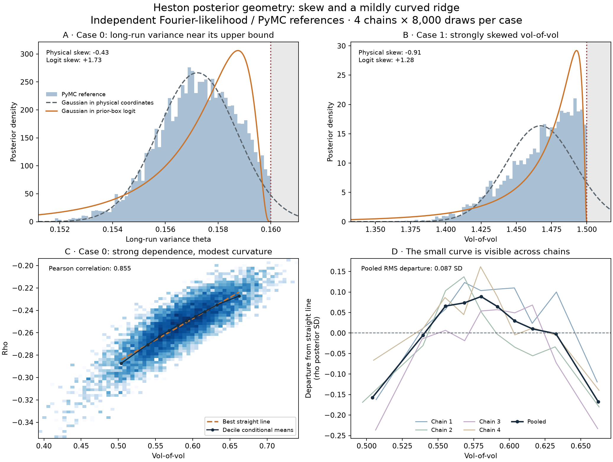

# Existing Heston posterior geometry

**The existing references show bounded, skewed marginals and a strongly correlated, mildly curved ridge. They do not establish dramatic banana shapes or multiple modes.** This is post-hoc descriptive evidence from the three already-inspected development cases, rather than a prevalence claim over the prior or a new acceptance gate.

Forwardable artifacts: [PNG](heston-posterior-geometry.png), [vector SVG](heston-posterior-geometry.svg), [complete numerical summary](geometry.json).

The blue distributions are the existing independent Fourier-likelihood / PyMC references, with four chains and 8,000 retained draws per chain. The figure is reference-only. Dashed gray curves are moment-matched Gaussians in physical coordinates; orange curves are Gaussians fitted in the prior-box logit coordinate and transformed back. The red dotted line is the upper prior bound; shaded gray lies outside that bound. The pair plot uses logarithmic histogram counts. No new posterior sampling, MCMC, simulator calls, prices or cluster allocations were required.

## What is non-Gaussian here?

| Existing case and marginal | Physical skew | Prior-box logit skew | Fitted physical Gaussian CDF distance | Fitted logit Gaussian CDF distance | Final neural / reference CDF distance |
| --- | ---: | ---: | ---: | ---: | ---: |
| Case 0, long-run variance theta | −.431 | +1.733 | .0320 | .1114 | .0461 |
| Case 1, vol-of-vol | −.914 | +1.282 | .0890 | .0866 | .0316 |
| Case 2, rho | −.736 | +1.554 | .0683 | .0989 | .0402 |

The prior boundaries matter. Case 1's vol-of-vol has mean 1.4671 and SD .02438, below its upper bound 1.5; a physical Gaussian with those moments puts about 8.86% probability outside support. The familiar logit transform does not generally Gaussianize these reference marginals: its residual skew is substantial in the three examples above. These are descriptive CDF distances, not normality-test p-values. The Gaussian fits use the reference sample's own moments; this is not a separately trained or tuned Gaussian inference benchmark. Other bounded approximations, such as truncated distributions, remain possible competitors.

The delivered final-500 amortizer captures much of case 1's shape: its vol-of-vol skew is **−1.018**, versus **−.914** for the reference, and its empirical CDF distance is **.0316**, versus approximately .089/.087 for these two fitted Gaussian descriptions. Agreement is not uniformly this close: **case 2's initial-variance CDF distance is .1072**. All twelve marginal distances and both reference/neural skew summaries remain in the numerical report. Correlated MCMC draws and finite neural samples affect these descriptive quantities; no new pass/fail threshold is imposed.

## How curved is the ridge?

Case 0's vol-of-vol/rho Pearson correlation is **.8548**, with chain-specific correlations .8496–.8580. Correlation alone is not evidence of a non-Gaussian distribution. We therefore measured the mean rho in ten equal-frequency vol-of-vol bins and its departure from the best straight conditional line. The pooled RMS departure is **.0871 rho posterior SD**, with maximum decile departure **.1676 SD**. That is visible but modest curvature.

A quadratic conditional fit reduces held-out-chain mean squared error by approximately **1.5–4.8%** relative to the straight line across the four leave-one-chain-out comparisons. This is a descriptive check against a single-chain artifact, not independent predictive validation or proof of a particular nonlinear mechanism. Bin means retain Monte Carlo noise. The figure magnifies the small residual so its scale remains explicit.

## Reference and artifact provenance

The existing parameter diagnostics pass for every case: the largest R-hat is **1.00495**, the smallest bulk ESS **1,529.7**, and the smallest tail ESS **1,462.2**. The physical skew has the same sign in each chain for the highlighted marginals; chain-specific values are retained. This supports interpreting these features as posterior geometry rather than an obvious mixing failure.

The [postprocessing source](analyze_heston_geometry.py) checks the downloaded reference chains, existing final-500 neural draws and reference diagnostic bytes against the already-frozen [candidate declaration](../heston-candidate-acceptance/manifest.json). The numerical summary records those SHA-256 hashes, original chain axes, source hash and local runtime versions. Full chain/draw payloads remain on Oscar and were temporarily copied only to `/private/tmp` for this inexpensive one-thread postprocessing; none is committed here. [sha256sums.txt](sha256sums.txt) inventories the retained artifacts.

These examples support a tutorial discussion of boundaries, skew, parameter dependence and modest curvature. They do not by themselves show that Heston needs the most elaborate flow architecture, that the posterior is multimodal, or that the amortizer captures every local shape equally well.
