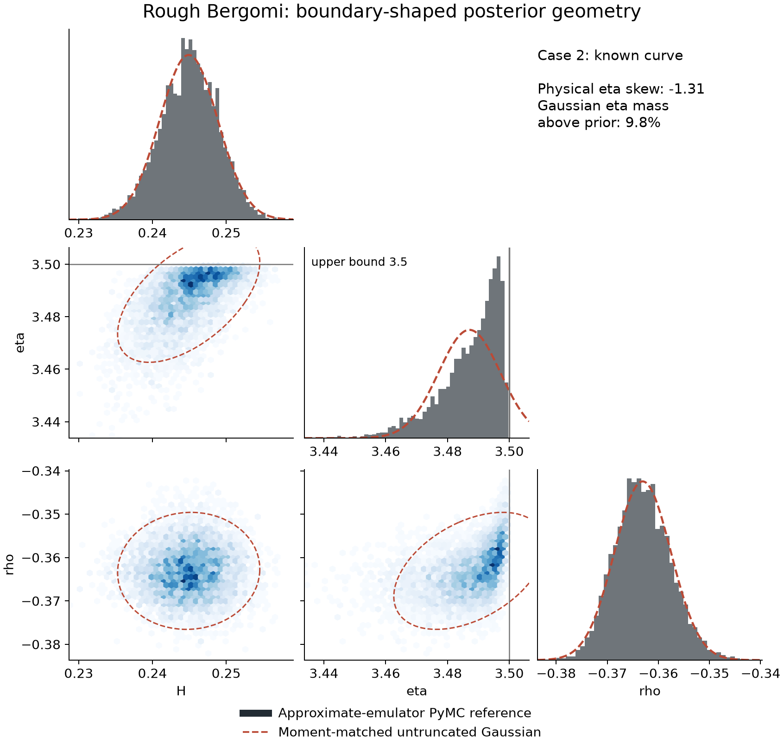
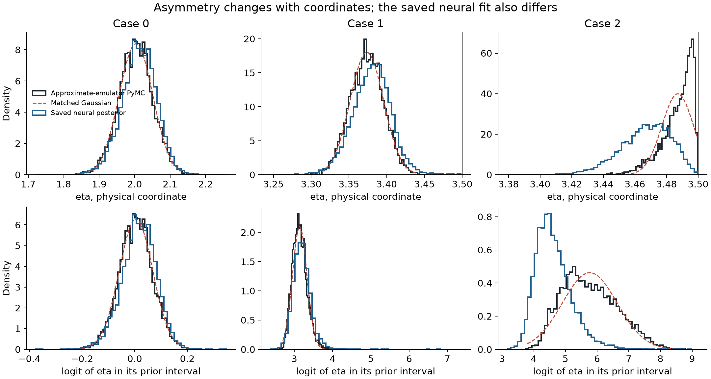

# Geometry of the saved rough Bergomi posteriors

The existing samples show **clear boundary-associated asymmetry in case 2**, while cases 0 and 1 are much closer to Gaussian in physical coordinates. This is useful evidence about posterior shape, but not evidence that flows are necessary or that the accepted rough-model posterior is multimodal.

These are the already saved known-curve development cases `validation:0`, `validation:1` and `validation:2`. Each PyMC reference has **four chains × 8,000 retained draws × three parameters**. The saved neural output contains **10,000 draws per case**. All statistics use every retained sample; no posterior sampling, pricing, training or notebook execution occurred. The one-thread postprocessing took about 4.4 seconds. [Input identities and axes](rough-geometry-inputs-20261028.json), [complete metrics](geometry.json), [analysis source](analyze_rough_posterior_geometry_20261028.py).

## Figures to share

**Case 2: physical-coordinate reference geometry.** Histograms and blue pair densities show the approximate-emulator PyMC reference. Dashed red curves are moment-matched untruncated Gaussian marginals; dashed ellipses are their bivariate 95% regions. Gray lines mark eta's prior upper bound, 3.5. Pair densities display a deterministic stride of 8,000 reference draws; numerical summaries use all 32,000. The eta asymmetry and support cutoff are visible. This is a reference-shape diagnostic, not proof of the correct continuous rough-model posterior.

**Physical versus logit eta, with the saved neural outputs.** Black outlines show the approximate-emulator PyMC references; blue outlines show the existing neural fits; dashed red curves are matched Gaussians in each displayed coordinate. The lower row transforms eta to `log((eta − 0.5) / (3.5 − eta))`. It changes coordinates of the same samples; it does not change or refit the posterior. Case 2's neural fit visibly differs from the reference, consistent with the previously recorded conditional failures. This figure does not establish neural/reference agreement.

## What the numbers support

| Reference case | Physical eta skew | Logit eta skew | Mass above eta 3.47 | Matched physical Gaussian mass outside eta's prior |
| --- | ---: | ---: | ---: | ---: |
| 0 | −.035 | −.035 | 0% | negligible |
| 1 | −.007 | +.528 | 0% | negligible |
| 2 | **−1.309** | **+.391** | **92.55%** | **9.84%** |

The interval `(3.47, 3.5)` is the top 1% of eta's full prior width. Case 2's eta excess kurtosis is **1.926**; its physical-coordinate skew ranges from −1.16 to −1.44 across the four chains. A Gaussian with the reference mean and SD would put nearly 10% of its eta mass above the prior bound, where the actual posterior has no support.

The coordinate comparison matters: logit eta is substantially less skewed in case 2, and case 1 becomes more skewed after transformation despite a nearly symmetric physical marginal. A simple transformed Gaussian may capture much of the boundary-associated shape. These examples alone do not establish that a flow provides a practical advantage over that baseline.

There is correlated dependence: reference eta/rho Pearson correlations are about **.730, .230 and .438** in cases 0, 1 and 2. Case 2 has some conditional curvature: a quadratic eta-to-rho regression reduces held-chain prediction RMSE by about **4.2%** relative to a linear regression, versus roughly 0–.03% in the other two cases. This is a descriptive diagnostic, not a compelling banana-shaped or multimodal example. The corner view is dominated by eta's boundary, with milder effects in the other marginals. Existing views do not provide persuasive evidence of distinct modes, and neither a corner plot nor finite chain diagnostics can exclude all missing modes.

## Scope and limitations

The PyMC target uses the existing **deterministic forward-price emulator plus Gaussian quote noise**. It is an approximate reference, not independently validated exact-model truth. The [independent pricing check](../known-pricing-validation/README.md) found material emulator and grid errors near case 2; detailed boundary geometry may therefore change with a better reference. It must not be attributed solely to exact rough Bergomi dynamics.

The neural samples are from the already evaluated selected checkpoint, whose cases 1 and 2 have known conditional discrepancies. They are not a newly accepted fit. The analysis compares physical and logit coordinates explicitly, records input hashes and chain axes, and avoids normality p-values or unsupported mode counts. No reserved-test samples were used. The figures and metrics are descriptive tutorial-development evidence.
