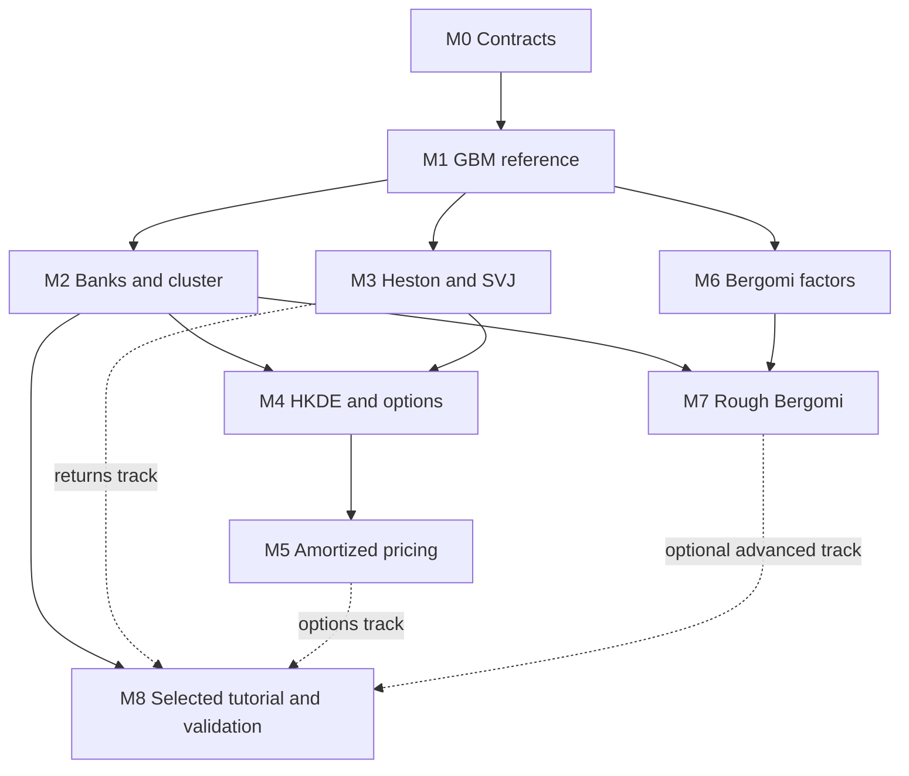

# Finance simulator and amortized inference implementation plan

Status: draft for review, 11 October 2026. Implementation starts after review of this plan.

Build reusable simulators and reproducible training datasets for two financial applications: learning dynamics from return histories, and learning pricing parameters or prices from option quotes. Both can be taught and validated on simulated observations. Shared infrastructure should make both applications practical while preserving their different probability measures, observations and inference targets.

The intended result is a small library inside `sbi4finance`, a cluster workflow that produces validated simulation banks, and selected BayesFlow examples that can be run from saved checkpoints. Numerical pricing engines provide reference calculations and training labels. Learned pricing components can subsequently remove those expensive calculations from the routine inference path.

## Synthetic delivery and market evidence

The required delivery is **S, a complete synthetic teaching core**. Market observations, provider access and acquisition permissions are not prerequisites. S, M and E describe delivery/evidence levels; they are separate from the numbered implementation milestones M0–M8.

| Level | Inputs and supported result | Evidence boundary |
|---|---|---|
| **S — synthetic teaching core, required** | Simulated observations and declared context support simulators/pricers, banks, network training, independent synthetic recovery, SBC, contraction, joint/reference checks, controlled misspecification, prior sensitivity, cost comparisons and a complete offline tutorial. Curves, contracts and forward-variance inputs may be hypothetical or generated when labeled. | Findings are conditional on the tested model, prior, observation design and numerical experiments. They do not establish adequacy for actual markets. |
| **M — market application, optional** | One compatible real return window, or an option panel with its market context, permits conditioning a trained, normally frozen network on an actual asset/date. It produces a forecast or a distribution of downstream model prices. | This is conditioning/calibration, not supervised network training. Real parameter/state truth is unavailable. Future returns or observed target prices are unnecessary merely to produce the output. |
| **E — empirical evaluation, optional** | Held-out later outcomes evaluate return forecasts; contemporaneous excluded target quotes evaluate option-pricing outputs. Broader backtest/regime claims require many chronological origins/dates and a declared evaluation design. | Preprocessing, smoothing and tuning must respect the holdout boundary. A single panel supplies a case study or in-sample fit, not general performance. Market prices are not known fair model values, and ordinary market data do not reveal true latent variance, jumps or parameters. |

The complete S returns workflow is **synthetic history → joint P parameters and current continuation state → simulated future returns, losses or volatility**. The complete S options workflow is **synthetic noisy panel → Q posterior → reference or surrogate target-price distribution**. Pricing regression instead maps parameters/contracts to accurate expectation labels; one simulated payoff is not a price label. Direct price-posterior training pairs a noisy panel with target reference prices from the same parameters. Q calibration does not forecast tomorrow's market option chain or provide P risk probabilities; linking P and Q remains deferred.

Synthetic American or exotic price uncertainty is possible once the relevant target pricer is validated. The initial European scope and deferred extensions below concern numerical implementation, not a need for real target quotes.

M0 contracts, M2 manifests and every validation sheet must record origin, purpose, task/measure, information cutoff or contract selection, available truth labels and the evidence scope of the reported result. Truth labels, simulator-only diagnostics and future evaluation outcomes stay outside observed conditioning. Synthetic training/test base draws are independent; option augmentations are grouped by base surface and related return windows account for dependence.

M8 must run the full chosen S workflow offline with **all real-market fixtures absent**. Optional M/E cells are labeled and explicitly unavailable when inputs are missing; a synthetic fallback must never be presented as real. Acquisition cannot block S, and market data cannot substitute for numerical or synthetic inference validation.

This boundary follows PR #4's committed [scenario and capability specification](https://github.com/fmuia/sbi4finance/blob/1e45918214c57b20120feb1c802cb3220cefcc41/docs/inference-scenarios-and-data.md) and [data-loading plan](https://github.com/fmuia/sbi4finance/blob/1e45918214c57b20120feb1c802cb3220cefcc41/docs/data-loading-plan.md). Its D0–D2 plus D4 form the required synthetic acceptance path; D3 is optional M/E acquisition. Those acquisition tasks add no dependency to this plan's S delivery.

## Reading paths

For a decision about scope, read the milestone table, the proposed defaults, and the review choices below. Each milestone links to its own actionable subplan.

For an introduction to the subject, read these notes in order:

1. [Financial and statistical foundations](notes/01-foundations.md): returns, volatility, options, physical and risk-neutral probabilities, Bayes, and an analytic worked example.
2. [Models and numerical simulation](notes/02-models-and-numerics.md): GBM, Heston, Gaussian and double-exponential jumps, Bergomi factors, rough memory, and numerical approximation.
3. [Inference and learned pricing](notes/03-inference-and-pricing.md): posterior training, the three pricing workflows, uncertainty propagation, forecasting and validation.
4. [Software and dataset contracts](notes/04-software-and-data.md): how those mathematical objects become modules, simulation examples, immutable banks and cluster jobs.

The notes define the equations and conventions used by this plan. They are an introduction to the proposed work, rather than a complete course in stochastic calculus or a claim that every listed model has already been validated.

## Milestones and deliverables

Every milestone is proposed. Acceptance means its stated checks pass; completing one does not automatically accept the others.

| Milestone | Main deliverable | Dependencies | Role |
|---|---|---|---|
| [M0 Contracts](milestones/00-contracts.md) | Versioned model, observation, task, target and numerical specifications | Plan review | Shared foundation |
| [M1 GBM reference](milestones/01-gbm-reference.md) | Exact simulator, analytic posterior/pricing checks, small local inference example | M0 | Shared foundation |
| [M2 Banks and cluster](milestones/02-banks-and-cluster.md) | Reproducible shards, verifier, BayesFlow loader and CPU generation array | M1 | Shared foundation |
| [M3 Heston and SVJ](milestones/03-heston-and-svj.md) | Validated hidden-variance/jump kernels and returns inference | M1; M2 for large banks | Returns application and shared kernels |
| [M4 HKDE and options](milestones/04-hkde-and-options.md) | Double-exponential jump variant, reference pricing and option-panel observations | M3 and M2 | Options application |
| [M5 Amortized pricing](milestones/05-amortized-pricing.md) | Parameter posterior plus learned price surrogate; optional direct-price posterior experiment | M4 and M2 | Learned financial output |
| [M6 Bergomi factors](milestones/06-bergomi-factors.md) | One-factor model and pricing checks; optional two-factor extension | M1; M2 for banks | Independent model branch |
| [M7 Rough Bergomi](milestones/07-rough-bergomi.md) | Validated rough simulator and option-calibration bank | M6 and M2 | Advanced model branch |
| [M8 Validation and tutorial](milestones/08-validation-and-tutorial.md) | Accepted checkpoint, reproducible reports and participant notebook for a selected application | M2 plus the selected accepted model/inference milestones | Delivery gate |

The minimum useful infrastructure release is M0–M2. A returns-based teaching release can then use M3 and M8. An options-based release can use M4, M5 and M8. M6–M7 can proceed independently once their shared dependencies are available; they need not delay either teaching release.

The table is authoritative for dependencies. The graph emphasizes the independent branches; shared bank infrastructure also supports the larger experiments in M3 and M6. Market acquisition has no dependency edge to the required S tutorial.

Milestone acceptance gates are scientific and engineering checks, rather than automatic requests for another permission at every step. After the plan is approved, implementation can proceed through the agreed scope as checks pass. A material scope change or unresolved scientific choice returns for review with its concrete alternatives.

## Proposed defaults

| Decision | Proposed starting point | Reason |
|---|---|---|
| Package location | Modules inside `sbi4finance` | One integration destination and one environment to maintain |
| Kernel backend | NumPy reference plus Numba where useful | Readable reference, fast CPU stepping, limited deployment burden |
| Storage | Many-example NumPy shards plus JSON manifests | Simple inspection, memory mapping and deterministic retries |
| Neural interface | BayesFlow adapter over raw arrays | Scientific simulation stays independent of network architecture |
| First data design | Fixed regular return windows and fixed European contract panels in separate tasks | Makes dimensions and acceptance criteria explicit |
| Required teaching inputs | Synthetic observations and context, with no real-market fixtures | Makes either chosen S workflow independently deliverable offline |
| Actual-market example | Optional M, with separately designed E evaluation | Keeps application distinct from evidence of real performance |
| Inference target | Model parameters plus necessary latent state | Supports interpretable inference and conditional forecasts |
| Learned pricing | Parameter posterior followed by a supervised price surrogate | Separately measurable inference and pricing errors |
| Direct price posterior | A gated comparison in M5 | Useful when price uncertainty is the main output |
| Bergomi application | Q-measure option calibration first | Avoids assuming an unspecified P/Q link or incomplete forecast state |
| Large compute | Small correctness and resource pilot before each bank | Cost and numerical error are measured before scaling |

Fixed designs are starting experiments, not permanent API restrictions. Variable grids, missingness and uncertain market inputs become new supported task versions with corresponding training and validation.

## What constitutes a successful result

For required S returns delivery: generate a synthetic return history, infer parameters and the required current state, continue the process from matched posterior draws, and assess future-loss uncertainty against synthetic references. For S options delivery: generate a synthetic quote panel and its context, infer Q parameters or target prices, and quantify price uncertainty for a declared target contract family. The participant notebook may load cached synthetic artifacts and a trained checkpoint; its inputs and results remain labeled synthetic. Either selected workflow must run with market fixtures removed.

Optional M replaces the conditioning observations with a compatible actual-market fixture, normally retaining frozen weights. Optional E adds separately held-out outcomes/quotes and its own evaluation design. Neither is an acceptance dependency for S.

Both S workflows must establish the first four kinds of evidence below. Empirical assessment is a separate optional layer:

| Evidence | Question answered |
|---|---|
| Mathematical and numerical (S) | Does the simulator/pricer implement the declared model accurately enough? |
| Data engineering (S) | Does the bank contain the intended independent base examples and grouped derivatives, with traceable definitions and reproducible generation? |
| Conditional inference (S) | Does the learned posterior agree with suitable references and calibrated synthetic experiments, including joint and conditional checks? |
| Financial output under the tested model (S) | Are prices or predictive risk quantities accurate and stable against numerical/synthetic references at the required resolution? |
| Empirical model assessment (E, optional) | How do declared forecasts or prices compare with held-out real outcomes/quotes across the claimed evaluation scope? |

Before an expensive run, define a validation sheet with the case bank, origin/purpose, truth availability, evidence scope, conditioning boundary, metric, tolerance, numerical reference and decision on failure. Strict software properties—IDs, masks, shapes, non-leakage and supported inputs—are pass/fail checks. Statistical quantities require uncertainty estimates, and numerical tolerances must reflect the task's noise scale and intended use. A universal threshold such as “all errors below 1%” would be misleading across these quantities.

Training and benchmarking reports distinguish compilation, generation, serialization, training, posterior sampling and downstream forecasting/pricing. Amortization is worthwhile when the one-time cost is spread over enough compatible uses. This is measured for the chosen workflow; no speed-up or break-even count is assumed in advance.

## Collaboration and existing work

The existing MMAR notebook remains a separate supported example while the shared layer develops. Its checkpoint is tied to its current simulator and transforms.

Francesco's contribution should enter through M3 with its exact equations, parameterization, initialization, discretization, checkpoint architecture, reference cases and generation seeds. First reproduce a saved result. Optimize or generalize only after that reference works. The absence of that bundle does not block M0–M2 or an independently named Heston reference; it does block a claim of reproducing his particular SVJ study.

SSMS and the HSSMSpine generation pipeline are architectural references for model catalogs, kernel boundaries and data lineage. Finance observations and posterior-training targets receive their own contracts. The precise reuse boundary is described in [software and data](notes/04-software-and-data.md).

## Review choices

The proposed defaults above make the plan implementable. The main choices for this review are:

- Whether the first application after shared infrastructure should be returns inference, option calibration, or two separately resourced branches.
- Whether M5's parameter-posterior-plus-surrogate route is the preferred pricing deliverable, with direct price inference remaining an experiment.
- Whether one-factor Bergomi is in the first implementation scope or follows the first accepted Heston/jump workflow.
- Which target contract family matters first. European calls/puts provide reference checks; any American or path-dependent extension needs its own pricing and validation work.

Exact priors, grids, noise models and numerical tolerances are deliverables of M0 and the relevant model milestone. They should be justified by the intended inference task and reference experiments, rather than filled with arbitrary values in a planning document.

Joint P/Q estimation, general portfolios, SVCJ, rough Heston, automatic Bayesian model selection, Greeks, and a universal American-option engine are outside the initial deliverables. They can be added through separately specified tasks when needed. A broader simulator catalog does not imply all models belong in one two-hour tutorial.

## Relationship to earlier notes

This is the implementation roadmap extending the [simulator architecture assessment](../simulator-ladder-architecture-2026-10-11.md), including the subsequent distinction between reference pricing and learned pricing. The [HKDE data specification](../tutorial-data-needs-2026-10-10.md) remains the options data reference, and the [SVJ integration assessment](../svj-hkde-integration-assessment-2026-10-10.md) preserves the collaborator handover and validation context. Curriculum choice remains explicit in this plan.
