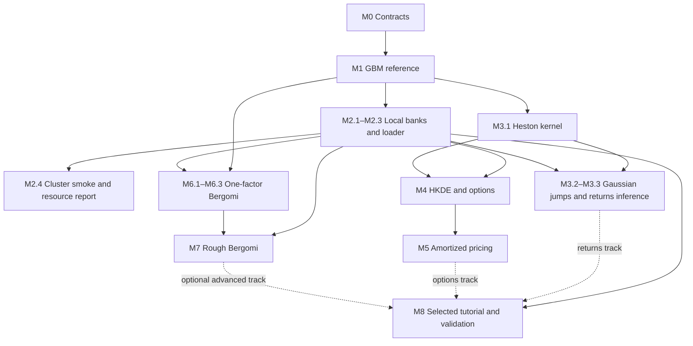

# Finance simulator and amortized inference implementation plan

Status: implementation started, 11 October 2026. The [GBM reference](../gbm-reference.md) records M0/M1, the [bank/training increment](../gbm-bank-training.md) records local M2.1–M2.3, and the [actual CPU cluster smoke](../gbm-cluster-smoke.md) records M2.4. [Heston/Gaussian-jump kernels](../heston-svj-kernels.md) implement M3.1–M3.2 with bounded numerical checks and measured Numba timings. The [M3.3 joint Heston pilot](../heston-joint-inference.md) implements the bank/reference/training/forecast path, but its frozen checkpoint failed conditional test checks: posterior acceptance remains pending. The [spline follow-up](../heston-inference-followup.md) and [explicit-time follow-up](../heston-time-context.md) also failed the unchanged validation gates; root 43022's final-test split remains unevaluated. The live tutorial's main application remains open. Track implementation evidence and didactic completion separately.

Build reusable simulators and reproducible training datasets for two financial applications: learning dynamics from return histories, and learning pricing parameters or prices from option quotes. Both can be taught and validated on simulated observations. Shared infrastructure should make both applications practical while preserving their different probability measures, observations and inference targets.

The intended result is a small library inside `sbi4finance`, a cluster workflow that produces validated simulation banks, and selected BayesFlow examples that can be run from saved checkpoints. Numerical pricing engines provide reference calculations and training labels. Learned pricing components can subsequently remove those expensive calculations from the routine inference path.

## Build for tutorial iteration

**Current priority (11 October): complete useful simulator and bank coverage.**
Keep the Heston inference findings and reserved test intact; further network
analysis is recorded in [next steps](../simulator-analysis-next-steps.md).
Implement HKDE (increment 6), one-factor Bergomi (8), and rough Bergomi (9)
with small verified banks and didactic reviews before returning to learned
pricing (7) or the final participant release (10). The numbering identifies
the planned scope, not a requirement to execute independent branches in order.
The returns-versus-options curriculum remains open. This changes work priority,
not scientific acceptance: a working simulator bank does not validate a posterior.

The [HKDE reference](../hkde-reference.md) and [shared option bank](../option-banks.md)
now implement M4.1–M4.2 with bounded M4.3 evidence. The numerical pilot covers
the supplied restricted prior and European panel; wider priors and products
need new accuracy checks. Notebook 06 is verified offline. The actual option workload now passes the
[cluster smoke](../option-cluster-smoke.md); M5 training remains pending.

Increment 8 now supplies [one-factor Bergomi](../bergomi-simulators.md), its
verified small bank and offline notebook 08. M6.1–M6.3 infrastructure is in place;
numerical acceptance is limited to the reported fixtures and sampling-aware
refinement screens. Before scaling, settle the chosen price-label fidelity.
Two-factor models and Bergomi posterior acceptance remain outside this increment.

Increment 9 supplies the [rough reference and hybrid driver](../rough-bergomi.md),
European pricing, a verified rough option bank and the rough sections of notebook
08. M7.1–M7.2 numerical infrastructure and M7.3a bank delivery are available with
explicit fidelity limits. The [restricted M7.3b pilot](../rough-joint-inference.md)
now supplies fixed-ID cluster generation, compact saved training/reference banks,
and the joint training/audit software path. Its original independent reference
passed 19/20 cases and stopped before neural training or SBC. One separately
authorized [reference extension](../rough-reference-expansion.md) retains that
failure and appends 4,096 rows under unchanged gates. Notebook09 reviews both
studies and separates reference precision from neural acceptance. All 20
expanded-reference cases and all seven neural validation gates pass, including
512-case SBC. The later [held-out study](../rough-heldout-test.md) passes its
reference and six of seven neural gates, but fails one conditional eta-spread
check. The candidate remains provisional; all 256 test cases are now used.
M8 curriculum/release acceptance is a separate decision.
These three option banks complete the current coverage push. All three now have actual
CPU generation, exact Linux replay, verified transfer and numerical Mac replay
in the [cluster report](../option-cluster-smoke.md). The original HKDE portable
tolerance failure and adjustment remain visible; scientific gates are unchanged.
Next follow the [restricted HKDE subplan](milestones/05-amortized-pricing.md#next-increment-restricted-hkde-baseline):
refined two-dimensional reference, one small baseline, conditional/joint and
price checks, and offline review. M5 posterior acceptance, Bergomi's M7.3b
inference, and M8's chosen participant release remain pending. Optional
two-factor models and rough-memory P forecasting are outside this required core.

The priority is a useful, scientifically sound tutorial that is easy to change. These milestones organize the work; they are not a requirement to build a production platform or complete every model before learning from a working example. The ordered substeps are a checklist, not separate PRs or approval rounds.

Start with a small executable path: a few functions, explicit parameters and arrays, a saved configuration and seed, a compact synthetic bank, and the existing in-memory training route. M0 should settle the conventions needed for that path and sketch the second observation type; it should not design every future model's API. Adapt contracts as experiments teach us what is needed, record the change, and regenerate small pilot banks when simpler than supporting old formats.

- Keep scientific essentials from the start: units and P/Q meaning, observation/target separation, correct continuation state, reproducible draws, independent evaluation, and appropriate reference checks on the declared domain.
- Add structure when an actual use needs it. Functions and plain dictionaries or small dataclasses are enough initially; the module diagram names responsibilities, not mandatory packages, base classes or registries.
- Start M2 with compact saved arrays, a short metadata file and a small train/reload example. A custom disk loader is needed only when a measured bank no longer fits comfortably in memory. Cluster support starts with a thin job script using the same generator.
- Use focused tests and a few informative reference cases during iteration. Broader numerical/inference validation is required before large banks or accepted teaching claims, not before every exploratory run. Mark provisional results clearly and constrain supported inputs rather than claiming generality.
- Defer plugin systems, schema-migration frameworks, deployment services, cross-platform compatibility matrices, generalized fault recovery and speculative optimization. Add an abstraction or hardening step when a second concrete use or a measured failure/cost justifies it.

Model prototypes can proceed alongside bank improvements once their scientific inputs are defined. A release dependency specifies the evidence needed to accept an output; it need not prevent a small exploratory script. Stop each increment when it answers the current question with credible checks, then use that evidence to choose the next increment. The full selected S teaching workflow still has to pass its stated acceptance checks.

## Envisioned PR sequence

Implementation titles use `N/10-simulator-plan-description`: the denominator is the **current envisioned total**, not a literal placeholder. Planning PR #3 is outside the count. Each PR body identifies its milestone and actual Git dependency; a sequence number does not make independent scientific branches depend on each other. Adjust the denominator if review slices are combined, split or deferred; it is not a promise to complete every model before the tutorial.

| PR position | Milestone/scope |
|---|---|
| 1/10 | M0/M1: GBM reference — [PR #7](https://github.com/fmuia/sbi4finance/pull/7) |
| 2/10 | M2.1–M2.3: small local bank, checks and training/reload — [PR #8](https://github.com/fmuia/sbi4finance/pull/8) |
| 3/10 | M2.4: CPU cluster generation and [measured smoke run](../gbm-cluster-smoke.md) |
| 4/10 | M3.1–M3.2: [Heston and Gaussian-jump kernels, checks and timings](../heston-svj-kernels.md) |
| 5/10 | M3.3: [restricted joint Heston inference and conditional forecasts](../heston-joint-inference.md); pipeline implemented, checkpoint provisional |
| 6/10 | M4: HKDE pricing and option panels |
| 7/10 | M5.1–M5.2: Q posterior, reference pricing and price surrogate |
| 8/10 | M6.1–M6.3: one-factor Bergomi |
| 9/10 | M7.1–M7.3: rough Bergomi and pilot inference |
| 10/10 | M8: selected, validated offline teaching workflow |

Optional collaborator parity, direct-price inference, two-factor Bergomi, finite-factor rough approximations and market/empirical additions are outside this count. M8 can follow the chosen route while unselected catalog work is deferred. The separate data-plan series currently envisions five review slices: local fixtures, returns preparation, options preparation, compatibility checks, and selected offline integration. Market acquisition is optional in both series.

## Synthetic delivery and market evidence

The required delivery is **S, a complete synthetic teaching core**. Market observations, provider access and acquisition permissions are not prerequisites. S, M and E describe delivery/evidence levels; they are separate from the numbered implementation milestones M0–M8.

| Level | Inputs and supported result | Evidence boundary |
|---|---|---|
| **S — synthetic teaching core, required** | Simulated observations and declared context support simulators/pricers, banks, network training, independent synthetic recovery, SBC, contraction, joint/reference checks, controlled misspecification, prior sensitivity, cost comparisons and a complete offline tutorial. Curves, contracts and forward-variance inputs may be hypothetical or generated when labeled. | Findings are conditional on the tested model, prior, observation design and numerical experiments. They do not establish adequacy for actual markets. |
| **M — market application, optional** | One compatible real return window, or an option panel with its market context, permits conditioning a trained, normally frozen network on an actual asset/date. It produces a forecast or a distribution of downstream model prices. | This is conditioning/calibration, not supervised network training. Real parameter/state truth is unavailable. Future returns or observed target prices are unnecessary merely to produce the output. |
| **E — empirical evaluation, optional** | Held-out later outcomes evaluate return forecasts; contemporaneous excluded target quotes evaluate option-pricing outputs. Broader backtest/regime claims require many chronological origins/dates and a declared evaluation design. | Preprocessing, smoothing and tuning must respect the holdout boundary. A single panel supplies a case study or in-sample fit, not general performance. Market prices are not known fair model values, and ordinary market data do not reveal true latent variance, jumps or parameters. |

The complete S returns workflow is **synthetic history → joint P parameters and current continuation state → simulated future returns, losses or volatility**. The complete S options workflow is **synthetic noisy panel → Q posterior → reference or surrogate target-price distribution**. Pricing regression instead maps parameters/contracts to accurate expectation labels; one simulated payoff is not a price label. Direct price-posterior training pairs a noisy panel with target reference prices from the same parameters. Q calibration does not forecast tomorrow's market option chain or provide P risk probabilities; linking P and Q remains deferred.

Synthetic American or exotic price uncertainty is possible once the relevant target pricer is validated. The initial European scope and deferred extensions below concern numerical implementation, not a need for real target quotes.

M0 contracts, M2 manifests and every validation sheet must record origin, purpose, task/measure, information cutoff or contract selection, available truth labels and the evidence scope of the reported result. Truth labels, simulator-only diagnostics and future evaluation outcomes stay outside observed conditioning. Synthetic training/test base draws are independent; option augmentations are grouped by base surface and related return windows account for dependence.

M8 must run the full chosen S workflow offline with **all real-market fixtures absent**. Optional M/E cells are labeled and explicitly unavailable when inputs are missing; a synthetic fallback must never be presented as real. Acquisition cannot block S, and market data cannot substitute for numerical or synthetic inference validation.

This boundary follows PR #4's committed [scenario and capability specification](https://github.com/fmuia/sbi4finance/blob/1e45918214c57b20120feb1c802cb3220cefcc41/docs/inference-scenarios-and-data.md) and [data-loading plan](https://github.com/fmuia/sbi4finance/blob/1e45918214c57b20120feb1c802cb3220cefcc41/docs/data-loading-plan.md). Its D0–D2 plus D4 form the required synthetic acceptance path; D3 is optional M/E acquisition. Those acquisition tasks add no dependency to this plan's S delivery.

## Reading paths

For a decision about scope, read the milestone table, the proposed defaults, and the review choices below. Each milestone links to its own actionable subplan.

For an introduction to the subject, read these notes in order:

1. [Financial and statistical foundations](notes/01-foundations.md): returns, volatility, options, physical and risk-neutral probabilities, Bayes, and an analytic worked example.
2. [Models and numerical simulation](notes/02-models-and-numerics.md): GBM, Heston, Gaussian and double-exponential jumps, Bergomi factors, rough memory, and numerical approximation.
3. [Inference and learned pricing](notes/03-inference-and-pricing.md): posterior training, the three pricing workflows, uncertainty propagation, forecasting and validation.
4. [Software and dataset contracts](notes/04-software-and-data.md): how those mathematical objects become modules, simulation examples, immutable banks and cluster jobs.

The notes define the equations and conventions used by this plan. They are an introduction to the proposed work, rather than a complete course in stochastic calculus or a claim that every listed model has already been validated.

## Didactic review notebooks at every milestone

Every significant implementation increment includes a **marimo review tutorial** that lets a reviewer learn the problem, run a small example, and inspect the evidence before moving on. This is part of that milestone's deliverable and acceptance, not work postponed to M8. Keep it lean: import the package's functions, reuse existing mathematical notes and saved reports, and extend explicit sections in an existing notebook when increments belong together. Do not introduce a separate notebook framework or copy simulator/training implementations into cells.

Each milestone's review sections must contain:

1. **Motivation and mathematics:** the financial question, essential equations and assumptions, and an explanation of the new step relative to the preceding milestone. Link the fuller mathematical notes and define notation needed to understand the example.
2. **A concrete task:** identify P or Q, the observation, conditioning context, inference target and continuation state, with units and array axes. Show which truth/diagnostic fields are unavailable to the estimator; distinguish numerical settings from model parameters. Explain any synthetic context and the S/M/E evidence boundary.
3. **A runnable small demonstration:** deterministic seeded synthetic inputs and a bounded CPU calculation using the actual implementation. Display a useful plot or table with units; explain what it means. Cached expensive results complement this demonstration, rather than substituting for all executable work.
4. **Actual evidence and limitations:** show measured results, tolerances, passed and failed gates, reference uncertainty and unsupported scope. Separate numerical correctness, conditional inference and empirical assessment. A functioning pipeline or marginal SBC pass cannot conceal a failed conditional check. A provisional checkpoint can be reviewed, but the notebook must not present it as an accepted inference product.
5. **Traceable artifacts:** link the source functions, task/configuration, bank manifest, relevant checkpoint and evidence reports, as applicable. Identify versions, seeds, hardware and what was computed live versus cached. Use the reports' actual numbers rather than copying optimistic summaries.
6. **Short review exercises:** two or three focused prompts with hints or answers, such as predicting a parameter change, inspecting a conditioning boundary, or explaining a failed gate. These should test understanding of this increment, not require another large experiment.

The default path is S and runs offline with all real-market fixtures absent. It neither submits cluster jobs nor automatically launches substantial bank generation, training, reference inference or provider access. Use explicit documented opt-in commands for expensive work. If a required cached artifact is missing, explain the missing dependency and how to obtain or reproduce it; do not silently start a costly fallback or invent a result. Optional M/E cells retain their labels and skip visibly without their inputs.

**Review verification:** execute the default notebook headlessly in a fresh process in the pinned CPU environment, and export it to HTML. Record the exact commands, exit status, runtime and artifact versions in the implementation PR; inspect the exported explanation, figures/tables and gate status. Verify that network/provider access and real-market fixtures are unnecessary, and that execution/export does not trigger expensive jobs. Execution failures and missing artifacts remain explicit incomplete checks. This verifies the review artifact; scientific acceptance still depends on the milestone's own numerical and inference gates.

The following map uses **implementation increment numbers**, not GitHub PR numbers. The baseline versions of the three review notebooks covering increments 1–5 were delivered and verified in [PR #11](https://github.com/fmuia/sbi4finance/pull/11), including the backfills for increments 1–4. Their delivery does not clear the failed M3.3 scientific gates. Later filenames are proposed destinations, not claims that those notebooks exist.

| Increment | Milestone sections and review notebook | Didactic status / next work |
|---|---|---|
| 1 — GBM foundation | M0 and M1 in `notebooks/01_gbm_foundations.py`: contracts, exact increments, analytic posterior and separate Q pricing | Delivered and verified in PR #11. Keep the MMAR notebook separate. |
| 2 — Local bank and training round trip | M2.1–M2.3 in `notebooks/01_gbm_foundations.py`: identities, splits, saved arrays, normalization and checkpoint reload | Delivered and verified in PR #11. |
| 3 — Cluster generation | M2.4 in an explicit cluster section of the same bank notebook: job/configuration, actual run evidence and cost | Delivered and verified in PR #11. Reviews actual cluster evidence without submitting jobs. |
| 4 — Heston/SVJ kernels | M3.1–M3.2 in `notebooks/04_heston_svj_kernels.py`: hidden variance, jumps, continuation and numerical checks | Delivered and verified in PR #11. Numerical support remains bounded to the reported cases. |
| 5 — Joint returns inference | M3.3 in `notebooks/05_heston_joint_inference.py`: task, joint posterior/reference comparison, continuation and future losses | Delivered and verified in PR #11, including the explicit-time follow-up section and its failed validation checks. M3.3 scientific acceptance remains pending. |
| 6 — HKDE option observations | M4 in `notebooks/06_hkde_and_pricing.py`: Q jump law, price expectations, noisy panel and accuracy budget | Planned with M4. |
| 7 — Learned pricing routes | M5 in separate sections of the HKDE/pricing notebook: posterior plus reference pricer, surrogate, optional direct-price study | Planned with M5; report each route's acceptance independently. |
| 8 — Finite-factor Bergomi | M6 in `notebooks/08_bergomi_models.py`: curve context, factor state, normalization and pricing | Planned with M6; optional two-factor material stays visibly optional. |
| 9 — Rough Bergomi | M7 in notebooks08–09: Gaussian reference, rough memory, refinement and restricted inference | Delivered. Reference/neural validation passed; later held-out study failed one conditional spread gate. Candidate remains provisional and test is used; simulator, numerical and inference scopes remain distinct. |
| 10 — Participant release | M8: a separately selected participant notebook, supported by the earlier review tutorials and release evidence | Planned; returns-versus-options curriculum choice remains open. |

New increments include their review material in the same PR. The backfills above are complete on the strength of their notebook checks, not retrospectively inferred from older implementation results. A review notebook can accurately explain a failed experiment and pass its execution check while that scientific substep remains pending. Track both states explicitly. M8 is the selected, paced participant course and final scientific delivery gate; the review notebooks support that decision and do not preselect the curriculum.

Baseline PR #11 verification: all three notebooks passed strict marimo checks, headless HTML export and visual inspection. They also passed in an isolated source/configuration/documentation/checkpoint copy with no `data/` directory and external sockets blocked (local IPC allowed). The foundation and kernel runs took 1.587 s and 1.622 s; the final joint-inference offline run passed without a new wall-time measurement. The initial 37-test suite passed; the current implementation suite passes 43 tests. Notebook 05's explicit-time extension also passes strict checks, headless export and visual inspection; its isolated export without market fixtures or external sockets took 13.09 seconds. These are execution/software checks, separate from posterior acceptance.

The [80-epoch explicit-time follow-up](../heston-time-context.md) uses the same bank and spline training design. Mean RMSE improved from 0.2457 to 0.1732 reference SD, but maximum mean error 0.4554 SD and predictive-interval endpoint error 0.2099 SD still exceed the unchanged 0.40 and 0.15 gates. Both failures occur on validation case 0; no other case exceeds an individual-error limit, and both aggregate rank checks pass. Root 43022's final test remains unevaluated, and M3.3 acceptance remains pending. These restricted Heston results make no full-SVJ or market claim and do not block the independent HKDE branch.

The [diagnostic review](../heston-diagnostics.md) now separates marginal SBC, conditional reference checks and engineering diagnostics, and directly compares the prior with all 16 conditional posteriors. Reference-normalized mean RMSE is 3.265 for a prior-copy baseline versus 0.173 for the neural posterior: this is substantial data updating. A frozen-weight precision follow-up confirms a persistent low-state mean discrepancy, while predictive endpoint errors straddle their tolerance across seeds. This is development evidence; it changes neither the original failed gate nor the reserved-test status.

The single [signed-asinh state experiment](../heston-state-transform.md) also failed the unchanged validation checks: mean RMSE 0.1865 reference SD, maximum mean error 0.5268, maximum relative SD error 0.3212 and predictive endpoint error 0.2403. Both marginal rank checks pass, illustrating why conditional checks remain necessary. Its predeclared stop rule was applied: no further candidate or final-test evaluation. M3.3 remains pending; further inference analysis is deferred during the simulator/bank coverage push described above. The expanded software suite passes 43 tests, and notebook 05 includes the transform mathematics and measured failure.

## Milestones and deliverables

Milestone status is recorded in each subplan. The milestone files define the required scope. Acceptance means the stated scientific/engineering checks pass and the corresponding didactic review sections are verified; completing one does not automatically accept the others. Implementation PRs record the evidence and any pending review backfill.

| Milestone | Main deliverable | Dependencies | Role |
|---|---|---|---|
| [M0 Contracts](milestones/00-contracts.md) | Versioned model, observation, task, target and numerical specifications | Plan review | Shared foundation |
| [M1 GBM reference](milestones/01-gbm-reference.md) | Exact simulator, analytic posterior/pricing checks, small local inference example | M0 | Shared foundation |
| [M2 Banks and cluster](milestones/02-banks-and-cluster.md) | Reproducible saved bank, integrity checks, training round trip and CPU generation job; scale storage/loading when needed | M1 | Shared foundation |
| [M3 Heston and SVJ](milestones/03-heston-and-svj.md) | Validated hidden-variance/jump kernels and returns inference | M1 for kernels; M2.3 for bank-backed inference | Returns application and shared kernels |
| [M4 HKDE and options](milestones/04-hkde-and-options.md) | Double-exponential jump variant, reference pricing and option-panel observations | M3.1 Heston kernel; M2.3 for banks | Options application |
| [M5 Amortized pricing](milestones/05-amortized-pricing.md) | Parameter posterior plus learned price surrogate; optional direct-price posterior experiment | M4 and M2.3 | Learned financial output |
| [M6 Bergomi factors](milestones/06-bergomi-factors.md) | One-factor model and pricing checks; optional two-factor extension | M1 for reference work; M2.3 for banks | Independent model branch |
| [M7 Rough Bergomi](milestones/07-rough-bergomi.md) | Validated rough simulator and option-calibration bank | M6.1–M6.3 and M2.3; not optional two-factor work | Advanced model branch |
| [M8 Validation and tutorial](milestones/08-validation-and-tutorial.md) | Accepted checkpoint, reproducible reports and participant notebook for a selected application | M2.1–M2.3 plus the selected accepted model/inference substeps | Delivery gate |

The minimum useful local infrastructure release is M0, M1 and M2.1–M2.3. M2.4 adds the verified cluster workflow and is required to call the full cluster milestone complete. A returns-based teaching release can use M3 and M8; an options-based release can use M4, M5 and M8. M6–M7 can proceed independently once their shared dependencies are available; they need not delay either teaching release.

The table and ordered subplans specify the dependencies; the graph summarizes required branches. Optional collaborator parity, two-factor Bergomi, direct price inference and finite-factor approximation experiments are omitted from the graph. Market acquisition has no dependency edge to the required S tutorial. A locally accepted notebook does not certify cluster execution: M2.4 remains separately tracked until its actual smoke job passes.

## Implementation sequence and subplans

Start with the shared foundation in this order. Each milestone file contains an **Ordered implementation subplan** table with stable step IDs, a concrete output and verification evidence. Existing task descriptions supply the scientific detail; the subplan defines the execution order. This documentation does not certify implementation completion; follow the linked artifacts and implementation PRs for measured status. Develop the corresponding review-notebook sections alongside each increment.

| Order | Work unit | Result needed before moving on |
|---|---|---|
| 1 | [M0.1–M0.3](milestones/00-contracts.md#ordered-implementation-subplan): conventions, worked schemas, contract review | Explicit P/Q tasks, units, inputs/targets, continuation requirements, identity and evidence metadata. Worked mock records suffice; a simulator is not a prerequisite. |
| 2 | [M1.1–M1.3](milestones/01-gbm-reference.md#ordered-implementation-subplan): exact GBM, analytic references, verified fixtures | One executable local simulation → observation → analytic posterior → conditional prediction example, plus separate Q price references. |
| 3 | [M2.1–M2.3](milestones/02-banks-and-cluster.md#ordered-implementation-subplan): bank generation, checks, training round trip | A saved synthetic bank and a small train/save/reload calculation checked against GBM. In-memory loading suffices initially; custom streaming is triggered by measured memory needs. |
| 4 | [M2.4](milestones/02-banks-and-cluster.md#ordered-implementation-subplan): cluster execution | Actual CPU generation smoke run, verified output and a short resource record. A thin job script suffices; add array partitioning when needed. If access is unavailable, keep this step pending while local model work continues. |
| 5 | Select and implement a model/application branch below | Use accepted shared infrastructure; branch choice does not retrospectively change the observation or measure contracts. |
| 6 | [M8.1–M8.4](milestones/08-validation-and-tutorial.md#ordered-implementation-subplan): evidence, artifact reproduction, offline notebook, release report | Selected S workflow passes its numerical/inference checks and runs with every market fixture absent. |

After the shared foundation, the supported execution routes are:

| Route | Ordered model work | Independent or optional work |
|---|---|---|
| Heston/Gaussian-jump returns | M3.1 Heston → M3.2 jumps → M3.3 joint parameter/state inference → M8 | M3.F imports Francesco's exact study when available. Its absence blocks a parity claim, not independently specified kernels. |
| HKDE option calibration/pricing | M3.1 Heston → M4.1–M4.3 HKDE/pricing/panel → M5.1 posterior plus reference pricing → M5.2 price surrogate when included in the selected deliverable → M8 | M3.2 Gaussian jumps and M3.3 returns inference are not prerequisites. M5.3 direct price inference is a separate experiment. M5.1's validated baseline can be delivered before surrogate acceptance; the proposed learned-pricing deliverable includes M5.2. |
| Bergomi and rough Bergomi | M6.1–M6.3 one-factor model/pricing/panel → M7.1–M7.3 rough reference/production/pilot posterior → M8 if selected for teaching | M6.4 two-factor extension and M7.4 finite-factor approximation are independent additions. This route does not depend on completing the Heston/HKDE branch. |

The option-observation contract belongs to M0. The first options branch to need its implementation—M4.2 or M6.3—adds the common helper under `observations/` and `tasks/`; the other branch reuses it. Do not duplicate the helper or make Bergomi depend on completing HKDE. M8's evidence sheet starts alongside the selected branch, before final training/evaluation; M8 release waits for the selected outputs to pass.

Implement one coherent substep or small group of tightly coupled substeps at a time. A brief milestone update linking the code, configuration, relevant check output and verified review-notebook sections is enough to record progress; do not create a separate reporting system. Distinguish planned, in progress, accepted, blocked and deferred work, and record outstanding didactic backfills separately. A partial milestone lists accepted substeps explicitly; passing the local loader does not mark the remote cluster step complete. These records document progress and acceptance, not a new permission request for every step.

Milestone acceptance gates are scientific and engineering checks, rather than automatic requests for another permission at every step. After the plan is approved, implementation can proceed through the agreed scope as checks pass. A material scope change or unresolved scientific choice returns for review with its concrete alternatives.

## Proposed defaults

| Decision | Proposed starting point | Reason |
|---|---|---|
| Package location | Modules inside `sbi4finance` | One integration destination and one environment to maintain |
| Kernel backend | Batched NumPy reference plus serial Numba stepping for Heston/SVJ | Recurrent diffusion stepping is an intended compiled workload; measure gains and keep validation independent of compilation |
| Storage | Compact NumPy arrays plus JSON metadata; shard as bank size grows | Simple inspection and reproducible generation without a storage framework |
| Neural interface | Existing in-memory BayesFlow training over raw arrays; disk batching only when needed | Scientific simulation stays independent of network architecture |
| First data design | Fixed regular return windows and fixed European contract panels in separate tasks | Makes dimensions and acceptance criteria explicit |
| Required teaching inputs | Synthetic observations and context, with no real-market fixtures | Makes either chosen S workflow independently deliverable offline |
| Actual-market example | Optional M, with separately designed E evaluation | Keeps application distinct from evidence of real performance |
| Inference target | Model parameters plus necessary latent state | Supports interpretable inference and conditional forecasts |
| Learned pricing | Parameter posterior followed by a supervised price surrogate | Separately measurable inference and pricing errors |
| Direct price posterior | A gated comparison in M5 | Useful when price uncertainty is the main output |
| Bergomi application | Q-measure option calibration first | Avoids assuming an unspecified P/Q link or incomplete forecast state |
| Large compute | Small correctness and resource pilot before each bank | Cost and numerical error are measured before scaling |

Fixed designs are starting experiments, not permanent API restrictions. Variable grids, missingness and uncertain market inputs become new supported task versions with corresponding training and validation.

## What constitutes a successful result

For required S returns delivery: generate a synthetic return history, infer parameters and the required current state, continue the process from matched posterior draws, and assess future-loss uncertainty against synthetic references. For S options delivery: generate a synthetic quote panel and its context, infer Q parameters or target prices, and quantify price uncertainty for a declared target contract family. The participant notebook may load cached synthetic artifacts and a trained checkpoint; its inputs and results remain labeled synthetic. Either selected workflow must run with market fixtures removed.

Optional M replaces the conditioning observations with a compatible actual-market fixture, normally retaining frozen weights. Optional E adds separately held-out outcomes/quotes and its own evaluation design. Neither is an acceptance dependency for S.

Both S workflows must establish the first four kinds of evidence below. Empirical assessment is a separate optional layer:

| Evidence | Question answered |
|---|---|
| Mathematical and numerical (S) | Does the simulator/pricer implement the declared model accurately enough? |
| Data engineering (S) | Does the bank contain the intended independent base examples and grouped derivatives, with traceable definitions and reproducible generation? |
| Conditional inference (S) | Does the learned posterior agree with suitable references and calibrated synthetic experiments, including joint and conditional checks? |
| Financial output under the tested model (S) | Are prices or predictive risk quantities accurate and stable against numerical/synthetic references at the required resolution? |
| Empirical model assessment (E, optional) | How do declared forecasts or prices compare with held-out real outcomes/quotes across the claimed evaluation scope? |

Before an expensive run, define a validation sheet with the case bank, origin/purpose, truth availability, evidence scope, conditioning boundary, metric, tolerance, numerical reference and decision on failure. Strict software properties—IDs, masks, shapes, non-leakage and supported inputs—are pass/fail checks. Statistical quantities require uncertainty estimates, and numerical tolerances must reflect the task's noise scale and intended use. A universal threshold such as “all errors below 1%” would be misleading across these quantities.

Training and benchmarking reports distinguish compilation, generation, serialization, training, posterior sampling and downstream forecasting/pricing. Amortization is worthwhile when the one-time cost is spread over enough compatible uses. This is measured for the chosen workflow; no speed-up or break-even count is assumed in advance.

## Collaboration and existing work

The existing MMAR notebook remains a separate supported example while the shared layer develops. Its checkpoint is tied to its current simulator and transforms.

Francesco's contribution should enter through M3 with its exact equations, parameterization, initialization, discretization, checkpoint architecture, reference cases and generation seeds. First reproduce a saved result. Optimize or generalize only after that reference works. The absence of that bundle does not block M0–M2 or an independently named Heston reference; it does block a claim of reproducing his particular SVJ study.

SSMS and the HSSMSpine generation pipeline are architectural references for model catalogs, kernel boundaries and data lineage. Finance observations and posterior-training targets receive their own contracts. The precise reuse boundary is described in [software and data](notes/04-software-and-data.md).

## Review choices

The proposed defaults above make the plan implementable. The main choices for this review are:

- Whether the first application after shared infrastructure should be returns inference, option calibration, or two separately resourced branches.
- Whether M5's parameter-posterior-plus-surrogate route is the preferred pricing deliverable, with direct price inference remaining an experiment.
- Whether one-factor Bergomi is in the first implementation scope or follows the first accepted Heston/jump workflow.
- Which target contract family matters first. European calls/puts provide reference checks; any American or path-dependent extension needs its own pricing and validation work.

Exact priors, grids, noise models and numerical tolerances are deliverables of M0 and the relevant model milestone. They should be justified by the intended inference task and reference experiments, rather than filled with arbitrary values in a planning document.

Joint P/Q estimation, general portfolios, SVCJ, rough Heston, automatic Bayesian model selection, Greeks, and a universal American-option engine are outside the initial deliverables. They can be added through separately specified tasks when needed. A broader simulator catalog does not imply all models belong in one two-hour tutorial.

## Relationship to earlier notes

This is the implementation roadmap extending the [simulator architecture assessment](../simulator-ladder-architecture-2026-10-11.md), including the subsequent distinction between reference pricing and learned pricing. The [HKDE data specification](../tutorial-data-needs-2026-10-10.md) remains the options data reference, and the [SVJ integration assessment](../svj-hkde-integration-assessment-2026-10-10.md) preserves the collaborator handover and validation context. Curriculum choice remains explicit in this plan.
