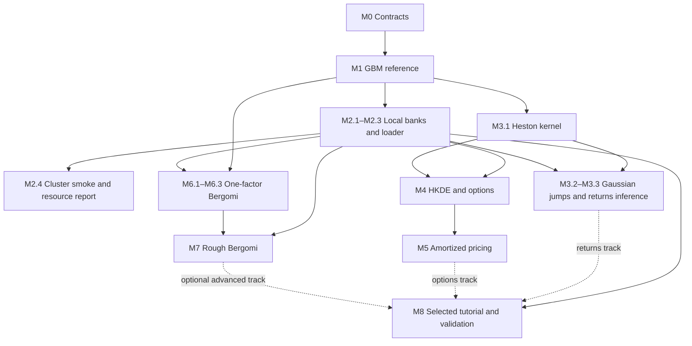

# Finance simulator and amortized inference implementation plan

Status: implementation roadmap and acceptance checklist, 12 October 2026. Record implementation evidence and didactic completion separately in the corresponding implementation PRs.

Build reusable simulators and reproducible training datasets for two financial applications: learning dynamics from return histories, and learning pricing parameters or prices from option quotes. Both can be taught and validated on simulated observations. Shared infrastructure should make both applications practical while preserving their different probability measures, observations and inference targets.

The intended result is a small library inside `sbi4finance`, a cluster workflow that produces validated simulation banks, and selected BayesFlow examples that can be run from saved checkpoints. Numerical pricing engines provide reference calculations and training labels. Learned pricing components can subsequently remove those expensive calculations from the routine inference path.

## Build for tutorial iteration

**Current priority: review the bounded options candidate and its retained scientific stop.**
The Heston posterior learns substantially from observations, although its
conditional acceptance gates remain unresolved. Preserve the frozen results
and untouched final test; record subsequent analysis in the [follow-up note](https://github.com/fmuia/sbi4finance/blob/feat/rough-bergomi-option-bank/docs/simulator-analysis-next-steps.md).
The restricted HKDE correction and 30-minute options lesson below reuse the
delivered infrastructure. They do not restart Heston tuning, require all model
branches to pass, decide the returns-versus-options curriculum, or relax
scientific gates.

| Planned increment | Delivered scope and review | Remaining acceptance/work |
|---|---|---|
| 6/10, M4 — [PR #12](https://github.com/fmuia/sbi4finance/pull/12) | HKDE jumps, Fourier European pricing, common option-panel bank and offline notebook06; actual option-bank cluster run recorded below | Wider numerical domains, Q inference and American/exotic extensions are separate. |
| 8/10, M6 — [PR #13](https://github.com/fmuia/sbi4finance/pull/13) | One-factor Bergomi, exact OU/asset covariance, complete continuation, bounded-price MC, bank and notebook08; PR #14 adds resolved paired-grid checks | No uniform continuum-bias certificate, accepted posterior or optional two-factor model. |
| 9/10, M7 — [PR #14](https://github.com/fmuia/sbi4finance/pull/14) | Rough simulator/pricer, shared banks, paired-grid study and restricted H/eta reference pilot; notebooks08–09 | 512-step finite-MC banks delivered. Reference passes 19/20 panels; one fails ESS/maximum weight. Stop rule applied before training/SBC; M7.3b acceptance pending. No scalar-state rough-memory forecast. |
| 7/10, M5 — [PR #15](https://github.com/fmuia/sbi4finance/pull/15) | [Restricted HKDE baseline](https://github.com/fmuia/sbi4finance/blob/feat/hkde-inference/docs/hkde-joint-inference.md), independently accepted M5.2 surrogate, and bounded [M5.1f correction follow-up](milestones/05-amortized-pricing.md#m51f-bounded-likelihood-correction-follow-up) | Raw checkpoint provisional and old test untouched. First correction stops on proposal reliability. Boundary follow-up passes validation but fails theta SBC on its new held-out test; all conditional accuracy/reliability gates pass. Frozen stop honored; corrected pipeline unaccepted. |
| 10/10, M8 — **[draft PR #19](https://github.com/fmuia/sbi4finance/pull/19)**, stacked on PR #15 | [Options review lesson](https://github.com/fmuia/sbi4finance/blob/feat/hkde-offline-tutorial/docs/m8-options-candidate.md): 30-minute notebook10 explains the candidate and saved diagnostics; review-only offline export passes, 17 cells and zero errors | Scientific participant acceptance remains pending after the held-out SBC stop; live candidate execution stays disabled. The passed review-only export does not complete M8 or choose the curriculum. |

All three 24-panel banks save/load and reproduce selected IDs. Bergomi bank
sampling SEs are below 10% of quote sigma. The coupled-grid study now resolves
all one-factor comparisons and rough 512-to-1,024 comparisons within 0.025
currency; the rough 128-step comparison remains unresolved at its difficult
corner. These finite-grid checks do not prove continuum bias below 0.025.
Existing banks retain their original numerical-pilot identities. The
[combined-stack check](https://github.com/fmuia/sbi4finance/blob/feat/hkde-offline-tutorial/docs/results/hkde-correction/combined-stack-verification.json)
now passes 171 software tests in 25.263 seconds. The nonmutating merge-tree
check combines the M8/PR #15 work with PR #14 cleanly at tree `8ac2bea9f00a37f8f6cfe612e188c46492d33a99`.
PR #15 alone passes 133 tests in 21.604 seconds. The
HKDE and combined Bergomi marimo reviews pass isolated offline export without
market fixtures or external connections. These execution checks do not accept
new posteriors. Source hashes and full numerical evidence are committed with
the implementation PRs.

The thin CPU script has now generated all three 24-panel banks on Oscar:
HKDE job **7297096** took **4 s**, one-factor job **7297097** took **158 s**,
and rough job **7297098** took **164 s**, each requesting one CPU and 4 GB.
Same-Linux selected-ID regeneration passed. All 15 transferred files match
independently retrieved remote hashes, and Mac numerical regeneration passed
for all three banks. The
[cluster run record](https://github.com/fmuia/sbi4finance/blob/feat/rough-bergomi-option-bank/docs/option-cluster-smoke.md)
and [machine-readable evidence](https://github.com/fmuia/sbi4finance/blob/feat/rough-bergomi-option-bank/docs/results/option-cluster-smoke.json)
retain the checks and their settings.
Scheduler elapsed times are smoke measurements, not scaling forecasts.
HKDE's initial portable comparison failed on a **1.55e-9 currency** difference;
the report preserves that result and the revised currency tolerance
`max(1e-14, 1e-6 * quote_sigma)` (**2.5e-7** here). Both MC banks differ by at
most **1.25e-14 currency**. This portable tolerance neither relaxes task pricing
gates nor promises cross-platform binary equality; integrity and parameter
identity checks remain separate.

The [coupled-grid study](https://github.com/fmuia/sbi4finance/blob/feat/rough-bergomi-option-bank/docs/bergomi-coupled-refinement.md)
uses 262,144 paired paths at each of five cases per model, with grids 128, 256,
512 and 1,024. Maximum 128-to-1,024 difference-plus-four-SE envelopes are
0.00827 (one factor) and 0.03839 (rough), against 0.025. The rough
512-to-1,024 envelope is at most 0.02011. This makes 512 a candidate grid for
the next restricted numerical observation law; it does not demonstrate a
continuum-bias bound or retroactively change the original 128-step bank.
Notebook08 explains pairing, the retained failure and the measured outcome.
The [frozen M7.3b pilot](https://github.com/fmuia/sbi4finance/blob/feat/rough-bergomi-option-bank/docs/rough-joint-inference.md)
now declares a 512-step finite-Monte-Carlo observation law. Its cluster run
completed all 98 fixed-ID tasks, delivering 6,146 panels in a 34.28-minute wall
span (31.68 allocated CPU hours). Compact banks and reference artifacts are
committed. The reference passes 19/20 panels; `validation:260` fails ESS
(600.55 < 800) and maximum weight (0.005392 > 0.005), while all mean/block/target
precision checks pass. The predeclared stop rule prevents training and SBC in
this run. The reduced end-to-end CLI smoke verifies software only. Notebook09
explains the measured result, reference efficiency and costs. M7.3b's reference
follow-up needs a new bounded design; no automatic expansion or threshold change
was made. Reserved tests and the existing Heston/HKDE findings remain intact.

The restricted HKDE posterior/reference path has now run once under its frozen
protocol. Mean RMSE is 0.123 reference SD versus 2.09 for the prior baseline;
parameter checks and marginal SBC pass, but the 0.0439 currency target-price
quantile error exceeds the 0.03 gate. The stop rule was applied without tuning
or final-test evaluation. The review notebook teaches this provisional result.
The [M5.2 fixed-contract surrogate](https://github.com/fmuia/sbi4finance/blob/feat/hkde-inference/docs/hkde-price-surrogate.md)
now passes its independently frozen regression checks: 512 training pairs,
256 validation pairs, the 129×129 reference grid and 256 new regression-test
pairs. Maximum observed price error is 3.84e-7 currency versus 0.003. The same
old neural draws priced by the surrogate still have a 0.04387 quantile miss:
surrogate acceptance does not repair or accept M5.1, unlock its test or select
M8. Notebook07 explains the regression and paired error checks. This small
polynomial supplies a learned forward-price building block without another
network or contract-generalization framework. Notebook07 passes its isolated
offline export (14 cells, zero errors, 9.17 seconds), and PR #15 now passes
133 software tests in 21.604 seconds including correction checks.

The [M5.1f likelihood correction](https://github.com/fmuia/sbi4finance/blob/feat/hkde-inference/docs/hkde-corrected-inference.md)
reuses that provisional flow as a proposal. Its first 90% flow / 10% uniform
mixture passes all conditional accuracy gates at 2,048 and 8,192 proposals,
including price errors 0.01261 and 0.005773 currency. The precision run stops
on `stress:2` weight concentration (ESS/N 0.3336 < 0.5; largest weight 0.01494 >
0.01); SBC and the new test were not run. Its absolute ESS and accuracy improved,
so the preserved failure is specifically a proposal-reliability stop.

One [frozen boundary follow-up](https://github.com/fmuia/sbi4finance/blob/feat/hkde-inference/docs/hkde-correction-boundary-protocol.md)
uses 80% flow, 10% uniform and 10% product-arcsine proposals. The prior remains
uniform; checkpoint, likelihood, budgets, seeds and gates stay fixed. M5.1f's
subplan separates density verification, conditional/calibration acceptance,
an independent root-95026 test and the M8 handoff. The boundary follow-up now
passes every validation gate: price-quantile errors are 0.01110 (participant)
and 0.004818 (precision) against 0.03, with minimum ESS/N 0.6878 and 0.6828.
Its 512-case finite-pool SIR check passes both marginal DKW limits and all
calibration-pool reliability gates. These are development-validation results.
The subsequently unlocked 256-panel [new test](https://github.com/fmuia/sbi4finance/blob/feat/hkde-inference/docs/results/hkde-correction/test.json)
passes the 16 conditional cases at both budgets (maximum price errors 0.01125
and 0.006382) and all proposal-reliability checks, but theta's SIR rank KS
0.103253 exceeds the frozen 0.092513 DKW limit; lambda's 0.072029 does not.
This single failed gate stops acceptance without another seed, mixture,
budget or threshold change. Its cause is not established by the gate alone.
The new test is now evaluated; the raw baseline's original test stays untouched.
An [independent saved-test audit](https://github.com/fmuia/sbi4finance/blob/feat/hkde-inference/docs/results/hkde-correction/test-independent-audit.json)
finds the same theta rank shift in numerical-reference posterior CDF values at
the generating truths: KS 0.103485 on the 129-point grid, 0.103404 on the
65-point grid, versus SIR's 0.103253. The shift is shared by the refined
reference on this finite test cohort; this check does not identify
proposal-specific bias or indicate further proposal tuning. It is post-hoc
diagnosis, not a replacement gate: the frozen failure and closed test stay unchanged.
The [M8 candidate subplans](milestones/08-validation-and-tutorial.md#bounded-options-candidate-concrete-m8-subplans)
then require an actual 2,048-proposal live offline calculation with the accepted
two-put surrogate, source-bound evidence, component timings and exercises.
No real-market fixtures, raw training bank or new training are needed to run
that lesson. The 10/10 handoff is a **draft review**, with the accepted-live path
disabled while scientific acceptance is unresolved. Its
[source-bound offline review export](https://github.com/fmuia/sbi4finance/blob/feat/hkde-offline-tutorial/docs/results/hkde-correction/notebook-verification.json)
passes all 17 cells with zero errors in 8.2935 seconds, with external sockets
blocked and raw training banks/market fixtures absent. The live path was
correctly skipped; this verifies the review lesson, not the full M8 workflow.
Numerical likelihood calls remain in the corrected path, so this
is not a purely amortized inference or unmeasured speedup claim. A passing
wrapper would not retrospectively accept the raw flow; the original test and
the unrelated Heston/rough failures remain unchanged.

Its deterministic Fourier labels avoid making unresolved Bergomi grid bias a
dependency of this first Q-inference experiment. Bergomi's banks remain numerical pilots, and
Heston's frozen failed gates remain unchanged. This ordering does not select
the participant curriculum. No schema registry, orchestration service or
additional production framework is needed. The original 10-part numbering
denotes planned scope; independent increments may execute out of numerical order.

The priority is a useful, scientifically sound tutorial that is easy to change. These milestones organize the work; they are not a requirement to build a production platform or complete every model before learning from a working example. The ordered substeps are a checklist, not separate PRs or approval rounds.

Start with a small executable path: a few functions, explicit parameters and arrays, a saved configuration and seed, a compact synthetic bank, and the existing in-memory training route. M0 should settle the conventions needed for that path and sketch the second observation type; it should not design every future model's API. Adapt contracts as experiments teach us what is needed, record the change, and regenerate small pilot banks when simpler than supporting old formats.

- Keep scientific essentials from the start: units and P/Q meaning, observation/target separation, correct continuation state, reproducible draws, independent evaluation, and appropriate reference checks on the declared domain.
- Add structure when an actual use needs it. Functions and plain dictionaries or small dataclasses are enough initially; the module diagram names responsibilities, not mandatory packages, base classes or registries.
- Start M2 with compact saved arrays, a short metadata file and a small train/reload example. A custom disk loader is needed only when a measured bank no longer fits comfortably in memory. Cluster support starts with a thin job script using the same generator.
- Use focused tests and a few informative reference cases during iteration. Broader numerical/inference validation is required before large banks or accepted teaching claims, not before every exploratory run. Mark provisional results clearly and constrain supported inputs rather than claiming generality.
- Defer plugin systems, schema-migration frameworks, deployment services, cross-platform compatibility matrices, generalized fault recovery and speculative optimization. Add an abstraction or hardening step when a second concrete use or a measured failure/cost justifies it.

Model prototypes can proceed alongside bank improvements once their scientific inputs are defined. A release dependency specifies the evidence needed to accept an output; it need not prevent a small exploratory script. Stop each increment when it answers the current question with credible checks, then use that evidence to choose the next increment. The full selected S teaching workflow still has to pass its stated acceptance checks.

## Synthetic delivery and market evidence

The required delivery is **S, a complete synthetic teaching core**. Market observations, provider access and acquisition permissions are not prerequisites. S, M and E describe delivery/evidence levels; they are separate from the numbered implementation milestones M0–M8.

| Level | Inputs and supported result | Evidence boundary |
|---|---|---|
| **S — synthetic teaching core, required** | Simulated observations and declared context support simulators/pricers, banks, network training, independent synthetic recovery, SBC, contraction, joint/reference checks, controlled misspecification, prior sensitivity, cost comparisons and a complete offline tutorial. Curves, contracts and forward-variance inputs may be hypothetical or generated when labeled. | Findings are conditional on the tested model, prior, observation design and numerical experiments. They do not establish adequacy for actual markets. |
| **M — market application, optional** | One compatible real return window, or an option panel with its market context, permits conditioning a trained, normally frozen network on an actual asset/date. It produces a forecast or a distribution of downstream model prices. | This is conditioning/calibration, not supervised network training. Real parameter/state truth is unavailable. Future returns or observed target prices are unnecessary merely to produce the output. |
| **E — empirical evaluation, optional** | Held-out later outcomes evaluate return forecasts; contemporaneous excluded target quotes evaluate option-pricing outputs. Broader backtest/regime claims require many chronological origins/dates and a declared evaluation design. | Preprocessing, smoothing and tuning must respect the holdout boundary. A single panel supplies a case study or in-sample fit, not general performance. Market prices are not known fair model values, and ordinary market data do not reveal true latent variance, jumps or parameters. |

The complete S returns workflow is **synthetic history → joint P parameters and current continuation state → simulated future returns, losses or volatility**. The complete S options workflow is **synthetic noisy panel → Q posterior → reference or surrogate target-price distribution**. Pricing regression instead maps parameters/contracts to accurate expectation labels; one simulated payoff is not a price label. Direct price-posterior training pairs a noisy panel with target reference prices from the same parameters. Q calibration does not forecast tomorrow's market option chain or provide P risk probabilities; linking P and Q remains deferred.

Synthetic American or exotic price uncertainty is possible once the relevant target pricer is validated. The initial European scope and deferred extensions below concern numerical implementation, not a need for real target quotes.

M0 contracts, M2 manifests and every validation sheet must record origin, purpose, task/measure, information cutoff or contract selection, available truth labels and the evidence scope of the reported result. Truth labels, simulator-only diagnostics and future evaluation outcomes stay outside observed conditioning. Synthetic training/test base draws are independent; option augmentations are grouped by base surface and related return windows account for dependence.

M8 must run the full chosen S workflow offline with **all real-market fixtures absent**. Optional M/E cells are labeled and explicitly unavailable when inputs are missing; a synthetic fallback must never be presented as real. Acquisition cannot block S, and market data cannot substitute for numerical or synthetic inference validation.

This boundary follows PR #4's committed [scenario and capability specification](https://github.com/fmuia/sbi4finance/blob/1e45918214c57b20120feb1c802cb3220cefcc41/docs/inference-scenarios-and-data.md) and [data-loading plan](https://github.com/fmuia/sbi4finance/blob/1e45918214c57b20120feb1c802cb3220cefcc41/docs/data-loading-plan.md). Its D0–D2 plus D4 form the required synthetic acceptance path; D3 is optional M/E acquisition. Those acquisition tasks add no dependency to this plan's S delivery.

## Reading paths

For a decision about scope, read the milestone table, the proposed defaults, and the review choices below. Each milestone links to its own actionable subplan.

For an introduction to the subject, read these notes in order:

1. [Financial and statistical foundations](notes/01-foundations.md): returns, volatility, options, physical and risk-neutral probabilities, Bayes, and an analytic worked example.
2. [Models and numerical simulation](notes/02-models-and-numerics.md): GBM, Heston, Gaussian and double-exponential jumps, Bergomi factors, rough memory, and numerical approximation.
3. [Inference and learned pricing](notes/03-inference-and-pricing.md): posterior training, the three pricing workflows, uncertainty propagation, forecasting and validation.
4. [Software and dataset contracts](notes/04-software-and-data.md): how those mathematical objects become modules, simulation examples, immutable banks and cluster jobs.

The notes define the equations and conventions used by this plan. They are an introduction to the proposed work, rather than a complete course in stochastic calculus or a claim that every listed model has already been validated.

## Didactic review notebooks at every milestone

Every significant implementation increment includes a **marimo review tutorial** that lets a reviewer learn the problem, run a small example, and inspect the evidence before moving on. This is part of that milestone's deliverable and acceptance, not work postponed to M8. Keep it lean: import the package's functions, reuse existing mathematical notes and saved reports, and extend explicit sections in an existing notebook when increments belong together. Do not introduce a separate notebook framework or copy simulator/training implementations into cells.

Each milestone's review sections must contain:

1. **Motivation and mathematics:** the financial question, essential equations and assumptions, and an explanation of the new step relative to the preceding milestone. Link the fuller mathematical notes and define notation needed to understand the example.
2. **A concrete task:** identify P or Q, the observation, conditioning context, inference target and continuation state, with units and array axes. Show which truth/diagnostic fields are unavailable to the estimator; distinguish numerical settings from model parameters. Explain any synthetic context and the S/M/E evidence boundary.
3. **A runnable small demonstration:** deterministic seeded synthetic inputs and a bounded CPU calculation using the actual implementation. Display a useful plot or table with units; explain what it means. Cached expensive results complement this demonstration, rather than substituting for all executable work.
4. **Actual evidence and limitations:** show measured results, tolerances, passed and failed gates, reference uncertainty and unsupported scope. Separate numerical correctness, conditional inference and empirical assessment. A functioning pipeline or marginal SBC pass cannot conceal a failed conditional check. A provisional checkpoint can be reviewed, but the notebook must not present it as an accepted inference product.
5. **Traceable artifacts:** link the source functions, task/configuration, bank manifest, relevant checkpoint and evidence reports, as applicable. Identify versions, seeds, hardware and what was computed live versus cached. Use the reports' actual numbers rather than copying optimistic summaries.
6. **Short review exercises:** two or three focused prompts with hints or answers, such as predicting a parameter change, inspecting a conditioning boundary, or explaining a failed gate. These should test understanding of this increment, not require another large experiment.

The default path is S and runs offline with all real-market fixtures absent. It neither submits cluster jobs nor automatically launches substantial bank generation, training, reference inference or provider access. Use explicit documented opt-in commands for expensive work. If a required cached artifact is missing, explain the missing dependency and how to obtain or reproduce it; do not silently start a costly fallback or invent a result. Optional M/E cells retain their labels and skip visibly without their inputs.

**Review verification:** execute the default notebook headlessly in a fresh process in the pinned CPU environment, and export it to HTML. Record the exact commands, exit status, runtime and artifact versions in the implementation PR; inspect the exported explanation, figures/tables and gate status. Verify that network/provider access and real-market fixtures are unnecessary, and that execution/export does not trigger expensive jobs. Execution failures and missing artifacts remain explicit incomplete checks. This verifies the review artifact; scientific acceptance still depends on the milestone's own numerical and inference gates.

The following map uses **implementation increment numbers**, not GitHub PR numbers. The baseline versions of the three review notebooks covering increments 1–5 were delivered and verified in [PR #11](https://github.com/fmuia/sbi4finance/pull/11), including the backfills for increments 1–4. Their delivery does not clear the failed M3.3 scientific gates. Later filenames are proposed destinations, not claims that those notebooks exist.

| Increment | Milestone sections and review notebook | Didactic status / next work |
|---|---|---|
| 1 — GBM foundation | M0 and M1 in `notebooks/01_gbm_foundations.py`: contracts, exact increments, analytic posterior and separate Q pricing | Delivered and verified in PR #11. Keep the MMAR notebook separate. |
| 2 — Local bank and training round trip | M2.1–M2.3 in `notebooks/01_gbm_foundations.py`: identities, splits, saved arrays, normalization and checkpoint reload | Delivered and verified in PR #11. |
| 3 — Cluster generation | M2.4 in an explicit cluster section of the same bank notebook: job/configuration, actual run evidence and cost | Delivered and verified in PR #11. Reviews actual cluster evidence without submitting jobs. |
| 4 — Heston/SVJ kernels | M3.1–M3.2 in `notebooks/04_heston_svj_kernels.py`: hidden variance, jumps, continuation and numerical checks | Delivered and verified in PR #11. Numerical support remains bounded to the reported cases. |
| 5 — Joint returns inference | M3.3 in `notebooks/05_heston_joint_inference.py`: task, joint posterior/reference comparison, continuation and future losses | Delivered and verified in PR #11, including the explicit-time follow-up section and its failed validation checks. M3.3 scientific acceptance remains pending. |
| 6 — HKDE option observations | M4 in `notebooks/06_hkde_and_pricing.py`: Q jump law, price expectations, noisy panel and accuracy budget | Delivered in PR #12; offline execution and bounded numerical evidence pass, Q inference remains separate. |
| 7 — Learned pricing routes | M5 in the HKDE/pricing reviews: posterior plus reference pricer, surrogate, bounded likelihood correction; optional direct-price study | First M5.1 experiment and 18-cell offline review delivered in PR #15. Raw checkpoint provisional; notebook07 reviews the accepted fixed-contract surrogate. M5.1f preserves both correction stops: v1 proposal reliability, v2 held-out theta SBC despite passing conditional checks. |
| 8 — Finite-factor Bergomi | M6 in `notebooks/08_bergomi_models.py`: curve context, factor state, normalization and pricing | Delivered in PR #13; PR #14 adds the paired-grid explanation and measured checks. Optional two-factor scope remains explicit. |
| 9 — Rough Bergomi | Notebook08: Gaussian reference, rough memory and refinement; notebook09: restricted posterior workflow, independent reference and actual cost | Numerical/bank reviews delivered in PR #14. Notebook09 reviews the failed reference gate; no neural training/SBC for the frozen run, and posterior acceptance remains pending. |
| 10 — Draft participant review | M8 in [notebook10](https://github.com/fmuia/sbi4finance/blob/feat/hkde-offline-tutorial/notebooks/10_hkde_corrected_workflow.py): 30-minute synthetic Q lesson, saved correction/price diagnostics and exercises; live path gated on scientific acceptance | Draft on `feat/hkde-offline-tutorial`; corrected final test failed one SBC gate, so M8 remains scientifically pending. Offline review execution cannot substitute for accepted live delivery. Curriculum choice remains open. |

New increments include their review material in the same PR. The backfills above are complete on the strength of their notebook checks, not retrospectively inferred from older implementation results. A review notebook can accurately explain a failed experiment and pass its execution check while that scientific substep remains pending. Track both states explicitly. M8 is the selected, paced participant course and final scientific delivery gate; the review notebooks support that decision and do not preselect the curriculum.

Baseline PR #11 verification: all three notebooks passed strict marimo checks, headless HTML export and visual inspection. They also passed in an isolated source/configuration/documentation/checkpoint copy with no `data/` directory and external sockets blocked (local IPC allowed). The foundation and kernel runs took 1.587 s and 1.622 s; the final joint-inference offline run passed without a new wall-time measurement. The initial 37-test suite passed; the current implementation suite passes 43 tests. Notebook 05's explicit-time extension also passes strict checks, headless export and visual inspection; its isolated export without market fixtures or external sockets took 13.09 seconds. These are execution/software checks, separate from posterior acceptance.

The [80-epoch explicit-time follow-up](https://github.com/fmuia/sbi4finance/pull/11) uses the same bank and spline training design. Mean RMSE improved from 0.2457 to 0.1732 reference SD, but maximum mean error 0.4554 SD and predictive-interval endpoint error 0.2099 SD still exceed the unchanged 0.40 and 0.15 gates. Both failures occur on validation case 0; no other case exceeds an individual-error limit, and both aggregate rank checks pass. Root 43022's final test remains unevaluated, and M3.3 acceptance remains pending. These restricted Heston results make no full-SVJ or market claim and do not block the independent HKDE branch.

The [diagnostic review](https://github.com/fmuia/sbi4finance/blob/feat/heston-joint-inference/docs/heston-diagnostics.md) now separates marginal SBC, conditional reference checks and engineering diagnostics, and directly compares the prior with all 16 conditional posteriors. Reference-normalized mean RMSE is 3.265 for a prior-copy baseline versus 0.173 for the neural posterior: this is substantial data updating. A frozen-weight precision follow-up confirms a persistent low-state mean discrepancy, while predictive endpoint errors straddle their tolerance across seeds. This is development evidence; it changes neither the original failed gate nor the reserved-test status.

The single [signed-asinh state experiment](https://github.com/fmuia/sbi4finance/blob/feat/heston-joint-inference/docs/heston-state-transform.md) also failed the unchanged validation checks: mean RMSE 0.1865 reference SD, maximum mean error 0.5268, maximum relative SD error 0.3212 and predictive endpoint error 0.2403. Both marginal rank checks pass, illustrating why conditional checks remain necessary. Its predeclared stop rule was applied: no further candidate or final-test evaluation. M3.3 remains pending; further inference analysis stays deferred while the separate options candidate is completed. The expanded software suite passes 43 tests, and notebook 05 includes the transform mathematics and measured failure.

## Milestones and deliverables

The milestone files define the required scope. Acceptance means the stated scientific/engineering checks pass and the corresponding didactic review sections are verified; completing one does not automatically accept the others. Implementation PRs record the evidence and any pending review backfill.

| Milestone | Main deliverable | Dependencies | Role |
|---|---|---|---|
| [M0 Contracts](milestones/00-contracts.md) | Versioned model, observation, task, target and numerical specifications | Plan review | Shared foundation |
| [M1 GBM reference](milestones/01-gbm-reference.md) | Exact simulator, analytic posterior/pricing checks, small local inference example | M0 | Shared foundation |
| [M2 Banks and cluster](milestones/02-banks-and-cluster.md) | Reproducible saved bank, integrity checks, training round trip and CPU generation job; scale storage/loading when needed | M1 | Shared foundation |
| [M3 Heston and SVJ](milestones/03-heston-and-svj.md) | Validated hidden-variance/jump kernels and returns inference | M1 for kernels; M2.3 for bank-backed inference | Returns application and shared kernels |
| [M4 HKDE and options](milestones/04-hkde-and-options.md) | Double-exponential jump variant, reference pricing and option-panel observations | M3.1 Heston kernel; M2.3 for banks | Options application |
| [M5 Amortized pricing](milestones/05-amortized-pricing.md) | Parameter posterior plus learned price surrogate; optional direct-price posterior experiment | M4 and M2.3 | Learned financial output |
| [M6 Bergomi factors](milestones/06-bergomi-factors.md) | One-factor model and pricing checks; optional two-factor extension | M1 for reference work; M2.3 for banks | Independent model branch |
| [M7 Rough Bergomi](milestones/07-rough-bergomi.md) | Validated rough simulator and option-calibration bank | M6.1–M6.3 and M2.3; not optional two-factor work | Advanced model branch |
| [M8 Validation and tutorial](milestones/08-validation-and-tutorial.md) | Accepted inference pipeline, reproducible reports and participant notebook for a bounded application; final curriculum selection separate | M2.1–M2.3 plus the selected accepted model/inference substeps | Delivery gate |

The minimum useful local infrastructure release is M0, M1 and M2.1–M2.3. M2.4 adds the verified cluster workflow and is required to call the full cluster milestone complete. A returns-based teaching release can use M3 and M8; an options-based release can use M4, M5 and M8. M6–M7 can proceed independently once their shared dependencies are available; they need not delay either teaching release.

The table and ordered subplans specify the dependencies; the graph summarizes required branches. Optional collaborator parity, two-factor Bergomi, direct price inference and finite-factor approximation experiments are omitted from the graph. Market acquisition has no dependency edge to the required S tutorial. A locally accepted notebook does not certify cluster execution: M2.4 remains separately tracked until its actual smoke job passes.

## Implementation sequence and subplans

Start with the shared foundation in this order. Each milestone file contains an **Ordered implementation subplan** table with stable step IDs, a concrete output and verification evidence. Existing task descriptions supply the scientific detail; the subplan defines the execution order. This documentation does not certify implementation completion; follow the linked artifacts and implementation PRs for measured status. Develop the corresponding review-notebook sections alongside each increment.

| Order | Work unit | Result needed before moving on |
|---|---|---|
| 1 | [M0.1–M0.3](milestones/00-contracts.md#ordered-implementation-subplan): conventions, worked schemas, contract review | Explicit P/Q tasks, units, inputs/targets, continuation requirements, identity and evidence metadata. Worked mock records suffice; a simulator is not a prerequisite. |
| 2 | [M1.1–M1.3](milestones/01-gbm-reference.md#ordered-implementation-subplan): exact GBM, analytic references, verified fixtures | One executable local simulation → observation → analytic posterior → conditional prediction example, plus separate Q price references. |
| 3 | [M2.1–M2.3](milestones/02-banks-and-cluster.md#ordered-implementation-subplan): bank generation, checks, training round trip | A saved synthetic bank and a small train/save/reload calculation checked against GBM. In-memory loading suffices initially; custom streaming is triggered by measured memory needs. |
| 4 | [M2.4](milestones/02-banks-and-cluster.md#ordered-implementation-subplan): cluster execution | Actual CPU generation smoke run, verified output and a short resource record. A thin job script suffices; add array partitioning when needed. If access is unavailable, keep this step pending while local model work continues. |
| 5 | Select and implement a model/application branch below | Use accepted shared infrastructure; branch choice does not retrospectively change the observation or measure contracts. |
| 6 | [M8.1–M8.4](milestones/08-validation-and-tutorial.md#ordered-implementation-subplan): evidence, artifact reproduction, offline notebook, release report | Selected S workflow passes its numerical/inference checks and runs with every market fixture absent. |

After the shared foundation, the supported execution routes are:

| Route | Ordered model work | Independent or optional work |
|---|---|---|
| Heston/Gaussian-jump returns | M3.1 Heston → M3.2 jumps → M3.3 joint parameter/state inference → M8 | M3.F imports Francesco's exact study when available. Its absence blocks a parity claim, not independently specified kernels. |
| HKDE option calibration/pricing | M3.1 Heston → M4.1–M4.3 HKDE/pricing/panel → M5.1 accepted posterior estimator (including M5.1f correction if used) → M5.2 price surrogate when included → M8 | M3.2 Gaussian jumps and M3.3 returns inference are not prerequisites. The current bounded candidate combines M5.1f with the independently accepted M5.2 surrogate; it preserves the raw-neural failure. M5.3 direct price inference is separate. |
| Bergomi and rough Bergomi | M6.1–M6.3 one-factor model/pricing/panel → M7.1–M7.3 rough reference/production/pilot posterior → M8 if selected for teaching | M6.4 two-factor extension and M7.4 finite-factor approximation are independent additions. This route does not depend on completing the Heston/HKDE branch. |

The option-observation contract belongs to M0. The first options branch to need its implementation—M4.2 or M6.3—adds the common helper under `observations/` and `tasks/`; the other branch reuses it. Do not duplicate the helper or make Bergomi depend on completing HKDE. M8's evidence sheet starts alongside the selected branch, before final training/evaluation; M8 release waits for the selected outputs to pass.

Implement one coherent substep or small group of tightly coupled substeps at a time. A brief milestone update linking the code, configuration, relevant check output and verified review-notebook sections is enough to record progress; do not create a separate reporting system. Distinguish planned, in progress, accepted, blocked and deferred work, and record outstanding didactic backfills separately. A partial milestone lists accepted substeps explicitly; passing the local loader does not mark the remote cluster step complete. These records document progress and acceptance, not a new permission request for every step.

Milestone acceptance gates are scientific and engineering checks, rather than automatic requests for another permission at every step. After the plan is approved, implementation can proceed through the agreed scope as checks pass. A material scope change or unresolved scientific choice returns for review with its concrete alternatives.

## Proposed defaults

| Decision | Proposed starting point | Reason |
|---|---|---|
| Package location | Modules inside `sbi4finance` | One integration destination and one environment to maintain |
| Kernel backend | NumPy reference plus Numba where useful | Readable reference, fast CPU stepping, limited deployment burden |
| Storage | Compact NumPy arrays plus JSON metadata; shard as bank size grows | Simple inspection and reproducible generation without a storage framework |
| Neural interface | Existing in-memory BayesFlow training over raw arrays; disk batching only when needed | Scientific simulation stays independent of network architecture |
| First data design | Fixed regular return windows and fixed European contract panels in separate tasks | Makes dimensions and acceptance criteria explicit |
| Required teaching inputs | Synthetic observations and context, with no real-market fixtures | Makes either chosen S workflow independently deliverable offline |
| Actual-market example | Optional M, with separately designed E evaluation | Keeps application distinct from evidence of real performance |
| Inference target | Model parameters plus necessary latent state | Supports interpretable inference and conditional forecasts |
| Learned pricing | Parameter posterior followed by a supervised price surrogate | Separately measurable inference and pricing errors |
| Direct price posterior | A gated comparison in M5 | Useful when price uncertainty is the main output |
| Bergomi application | Q-measure option calibration first | Avoids assuming an unspecified P/Q link or incomplete forecast state |
| Large compute | Small correctness and resource pilot before each bank | Cost and numerical error are measured before scaling |

Fixed designs are starting experiments, not permanent API restrictions. Variable grids, missingness and uncertain market inputs become new supported task versions with corresponding training and validation.

## What constitutes a successful result

For required S returns delivery: generate a synthetic return history, infer parameters and the required current state, continue the process from matched posterior draws, and assess future-loss uncertainty against synthetic references. For S options delivery: generate a synthetic quote panel and its context, infer Q parameters or target prices, and quantify price uncertainty for a declared target contract family. The participant notebook may load cached synthetic artifacts and a trained checkpoint; its inputs and results remain labeled synthetic. Either selected workflow must run with market fixtures removed.

Optional M replaces the conditioning observations with a compatible actual-market fixture, normally retaining frozen weights. Optional E adds separately held-out outcomes/quotes and its own evaluation design. Neither is an acceptance dependency for S.

Both S workflows must establish the first four kinds of evidence below. Empirical assessment is a separate optional layer:

| Evidence | Question answered |
|---|---|
| Mathematical and numerical (S) | Does the simulator/pricer implement the declared model accurately enough? |
| Data engineering (S) | Does the bank contain the intended independent base examples and grouped derivatives, with traceable definitions and reproducible generation? |
| Conditional inference (S) | Does the learned posterior agree with suitable references and calibrated synthetic experiments, including joint and conditional checks? |
| Financial output under the tested model (S) | Are prices or predictive risk quantities accurate and stable against numerical/synthetic references at the required resolution? |
| Empirical model assessment (E, optional) | How do declared forecasts or prices compare with held-out real outcomes/quotes across the claimed evaluation scope? |

Before an expensive run, define a validation sheet with the case bank, origin/purpose, truth availability, evidence scope, conditioning boundary, metric, tolerance, numerical reference and decision on failure. Strict software properties—IDs, masks, shapes, non-leakage and supported inputs—are pass/fail checks. Statistical quantities require uncertainty estimates, and numerical tolerances must reflect the task's noise scale and intended use. A universal threshold such as “all errors below 1%” would be misleading across these quantities.

Training and benchmarking reports distinguish compilation, generation, serialization, training, posterior sampling and downstream forecasting/pricing. Amortization is worthwhile when the one-time cost is spread over enough compatible uses. This is measured for the chosen workflow; no speed-up or break-even count is assumed in advance.

## Collaboration and existing work

The existing MMAR notebook remains a separate supported example while the shared layer develops. Its checkpoint is tied to its current simulator and transforms.

Francesco's contribution should enter through M3 with its exact equations, parameterization, initialization, discretization, checkpoint architecture, reference cases and generation seeds. First reproduce a saved result. Optimize or generalize only after that reference works. The absence of that bundle does not block M0–M2 or an independently named Heston reference; it does block a claim of reproducing his particular SVJ study.

SSMS and the HSSMSpine generation pipeline are architectural references for model catalogs, kernel boundaries and data lineage. Finance observations and posterior-training targets receive their own contracts. The precise reuse boundary is described in [software and data](notes/04-software-and-data.md).

## Review choices

The proposed defaults above make the plan implementable. The main choices for this review are:

- Whether the first application after shared infrastructure should be returns inference, option calibration, or two separately resourced branches.
- Whether M5's parameter-posterior-plus-surrogate route is the preferred pricing deliverable, with direct price inference remaining an experiment.
- Whether one-factor Bergomi is in the first implementation scope or follows the first accepted Heston/jump workflow.
- Which target contract family matters first. European calls/puts provide reference checks; any American or path-dependent extension needs its own pricing and validation work.

Exact priors, grids, noise models and numerical tolerances are deliverables of M0 and the relevant model milestone. They should be justified by the intended inference task and reference experiments, rather than filled with arbitrary values in a planning document.

Joint P/Q estimation, general portfolios, SVCJ, rough Heston, automatic Bayesian model selection, Greeks, and a universal American-option engine are outside the initial deliverables. They can be added through separately specified tasks when needed. A broader simulator catalog does not imply all models belong in one two-hour tutorial.

## Relationship to earlier notes

This is the implementation roadmap extending the [simulator architecture assessment](../simulator-ladder-architecture-2026-10-11.md), including the subsequent distinction between reference pricing and learned pricing. The [HKDE data specification](../tutorial-data-needs-2026-10-10.md) remains the options data reference, and the [SVJ integration assessment](../svj-hkde-integration-assessment-2026-10-10.md) preserves the collaborator handover and validation context. Curriculum choice remains explicit in this plan.
