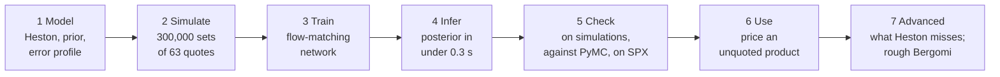
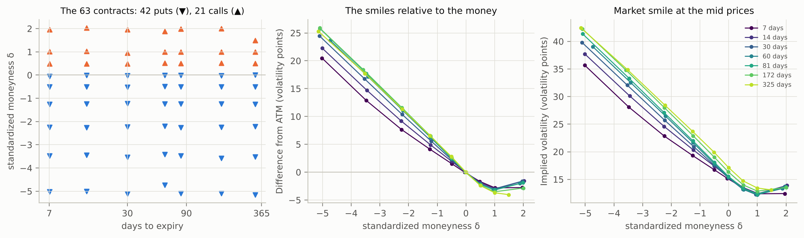
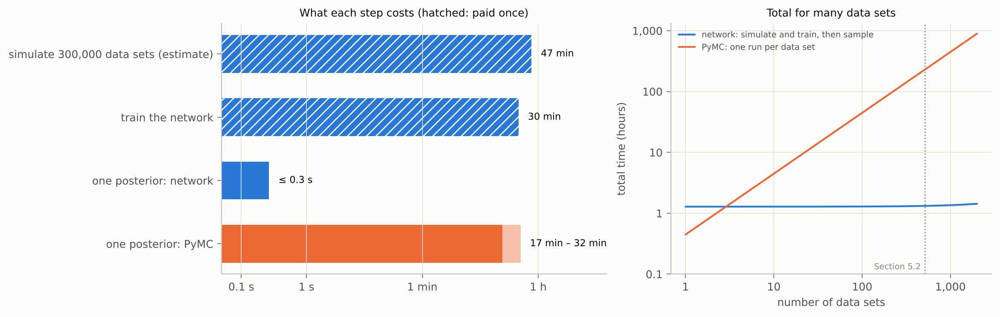
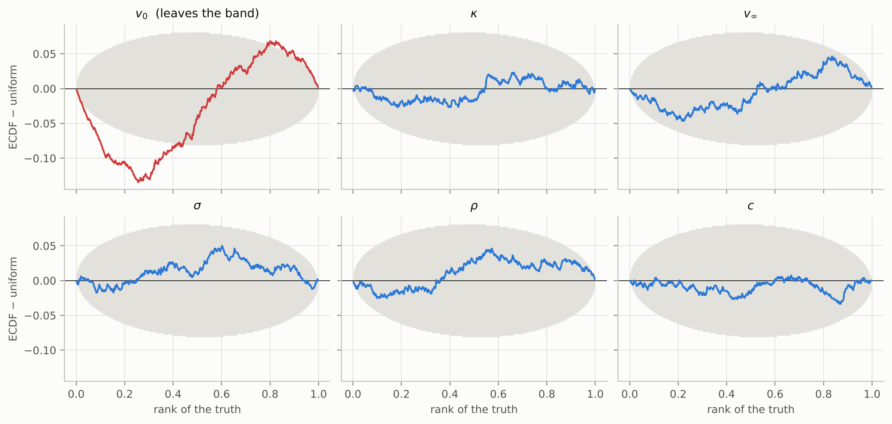
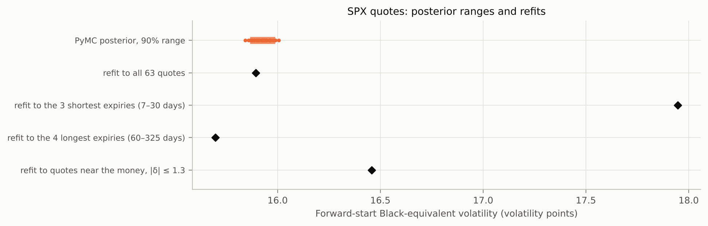
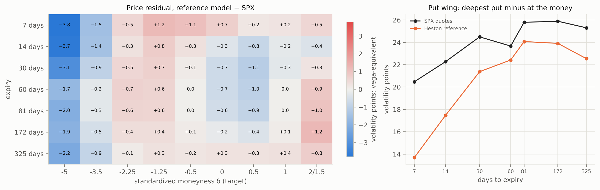
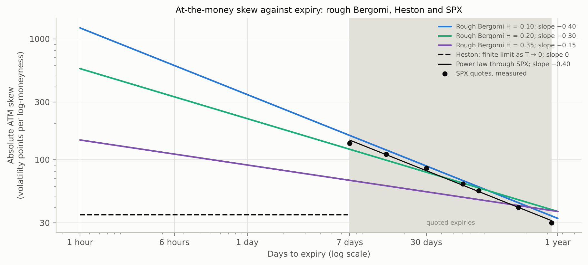
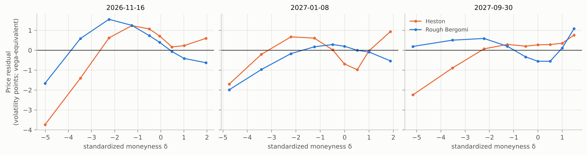

# Bayesian calibration on SPX options

*A companion to the Heston and rough Bergomi notebook presented at ICAIF '26 (Milan, 14 November
2026). About 15 minutes. The numbers and figures are those of the notebook as presented; section
numbers such as §5.2 refer to it.*

The notebook calibrates an option-pricing model to 63 SPX quotes. Instead of one best-fitting
parameter vector, it computes a posterior distribution over the parameters. It then checks that
posterior, uses it to price a product that the market does not quote, and asks whether the model
describes the market at all. This page tells the same story in less detail, for readers who want
the argument before the code.

- **Notebook:** [`lab/notebooks/heston_spx_calibration.py`](../lab/notebooks/heston_spx_calibration.py),
  run from the [lab environment](../lab/README.md#review-the-heston-spx-notebook). A
  [static copy](https://fmuia.github.io/sbi4finance/notebooks/heston_spx_calibration.html) is on
  the tutorial website.
- **Audience:** AI researchers who know Bayesian inference but not derivatives, and finance
  practitioners who know derivatives but not simulation-based inference. Terms in **bold** are
  explained where they first appear and in the [glossary](#glossary).

## The problem: a price and a range

Every evening a bank values each position it holds; this is **marking**. A listed option is
marked at its market price. A product agreed privately, **over the counter**, has no price to
read, so it is marked with a model whose parameters $`\theta`$ are set to reproduce listed prices.
This is **calibration**, classically a least-squares fit, and it gives one value
$`G(\hat\theta)`$ for the product.

One value hides how far the price could move. Listed options pin some combinations of parameters
and leave others loose; parameter sets that fit almost equally well can value an unlisted product
differently. Regulators ask for that uncertainty: under the EU's prudent-valuation rules
(Commission Delegated Regulation (EU) 2016/101), a bank must also compute a **prudent value**, at
which it is 90% confident it could exit the position.

A Bayesian calibration replaces the best fit by a **posterior**,

```math
p(\theta \mid y) \;\propto\; p(y \mid \theta)\,p(\theta),
```

from a **prior** $`p(\theta)`$ and a **likelihood** $`p(y \mid \theta)`$ of the quotes
$`y`$. Pricing the product under each posterior draw $`\theta^{(s)}`$ gives a distribution of
values, $`G(\theta^{(s)})`$: its mean is a mark and its quantiles a range.

Two costs stand in the way. An exact posterior by **MCMC** needs about 180,000 likelihood
evaluations, each a full pricing of the 63 quotes. And trusting a posterior's ranges needs many
posteriors: checking that 90% intervals contain the truth 90% of the time takes hundreds of
simulated data sets, each with its own posterior. **Amortized simulation-based inference** pays
once instead: a neural network is trained on simulated pairs of parameters and quotes, and then
returns the posterior for any new quotes in under a second.

## The workflow

The notebook follows seven steps, and so does this page.



## 1. Model and data (§1 and the data section)

**The quotes.** The data are 63 SPX index option quotes from one snapshot, 20:13 UTC on
9 November 2026: seven expiries from 7 to 325 days, nine strikes each, 42 puts and 21 calls. Each
contract gives a mid price $`y_i`$ and a **half-spread** $`h_i`$, half the gap between bid and ask.
Strikes are placed on a common scale, the **standardized moneyness**

```math
\delta = \frac{\ln(K/F)}{\sigma_{\text{ref}}\sqrt{T}},\qquad \sigma_{\text{ref}} = 16\%,
```

the distance of the strike $`K`$ from the **forward** $`F`$ in units of a typical move over the
option's life $`T`$. At every expiry the notebook takes the puts nearest to $`\delta`$ = −5,
−3.5, −2.25, −1.25, −0.5 and 0 and the calls nearest to 0.5, 1 and 2.



*The 63 contracts (left) and their **implied volatilities**, relative to the money (middle) and as
levels (right), in **volatility points**. In standardized moneyness the seven smiles are nearly
parallel: the deepest put sits 20.5 to 25.9 points above the money at every expiry. That is the
feature the model must reproduce.*

**The model.** Heston lets the variance $`V_t`$ of returns move randomly around a long-run level:

```math
\frac{dX_t}{X_t} = \sqrt{V_t}\,dW_t^S,\qquad
dV_t = \kappa\,(v_\infty - V_t)\,dt + \sigma\sqrt{V_t}\,dW_t^V,\qquad
d\langle W^S, W^V\rangle_t = \rho\,dt,
```

with $`X_t`$ the carry-adjusted price normalized to start at 1. Today's variance $`v_0`$ sets short
expiries, the long-run variance $`v_\infty`$ long ones and the speed $`\kappa`$ how fast one turns
into the other. A negative correlation $`\rho`$ tilts the smile into a **skew**; the volatility
of variance $`\sigma`$ curves it. Heston prices are one Fourier integral each, so all 63 take
milliseconds. That makes an exact reference posterior affordable.

**The observation model.** Each quote is its Heston price plus Gaussian error, scaled by a fixed
profile $`b_i`$ and a common multiplier $`c`$:

```math
y_i = P_i(v_0,\kappa,v_\infty,\sigma,\rho) + c\,b_i\,\epsilon_i,\qquad
\epsilon_i \sim \mathcal N(0,1),\qquad b_i = h_i .
```

The profile is the observed half-spread, a working convention rather than a measured error law.
The multiplier $`c`$ is inferred with the five Heston parameters, so there are six unknowns,
$`\theta = (v_0, \kappa, v_\infty, \sigma, \rho, c)`$. There is no separate term for the model's
own error: at the right parameters, Heston is assumed to price every quote up to this noise.

**The prior** is uniform on each parameter: $`v_0`$ and $`v_\infty`$ on 0.01 to 0.16 (volatility
10% to 40%), $`\kappa`$ on 0.1 to 10, $`\sigma`$ on 0.1 to 3, $`\rho`$ on −0.95 to −0.1, and
$`c`$ on 0.5 to 2. It does not impose the **Feller condition**.

## 2. Simulate and train (§2 and §3)

**Simulate.** One simulation draws $`\theta`$ from the prior, prices the 63 contracts and adds
noise: one hypothetical market. Before training, a **prior predictive check** asks whether such
markets cover the real one. They do: on 1,000 simulations the SPX quote lies inside the simulated
range at every contract.

**Whitening.** The network sees each quote divided by its error scale, $`x_i = y_i/b_i`$. These
inputs are badly conditioned: a few directions, such as the overall level and the skew, vary up to
$`2\times10^{6}`$ times more across simulations than the small directions that carry information
about $`c`$. **Whitening**, a fixed linear change of coordinates
$`\tilde x = \Sigma^{-1/2}(x-\mu)`$ fitted once on training simulations, gives all directions the
same scale without discarding any. In a pilot, the network's estimate of $`c`$ went from ignoring
the truth (correlation −0.001) to following it (0.923).

**Train.** Rather than learn prices and run MCMC for every data set, the network learns the
posterior itself. Because $`p(\theta)\,p(y\mid\theta) = p(y)\,p(\theta\mid y)`$, every simulated
pair is a draw of quotes followed by a draw from their posterior; a conditional generative model
fitted to the pairs learns $`p(\theta\mid y)`$ for every $`y`$ at once. The notebook uses
BayesFlow's **flow matching**: a velocity field $`v_\phi(z, t, \tilde x)`$, an MLP of three layers
of 128 units, moves standard normal noise to posterior draws. The pretrained estimator saw
300,000 simulated pairs over 300 epochs (351,600 updates), which took 30 minutes on an
Apple-silicon CPU. §3.3 trains a small version live in about a minute.

## 3. Infer, and what it costs (§4)

The estimator is applied to three data sets: a market-like simulation, a stressed simulation, and
the SPX quotes. For each, a **PyMC** reference samples the exact posterior with the Fourier pricer:
four chains of 12,000 draws after 6,000 tuning steps, R-hat at most 1.003, using PyMC's
gradient-free DEMetropolisZ sampler because the pricer has no gradients.

On the SPX quotes the reference gives a tight posterior:

| Parameter | Median [90% interval] |
| --- | --- |
| $`v_0`$ | 0.02807 [0.02790, 0.02823] |
| $`\kappa`$ | 5.07 [4.90, 5.24] |
| $`v_\infty`$ | 0.0535 [0.0529, 0.0540] |
| $`\sigma`$ | 1.805 [1.773, 1.836] |
| $`\rho`$ | −0.6967 [−0.6998, −0.6937] |
| $`c`$ | 1.9995 [1.9979, 2.0000] |

The noise multiplier sits on its upper bound of 2. The quotes ask for more noise than the prior
allows, because no Heston surface comes close enough to them. Section 6 of this page returns to
that.



*Simulating and training cost about 1.3 hours once (left, hatched). After that, a network
posterior takes under 0.3 s, while one PyMC run takes 17 to 32 minutes on one core and about
180,000 likelihood evaluations. The 512 posteriors of the calibration check in §5.2 would take
PyMC about 229 hours (right).*

## 4. Check (§5)

A posterior from a network is an approximation, and the model is an assumption. The notebook
checks both, separately.

| Check | Question | Answer |
| --- | --- | --- |
| Posterior predictive (§5.1) | Do posterior draws, priced and with fresh noise, regenerate the quotes? | On simulated quotes, yes. On SPX, no: the prices miss by 1.10 volatility points (RMS), where the prior allows noise of at most 0.18. |
| Calibration (§5.2) | Do 90% intervals contain the truth 90% of the time? | On 512 simulated data sets, five parameters have 90% coverage of 89.3% to 92.4%. Intervals for $`v_0`$ are too wide (97.5%). |
| Recovery (§5.3) | Do posterior medians find the true parameters? | For the five Heston parameters, correlation with the truth is at least 0.996, with intervals spanning at most 3.4% of the prior range. For $`c`$, 0.95. |
| Against PyMC (§5.4–5.5) | Does the network reproduce the exact posterior of one data set? | On SPX it does not: its interval for $`c`$ is 60 times wider than PyMC's, and 853 of 4,096 draws fall outside the prior. These quotes lie far from any surface Heston simulates, so the network extrapolates. |
| Model fit (§5.5) | Can Heston describe the SPX quotes at all? | No. The misfit is systematic (Section 6 below). |



***Simulation-based calibration** of the pretrained network on 512 simulated data sets. A
calibrated parameter keeps its curve inside the grey band; $`v_0`$ leaves it with the shape of a
posterior that is too wide.*

These checks answer different questions. Calibration cannot show sharpness (a network that
returned the prior would pass), so recovery and the PyMC comparison are needed too. None of the
checks on simulated data can show that the model fits the market. §5.6 adds an experiment:
compressing the 63 whitened inputs through a learned summary keeps all six parameters recoverable
down to 6 coordinates; at 5, recovery of $`c`$ is lost.

## 5. Use: a product the market does not quote (§6)

The example is a **forward-start call**: bought today, it fixes its strike in 3 months at the
index level of that day and pays at 6 months the percentage rise above it,
$`\max(S_{6\text{m}}/S_{3\text{m}} - 1,\,0)`$. Listed options fix the index's distribution at each
expiry, but not how those distributions are linked across dates, so the product needs a model.
Its price is shown as an equivalent Black volatility over the 3-to-6-month period.

Pricing it under every posterior draw gives a range. On the market-like simulation, where Heston
is right by construction, the PyMC 90% range of 15.672 to 15.741 volatility points contains the
true value of 15.682.

On the SPX quotes the range is 15.865 to 15.988. But Heston does not fit these quotes, so its
parameters depend on which quotes it is fitted to.



*The forward-start call on the SPX quotes: the PyMC posterior's 90% range (orange) and Heston
refitted by least squares to parts of the quotes (diamonds). The refits move the price 18 times
more than the posterior range, from 15.70 to 17.95 volatility points. For a 3-month volatility
swap they spread 21 times wider.*

A posterior range measures uncertainty within the model. When the model is wrong, the choice of
quotes moves the price far more, and the posterior cannot see that. A posterior range is not a
model-risk reserve.

## 6. What Heston misses, and rough Bergomi (§7)

**Heston's misfit (§7.1).** Across all 63 quotes the reference fit misses by 1.10 volatility
points (RMS). At every expiry the miss exceeds the working noise: 0.82 to 1.51 points, against
noise limits of 0.10 to 0.25. The misses are systematic. The deepest put is underpriced at every
expiry, by 1.75 to 3.80 points. The 14 puts with $`\delta < -3`$ account for 78% of the squared
residuals. At these prices the likelihood would want $`c = 13.4`$, far above the prior's bound.
The fit also needs a large $`\sigma`$, which breaks the Feller condition: $`\sigma^2 = 3.3`$
against $`2\kappa v_\infty = 0.54`$.



*Model minus SPX, in volatility points (left). Heston underprices the deep put wing, most at
7 days. Right: the rise from the money to the deepest put. SPX keeps it near 20 to 26 points at
every expiry; Heston cannot at short expiries.*

**The missing feature.** As the expiry shrinks, Heston's at-the-money skew grows only up to a
ceiling, $`|\rho|\,\sigma/(4\sqrt{v_0})`$. The fit's 7-day skew is already at 85% of it. The SPX
skew keeps growing: from 325 to 7 days it rises 4.5-fold, like the power law $`T^{-0.40}`$.

**Rough Bergomi (§7.2)** is built for that. Its variance is driven by a fractional kernel with
roughness $`H`$:

```math
V_t = \xi(t)\,\exp\!\left(\eta Y_t - \tfrac12\eta^2 t^{2H}\right),\qquad
Y_t = \sqrt{2H}\int_0^t (t-s)^{H-1/2}\,dW^V_s,\qquad
\xi(t) = v_\infty + (v_0 - v_\infty)\,e^{-kt},
```

with dispersion $`\eta`$, correlation $`\rho`$, and a curve $`\xi(t)`$ that has the shape of
Heston's expected variance. For $`H < 1/2`$ its short-expiry skew grows like $`T^{H-1/2}`$
without bound; the SPX slope of −0.40 corresponds to $`H \approx 0.10`$.



*At-the-money skew against expiry, on log scales. The SPX skews (dots) follow a power law with the
slope of rough Bergomi at H = 0.10. Heston's skew levels off at a finite limit (dashed).*

Rough Bergomi has no closed-form prices. The notebook therefore trains a neural **price
emulator** on Monte Carlo prices first. MCMC and the amortizer then both use that same emulator,
so any difference between them is an inference error, not a pricing error. Three results:
- On 800 held-out simulated data sets, the amortizer's 90% intervals contain the truth 88% to 92%
  of the time for each of the seven parameters ($`H, \eta, \rho, v_0, v_\infty, k, c`$).
- On SPX, rough Bergomi lowers the residual RMS from 1.09 to 0.83 volatility points, 24% lower
  than Heston. Visible residuals remain.
- On SPX, the amortizer underestimates the noise. MCMC gives $`c = 10.3`$ [8.87, 12.1], the
  amortizer 4.76 [3.77, 5.74], though the two can predict similar central prices. The MCMC posterior is that
  of the emulator, not of exact rough Bergomi. This is a development result, not an accepted
  calibration.



*Posterior-mean model prices minus the SPX quotes at three expiries, in volatility points. Rough
Bergomi (blue) reduces the deep-put miss at 7 days but does not remove it.*

## What the results show, and what they do not

They show, for Heston on these SPX quotes:
- a network trained once that returns a posterior in under 0.3 s, where the exact method takes
  17 to 32 minutes; it is well calibrated on simulations for five of six parameters and too
  cautious for the sixth;
- that calibration, sharpness and model fit are separate checks: the network passes on
  simulations, while on SPX Heston misses the quotes by 1.1 volatility points and pushes $`c`$ to
  its bound, and the network's posterior departs from PyMC's;
- that on SPX, model error dominates parameter uncertainty: refits of the same model spread
  18 to 21 times wider than the posterior range;
- that the missing feature is the short-expiry skew, which rough Bergomi reproduces in shape and
  which lowers the misfit by a quarter.

They do not:
- cover the model's own error. A posterior range is uncertainty about one model's parameters
  under a stated error model. Admitting the misfit needs an explicit model-error term; removing
  it needs a different model;
- establish the rough Bergomi amortizer on market data: it disagrees with MCMC about the noise;
- check a product price against a true value on real data, which is never observed;
- establish a posterior as an accepted basis for a prudent value. That is a proposal, not current
  practice.

## Glossary

- **Calibration.** Choosing a model's parameters so that its prices match listed ones.
- **Feller condition.** $`2\kappa v_\infty \ge \sigma^2`$. When it holds, Heston's variance never
  reaches zero. Heston is valid either way.
- **Flow matching.** A way to train a generative network: it learns a velocity field that
  transports noise to the target distribution, here the posterior.
- **Forward.** The price agreed today for the index at a future date; read here from put–call
  parity.
- **Forward-start call.** An option whose strike is fixed at a future date, at the index level of
  that day.
- **Half-spread.** Half the gap between the best bid and the best ask.
- **Implied volatility.** The volatility that makes the Black–Scholes formula reproduce a price.
  Prices are compared in this unit.
- **Marking.** Valuing a position at the end of the day: at its market price if listed, with a
  model if not.
- **MCMC.** Markov chain Monte Carlo: draws from a posterior by proposing and accepting parameter
  values one after another; each step needs the likelihood.
- **Amortized inference.** Training a network once so that each later posterior costs only a
  forward pass.
- **Posterior, prior, likelihood.** What is believed about the parameters after the data; before
  them; and how probable the data are under each parameter value.
- **Prudent value.** A value at which a bank is 90% confident it could exit a position, under EU
  rules.
- **Simulation-based calibration.** A check of a posterior's uncertainty: on simulated data, the
  rank of the true value among posterior draws should be uniform.
- **Skew, smile.** Implied volatility against strike is the smile. For an index it is mostly a
  downward slope, the skew, because protection against a fall is in demand.
- **Standardized moneyness.** The distance of a strike from the forward, in units of a typical
  move over the option's life.
- **Volatility point.** 0.01 of annualized volatility. The notebook converts price errors to this
  unit with each quote's vega.
- **Volatility swap, variance swap.** Contracts that pay the realized volatility (or variance) of
  the index over a period, minus a strike agreed today.
- **Whitening.** A fixed linear change of coordinates that gives every direction of the inputs
  the same scale.
