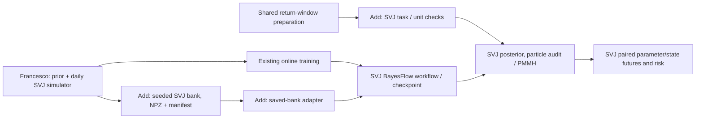

# Where Francesco's SVJ work fits, and what to make common

Checked 13 October 2026 against **main `b2a575149bf5035a95ac1da6d60749ba10b61c5f`**
and draft [PR #33](https://github.com/fmuia/sbi4finance/pull/33), head
`2e3165f7b8a25bfaaf2639fa6b759e20d1a7516b`. The draft is still separate.
This is a code/interface assessment, not reproduction or scientific acceptance
of its experiments. Recommendations below are not yet implemented.

**Francesco's simulator can join the existing collection without changing its
equations.** Making it a reproducible saved-bank task needs a small bank module,
a data/target adapter and some random-input work for efficient cluster generation.
His complete application brings considerably more than another simulator:
full parameter-and-state inference, particle filtering and MCMC, auditing and
conditional risk forecasts.

We should share data and execution conventions while retaining that application.
Where Francesco has the more capable solution, our project should accommodate
it. Existing conventions are not a reason to rebuild his pipeline around our
smaller Heston example.

## 1. What exists, at the level of the financial problem

P denotes physical dynamics for historical returns and future risk; Q denotes
risk-neutral dynamics for derivative valuation. A model family can occur in
either task, with different parameters and evidence.

| Building block | On main now | What Francesco adds |
|---|---|---|
| Simple reference | GBM simulation, analytic drift inference and separate European pricing | No replacement needed; GBM remains the introductory reference. |
| Stochastic volatility and jumps | Heston/Gaussian-price-jump trajectory kernels; a **restricted** P inference pilot estimating long-run variance and terminal continuation state, with other parameters fixed | A daily SVJ P task estimating **eight parameters plus terminal volatility**, with its own prior and checkpoint. Both kernels offer price jumps; neither is an SVCJ variance-jump model. |
| Option calibration and downstream prices | HKDE paths/Fourier pricing, option banks, two-parameter inference, numerical reference, correction and target-price surrogate | No equivalent Q calibration or pricer; the contribution is complementary. |
| Bergomi family | One-factor and rough Q simulation/option banks; rough Hurst/eta inference and reference checks | No replacement or extension of these models. |
| Returns inference and forecasts | Heston adapted particle/grid reference and paired parameter/state continuation for the restricted task | A larger P application: adapted particle filter, grid likelihood, PMMH, compiled neural sampler, importance audit, plug-in comparisons and VaR/ES. |
| Data and execution | Local observation preparation, task-specific NPZ/JSON banks, independent example identities, selected cluster generation workflows and marimo lessons | Online simulation/training, saved checkpoint and extensive study artifacts; no equivalent saved-bank/Slurm integration yet. |

See the [architecture guide](code-architecture.md) for main's modules. The
earlier MMAR example also remains separate; its simple returns and fresh
cascade forecasts are not interchangeable with either Heston or daily SVJ.

The selected two-hour participant route is currently GBM → provisional HKDE
Q/options. Adding this P application **does not require changing that route**.
It provides an optional returns/risk lesson and a candidate for a later
curriculum decision. Q calibration does not supply P risk probabilities;
linking the measures remains separate work.

## 2. Where it slots into the code

Main uses model-specific modules, not a universal simulator registry.
`gbm_bank.py`, `heston_bank.py` and `option_bank.py` share conventions and
helpers, but validate different tasks. `datasets/banks.py` is specifically an
HKDE observation bridge, not a general bank engine. Adding SVJ to the option
bank's model switch would put a returns task in the wrong workflow.

Keep the contributed `src/sbi4finance/svj/` package. A task config and small
`svj/bank.py` plus generation command would fit the architecture; these are
proposed additions, not existing APIs. Add saved-bank input to its training
entry point while retaining online training. Cluster jobs should invoke the
same generation command as the laptop. No registry, generic trainer, storage
migration or package-wide rearrangement is needed.

Mechanical coexistence is straightforward. The earlier merge-tree check found
only README and `pyproject.toml` conflicts; `.gitignore` merged automatically.
The intervening main closeout did not change this overlap: model modules,
notebooks, tests, checkpoints and result paths do not collide. Both use the
same Python/BayesFlow/Keras/JAX pins; the proposed SciPy pin is already on main.
Union the tasks and README entries, preserving Numba settings and the lockfile.
No dependency upgrade is indicated by this comparison.

## 3. Can we simply add the simulator to our banks?

**Yes as another model; no as a zero-work registration or a replacement for the
Heston kernel.** Its existing
[`model.py`](https://github.com/fmuia/sbi4finance/blob/2e3165f7b8a25bfaaf2639fa6b759e20d1a7516b/src/sbi4finance/svj/model.py)
already provides the necessary operations:

- `draw_coordinates`: draw eight prior coordinates.
- `simulate_from_coordinates`: produce histories, nine targets, variance paths
  and jump indicators for supplied parameter rows.
- `run_daily_model`: advance from a supplied variance state.
- `forward_returns`: continue matched posterior parameter/state draws.

One training example is a **whole return history**, not a day or future path.
The simulator accepts other lengths, but the contributed pipeline/checkpoint
is designed for 1,000 daily observations. Initially expose that exact task,
with fixed trading-day increments `dt_years = 1/252`.

The proposed bank boundary can be explicit and small:

| Bank field / role | Mapping from the simulator |
|---|---|
| `observations [B,T,1]` | `returns[..., None] / 100`: decimal log returns, retaining their scale. |
| `parameters [B,8]`, target only | First eight `targets` columns: **named transformed coordinates**, not our annualized Heston parameters. |
| `terminal_state [B,1]`, target only | Last simulated variance, labelled **percent-squared per trading day**, checked against the recorded `V_MIN`. This floored state is what its continuation requires. |
| Known context | P, complete daily grid, 252-day convention, observation length and cutoff; fixed context stays in the task. |
| Identity / provenance | Model/task version, complete prior, variance floor, jump-probability cap, initialization, root/split/example identity, source and file hashes. |
| Optional auxiliary truth | Variance paths and jump indicators, excluded from conditioning; not required in every training bank. |

At the SVJ neural boundary, recover percent returns once with
`100 * observations[..., 0]`, then call the **existing** `network_input` for
`[y, log(y² + 0.01)]`. Reconstruct target nine with `log_spot_vol(v_T)`.
This preserves its checkpoint's features and transforms. Passing `[B,T,1]`
straight to its sampler is unsafe: its three-dimensional input branch assumes
already prepared features. A narrow adapter prevents that ambiguity.

Three pieces of integration work remain:

1. **Stable example identities.** `simulate(n, seed)` and `SVJSimulator.sample`
   consume a shared generator, including arrays shaped `[time,batch]`. A seed
   repeats a fixed call, but changing batch size/order changes individual
   examples. Per-example seeded calls suffice for a small correctness smoke.
   For large banks, expose per-example random inputs to the existing batched
   transition, avoiding a separate 1,000-day Python loop for every row. Keep
   the existing seed path for historical replay; version the new bank streams.
2. **Storage and training bridge.** Add config, writer/reader and role checks
   using current NPZ/manifest conventions; map loaded arrays to its existing
   `targets`/`features` adapter and `fit_offline`. Using the frozen checkpoint
   needs no neural redesign or retraining. Training on a finite bank creates
   a new artifact needing validation; it need not reproduce online training.
3. **Cluster execution.** Add a thin Slurm entry and verify selected examples
   locally and remotely. Option-array assembly is Q-specific and cannot just
   dispatch this P bank. Start with one bounded CPU job; add deterministic
   shards only if volume requires them. Save raw returns/targets rather than
   every latent path or duplicated feature tensor. The old GPU
   `cluster/train.sbatch` runs MMAR, not SVJ.

This is a bounded extension. Numba could help the daily loop at bank scale,
but a kernel rewrite is not a prerequisite. Benchmark actual generation before
choosing compilation; preserve the discrete law and compare optimized stepping
against the current implementation with matched inputs.

## 4. Easy alignment, and which side should change

| Area | Preferred direction | Reason / boundary |
|---|---|---|
| Observation entry | **SVJ adopts our local preparation boundary**, then converts decimal to percent once. | `datasets/returns.py` checks schedule, completeness and cutoff. SVJ's `data.py` sorts and drops missing values, potentially hiding gaps. Require P/log and the full 1,000-step daily design; no window standardization. |
| Bank identity and roles | **New SVJ banks adopt our conventions**, with native parameter coordinates and state units explicit. | Stable example identities, independent splits and separation of observations/truth support reproducible generation. Renaming every internal variable is unnecessary. |
| Full P inference and references | **Our project accommodates Francesco's implementation**: filter, PMMH, nine-target workflow and compiled sampler. | It already implements the larger returns problem. Expanding our two-target Heston reference into that problem would duplicate work. This is a capability advantage, not universal numerical superiority. |
| Forecast workflow | **Use Francesco's fuller P application**, including re-filtered plug-in comparisons and conditional-risk uncertainty. | Retain our restricted Heston continuation as a diagnostic rung; do not create a competing nine-target risk pipeline. |
| Training/backend | **Support both online and saved-bank input.** Retain JAX filtering/sampling and existing Numba kernels. | Cheap online simulation is useful; banks enable reproducibility and cluster preparation. A uniform backend provides no demonstrated benefit here. |
| Checkpoint metadata | **SVJ adopts a fuller task sidecar** without changing the saved network. | `training.json` records training/versions/targets; also bind the full prior, daily constants, units, features, solver settings and task identity. Record known values; do not invent missing historical provenance. |
| Didactic delivery | **SVJ adopts a synthetic offline default**, retaining real windows as optional. | Its notebook currently reads the market CSV unconditionally and runs live calculations. Reuse its explanations and saved studies; market data and costly PMMH should not be needed to open the lesson. |
| Audit presentation | **SVJ adopts explicit provisional/unsupported output status.** | With `pmmh_on_flag=False`, it forecasts from a flagged importance result. Label this clearly or run the fallback; report fallback convergence too. ESS is a warning signal, not proof of correctness. |

These changes make boundaries consistent without making all model code
identical. Adapter checks should first establish numerically equivalent
checkpoint inputs and outputs with stated tolerances, rather than trigger an
unnecessary new scientific campaign.

## 5. Higher-friction differences: decisions, not renaming

### The simulators define different finite models

| Aspect | Main's `heston.py` | Francesco's `svj/model.py` |
|---|---|---|
| Price jumps | Compound Poisson Gaussian totals; multiple jumps possible per interval | One Bernoulli jump opportunity per trading day; probability capped at 0.5 |
| Diffusion/state | Year fractions/substeps; signed full-truncation auxiliary variance | Fixed daily update; variance clipped to `V_MIN = 1e-3` in daily percent-squared units |
| Return drift | Proportional-price drift, with `−v/2` and jump compensation in log returns | Additive log-return intercept without these terms |
| Initialization | Supplied state; current inference task fixes the initial value | Gamma-drawn initial variance, then floored |
| Learned task | Long-run variance and signed terminal state; others fixed | Eight parameter coordinates and log annualized terminal volatility |

Unit conversion cannot remove these differences. In particular, a constant
log-return intercept cannot absorb the state-dependent `−v/2` term. The Gamma
initialization is part of the daily model specification; it is not established
as a stationary law of the clipped recursion by its continuous-CIR motivation.

**Decision: retain both named model versions.** Our kernel supports explicit
time-step/refinement and Q pricing work; Francesco's daily model has a matching
conditional particle-filter construction. Neither is globally better. Replacing
one law with the other changes data, likelihood, state/prior interpretation,
checkpoint validity and validation results. That is a new scientific experiment.
His filter likewise cannot simply replace HKDE or rough Bergomi references.

### Risk units have a clear correctness choice

Francesco's [`risk.py`](https://github.com/fmuia/sbi4finance/blob/2e3165f7b8a25bfaaf2639fa6b759e20d1a7516b/src/sbi4finance/svj/risk.py)
negates cumulative percent log-return quantiles and tail means, but describes
them as percent-of-position losses. Our `heston_forecast.py` already uses the
exact simple-position loss. For cumulative percent log return $R$, this is

$$
L_{\%}=100\bigl(1-\exp(R/100)\bigr).
$$

**Decision:** preserve historical values with an accurate **log-loss** label.
For new percent-of-position VaR/ES, change SVJ to transform each future return
to position loss first. Transforming the final log-loss ES is not equivalent
to averaging transformed tail losses. The code change is small; affected risk
tables, analytic comparisons and backtests need new versioned results.
Parameter inference need not be retrained solely for this change.

### Correction and scientific evidence remain task-specific

HKDE uses a numerical quote likelihood and the full neural/prior/boundary
proposal density. SVJ fits a Student-t proposal to eight parameter coordinates,
uses a particle likelihood estimate and supplies the terminal state through
that filter. Its audit does not simply reweight the nine original neural
draws. Keep the algorithms separate; common reporting of weights, ESS,
reference agreement and timing can be added when useful.

Keep the contributed compiled sampler for its checkpoint; changing its Euler
steps, network or features changes what needs validation. Retain the initial
8/9 SBC result and 9/9 replicate, conditional PMMH discrepancies and flagged
importance cases. Neither a replicate pass nor our own gates accepts this
different task. The summary-space misspecification screen is a useful pattern
to consider for our workflows, but a high p-value does not certify market
adequacy. See the contributed [results and deviations](https://github.com/fmuia/sbi4finance/blob/2e3165f7b8a25bfaaf2639fa6b759e20d1a7516b/docs/svj-pipeline.md).

## 6. Small integration sequence for a later implementation decision

1. **Coexistence and frozen-checkpoint bridge.** Union README/tasks; retain
   `svj/`; record task metadata; check numerically equivalent features/draws for
   a prepared return window. Reproduce a saved case, run its tests, label flagged/log-loss
   outputs honestly and add a synthetic marimo path. Completion means a
   reviewable application without changing its model or acceptance flags.
2. **One saved bank, then one cluster smoke.** Add task, stable generation,
   NPZ/manifest reader/writer and offline input. Check reorder/chunk invariance,
   split isolation, serialization, exclusion of latent/future truth from
   conditioning, equivalent checkpoint inputs and paired-state continuation.
   Use a tiny training/reload exercise for plumbing, not scientific acceptance.
   Include a marimo bank walkthrough and measured local/cluster costs. This
   completes the requested simulator-bank integration.
3. **Choose further work separately.** Decide whether to change the risk
   target, run a new acceptance study, compare models, optimize generation or
   change the curriculum. None is a prerequisite for adding the simulator.

Both synthetic P history → posterior/state → future losses and Q panel →
posterior → target prices can be complete offline. Actual-market conditioning
is optional and supplies no true parameter/state labels. Empirical evaluation
needs held-out outcomes/quotes and appropriate repeated dates; neither synthetic
validity nor one real window establishes market performance. Preserve the
[data plan's S/M/E distinction](inference-scenarios-and-data.md) in new manifests
and lessons.

Only this assessment changes here. PR #33, its checkpoint/results and main's
models are untouched; no SVJ tests or experiments were rerun for this update.
