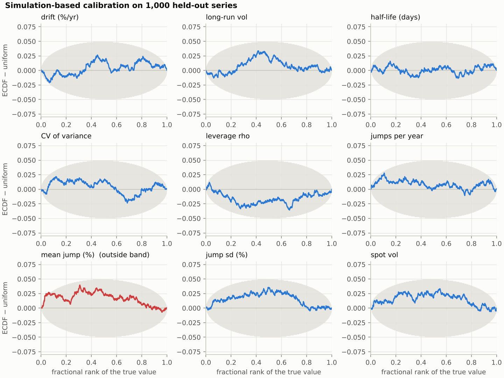
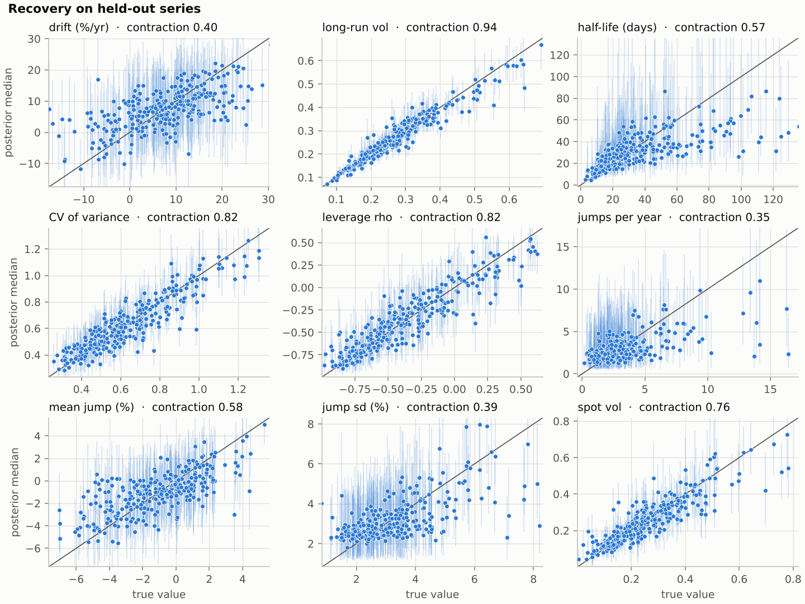
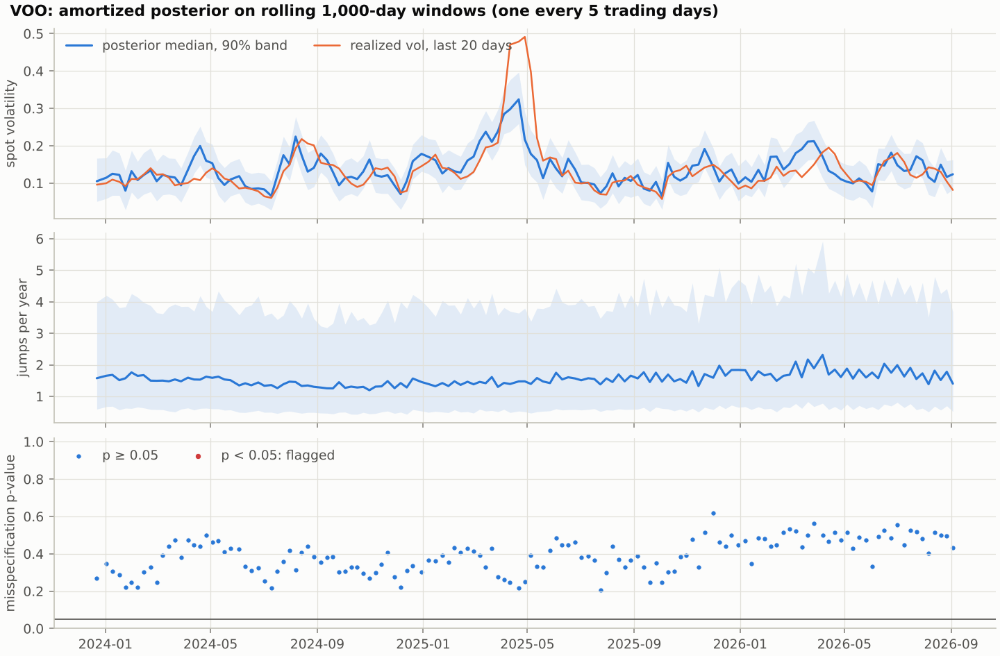
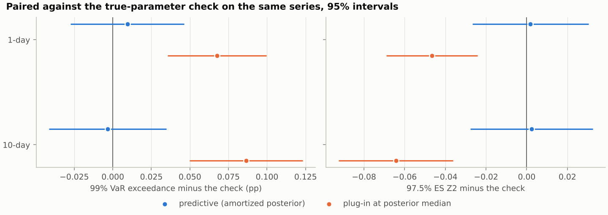

# SVJ pipeline: from 1,000 daily returns to VaR and ES

This branch implements the end-to-end pipeline of the design document *SVJ advanced example: technical design and narrative* (10 Oct 2026) in `src/sbi4finance/svj`, trains the reference network on CPU, and re-runs the document's feasibility checks against it. Results from the reference training run are being added; until then this page describes the design and how each piece is checked.

## The daily process

Every step is one function call; `pipeline.run_window` chains them and `scripts/svj_daily.py` runs them on a window of the bundled CSV.

1. **Network input.** The last 1,000 daily log returns in percent, as two channels per day: the return and log(y² + 0.01) (`model.network_input`).
2. **Amortized posterior.** The summary network compresses the 1,000 × 2 input into 32 statistics; 50 Euler steps of the flow-matching network carry noise to 1,000 joint draws of the eight parameters and log spot volatility at the last day (`amortized.AmortizedPosterior`, compiled once).
3. **Misspecification test.** The MMD distance between the window's summaries and those of 2,000 simulated series, with a p-value from 500 more (`checks.MisspecificationTest`).
4. **Audit.** A Student t (5 degrees of freedom, scale × 1.2) fitted to the draws proposes 3,000 parameter vectors; each is weighted by prior × particle-filter likelihood / proposal density, and the share of effective draws is the audit score (`audit.audit`). A score below the threshold flags the window, which can go to particle MCMC (`pmmh.run_pmmh`).
5. **Forecast.** 20 paths of 10 days from every posterior draw give the predictive 1- and 10-day 99% VaR and 97.5% ES, beside the plug-in forecast at the posterior median, the posterior of the 1-day conditional VaR and the split of its variance between today's variance and the parameters (`risk.forecast`).

Training happens once, before any of this: `scripts/svj_train.py` simulates every batch fresh from the prior (50 epochs × 400 batches × 128 series).

## Code layout

| Module | What it holds | How it is checked |
|---|---|---|
| `model.py` | Prior in risk-manager coordinates, the daily Euler model with floor and Bernoulli jumps, forward paths, network input | Prior table and prior predictive statistics reproduce the design document; unit tests |
| `filtering.py` | Fully adapted particle filter (JAX, vectorized over parameter vectors) and the grid filter | The mean of L-hat matches the converged grid likelihood; noise falls with particles |
| `amortized.py` | BayesFlow networks, online training, the compiled 50-step Euler sampler | The compiled sampler matches BayesFlow's own Euler integration to 4e-6 |
| `checks.py` | SBC with simultaneous bands, coverage, contraction, misspecification test | An exact posterior passes and an overconfident one fails; false-alarm rate on fresh simulations |
| `audit.py` | Importance sampling with the particle filter | Weights normalize; agreement study against particle MCMC |
| `pmmh.py` | Particle marginal Metropolis–Hastings, rank-normalized R-hat and bulk ESS | Diagnostics on independent, stuck and autocorrelated chains |
| `classical.py` | Approximate ML on the grid-filter likelihood (exact gradient by autodiff, L-BFGS-B, float64) and Wald intervals | Autodiff gradient against finite differences |
| `risk.py` | Predictive and plug-in VaR / ES, conditional VaR, variance split | Normal closed forms; the mixture example of Appendix H.2; the forward-simulation figure of the document |
| `pipeline.py`, `data.py`, `plots.py` | One window end to end; return windows from CSV; figures | Run on VOO and SPMO |

`pixi run test-svj` runs the 19 unit tests in `tests/test_svj.py` in under a minute.

## Results

The reference network reproduces the design document's calibration and identification on held-out simulations, and the daily process runs end to end on real windows in about two minutes per name. As in the document, the network alone is not trusted name by name: on VOO's last window the audit flags it, while SPMO passes.

| # | Check | Design document | This branch | Status |
|---|---|---|---|---|
| 1 | Training cost on CPU | 64 min on 2 cores, 2.56 million series; validation loss 0.79 over the last ten epochs | 79 min on 4 cores, 2.56 million series; validation loss 0.80 over the last ten epochs | Passed |
| 2 | Calibration on 1,000 held-out series | SBC 9 of 9 inside the band; 95% intervals cover 94% to 96% | SBC 8 of 9 (mean jump size leaves the band near rank 0.05), 9 of 9 on a replicate set; 95% intervals cover 93% to 96% | Passed |
| 3 | Agreement with particle MCMC on 4 series | Network alone off by 0.47 to 1.57 sd; within 0.4 sd after importance sampling | Pending: the agreement study runs after the real-data checks | Pending |
| 4 | Cost per name | Network 1.4 CPU-s; audit 18 to 146 CPU-s; particle MCMC 285 to 1,733 CPU-s | Network 0.5 s wall for 500 draws, 1.1 s for 1,000; audit 100 and 157 CPU-s on the two real windows; particle MCMC 2,295 CPU-s on VOO (bulk ESS 296) | Measured |
| 5 | Wald against posterior coverage | Wald 0.68 and 0.60 for jump frequency and mean jump; posterior 0.88 and 0.98 | Pending: `pixi run svj-classical` | Pending |
| 6 | VaR and ES backtest with a known truth | Plug-in minus predictive: exceedance +0.05 / +0.12 pp, Z2 −0.05 / −0.08 at 1 / 10 days | Plug-in minus predictive: exceedance +0.06 / +0.09 pp, Z2 −0.05 / −0.07; the predictive matches the true-parameter check | Passed |
| 7 | Real data | S&P 500 and WTI: sensible rolling posteriors, 9 of 807 windows flagged | VOO and SPMO, 136 weekly windows each: spot vol tracks realized vol (correlation 0.73 and 0.80), no window flagged; VOO's last window flagged by the audit and sent to particle MCMC, which lowers its 1-day VaR from 1.99% to 1.85% | Mixed |

### 1. Training

`pixi run svj-train` trained the reference network online in 79 minutes on a 4-core cloud container (process CPU time counts all four cores): 50 epochs of 400 batches of 128 freshly simulated series. The validation loss fell from 1.36 after the first epoch to 0.80 on average over the last ten, against 1.38 and 0.79 in the design document; training and validation losses agree because no series is seen twice. The checkpoint (6.1 MB, no optimizer state) and the training record are in `checkpoints/svj/`.

### 2. Calibration and recovery

`pixi run svj-validate` checks the network on 1,000 held-out series with 500 draws each. Eight of the nine rank ECDFs stay inside the 95% simultaneous band (half-width 0.050 at the centre); the mean jump size leaves it near rank 0.05, the shape of a posterior slightly too high. On 1,000 fresh series with another seed all nine stay inside, the mean jump's largest deviation falls from 0.040 to 0.024, and its posterior median lies above the truth in 49.4% of series (`sbc_replicate.json`): the excursion is the chance alarm the document anticipates, since nine bands at 5% each leave one band in up to 37% of studies.

How to read the figure: each panel is one target; the curve is the ECDF of the fractional ranks of the 1,000 true values minus the uniform CDF, and the grey area is the 95% simultaneous band. A curve that leaves the band is drawn red.

Coverage is close to nominal for every target: 50% intervals cover 47% to 52%, 90% intervals 87% to 92% and 95% intervals 93% to 96%. Contraction, the share of prior variance the data remove, matches the design document within 0.04 for every target except the drift:

| Target | Contraction, this branch | Design document |
|---|---|---|
| Long-run volatility | 0.94 | 0.94 |
| CV of variance | 0.82 | 0.82 |
| Leverage | 0.82 | 0.81 |
| Spot volatility at the last day | 0.76 | 0.75 |
| Mean jump size | 0.58 | 0.56 |
| Half-life | 0.57 | 0.61 |
| Drift | 0.40 | 0.52 |
| Jump size sd | 0.39 | 0.42 |
| Jump frequency | 0.35 | 0.33 |

How to read the figure: each point is one of 300 held-out series at its true value (horizontal) and posterior median (vertical), with its 90% interval; the diagonal is perfect recovery. Long-run and spot volatility hug the diagonal; the jump frequency and jump size sd form flat clouds near the prior medians, because four years of returns say little about them. The misspecification test, run on 500 fresh simulated series, raises a false alarm at the 5% level for 3.2% of them.

### 3. One window, end to end

`pixi run svj-daily` runs the daily process on the last 1,000 trading days of the bundled CSV (9 Sep 2022 to 3 Sep 2026). Both windows look like the training data (misspecification p-values 0.43 and 0.81).

| Window | Audit efficiency | Spot vol, median [90%] | 1-day VaR99 / ES97.5 | 10-day VaR99 / ES97.5 | Plug-in 10-day VaR99 / ES97.5 | Today's variance share |
|---|---|---|---|---|---|---|
| VOO | 0.9% (27 of 3,000, 200 particles): flagged | 12.3% [7.5%, 14.9%] | 1.99% / 2.17% | 7.51% / 7.62% | 7.08% / 7.18% | 92% |
| SPMO | 8.4% (253 of 3,000, 400 particles) | 19.8% [11.9%, 29.8%] | 3.36% / 3.43% | 10.88% / 11.15% | 10.59% / 10.81% | 94% |

On VOO the correction moves the parameters, leverage from −0.87 to −0.77 and jumps per year from 1.4 to 2.5, but barely the risk numbers (10-day VaR 7.49% from the network, 7.51% after the correction), because spot volatility agrees and today's variance carries 92% of the uncertainty of the 1-day conditional VaR. This is the pattern of the document's S&P 500 window. With 27 effective draws the corrected figure is approximate, and the window goes to particle MCMC (`--pmmh-on-flag`; 4 chains of 12,500 iterations with 200 particles, R-hat at most 1.008, bulk ESS at least 296, 2,295 CPU-s):

| VOO window | Network | Network + importance sampling | Particle MCMC (exact) |
|---|---|---|---|
| Leverage | −0.87 | −0.77 | −0.79 |
| Jumps per year | 1.4 | 2.5 | 2.3 |
| Half-life (days) | 22 | 17 | 17 |
| Spot volatility | 12.4% | 12.3% | 11.0% |
| 1-day VaR99 / ES97.5 | 1.99% / 2.14% | 1.99% / 2.17% | 1.85% / 2.07% |
| 10-day VaR99 / ES97.5 | 7.49% / 7.58% | 7.51% / 7.62% | 7.23% / 7.45% |

The audit moves leverage, jump frequency and half-life most of the way to the exact posterior. The network's 1-day VaR is 0.14 points above the exact one, mostly through spot volatility, the same gap as the document's S&P 500 window (3.90% against 3.76%); the daily process therefore reports the particle-MCMC figures for this name.

### 4. Rolling posteriors on real data

`pixi run svj-rolling` applies the network to 136 windows per ticker, one every five trading days, ending between 22 Dec 2023 and 3 Sep 2026; each window costs one network pass.

How to read the figure: each point on the horizontal axis is one 1,000-day window, labelled by its last day. The top panel shows the posterior median and 90% band of spot volatility against the realized volatility of the last 20 days, the middle panel the jump frequency, and the bottom panel the misspecification p-value.

Spot volatility tracks realized volatility (correlation 0.73 for VOO, 0.80 for SPMO). In April 2025 the realized volatility reaches 49% while the posterior spot volatility peaks near 32%: the model assigns part of those days to jumps, which do not move the variance. The model has no jumps in volatility, and the misspecification test does not flag these windows (p near 0.22). VOO's leverage medians lie between −0.92 and −0.77, partly below the prior's 2.5% quantile of −0.89, as the document found for the S&P 500; SPMO's lie between −0.74 and −0.41. Jump-frequency medians stay between 1.2 and 2.3 a year with wide bands.

### 5. VaR and ES backtests with a known truth

`pixi run svj-backtest` scores three forecasts on 500 held-out series, where the true parameters and today's true variance are known: the probability that the next loss exceeds the reported 99% VaR comes from 50,000 simulated futures, and the expected Acerbi–Szekely Z2 score of the 97.5% ES (0 when correct, negative when too low) from the same futures. The check forecasts with the true parameters and a filtered state.

How to read the figure: each dot is the average difference between a method and the true-parameter check on the same 500 series, with a paired 95% interval; the vertical line marks no difference. Blue is the predictive forecast from the amortized posterior, orange the plug-in at the posterior median.

| Paired against the check | 1-day exceedance | 10-day exceedance | 1-day Z2 | 10-day Z2 |
|---|---|---|---|---|
| Predictive (amortized posterior) | +0.01 pp [−0.03, +0.05] | −0.00 pp [−0.04, +0.03] | +0.00 [−0.03, +0.03] | +0.00 [−0.03, +0.03] |
| Plug-in at posterior median | +0.07 pp [+0.04, +0.10] | +0.09 pp [+0.05, +0.12] | −0.05 [−0.07, −0.02] | −0.06 [−0.09, −0.04] |

The predictive forecast is indistinguishable from knowing the parameters. The plug-in forecast, which drops parameter uncertainty, exceeds its VaR more often and understates the ES, more at 10 days than at 1 day; its ES is more than 10% below the true ES in 17% of series, against 13% to 15% for the predictive. These gaps match the document's (+0.05 and +0.12 pp, −0.05 and −0.08 against the predictive).

The levels themselves sit below nominal on these 500 series: the check is exceeded 0.91% of the time at 1 day and 0.94% at 10 days, with Z2 of +0.07 and +0.06 (`backtest_levels.png`). That is the sample, not the test: the per-series exceedance is right-skewed (median 0.81%), and `scripts/svj_backtest_check.py` computes the one-day check exactly, with no Monte Carlo, on 2,000 fresh series: 0.99% (95% CI 0.95% to 1.03%), batch means of 500 series between 0.97% and 1.02%. The particle filter's law of today's variance is also calibrated: the rank of the true v_T in the filter's cloud is uniform over 300 series (KS p = 0.98). Comparisons are therefore paired against the check, as in the document.

## Deviations from the design document

| Area | Design document | This branch | Why |
|---|---|---|---|
| Filters | numba (`pf_numba.py`) | JAX: `vmap` over parameter vectors, `lax.scan` over days, float32 | No new dependency: JAX is already the Keras backend. Systematic resampling uses offspring counts and the XLA bit generator, 30–40% faster than the first version |
| Python | 3.13 | 3.12 | The repository's pinned environment; BayesFlow, Keras and JAX versions are the same |
| SBC ranks | Fractional ranks | Randomized ranks (k + U) / (L + 1) | Exactly uniform for an exact posterior; removes false alarms of discrete ranks at the ends of the band |
| Audit threshold | Open decision | 2% efficiency (`--threshold`) | The study flagged windows at 0.2%, 1.5% and 1.6% and passed 3.3% and above |
| Real data | S&P 500 1999–2018 (arch package), WTI to Oct 2026 | VOO and SPMO, 2020 to Sep 2026, from `data/` | The repository's pinned CSV; the document's series are not in the repository |
| Hardware | 2-core cloud VM | 4-core cloud container | Costs are reported as process CPU seconds, which count all threads, and as wall time |
