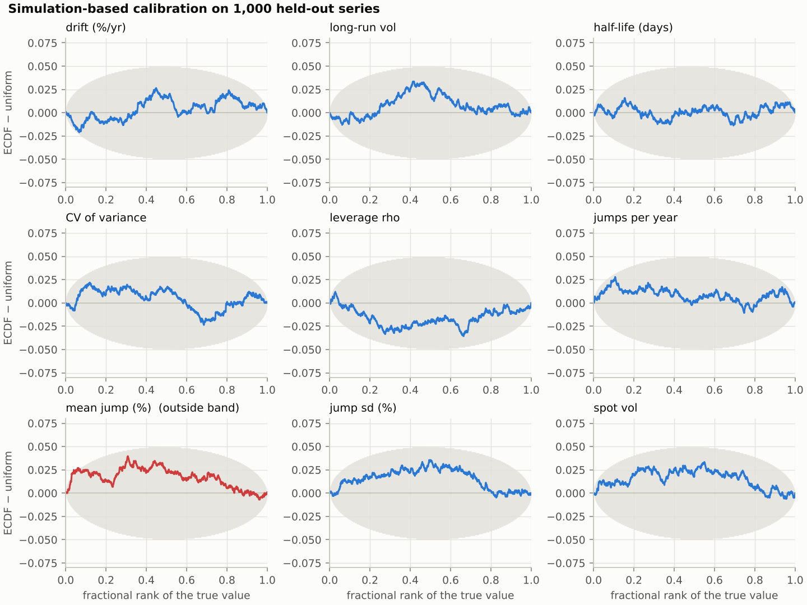
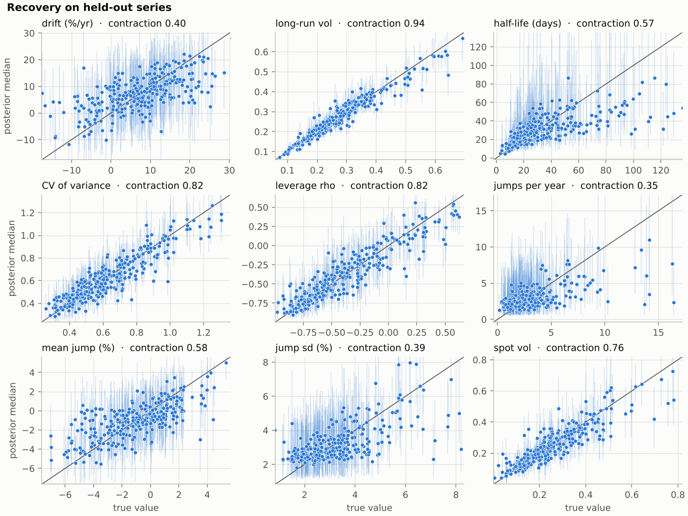
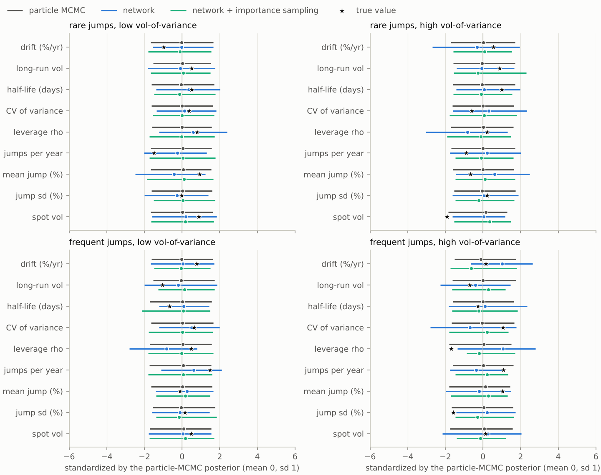
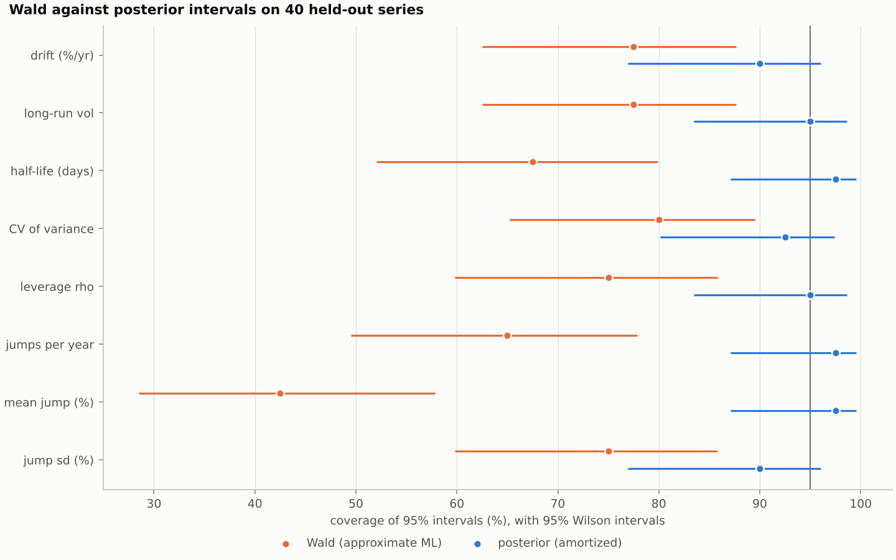
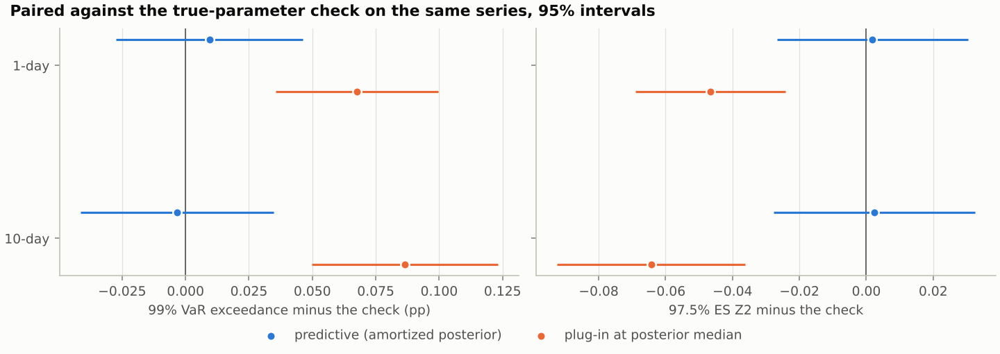
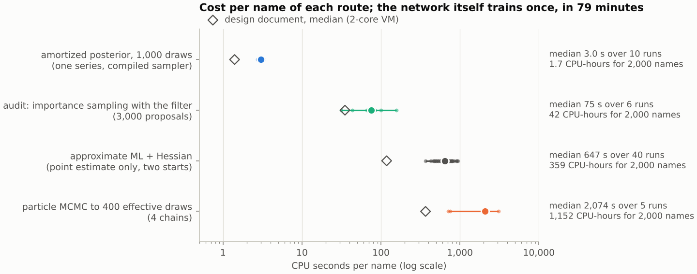
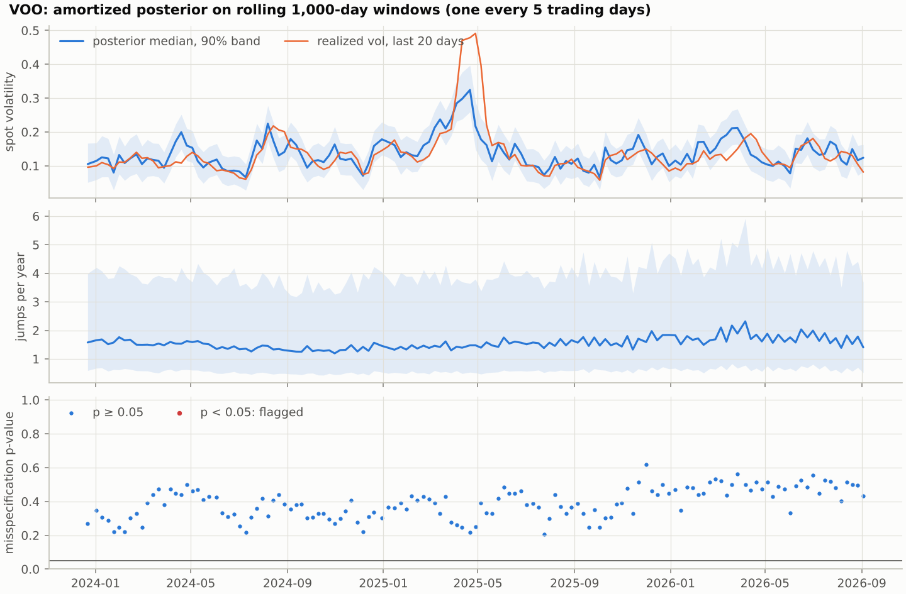

# SVJ pipeline: results summary

This branch implements the [design document](design/svj-design-document.md) for the SVJ advanced example end to end: a stochastic-volatility model with jumps, calibrated from the last 1,000 daily returns of one name by an amortized posterior, audited name by name with a particle filter, and carried into VaR and ES. It trains the reference network on CPU and re-runs the document's seven feasibility checks. This page gives the results in brief, with the main figures. [The pipeline document](svj-pipeline.md) has the full results, the code layout and every deviation, and [`results/`](results/) holds every output the numbers come from.

## In brief

Both claims of the tutorial hold on this branch's own runs, and the three checks the document marks as mixed are mixed here too, for the same reasons.

- **Point estimates misstate the uncertainty of the tail parameters.** On 40 simulated series, 95% Wald intervals from approximate maximum likelihood contain the true jump frequency in 26 series and the true mean jump in 17. The posterior intervals contain both in 39 of 40.
- **That error reaches the risk numbers.** On 500 simulated series, a forecast at the posterior median exceeds its 99% VaR more often and understates the 97.5% ES, more at 10 days than at 1 day. The predictive forecast, which averages over the posterior, cannot be told apart from a forecast made with the true parameters.
- **Amortization makes the Bayesian answer affordable.** The network trains once, in 79 minutes. After that, the posterior of a name costs about 3 CPU-seconds. That is about 700 times less than particle MCMC, the exact route, and still about 26 times less when every name also gets an importance-sampling audit.
- **The network is calibrated on average, not for every name.** Simulation-based calibration passes on 1,000 held-out series. On four single series, though, the network alone is off by 0.6 to 1.0 posterior sd. The audit repairs three of them and flags the fourth for particle MCMC. On real data it flags VOO's last window, whose exact posterior lowers the 1-day 99% VaR from 1.99% to 1.85%.

## Scorecard against the design document

| # | Check | Design document | This branch | Status |
|---|---|---|---|---|
| 1 | Training cost | 64 min on 2 cores; validation loss 0.79 | 79 min on 4 cores; validation loss 0.80 | Passed |
| 2 | Calibration on 1,000 held-out series | SBC: 9 of 9 targets inside the band; 95% intervals cover 94% to 96% | SBC: 8 of 9, and 9 of 9 on a replicate set; 95% intervals cover 93% to 96% | Passed |
| 3 | Agreement with particle MCMC on 4 series | Network off by 0.47 to 1.57 sd; within 0.4 sd after importance sampling | Network off by 0.61 to 1.00 sd; 0.14 to 0.26 sd after importance sampling on 3, the fourth flagged | Mixed |
| 4 | Cost per name, CPU-s | Network 1.4 for 1,000 draws (criterion: 2,000 draws in 1 s); audit 18 to 146; particle MCMC 285 to 1,733 | Network 3.0 (criterion missed); audit 31 to 157; particle MCMC 715 to 3,101 | Mixed |
| 5 | Coverage of 95% intervals on 40 series, jump frequency / mean jump | Wald 0.68 / 0.60; posterior 0.88 / 0.98 | Wald 0.65 / 0.43; posterior 0.98 / 0.98 | Passed |
| 6 | Backtest on 500 series, plug-in minus predictive, 1 / 10 days | Exceedance +0.05 / +0.12 pp; Z2 −0.05 / −0.08 | Exceedance +0.06 / +0.09 pp; Z2 −0.05 / −0.07 | Passed |
| 7 | Real data | S&P 500 and WTI: sensible rolling posteriors, 9 of 807 windows flagged; network VaR 3.90% against exact 3.76% | VOO and SPMO, 136 windows each: none flagged; network VaR 1.99% against exact 1.85% on VOO's last window | Mixed |

Check 3 is mixed because the network alone fails the agreement criterion on every series and only the audit brings it inside. Check 4 is mixed because the speed-up holds but the absolute criterion is missed, as in the document. Check 7 is mixed because a check against the exact likelihood still finds errors in the network's posterior for a flagged window. It runs on VOO and SPMO, because the document's S&P 500 and WTI series are not in the repository.

## Calibration: the network is right on average



How to read the figure: each panel is one target. The curve is the empirical CDF of the ranks of the 1,000 true values among their posterior draws, minus the uniform CDF. The grey area is the 95% simultaneous band, and a curve that leaves it is drawn red.

Eight of the nine curves stay inside the band. The mean jump size leaves it near rank 0.05, and stays inside on a second set of 1,000 series; nine bands at 5% each give one chance alarm in up to 37% of studies. The 95% intervals cover the truth in 93% to 96% of series for every target.



How to read the figure: each point is one series, at its true value (horizontal) and posterior median (vertical), with its 90% interval. Points on the diagonal are perfect recovery.

The data say a lot about volatility and little about jumps. The posterior removes 94% of the prior variance of the long-run volatility and 76% for today's spot volatility, but only 35% for the jump frequency and 39% for the jump size sd. Four years of daily returns hold only a handful of jumps, which is the reason the tutorial needs a posterior rather than a point estimate.

## Single names: the audit decides when the network is enough



How to read the figure: each panel is one series and each row one target. Dots are medians and lines 90% intervals, standardized by the exact particle-MCMC posterior (grey, mean 0 and sd 1). Blue is the network alone, green the network corrected by importance sampling, and the star the true value.

| Series | Network alone: largest error | After importance sampling | Audit efficiency |
|---|---|---|---|
| Rare jumps, low vol-of-variance | 0.61 sd | 0.14 sd: passes | 10.2% |
| Rare jumps, high vol-of-variance | 0.83 sd | 0.26 sd: passes | 2.8% |
| Frequent jumps, low vol-of-variance | 0.87 sd | 0.15 sd: passes | 4.2% |
| Frequent jumps, high vol-of-variance | 1.00 sd | 0.40 sd: fails | 0.7%: flagged |

The criterion, from the design document, is a mean error below 0.3 posterior sd and 90% widths within 25% for every target. The network alone misses it on all four series, mostly in leverage. The correction fixes three of them at 5 to 9 times less CPU than particle MCMC. On the fourth, the audit's efficiency falls below the 2% threshold, so the daily process sends that name to particle MCMC: the audit flags exactly the series it cannot repair.

## Claim 1: point estimates misstate tail uncertainty



How to read the figure: each row is one parameter. Orange is the share of the 40 series whose 95% Wald interval from approximate ML contains the true value, and blue the same share for the 95% posterior interval. Each share has its 95% Wilson interval, and the vertical line marks the nominal 95%.

The Wald intervals cover the mean jump in 43% of series and the jump frequency in 65%. Their causes are the ones the design document lists. Half the fits put a parameter on a bound, mostly the jump size sd at its floor. Six Hessians are not positive definite, so no interval exists. Even where it exists, the Wald interval for the jump size sd is often uninformative: in 15 of the 40 series it spans more than a factor of 100. The posterior intervals stay near nominal for every parameter.



How to read the figure: each dot is the average difference between a forecast and the true-parameter check on the same 500 series, with a paired 95% interval. The left panel shows how often the loss exceeds the 99% VaR, and the right panel the Acerbi–Szekely Z2 score of the 97.5% ES, which is negative when the ES is too low. Blue is the predictive forecast from the posterior, and orange the plug-in forecast at the posterior median.

| Paired against the check | 1-day exceedance | 10-day exceedance | 1-day Z2 | 10-day Z2 |
|---|---|---|---|---|
| Predictive (posterior) | +0.01 pp [−0.03, +0.05] | −0.00 pp [−0.04, +0.03] | +0.00 [−0.03, +0.03] | +0.00 [−0.03, +0.03] |
| Plug-in at the posterior median | +0.07 pp [+0.04, +0.10] | +0.09 pp [+0.05, +0.12] | −0.05 [−0.07, −0.02] | −0.06 [−0.09, −0.04] |

The predictive forecast is as good as knowing the parameters. The plug-in forecast drops parameter uncertainty: it breaches its VaR more often and its ES is too low, by more at 10 days. A forecast at the maximum-likelihood estimate does worse on the 40 series of the classical study (10-day Z2 of −0.20), but 40 series are too few to rank it reliably against the others.

## Claim 2: amortization makes the posterior affordable



How to read the figure: each row is one route, on a log scale. Small dots are single runs, the large dot is the median and the line the range. The hollow diamond is the design document's median, measured on a 2-core machine.

| Route | CPU-s per name, median | 2,000 names |
|---|---|---|
| Amortized posterior, 1,000 draws | 3.0 | 1.7 CPU-hours |
| Audit by importance sampling, 3,000 proposals | 75 | 42 CPU-hours |
| Approximate ML with Hessian (point estimate only) | 647 | 359 CPU-hours |
| Particle MCMC to 400 effective draws | 2,074 | 1,152 CPU-hours |

Training took 79 minutes on 4 cores, at most about 19,000 CPU-seconds, so against particle MCMC it pays for itself within about ten names (the document: about 21). Every route costs more here than in the document. The network costs about twice as much on this container, with timing medians from 2.5 to 3.1 CPU-s across four runs. Particle MCMC costs more still, because its random-walk proposal, scaled from the network's covariance as in the document, accepts only 9% to 16% of moves. A tuned proposal would narrow the gap. The whole daily process for one name (network, misspecification test, audit and forecast) takes about two minutes of wall time.

## Real data: VOO and SPMO



How to read the figure: each point on the horizontal axis is one 1,000-day window, labelled by its last day. The top panel shows the posterior median and 90% band of spot volatility against the realized volatility of the last 20 days. The middle panel shows the jump frequency, and the bottom panel the p-value of the misspecification test.

Spot volatility tracks realized volatility, with a correlation of 0.73 for VOO and 0.80 for SPMO ([SPMO figure](results/svj-rolling/SPMO_rolling.png)). In April 2025 realized volatility reaches 49% while the posterior peaks near 32%: the model assigns part of those days to jumps, which do not move the variance. No window fails the misspecification test. The jump frequency stays between 1.2 and 2.3 a year at the median, with wide bands, as the simulation study predicts.

The audit flags VOO's last window (efficiency 0.9%), and particle MCMC gives its exact posterior:

| VOO, window to 3 Sep 2026 | Network | Network + importance sampling | Particle MCMC (exact) |
|---|---|---|---|
| Leverage | −0.87 | −0.77 | −0.79 |
| Jumps per year | 1.4 | 2.5 | 2.3 |
| Spot volatility | 12.4% | 12.3% | 11.0% |
| 1-day VaR99 / ES97.5 | 1.99% / 2.14% | 1.99% / 2.17% | 1.85% / 2.07% |
| 10-day VaR99 / ES97.5 | 7.49% / 7.58% | 7.51% / 7.62% | 7.23% / 7.45% |

The correction moves leverage and jump frequency most of the way to the exact posterior. The network's 1-day VaR sits 0.14 points above the exact value, mostly through spot volatility. This is the same size of gap as the document's S&P 500 window (3.90% against 3.76%). SPMO's window passes the audit (efficiency 8.4%), with a 1-day VaR of 3.36%.

## How this run differs from the design document

- **Hardware.** The runs used a 4-core cloud container rather than the document's 2-core VM. Costs are process CPU seconds, which count every thread.
- **Software.** The particle and grid filters are written in JAX rather than numba, so the package needs no new dependency. Python is 3.12; BayesFlow, Keras and JAX match the document's versions.
- **Data.** The real-data runs use the repository's pinned VOO and SPMO returns, 2020 to September 2026, rather than the S&P 500 (1999 to 2018) and WTI.
- **Audit threshold.** The document left it open; this branch flags a name below 2% efficiency.
- **SBC ranks.** Ranks are randomized, which makes them exactly uniform under an exact posterior.

The [pipeline document](svj-pipeline.md#deviations-from-the-design-document) lists these with their reasons.

## Reproduce

```bash
pixi run test-svj            # 21 unit tests
pixi run svj-train           # reference network, about 80 min on 4 cores  -> checkpoints/svj
pixi run svj-validate        # SBC, coverage, recovery, contraction        -> docs/results/svj-validation
pixi run svj-agreement       # network and audit against particle MCMC     -> docs/results/svj-agreement
pixi run svj-classical       # Wald against posterior intervals            -> docs/results/svj-classical
pixi run svj-backtest        # VaR and ES backtests with a known truth     -> docs/results/svj-backtest
pixi run svj-costs           # cost per name of each route                 -> docs/results/svj-costs
pixi run svj-rolling         # rolling posteriors on VOO and SPMO          -> docs/results/svj-rolling
pixi run svj-daily --ticker VOO --pmmh-on-flag   # one window, end to end   -> results/svj
```

The committed reports of the daily runs are in `docs/results/svj-daily`. The marimo notebook `notebooks/svj_var_pipeline.py` walks through the same process on one window with the pretrained network.
