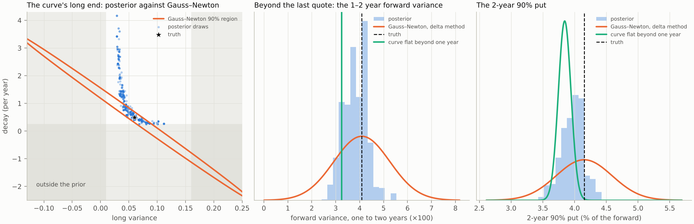
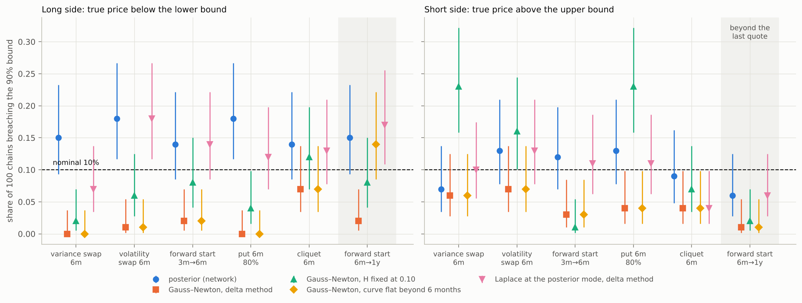

# Where the posterior and the classical answer part: complete surfaces and a thin chain

Quick check of 28 and 29 October 2026. It looks for a case in the core tutorial, Heston and rough Bergomi on the
complete 63-quote design, where the full posterior changes a product's 90% bound, and proposes how to test it;
Section 5 then runs the thin-chain case it settles on, on one machine. It is a quick check, not a study: nothing here
is registered in `tutorial/CLAIMS.md`, and no number goes on screen from it. The course quotes it as a quick check:
Section 1 in Lecture 11, Section 11.6; Sections 3 and 4 in Lecture 15, Section 15.6; Section 5 in Lecture 16,
Sections 16.1 to 16.9; `course/scripts/check_v2_plan.py` checks every number quoted there against the files here.
Sections 2, 3 and 5 use `rough_joint_calibration_v1` and `tasks.joint_rough_task`, with the task/runtime/source identities of their recorded runs. Their outputs and samplers are not changed or rerun by this editorial refresh. The current full-surface tutorial has completed 100k known-curve and joint-curve banks/fits; see [current status](../../../course/status.md). Sparse chains remain an optional/deferred unit under the separate [sparse plan](../../plans/SPARSE-QUOTE-CASE-PLAN.md).

**What these checks establish.** In the particular full-surface product comparisons below, the prior and curve continuation matter more than departures from a matched local Gaussian approximation. On the separate thin quick check, least squares without a prior over-reserves and fixing H at 0.10 can bias bounds; a Gaussian at the posterior mode with the same prior matches the network for the six tested products. These are useful arguments for stating the prior and comparing strong classical alternatives. They are not a theorem that all complete-surface posteriors are Gaussian or that SBI requires sparse observations.

## Parameter geometry and product consequences are separate checks

The known-curve SPY and Heston comparisons below can be close to a Gaussian for their recorded tasks and observations. Earlier PR48 boundary examples do not establish non-Gaussian interior geometry. The newer joint100k J1 panel does contain selected interior *learned* candidates: case 1983 has a curved long-level/decay ridge (Spearman 0.975), and case 1941 has strong eta/rho dependence (about 0.957, largely elliptical). Their all-six-parameter interior rule and exploratory selection are documented in [the joint sanity audit](../../plans/joint-rough-posterior-sanity.md). Conditional PyMC validation remains J2, and an effect on product prices remains J3; neither follows from a corner plot or from marginal SBC.

The financial question is whether such dependence changes the price distribution of a stated payoff. Linearity of a payoff's parameter map alone does not guarantee that arbitrary posteriors and Laplace approximations have the same distribution or quantiles. PR48's twelve analytic variance-product comparisons probe particular linear combinations of Heston parameters at fixed kappa; agreement there does not establish all parameter geometry or nonlinear-product accuracy. The exploration below therefore scores products and respects the prior, without dismissing parameter geometry as a diagnostic.

## 1. Heston: the low vol-of-vol corner (study S6)

`heston_s6_strata.py` splits study S6's 200 test smiles by the fitted vol-of-vol, an observable, so a correct
posterior keeps its coverage inside each stratum. The posterior here is the BayesFlow 2.0 network's, not an exact
one.

| Fitted $\sigma_v$ | Smiles | Optimum on a bound | No Gauss–Newton interval | Two or more optima | Gauss–Newton over posterior 90% width, $\sigma_v$ | Same, $\rho$ |
| --- | ---: | ---: | ---: | ---: | --- | --- |
| below 0.3 | 28 | 7 | 4 | 6 | 1.48 (10–90%: 0.84–3.10) | 1.36 (0.60–5.54) |
| 0.3 and above | 172 | 8 | 7 | 0 | 1.03 (0.95–1.15) | 1.01 (0.93–1.10) |

Below 0.3 the skew pins only $\rho\sigma_v$, and the valley of Lecture 7, Section 7.7 appears in Heston, cut by
$\rho = -0.95$ and $\sigma_v = 0.1$. Row 2115 shows it: truth $(\sigma_v, \rho) = (0.144, -0.833)$, least squares
$(0.209, -0.579)$, both with $\rho\sigma_v \approx -0.12$. Study S3's exact chains on row 2000 (true
$\sigma_v = 0.104$) show it with a reference posterior: $\sigma_v$'s 5%, 50% and 95% quantiles are 0.102, 0.125
and 0.182, and the sd of $\rho$ falls from 0.053 to 0.022 from the lowest to the highest decile of $\sigma_v$. The
corner is real model geometry, not a chosen limit. Whether it moves the tutorial's reserves was not checked: its
products depend on the vol-of-vol mostly through its square, which is small here, and SPY ($\sigma_v \approx 1.1$)
is far from it. A product priced by the vol-of-vol itself, such as an option on realized variance, would show it.

## 2. Joint-curve rough Bergomi: a local Gauss–Newton screen

`joint_gn_screen.py` computes, at eight parameter vectors, the expected information of the 63 design quotes with
the design noise. It uses the task's Monte Carlo pricer on one seed (32,768 paths per block, common random numbers)
and central differences. "Given" holds the curve at its true values; "inferred" estimates its three coefficients
with $(H, \eta, \rho)$. The 2-year 90% put is the tutorial's product beyond the last quote.

| Point: $(H, \eta, \rho)$; short, long, decay | $\eta$ sd, inferred over given | Long-variance sd over its prior width | 2-year put, delta-method sd: inferred, given |
| --- | ---: | ---: | --- |
| A, rising, slow decay: (0.09, 2.6, −0.73); 0.02, 0.06, 0.5 | 1.30 | 0.64 | 10.6%, 2.8% |
| B, rising, fast decay: A with decay 4.0 | 1.26 | 0.025 | 2.5%, 1.9% |
| C, flat: A's dynamics; 0.04, 0.04, 2.0 | 1.35 | 0.016 | 2.1%, 1.9% |
| D, falling: A's dynamics; 0.10, 0.04, 1.5 | 1.50 | 0.11 | 4.5%, 1.1% |
| E, $\rho$ near its bound: (0.07, 1.9, −0.95); A's curve | 1.16 | 0.54 | 9.8%, 1.9% |
| F, low vol-of-vol: (0.15, 0.8, −0.5); 0.03, 0.05, 1.0 | 1.08 | 0.14 | 6.4%, 1.2% |
| G, rising, very slow decay: A's dynamics; 0.02, 0.08, 0.3 | 1.30 | 1.73 | 11.9%, 2.8% |
| H, A's curve, low $\eta$: (0.12, 1.2, −0.6) | 1.16 | 0.51 | 9.7%, 1.8% |

The forward start's delta-method sd is 1.0% to 2.3% of its price inferred and 0.8% to 1.7% given, at every point.

- **Inferring the curve does not reopen the $\rho\eta$ valley.** The sd of $\eta$ grows by a factor of 1.1 to 1.5 and
  stays at 2% to 5% of its prior width; the wings still separate $\eta$ from $\rho$. The forward start and the
  volatility swap, which $\eta$ drives, do not carry the case.
- **The long end does.** When the curve still moves at one year (decay 0.3 to 0.5 per year), the quotes barely
  inform the long variance locally: its Gauss–Newton 90% interval crosses both prior bounds, decay's crosses the
  lower one, and a $\chi^2$ slice along the weakest direction leaves the prior box within one Gauss–Newton sd. The
  posterior there cannot be the Gauss–Newton normal. The 2-year put's delta-method sd rises four- to fivefold
  against the curve given. Section 3 measures what the posterior does instead.
- **An exactly flat curve does not depend on decay conditional on equal short/long levels.** This explains weak decay identification. Integrating uncertain levels need not leave its marginal equal to the prior, and broad decay alone does not prove every extrapolated product harmless.

## 3. One slow-decay smile, by importance sampling

`joint_is_posterior.py` computes the posterior at point A for one noisy smile (the design noise, seed 1), with the
task's pricer on one seed, by importance sampling; the target is the posterior of that fixed-seed pricer, as in
`rough_spy_is.py`. The proposal is a t distribution in the coordinates the quotes pin down, the curve's values at 6
and 12 months in place of (long variance, decay), mapped back in closed form with its Jacobian. 357 of 1,024
proposals are valid curves inside the prior box; the effective sample size is 98 and the largest weight 0.033, so
the 5% and 95% quantiles below are good to a few percentile points. A first attempt, with the Gauss–Newton normal in
the model's own parameters as the proposal, kept 370 of 2,048 proposals inside the box and reached an effective
sample size of 5: that normal is a poor description of this posterior. The Gauss–Newton column is the Laplace
approximation at the truth, which separates its shape from the location error of a least-squares point.

| Quantity | Truth | Posterior 5%, 50%, 95% | Gauss–Newton 90% |
| --- | ---: | --- | --- |
| $H$ | 0.090 | 0.080, 0.105, 0.130 | 0.064 to 0.116 |
| $\eta$ | 2.60 | 2.40, 2.54, 2.70 | 2.45 to 2.75 |
| $\rho$ | −0.73 | −0.81, −0.72, −0.64 | −0.82 to −0.64 |
| short variance | 0.0200 | 0.0191, 0.0198, 0.0205 | 0.0190 to 0.0210 |
| long variance | 0.060 | 0.030, 0.050, 0.088 | −0.097 to 0.217 |
| decay (per year) | 0.50 | 0.28, 0.66, 2.95 | −1.79 to 2.79 |
| 2-year variance-swap strike | 0.0347 | 0.0281, 0.0332, 0.0366 | 0.0244 to 0.0450 |
| forward variance, 1 to 2 years | 0.0409 | 0.0298, 0.0384, 0.0440 | 0.0217 to 0.0601 |
| forward start, 63 to 126 days | 0.02216 | 0.02140, 0.02213, 0.02280 | 0.02136 to 0.02296 |
| 2-year 90% put | 0.04151 | 0.03645, 0.03980, 0.04252 | 0.03426 to 0.04875 |

The two option rows come from `joint_is_products.py`: a systematic resample of 300 posterior draws (148 distinct),
priced with 8,192 paths on common random numbers. Their "truth" is the price under the true parameters. The
script's reserve lines measure from that price, while the posterior comes from a noisy smile, so they mix location
with shape; the comparison below uses widths and percentiles instead.

How to read the figure: on the left, the shaded area lies outside the prior box; the blue dots are 600 draws
resampled from the weighted posterior; the orange band is the Gauss–Newton 90% region at the truth (the star). The
posterior is a bent ridge, either a fast decay with a low long variance or a decay near its floor with a higher one,
and the straight Gauss–Newton band cannot follow the bend; most of it lies outside the prior. In the centre and on
the right, the blue histogram is the posterior's distribution of the product, the orange curve the delta method's
normal, the green line or curve the answer with the curve held flat beyond one year, and the dashed line the truth.
The histograms are spiky because the effective sample size is about 100.

- **$(H, \eta, \rho)$** have the Gauss–Newton widths, to within 3% to 15%: the regular part of the posterior, as on
  the known-curve task. The short variance's posterior range is 0.7 times Gauss–Newton's, through its coupling to
  the long end.
- **The long end** does not. The long variance's 90% range is a fifth of Gauss–Newton's, and decay sits near its
  floor (34% of the posterior below 0.5 per year) with a long upper tail. The quotes pin the curve's level and slope
  within the year and only weakly its curvature. Given the curve at 0, 6 and 12 months, the long variance is
  $(\xi_1 S - \xi_{0.5}^2)/(\xi_1 + S - 2\xi_{0.5})$, a ratio whose denominator is that curvature, and the prior's
  floor on decay limits how far the curve can keep rising.
- **The forward variance from one to two years** has a posterior 90% range 0.37 times Gauss–Newton's, and skewed:
  0.0086 below the median, 0.0056 above. No posterior mass lies outside Gauss–Newton's interval, which here
  over-reserves on both sides rather than missing risk. Holding the curve flat beyond one year gives 0.0324, a point
  21% below the truth and at the posterior's 13th percentile; the truth is at its 65th.
- **The 2-year 90% put** follows. The posterior's 90% range is 15% of the price, mildly skewed downward;
  Gauss–Newton's is 35%, 2.4 times wider. Holding the curve flat beyond one year moves the mark to 0.03844, 7.4%
  below the price on the true curve, with a range of ±4.3% from $(H, \eta, \rho)$ alone, which misses the truth. The
  truth lies at the posterior's 89th percentile.
- **The forward start**, inside the quoted year, is the control: Gauss–Newton's 90% range is 1.14 times the
  posterior's, and holding the curve flat beyond one year does not change its price.

## 4. SPY and the joint task's curve family

`spy_curve_fit.py` fits the joint task's curve, $\xi_0(t) = L + (S - L)e^{-kt}$, to SPY's seven replicated
forward-variance levels of 21 October 2026, with 5% error per level (the long-end check's assumption). The fit
prefers a fast rise to a plateau: decay 5.9 ± 1.1 per year, long variance 0.052 ± 0.003, $\chi^2$ = 9.8 on 7
levels. It misses the continued rise from six months to one year (0.0517 against 0.0546) and puts the forward
variance from one to 2.23 years at 0.052, against 0.0575 implied by SPY's 2.23-year LEAP, which the design does not
use. Slow decays fit worse ($\chi^2$ of 43 to 60 for decay 0.25 to 1).

Under this family SPY sits in the identified, fast-decay regime of Section 2. Its long end looks precise because
one exponential cannot express two time scales: a near-zero-width assumption about the curve beyond the last quote,
which the held-out LEAP contradicts. That is a misspecification lesson for slot 6, and it bears on the plan's check
of the hump-capable family, not a case for the posterior on SPY.

## What follows

**The case.** Joint-curve rough Bergomi, a product beyond the last quote, on smiles whose curve still moves at one
year. The two classical answers bracket the posterior. Holding the curve flat beyond one year, as the known-curve
task does, gives the long end no range and a mark biased by the extrapolation: at point A, 21% low for the forward
variance and 7.4% low for the 2-year put, whose range then misses the truth. Gauss–Newton with the curve inferred
gives a symmetric range 2.4 to 2.7 times the posterior's, for the curve products and the put alike, from a parameter
region that runs through negative variances and decays. The posterior's range lies
between them and is skewed. Its upper side is set by the prior's floor on decay (a half-life of at most 2.8 years):
beyond the last quote the range is the prior's as much as the quotes', and the slide must say so. Heston is the
control: with $\kappa$ fixed at 2 its curve reaches $\theta$ within the quoted year, so its 2-year put looks precise
because an input is fixed, the zero-width choice of Lecture 6, Section 6.7.

The argument is therefore not "the classical interval is too narrow". One classical answer invents precision, the
other spends capital on curves the model does not allow, and the size of each error shows in a reserve. The
posterior is right if its prior is, which is testable. The non-Gaussian shape sits in the curve's coefficients, not
in $(H, \eta, \rho)$, which is why the known-curve and Heston runs did not show it.

**J3 proposal, not a completed study.** Specify the development analysis on validation first and freeze its protocol before opening reserved test outcomes; nothing here runs it:

1. Stratify the smiles by an observable, the posterior median of decay below 1 per year (or the long variance's
   contraction below 0.5), against the rest. Bayesian calibration holds within any stratum defined by the data, when
   the truths follow the prior. A rough count from the curve's second difference over the year,
   $(S - L)(1 - e^{-k/2})^2$, puts 6% to 10% of the prior in this regime: some 120 to 200 of 2,000 validation smiles.
2. For the 2-year put and the 1-to-2-year forward variance (analytic in the curve coefficients), report one-sided
   breaches of the 90% bounds, each of which should be 10%, and the reserves, for four methods: the posterior; least
   squares with Gauss–Newton and the delta method, from the price emulator; the curve held flat beyond one year;
   and the profile likelihood of each product. The last is the strongest classical competitor, since it follows the
   curvature and respects the box, at one constrained fit per product. If it matches the posterior, the report says
   so: the posterior's advantage is then calibration tested on average, every product from one set of draws, and an
   explicit prior.
3. Choose the exemplar by a fixed rule, the median smile of the stratum, and audit its posterior with the Monte
   Carlo likelihood (S5's machinery). The old joint20k decay coverage was 46.75% at 50%; the newer J1 panel must be read with its own frozen model and validation record, rather than inheriting that value. Decay remains weakly identified near flat curves.
4. Repeat the breaches with truths from another law for the long end, as S10 does for EWG, so that the posterior's
   advantage is not only its own prior.

**What it does not show.** That the posterior differs from Gauss–Newton on SPY's grid (Lecture 15, Section 15.4);
that point A is typical of its stratum (one smile, one noise draw); or that the joint task's prior on the long end
is right. Section 4 suggests the one-exponential family is too rigid for SPY.

**Reassessed the same day.** The long end is a case for a prior, not for simulation-based inference. The curve
beyond the last quote depends on the curve family and its prior, not on the simulator: $(H, \eta, \rho)$ need the
simulator, and they stay Gaussian here. The study above supports claim 2a of Lecture 6, Section 6.8 (a stated
prior against a zero-width extrapolation) and is nearly free on PR #48's validation panels, so it stays worth
running, as a result for Lecture 15, Section 15.6 and slot 6, not as the headline. One optional analysis that tests Bayes and the network together is the thin chain with the joint curve: EWG's 27-contract layout under the six-target
task, which removes the curve leak that withdrew the earlier thin cases (Lecture 16, Section 16.3). One such
surface prices in about 1 CPU-second at 8,192 paths, within the bank's precision budget (`thin_joint_timing.py`,
`thin_joint_results/timing.txt`: largest Monte Carlo error 0.067 of the quote noise against a budget of 0.25), so a 100,000-surface bank costs about
30 CPU-hours against about 370 for the full design. Runs R4 and R7 to R9 of the runbook then apply, with the
classical baselines of `thin.py` ported from the seven-level curve to the three coefficients.

## 5. The thin chain with the curve inferred, run locally

The analysis the reassessment proposes, run on one four-core machine on 28 and 29 October. The task is PR #48's
joint rough Bergomi with all six targets, $(H, \eta, \rho)$ and the curve's short variance, long variance and decay,
on EWG's layout of 22 October: 27 contracts at 21, 42, 63 and 126 trading days, with EWG's half-spreads as the quote
noise (`make_thin_joint_config.py`). The curve is inferred with the rest, so no given curve carries information into
the products.

**Bank, network, calibration.** 24,000 surfaces (20,000 training, 2,000 validation, 2,000 test) from PR #48's bank
builder, unchanged. The network is `thin.py`'s design for the six targets (`thin_joint.py`): flow matching
conditioned on the quotes in noise units and on the noise scale, trained with a fresh quote error and a log-uniform
noise scale on [0.5, 2] each batch, at R4's settings (`thin_joint_train.py`): 20 minutes, best validation loss at
epoch 270 of 300 (`thin_joint_net/`). SBC on 1,000 validation surfaces at the layout's noise, 200 draws each
(`thin_joint_sbc.py`): every rank KS statistic, 0.017 to 0.033, is inside the DKW bound of 0.054, for the six
targets, $\rho\eta$ and the forward variance from six months to one year. The quotes inform the short variance
(contraction 0.92) and $\eta$ (0.72), less so the long variance (0.64) and $\rho$ (0.55), and barely $H$ (0.22) or
decay (0.18). The tails are less exact than the ranks: the 90% intervals cover 88.4% to 89.7%, every one below
90% (standard error 0.9 points). The record keeps two-sided coverage only, not the rate on each side.

**The breach study** (`thin_joint_breach.py`, study S10's design for the joint task). 100 test surfaces, each read
as a chain with a fresh quote error. For six products, five inside the quoted half-year and the forward start from
six months to one year beyond it, each method gives a lower and an upper 90% bound. The truth is the product priced
at the surface's parameters on the same paths, so a correct method puts it below the lower bound on 10% of chains and
above the upper bound on 10%. The classical fits start from the prior box and the quotes only: the best of 17 points
by $\chi^2$, then two least-squares runs. The Laplace approximation is the posterior's mode in the logit coordinates
of the box, where the uniform prior is a logistic density, with the Gauss–Newton curvature of the quotes plus the
prior's; "delta" applies the delta method there, "sampled" prices 200 draws of that normal mapped back into the box.

| Product | Posterior (network) | Laplace, delta | Laplace, sampled | Gauss–Newton | $H$ fixed at 0.10 | Curve flat beyond 6 months |
| --- | --- | --- | --- | --- | --- | --- |
| variance swap 6m | 15 / 7 (0.27) | 7 / 10 (0.27) | 7 / 16 (0.30) | 0 / 6 (0.50) | 2 / 23 (0.26) | as Gauss–Newton |
| volatility swap 6m | 18 / 13 (0.080) | 18 / 13 (0.076) | 16 / 13 (0.122) | 1 / 7 (0.139) | 6 / 16 (0.096) | as Gauss–Newton |
| forward start 3m→6m | 14 / 12 (0.18) | 14 / 11 (0.18) | 18 / 11 (0.21) | 2 / 3 (0.30) | 8 / 1 (0.24) | as Gauss–Newton |
| put 6m, 80% | 18 / 13 (0.25) | 12 / 11 (0.25) | 9 / 18 (0.30) | 0 / 4 (0.56) | 4 / 23 (0.27) | as Gauss–Newton |
| cliquet 6m | 14 / 9 (0.16) | 13 / 4 (0.17) | 7 / 11 (0.19) | 7 / 4 (0.23) | 12 / 7 (0.18) | as Gauss–Newton |
| forward start 6m→1y | 15 / 6 (0.32) | 17 / 6 (0.32) | 20 / 10 (0.33) | 2 / 1 (1.04) | 8 / 2 (0.73) | 14 / 1 (0.46) |

Each cell: percent of the 100 chains with the truth below the lower bound / above the upper bound, and in brackets
the median width of the 10%-to-90% band over the true price. Near 10%, a rate's 95% interval is about ±6 points.

How to read the figure: each marker is the share of chains whose truth lies beyond a method's bound, on the long
side (left) and the short side (right), with a 95% Wilson interval; the dashed line is the 10% a correct method
hits, and the shaded product lies beyond the last quote. The sampled Laplace is in the table only.

- **Least squares cannot identify the model on 27 quotes.** 76 of 100 Gauss–Newton fits end with a parameter on its
  bound, most often $H$ (34% of fits), the long variance (32%) and decay (28%), and the median condition number of
  the information matrix is $2 \times 10^{12}$. The delta method's bands are then 1.5 to 3.3 times the posterior's
  and breach 0% to 7%: an over-reserve on every product, largest beyond the last quote.
- **Fixing $H$ at 0.10 buys the width back with a bias.** Inside the half-year its bands are about as narrow as the
  posterior's, and the truth lies above them on 23% of chains for the variance swap and the put. The bias comes from
  chains whose true $H$ is far from 0.10: on the 29 within 0.05 of it the two rates are 10% and 14%, on the other 71
  they are 28% and 27%. The variance swap does not depend on $H$; the fitted curve absorbs the error. (A split by the
  truth, as a diagnostic: a desk cannot make it.)
- **Holding the curve flat** beyond the last quote, with Gauss–Newton's fit and covariance, moves the forward start
  from six months to one year from 2% to 14% of truths below the band, with 1% above.
- **A prior fixes both, and its Gaussian approximation does as well as the network.** The delta-method Laplace and
  the network's posterior have the same widths to within 5% on every product, and no mode lies on a bound (median
  condition number 370). Their breach rates differ by at most 8 points, mostly on the same chains, and neither is
  consistently the closer to 10%. Sampling the same normal through the box gives bands up to 1.6 times as wide (the
  volatility swap) that breach as often or more: a normal in logit coordinates spreads the weakly informed $H$ and
  decay toward the box's edges.
- **The common excess**, 14% to 18% below the band on several products for the posterior and the Laplace alike, is
  mostly the sample: the methods read the same quotes and miss on the same chains. On the ten audited chains the exact
  posterior's bands are as wide as the network's (below).

**The audit** (`thin_joint_audit.py`; chains 0 to 9, fixed in advance). Importance sampling with the Monte Carlo
likelihood: 512 proposals, 90% a t distribution fitted to the network's draws and widened by 1.2, 10% the prior,
each priced on its own 8,192 paths; effective sample sizes 28 to 60, Pareto $\hat k$ at most 0.53, so the exact
bands are good to a few percentile points. Against them the network's product bands are 0.65 to 1.52 times as wide
(median 1.04), the delta-method Laplace's 0.69 to 1.72 (median 1.08) and the sampled Laplace's 0.76 to 2.90 (median
1.20). The truth lies on the same side of the exact band as of the network's in 57 of 60 chain-products, and as of
the delta-method Laplace's in 55. The exact posterior itself misses 14 of the 60, against 12 expected. The
parameters agree as well: the network's 90% intervals are 0.53 to 1.45 times the exact ones (medians 0.94 to 1.14
across the six), and no quantile is off by more than 0.43 of the exact interval.

**EWG's own chain** (`thin_joint_ewg.py`; there is no truth, so this shows how far the answers differ, not which is
right). Least squares fits the 27 quotes with $\chi^2$ = 1.75, decay on its upper bound and a condition number of
$8 \times 10^{13}$: the mids sit far closer to the model than their half-spreads, so the noise model is
conservative here. The posterior barely informs $H$ (5% to 95%: 0.05 to 0.32) and decay (0.6 to 7.3). The 10%-to-90%
bands:

| Product | Posterior (network) | Laplace, delta | Gauss–Newton | $H$ fixed at 0.10 | Curve flat beyond 6 months |
| --- | --- | --- | --- | --- | --- |
| variance swap 6m | 0.0572 to 0.0832 | 0.0544 to 0.0801 | 0.0341 to 0.1054 | 0.0507 to 0.0747 | as Gauss–Newton |
| volatility swap 6m | 0.1949 to 0.2169 | 0.1952 to 0.2169 | 0.1881 to 0.2191 | 0.1902 to 0.2185 | as Gauss–Newton |
| forward start 3m→6m | 0.0300 to 0.0380 | 0.0303 to 0.0381 | 0.0277 to 0.0381 | 0.0291 to 0.0392 | as Gauss–Newton |
| put 6m, 80% | 0.0114 to 0.0148 | 0.0115 to 0.0150 | 0.0093 to 0.0173 | 0.0105 to 0.0146 | as Gauss–Newton |
| cliquet 6m | 0.0147 to 0.0168 | 0.0146 to 0.0171 | 0.0141 to 0.0171 | 0.0148 to 0.0174 | as Gauss–Newton |
| forward start 6m→1y | 0.0339 to 0.0509 | 0.0347 to 0.0519 | 0.0248 to 0.0539 | 0.0349 to 0.0555 | 0.0219 to 0.0560 |

The posterior's and the Laplace's band ends agree to within 5% on every product, and their widths to within 12%
(the cliquet). Gauss–Newton's bands are 1.3 to 2.7 times
wider, and fixing $H$ moves the variance swap's band about 11% down, the pattern of the simulated chains.

**What this shows, and what it does not.** On a thin chain with the curve inferred, the two classical practices fail
in opposite directions: without a prior the model is not identified and the reserve grows 1.5 to 3.3 times; with a
parameter fixed by hand the reserve is tight and a quarter of the truths escape it on one side. A stated prior fixes
both, which is claim 2a of Lecture 6, Section 6.8 on a case where no given curve leaks. It does not show that the
posterior's shape matters: for these six products a normal at the posterior's mode, in the box's logit coordinates,
does as well as the network, presumably because the products load on the directions the quotes inform. What the
network adds is cost and robustness: once trained it gives 200 draws of a chain in 1.3 s on four cores, with no
starts to choose and no optimum to lose, where the Laplace needs about three CPU-minutes of fitting a chain (least
squares from the box, then the mode); the bank and the training cost about as much as 100 such fits. The truths come
from the network's own prior, so an exact posterior is calibrated by construction; truths from another law (S10's
robustness check), the profile likelihood, other dates and other noise models are not run.

## What runs without the cluster

Measured on 28 October on a four-core machine with no GPU, in a plain virtual environment holding the lab's pins
(BayesFlow 2.0.14, Keras 3.15.1, JAX 0.11.1 on CPU), outside pixi.

| Step | Tested | Result |
| --- | --- | --- |
| The thin-layout joint bank | `make_thin_joint_config.py`, then PR #48's `calibration_bank.py local`, unchanged: 24 and 200 surfaces | 0.68 CPU-s a surface; every quote within the 0.25 budget (median Monte Carlo error 0.04 of the noise, largest 0.25); 153 of 160 training surfaces at the first rung of 4,096 paths. 100,000 surfaces: about 19 CPU-hours, five wall-hours on four cores |
| The shipped Heston network | `tutorial/assets/checkpoints/heston` loaded through `sbi4f_tutorial.teaching.load_network` | 2,000 SPY draws in 3.5 s; means within 0.34 exact-posterior sd and widths within 4% of the exact chain, as in slot 4 |
| Real chains | Ten Cboe chains fetched at 20:30 UTC (SPY, QQQ, IWM, EWI, EWQ, FEZ, AAPL, XLF, GLD, TLT), about one second each | All ten fail `build_surface.py`'s full-design gate: on SPY the one-week expiration's cleaned strip reaches −6.95 standardized deltas against the −8 the replication needs (−8.15 on 21 October), so the front maturity has no covered expiration; FEZ and XLF do not reach one year; EWI and EWQ have no usable expiration. `chain_reach.py` prints the reach per expiration |
| The thin layout on a later date | `checks/thin_chains/build_layout.py` on EWG's chain of 28 October | 13 contracts at two maturities, against 27 at four on 22 October: the design maturities match an expiration only within 7 trading days (`MATCH_DAYS`), and EWG's January and April expirations have drifted out of the 63- and 126-day windows. A fixed layout is tied to its date; the stage date needs its own, or a network conditioned on the maturities |
| Training | `thin_joint.py` and `thin_joint_train.py`, the six-target branch of `thin.py`, written the same day; R4's settings (four layers of 512, 300 epochs, batch 256, time alpha −0.5) on the 20,000-surface bank | 20 minutes on four cores; best validation loss at epoch 270. Section 5 |
| SBC | `thin_joint_sbc.py`, 1,000 validation surfaces, 200 draws each | 1.3 s a surface on four cores |
| Breach study | `thin_joint_breach.py`, 100 test chains, three arms | A chain costs 3.7 CPU-minutes for the classical fits and their delta method, 1.2 for pricing the network's 200 draws, 2.2 for the Laplace (mode and 200 draws): 12 CPU-hours in all |
| Audit | `thin_joint_audit.py`, chains 0 to 9 | About 10 CPU-minutes a chain, 2.4 minutes on four cores: 512 surfaces at 8,192 paths, then 200 resampled draws of the products |
| EWG | `thin_joint_ewg.py` | Minutes per method |

So the bank, the network's training, SBC on held-out chains, the breach-rate study on 100 chains with a
10-chain audit and EWG's own chain all ran on one machine, in about a day of four cores including restarts. The
cluster is needed for a 1,000-chain study with every chain audited, a 100,000-surface bank, or more layouts and
dates, and for nothing else on this path.

## Files

| Script | Output | Runs on this branch |
| --- | --- | --- |
| `heston_s6_strata.py` | `heston_s6_strata.json` | yes |
| `joint_gn_screen.py` | `joint_gn_screen.json` | requires the recorded joint task/runtime; not rerun in this refresh |
| `joint_is_posterior.py`, `joint_is_products.py` | `joint_is_A.npz`, `joint_is_A-products.npz`, `joint_is_A.txt` | requires the recorded joint task/runtime; not rerun in this refresh |
| `joint_is_figure.py` | `joint_is_A.png` | yes, from the committed npz files |
| `spy_curve_fit.py` | `spy_curve_fit.json` | yes |
| `thin_joint_timing.py` | `thin_joint_results/timing.txt`, quoted above | yes; rerun on 30 October in `-e core`: 0.067 at 8,192 paths, as quoted |
| `make_thin_joint_config.py` | `thin_joint_net/bank-config.json`, the thin joint bank's configuration | requires the recorded joint task/runtime; not rerun in this refresh |
| `thin_joint.py`, `thin_joint_train.py` | `thin_joint_net/training.json`; `SHA256SUMS` identifies the network and the bank, which are not committed | requires the recorded joint task/runtime; not rerun in this refresh |
| `thin_joint_sbc.py` | `thin_joint_net/sbc-scale1.json` | requires the recorded joint task/runtime; not rerun in this refresh |
| `thin_joint_breach.py` | `thin_joint_results/rows-{classical,posterior,laplace}-0-100.jsonl`, `summary.json` | requires the recorded joint task/runtime; not rerun in this refresh; `summarize` runs from the committed rows |
| `thin_joint_breach_figure.py` | `thin_joint_results/breach.png` | yes, from the committed summary |
| `thin_joint_audit.py` | `thin_joint_results/audit-0-10.jsonl` | requires the recorded joint task/runtime; not rerun in this refresh |
| `thin_joint_ewg.py` | `thin_joint_results/ewg-{classical,posterior,laplace}.json` | requires the recorded joint task/runtime; not rerun in this refresh |

Run every script from `lab/`; the commands are in each docstring. The steps that train or load the thin network
(`thin_joint_train.py`, `thin_joint_sbc.py`, the breach study's `sample` step and `thin_joint_ewg.py`'s posterior arm)
need BayesFlow 2.0.14: run them in the lab's default environment (`pixi run --locked python ...`), not in `-e core`,
which `thin_joint.py` refuses. The recorded outputs were made on 28 and 29 October
2026 with PR #48's source at `4281d4e`, outside the lab's locked environment: Python 3.13.17, NumPy 2.5.4, SciPy
1.18.1, Numba 0.68.1, Matplotlib 3.11.2, BayesFlow 2.0.14, Keras 3.15.1 and JAX 0.11.1, on four cores. The screen
took 63 to 98 seconds a point on one core; the importance sampling about ten minutes and the product pricing about
four, on four.
