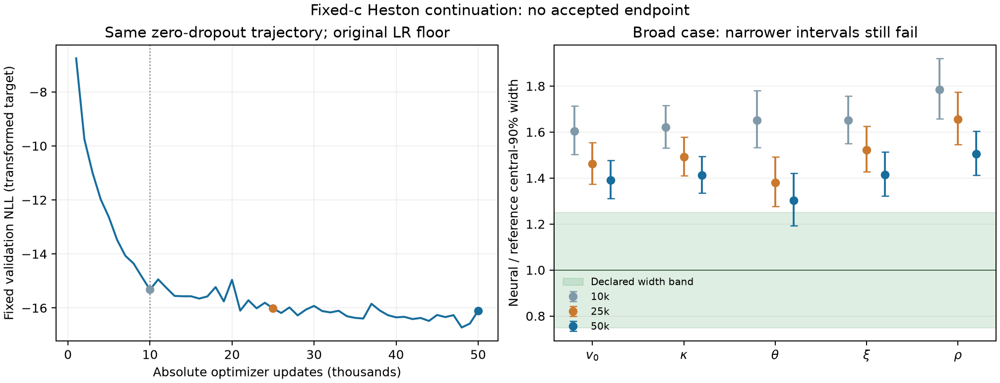

# Zero-dropout Heston continuation to 50k

**Completed bounded development experiment; no accepted endpoint.** The 10k zero-dropout model continued to the predeclared 25k/50k checkpoints with unchanged likelihood, prior, design, spreads, 20k-row bank prefix, architecture and absolute row/noise streams. Adam moments, standardization, metrics and saved RNG arrays were restored under exact array hashes. The original 10k cosine horizon remained at its approximately 5e-5 floor.

The continuation committed 40,000 updates in 298.84 worker seconds, within its 900-second cap. It added 5,095,520 row presentations, for 6,369,472 in total. Both new checkpoints preserve exact seeded inference reload. Full payloads remain outside Git; [resume proof](resume-protocol.json), [run identity](run.json) and [payload hashes](checkpoint-payloads.json) bind the compact evidence.

The broad-case table reports signed mean error in reference SD, followed by the neural/reference central-90% width ratio. Existing MC-aware margins remain .3 reference SD and widths [.75,1.25]; the source comparisons include Monte Carlo uncertainty. Narrower intervals do not ensure better centering.

| Parameter | 10k mean / width | 25k mean / width | 50k mean / width |
| --- | ---: | ---: | ---: |
| initial_variance | +1.83 / 1.60 | +1.34 / 1.46 | +0.14 / 1.39 |
| kappa | +0.11 / 1.62 | +0.74 / 1.49 | +0.03 / 1.41 |
| theta | -0.58 / 1.65 | -0.56 / 1.38 | -1.42 / 1.30 |
| vol_of_vol | -0.10 / 1.65 | +0.90 / 1.52 | +1.60 / 1.41 |
| rho | -1.54 / 1.78 | +0.57 / 1.66 | -0.64 / 1.50 |

Additional optimization narrows broad widths modestly, but every endpoint still fails its conditional comparison. Some mean errors improve and others worsen. The completed market-like and actual-market comparisons also fail at 25k and 50k; the market query's inferential error remains distinct from Heston/observation-model adequacy.

Development coverage uses parameter order v0, kappa, theta, xi, rho on the same 512 held-out development rows and 512 posterior draws per row. These repeated checks are not fresh final acceptance evidence. All rank/coverage uncertainty remains in [comparison.json](comparison.json).

| Update | Fixed validation NLL | 90% coverage by parameter | Rank checks passing |
| --- | ---: | --- | ---: |
| 10k | -15.3250 | 0.918, 0.928, 0.955, 0.912, 0.918 | 3/5 |
| 25k | -16.0169 | 0.916, 0.932, 0.932, 0.904, 0.932 | 4/5 |
| 50k | -16.1048 | 0.928, 0.916, 0.879, 0.891, 0.914 | 1/5 |

The boundary reference failed its 2700-second wall/CPU allocation after an unconverged first attempt and a bounded escalation. Its neural comparisons remain inconclusive. This reference failure is retained, not replaced by a successful case or counted as passing. Three other reference cases are available.

Neither the slightly lower 50k loss nor the better 25k pooled rank count selects an accepted model. Further diagnostics or optimizer/data/capacity interventions require their own frozen comparison; these records authorize no additional fit, revised-grid labels, inferred-scale training or Bergomi production. The reserved test arrays remain unopened.

Reproduce this package with `lab/scripts/plot_heston_spread_continuation.py` and the source paths/hashes in [manifest.json](manifest.json). The producer reads metadata and hashes payload files as bytes; it loads no model/state arrays, bank members or posterior draws. The 10k evaluation has the weaker historical path binding described in comparison.json; the new 25k/50k records explicitly bind checkpoint/source/model/state hashes.
