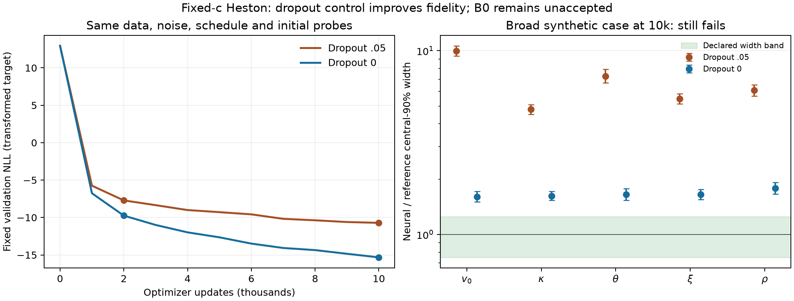

# Fixed-c Heston zero-dropout control

**Provisional development evidence: substantially improved, B0 still unaccepted.** The same fixed c=1 likelihood, physical prior, 54 contracts, 20k row prefix, Gaussian errors, row schedule, batch protocol and 10k optimizer schedule were retained. Only effective hidden-layer dropout changed from .05 to zero after replaying the original construction.

The control completed 10,000 finite updates in 80.70 worker seconds; the original took 163.04. These are observed worker clocks with concurrent work, not a dedicated performance benchmark. Both runs saw all 20,000 physical rows and 1,273,952 presentations, with identical row-order hashes and exact seeded checkpoint reloads. Reserved test arrays remain unopened.

The rate toggle leaves all initialized arrays unchanged and matches the original saved deterministic initial probes. The original full initial state was not persisted; the evidence does not claim a comparison against an unavailable initial archive. [Run bindings](run.json) and [payload hashes](checkpoint-payloads.json) preserve this limit.

The table uses the same broad synthetic reference at 10k; width intervals in the figure include the evaluator's Monte Carlo uncertainty. Width acceptance is [.75,1.25] and the MC-aware mean margin is .3 reference SD. All five broad widths remain above the band, and several means fail. Development coverage is closer to nominal but does not establish conditional accuracy.

| Parameter | .05 broad width | Zero broad width | Zero mean error (ref SD) | 90% coverage .05 → zero |
| --- | ---: | ---: | ---: | ---: |
| initial_variance | 9.98 | 1.60 | +1.83 | 0.998 → 0.918 |
| kappa | 4.80 | 1.62 | +0.11 | 0.996 → 0.928 |
| theta | 7.28 | 1.65 | -0.58 | 0.996 → 0.955 |
| vol_of_vol | 5.48 | 1.65 | -0.10 | 0.975 → 0.912 |
| rho | 6.08 | 1.78 | -1.54 | 0.971 → 0.918 |

The family-adjusted rank checks improve from 0/5 to 3/5 passing parameters; theta and rho still fail. These checks use the same 512 development cases, not the reserved acceptance population.

[The complete provisional comparison](comparison.json) retains market, market-like and boundary entries exactly as available in the source evaluations, including fail/inconclusive status. Some references were unavailable when the original baseline evaluation snapshot was made. A missing comparison is not a pass, and improvements on one case do not accept the whole task. Market-model adequacy remains a separate question.

The selected next experiment is one separately frozen, bounded optimization continuation of the zero-dropout checkpoint, preserving its task, data, architecture and original schedule floor. More data and capacity remain later isolated choices; no automatic grid, inferred-c or Bergomi production is justified by these results.

Reproduce with `lab/scripts/plot_heston_spread_development.py` using the source paths/hashes in [manifest.json](manifest.json). The producer loads no model or state arrays and opens no bank members. Full checkpoints remain outside Git; no tutorial asset is promoted.
