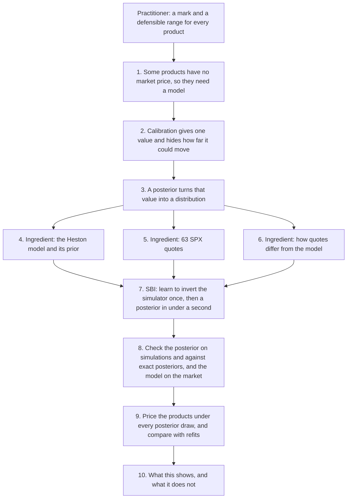
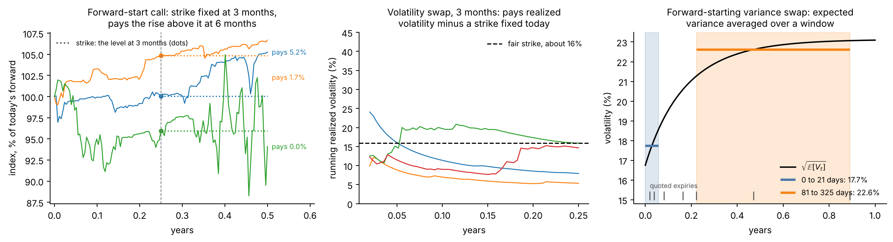
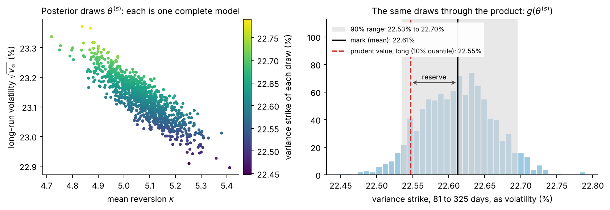
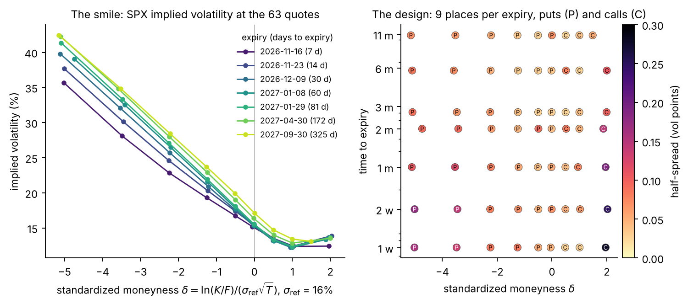
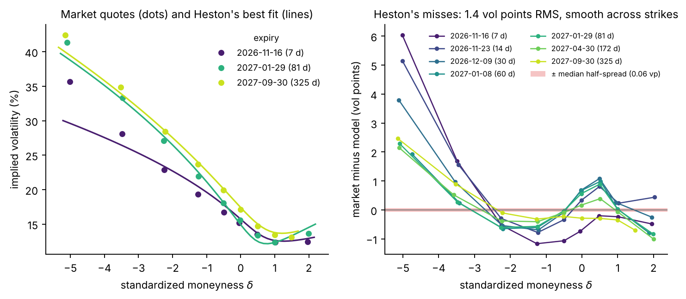
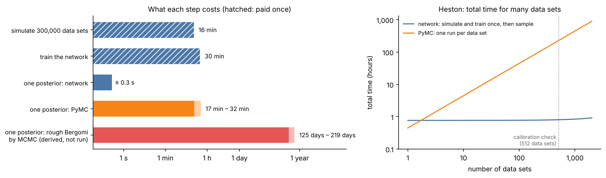
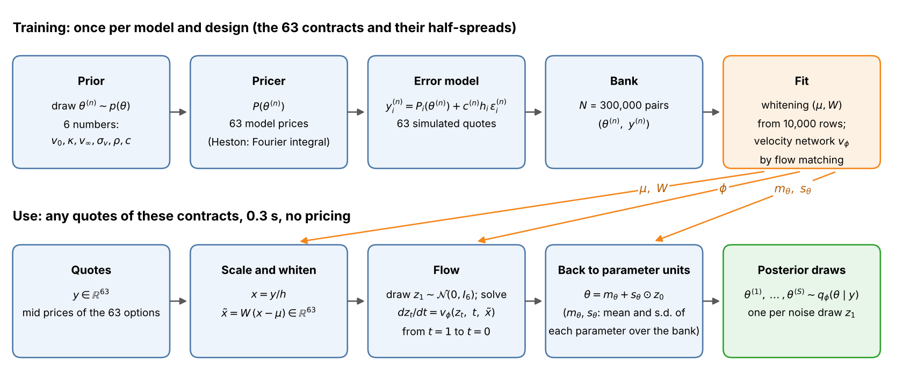
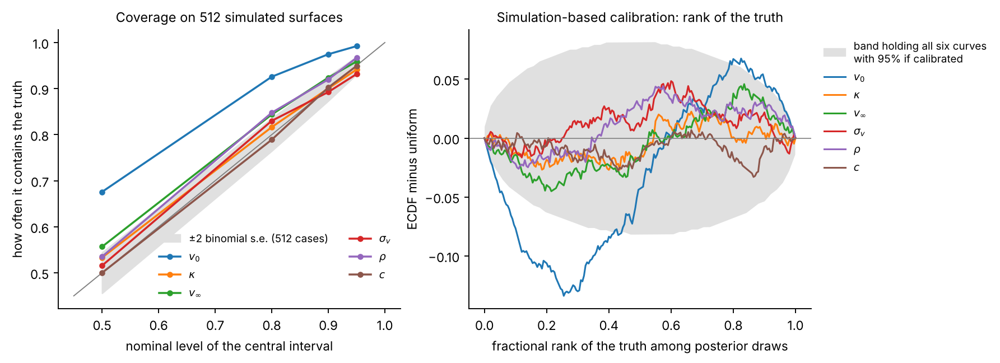
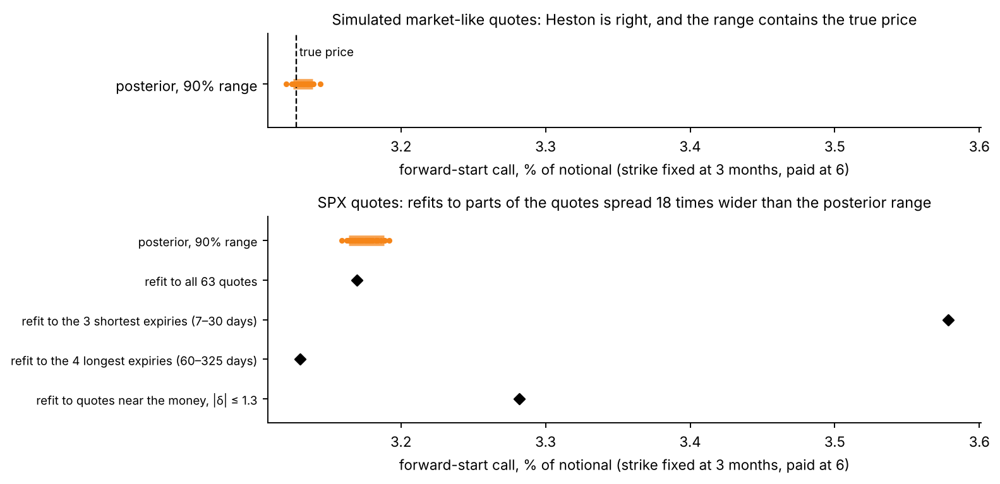

# Option application on SPX · Layer 1: overview

*Layer 1 of 3 · about 10 minutes · [Index](README.md) · [Layer 2](2-walkthrough.md) ·
[Layer 3](3-full-detail.md) · [Glossary](glossary.md) · Results as of 13 November 2026*

## Goals

1. Give a product that no market prices a value **and a range**, from a Bayesian
   posterior over the parameters of a model (step 3).
2. Show that simulation-based inference (SBI) makes this posterior fast enough for daily
   use, and cheap enough to test whether its 90% ranges contain the truth 90% of the time
   (steps 7 and 8).
3. Check the model as well as the posterior, and state what the range covers and what it
   does not (steps 6, 8 and 10).

## Audience

The tutorial's audience, ICAIF '26, mixes AI researchers who know Bayesian inference but
not derivatives with practitioners who know derivatives but not SBI. Each must be able to
follow the other's half, so no finance background is assumed: terms in **bold** are
explained where they first appear, and in the [glossary](glossary.md).

## The practitioner's point of view

Every evening a bank values each position it holds. This is **marking** the position,
for the day's profit and loss (**P&L**) and the balance sheet. An instrument traded on an
exchange is **marked to market**, at its price. One that is not traded has no price to
read, so it is **marked to model**: valued by a model fed with market prices.

Such values are uncertain, and EU rules (Regulation 2016/101) make banks quantify the
uncertainty. Besides the mark, a bank computes a **prudent value**: a price at which it is
90% confident it could **exit** the position (sell what it owns, or buy back what it
owes), or better. The gap between the two, an **additional valuation adjustment (AVA)**,
is deducted from the bank's core capital. Today the range comes from alternative
calibrations and models, from consensus prices pooled across banks, or from expert
judgment.

So the practitioner needs, for every product, a mark and a range that can be defended.

## The steps at a glance



## 1. What has a price, and what does not

The problem starts with a distinction: some instruments have a market price and some do
not.

**Listed options.** An option on the S&P 500 index pays at its **maturity** $`T`$ an
amount set by the index level $`S_T`$ and a **strike** $`K`$: a **call** pays
$`\max(S_T-K,\,0)`$ and a **put** pays $`\max(K-S_T,\,0)`$. Options on the index itself,
**SPX**, trade on the Cboe exchange in thousands of strikes and maturities, each with a
**bid** (the best offer to buy) and an **ask** (the best offer to sell). For quote $`i`$
we take the midpoint $`y_i`$ as the price, and half the gap, the **half-spread**
$`h_i`$, as its uncertainty.

Prices are compared as **implied volatilities**: the volatility $`\sigma`$ that makes the
Black–Scholes formula (the textbook model, with a constant volatility) reproduce the
price. Low strikes show a higher $`\sigma`$, because protection against a fall is in
demand. This curve across strikes and maturities is the **smile**; for an index it is
mostly a downward slope, the **skew**. Gaps are counted in **vol points**: 0.01 of
volatility.

**Products that are not listed.** Banks also sell products on the index privately (**over
the counter**), often inside notes sold to investors. Three examples:
- a **forward-starting variance swap**, which pays the index's realized variance over a
  future window $`[t_1, t_2]`$ minus a strike agreed today;
- a **forward-start call**, whose strike is set in 3 months at the index level of that
  day, and which pays at 6 months the percentage rise above it;
- a **volatility swap**, which pays the index's realized volatility over the next 3 months
  minus a strike agreed today.



**Figure 1.** Simulated paths of the index under Heston (step 4), at its fit to the SPX
quotes. Left: each forward-start call fixes its strike at the dot, at 3 months, and pays
the rise above it at 6 months. Centre: running realized volatility, path by path, against
one fixed strike; at these parameters the variance stays low most of the time and spikes
now and then, so most paths realize less than the strike and a few much more. Right: the
expected variance over time, averaged over a short and a later window.

These payoffs depend on the index's path or on its future variance. Listed options fix
the index's distribution at each listed maturity, but not how those distributions are
linked across dates. So these products must be marked to model.

## 2. Calibration gives one value and hides the rest

A product without a price needs a model, and a model needs its parameters $`\theta`$. The
model values a product with payoff $`\Pi`$ as the expected discounted payoff,

```math
G(\theta) = D\,\mathbb{E}_\theta[\Pi],
```

with $`D`$ the **discount factor** (today's value of 1 paid at the payment date) and the
expectation taken under the model's **pricing probabilities** (under which the index grows
on average at the interest rate less its dividend yield, so that no trade earns a
riskless profit). **Calibration** picks the parameters whose prices best match the listed
ones, classically by least squares on the implied volatilities $`\sigma^{\text{imp}}_i`$
of the quotes,

```math
\hat\theta = \arg\min_\theta \sum_i \big(\sigma^{\text{imp}}_i - \sigma^{\text{model}}_i(\theta)\big)^2 ,
```

and marks the product at $`G(\hat\theta)`$.

But listed options pin some combinations of parameters and leave others loose. Many
parameter sets fit almost equally well, yet value the products differently. One best fit
hides this.

## 3. The posterior turns one value into a distribution

To see how far the value can move, we replace the best fit by a distribution. Bayes' rule
gives the **posterior** of the parameters given the quotes $`y = (y_1, \dots, y_{63})`$,

```math
p(\theta \mid y) \;\propto\; p(y \mid \theta)\; p(\theta),
```

from a **prior** $`p(\theta)`$ (which parameters are plausible before seeing data) and a
**likelihood** $`p(y \mid \theta)`$ (how probable the quotes are under $`\theta`$).

The value of product $`j`$ is a function $`G_j(\theta)`$ of the parameters. Draws
$`\theta^{(1)}, \dots, \theta^{(S)}`$ from the posterior therefore give $`S`$ values
$`G_j^{(s)} = G_j(\theta^{(s)})`$, and from them:

```math
\underbrace{\bar G_j = \frac1S \sum_{s=1}^{S} G_j^{(s)}}_{\text{mark}},\qquad
\underbrace{\mathrm{PV}_j = 10\%\ \text{quantile of the}\ G_j^{(s)}}_{\text{prudent value of a product the bank owns}},\qquad
\underbrace{R_j = \bar G_j - \mathrm{PV}_j}_{\text{reserve}} .
```

For a product the bank owes, the prudent value is the 90% quantile.



**Figure 2.** The posterior of the Heston model on the SPX quotes, and what it implies for
one product. Left: 1,000 posterior draws; each dot is one complete set of parameters,
shown through two of them. Right: the value of the product (the strike of an 81-to-325-day
variance swap, step 9) under every draw: the mean is the mark, the 10% quantile the
prudent value of a long position, and the gap between them the reserve.

The posterior needs three ingredients: a model with its prior (step 4), the quotes
(step 5), and an error model linking the two (step 6). Together they describe how quotes
are generated: draw parameters, compute prices, add errors. That is a simulator, and
step 7 inverts it.

## 4. The model

The first ingredient is the model. **Heston** lets the variance $`V_t`$ of index returns
move randomly around a long-run level:

```math
\frac{dS_t}{S_t} = (r-q)\,dt + \sqrt{V_t}\,dW^F_t,\qquad dV_t = \kappa\,(v_\infty - V_t)\,dt + \sigma_v\sqrt{V_t}\,dW^V_t,\qquad \mathrm{corr}(dW^F_t, dW^V_t) = \rho ,
```

with $`r-q`$ the interest rate less the dividend yield and $`W^F`$, $`W^V`$ two Brownian
motions. Its parameters are today's variance $`v_0`$, the long-run variance
$`v_\infty`$, the speed of **mean reversion** $`\kappa`$, the **vol of vol**
$`\sigma_v`$, and the correlation $`\rho`$ (negative: volatility rises when the index
falls). The variance drifts from $`v_0`$, which sets short expiries, towards
$`v_\infty`$, which sets long ones; $`\rho`$ tilts the smile into a skew and $`\sigma_v`$
curves it. As the expiry shrinks, the skew at the money grows only up to a ceiling,
$`|\rho|\,\sigma_v/(4\sqrt{v_0})`$. A Fourier integral gives each option price in
milliseconds, so the posterior can also be computed directly, in about half an hour, and
serves as the reference.

The prior is uniform on wide ranges of each parameter. From here on, $`\theta`$ denotes
everything inferred: the model's parameters and the error multiplier $`c`$ of step 6,
$`\theta = (v_0, \kappa, v_\infty, \sigma_v, \rho, c)`$. A second model, **rough
Bergomi**, has a skew that keeps steepening at short expiries; it follows the same steps
once its simulations are complete (step 10).

## 5. Which quotes

The second ingredient is the data: $`n = 63`$ actual quotes of SPX options from the Cboe
chain of 9 November 2026, read at 15:13 New York time. They sit on seven expiries, from 7
days to about 11 months, with nine strikes per expiry.

The strikes are placed by their **standardized moneyness**,

```math
\delta = \frac{\ln(K/F)}{\sigma_{\text{ref}}\sqrt{T}},\qquad \sigma_{\text{ref}} = 0.16 ,
```

the distance of the strike $`K`$ from the **forward** $`F`$ (the price agreed today for
the index at $`T`$), in units of the standard deviation the log index would have at
expiry under a 16% volatility. The targets are $`\delta`$ = −5, −3.5, −2.25, −1.25, −0.5
and 0 for puts, and +0.5, +1 and +2 for calls; at each expiry the listed quote nearest to
each target is used.



**Figure 3.** Left: the smile, implied volatility against $`\delta`$ for each expiry; deep
puts cost up to 42% in volatility terms, calls about 13%. Right: the design, nine quotes
per expiry; the colour is the half-spread, mostly well under 0.1 vol points.

On this scale the seven smiles are nearly parallel: the skew per unit of $`\delta`$ is
about the same at one week as at eleven months. That is the feature the model must
reproduce.

The design is heavy in **out-of-the-money** puts (strikes below the forward), because
each region of the smile pins something different:
- deep puts: how much volatility fluctuates and how fast it reverts;
- calls: the correlation between index and volatility;
- short maturities: today's variance; long ones: the long-run level.

A region left out leaves its quantities loose, and with them the products that depend on
them: without the expiries beyond 2 months, the long-run variance $`v_\infty`$ becomes 16
times less certain.

## 6. How quotes differ from the model

The third ingredient links the first two. Quote $`i`$ is modelled as the model's price
$`P_i(\theta)`$ plus an error whose size is the quote's half-spread $`h_i`$ times a
common multiplier $`c`$:

```math
y_i = P_i(\theta) + c\,h_i\,\epsilon_i,\qquad \epsilon_i \sim \mathcal N(0, 1)\ \text{independent}.
```

The half-spread $`h_i`$ is data: the price lies somewhere between bid and ask, so it is
the natural scale of a quote's uncertainty. The multiplier $`c`$ is inferred with the
model's parameters, between 0.5 and 2: the data say how large the errors are. This
equation is the likelihood $`p(y \mid \theta)`$ of step 3. It has no term for the model's
own error: at the right parameters, the model is assumed to price every quote exactly.

On the SPX quotes, $`c`$ goes straight to its upper limit of 2. Figure 4 shows why.
Measure the model's miss on each quote in half-spreads,
$`r_i(\theta) = (y_i - P_i(\theta))/h_i`$. If the model were right, the $`r_i`$ would
have a typical size of $`c`$, at most 2. At its best parameters, Heston gives a root mean
square of 13.4: about 1.4 vol points, where the half-spreads are about 0.06. The misses
are **systematic**: neighbouring quotes are missed by similar amounts, and the deepest put
is priced too low at every expiry, by 1.9 to 6.0 vol points, most at 7 days. There
Heston's skew has reached its ceiling (step 4), while the market's keeps steepening.



**Figure 4.** Left: market quotes (dots) and Heston's best fit (lines) for three expiries;
at 7 days Heston cannot produce the steep skew of deep puts. Right: market minus model,
for all expiries; the red band, ± one median half-spread, is barely visible.

So on the market the model, not the quotes, is the main source of error. The posterior
is then a statement about the parameters of Heston, given that Heston is the model; it
does not include the model's own error. Steps 9 and 10 return to this.

## 7. Computing the posterior: simulation-based inference

With the three ingredients the posterior $`p(\theta \mid y)`$ is defined; computing it is
the next problem.

**What it costs directly.** Evaluating the likelihood at one $`\theta`$ needs the model's
63 prices $`P(\theta)`$: one **pricing**. A pricing takes milliseconds for Heston and 1
to 2 CPU-minutes for rough Bergomi. The standard method, MCMC, draws from the posterior by
trying values of $`\theta`$ one after another. For Heston it used about 180,000 pricings
per posterior: 17 to 32 minutes on one processor core. At rough Bergomi's cost per
pricing, the same run would take four to seven months.

**How many posteriors are needed.** One, for the market quotes of the day. But checking
that a 90% range contains the truth 90% of the time needs cases where the truth is known:
hundreds of simulated sets of quotes, each with its own posterior (512 in step 8). That
check is what the direct route cannot afford.



**Figure 5.** Left: what each step costs for Heston, and one rough Bergomi posterior by
MCMC (derived, not run). Right: the total time for many sets of quotes. Simulating and
training are paid once, about 46 minutes; MCMC is paid again for every set.

**The idea: do the pricings once.** Draw parameters $`\theta^{(n)}`$ from the prior,
compute their 63 prices and add errors as in step 6, to get simulated quotes
$`y^{(n)}`$; repeat $`N`$ = 300,000 times. That costs fewer pricings than two MCMC
posteriors: 16 minutes for Heston. A pair made this way is also a draw of quotes followed
by a draw from their posterior, because the joint density factors both ways:

```math
p(\theta)\,p(y \mid \theta) = p(y)\,p(\theta \mid y) .
```

So the pairs are examples of "quotes, and a draw from their posterior", and a neural
network can learn from them to return the posterior of any quotes.

A network could instead learn the prices and replace the pricer inside MCMC, which would
still run for every set of quotes. Learning the posterior itself removes MCMC altogether.

**What the network takes in and returns.** Input: the 63 quotes, each divided by its
half-spread, $`x_i = y_i/h_i`$, then whitened (below). Output: draws
$`\theta^{(1)}, \dots, \theta^{(S)}`$ from an approximation $`q_\phi(\theta \mid y)`$ of
the posterior, where $`\phi`$ denotes the network's weights. To make one draw, the network
starts from a random vector $`z_1`$ of six standard normals and moves it, step by step,
along a learned velocity $`v_\phi(z_t, t, \tilde x)`$ until it becomes a parameter vector
(**flow matching**). Training takes 30 minutes. After it, a posterior takes under 0.3 s
and no pricing. The cost of inference is paid once: it is **amortized**.



**Figure 6.** Top: training, done once per model and set of contracts. Bottom: use.

**Whitening.** All 63 quotes move together with the parameters, by hundreds to thousands
of half-spreads, while the errors move each quote by $`c`$ half-spreads. The size of the
errors, and so $`c`$, shows only in small differences between quotes. Whitening is a
fixed linear change of coordinates, $`\tilde x = W(x - \mu)`$, fitted on simulated quotes,
that gives every direction of the input the same size. It loses no information. Without
it the network returns the prior of $`c`$ whatever the data; with it, it recovers $`c`$.

## 8. Checking it

The network's posterior is an approximation, and the model is an assumption. Five
checks, each with its answer:
- **Can the posterior regenerate the quotes?** Draw parameters from the posterior, price
  and add fresh errors. On simulated quotes the observed set looks like one more such
  replicated set. On the SPX quotes it does not: the prices miss it by 13.4 half-spreads,
  root mean square, where the error model allows at most 2.
- **Is it right on average?** On 512 simulated sets of quotes with known parameters, the
  90% intervals of five of the six components contain the truth 89–92% of the time.
  Those for today's variance $`v_0`$ are too wide (97.5%).
- **Does it find the truth?** On the same sets, the posterior medians of the five Heston
  parameters follow the true values almost exactly (correlation at least 0.996), and that
  of $`c`$, read from the errors alone, less sharply (0.95).
- **Is it right for one given set of quotes?** Against the exact posterior, computed by
  MCMC with PyMC, the network is centred within one standard deviation on two simulated
  sets, with intervals 1.1 to 2.9 times wider: cautious, not overconfident. On the market
  quotes it disagrees, because they lie 13.4 half-spreads from any Heston surface, unlike
  anything it learned from. Market results therefore use the exact posterior.
- **Does the model describe the market?** No: step 6 showed the misfit.



**Figure 7.** Heston network on 512 simulated sets of quotes. Left: how often central
intervals contain the truth, against their nominal level. Right: rank of the truth among
posterior draws; a calibrated posterior keeps all six curves inside the grey band.

## 9. From the posterior to the products

With a checked posterior, each product is valued under every draw:
$`G_j^{(s)} = G_j(\theta^{(s)})`$.

The strike of a **forward-starting variance swap** on $`[t_1, t_2]`$ has a closed form
under Heston: it is the expected variance averaged over the window,

```math
K_{\text{var}}(t_1, t_2) = v_\infty + (v_0 - v_\infty)\,e^{-\kappa t_1}\,\frac{1 - e^{-\kappa (t_2 - t_1)}}{\kappa\,(t_2 - t_1)} .
```

Under the exact SPX posterior, quoted as a volatility $`\sqrt{K_{\text{var}}}`$: 17.73%
for the window from today to 21 days (90% range 17.69% to 17.78%) and 22.61% from 81 to
325 days (22.53% to 22.70%, Figure 2).

The **forward-start call** and the **volatility swap** depend on the path, so each draw
values them by simulation, with the same random numbers for every draw so that the spread
reflects the parameters, not simulation noise.
- *Where the model is right,* on the simulated market-like quotes, the 90% range of the
  forward-start call, 3.125% to 3.139% of the notional, contains its true price, 3.127%.
- *On the SPX quotes* its range is 3.164% to 3.188%. Heston refitted by least squares to
  parts of the quotes (the three shortest expiries, the four longest, or the quotes near
  the money) prices it anywhere from 3.13% to 3.58%: a spread 18 times the posterior
  range (21 times for the volatility swap). The posterior range measures uncertainty
  within the model; on SPX the model is wrong, and the choice of quotes moves the price
  far more.



**Figure 8.** The forward-start call under 40 posterior draws (dots; the bar is the 90%
range) and under Heston refitted to parts of the SPX quotes (diamonds). Top: simulated
quotes, where Heston is right. Bottom: the SPX quotes.

## 10. What the results show, and what they do not

They show, for Heston on SPX:
- a network, trained once, that returns a posterior in under 0.3 s where the exact method
  takes 17 to 32 minutes; calibrated for five of six components, and close to the exact
  posterior on simulated quotes, but wider;
- what each region of quotes pins, and so which products the quotes leave open;
- that Heston misses the SPX quotes by 13.4 half-spreads, root mean square, most in the
  deep put wing and at short expiries, where its skew stops at a ceiling while the
  market's keeps steepening;
- that model error dominates: refits of the same model spread about 20 times wider than
  the posterior range.

They do not:
- cover the model's own error. The ranges are uncertainty about one model's parameters.
  A smooth model-error term in the likelihood would let the posterior admit the misfit;
  removing the misfit needs a different model;
- check the products against a true value on real data, which is never observed;
- show hedging under parameter uncertainty;
- establish that a posterior is an accepted basis for a prudent value. That is our
  proposal, not current practice.

**Next.** Rough Bergomi follows the same steps: its 300,000 simulated sets of quotes are
being generated on a computing cluster, and its network and checks come after. Then the
model-error term, and further products: a **down-and-in put**, a put that exists only if
the index falls to a barrier, which buyers of **autocallable** notes (a very common
structured product) in effect sell to the bank; and a **book** of products, valued draw by
draw so that its range shows how the products offset each other.

## Back to the goals, the audience and the practitioner

**Goals.** Steps 3 and 9 give every product a mark and a range from one posterior
(goal 1). Steps 7 and 8 make the posterior fast and tested (goal 2). Steps 6, 8 and 10
check the model and state the limits: on SPX, Heston's misfit, not the uncertainty of its
parameters, sets how far the price can move (goal 3).

**Audience.** In the tutorial, the Heston notebook runs steps 4 to 9 on the SPX quotes,
against an exact posterior, and then shows what Heston misses. Attendees should leave
able to say, for their own model, whether they need a range like this, what it costs, and
how to check both the posterior and the model.

**Practitioner.** A desk and its **product control** (the team, independent of the
traders, that verifies the marks) would get every day, from one consistent calculation, a
mark and a range for every product and for the book, with tested coverage, and a measure
of how well the model fits that day's quotes. They would still choose the models, handle
the model risk beyond one model's parameters, and need their regulator to accept a
posterior as the basis of a prudent value.
